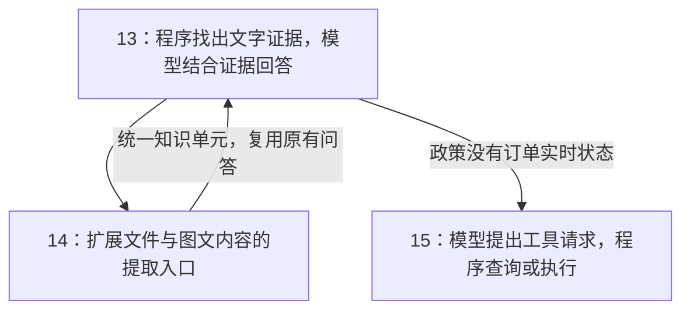

# 大模型应用开发学习：文章路线与学习点映射

> 这份目录是“大模型应用开发学习”系列的对外写作路线。
> 当前按用户确认的范围整理为32篇主线：01—32均已有正文，23—32的机制与综合应用配套实现位于`examples/23-32-assistant`。参考网站五部分知识点归入相关主题，最后用一个应用落地；工具说明按需配套。
> 应用系列与“大模型基础原理”系列平级，各自编号。

## 系列定位

本系列不尝试完整讲授神经网络、训练过程和 Transformer 数学推导，而是沿着一条应用开发路线展开：

```text
认识并调用模型
    ↓
管理 Prompt、Token 和输出
    ↓
通过检索为模型补充外部知识
    ↓
通过工具调用让模型执行动作
    ↓
通过框架、状态和安全机制组织完整应用
```

文章仍然会解释必要原理，但判断标准是：这些原理是否能帮助读者理解应用行为、排查问题和做出工程选择。

## 与“大模型基础原理”系列的边界

现有几篇文章同时具有原理色彩，但暂时保留在应用开发系列中：

| 现有文章 | 处理决定 | 在应用系列中的边界 |
| --- | --- | --- |
| 01 大模型是什么 | 保留 | 建立应用开发全景，说明模型、API、知识库和工具调用的位置 |
| 03 大模型如何生成回答 | 保留 | 建立“逐 Token 生成”和幻觉风险的工程直觉，不深入 Transformer 推导 |
| 05 Token | 保留 | 重点讨论上下文窗口、成本、截断和会话管理 |
| 06 Embedding | 保留 | 重点讨论语义检索和知识库应用，原理只讲到足以理解检索行为 |

基础原理系列以后会从不同角度重新展开这些概念：

- Token：分词、词表、Token ID 与模型输入表示
- Embedding：嵌入矩阵、上下文化表示和表示学习
- 文本生成：Transformer、Attention、Logits、Softmax 与解码
- 模型能力：训练目标、损失函数、梯度下降、预训练、微调与对齐

这不是重复写作，而是“应用视角”和“模型内部视角”的分层。

## 第一阶段：模型认知与调用基础

这一阶段回答：模型是什么，以及程序怎样稳定地调用它。

| 篇号 | 文件 | 标题 | 核心问题 |
| --- | --- | --- | --- |
| 01 | `01-我先把大模型是什么这件事想明白.md` | 先把“大模型是什么”这件事想明白 | 大模型在应用系统中扮演什么角色 |
| 02 | `02-Prompt不是提问而是任务设计.md` | Prompt 不是提问，而是任务设计 | 怎样把自然语言需求变成明确任务 |
| 03 | `03-大模型是怎么生成回答的.md` | 大模型是怎么生成回答的 | 逐 Token 生成为什么带来灵活性和幻觉 |
| 04 | `04-用API把大模型接入程序.md` | 用 API 把大模型接入程序 | 怎样从聊天产品进入程序调用 |
| 05 | `05-Token上下文记忆和成本的基本单位.md` | Token：上下文、记忆和成本的基本单位 | 怎样管理长度、成本和多轮上下文 |

这一阶段完成后，读者应该能够理解一次模型调用的基本链路，并知道模型输出为什么需要约束和验证。

## 第二阶段：语义检索与 RAG

这一阶段回答：当模型不知道私有资料，或者上下文放不下全部文档时，怎样先找到证据再生成回答。

| 篇号 | 文件 | 标题 | 核心问题 |
| --- | --- | --- | --- |
| 06 | `06-Embedding文本如何变成向量.md` | Embedding：文本如何变成向量 | 怎样把语义变成可以比较的表示 |
| 07 | `07-余弦相似度如何判断两段文本像不像.md` | 余弦相似度：如何判断两段文本像不像 | 怎样计算向量之间的方向相似性 |
| 08 | `08-文本切分长文档为什么不能直接用于检索.md` | 文本切分：长文档为什么不能直接用于检索 | 怎样把文档拆成适合召回和生成的证据单元 |
| 09 | `09-向量数据库如何保存和检索语义.md` | 向量数据库如何保存和检索语义 | 怎样存储并快速查询大量向量 |
| 10 | `10-混合检索BM25TFIDF和向量检索怎么配合.md` | 混合检索：BM25、TF-IDF 和向量检索怎么配合 | 怎样同时利用精确关键词和语义关系 |
| 11 | `11-检索质量优化从召回到融合再到重排.md` | 检索质量优化：从召回到融合再到重排 | 怎样把候选证据变成更可靠的上下文 |
| 12 | `12-RAG入门让模型基于自己的资料回答.md` | RAG 入门：让模型基于自己的资料回答 | “先检索、再生成”的完整架构是什么 |
| 13 | `13-RAG实战从文档到问答系统.md` | RAG 实战：从文档到问答系统 | 怎样把各个环节组织成最小可运行系统 |
| 14 | `14-文档解析工具链网页PDFWordPPTExcel怎么进知识库.md` | 文档解析工具链：网页、PDF、Word、PPT、Excel 怎么进知识库 | 不同格式的资料怎样进入统一处理链路 |

### 13—15篇的能力铺垫、案例递进与接口交接

保留11、12篇的原有内容，不新增编号章节。13篇先将已有模型认识接到具体系统：用给资料前后的对照说明生成模型能做什么，再区分嵌入模型、生成模型与普通程序；14、15篇各自从现有能力的缺口引入扩展。

| 篇号 | 先回答的能力问题 | 实践任务与交接 |
| --- | --- | --- |
| 13 | 模型能阅读给定政策，为什么还需要程序找资料；向量与答案分别由谁生成 | 用`refund-policy.md`跑通文本问答，留下`DocumentUnit(text, metadata)`接口 |
| 14 | 原生文字、扫描文字、图表关系分别需要解析器、OCR或哪类模型；程序实际向模型传了什么 | 先选提取方式并核对，再输出统一知识单元，复用13篇的入库、检索与问答 |
| 15 | 政策问答为什么不能提供订单实时状态；模型怎样提出请求、程序怎样实际执行 | 用A1001完成查询，用A3003扩展草稿、确认和提交；保留模型能力、接口支持与应用执行的分层 |

13篇不重复推导Top K等已学原理，不以PDF解析作为实战前提。14篇扩展13篇的资料入口；15篇扩展应用取得实时事实和执行业务操作的方式，不要求把14篇的全部解析实验当作15篇前置步骤。



14篇区分多格式容器、图文内容转文本和直接多模态检索，不把OCR、图示理解或多模态向量检索写成基础程序已经实现的能力。各篇都先说明问题、所需能力、提供者、输入输出，再进入对应代码与验证。

## 第三阶段：工具调用与 Agent

这一阶段回答：怎样让模型不只生成文字，还能连接工具、读取资源和推动任务执行。

| 篇号 | 文件 | 标题 | 核心问题 |
| --- | --- | --- | --- |
| 15 | `15-FunctionCalling和ToolCall让模型从回答走向行动.md` | Function Calling 和 ToolCall：让模型从回答走向行动 | 模型如何表达调用工具的意图 |
| 16 | `16-MCP入门模型如何连接工具和资源.md` | MCP 入门：模型如何连接工具和资源 | 怎样用统一协议暴露工具、资源和提示模板 |
| 17 | `17-Agent入门让模型自己规划并使用工具.md` | Agent 入门：让模型自己规划并使用工具 | 每轮怎样决定、执行并回填反馈，怎样暂停恢复与停止；先观察A1001最小循环，再设计A3003多步任务 |
| 18 | `18-安全护栏与中间件不要让Agent乱跑.md` | 安全护栏与中间件：不要让 Agent 乱跑 | 怎样限制权限、检查输入输出并保留人工确认 |

## 第四阶段：应用编排与状态管理

这一阶段回答：怎样把单次模型调用、工具、输出结构和会话状态组织成可维护的程序。

| 篇号 | 文件 | 标题 | 核心问题 |
| --- | --- | --- | --- |
| 19 | `19-LangChain入门它到底帮我们封装了什么.md` | LangChain 入门：它到底帮我们封装了什么 | 只沿一次退款查询，解释框架定位、普通Python与LangChain的职责差异，以及模型连接、函数说明、结果回传怎样共同支持可复用的执行循环；用新增物流查询的代码对照具体修改位置 |
| 20 | `20-用LangChain组织一次政策解释.md` | 用LangChain组织一次政策解释 | 只沿一份已取得的会员政策与同一个期限问题，讲清模板、模型、文本解析的输入输出，再比较逐步函数与Runnable/LCEL组合；正文不展开检索接入、问题拆分、并行、分支及其他运行方式 |
| 21 | `21-结构化输出让模型结果变成程序能用的数据.md` | 结构化输出：让模型结果变成程序能用的数据 | 沿同一条售后描述，讲清JSON与字段约定、Pydantic及未知值、模型层结构化调用、有限失败处理和字段使用；来源核对说明格式与事实的边界，Agent最终接口和可选输出方式留独立扩展，结尾回到工单草稿的交付 |
| 22 | `22-助手怎样接着上一次对话继续处理.md` | 助手怎样接着上一次对话继续处理 | 从售后追问对照手工历史与检查点，区分状态、模型上下文、存储寿命与跨会话偏好，再验证持久恢复与摘要 |

结构化输出在概念上也属于模型调用基础，这里保留第21篇编号，接着组件组合讨论稳定的数据交接，不为目录美观大规模重排现有文章。

## 参考范围与组织方式

知识点范围以仁胜科技参考网站的五部分为准：AI大模型入门、AgentHarness、RAG、LangChain、LangGraph。相同问题跨分组出现时合并解释，不按网站每个小节、接口或工具一对一增加文章。

| 参考分组 | 主要承接位置 | 组织方式 |
| --- | --- | --- |
| AI大模型入门 | 01—11、14—16及工具说明 | 模型调用、检索基础、协议与相关库，按应用问题组织 |
| AgentHarness | 15—18、22、27—31 | 已有循环、工具与权限作基础，再补按需输入、长任务运行、后台调度与协作 |
| RAG | 12—14 | 原理、最小问答、多格式资料，最终接回同一应用 |
| LangChain | 19—22、27、30 | 框架分工、组件组合、字段、会话，以及按需加载和分工 |
| LangGraph | 23—26 | 从任务流程解释图与状态、分支循环与并行、恢复和流式观察 |
| 应用落地 | 32 | 将已学模块接成一个助手，提供运行和检查案例 |

## 第五阶段：用LangGraph组织任务流程

| 篇号 | 文件 | 标题 | 核心问题 |
| --- | --- | --- | --- |
| 23 | `23-LangGraph怎样记录并推进退货任务.md` | LangGraph怎样记录并推进退货任务 | 订单事实、规则核对与草稿结果怎样逐步形成可核验的任务进度？ |
| 24 | `24-任务怎样选择路径循环重试和并行处理.md` | 任务怎样选择路径循环重试和并行处理 | 流程遇到不同条件时，怎样选择下一步；多个独立任务又怎样分发和汇总？ |
| 25 | `25-任务怎样等待确认并在重启后继续.md` | 任务怎样等待确认并在重启后继续 | 用户过一段时间才确认，甚至程序重启，怎样继续正确任务而不重复提交？ |
| 26 | `26-怎样看见任务的执行进度和流式结果.md` | 怎样看见任务的执行进度和流式结果 | 任务执行到哪里、模型在回复什么、何时等待确认，怎样准确展示？ |

23用退货任务观察状态更新与完成依据；24在同一流程中观察路径、循环与并行；25处理等待恢复；26观察执行过程。与网站LangGraph十个小节逐项对照，但不扩成完整图计算教程。

## 第六阶段：把Agent运行中的相关机制串起来

| 篇号 | 文件 | 标题 | 核心问题 |
| --- | --- | --- | --- |
| 27 | `27-助手怎样按需加载知识和操作说明.md` | 助手怎样按需加载知识和操作说明 | 任务需要不同规范时，怎样提供本轮真正有用的信息，而不把全部内容塞进提示？ |
| 28 | `28-长任务怎样保持计划记忆并处理运行错误.md` | 长任务怎样保持计划记忆并处理运行错误 | 做了很多轮以后，怎样保持目标、控制输入长度，并从可恢复错误中继续？ |
| 29 | `29-耗时任务怎样放到后台并按计划继续.md` | 耗时任务怎样放到后台并按计划继续 | 工具执行很慢，或者需要稍后触发时，程序怎样继续响应并取回对应结果？ |
| 30 | `30-多个助手怎样分工交接并返回结果.md` | 多个助手怎样分工交接并返回结果 | 一个助手已经能调用多个工具，什么时候值得拆分，怎样交接上下文和结果？ |
| 31 | `31-助手团队怎样通信认领任务并正确收尾.md` | 助手团队怎样通信认领任务并正确收尾 | 多个助手独立工作时，怎样通信、避免重复认领，并在取得结果后结束？ |

每篇的相关机制服务一个连续案例：27处理本轮需要哪些知识和说明，28处理长任务怎样保持目标与信息，29处理工作稍后执行，30处理职责分工，31处理团队任务从派发到收尾。内部可以用少量子实验说明差别，不要求把所有机制一起加入最终应用。

## 第七阶段：一个综合应用收尾

| 篇号 | 文件 | 标题 | 核心问题 |
| --- | --- | --- | --- |
| 32 | `32-把学过的能力接成一个售后助手.md` | 把学过的能力接成一个售后助手 | 用学过的知识完成同一个能运行、能解释和能检查的售后助手 |

应用至少贯通政策问答、实时状态查询、补充信息、申请草稿和人工确认；重启恢复、必要日志及正常/失败检查跟随具体任务演示。后台、定时和多助手通过局部案例学清楚，只有产品需求确实需要才接进综合应用，不强行把每个组件串成一条超大流程。

## 相近主题的分工检查

目录能形成闭环，不等于已保证正文毫无重复。新增主题写作前必须指出已知内容、新问题、新代码观察与最终交付。相近概念可以复用，但不能把相同例子换库再从头讲一遍。

| 容易重复的位置 | 已有解释 | 后者必须新增的观察 |
| --- | --- | --- |
| 15、17、19 | 明确请求怎样成为执行 | 17看反馈怎样推进下一轮，19看同一循环哪些工作交给框架 |
| 20与23 | 一次政策解释中组件的输入输出交接 | 退货业务共享状态、每步更新以及真实草稿结果 |
| 20与24 | 输入字段映射、空问题分支和组件并行 | 业务结果决定路径、有界循环、多任务结果汇总 |
| 22与25 | 保存对话并找回历史 | 恢复业务执行位置、检查重复执行与幂等 |
| 20与26 | 模型文字的增量交接 | 任务进度来源、暂停、失败和界面事件 |
| 02、20、22与27 | 提示、模板和偏好注入 | 目录与全文按需加载，以及本轮允许的知识和工具范围 |
| 18、22与28 | 单次限制、会话保存与摘要基础 | 持续任务中计划、输出预算、信息找回与恢复的联动 |
| 24与29 | 一次执行内的并行与汇总 | 跨时间的派发、结果回收、定时触发和取消 |
| 30与31 | 一次子任务的委派、交接与返回 | 异步通信、看板认领、迟到结果与团队收尾 |
| 13与32 | 一个独立知识问答程序 | 复用已有模块完成跨问答、查询、会话与人工确认的端到端任务 |

这些分工继续用于正文复核；当前23—32已完成首次正文与离线实验核对，真实模型与可选外部服务仍按各文说明验证。若新稿拿不出新增观察，应合并回已有主题，不能只靠更换标题或框架名称成立。

## 工具说明

- `supplements/工具笔记-worktree多工作区.md`：worktree：工作目录与产物隔离，已有正文，按案例需要查阅。
- `supplements/工具笔记-rich命令行输出.md`：rich：命令行输出，已有正文，按案例需要查阅。
- `supplements/工具笔记-ContextVar请求上下文.md`：ContextVar：请求上下文，已有正文，按案例需要查阅。
- `supplements/工具笔记-PostgreSQL持久化存储.md`：PostgreSQL：应用持久化，已有正文，按案例需要查阅。

它们承接网站中的工具知识，不占新的主线阶段。已有解析库与检索库继续放在对应正文和运行说明，不再各开一篇。

## 结束标准与范围控制

结束标准是：参考网站五部分的知识点均有解释位置，能够结合代码或小实验理解，再通过一个完整应用看到这些知识怎样配合。完整是知识点与应用的闭环，不是每个API穷尽、也不是每个机制各占一篇。

保留讲解深度：先有问题与直觉，再解释机制、代码、输入和输出。相关点在同一任务里展开，不能合并成术语清单或用几句结论代替解释。

不另起云部署、高可用、CI/CD、监控平台、队列平台或数据库运维课程。案例需要的依赖、密钥配置、存储连接、最小界面或接口和启动方式写进配套说明；效果核对与排错用于解释案例，不独立扩成新的系列阶段。

写作以当前32篇为基线，先在既定主题内整合。网站更新先看是否补充原主题，不自动新增文章；只有出现无法由现有问题承接的独立主题，才重新评估范围。维护时不得在01—22中突然倒入后续整套机制。

## 现有内容的维护重点

- 01—07整理过碎导航和重复总览，保留原理与例子；06明确找资料目标，09形成最小检索，10—11解释改进，12—13完成问答。
- 15、17、19分别处理请求执行、反馈循环和框架分工；16解决跨程序连接；18解释权限与调用前后检查。
- 22保持会话与信息保存的基础入口；长任务信息取舍与恢复的扩展放28，不抢占已写正文主线。
- 84个网站目录入口及汇总正文的额外主题对照见`00-参考网站覆盖核对.md`。记录承接位置与正文状态，不因提到关键词就标为全部完成。
- 标题、正文和文件名同步；使用学习者分享语气，不以“本章”“下章”安排读者，收尾自然总结。

## 2026-10-27：12—21篇交接修复

- 12补充单输入框、固定RAG入口与多能力选择的区别；统一申请期限与实际批准的表述。
- 13明确交付question/context/evidence，15保留已有检索能力并解释工具选择与具体检索的区别。
- 17以政策、订单、混合问题给出同一聊天入口的接入设计，明确与已运行查询轨迹的边界。
- 19说明比较的是同一循环的维护职责；20不再省略手选资料与检索产物的关系，增加rag_bridge.py复用13的ask。
- 21明确结构字段是另一种输出处理，Ticket分类不自动决定知识搜索，也不证明订单事实。
