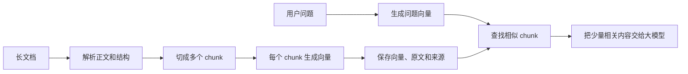
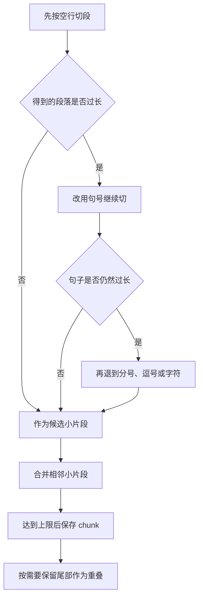

# 大模型应用开发学习 08：文本切分，长文档为什么不能直接用于检索

刚接触文本切分时，我以为它只是一个长度问题：文档太长，模型一次放不下，于是每隔几百个字切一段。

这个理解不算错，但只解释了“为什么要切”的一小部分。

假设公司有一本两百页的报销手册，用户只问了一句：

> 发票抬头写错了，应该怎么处理？

系统真正需要的不是让大模型从头阅读两百页，而是先找到其中讲“错误发票处理”的几段文字。可在开始检索之前，我们必须先决定：**多长的一段文字，才算一个可以被搜索、比较和引用的独立单位？**

这里先假设 PDF、Word 等原始文件已经解析成保留标题和段落顺序的文本。如果解析时漏掉了否定词，或把表格的条件与金额错配，后面无论怎样切分都无法补回正确原文。不同文件格式的解析方法会在文档进入知识库的实践中单独展开；本篇聚焦解析之后的切分。

这个单位通常叫作 chunk，也就是文本块。

因此，文本切分真正决定的不是文档能否被“剪短”，而是检索系统以后会以什么粒度理解这份文档。切得太大，一个块里混入很多主题；切得太小，条件和结论又会被拆散。

这篇不准备罗列一大堆切分器，而是围绕一份报销制度，把文本为什么要切、应该从哪里切，以及 `chunk_size` 和 `chunk_overlap` 到底在控制什么讲清楚。

## 文本切分到底解决了什么问题

前面已经讨论过，Embedding 可以把文本转换成向量，余弦相似度可以比较两个向量在语义上是否接近。

但这里还缺少一个关键前提：**到底把什么文本交给 Embedding 模型？**

一整本手册可以生成一个向量，一个自然段也可以生成一个向量。程序可能都能运行，但检索效果完全不同。



这里其实存在三种不同的“长”，不能混在一起：

| 长度问题出现在哪里 | 被限制的内容 | 直接影响 |
| --- | --- | --- |
| Embedding 模型 | 单次生成向量的文本 | 过长时可能报错、截断，或让局部主题变得不突出 |
| 向量检索 | 一个向量所代表的语义范围 | 一个块包含的主题越多，相似度越难准确指向其中某个细节 |
| 生成模型上下文 | 指令、问题、历史、检索证据和回答 | 无关证据越多，成本和干扰越大，留给回答的空间越少 |

第一种是模型能否处理的问题，第二种是检索是否准确的问题，第三种是上下文如何分配的问题。文本切分同时影响三者，但它最核心的价值仍然是为检索建立合适的语义单位。

如果两百页手册只生成一个向量，这个向量就要同时表达出差申请、住宿标准、交通费用、发票要求、审批流程和到账时间。用户搜索“发票抬头写错了怎么办”时，真正相关的内容只占很小一部分，其余主题都会稀释它的特征。

可以把它想成给一本综合杂志贴一个标签。杂志里既有财经，也有体育、电影和旅行。最后只允许贴一个标签时，这个标签很难准确代表其中某一篇文章。

切分以后，检索对象会变得更具体：

| 文本块 | 主要内容 |
| --- | --- |
| 块 A | 出差申请需要哪些审批 |
| 块 B | 交通和住宿费用标准 |
| 块 C | 发票填写错误如何处理 |
| 块 D | 报销材料审核与到账时间 |

这时，“发票抬头写错”更容易匹配到块 C。系统也只需要把块 C 和少量相关内容交给大模型，不必把整本手册塞进上下文。

从这个角度看，文本切分至少在做四件事：

- 把“哪份文档相关”细化成“哪一段能回答问题”；
- 减少一个向量中混杂的主题；
- 控制送进大模型的无关内容和 Token 成本；
- 让答案能够定位到具体章节、页码或文件位置。

所以，即使模型拥有很长的上下文窗口，切分仍然有价值。**能把全文放进去，不等于每次都应该把全文放进去。**

## 真正困难的不是切开，而是从哪里切

如果切得越小越好，那最简单的办法就是一句话生成一个向量，甚至一个词生成一个向量。但这样很快会遇到新的问题。

来看报销制度中的一条规则：

> 单笔费用超过 2,000 元时，除电子发票外，还需要提交审批单。海外行程需要同时提供行程单和付款凭证。

如果刚好从中间切开：

| 分块 | 内容 | 丢失的信息 |
| --- | --- | --- |
| 块 1 | 单笔费用超过 2,000 元时 | 有条件，没有处理要求 |
| 块 2 | 除电子发票外，还需要提交审批单 | 有结论，不知道适用条件 |
| 块 3 | 海外行程需要同时提供行程单和付款凭证 | 这一块相对完整 |

用户问“什么情况下需要审批单”时，块 1 和块 2 必须同时被找回来才能回答。只命中一个，信息都是残缺的。

有些断裂会更隐蔽：

> 员工提交报销材料后，由直属负责人审核。审核通过后，通常会在三个工作日内到账。

如果第二句被单独切出来，“审核通过后”指的是什么审核，就只能依赖上一块才能理解。这类主语、省略、指代和因果关系，在自然语言里非常常见。

一个好 chunk 因此要同时满足两个要求：

- **主题尽量单一**：不要把发票、住宿标准和离职流程混在同一个向量里。
- **信息尽量完整**：主语、条件、动作、结论和重要例外尽量留在一起。

这两个目标天然存在拉扯：

| 切分方式 | 好处 | 代价 |
| --- | --- | --- |
| 块很小 | 主题集中，容易精确命中 | 条件、指代和上下文容易断裂 |
| 块很大 | 信息完整，模型容易理解 | 主题混杂，检索不够聚焦 |
| 大小适中并尊重语义边界 | 兼顾检索和完整性 | 需要结合文档反复验证 |

> 文本切分不是寻找最小块，而是寻找“足够小，同时又足以独立支持答案”的证据块。

理解这句话，比记住某个固定参数更重要。

## `chunk_size` 和 `chunk_overlap` 在控制什么

文本切分最常见的两个参数是 `chunk_size` 和 `chunk_overlap`。名字看起来直白，但很容易被误解。

**`chunk_size` 是块大小的目标上限。**

它可以按字符、单词或 Token 计算。使用 Python 的 `len` 时，计算的是字符数；使用与模型匹配的 tokenizer 时，计算的是 Token 数。

两种方式各有适用场景：

| 计数方式 | 优点 | 需要注意 |
| --- | --- | --- |
| 字符数 | 简单、速度快、容易观察 | 不能准确代表模型实际使用的 Token |
| Token 数 | 更贴近模型限制和调用成本 | 必须与目标模型的 tokenizer 对应 |

不同模型的 tokenizer 可能不同，所以“500 个字符”和“500 个 Token”不是一回事，同一段文字在不同模型下的 Token 数也可能不同。

还有一个容易误会的地方：设置 `chunk_size=500`，并不代表每个块都必须正好有 500 个字符。

如果一个自然段在第 380 个字符处结束，切分器通常会在这里停下，以保住完整段落，而不是从下一段再硬塞 120 个字符进来。因此，递归切分得到 260、380、470 这样大小不一的块，往往是正常结果。`chunk_size` 更接近“不要超过这里”，而不是“必须装满这里”。

**`chunk_overlap` 是相邻块之间重复保留的内容。**

假设按固定位置切分一段 260 字的文本：

- `chunk_size = 100`
- `chunk_overlap = 20`

不使用空格对齐的示意图，直接看位置会更清楚：

| 文本块 | 覆盖位置 | 与上一块重复的位置 |
| --- | --- | --- |
| 块 1 | 第 1～100 个字符 | 无 |
| 块 2 | 第 81～180 个字符 | 第 81～100，共 20 个字符 |
| 块 3 | 第 161～260 个字符 | 第 161～180，共 20 个字符 |

块 1 从位置 1 开始，块 2 从位置 81 开始，而不是从 101 开始。每次真正向前移动的距离叫作步长：

$$
\text{步长}=\text{块大小}-\text{重叠大小}=100-20=80
$$

所以三个块的起点依次是：

1. 块 1 从 1 开始；
2. 块 2 从 $1+80=81$ 开始；
3. 块 3 从 $81+80=161$ 开始。

重叠的作用，是让恰好落在边界附近的一条信息有机会完整出现在至少一个块里。例如：

| 没有重叠 | 有适度重叠 |
| --- | --- |
| 块 1：订单进入人工审核后 | 块 1：订单进入人工审核后，通常在两个工作日内完成 |
| 块 2：通常在两个工作日内完成 | 块 2：通常在两个工作日内完成。如果材料缺失，时间会重新计算 |

但重叠不是越大越好。它会产生更多向量、占用更多存储，还可能让检索结果的前几名都是同一段内容的不同副本。模型看到五个高度重复的块，不如看到三段互相补充的证据。

因此，更准确的理解是：

- `chunk_size` 在控制一个检索单位能承载多少上下文；
- `chunk_overlap` 在用一定的重复成本，降低边界处的信息断裂。

## 递归切分器究竟是怎样工作的

固定位置切分容易把句子拦腰截断。更常见的做法，是准备一组从“大边界”到“小边界”的分隔符：

```python
separators = ["\n\n", "\n", "。", "！", "？", "；", "，", " ", ""]
```

这组顺序表达的是一种偏好：

| 优先级 | 分隔符 | 希望保住什么 |
| ---: | --- | --- |
| 1 | `\n\n` | 完整段落 |
| 2 | `\n` | 完整行或列表项 |
| 3 | `。！？` | 完整句子 |
| 4 | `；，` | 句子内部较小的语义停顿 |
| 5 | 空格 | 英文单词边界 |
| 6 | 空字符串 | 实在无法再分时按字符兜底 |

所谓“递归”，可以理解成：**大边界切不开，就退到更小的边界继续切。**

还是用报销制度举例：

> 员工出差前需要完成审批。交通费和住宿费应按实际金额填写，并上传电子发票。
>
> 单笔费用超过两千元时，还需要附上审批单。海外行程需要同时提交行程单和付款凭证。

假设一个块最多容纳 35 个字符，切分器大致会经历下面四步：

1. **先按空行分段。** 两个自然段在语义上相对独立，优先不要混在一起。
2. **检查每段是否超长。** 第一段如果仍超过 35 个字符，就不能直接输出。
3. **在超长段内部按句号继续切。** 得到“员工出差前需要完成审批”和“交通费和住宿费……”等小片段。
4. **把相邻小片段重新合并。** 只要加入下一句后不超过上限，就放在同一块；超过上限时保存当前块，并按需要保留尾部内容作为 overlap。



这里有两个细节值得单独记住。

第一，递归切分并不是简单地按分隔符拆完就结束。如果一句一块，很容易产生大量过短文本。它还要把小片段重新合并到接近 `chunk_size`。

第二，实际重叠长度不一定精确等于 `chunk_overlap`。切分器通常尽量保留完整句子或片段。例如重叠目标是 20 个字符，上一句有 17 个字符，那么实际保留下来的可能就是这 17 个字符，而不是从更前面再截 3 个字符。

这也是为什么查看真实切分结果比只看参数更重要。参数表达的是目标，文档结构决定了最终边界。

为了不让“递归、合并、重叠”停留在概念上，下面再把一次完整执行过程走一遍。这里故意使用很短的文字和很小的参数，目的不是模拟真实文档，而是让每一步都可以手算。

原文包含两个段落组：

```text
段落1
段落2
段落3
段落4

段落5
段落6
段落7
段落8
```

设置如下：

```python
chunk_size = 10
chunk_overlap = 4
separators = ["\n\n", "\n", " ", ""]
```

在 Python 的字符长度计算中，“段落1”的长度是 3，一个换行符的长度是 1。因此：

```text
“段落1\n段落2”的长度 = 3 + 1 + 3 = 7
“段落1\n段落2\n段落3”的长度 = 3 + 1 + 3 + 1 + 3 = 11
```

**第一步，先使用最高级的可用分隔符。**

原文中存在两个连续换行 `\n\n`，算法优先用它切成两个大段：

```python
[
    "段落1\n段落2\n段落3\n段落4",
    "段落5\n段落6\n段落7\n段落8",
]
```

这里的 `\n\n` 通常代表自然段之间的明显边界。两个大段都超过 10 个字符，所以还不能直接作为最终 chunk。

**第二步，只对超长的大段继续往下切。**

处理第一个大段时，算法不再重复尝试 `\n\n`，而是使用剩余列表中的 `\n`：

```python
["段落1", "段落2", "段落3", "段落4"]
```

这就是“递归”的实际含义：不是把整份文档反复重切，而是对仍然超长的局部内容，换一个更细的边界继续处理。

**第三步，把过短的小片段重新合并。**

四个小片段都只有 3 个字符。如果直接输出，就会产生四个过碎的块。因此算法会按原顺序把它们装入当前块：

| 正在加入 | 加入后的内容 | 总长度 | 是否超过 10 |
| --- | --- | ---: | --- |
| 段落1 | `段落1` | 3 | 否 |
| 段落2 | `段落1\n段落2` | 7 | 否 |
| 段落3 | `段落1\n段落2\n段落3` | 11 | 是 |

尝试加入“段落3”时超出上限，于是先保存当前内容：

```text
块 1：段落1\n段落2
```

这解释了为什么递归切分器不会让每个自然句都单独成为一个块：**拆分负责找到合理边界，合并负责避免块过碎。**

**第四步，保存以后保留一部分尾部内容。**

如果保存块 1 后把当前内容全部清空，下一个块会从“段落3”开始，块与块之间没有重叠。

现在的 `chunk_overlap=4`。算法会从块 1 的前面移除旧片段，尽量保留不超过 4 个字符的尾部。“段落2”长度为 3，因此被保留下来，再与新的“段落3”合并：

```text
块 2：段落2\n段落3
```

继续处理“段落4”时，同样会保留“段落3”，得到：

```text
块 3：段落3\n段落4
```

第二个大段按相同方式处理，最终结果可以用表格看清：

| 最终块 | 内容 | 与前一块重复的内容 |
| --- | --- | --- |
| 块 1 | `段落1\n段落2` | 无 |
| 块 2 | `段落2\n段落3` | `段落2` |
| 块 3 | `段落3\n段落4` | `段落3` |
| 块 4 | `段落5\n段落6` | 无 |
| 块 5 | `段落6\n段落7` | `段落6` |
| 块 6 | `段落7\n段落8` | `段落7` |

这个结果还能说明两个细节。

第一，`chunk_overlap=4` 不意味着每一对相邻块一定精确重复 4 个字符。为了保留一个完整小片段，实际重复的是长度为 3 的“段落2”。参数是目标，语义边界会影响最终结果。

第二，块 3 和块 4 之间没有强行重叠。它们原本被 `\n\n` 分开，代表两个更独立的段落组。跨越这种强边界复制内容，有时只会把上一主题的噪声带进下一主题。

至此，一次递归切分的完整过程才真正闭环：

1. 优先寻找较大的语义边界；
2. 对仍然超长的片段递归使用更小边界；
3. 将过短片段重新合并到接近块大小上限；
4. 保存块时保留适量尾部内容，形成重叠。

## 用 Python 切一段中文制度

理解机制以后，工程中不必自己从头实现所有边界和合并逻辑。下面使用 `langchain-text-splitters` 里的 `RecursiveCharacterTextSplitter` 做一个完整示例。这里的工具只是实现方式，文本块、语义边界和重叠本身是通用概念。

先安装文本切分包：

```bash
python -m pip install langchain-text-splitters
```

然后准备一段中文制度文本：

```python
from langchain_text_splitters import RecursiveCharacterTextSplitter

document = """
差旅报销说明

员工出差前需要完成审批。交通费和住宿费应当按照实际发生金额填写，并上传合法有效的电子发票。

单笔费用超过两千元时，除电子发票外，还需要附上审批单。海外行程需要同时提交行程单和付款凭证。

材料审核通过后，报销款通常会在三个工作日内到账。材料不完整时，系统会退回并说明缺失内容。
""".strip()

splitter = RecursiveCharacterTextSplitter(
    chunk_size=80,
    chunk_overlap=20,
    length_function=len,
    separators=[
        "\n\n",
        "\n",
        "。",
        "！",
        "？",
        "；",
        "，",
        " ",
        "",
    ],
)

chunks = splitter.split_text(document)

for index, chunk in enumerate(chunks, start=1):
    print(f"\n--- chunk {index}｜{len(chunk)} 字符 ---")
    print(chunk)
```

这段代码中：

- `chunk_size=80` 表示使用 `len` 计算时，每块的目标上限是 80 个字符；
- `chunk_overlap=20` 表示保存一个块后，希望保留一部分尾部上下文；
- `length_function=len` 表示按字符计数，而不是按 Token 计数；
- `separators` 决定从段落到字符的切分优先级；
- `split_text` 返回切分后的字符串列表。

示例故意把块设得较小，是为了方便观察结果，并不代表真实项目也应该使用 80 和 20。

中文文本尤其需要关注分隔符。英文单词之间通常有空格，中文没有。如果默认分隔符只有空行、换行、空格和字符，一个很长的中文段落可能找不到合适边界，最后只能退化成逐字符截断。加入 `。！？；，` 后，切分器才有机会优先沿着中文句子结构切开。

不过，分隔符也不是越多越好。财务数字里的英文逗号、代码中的标点和网页清洗后的异常换行，都可能被误认为边界。更稳的做法，是先打印二三十个真实 chunk 逐个阅读，观察它们是否仍然像一段完整的话。

## 不同文档不能使用同一把尺子

普通文章可以优先保留段落和句子，但 Markdown、代码和表格已经带有更明确的结构。如果忽略这些结构，直接按字符切，相当于先丢掉一批免费的语义信息。

**Markdown 要让标题跟着正文走。**

假设原文是：

```markdown
# 费用管理

## 差旅报销

单笔超过两千元需要审批单。

## 采购付款

单笔超过两万元需要部门负责人复核。
```

如果切分后只剩下“单笔超过两千元需要审批单”，读者和模型都不知道它属于差旅报销还是采购付款。更完整的文本块应该带上标题路径：

> 费用管理 > 差旅报销
>
> 单笔超过两千元需要审批单。

实际处理时，可以先按 Markdown 标题分组，再使用递归切分器处理仍然过长的标题块。

**代码要优先保住函数和类。**

下面这个函数如果从 `if` 中间切开，前半块只有条件，后半块只有返回值：

```python
def calculate_refund(order):
    if order.status != "paid":
        return 0
    return order.amount - order.used_coupon
```

代码切分应优先识别模块、类、函数和方法。函数仍然过长时，再在内部继续拆分。每块还应该保存文件路径、符号名和行号，否则即使搜到了代码，也难以回到原文件定位。

**表格必须让数值和表头一起走。**

单独一个“2,000 元”没有意义。只有与“交通费”“单笔上限”“审批要求”放在一起，它才是一条可以回答问题的事实。长表格按行分块时，通常需要在每个块里重复必要表头：

| 费用类型 | 单笔上限 | 审批要求 |
| --- | ---: | --- |
| 交通费 | 2,000 元 | 超过上限需部门负责人审批 |

因此，比“统一设置 500 字符”更可靠的顺序是：先识别文档自己的结构，再对过长的结构块做长度控制。

## 一个 chunk 还需要带上来源

只保存正文，会让后面的答案无法解释“这条规则从哪里来”。一个可用的 chunk 通常还会带有 metadata，也就是描述来源的附加信息：

```json
{
  "page_content": "单笔费用超过两千元时，需要附上审批单。",
  "metadata": {
    "document_id": "employee-handbook-2026",
    "title": "员工手册",
    "section_path": ["差旅管理", "报销材料"],
    "page": 38,
    "source": "employee-handbook.pdf",
    "chunk_index": 17,
    "version": "2026-08"
  }
}
```

这些信息不会代替正文参与回答，却能支持很多重要能力：

- 在答案后显示文档名和页码；
- 只搜索某个部门或某个版本的制度；
- 文档更新时找到并删除旧版本数据；
- 命中块 17 后，按需补充块 16 和块 18；
- 出现错误答案时，追查它引用了哪一段原文。

其中 `chunk_index` 很实用。它让系统可以先用较小的块精确搜索，再按需读取相邻内容补足上下文，而不必一开始就把 overlap 设置得很大。

## 参数没有标准答案，应该怎样开始

网上经常能看到“块大小 500、重叠 50”之类的配置。它可以作为第一次实验的起点，但不能当成标准答案。

真正影响参数的，是下面几个更具体的问题：

1. 用户通常问的是一个字段、一个步骤，还是整章总结？
2. 一条完整答案通常分布在一句话、一个段落，还是多个小节？
3. 文档是 FAQ、制度、技术文档、代码，还是表格？
4. 一次准备召回几个块，大模型上下文还要为问题和回答留下多少空间？

第四个问题可以用一个简单预算帮助理解。假设一次调用可使用的上下文预算为 $B$，准备放入 $k$ 个平均长度为 $s$ 的检索块，还要为系统指令、用户问题、对话历史和回答预留 $P$ 个 Token，那么至少需要满足：

$$
k \times s + P \le B
$$

其中：

- $B$ 是本次调用能够使用的上下文总预算；
- $k$ 是准备交给大模型的检索块数量；
- $s$ 是每个块的平均 Token 数；
- $P$ 是指令、问题、历史和预期回答需要的空间。

例如，可用预算是 8,000 Token，准备召回 5 个片段，每块平均 800 Token，其他内容预留 2,000 Token：

$$
5 \times 800 + 2{,}000 = 6{,}000 \le 8{,}000
$$

这组配置还有余量。如果每个块增大到 1,500 Token：

$$
5 \times 1{,}500 + 2{,}000 = 9{,}500 > 8{,}000
$$

这时上下文已经放不下。可以减小块、减少召回数量，或者增加可用上下文预算。

这个公式只能排除明显不合理的配置，不能证明“800 Token 就是最佳块大小”。块是否合适，仍然取决于真实问题能否找到完整证据。

不同文档第一次实验时，可以先明确想保住的单位和需要观察的风险：

| 内容类型 | 优先保留的单位 | 块太小时先看什么 | 块太大时先看什么 |
| --- | --- | --- | --- |
| FAQ | 一组问题与回答 | 问题与答案是否分离 | 是否混入多个无关问答 |
| 制度说明 | 一条规则或一个完整段落 | 条件、结论、例外是否齐全 | 一块是否包含多个制度主题 |
| 技术文档 | 一个标题下的小主题 | 标题和示例是否分离 | 是否把多个操作步骤混在一起 |
| 代码 | 一个函数、方法或小类 | 签名和实现是否分离 | 定位是否过于宽泛 |
| 表格 | 表头与若干相关行 | 数值是否失去字段含义 | 是否一次塞入大量无关行 |
| 长篇叙述 | 若干连续段落 | 人称指代和因果是否断裂 | 局部事件是否被整体主题稀释 |

一个实用的调参过程不需要很复杂。

先从真实业务中准备 20 个问题，例如“报销款几天到账”“海外出差需要哪些材料”“票据抬头错误怎么办”。然后为每个问题标出能够支持答案的原文。接着用两三组不同的块大小和 overlap 建立索引，观察正确证据能否出现在前 3 个检索结果中。

如果 20 个问题里有 16 个能够在前三个结果中找到正确证据，那么当前方案的 Top 3 命中率可以简单记为：

$$
\text{Hit@3}=\frac{16}{20}=80\%
$$

这条公式只是在回答“正确证据有没有被找回来”：

- 分子 16 是成功找回正确证据的问题数；
- 分母 20 是全部测试问题数；
- 结果越高，说明当前切分与检索组合覆盖的问题越多。

但数字不是全部。还要亲自读一读检索结果：

- 命中的块能不能独立支持答案？
- 块里是否夹杂了大量无关主题？
- 前三个结果是不是同一段内容的重复副本？
- 标题、条件、例外和来源是否完整保留？

如果正确证据经常被拆散，可以适当增大块或 overlap；如果结果主题混杂，可以缩小块或先按标题切分；如果前几名高度重复，则需要降低 overlap，或者在检索后去重。

这比反复猜一个“最优数字”更可靠，因为文本切分没有脱离数据的最佳配置。

实际调试时，还有几类现象很容易把方向带偏。

**设置了 500，为什么很多块只有 200？**

递归切分器会优先在段落或句子边界结束，`chunk_size` 是目标上限，不是必须填满的定长容器。如果短块特别多，可以检查原文是否存在大量异常换行，也可以在不跨越主题的前提下合并相邻小段。不要为了让数字整齐，反过来破坏完整语义。

**设置了 overlap，为什么看不到精确数量的重复？**

重叠通常发生在小片段重新合并的阶段。切分器会尽量保留完整片段，因此实际重叠可能小于目标值。如果两段之间存在很强的结构边界，也可能没有明显重叠。判断时应阅读重复了什么内容，不能只比较字符数量。

**中文为什么经常从奇怪的位置断开？**

原因不一定只是缺少中文标点，还可能出在切分之前：

- PDF 解析后在每一行末尾插入了换行；
- 页眉和页脚混进正文；
- 清洗时误删了句号或段落；
- 扫描文档的 OCR 顺序发生错乱；
- 一整段没有可用边界，最终只能逐字符切分。

这说明切分质量依赖上游解析。原始结构已经损坏时，只调整 `chunk_size` 很难修好结果。

**overlap 已经很大，为什么检索没有变好？**

重叠只是在边界附近保留冗余。它无法修复错误的文档解析、选错的 Embedding 模型、不合理的元数据过滤，也不能自动补回标题和表头。重叠太大还会让前几个检索结果高度重复，减少真正能提供新信息的块。

**块看起来很完整，为什么还是搜不到？**

这时应该把排查范围放回整条检索链路：

- 问题和文档是否使用同一个 Embedding 模型；
- 文档是否真的完成解析、切分和入库；
- 相似度计算方式是否与向量匹配；
- 元数据过滤是否误删了正确结果；
- 召回数量是否太少；
- 编号、错误码和专有名词是否更适合关键词检索。

文本切分很重要，但不是所有检索问题的唯一原因。

再往前看，固定大小的 chunk 也不是终点。真实项目还可能使用：

- **语义切分**：检测相邻句子的语义变化，把明显换主题的位置当成边界；
- **父子块**：用小块精确检索，命中后返回它所属的较大父块补充上下文；
- **相邻块扩展**：先找到最相关块，再读取它前后的块；
- **按问题重组内容**：围绕文档中可能被询问的事实建立更适合检索的表示。

这些方法解决的仍然是同一个矛盾：小块更容易精确命中，大块更容易保留完整语境。基础阶段先把长度、边界、合并和重叠理解清楚，后续遇到实际瓶颈时，才知道更复杂的方案究竟在补哪一块能力。

## 最后收束成一个判断

文本切分不是因为长文档“太长了，所以随便切短一点”。它是在定义检索系统眼中的最小证据单位。

这个单位太大，一个向量会混合多个主题，检索结果不够聚焦；这个单位太小，主语、条件、结论和例外又会散落在不同块里。

`chunk_size` 控制一个块最多承载多少内容，`chunk_overlap` 用一定的重复成本保护边界附近的上下文。递归切分负责优先保住段落和句子，结构化切分则利用标题、函数和表格这些更可靠的边界。

真正值得追求的不是块大小整齐，而是每个被找回的 chunk 都满足两件事：**它与问题足够相关，并且它包含支持答案所需的完整信息。**

当文档被整理成这些可检索、可引用、带来源的文本块后，下一个自然问题才会出现：这些文本块生成的向量和元数据应该怎样保存，又如何从大量候选中快速找到最相关的几个？

## 参考资料

- [LangChain：Text splitters](https://docs.langchain.com/oss/python/integrations/splitters/index)
- [LangChain：Splitting recursively](https://docs.langchain.com/oss/python/integrations/splitters/recursive_text_splitter)
- [LangChain：Splitting Markdown by headers](https://docs.langchain.com/oss/python/integrations/splitters/markdown_header_metadata_splitter)
- [LangChain：Splitting code](https://docs.langchain.com/oss/python/integrations/splitters/code_splitter)
