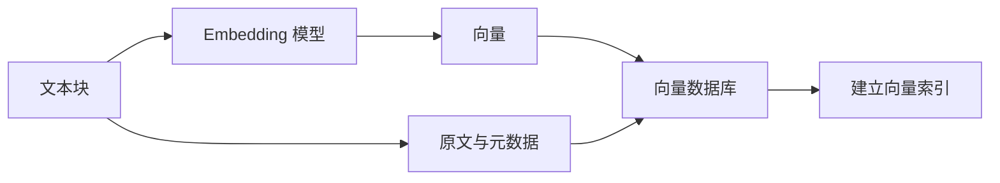
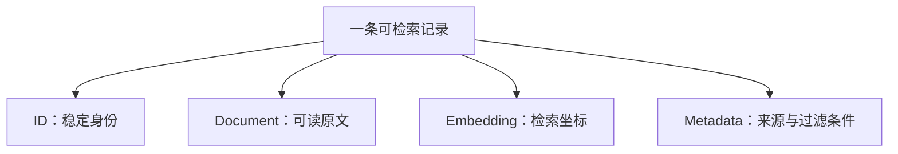
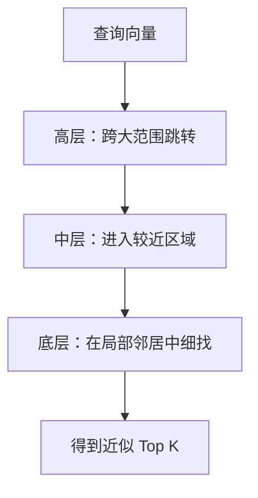
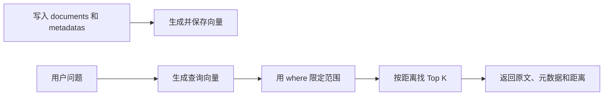
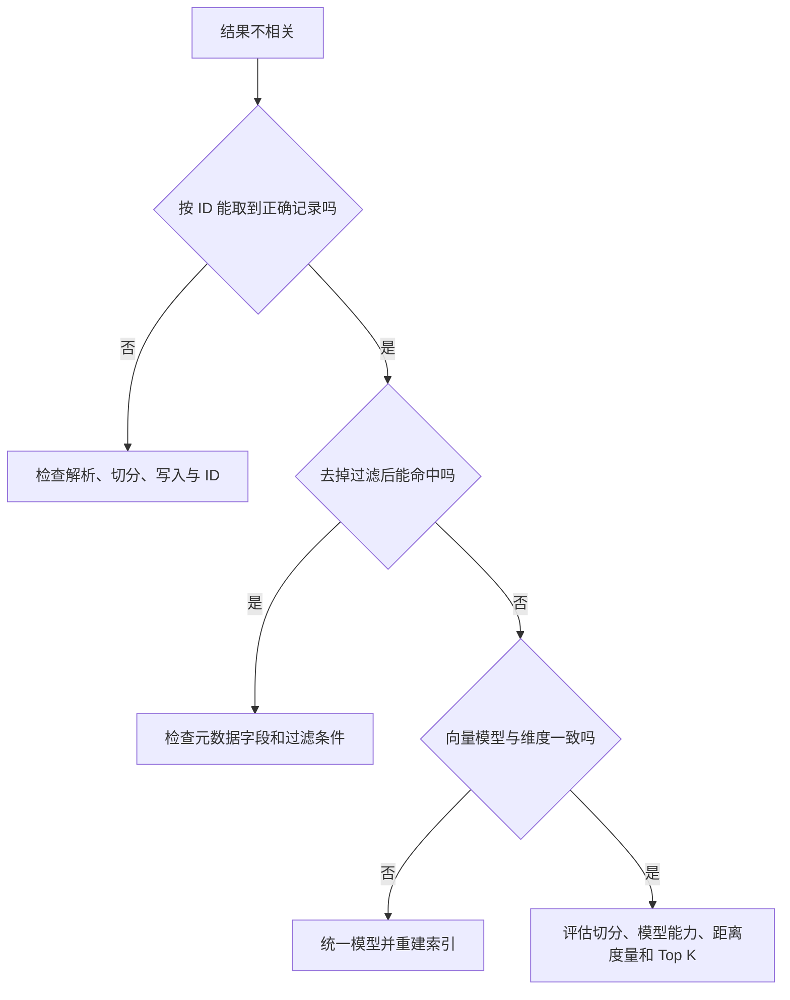

# 大模型应用开发学习 09：向量数据库，如何保存和检索语义

上一篇讨论文本切分时，最后留下了一个很实际的问题：一份长文档被切成许多文本块，也分别生成了向量，接下来这些内容应该放在哪里？用户提问以后，系统又怎样从成千上万个文本块中找到最相关的几个？

把向量写进普通文件当然可以，把它作为数组存进关系型数据库也并非做不到。真正困难的部分不在于“能不能存”，而在于：**如何同时管理文本、向量和来源信息，并在大量高维向量中快速完成相似性检索。**

这正是向量数据库要解决的问题。

为了把后面的检索流程讲具体，全文会反复使用同一组演示数据：一家虚构公司准备把内部的《员工费用手册（演示版）》做成问答知识库，员工可以用自然语言查询差旅、住宿和采购规则。

下面三条制度内容，以及其中的金额、期限和条款位置，都是为了讲解而构造的数据，并不来自任何真实公司的制度。假设这份演示手册已经完成文本切分，系统得到三条记录：

| 文本块 ID | 文本内容 | 在演示手册中的位置 |
| --- | --- | --- |
| `policy-demo-v3-travel-001` | 国内差旅应在返程后 10 个工作日内提交报销申请 | 差旅报销 / 提交期限 |
| `policy-demo-v3-travel-002` | 单张住宿发票超过 2000 元时，需要部门负责人审批 | 差旅报销 / 住宿审批 |
| `policy-demo-v3-office-001` | 办公用品采购应提前提交采购申请 | 日常采购 / 申请流程 |

第三列不是装饰信息。它模拟的是文本块在原始文档中的定位路径。真实项目里，这个位置也可能表现为 PDF 页码、网页 URL、Markdown 标题路径或数据库主键。**向量数据库里通常不只存向量本身，还要保留这段内容来自哪里。** 这样系统把结果检索出来以后，才能把原文、文档名、版本号和定位信息一起返回给上层应用。

后文出现的 JSON、代码、查询结果和排查示例，都会继续围绕这三条演示记录展开。这样一来，读到具体 API 和字段设计时，看到的仍然是同一批数据，而不是临时换一套陌生样本。

我们要把它们做成一个真正可查询的小型知识库，并借这个过程回答几个问题：

- 向量数据库究竟保存了什么；
- 写入和查询为什么是两条不同的链路；
- Top K 是怎么从大量向量里选出来的；
- 精确检索为什么会变慢，近似检索又牺牲了什么；
- 文档、Embedding、Metadata 和 ID 为什么缺一不可；
- ChromaDB 在这条链路里扮演什么角色；
- 一个能运行的 Demo 距离生产可用还差哪些工作。

## 向量数据库不是“把文字变成向量”的模型

刚接触这部分时，最容易混在一起的是 Embedding 模型和向量数据库。它们都出现在语义检索链路中，却负责完全不同的事情。

**Embedding 模型负责表示。**

它接收文本，输出固定维度的数字数组：

```text
“报销款什么时候到账？”
        ↓ Embedding 模型
[0.18, -0.42, 0.07, ..., 0.31]
```

**向量数据库负责管理和检索。**

它接收已经生成的向量以及与向量关联的数据，建立检索索引；查询时再根据距离或相似度找出最近的候选项。



所以，“向量数据库保存语义”其实是一种方便交流的简称。数据库并没有像人一样理解制度条款，也没有把“报销”这个概念装进某个抽屉。更准确的说法是：

> Embedding 模型把文本映射到语义空间中的坐标，向量数据库保存这些坐标及其关联信息，并提供按空间距离查找邻居的能力。

这也解释了为什么换掉 Embedding 模型后，数据库中的旧向量往往需要重新生成。语义空间是模型学习出来的，不同模型建立的坐标系通常不能直接混用。即使两个模型恰好都输出 768 维向量，也不代表第 125 个维度具有相同含义。

向量数据库与传统数据库也不是互相替代的关系。传统数据库擅长回答确定条件：

```sql
SELECT *
FROM policy_chunks
WHERE department = 'finance'
  AND version = 3;
```

这类查询知道自己要找什么字段、满足什么条件。语义检索面对的却是：

```text
“出差回来多久之内要提报销？”
```

原文可能写的是“员工应在返程后 10 个工作日内提交报销申请”，二者没有完全相同的关键词，却表达相近的问题。向量检索要找的不是“字段值等于什么”，而是“空间里谁离查询最近”。

| 能力 | 传统关系型查询 | 向量检索 |
| --- | --- | --- |
| 精确 ID 查询 | 很擅长 | 可以支持，但不是核心优势 |
| 范围与条件过滤 | 很擅长 | 通常借助元数据过滤完成 |
| 关键词完全匹配 | 可借助全文索引 | 不是主要目标 |
| 同义表达检索 | 通常较弱 | 核心能力 |
| 返回方式 | 符合条件的记录 | 距离最近的 Top K 候选 |

真实系统经常把两种能力组合起来：先用部门、权限、版本等确定条件缩小范围，再在合法候选中进行向量排序。向量数据库的价值不只是多存了一列数组，而是把这种组合查询做成了可管理的系统能力。

## 一条记录里真正需要保存什么

把一段制度写入向量数据库时，至少要同时考虑四类数据：`ID`、`Document`、`Embedding` 和 `Metadata`。



以第一条演示数据为例，一条逻辑记录可以表示成：

```json
{
  "id": "policy-demo-v3-travel-001",
  "document": "国内差旅应在返程后 10 个工作日内提交报销申请。",
  "embedding": [0.18, -0.42, 0.07, 0.31],
  "metadata": {
    "document_id": "employee-expense-handbook-demo",
    "version": 3,
    "category": "travel",
    "section": "差旅报销",
    "clause": "提交期限",
    "status": "active"
  }
}
```

这里的四个部分并不是重复保存同一件事。

**Embedding 用于“找”。**

查询向量会与它比较距离。真实向量可能有几百甚至几千维，示例只保留四个数字，是为了让结构容易观察。

**Document 用于“读”和“回答”。**

向量本身不能还原成一段可靠原文。系统命中向量后，仍然需要取出文本块，把它放进模型上下文，或者直接展示给用户核对。

**Metadata 用于“限制范围”和“追溯来源”。**

`category=travel` 可以限定只检索差旅制度，`version=3` 可以排除旧版本，`section` 和 `clause` 可以帮助用户回到原文位置，`status=active` 可以阻止已废止条款进入结果。

**ID 用于“管理生命周期”。**

同一个文本块以后可能需要更新、删除或去重。没有稳定 ID，系统很难判断重新导入的是同一条记录，还是一条新记录。

ID 最好由业务身份稳定推导，而不是每次导入都随机生成。例如：

```text
文档 ID + 文档版本 + 章节路径 + 块序号
employee-expense-handbook-demo + v3 + travel + 001
                    ↓
policy-demo-v3-travel-001
```

如果每次运行都给相同文本生成新 UUID，重复执行导入任务就可能写入多份副本。检索结果的前三名随后全是同一段话，看起来像“模型特别确定”，实际上只是数据重复。

这里还有一个容易被忽略的对应关系：批量写入时，四组列表的同一位置必须描述同一条记录。

```text
ids[0]        ─┐
documents[0]   ├─ 同一条记录
embeddings[0]  │
metadatas[0]  ─┘
```

只要清洗、过滤或排序过程中有一组列表发生错位，就可能出现“差旅制度的向量，取回的却是办公用品原文”这种很难排查的问题。工程上更稳的做法，是先用对象列表维护记录，最后在写入边界统一拆成各字段数组。

## 写入和查询是两条方向相反的链路

一个语义检索系统通常存在两条路径：离线或准实时的**写入链路**，以及用户触发的**查询链路**。

写入链路处理已有资料：


查询链路处理用户问题：


两条链路在向量数据库里会合，但有三个条件必须保持一致。

**第一，写入与查询要使用同一个 Embedding 模型。**

如果文档使用模型 A，问题使用模型 B，它们来自不同坐标系，距离通常没有可靠意义。这就像一份地图使用经纬度，另一份地图把像素坐标当作位置，两个 `(120, 30)` 看起来格式一致，却不是同一种位置。

**第二，向量维度必须一致。**

如果集合中的文档向量是 768 维，查询向量却是 1024 维，连逐维计算都无法进行。数据库通常会直接报维度不匹配。

**第三，预处理方式应保持稳定。**

是否添加标题、是否保留字段名、是否在查询前补充上下文，都会改变生成的向量。模型相同不代表任何输入模板都可以随意混用。

假设入库文本是：

```text
主题：差旅报销
内容：国内差旅应在返程后 10 个工作日内提交报销申请。
```

这种把标题补到正文前的做法可能帮助模型理解短文本块。但如果后续重新索引时突然去掉标题，新旧数据就不再遵循同一套表示规则。模型版本、向量维度、归一化方式、输入模板等信息，最好作为索引版本配置保存下来。

还有一个概念值得分清：`get` 与 `query` 不是同一类操作。

- `get(ids=[...])` 是按已知 ID 精确取回记录；
- `query(...)` 是不知道目标 ID 时，按向量距离寻找相近记录。

前者像凭快递单号查包裹，后者像描述包裹内容，让系统从仓库里找最可能的几个。

## Top K 到底是怎样算出来的

先把 `Top K` 这个词单独说清楚。

这里的 `Top` 不是“最厉害”的意思，而是“排在最前面”；`K` 也不是某种特殊缩写，它只是一个变量，表示“取多少条”。

所以 `Top K` 放到检索里，意思就是：

> 把所有候选结果按相关程度排好序，然后取最靠前的 K 条。

如果 `K=1`，就只取最靠前的 1 条；如果 `K=3`，就取最靠前的 3 条。

在向量数据库里，这个“排在前面”通常不是按时间、热度或点赞数，而是按**向量距离是否更近**来决定。距离越近，说明它在当前语义空间里越像用户的问题，就越有机会排在前面。

可以先把它想成一次很朴素的筛选过程：

```text
用户问题
  ↓
转成查询向量
  ↓
和库里的每一条记录比较“谁更像”
  ↓
按相似程度排序
  ↓
取前 K 条
```

比如知识库里有 1000 条文本块，系统不可能把 1000 条都交给后面的模型去读，于是它先挑出最可能相关的几条。

- `Top 1`：只拿最像的 1 条
- `Top 3`：拿最像的 3 条
- `Top 5`：拿最像的 5 条

这一步的目标不是“直接给出最终答案”，而是先把最值得看的候选证据捞出来。

先不考虑索引优化，最直接的检索方法是**精确最近邻搜索**。

这个名字听起来有点学术，其实意思非常朴素：

> 不走捷径，把查询向量和库里的每一个向量都老老实实比一遍，然后选出最近的几个。

之所以叫“精确”，是因为它真的把所有候选都比较过了，所以理论上不会漏掉真正最近的结果；之所以叫“最近邻”，是因为它要找的就是空间里离查询向量最近的那些邻居。

如果把向量数据库想成一个巨大的坐标空间，那么精确最近邻做的事情就是：

1. 拿着用户问题的坐标出发；
2. 把库里所有文本块的坐标都看一遍；
3. 算出每一个候选离当前问题有多远；
4. 最后按距离从近到远排序，取前 $K$ 个。

写成一句话就是：让查询向量与库中每一个向量都计算一次距离，然后从近到远排序，取前 $K$ 个。

假设为了演示，数据库中只有三个二维向量：

| 文本块 | 向量 | 内容 |
| --- | --- | --- |
| A | $(1, 1)$ | 差旅报销提交时限 |
| B | $(4, 5)$ | 住宿发票审批规则 |
| C | $(8, 1)$ | 办公用品采购流程 |

用户问题“出差回来多久要报销”被映射为查询向量：

$$
Q=(2,1)
$$

为了直观看“空间中离得多远”，这里使用欧氏距离。它计算两点之间的直线距离：

$$
d(Q,X)=\sqrt{\sum_{i=1}^{d}(q_i-x_i)^2}
$$

其中：

- $Q$ 是查询向量；
- $X$ 是某个候选文本块的向量；
- $q_i$ 和 $x_i$ 是两个向量第 $i$ 维的数值；
- $d$ 是向量维度；
- 结果非负，等于 $0$ 表示两个向量完全重合，数值越小表示距离越近。

先计算查询与 A 的距离：

$$
d(Q,A)=\sqrt{(2-1)^2+(1-1)^2}=1
$$

再计算与 B、C 的距离：

$$
d(Q,B)=\sqrt{(2-4)^2+(1-5)^2}=\sqrt{20}\approx4.47
$$

$$
d(Q,C)=\sqrt{(2-8)^2+(1-1)^2}=6
$$

排序以后得到：

```text
A：1.00
B：4.47
C：6.00
```

当 $K=2$ 时，系统返回 A 和 B。

把这一步翻译成自然语言，其实就是：

1. 系统先拿用户问题对应的向量 `Q`
2. 逐个比较它和 A、B、C 谁更近
3. 发现 A 最近，B 次之，C 最远
4. 因为现在设定 `K=2`，所以只返回前两名 A 和 B

这就是 `Top K` 最核心的含义。它本质上是一道排序后的截断动作。

这里有两个特别容易误解的地方。

第一，`Top K` 不等于“前 K 条都正确”。

它只能说明：在当前这批候选里，这 K 条离查询向量最近。至于它们能不能真的回答问题，还要看文本切分是否合理、Embedding 是否靠谱、元数据过滤有没有把范围收对。

第二，`Top K` 不等于“第 K 条也同样重要”。

很多时候第 1 条和第 3 条虽然都进入了 `Top 3`，但相关程度可能差很多。返回进来了，不代表它们在业务上都值得同等信任。

所以更稳的理解是：

> `Top K` 解决的是“先拿哪几条最像的内容出来”，不是“这几条就是最终答案”。

理解到这里，再往下就能自然过渡到一个工程问题：

如果数据库里只有 A、B、C 三条记录，逐个比较当然很轻松；但如果库里有几十万条、几百万条记录，系统是不是每次都还要把全部向量拿出来比一遍？

这正是后面要讨论计算量和近似最近邻索引的原因。`Top K` 这个动作本身不复杂，真正复杂的是：**当候选数据变得非常多时，怎样又快又稳地把这前 K 条找出来。**

这种方法的好处是直观、可靠、容易理解。坏处也很明显：数据一多，计算量会迅速变大。

如果库里有 $N$ 个向量，每个向量有 $d$ 维，逐个比较需要大致处理 $N\times d$ 个数，可以把计算量直观写成：

$$
T(N,d)\propto N\cdot d
$$

这不是在计算精确运行时间，而是在表达增长关系：

- 向量数量扩大 10 倍，比较工作大致也扩大 10 倍；
- 向量维度扩大 2 倍，每次距离计算处理的数字大致扩大 2 倍；
- 如果每个查询都扫描全部数据，数据规模上升后延迟会越来越明显。

例如 100 万个 768 维向量，一次完整扫描要参与计算的坐标数量约为：

$$
1{,}000{,}000\times768=768{,}000{,}000
$$

实际系统会使用向量化指令、并行计算和高效内存布局，不能把这个数字直接当成耗时；但它足以解释为什么数据库不能永远依靠全量扫描。

除了欧氏距离，余弦相似度也常用于检索。这里也很容易让人困惑，因为很多人一看到公式，就会以为它又是一种“更复杂的距离”。

其实可以先抓住一个更直观的理解：

> 欧氏距离更像是在看“两个点离得有多远”，余弦相似度更像是在看“两个方向像不像”。

这两个判断角度并不完全一样。

比如两个人从同一个路口出发：

- 一个人往东北方向走了 1 公里；
- 另一个人也往东北方向走，但走了 10 公里。

如果按欧氏距离看，这两个人最后站的位置差得不小；但如果按“方向是否一致”来看，他们其实非常相似，因为都在朝东北走。

很多向量检索场景更关心的，恰恰是这种“语义方向是否接近”，而不是单纯比较数值长度。所以余弦相似度经常会出现。需要特别注意：不同数据库和索引配置可能返回**相似度**，也可能返回由它转换得到的**距离**。

以余弦相似度为例：

$$
s_{\cos}(A,B)=\frac{A\cdot B}{\|A\|\|B\|}
$$

先不急着背公式，可以先看它在做什么。

- 分子 $A\cdot B$ 可以先粗略理解成：两个向量在“同一方向上”有多少重合；
- 分母 $\|A\|\|B\|$ 是把两个向量各自的长度影响消掉；
- 这样算出来以后，结果就更偏向比较“方向相似度”，而不是单纯比较谁更长。

所以余弦相似度高，不一定表示两个向量在空间里离得最近；它更接近在说：这两个向量指向的语义方向很接近。

常见的余弦距离定义是：

$$
d_{\cos}(A,B)=1-s_{\cos}(A,B)
$$

于是二者排序方向相反：

| 返回值 | 越相关时怎样变化 |
| --- | --- |
| 余弦相似度 $s_{\cos}$ | 越大越相似 |
| 余弦距离 $d_{\cos}$ | 越小越相似 |
| 欧氏距离 | 越小越接近 |

因此不能看到一个 `0.18` 就武断地说“相似度只有 18%”。必须先确认集合使用的距离度量、API 返回的是距离还是相似度、向量是否归一化。更不能不加条件地使用 `1 - distance` 把任意距离变成百分制相似度：对于无界的欧氏距离，这种转换没有统一的概率含义。

## 数据量大以后，为什么需要近似最近邻

精确搜索的优点很直接：只要距离函数与实现正确，它不会因为索引捷径漏掉真正的最近邻。缺点也同样明显：每次都与全部向量比较，规模越大成本越高。

所以系统接下来会遇到一个很现实的问题：

> 能不能不把所有数据都比完，也大致找到“最像的那几条”？

这就是近似最近邻要解决的事。

于是向量检索系统普遍使用**近似最近邻搜索**，英文通常写作 Approximate Nearest Neighbor，简称 ANN。

先把这个名字也翻译成白话。

- “最近邻”还是同一个目标：找到离查询最近的那些向量；
- “近似”表示它不保证每次都把绝对最优结果一个不漏地找全；
- 但它希望用更少的比较次数，找到一组已经非常接近真实答案的候选。

所以，“近似”并不是随便返回几个差不多的结果，而是接受一个工程交换：

> 用极小概率漏掉真正最近邻的代价，换取明显更低的查询延迟和计算成本。

可以先把精确搜索和近似搜索放在一起看：

| 方式 | 可以先怎么理解 |
| --- | --- |
| 精确最近邻 | 全部比一遍，再选最近的 |
| 近似最近邻 | 先快速缩小范围，再在更可能相关的区域里细找 |

ChromaDB 使用的 HNSW 属于常见的图索引思路。这里不展开它的全部构造细节，可以先用“城市道路”理解它。

如果要在一百万个地点里找离当前位置最近的咖啡店，精确扫描相当于逐一计算到每家店的距离。图索引则提前给相近地点建立连接，并设计多层导航：



搜索先在稀疏的高层快速靠近目标区域，再下到更密的低层寻找邻居。它通常不需要访问全部节点，因此速度可以明显提升。

如果把它说得再生活化一点：

- 精确搜索像是“把整座城市所有咖啡店都量一遍距离”；
- 近似搜索像是“先根据城市道路和区域分布，迅速赶到最可能的街区，再在那里细找最近的几家”。

它不一定每次都做到绝对最优，但大多数时候可以用更低的成本拿到足够好的结果。

但索引不是免费的：

- 建索引需要额外时间；
- 图结构会占用内存或磁盘；
- 写入和删除可能带来索引维护成本；
- 搜得更快与找得更全之间需要调参；
- 数据量很小时，复杂索引未必比直接扫描更划算。

衡量 ANN 不能只看“快不快”，还要看召回率。

这里的“召回率”也很容易被误解成“答案质量有多高”，其实它更像是在问：

> 那些本来应该被找回来的结果，系统到底找回来了多少？

它先不评价回答写得好不好，也不评价第一名是否最合适，而是先检查一件更基础的事：该捞出来的证据，有没有真的被捞出来。

假设精确搜索得到的真实前 10 名中，近似搜索找回了 9 个，可以写成：

$$
\text{Recall@10}=\frac{9}{10}=90\%
$$

这个数字表示真实 Top 10 中有 90% 被近似检索找回。

如果把它说得更白话一点，就是：

- 精确搜索心里知道“标准答案集合”大概是哪 10 条；
- 近似搜索实际返回了一批结果；
- 这两批结果一对照，发现真正该回来的 10 条里，有 9 条确实回来了；
- 所以 `Recall@10 = 90%`。

它不判断这些文档是否真的能回答业务问题，只衡量近似算法相对于精确结果漏掉了多少邻居。

这也是为什么高召回率不等于高业务效果。

- 召回率高，说明“该找回来的，大体都找回来了”；
- 但如果文本切分本身不好、内容过时、元数据范围不对，找回来的东西依然可能不好用。

这一区分很重要：

- **索引召回率**低，问题可能出在 ANN 参数和索引结构；
- **业务检索质量**低，问题还可能出在文本切分、Embedding 模型、元数据、查询表达或数据本身。

向量数据库解决的是高效找近邻，不会自动保证“离得近的文本就是正确证据”。

## 用 ChromaDB 跑通一遍写入与查询

前面已经把向量数据库的概念拆开了：一条记录里有 `ID`、`Document`、`Embedding` 和 `Metadata`。接下来用 ChromaDB 跑一遍，不是为了突然切换到“工具教程”，而是为了把这四个东西放到真实 API 里看一眼。

这一段可以先带着一个问题读：

> 前面说的一条“可检索记录”，在代码里到底长什么样？

ChromaDB 是一个开源向量数据库，适合本地实验、原型和中小规模应用。本篇用它来观察通用概念怎样落到代码中，而不是把向量数据库等同于 ChromaDB。

安装 Python 包：

```powershell
python -m pip install chromadb
```

先创建一个本地数据库和集合：

```python
import chromadb

client = chromadb.PersistentClient(path="./chroma_data")

collection = client.get_or_create_collection(
    name="expense_policy_demo",
    metadata={"description": "员工费用手册演示数据"},
)
```

这几行代码可以先这样理解：

| 代码 | 可以先这样理解 |
| --- | --- |
| `PersistentClient(path="./chroma_data")` | 在本地目录里保存数据，程序重启后还在 |
| `get_or_create_collection(...)` | 拿到一个集合；没有就创建 |
| `expense_policy_demo` | 这批费用制度文本块放在同一个集合里 |

`Collection` 可以近似理解成关系型数据库中的表，但不要把两者完全画等号。集合不仅管理记录，还可能绑定向量维度、距离空间、Embedding 配置和向量索引等语义检索相关信息。

下面把文章开头的三条演示数据写进去。先不要被代码长度吓住，它本质上是在同时传四组东西：

```text
ids        -> 每条记录的稳定身份
documents  -> 可读原文
metadatas  -> 来源、分类、版本、状态
embeddings -> 这一段示例里先不手动传，由集合自动生成
```

对应到前文那张表，就是：

| ID | Document | Metadata 里的关键信息 |
| --- | --- | --- |
| `policy-demo-v3-travel-001` | 国内差旅应在返程后 10 个工作日内提交报销申请。 | `category=travel`，`clause=提交期限`，`status=active` |
| `policy-demo-v3-travel-002` | 单张住宿发票超过 2000 元时，需要部门负责人审批。 | `category=travel`，`clause=住宿审批`，`status=active` |
| `policy-demo-v3-office-001` | 办公用品采购应提前提交采购申请。 | `category=office`，`clause=申请流程`，`status=active` |

代码写出来是这样：

```python
collection.upsert(
    ids=[
        "policy-demo-v3-travel-001",
        "policy-demo-v3-travel-002",
        "policy-demo-v3-office-001",
    ],
    documents=[
        "国内差旅应在返程后 10 个工作日内提交报销申请。",
        "单张住宿发票超过 2000 元时，需要部门负责人审批。",
        "办公用品采购应提前提交采购申请。",
    ],
    metadatas=[
        {
            "document_id": "employee-expense-handbook-demo",
            "version": 3,
            "category": "travel",
            "section": "差旅报销",
            "clause": "提交期限",
            "status": "active",
        },
        {
            "document_id": "employee-expense-handbook-demo",
            "version": 3,
            "category": "travel",
            "section": "差旅报销",
            "clause": "住宿审批",
            "status": "active",
        },
        {
            "document_id": "employee-expense-handbook-demo",
            "version": 3,
            "category": "office",
            "section": "日常采购",
            "clause": "申请流程",
            "status": "active",
        },
    ],
)
```

这里用 `upsert`，意思是：如果这个 ID 不存在就新增，如果已经存在就更新。学习阶段可以先记住它适合“重复跑导入脚本”的场景。

如果更细一点看，常见写入动作可以这样区分：

| 方法 | 更适合的意图 |
| --- | --- |
| `add` | 明确新增，不希望覆盖已有记录 |
| `upsert` | ID 已存在时更新，不存在时新增，适合可重复执行的同步任务 |
| `update` | 明确更新已存在的记录 |
| `delete` | 按 ID 或条件删除记录 |

现在数据已经进去了，下一步是查询。

用户可能会问：

```text
出差结束以后，最晚什么时候提交报销？
```

这句话和原文“国内差旅应在返程后 10 个工作日内提交报销申请”并不完全一样，但语义接近，所以可以走向量检索。

查询代码是：

```python
results = collection.query(
    query_texts=["出差结束以后，最晚什么时候提交报销？"],
    n_results=2,
    where={
        "$and": [
            {"category": {"$eq": "travel"}},
            {"status": {"$eq": "active"}},
        ]
    },
    include=["documents", "metadatas", "distances"],
)
```

这段代码可以拆成四层看：

| 参数 | 作用 |
| --- | --- |
| `query_texts` | 用户问题，ChromaDB 会把它转成查询向量 |
| `n_results=2` | 返回最相关的前 2 条 |
| `where` | 先限制业务范围，比如只查差旅、只查生效制度 |
| `include` | 指定返回哪些信息，比如原文、元数据和距离 |

读到这里，先不要急着纠结 `$and`、`$eq` 的语法。它们只是表达：

```text
只在 category = travel 且 status = active 的记录里查。
```

换句话说，这次查询不是在全部资料里乱搜，而是在“差旅 + 生效”的范围里做语义检索。

把结果打印出来：

```python
for doc_id, document, metadata, distance in zip(
    results["ids"][0],
    results["documents"][0],
    results["metadatas"][0],
    results["distances"][0],
):
    print(doc_id)
    print(document)
    print(metadata)
    print(distance)
    print("-" * 40)
```

这里的 `results["documents"][0]` 看起来有点奇怪，为什么要多一个 `[0]`？

因为 `query_texts` 支持一次传多个问题：

```python
query_texts=[
    "报销期限是多久？",
    "高额住宿费由谁审批？",
]
```

所以返回结果会长成这样：

```text
documents
├── 第 1 个问题的 Top K 结果：[结果 1, 结果 2, ...]
└── 第 2 个问题的 Top K 结果：[结果 1, 结果 2, ...]
```

当前只有一个问题，所以取第一个问题的结果，也就是 `[0]`。

到这里，一个最小链路就跑通了：



如果项目已经在外部统一调用 Embedding 服务，也可以自己生成向量，再把向量传给 ChromaDB：

```python
document_vectors = embed_texts(documents)  # 由同一个 Embedding 服务生成

collection.upsert(
    ids=ids,
    documents=documents,
    metadatas=metadatas,
    embeddings=document_vectors,
)

query_vector = embed_texts(["出差后多久提交报销？"])[0]

results = collection.query(
    query_embeddings=[query_vector],
    n_results=2,
    include=["documents", "metadatas", "distances"],
)
```

这里的 `embed_texts` 只是代表项目自己的 Embedding 调用封装。重点不在具体供应商，而在于文档与问题都必须经过同一套模型和预处理流程。

最短示例适合验证链路，却不等于中文检索效果已经合格。代码能跑，只能说明 API 链路打通；真正效果还要看模型是否适合中文、业务术语是否能被表示、文本切分是否合理、元数据范围是否正确。

## 为什么查询前还要做元数据过滤

这里是理解向量数据库时很容易卡住的地方。

因为前面一直在讲“向量距离”，很容易形成一个直觉：

> 既然向量能找语义相近的内容，那查询时直接找最近的 Top K 不就行了吗？

问题就在这里：真实知识库通常不能在“全部资料”里无条件找最近。

继续沿用费用手册这个例子。假设知识库不止有这三条数据，而是同时保存了：

- 2024 年旧版制度；
- 2026 年新版制度；
- 国内差旅制度；
- 海外差旅制度；
- 普通员工可见制度；
- 财务部门内部制度；
- 生效制度；
- 草稿制度；
- 已废止制度。

用户问：

```text
出差后几天内报销？
```

旧制度可能写：

```text
国内差旅应在返程后 15 个工作日内提交报销申请。
```

新制度可能写：

```text
国内差旅应在返程后 10 个工作日内提交报销申请。
```

这两句话在语义上非常像，甚至只有数字不同。  
如果只看向量相似度，旧制度完全可能排得很靠前。

但业务上，旧制度不应该进入当前答案。

这就是元数据过滤要解决的问题：

> 向量负责判断“语义像不像”，元数据负责判断“这条资料有没有资格参与这次检索”。

可以把一次查询想成两道门：


第一道门回答的是：

```text
这条资料属于当前版本吗？
这条资料在当前地区适用吗？
这个用户有权限看吗？
这条资料是生效状态吗？
```

第二道门回答的是：

```text
在这些合法资料里，哪几条和用户问题最像？
```

所以元数据过滤不是“附属功能”，它是业务边界。

比如一条记录的元数据可以是：

```json
{
  "version": 3,
  "region": "cn",
  "visibility": "employee",
  "status": "active",
  "category": "travel"
}
```

查询时的过滤条件就像在说：

```text
只查第 3 版；
只查中国区；
只查普通员工可见；
只查生效制度；
只查差旅分类。
```

适合进入元数据的字段，通常不是随便想到什么就塞什么，而是围绕四件事设计：

| 设计目标 | 常见字段 | 作用 |
| --- | --- | --- |
| 找回来源 | `document_id`、`section`、`clause`、`url` | 命中后能回到原文 |
| 限定范围 | `category`、`product`、`region` | 缩小候选范围 |
| 控制版本 | `version`、`updated_at`、`status` | 排除旧版、草稿和废止资料 |
| 控制权限 | `tenant_id`、`department`、`visibility` | 防止越权召回 |

尤其需要强调权限：**先检索再让大模型“不要泄露”不是可靠的权限控制。**

不该被用户访问的文本，最好在进入候选结果之前就被过滤掉。模型提示词不能代替数据库层或业务层的授权判断。

当然，过滤也可能写错或写得太严。

比如某条记录导入时忘了写：

```json
{
  "status": "active"
}
```

那么查询强制要求 `status=active` 时，它就不会出现。  
这时不是向量不准，而是它连参与比赛的资格都没有。

排查这类问题，可以按顺序拆开：

1. 按 ID 能否 `get` 到记录；
2. 不加 `where` 时能否向量命中；
3. 只加 `category=travel` 时能否命中；
4. 再加 `status=active` 后是否消失；
5. 检查元数据类型和值是否一致，比如数字 `3` 和字符串 `"3"`。

这段可以收束成一句话：

> 向量检索解决“意思像不像”，元数据过滤解决“该不该查”。两者缺一边，知识库都很难可靠。

## 从 Demo 到可维护知识库，还缺什么

能成功写入三段文字并查出两条结果，只能证明 API 链路打通。真正的知识库还要面对一个更麻烦的问题：数据会变化。

制度会更新，文档会改版，切分策略会调整，Embedding 模型也可能更换。只要这些东西变了，向量数据库里的记录就可能不再一致。

### 文档改了，向量也要跟着改

假设原文是：

```text
国内差旅应在返程后 10 个工作日内提交报销申请。
```

后来制度改成：

```text
国内差旅应在返程后 7 个工作日内提交报销申请。
```

这时不能只更新 `Document`，还要重新生成 `Embedding`。

原因是：向量是根据旧文本算出来的。  
如果只改原文不改向量，数据库仍然会按旧文本的语义位置检索这条记录，但返回给用户的却是新文本。记录内部已经不一致。

比较稳的更新流程是：


### 切分策略变了，旧块可能要整体清理

再看另一种变化。

原来按固定长度切分：

```text
每 500 Token 切一块
```

后来改成按标题结构切分：

```text
每个小节作为一个文本块
```

这时文本块数量、边界和 ID 都可能变化。  
如果只把新块写进去，旧块不会自动消失。检索时，新旧块可能同时参与，结果里就会出现重复、过期或边界混乱的证据。

更稳的做法是为每次索引构建分配版本：

```text
expense-policy-index-v1
expense-policy-index-v2
```

先构建新版本，验证没问题后再切换，最后清理旧版本。

### Embedding 模型变了，旧向量通常不能混用

如果从模型 A 换到模型 B，即使两者都输出 768 维向量，也不能默认混用。

因为它们学习出来的语义空间可能不同。  
同一句话在模型 A 里的坐标，和模型 B 里的坐标，不一定能放在同一个空间比较。

这也是为什么需要给每批索引留一张“身份证”。

它不是为了增加配置仪式感，而是为了以后能回答这些问题：

```text
这批向量是哪一个模型生成的？
向量有多少维？
用的是什么距离度量？
文本当时是怎么切分的？
入库前有没有把标题拼到正文里？
```

可以把这些信息记成一份索引配置：

```yaml
index_version: expense-policy-demo-v1
embedding_model: your-embedding-model-version
embedding_dimensions: 768
distance_metric: cosine
chunk_strategy: markdown-structure-v2
content_template: title-plus-body-v1
```

这段配置不是用来背诵的。它的作用是：当几个月后检索结果异常时，团队还能复盘“这批向量究竟是怎么来的”。

如果所有配置只存在某位开发者记忆里，后面几乎无法可靠复现。

### 本地跑通不等于生产可靠

`PersistentClient` 很适合个人学习和嵌入式应用，但生产系统还要继续问：

- 多进程是否会同时写同一路径；
- 数据目录是否进入备份；
- 部署容器重启后磁盘是否保留；
- 是否需要多租户隔离与访问控制；
- 写入吞吐、查询并发和数据规模是否超出单机设计；
- 索引迁移和回滚如何完成。

ChromaDB、FAISS、Milvus、Weaviate、Pinecone、pgvector 等工具也不是简单的“谁更快”排名。它们可能分别是向量检索库、嵌入式数据库、分布式服务、托管服务或关系数据库扩展，运维方式和一致性能力并不相同。

选型时更值得先问：

| 问题 | 为什么重要 |
| --- | --- |
| 数据量和增长速度是多少 | 决定单机是否足够 |
| 查询并发与延迟目标是什么 | 决定部署与索引方案 |
| 是否已有 PostgreSQL 等基础设施 | 复用现有系统可能更简单 |
| 元数据过滤是否复杂 | 决定标量查询能力是否够用 |
| 是否要求事务、备份和高可用 | “能检索”之外还有数据库职责 |
| 团队能承担多少运维成本 | 分布式能力并非免费收益 |

学习阶段用 ChromaDB 跑通概念很合适；生产选型则要从约束出发，而不是看到“向量数据库”四个字就默认必须引入一套独立集群。

## 检索结果不对时，应该沿着整条链路排查

语义检索的麻烦之处在于：最终只看到“不相关的结果”，原因却可能出现在链路中的任何位置。

下面继续用同一个查询“出差结束以后，最晚什么时候提交报销？”走一遍排查流程。这个问题的预期证据，就是开头那条“返程后 10 个工作日内提交”的演示记录。

**先确认数据是否存在。**

使用稳定 ID 精确读取：

```python
record = collection.get(
    ids=["policy-demo-v3-travel-001"],
    include=["documents", "metadatas", "embeddings"],
)

print(record)
```

如果 `get` 都取不到，问题在导入或 ID，而不是相似度。

**再确认文本块是否具备回答能力。**

命中的块如果只有“应及时提交”，具体的“10 个工作日”被切到相邻块，向量数据库再快也找不回一个不存在的完整证据。这时应该回到文本解析和切分。

**检查 Embedding 链路是否一致。**

- 文档和查询是否使用同一模型版本；
- 向量维度是否一致；
- 输入是否采用同一语言和模板约定；
- 更换模型后是否仍在查询旧集合；
- 中文、缩写和业务术语是否在模型能力范围内。

**暂时移除元数据过滤。**

如果不加过滤能命中，加过滤后消失，问题就在字段缺失、类型不一致或条件过严。

**读取原始距离，不要急着造“相似度百分比”。**

先记录同一批真实问题下，正确答案与错误答案各自的距离分布，再决定是否设置阈值。不能从一个例子看到正确结果距离是 `0.42`，就把所有大于 `0.5` 的结果永久过滤掉。

**不要把 Top K 设成答案质量开关。**

`n_results=20` 可能提高正确证据被包含的机会，也会带来更多噪声、重复内容和上下文成本。Top K 应结合真实问题评估，而不是越大越好。

为了把“感觉搜得还行”变成可测量的结果，可以准备 20 个业务问题，为每个问题标注正确证据 ID，然后统计正确证据是否进入前 K 名：

$$
\text{Hit@K}=\frac{\text{前 K 名包含正确证据的问题数}}{\text{问题总数}}
$$

假设 20 个问题中有 17 个在前三名找到正确证据：

$$
\text{Hit@3}=\frac{17}{20}=85\%
$$

这个指标回答的是“正确证据有没有被召回”，还需要人工检查：

- 第一名是否经常就是正确结果；
- 命中块能否独立支持答案；
- 结果是否被重复块占满；
- 是否召回已过期或越权资料；
- 距离很近的错误结果有什么共同特征。

可以把排查顺序整理成一条稳定路径：



这比一看到结果不准就更换向量数据库更有效。数据库只是链路中的一环，数据质量和表示质量往往比工具品牌更早决定效果上限。

**还有几个需要提前避开的误解。**

**误解一：存入向量数据库后，模型就“学会”了这些资料。**

没有。资料只是可被检索。每次问答仍需先查询相关文本，再把文本交给大模型。删除数据库记录不会修改大模型参数，新增记录也不等于训练模型。

**误解二：向量数据库会自动解决同义词、数字和专有名词。**

效果取决于 Embedding 模型和数据。语义模型可能很好地理解“付款失败”和“无法支付”，却不一定稳定区分两个相近的错误码、合同编号或精确金额。编号、名称和精确词匹配常常需要关键词检索配合。

**误解三：距离第一名就是正确答案。**

第一名只是候选集合中的最近项。用户问了知识库没有覆盖的问题，数据库仍然可能返回一个“最不离谱”的第一名。系统需要阈值、无答案判断、重排或人工规则来约束结果。

**误解四：数据库返回的距离可以直接跨集合比较。**

换了模型、归一化方式、距离度量或数据分布以后，`0.4` 的含义可能变化。阈值应该在同一检索配置下通过数据评估，不能从另一个项目照抄。

**误解五：只保存向量最节省空间。**

只保存向量会失去可读原文和引用依据。命中后无法给模型提供证据，也难以人工排查为什么命中。至少要保留能定位原文的可靠关联；多数知识库会直接保存 chunk 文本和来源元数据。

**误解六：元数据越多越好。**

无约束地塞入所有字段，会增加导入复杂度和治理负担。元数据应该服务于过滤、权限、追溯和生命周期管理。不会用于这些目的的临时字段，不一定值得进入索引记录。

**误解七：把 Demo 封装成一个类，就已经是完整知识库。**

真正的系统还要面对批量导入失败、幂等、重试、文档版本、权限、评估、监控、备份和索引切换。类封装只是代码组织方式，不能替代这些工程机制。

## 最后收束成一个完整认识

文本切分决定了知识库把什么当作一条证据，Embedding 模型把这条证据映射成语义空间中的坐标，向量数据库则负责保存坐标与原文之间的关系，并从大量候选中快速找到最近的几个。

一条可维护的向量记录不只有向量：

- `Document` 保存可读、可引用的证据；
- `Embedding` 提供相似性检索所需的坐标；
- `Metadata` 约束版本、范围、权限和来源；
- `ID` 支撑去重、更新、删除和追踪。

查询时，用户问题先经过与文档一致的 Embedding 流程，再由数据库进行过滤和近邻搜索。Top K 只是距离排序结果，不是正确性证明；近似最近邻提高了速度，也带来了召回与资源之间的权衡。

ChromaDB 把这些能力封装成了较容易上手的 API，但工具不会替我们决定文本该怎样切、模型是否适合中文、元数据怎样设计，也不会自动判断召回的内容能不能支持答案。

因此，这篇最重要的结论不是“学会调用 `collection.query()`”，而是建立一条完整链路：

> **语义检索的质量，来自文本、表示、索引、过滤和评估共同工作；向量数据库负责把其中的存储与近邻搜索做得可管理、可扩展。**

到这里，向量数据库这条线已经可以先收住：它解决的是“语义证据怎么保存、怎么按相似度找回来”。

但真实检索还有另一类问题。比如错误码、产品型号、函数名、字段名、合同编号这类内容，往往不是靠“语义相近”就能稳定解决。它们更依赖字面命中和精确匹配。

所以后面再继续往下看时，问题会自然转向：**向量检索要不要和关键词检索配合？如果要配合，BM25、TF-IDF 这类方法又站在什么位置？**

这就是下一步要展开的混合检索问题。

## 参考资料

- [Chroma Documentation](https://docs.trychroma.com/)
- [Chroma Cookbook：Core Concepts and APIs](https://cookbook.chromadb.dev/core/)
- [Chroma Cookbook：Clients](https://cookbook.chromadb.dev/core/clients/)
- [Chroma Cookbook：Collections](https://cookbook.chromadb.dev/core/collections/)
- [Chroma Cookbook：Deployment Patterns](https://cookbook.chromadb.dev/running/deployment-patterns/)
- [Chroma GitHub Repository](https://github.com/chroma-core/chroma)

