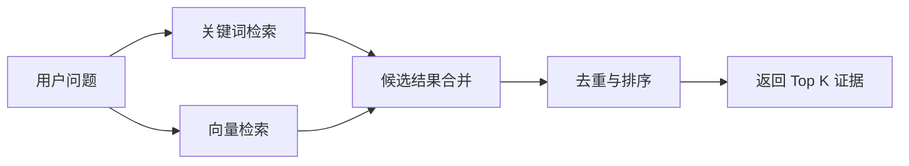
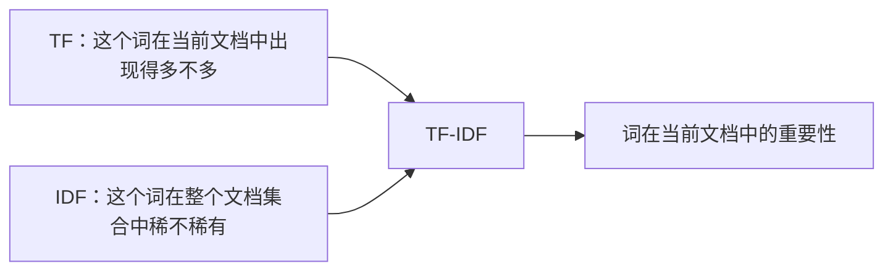
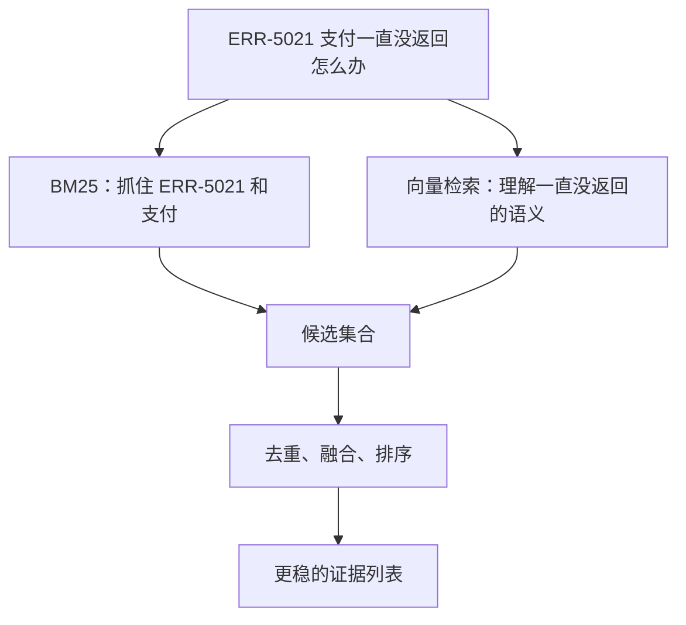
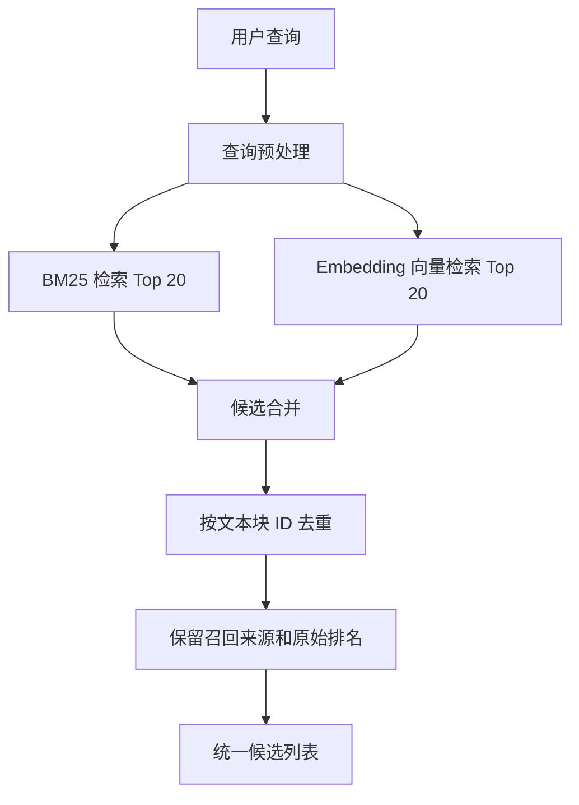
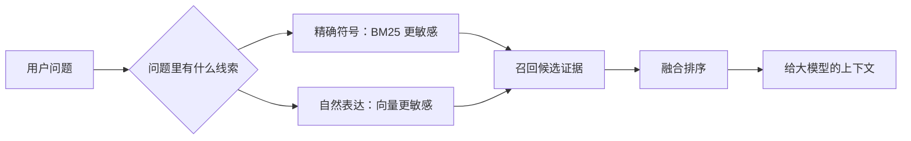

# 大模型应用开发学习 10：混合检索：BM25、TF-IDF 和向量检索怎么配合

如果要做一个“基于自己资料回答问题”的 AI 应用，通常会遇到一个很现实的问题：

> 用户问一句话，系统应该先从一堆文档里找到相关内容，再把这些内容交给大模型组织成回答。

这个过程看起来像“搜索 + 回答”，但里面有一个关键环节：**怎么把真正有用的资料找出来。**

如果找错了，大模型后面写得再流畅，也只是基于错误资料进行发挥。  
如果找少了，大模型可能答得很保守，甚至漏掉关键信息。  
如果找得太杂，大模型又可能被无关内容干扰。

这就是检索问题。

前面讨论文本向量和向量数据库时，已经接触过一种很重要的思路：把文本切成一段一段的小块，再用 Embedding 模型把文本变成向量，最后根据向量距离找出语义相近的内容。

这里有几个词先简单放平：

| 术语 | 可以先这样理解 |
| --- | --- |
| 文本块 / chunk | 把一篇长文档切成更小的段落，方便检索和放进模型上下文 |
| Embedding | 把文本转换成一串数字，让机器可以比较“语义像不像” |
| 向量检索 | 用这些数字向量去找语义相近的文本 |
| 召回 | 从大量资料里先捞出一批可能相关的候选内容 |
| Top K | 按相关性排序后取前 K 条，比如 Top 5 就是取最相关的 5 条 |
| RAG | Retrieval-Augmented Generation，检索增强生成；可以先理解成“先查资料，再让大模型回答” |

顺着向量检索这条线看，很容易形成一个直觉：既然向量可以表达语义，那是不是以后检索都用向量就够了？

刚开始接触知识库问答时，我也很容易这样理解。向量检索确实很强，它能处理同义表达、近义问题和不完全匹配的查询。用户问“出差回来多久报销”，原文写“返程后 10 个工作日内提交报销申请”，向量检索有机会把它们关联起来。

但继续往真实项目想，就会发现事情没这么简单。

如果用户问的是：

```text
ERR-5021 怎么处理？
```

或者：

```text
policy-demo-v3-travel-001 这条规则是什么？
```

这类查询不一定需要系统先“理解一大段语义”。它更需要系统精准抓住字面上的错误码、编号、产品名、函数名、制度条款号。向量检索有时会把语义相近但编号不一致的内容召回，反而不如关键词检索稳定。

所以这一篇想解决的问题不是“BM25、TF-IDF 和向量检索谁更高级”，而是：

> **在知识库检索里，关键词检索和向量检索分别擅长什么，为什么很多“先查资料、再回答”的系统会把它们组合起来。**

为了避免后文例子跳来跳去，这篇使用一组虚构的内部知识库数据。假设有一家 SaaS 公司，把客服 FAQ、接口错误码和费用规则都整理成了可以检索的文本块：

| 文本块 ID | 文本内容 | 类型 |
| --- | --- | --- |
| `support-api-err-5021` | ERR-5021 表示支付网关超时，建议重试支付请求并检查网关状态。 | 错误码 |
| `support-api-err-5030` | ERR-5030 表示签名校验失败，需要检查请求参数排序和密钥配置。 | 错误码 |
| `support-refund-policy` | 用户退款申请应在订单完成后 7 个自然日内提交。 | 业务规则 |
| `support-travel-policy` | 国内差旅应在返程后 10 个工作日内提交报销申请。 | 费用规则 |
| `support-payment-delay` | 如果支付结果长时间未返回，可以先查询订单状态，再决定是否发起补偿流程。 | 支付流程 |

这些都是为了讲解而构造的数据，不来自真实公司制度。后文会用它们观察三件事：

- TF-IDF 为什么能给词语计算重要性；
- BM25 为什么比朴素 TF-IDF 更适合搜索；
- 为什么关键词检索和向量检索组合起来，常常比单独使用其中一种更稳。

## 关键词检索和向量检索到底差在哪

可以先把检索分成两种能力。

**关键词检索关注“字面有没有命中”。**

用户查询：

```text
ERR-5021
```

关键词检索会非常在意文档里是否真的出现了 `ERR-5021`。如果某个文本块包含这个错误码，它就应该排得很靠前。

**向量检索关注“语义上像不像”。**

用户查询：

```text
支付一直没返回怎么办？
```

即使原文没有“一直没返回”这几个字，只要写了“支付结果长时间未返回”“查询订单状态”“补偿流程”，向量检索也可能认为它们语义接近。

这两种能力的差别，可以先放在一张表里看：

| 查询类型 | 更适合的检索方式 | 原因 |
| --- | --- | --- |
| `ERR-5021` | 关键词检索 | 错误码必须精确命中 |
| `policy-demo-v3-travel-001` | 关键词检索 | ID、编号、条款号不能靠语义猜 |
| `支付回调超时` | 关键词 + 向量 | 有明确术语，也可能存在不同表述 |
| `付款后页面卡住了怎么办` | 向量检索 | 用户表达可能和文档措辞不同 |
| `住宿发票 2000 元审批` | 关键词 + 向量 | 数字和术语都重要 |

向量检索解决的是“说法不一样但意思相近”的问题。

关键词检索解决的是“某些字面信息必须对上”的问题。

如果只用向量检索，容易漏掉错误码、版本号、字段名、函数名、产品型号这类精确符号。如果只用关键词检索，又很难处理自然语言里的换一种说法。

混合检索的基本思路就是：



这里的“候选结果”可以理解成：系统暂时还不能确定哪几段最可靠，所以先把可能相关的内容都捞出来。  
“去重”是因为同一段文本可能同时被关键词检索和向量检索找到，最终给大模型时不应该重复塞进去。  
“Top K”则是最终只取前面几条，比如从 40 条候选里选出最有用的 5 条。

它不是为了把系统搞复杂，而是承认一个事实：真实用户的提问里，经常同时包含“精确符号”和“模糊意图”。

## TF-IDF：先理解关键词为什么有轻重

要理解 BM25，最好先理解 TF-IDF。因为 BM25 很大程度上是在 TF-IDF 的思想上继续改进。

TF-IDF 的完整名字是 Term Frequency-Inverse Document Frequency，通常翻译成“词频-逆文档频率”。

这个名字看着有点拗口，但它想解决的问题很直观：

> 一个词在某篇文档里到底重不重要？

只看词出现次数是不够的。

比如一篇文档里，“的”“是”“在”可能出现很多次，但它们不能代表文档主题。相反，“ERR-5021”“支付网关”“签名校验”出现次数可能没那么多，但更能区分文档内容。

TF-IDF 就是把两个因素乘起来：



**TF：词在当前文档里出现得多不多。**

TF 是 Term Frequency，词频。

最简单的 TF 就是词出现的次数：

$$
\text{TF}(t,d)=\text{count}(t,d)
$$

其中：

- $t$ 表示某个词；
- $d$ 表示某篇文档；
- $\text{count}(t,d)$ 表示词 $t$ 在文档 $d$ 中出现了几次。

有时为了避免长文档天然占便宜，也会使用标准化词频：

$$
\text{TF}(t,d)=\frac{\text{count}(t,d)}{\text{文档 }d\text{ 的总词数}}
$$

假设一个文本块是：

```text
ERR-5021 表示支付网关超时，支付请求可以重试。
```

简单分词后可以理解成：

```text
ERR-5021 / 支付 / 网关 / 超时 / 支付 / 请求 / 重试
```

这里“支付”出现 2 次，`ERR-5021` 出现 1 次。如果只看 TF，“支付”似乎比 `ERR-5021` 更重要。

但这还不够。因为“支付”可能在很多文档里都出现，而 `ERR-5021` 可能只在一条错误码说明里出现。

这就需要 IDF。

**IDF：词在整个文档集合里稀不稀有。**

IDF 是 Inverse Document Frequency，逆文档频率。

它不是看一个词在当前文档里出现多少次，而是看它出现在多少篇文档里。

如果一个词在很多文档里都出现，它的区分能力就弱。

如果一个词只在少数文档里出现，它就更像某些文档的“指纹”。

一个常见的 IDF 形式是：

$$
\text{IDF}(t)=\log\frac{N}{\text{DF}(t)+1}
$$

其中：

- $N$ 表示文档总数；
- $\text{DF}(t)$ 表示包含词 $t$ 的文档数量；
- 分母加 $1$ 是一种平滑处理，避免极端情况下除以 0；
- $\log$ 用来压缩数值范围，避免稀有词权重过大。

用这篇文章开头的 5 条演示数据来看：

| 词 | 出现在哪些文档 | DF |
| --- | --- | --- |
| `支付` | `support-api-err-5021`、`support-payment-delay` | 2 |
| `ERR-5021` | `support-api-err-5021` | 1 |
| `报销` | `support-travel-policy` | 1 |
| `用户` | `support-refund-policy` | 1 |

如果总文档数 $N=5$，那么：

$$
\text{IDF}(\text{支付})=\log\frac{5}{2+1}=\log\frac{5}{3}
$$

$$
\text{IDF}(\text{ERR-5021})=\log\frac{5}{1+1}=\log\frac{5}{2}
$$

`ERR-5021` 的 IDF 更高，因为它更稀有，更能区分具体文档。

这背后的直觉很像查资料：

- “支付”像一个比较宽泛的主题词，能带你进入支付相关资料；
- `ERR-5021` 像一个精确定位码，能直接指向某条故障说明。

**TF-IDF：当前文档里常见，同时在全局里稀有。**

把 TF 和 IDF 乘起来，就是 TF-IDF：

$$
\text{TF-IDF}(t,d)=\text{TF}(t,d)\times\text{IDF}(t)
$$

它想表达的是：

> 一个词如果在当前文档里出现较多，同时在整个文档集合里不常见，那么它就更能代表当前文档。

可以把四种情况放在一起看：

| TF | IDF | 含义 | 例子 |
| --- | --- | --- | --- |
| 高 | 高 | 当前文档频繁出现，全局又稀有，很重要 | 某篇故障说明里的 `ERR-5021` |
| 高 | 低 | 当前文档常见，但全局也常见，区分度有限 | 很多支付文档里的“支付” |
| 低 | 高 | 全局稀有，但当前文档只偶尔提到 | 误提到一次的专业名词 |
| 低 | 低 | 当前不突出，全局也普通 | 停用词或泛词 |

TF-IDF 的价值在于简单、可解释、计算快。它可以用于关键词提取、文档相似度计算、简单搜索排序、传统机器学习的文本特征。

但 TF-IDF 也有明显局限：它通常基于词袋模型，不理解词序，也不理解语义。

```text
苹果 公司 发布 新 手机
```

和：

```text
市场 苹果 价格 上涨
```

都包含“苹果”，但前者可能是科技公司，后者可能是水果价格。TF-IDF 本身很难知道这里的“苹果”到底是哪一种含义。

这也是后来向量检索能补上的部分。

## BM25：把关键词命中排得更公平

前面讲 TF-IDF 时，已经知道它会给词语计算权重：

- 词在当前文档里出现得越多，越可能和文档主题有关；
- 词在整个文档集合里越稀有，越有区分度；
- 两者结合起来，就能给文档一个关键词相关性分数。

但把 TF-IDF 放进搜索场景以后，还会遇到两个具体问题。

### 先看 TF-IDF 可能怎样排偏

假设用户搜索：

```text
支付网关超时
```

知识库里有三份候选文档：

| 文档 | 内容特点 |
| --- | --- |
| A | 一段很短的 FAQ，只出现一次“支付网关超时”，但直接给出处理办法 |
| B | 一篇很长的故障报告，里面反复出现“支付”“网关”“超时”，还包含许多其他问题 |
| C | 一篇普通支付说明，只提到一次“支付”，没有解释网关超时 |

TF-IDF 大致会认为：

- A 命中了完整的关键短语，应该相关；
- B 命中了多个查询词，而且词频很高，也可能得到高分；
- C 只有部分词命中，分数相对较低。

看起来没什么问题，但 B 有两个天然优势：

1. 它足够长，所以有更多机会碰到查询词；
2. 它可以通过反复重复关键词，把词频继续堆高。

然而从用户角度看，A 可能比 B 更有用。  
A 直接回答“支付网关超时怎么处理”，B 只是因为内容长、关键词多而排得靠前。

所以 BM25 不是突然出现的另一个神秘算法。它要做的事情很明确：

> **保留 TF-IDF 对关键词和稀有词的判断，同时限制“重复太多”和“文档太长”带来的不公平。**

BM25 仍然是关键词检索方法。它不会理解“付款后一直没结果”和“支付结果长时间未返回”其实意思相近，那是向量检索更擅长的事情。

BM25 主要解决的是：

```text
当查询词真的出现时，怎样更合理地给文档排序？
```

### 第一个改进：词出现多次，但收益会逐渐变小

先只看“词出现了多少次”这件事。

一个文档里出现 1 次“支付网关”，另一个文档里出现 3 次“支付网关”，后者通常更值得关注，这很合理。

但如果一个文档出现 30 次，另一个出现 300 次，后者真的应该比前者相关 10 倍吗？

通常不应该。

因为关键词出现到一定次数后，已经足以证明文档和它有关。继续重复，可能只是：

- 文档本身很长；
- 同一段内容重复引用；
- 故障日志反复打印同一个错误；
- 写作者习惯性重复术语。

这些重复不应该无限增加文档的相关性。

BM25 用“词频饱和”处理这个问题。  
“饱和”可以先理解成：**词频带来的加分会越来越接近一个上限。**

为了先看懂趋势，可以把它简化成：

$$
\text{TF-Sat}(t,d)=
\frac{\text{TF}(t,d)\times(k_1+1)}
{\text{TF}(t,d)+k_1}
$$

这个公式暂时只看三个东西：

| 符号 | 含义 |
| --- | --- |
| $t$ | 某个查询词，例如“超时” |
| $d$ | 某篇候选文档 |
| $\text{TF}(t,d)$ | 这个词在文档里出现了几次 |
| $k_1$ | 控制“多出现几次以后开始趋于饱和” |

假设 $k_1=1.5$，把不同词频代入：

| 词频 $\text{TF}$ | 计算结果约为 | 说明 |
| ---: | ---: | --- |
| 1 | 1.00 | 第一次命中，获得基础贡献 |
| 2 | 1.43 | 第二次命中仍有明显帮助 |
| 3 | 1.67 | 继续增加，但增幅变小 |
| 5 | 1.92 | 已经接近上限 |
| 50 | 2.43 | 重复很多次，增加有限 |
| 500 | 2.49 | 几乎不再明显增加 |

不要把这里的 1.00、1.43 理解成概率。它们只是公式产生的相对贡献值，用来说明增长趋势。

这个趋势比“词频直接乘上权重”更符合搜索直觉：

```text
第一次命中：说明可能相关
第二次命中：进一步确认相关
重复很多次：不要再无限奖励
```

参数 $k_1$ 也不需要现在背具体数值。先理解它的作用就够了：

- $k_1$ 较小，词频更早进入饱和；
- $k_1$ 较大，重复出现对分数的影响会持续得久一些。

### 第二个改进：长文档不能只靠“词多”占便宜

再看文档长度。

假设有两篇文档：

```text
文档 A：支付网关超时，请先检查网关状态。
文档 B：一篇 10 页的支付系统故障报告，其中某一段提到支付网关超时。
```

文档 B 可能包含更多查询词，但它并不一定比 A 更直接。

如果评分完全不考虑长度，长文档容易因为“包含的词更多”获得额外优势。BM25 会根据当前文档长度和平均文档长度进行调整。

长度调整项通常写成：

$$
\text{LenNorm}(d)=
1-b+b\times\frac{|d|}{\text{avgdl}}
$$

这里的符号可以这样理解：

| 符号 | 含义 |
| --- | --- |
| $|d|$ | 当前文档的长度 |
| $\text{avgdl}$ | 所有文档的平均长度 |
| $b$ | 长度调整的强度 |

假设平均文档长度是 100，$b=0.75$：

| 当前文档长度 | 长度调整项 | 直观含义 |
| ---: | ---: | --- |
| 50 | $0.625$ | 文档较短，长度惩罚较小 |
| 100 | $1.000$ | 和平均长度一样 |
| 200 | $1.750$ | 文档较长，后续分母会变大 |

这里容易产生一个疑问：短文档的调整项更小，是不是短文档反而被惩罚了？

恰好相反。

这个调整项会进入 BM25 公式的分母：

- 分母较小，最终分数更容易变大；
- 分母较大，最终分数会被压低。

所以它表达的是：

```text
短而精准的文档，不因为字数少而吃亏；
长而宽泛的文档，不因为字数多而占便宜。
```

参数 $b$ 可以理解为“要不要认真考虑长度”：

- $b=0$：不做长度调整；
- $b$ 越接近 1：越重视文档长度；
- 常见默认值只是经验起点，不是所有语料的固定答案。

### 把两个改进合在一起

到这里，BM25 的思路其实已经完整了：

1. 先看查询词是不是稀有，稀有词更能区分文档；
2. 再看查询词在当前文档里出现了多少次；
3. 词频增加可以加分，但加分会逐渐饱和；
4. 再根据文档长度做调整，避免长文档天然占优。

因此，BM25 的常见公式可以写成：

$$
\text{score}(D,Q)=
\sum_{q_i\in Q}
\text{IDF}(q_i)
\times
\frac{
\text{TF}(q_i,D)\times(k_1+1)
}{
\text{TF}(q_i,D)
+
k_1\times
\left(
1-b+b\times\frac{|D|}{\text{avgdl}}
\right)
}
$$

这条公式不需要一次背下来。可以把它从外到内拆成：

```text
最终得分
 = 查询词的重要程度
 × 当前词频的饱和贡献
 × 文档长度调整
```

更准确地说，长度调整放在分母中，所以文档越长，通常越会压低同等词频下的贡献。

公式里的三块分别对应：

| 部分 | 它在回答什么问题 |
| --- | --- |
| $\text{IDF}(q_i)$ | 这个查询词有区分度吗？ |
| $\text{TF}(q_i,D)$ 和 $k_1$ | 这个词出现多次后，是否已经够说明相关？ |
| $b$、$|D|$、$\text{avgdl}$ | 当前文档会不会因为太长而占便宜？ |

### 用一个词做一次简化计算

为了不让完整公式停留在“看过但不会用”，假设查询只有一个词“超时”，并且：

```text
IDF("超时") = 1
k1 = 1.5
b = 0.75
平均文档长度 = 100
```

现在比较两篇文档：

| 文档 | “超时”出现次数 | 文档长度 |
| --- | ---: | ---: |
| A | 1 | 50 |
| B | 10 | 200 |

文档 A 的长度调整项是：

$$
1-0.75+0.75\times\frac{50}{100}=0.625
$$

代入 BM25 的这一项：

$$
\frac{1\times(1.5+1)}
{1+1.5\times0.625}
\approx1.29
$$

文档 B 的长度调整项是：

$$
1-0.75+0.75\times\frac{200}{100}=1.75
$$

代入同样的计算：

$$
\frac{10\times(1.5+1)}
{10+1.5\times1.75}
\approx1.98
$$

文档 B 仍然因为命中了 10 次而得到更高贡献，但它并没有获得“10 倍分数”。同时，文档长度也让它的得分受到了一定压制。

这个例子想说明的不是要手算 BM25，而是看清三个变化：

- 词从出现 1 次增加到 10 次，分数增加，但没有线性增加 10 倍；
- 文档变长会进入长度调整；
- 稀有词的 IDF 还会进一步影响最终结果。

如果用一句话解释 BM25：

> BM25 是一种关键词检索评分方法：它奖励命中有区分度的查询词，但会限制重复词频和文档长度带来的虚高分。

它不需要训练大模型，也不需要 GPU。只要有分词后的文档，就可以建立关键词检索能力。

但它的边界也要记住：

```text
“支付网关超时” 和 “付款后一直没结果”
```

即使两句话意思相近，只要关键词不同，BM25 也不一定能把它们联系起来。  
这正是向量检索可以补上的部分。

## 三种检索方式的能力边界

把 TF-IDF、BM25 和向量检索放在一起看，会更容易理解它们为什么能组合。

| 能力 | TF-IDF | BM25 | 向量检索 |
| --- | --- | --- | --- |
| 精确词命中 | 可以 | 很强 | 不稳定 |
| 错误码、ID、函数名 | 可以 | 很强 | 容易语义漂移 |
| 同义表达 | 弱 | 弱 | 强 |
| 词频影响 | 线性或简单变体 | 有饱和控制 | 由模型表示决定 |
| 文档长度影响 | 通常靠归一化间接处理 | 内置长度归一化 | 取决于切分和模型 |
| 可解释性 | 强 | 强 | 较弱 |
| 中文依赖分词 | 是 | 是 | 通常不需要显式分词 |
| 冷启动成本 | 低 | 低 | 需要 Embedding 模型和向量库 |

这里最重要的不是背表格，而是建立一个判断：

> 关键词检索擅长“必须字面对上”的场景，向量检索擅长“表达方式不一样但意思接近”的场景。

例如用户问：

```text
ERR-5021 支付失败
```

BM25 很容易命中：

```text
ERR-5021 表示支付网关超时，建议重试支付请求并检查网关状态。
```

因为 `ERR-5021` 是强字面线索。

但用户如果问：

```text
付款后一直没有结果，应该先查什么？
```

向量检索更可能命中：

```text
如果支付结果长时间未返回，可以先查询订单状态，再决定是否发起补偿流程。
```

因为“付款后一直没有结果”和“支付结果长时间未返回”字面不完全一样，但语义接近。

真实问题经常混在一起：

```text
ERR-5021 支付一直没返回怎么办？
```

这里既有精确错误码，又有自然语言描述。

只走 BM25，可能过度依赖 `ERR-5021`。只走向量，可能召回一些“支付超时”“订单状态查询”相关但没有 `ERR-5021` 的内容。

混合检索就更自然：



## 混合检索不是把两个结果随便拼起来

最简单的混合方式，是分别从 BM25 和向量检索里取一些结果，然后合并。

但真正要做好，至少要考虑四个问题：

1. 两路检索分别取多少条；
2. 两路分数能不能直接相加；
3. 同一个文本块被两路召回时如何去重；
4. 合并后怎样重新排序。

**第一步：分别召回候选。**

假设用户查询：

```text
ERR-5021 支付一直没返回怎么办？
```

BM25 可能返回：

| 排名 | 文本块 | 命中原因 |
| --- | --- | --- |
| 1 | `support-api-err-5021` | 精确命中 `ERR-5021`、`支付` |
| 2 | `support-payment-delay` | 命中 `支付` |
| 3 | `support-api-err-5030` | 命中错误码结构相近，但编号不同 |

向量检索可能返回：

| 排名 | 文本块 | 命中原因 |
| --- | --- | --- |
| 1 | `support-payment-delay` | 语义接近“支付一直没返回” |
| 2 | `support-api-err-5021` | 和支付网关超时相关 |
| 3 | `support-refund-policy` | 与支付、订单有弱相关 |

单看任意一路都有风险。

BM25 可能召回编号相近但实际不对的错误码。向量检索可能召回语义相关但缺少精确错误码的内容。

两路合起来，`support-api-err-5021` 和 `support-payment-delay` 同时被召回，可信度就更高。

**第二步：不要直接相信原始分数。**

BM25 分数和向量距离通常不在同一个尺度上。

BM25 返回的可能是：

```text
support-api-err-5021       8.7
support-payment-delay      3.2
support-api-err-5030       1.1
```

向量检索返回的可能是余弦距离：

```text
support-payment-delay      0.18
support-api-err-5021       0.24
support-refund-policy      0.41
```

这里 BM25 是分数越大越相关，余弦距离可能是越小越相关。它们不能直接相加。

直接写：

$$
\text{final}=\text{bm25\_score}+\text{vector\_distance}
$$

通常是不靠谱的。

更稳的做法有两类。

一种是分数归一化后加权。这里要先做一个转换：不管原始返回的是“分数”还是“距离”，最终都要先变成同一个方向的相关性分数。

也就是说，要统一成：

```text
数值越大，表示越相关。
```

如果某一路返回的是“距离”，而且距离越小越相关，就不能直接拿来加权。要先把它转换成“越大越好”的分数，再做归一化。

归一化的作用，是把每一路结果缩放到相似区间，比如 $0$ 到 $1$：

$$
\text{score}_{\text{norm}}=\frac{x-\min(x)}{\max(x)-\min(x)}
$$

这个公式本身并不神秘，只是在做一件事：

> 当前值在这一批结果里大概处于什么位置。

然后再加权：

$$
\text{final}=w_b\times\text{BM25}_{\text{norm}}+w_v\times\text{Vector}_{\text{norm}}
$$

其中：

- $w_b$ 是关键词检索权重；
- $w_v$ 是向量检索权重；
- 两者可以根据业务调，比如错误码查询更偏 BM25，自然语言问答更偏向量。

不过这里也要留一个边界：归一化加权只是混合检索的一种做法，不是唯一标准答案。数据分布不同、距离含义不同、查询类型不同，都会影响权重效果。

另一种是按排名融合。有时不直接融合分数，而是融合排名。比如某条结果在 BM25 里排第 1，在向量检索里排第 2，那它比只在一路里排第 8 的结果更值得关注。

具体的排名融合方法可以单独展开。这里先不急着引入更多算法名，只抓住一个直觉：

> 多路检索融合时，原始分数不一定能直接比较，排名和归一化通常比直接相加更稳。

**第三步：去重和保留来源。**

混合检索会出现同一个文本块被多路召回的情况。

比如：

```text
BM25 返回：support-api-err-5021
向量检索返回：support-api-err-5021
```

这时不能把它当成两条内容塞给大模型。否则上下文会重复，浪费 token，还可能让模型误以为这条证据出现了两次。

更好的做法是按稳定 ID 去重，并保留召回来源：

```json
{
  "id": "support-api-err-5021",
  "document": "ERR-5021 表示支付网关超时，建议重试支付请求并检查网关状态。",
  "retrieval_sources": ["bm25", "vector"],
  "bm25_rank": 1,
  "vector_rank": 2
}
```

这样后续排查时也能知道：

- 它是被关键词召回的；
- 还是被向量召回的；
- 或者两路都认为它相关。

这对评估检索系统很有用。

**第四步：根据查询类型调整策略。**

不是所有查询都应该使用同样的混合比例。

可以先粗略分几类：

| 查询特征 | 检索策略倾向 |
| --- | --- |
| 包含错误码、订单号、接口名、字段名 | 提高 BM25 权重 |
| 包含自然语言描述、同义表达 | 提高向量检索权重 |
| 同时包含编号和自然语言 | 两路都要召回 |
| 查询非常短，比如“退款” | 增加候选数量，避免过早过滤 |
| 查询很长，像完整问题 | 向量检索通常更有帮助 |

例如：

```text
ERR-5030
```

可以优先关键词检索，因为这是明确错误码。

```text
为什么付款成功后页面还是显示处理中？
```

可以优先向量检索，因为这是自然语言问题。

```text
ERR-5021 支付成功但回调没到
```

混合检索更合适，因为它同时包含错误码和语义描述。

## 一个最小混合检索流程

下面用伪代码表达一个最小流程。重点不是把它做成可直接上线的框架，而是看清数据怎么流动。



可以写成类似这样的结构：

```python
def collect_hybrid_candidates(query, per_route_k=20):
    bm25_results = bm25_search(query, n=per_route_k)
    vector_results = vector_search(query, n=per_route_k)

    candidates = {}

    for rank, item in enumerate(bm25_results, start=1):
        candidates.setdefault(item.id, item)
        candidates[item.id].bm25_rank = rank
        candidates[item.id].sources.add("bm25")

    for rank, item in enumerate(vector_results, start=1):
        candidates.setdefault(item.id, item)
        candidates[item.id].vector_rank = rank
        candidates[item.id].sources.add("vector")

    return list(candidates.values())
```

这段代码到“统一候选列表”就停止了。列表中的记录保留了它来自哪一路、在各路排第几，但还没有决定最终顺序，也不是可以直接送给大模型的最终证据。稳定融合、重排和截断会在下一篇继续处理。

这里有几个细节值得注意。

**BM25 和向量检索都可以多召回一点。**

不要一开始每路只取 3 条。因为融合之前就截得太狠，另一条路线可能还没机会补上。

常见做法是：

```text
BM25 Top 20
向量 Top 20
合并去重
得到统一候选集
```

**下一阶段需要的候选数量，不一定等于每路 Top K。**

即使最终只需要 5 条证据，也可以每路先召回 20 条，合并后得到一个更宽的统一候选集。这里的 20 是每一路的召回数量，最终保留哪 5 条，要等后续完成融合、重排和多样性控制后再决定。

**候选记录必须有稳定 ID。**

如果没有稳定 ID，去重会很麻烦。前面讨论向量数据库时提到过，ID 不只是方便存储，也会影响后续检索结果能不能被稳定合并。

## 用 Python 库 rank_bm25 跑通关键词检索

下面这部分是动手示例，不是理解主线的前置条件。  
如果当前只想先读懂混合检索的思路，可以先看代码前后的解释，代码细节以后再回来跑。

先区分两个容易混在一起的名字：

- **BM25** 是前面一直在讲的关键词相关性评分算法；
- **`rank_bm25`** 是一个已经用 Python 实现了 BM25 的第三方库。

也就是说，`rank_bm25` 不是另一种检索方法，而是帮助我们调用 BM25 的现成工具。自己从公式开始实现 BM25，需要统计词频、文档频率、平均文档长度，再计算每篇文档的得分；使用这个库时，这些计算已经封装好了，我们只需要准备分词后的文档和查询。

这一节使用它，是为了用尽量少的代码观察完整过程：

```text
准备文档 -> 分词 -> 建立 BM25 评分器 -> 输入查询 -> 给文档打分和排序
```

它适合教学、小规模实验和快速验证。它不会替我们理解中文，也不会自动完成中文分词、数据清洗、持久化索引或大型检索服务。真正接入生产系统时，通常还要使用搜索引擎或更完整的检索组件。

先安装示例需要的库：

```bash
pip install rank-bm25
```

安装时的包名是 `rank-bm25`，Python 代码里的导入名则是 `rank_bm25`。下面使用其中的 `BM25Okapi` 类，它实现的是常见的 Okapi BM25 版本。

这个库的基本用法很直接：语料和查询都先分词，再交给 `BM25Okapi`。英文示例可以简单用空格分词：

```python
from rank_bm25 import BM25Okapi

documents = [
    "ERR-5021 payment gateway timeout retry request",
    "ERR-5030 signature validation failed check secret",
    "refund request must be submitted within seven days",
    "payment result pending query order status first",
]

tokenized_documents = [doc.split(" ") for doc in documents]
bm25 = BM25Okapi(tokenized_documents)

query = "ERR-5021 payment timeout"
tokenized_query = query.split(" ")

scores = bm25.get_scores(tokenized_query)
top_docs = bm25.get_top_n(tokenized_query, documents, n=2)

print(scores)
print(top_docs)
```

运行后，`scores` 中每个数字依次对应一篇原始文档：分数越大，表示在这一次查询下越相关。`top_docs` 则直接给出得分最高的两篇文档。

中文不能像英文示例那样简单按空格切开，需要先进行中文分词。这里用 `jieba` 举例，因此还需要安装：

```bash
pip install jieba
```

```python
from rank_bm25 import BM25Okapi
import jieba

documents = [
    "ERR-5021 表示支付网关超时，建议重试支付请求并检查网关状态。",
    "ERR-5030 表示签名校验失败，需要检查请求参数排序和密钥配置。",
    "用户退款申请应在订单完成后 7 个自然日内提交。",
    "如果支付结果长时间未返回，可以先查询订单状态。",
]

def tokenize(text):
    return list(jieba.cut(text))

tokenized_documents = [tokenize(doc) for doc in documents]
bm25 = BM25Okapi(tokenized_documents)

query = "ERR-5021 支付一直没返回"
tokenized_query = tokenize(query)

scores = bm25.get_scores(tokenized_query)
top_docs = bm25.get_top_n(tokenized_query, documents, n=2)

print(scores)
print(top_docs)
```

`rank_bm25` 的关键点是：

- 初始化时传入分词后的文档集合；
- 查询时也要用同一套分词方式；
- `get_scores(query_tokens)` 返回查询对所有文档的分数；
- `get_top_n(query_tokens, documents, n=...)` 返回最相关的原始文档。

这里也能看到中文检索的一个现实问题：**分词质量会直接影响 BM25 质量。**

如果 `ERR-5021` 被切坏，或者“支付网关”被切成不合理的片段，关键词检索效果就会受影响。中文知识库做 BM25，通常要认真处理：

- 中文分词词典；
- 产品名、错误码、函数名的保护；
- 停用词；
- 大小写、全角半角、标点；
- 同义词扩展。

## 用 TF-IDF 做向量化和相似度基线

下面这部分同样是工具示例。它的目的不是把 TF-IDF 变成另一个重点，而是帮助看清：传统关键词方法也可以把文本表示成“向量”，只是这个向量和 Embedding 向量不是一回事。

TF-IDF 也可以直接把文本变成一个稀疏向量。

这里的“向量”不是 Embedding 那种神经网络语义向量，而是“词表维度上的权重向量”。

假设词表是：

```text
[ERR-5021, ERR-5030, 支付, 网关, 超时, 签名, 退款]
```

某个文档可以表示成：

```text
[0.8, 0, 0.3, 0.4, 0.4, 0, 0]
```

这表示它在 `ERR-5021`、`支付`、`网关`、`超时` 等维度上有权重。

用 scikit-learn 可以这样写：

```python
from sklearn.feature_extraction.text import TfidfVectorizer
from sklearn.metrics.pairwise import cosine_similarity

documents = [
    "ERR-5021 payment gateway timeout retry request",
    "ERR-5030 signature validation failed check secret",
    "refund request must be submitted within seven days",
    "payment result pending query order status first",
]

vectorizer = TfidfVectorizer()
tfidf_matrix = vectorizer.fit_transform(documents)

query = "ERR-5021 payment timeout"
query_vector = vectorizer.transform([query])

scores = cosine_similarity(query_vector, tfidf_matrix)[0]

ranked = sorted(
    enumerate(scores),
    key=lambda item: item[1],
    reverse=True,
)

for index, score in ranked[:3]:
    print(score, documents[index])
```

这里要注意 `fit_transform` 和 `transform` 的区别：

- `fit_transform(documents)` 会从语料里学习词表和 IDF，同时转换文档；
- `transform([query])` 会复用已经学好的词表和 IDF，把新查询转换到同一个空间。

查询不能重新 `fit_transform`，否则查询会有自己的词表，和文档空间对不上。

这一点和 Embedding 检索里“文档和查询要用同一个模型”很像。TF-IDF 检索里，文档和查询也必须使用同一个词表、同一套 IDF 统计。

## 用户输入一句话后，到底走哪种检索

学完三种检索方式后，很容易产生一个疑问：

> 用户输入一句话，系统怎么判断它应该走 BM25、TF-IDF，还是向量检索？

先纠正一个容易形成的误解：**真实系统通常不是在这三种方法之间临时三选一。**

这里其实有两层选择。

### 第一层：系统建设时，选择哪一种关键词检索实现

TF-IDF 和 BM25 都属于字面关键词检索。它们接收的线索相似，都是词语、编号、名称等字面信息。

因此，一个项目通常不会写成：

```text
查询 A -> TF-IDF
查询 B -> BM25
```

更常见的是在系统建设阶段就选择一种关键词检索实现：

```text
简单实验和教学基线 -> TF-IDF
正式一些的关键词排序 -> BM25
```

前面同时介绍 TF-IDF 和 BM25，是为了说明关键词权重和 BM25 的改进思路，并不代表每次查询都必须在两者之间做路由。

后面的代码可以统一使用一个名字：

```python
keyword_search(query)
```

它的底层既可以是 BM25，也可以换成 TF-IDF。对上层查询流程来说，它们都属于“关键词检索这一路”。本章后面的路由示例默认使用 BM25。

### 第二层：查询到来时，决定关键词检索和向量检索的侧重

用户问题真正需要判断的，通常是下面三种情况：

| 查询特征 | 更适合的策略 | 原因 |
| --- | --- | --- |
| 包含错误码、订单号、版本号、函数名、字段名、文件名 | BM25 优先 | 这些内容必须字面对上 |
| 主要是自然语言描述，没有明确专有符号 | 向量检索优先 | 用户说法可能和文档写法不同 |
| 同时包含编号和自然语言描述 | 混合检索 | 既要匹配硬线索，也要理解语义 |
| 无法可靠判断 | 默认混合检索 | 同时召回两路结果通常更稳 |

例如：

```text
ERR-5021
```

这是非常明确的错误码查询，可以让 BM25 优先。

```text
支付完成后一直没有结果，应该怎么处理？
```

这里没有固定编号，用户的表达还可能和文档原文不同，可以让向量检索占更大比重。

```text
ERR-5021 支付一直没返回怎么办？
```

这句话既有错误码，又有自然语言描述，最适合同时执行 BM25 和向量检索。

注意，“优先”不一定意味着只执行一路。例如向量优先可以表示：两路都查，但向量检索多取一些候选。至于融合时怎样体现不同路线的重要程度，放到下一篇讨论。

### 先用规则完成一个查询路由器

刚开始不必训练一个专门的分类模型。可以先用一些可解释的规则识别查询中的“硬线索”：

- 带连字符的错误码，例如 `ERR-5021`；
- 版本号，例如 `v2.1.0`；
- 函数名或字段名，例如 `get_user_by_id`；
- 文件名，例如 `config.yaml`；
- 引号里要求精确匹配的内容；
- 较长的纯数字订单号。

下面是一个最小路由器：

```python
import re
from dataclasses import dataclass


@dataclass
class SearchRoute:
    mode: str
    bm25_top_k: int
    vector_top_k: int
    reason: str


HARD_SIGNAL_PATTERNS = [
    r"\b[A-Za-z]{2,10}-\d{2,}\b",       # ERR-5021、BUG-104
    r"\bv?\d+(?:\.\d+){1,3}\b",       # v2.1、1.5.0
    r"\b[a-zA-Z]+_[a-zA-Z0-9_]+\b",    # get_user_by_id
    r"\b[\w-]+\.(?:py|js|ts|json|ya?ml)\b",  # config.yaml
    r"[\"“][^\"”]+[\"”]",            # 引号中的精确短语
    r"\b\d{8,}\b",                     # 较长订单号
]


def count_hard_signals(query: str) -> int:
    return sum(
        1
        for pattern in HARD_SIGNAL_PATTERNS
        if re.search(pattern, query, flags=re.IGNORECASE)
    )


def remove_hard_signals(query: str) -> str:
    """移除已经识别出的编号、版本号等内容，观察还剩多少自然语言。"""
    remaining = query

    for pattern in HARD_SIGNAL_PATTERNS:
        remaining = re.sub(
            pattern,
            " ",
            remaining,
            flags=re.IGNORECASE,
        )

    return re.sub(r"[\s?？!！,，。:：;；]+", "", remaining)


def route_query(query: str) -> SearchRoute:
    hard_signal_count = count_hard_signals(query)
    remaining_text = remove_hard_signals(query)
    almost_pure_hard_signal = len(remaining_text) <= 2

    # 去掉编号等硬线索后几乎没有自然语言，说明是在精确查找。
    if hard_signal_count >= 1 and almost_pure_hard_signal:
        return SearchRoute(
            mode="bm25",
            bm25_top_k=10,
            vector_top_k=0,
            reason="查询较短，并且包含需要精确匹配的编号或名称",
        )

    # 既有精确符号，又有自然语言描述。
    if hard_signal_count >= 1:
        return SearchRoute(
            mode="hybrid",
            bm25_top_k=30,
            vector_top_k=20,
            reason="查询同时包含硬线索和自然语言描述",
        )

    # 没有明显硬线索时仍然保留 BM25，只是让向量检索占更大比重。
    return SearchRoute(
        mode="hybrid",
        bm25_top_k=20,
        vector_top_k=30,
        reason="查询主要是自然语言，优先使用语义相似度",
    )
```

可以先观察它的判断：

```python
queries = [
    "ERR-5021",
    "ERR-5021 支付一直没返回怎么办？",
    "支付完成后一直没有结果，应该怎么处理？",
]

for query in queries:
    route = route_query(query)
    print(query, route)
```

可能得到类似结果：

```text
ERR-5021                         -> BM25
ERR-5021 支付一直没返回怎么办？   -> 混合检索，BM25 多取一些候选
支付完成后一直没有结果怎么办？    -> 混合检索，向量多取一些候选
```

这个路由器不是一套放之四海而皆准的规则。它只是把业务经验写成了第一版可运行逻辑。真实项目应该根据自己的查询日志补充错误码格式、产品型号、合同编号、函数名等规则。

### 把路由器接到两路检索上

假设前面已经实现了两个函数：

```python
bm25_search(query, top_k)
vector_search(query, top_k)
```

两个函数都返回统一结构：

```python
[
    {"id": "doc-001", "text": "..."},
    {"id": "doc-002", "text": "..."},
]
```

路由执行代码可以这样写。这里先只负责“走哪些检索路线、每路召回多少候选”，不在这一节实现最终融合算法：

```python
def merge_candidates(bm25_results, vector_results):
    """按稳定 ID 去重，并保留每条候选来自哪一路。"""
    candidates = {}

    for rank, document in enumerate(bm25_results, start=1):
        document_id = document["id"]
        item = candidates.setdefault(
            document_id,
            {**document, "sources": []},
        )
        item["sources"].append("bm25")
        item["bm25_rank"] = rank

    for rank, document in enumerate(vector_results, start=1):
        document_id = document["id"]
        item = candidates.setdefault(
            document_id,
            {**document, "sources": []},
        )
        item["sources"].append("vector")
        item["vector_rank"] = rank

    return list(candidates.values())


def retrieve_candidates(query: str):
    route = route_query(query)

    if route.mode == "bm25":
        bm25_results = bm25_search(
            query,
            top_k=route.bm25_top_k,
        )
        candidates = merge_candidates(bm25_results, [])
    else:
        bm25_results = bm25_search(
            query,
            top_k=route.bm25_top_k,
        )
        vector_results = vector_search(
            query,
            top_k=route.vector_top_k,
        )
        candidates = merge_candidates(
            bm25_results,
            vector_results,
        )

    return {
        "route": route,
        "candidates": candidates,
    }
```

这个版本故意没有直接返回“最终 Top 5”。它只完成三件事：

1. 根据查询特征选择 BM25 或混合检索；
2. 调整两路各自的候选数量；
3. 按稳定 ID 去重，并保留每一路的原始排名。

接下来还要决定：多路排名怎么稳定合并、候选是否需要精细重排、怎样减少重复内容。这些算法和实现会放到下一篇统一展开。

完整流程可以概括为：

```text
用户查询
   ↓
识别错误码、版本号、字段名等硬线索
   ↓
选择 BM25 优先或混合检索
   ↓
分别召回候选
   ↓
按稳定 ID 合并和去重
   ↓
得到统一候选集
   ↓
交给后续融合与重排
```

### 什么时候才考虑让模型判断路由

规则路由不够用时，可以再让小模型或大模型把查询分类为：

- 精确查找；
- 语义问答；
- 混合查询。

但模型路由会增加延迟、费用和新的误判可能。实际项目通常先使用规则加默认混合检索，积累查询日志和评估数据后，再判断是否真的需要模型路由。

因此，学习阶段可以先记住一个实用默认值：

> **TF-IDF 用来理解和建立基线，BM25 作为关键词检索主力；遇到明确编号时提高 BM25 比重，其余查询默认同时执行 BM25 和向量检索。**

## 放到知识库问答里，混合检索解决什么问题

到这里，TF-IDF、BM25 和向量检索都讲完了。接下来可以把它们放回一个更真实的场景：基于知识库回答问题。

比如公司内部有一堆文档：

- 接口错误码说明；
- 产品使用手册；
- 客服 FAQ；
- 业务制度；
- 故障处理流程；
- 历史工单总结。

用户问一句：

```text
ERR-5021 支付一直没返回怎么办？
```

系统不能只把这个问题直接丢给大模型。因为大模型本身不一定知道这家公司内部的错误码含义，也不一定知道当前业务文档里的最新处理流程。

更合理的做法是：


这类“先检索，再生成”的思路，常见名称就是 **RAG**，全称是 Retrieval-Augmented Generation，中文常译作“检索增强生成”。

拆开看并不神秘：

| 部分 | 含义 |
| --- | --- |
| Retrieval | 先从外部资料里检索相关内容 |
| Augmented | 用检索到的内容增强大模型上下文 |
| Generation | 再让大模型生成回答 |

所以 RAG 不是一个单独的模型，也不是某一家厂商的专有能力。它更像一种应用架构：**大模型负责组织语言，知识库负责提供依据，检索负责把依据找出来。**

也正因为这样，检索质量会直接影响最终回答质量。

这会带来一个更严格的要求：

> 检索结果不只是“相关”，还要能支持后续回答。

在普通搜索里，用户可以自己点开多个结果判断，发现不对还能换一个关键词继续搜。但在知识库问答里，用户看到的往往是大模型已经整理好的答案。如果错误证据进入上下文，大模型可能会基于错误证据编出看似合理的回答。

混合检索的价值在这里会更明显。

**BM25 负责抓住硬线索。**

比如：

- 错误码：`ERR-5021`
- 接口名：`createPayment`
- 字段名：`callback_url`
- 产品型号：`X100-Pro`
- 制度编号：`policy-demo-v3-travel-001`

这些内容如果没被召回，回答很可能偏题。

**向量检索负责补上软语义。**

比如：

- “支付一直没返回”
- “付款后页面卡住”
- “订单状态没有变化”
- “回调好像没有触发”

这些表达不一定和文档完全同词，但语义上可能指向同一类问题。

两者合在一起，系统更容易同时拿到：

```text
精确错误码说明 + 相关处理流程
```

而不是只拿到其中一边。

可以把混合检索理解成一个更稳的“找资料策略”：



## 常见调参方向

混合检索真正落地时，通常不是一次就调好。可以从几个方向逐步调整。

**召回数量。**

如果结果经常漏掉正确证据，可以先扩大每路召回数量：

| 配置 | 适合情况 |
| --- | --- |
| BM25 Top 10 + Vector Top 10 | 小型知识库或延迟敏感 |
| BM25 Top 20 + Vector Top 20 | 常见默认起点 |
| BM25 Top 50 + Vector Top 50 | 召回不足，后面有重排能力 |

这里的 Top 10、Top 20、Top 50 不是固定标准，而是一种取舍。

可以把它想成查资料时的两步：

1. 第一轮先多找一些可能有用的资料，避免漏掉关键段落；
2. 第二轮再从这些资料里筛掉不相关、重复或者质量差的内容。

召回越多，正确证据进入候选集的机会越大，但也会带来更多噪声和计算成本。如果后面没有足够好的排序、去重或重排能力，盲目扩大召回数量也可能让结果变乱。

**权重比例。**

如果使用加权分数，可以按查询类型调权重：

| 查询类型 | BM25 权重 | 向量权重 |
| --- | --- | --- |
| 错误码、ID、字段名 | 高 | 中 |
| 自然语言问答 | 中 | 高 |
| 术语 + 自然语言混合 | 高 | 高 |
| 泛泛问题 | 中 | 高 |

这里的权重只适用于前面介绍的“归一化分数加权”方案。查询路由示例采用的是调整每路候选数量，两者是不同的控制手段，不要把 `Top K` 数量直接当成融合权重。

不要一开始追求一个万能比例。更实际的做法是准备一组真实问题，看不同策略下正确证据是否进入 Top K。

**分词和清洗。**

BM25、TF-IDF 对分词和清洗非常敏感。

需要特别保护：

- 错误码：`ERR-5021`
- API 名：`create_payment`
- 配置项：`timeout_ms`
- 文件名：`settings.yaml`
- 产品名：`Pro Max`
- 数字和单位：`2000 元`、`10 个工作日`

如果这些词被切碎，关键词检索会明显变差。

一个常见的预处理思路是：

```text
原始文本
  ↓
统一大小写、全角半角、标点
  ↓
保护错误码、函数名、字段名
  ↓
中文分词
  ↓
停用词过滤
  ↓
进入 BM25 / TF-IDF
```

向量检索通常不需要显式分词，但它也需要稳定的文本清洗和文本切分策略。两路检索的预处理不一定完全相同，但都要可复现。

## 最小评估：先用 Hit@K 比较三种检索方案

混合检索是否真的变好，不能只看几个例子。

可以准备一个小型评估集：

| 问题 | 正确证据 ID |
| --- | --- |
| `ERR-5021 怎么处理？` | `support-api-err-5021` |
| `签名校验失败是什么原因？` | `support-api-err-5030` |
| `退款最晚什么时候提交？` | `support-refund-policy` |
| `支付结果一直没回来怎么办？` | `support-payment-delay` |
| `出差回来多久内报销？` | `support-travel-policy` |

然后分别测试：

- 只用 BM25；
- 只用向量检索；
- BM25 + 向量混合；
- 不同权重或不同召回数量。

可以先看一个简单指标：

$$
\text{Hit@K}=\frac{\text{前 K 条中包含正确证据的问题数}}{\text{问题总数}}
$$

比如 20 个问题里，有 17 个问题的正确证据进入了前 5 条：

$$
\text{Hit@5}=\frac{17}{20}=85\%
$$

这个指标不完美，但它能回答一个基础问题：正确证据有没有被召回。

除此之外，还要人工看：

- 第一名是不是经常正确；
- 错误召回通常来自 BM25 还是向量；
- 数字、编号、版本号有没有被误召回；
- 同义表达有没有被向量检索补上；
- 长文档切分是否导致证据不完整；
- 混合后是否重复内容太多。

这一步很重要。因为混合检索不是一定更好。如果融合策略做得粗糙，它也可能把两路噪声一起带进来。

这一节只使用 Hit@K 回答一个最基础的问题：正确证据有没有进入前 K 条。至于多条正确证据找回了多少、第一条正确证据排在第几、延迟和成本怎样一起评估，会在下一篇进入完整检索优化流水线后继续展开。

## 容易踩的坑

**坑一：以为向量检索可以替代所有关键词检索。**

向量检索很强，但它不擅长保证精确符号匹配。错误码、订单号、函数名、字段名、制度编号，仍然应该让关键词检索参与。

**坑二：把 BM25 分数和向量距离直接相加。**

两者尺度不同，方向也可能不同。BM25 通常越大越相关，向量数据库返回的可能是距离，越小越相关。融合前必须明确含义。

**坑三：只看最终回答，不看检索证据。**

大模型可能把不完整证据说得很顺。排查知识库问答质量时，要先看检索结果，再看生成答案。也就是说，先确认“资料有没有找对”，再判断“回答有没有写好”。

**坑四：忽略中文分词。**

BM25 和 TF-IDF 的效果高度依赖分词。如果“支付网关超时”被切得很差，检索质量会被直接拖垮。

**坑五：混合检索后不去重。**

同一个文本块被两路召回是好事，说明它既命中了关键词，也和查询语义接近。但给模型上下文时应该去重。重复内容会浪费 token，也会干扰模型判断。

**坑六：把混合检索当成最终排序。**

混合检索主要解决“多召回一些可能相关的候选”。它先让关键词检索和向量检索都参与，把更可能有用的资料放进候选集。

但候选集不等于最终答案列表。

如果候选较多，后面还可以继续做更细的排序、去冗余和多样性控制。这些属于“检索质量继续优化”的问题，不是这一篇必须一次讲完的内容。

## 最后收束成一个完整认识

TF-IDF、BM25 和向量检索不是三个互相替代的时代产物，而是三种不同的检索视角。

TF-IDF 解决的是：

> 哪些词在当前文档里重要，同时在全局里有区分度。

BM25 在这个基础上进一步处理：

> 词频不能无限加分，长文档也不能因为词多而天然占便宜。

向量检索解决的是：

> 查询和文档即使字面不同，只要语义接近，也应该有机会被召回。

在“先查资料、再让大模型回答”的知识库应用里，真实问题往往同时包含精确符号和自然语言表达。只用关键词检索会错过同义表达，只用向量检索又可能忽略错误码、编号和术语。

所以混合检索的核心不是“多用几个算法显得高级”，而是让系统同时具备两种能力：

- **关键词检索负责抓准字面线索；**
- **向量检索负责补上语义表达；**
- **候选合并负责去重，并保留每条结果的召回来源和原始排名。**

到这里，这一篇可以先收住：它解决的是“为什么不能只靠一种检索方式，以及 BM25、TF-IDF 和向量检索为什么可以配合”。

继续往下，新的问题会变得更具体：候选资料已经找回来了，但谁应该排第一？两路排名怎么更稳定地合并？如果前几条内容高度重复，要不要保留这么多相似片段？

这些就是后面要继续展开的检索质量优化问题。

## 参考资料

- [rank-bm25 documentation](https://github.com/dorianbrown/rank_bm25)
- [scikit-learn TfidfVectorizer](https://scikit-learn.org/stable/modules/generated/sklearn.feature_extraction.text.TfidfVectorizer.html)
- [scikit-learn cosine_similarity](https://scikit-learn.org/stable/modules/generated/sklearn.metrics.pairwise.cosine_similarity.html)
