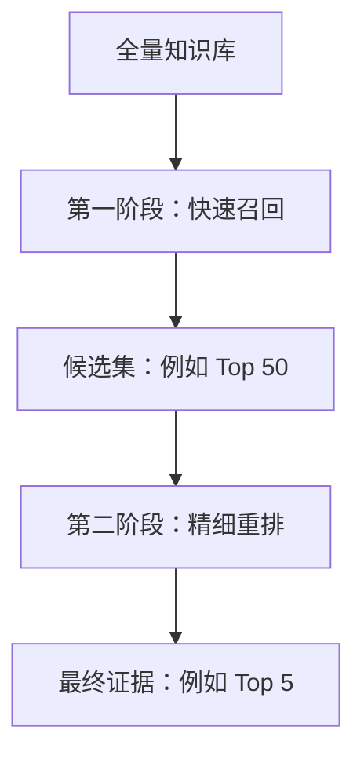
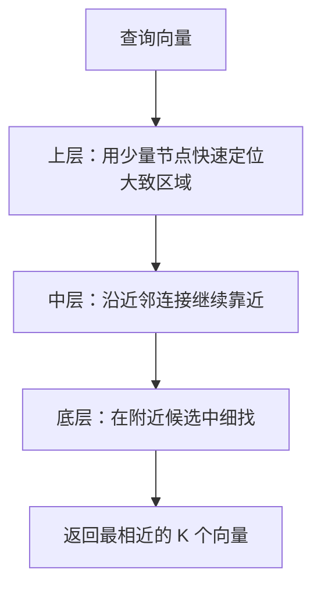
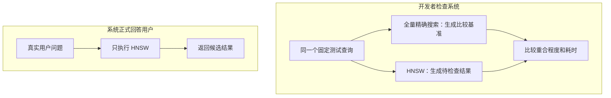
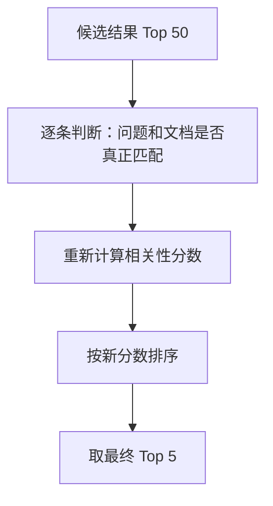
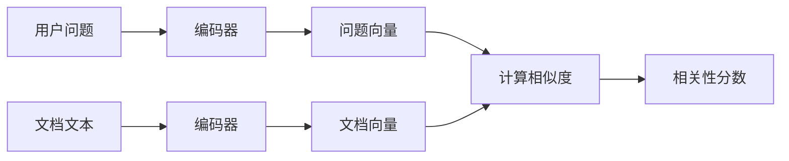
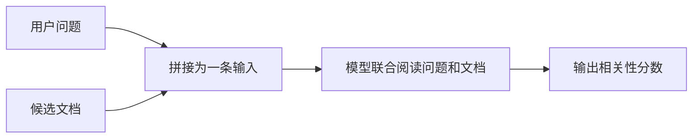
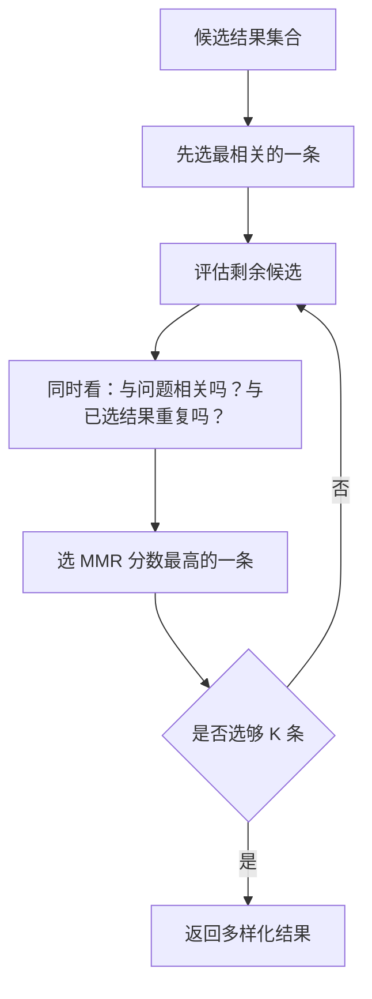
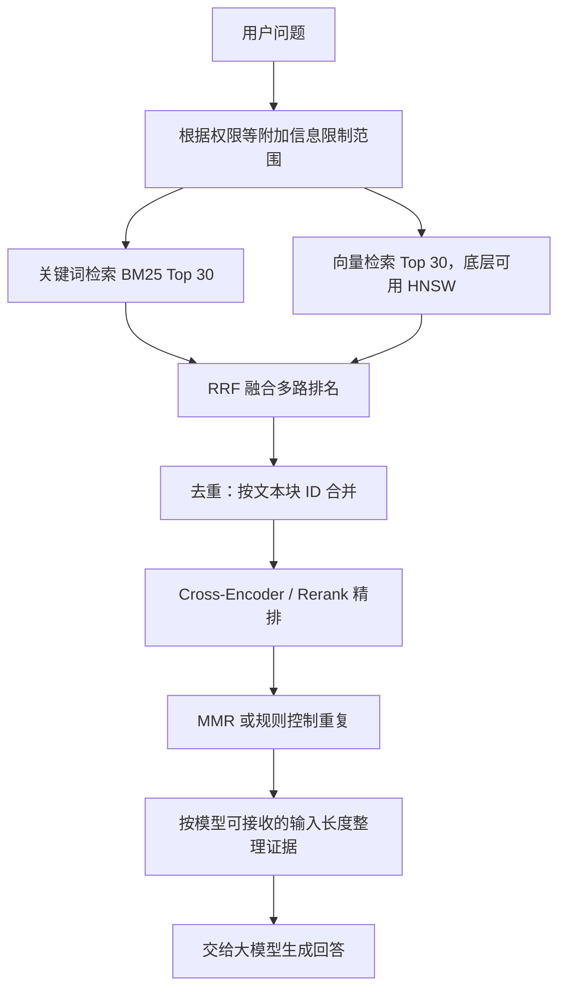
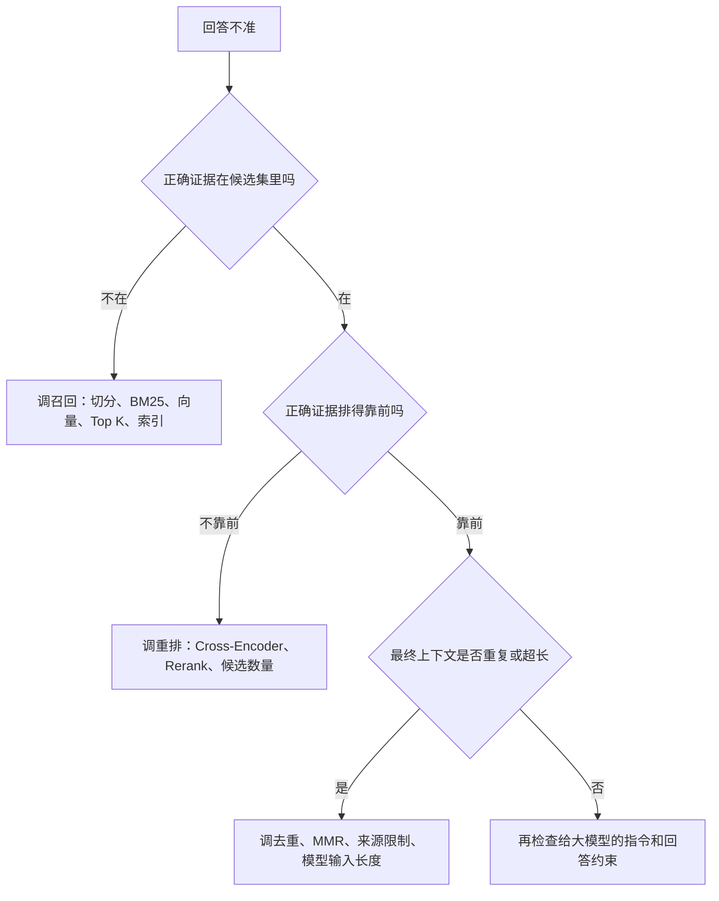

# 大模型应用开发学习 11：检索质量优化：从召回到融合再到重排

前面聊到混合检索时，已经能看到一个很现实的问题：

> 知识库问答的质量，不只取决于大模型会不会写回答，也取决于系统能不能先把正确资料找出来。

但“找出来”这件事，还可以继续拆。

很多时候，系统并不是完全没找到正确资料，而是出现了更微妙的问题：

- 正确资料在第 5 名，但最终只取了前 3 条；
- 召回结果里有很多重复片段，占满了上下文；
- 关键词检索和向量检索都返回了一些结果，但不知道怎么合并；
- 向量库很大，无法每次都把所有向量逐个比较；
- 模型生成答案时引用了看起来相关、其实答偏了的资料。

所以这一篇想解决的问题不是“再学几个算法名”，而是把检索链路看完整：

> **从海量资料中快速捞出候选，融合多路结果，再认真重排，最后控制重复并整理成适合大模型使用的证据。**

如果上一篇讨论的是“关键词检索和向量检索为什么要配合”，这一篇更进一步：

> 检索结果已经有了，怎样让最终送给大模型的证据更可靠。

两篇的边界可以先这样划分：

- 上一篇解决“关键词检索和向量检索为什么要配合，以及怎样形成统一候选集”；
- 本篇从这个候选集继续往后，解决“怎样稳定融合、精细重排、减少重复并评估效果”。

所以下面再次出现 BM25 和向量检索时，不再重新解释它们各自怎样计算分数，而是把它们当作已经能够返回候选的两条召回路线。

这一篇会连续遇到几个新方法，但不会先列出一排缩写让读者记忆。可以先只看系统遇到了什么问题：

| 系统遇到的问题 | 先用人话理解 |
| --- | --- |
| 向量有几十万、几百万个，逐个比较太慢 | 想办法少检查一些向量，更快找到附近结果 |
| 正确资料找到了，却排在错误资料后面 | 对少量候选重新认真判断一次 |
| BM25 和向量检索各有一份排名，不知道怎么合并 | 不直接相加两种不同尺度的分数，改为综合名次 |
| 前几条资料几乎在重复同一件事 | 在保持相关的同时，补充不同信息 |
| 调整以后不知道是不是真的变好了 | 用固定问题检查是否找得到、排得准、跑得快 |

后面每一节都会先把其中一个问题讲清楚，再告诉你解决它的方法叫什么。第一次阅读只抓住问题、解决思路和它在流程中的位置即可；公式、参数和完整代码可以留到第二遍。

阅读过程中还会看到两种不同的场景，也需要提前分清：

| 场景 | 谁在做什么 | 目的 |
| --- | --- | --- |
| 系统正式回答问题 | 用户提交一个问题，系统立即检索并返回证据 | 尽量又快又准地完成这一次查询 |
| 开发者检查系统 | 开发者使用一批固定问题反复测试不同配置 | 判断修改以后是否真的更好 |

这两种场景有时会使用相同的问题，却不是同一条执行流程。在工程中，它们通常分别称为：

- 系统正在处理真实用户请求，通常叫作**线上查询**；
- 开发者拿固定问题比较不同方案，通常叫作**离线评估**。

这里的“线上”不是单纯指连接互联网，而是“正在正式服务用户”；“离线”也不是断网，而是“测试过程不在真实用户的请求链路中”。后文讨论正式检索流程时使用前一种场景，讨论参数和质量比较时使用后一种场景。

## 先用一个失败案例看清问题

假设有一个售后知识库，里面有几段文档：

| 文档 ID | 内容 | 说明 |
| --- | --- | --- |
| `return-7-days` | 用户签收商品后 7 日内可申请无理由退货，商品需保持完好。 | 正确答案 |
| `refund-3-days` | 退款将在收到退货并检验合格后的 3 个工作日内原路退回。 | 讲退款到账 |
| `exchange-15-days` | 质量问题商品 15 日内可申请换货，需提供照片凭证。 | 讲换货 |
| `shipping-presale` | 预售商品以商品页标注的发货时间为准。 | 讲发货 |
| `return-package` | 退货时请保留原包装、配件、赠品和发票。 | 讲退货材料 |

用户问：

```text
多少天内可以退货？
```

理想情况下，系统应该把 `return-7-days` 放在最前面，因为它直接回答了“多少天内可以退货”。

但粗检索可能会返回这样的结果：

| 粗排排名 | 文档 ID | 为什么会被找出来 |
| --- | --- | --- |
| 1 | `refund-3-days` | 有“退”“3 个工作日” |
| 2 | `exchange-15-days` | 有“15 日内”和售后语义 |
| 3 | `return-7-days` | 真正回答退货期限 |
| 4 | `return-package` | 有“退货” |
| 5 | `shipping-presale` | 与时效相关，但偏题 |

这时如果系统只取第一条给大模型，大模型可能回答：

```text
退款一般在 3 个工作日内到账。
```

这句话本身可能没错，但它没有回答用户问的“退货期限”。  
问题不在生成阶段，而在检索阶段：正确证据被找到了，却排得不够靠前。

这就是检索质量优化要处理的典型场景。

可以先把一条常见链路看成五步：

下面流程中的 Top K 表示“排序后取前 K 条”。例如 Top 50 是先保留前 50 条候选，Top 5 是最后取前 5 条证据。K 只是一个可以调整的数量，不是某种检索算法。


图中的每一步处理一种不同的问题，它们不是几个意思相近的“排序”名称。后面判断一种方法应该放在哪里时，要看它接收什么输入、解决什么问题。

系统并不只有一种固定顺序。有的系统会先融合多路候选，再统一重排；也有系统先分别重排，再合并结果。为了让第一次阅读不在流程中来回跳，下面先沿着一条主线理解：快速找候选、处理候选排名、合并多路结果、减少重复，最后再看开发者怎样检查整条链路。

## 召回不是越少越精准，而是先保证别漏

入门时很容易把检索想成一次排序：系统从全库里找到最相关的 5 条，然后直接交给大模型。

真实系统通常不是这样。

原因很简单：全库可能有几万、几十万甚至上百万个文本块。每次都用最精细的模型逐条判断，延迟和成本都会很高。

所以常见做法是两段式：



第一阶段的目标不是“百分百排准”，而是：

> **把正确答案尽量放进候选集。**

这和筛简历很像。

第一轮 HR 可能先按关键词、工作年限、技术栈筛出 100 份简历。这个阶段不能太苛刻，因为太苛刻会漏掉好候选。  
第二轮技术面试官再认真看这 100 份，判断谁真的匹配岗位。

检索也是一样：BM25、向量检索或混合检索先快速找出一批候选，更细的判断留给后续阶段。接下来先看一个具体问题：当向量数量非常多时，向量检索怎样避免每次都把全库比较一遍。

如果召回阶段没有把正确文档捞进候选集，后面的重排再强也救不回来。

这句话很关键：

> **重排只能在候选集里重新排序，不能凭空找回没被召回的文档。**

所以实际调系统时，不能只看最终答案好不好，还要回头检查：

- 正确证据有没有进入候选集；
- 正确证据排在第几名；
- 候选集里有多少重复内容；
- 候选数量是不是太少；
- 查询里的错误码、数字、日期、字段名有没有被保住。

## 向量太多时，怎样避免挨个比较

先看一个非常朴素的性能问题。

假设知识库里只有 100 个文本块。用户的问题变成向量以后，让它和 100 个文档向量逐个比较，通常没有什么压力。

但如果知识库里有 100 万个文本块，每次查询都要完成下面这件事：

```text
查询向量
  ↓
依次和 100 万个文档向量计算距离
  ↓
排序并取最相近的 5 个
```

这种“全部比较一遍”的方法通常叫精确搜索或暴力搜索。它的好处是不会因为少检查了一些向量而漏掉真正的最近邻；问题是数据越多，计算量越大。

工程上于是出现了一个新的问题：

> 能不能不要检查全部向量，也能较快找到大概率最相近的那些向量？

这类“少检查一部分向量，尽量找到真正近邻”的方法，统称为**近似最近邻搜索**。它的英文是 Approximate Nearest Neighbor，后文简称 ANN。“近似”表示它优先追求速度，不保证每次结果都与全量精确搜索完全相同。

解决这个问题的方法不止一种。接下来要介绍的 HNSW，就是常用的 ANN 索引之一。它的全称是 Hierarchical Navigable Small World，可以先把它理解成：

> **提前把向量组织成一张分层的近邻导航图，查询时沿着图逐步靠近目标区域，而不是把全库检查一遍。**

这里的“节点”就是文档向量，“边”表示两个向量彼此比较接近。上层节点少，适合快速跨越较远区域；越往下节点越多，搜索也越细。



可以把它想成去陌生城市找一家餐厅：

- 全量精确搜索像是把全市每条街、每家店都检查一遍；
- HNSW 像是先通过快速路到达目标城区，再进入街道，最后检查附近几家店。

这个比喻最重要的不是“道路”，而是搜索范围逐层缩小。它解释了 HNSW 为什么快，也解释了它为什么可能漏：如果前面走进了一个看起来很近、实际却不是最佳答案的区域，搜索可能没有访问到真正最近的那个节点。

因此，HNSW 没有给向量增加新的语义能力。文本能不能被正确表示，仍由前面讲过的文本向量表示模型，也就是 Embedding 模型决定；HNSW 只是帮助系统更快地在已有向量中寻找近邻。

可以先把它放回整条链路：

```text
文本 -> Embedding 向量
              ↓
       HNSW 帮助快速找近邻
              ↓
          得到向量候选
```

到这里，第一次阅读需要掌握的 HNSW 内容已经结束。下面的参数和代码是在回答第二个问题：怎样控制“搜索快一点”还是“尽量少漏一点”。

**速度和完整度为什么不能同时无限提高？**

查询时，如果只探索很少的图节点，速度会更快，但也更容易错过真实近邻；如果愿意探索更多节点，结果通常更接近全量精确搜索，但查询会变慢。

```text
探索范围更小 -> 查询更快 -> 更可能漏掉真实近邻
探索范围更大 -> 查询更慢 -> 更接近精确搜索结果
```

不少向量检索系统会提供查询时的探索范围参数，常见名称包括 `ef` 或 `efSearch`。具体名称要以所使用的数据库为准。

HNSW 中经常一起出现三个参数。可以把它们分别理解成“路修得多密”“修路时考察得多仔细”“这次导航愿意找多宽”：

| 参数 | 发生阶段 | 白话理解 | 调大后的常见影响 |
| --- | --- | --- | --- |
| `M` | 建立索引 | 每个节点可以保留多少条近邻连接 | 图更密，通常更容易找到近邻，但占用更多内存 |
| `ef_construction` | 建立索引 | 插入节点、选择连接时愿意考察多少候选 | 索引通常更好，但构建时间增加 |
| `ef` / `efSearch` | 查询 | 本次搜索愿意保留和探索多大的候选范围 | 通常更少漏，但查询延迟增加 |

前两个参数主要决定“索引怎样建”，最后一个参数决定“这一次查询找多宽”。它们不是相关性权重，也不会让模型更理解文本。

如果使用 `hnswlib`，最小实验可以这样写：

```bash
pip install hnswlib numpy
```

```python
import hnswlib
import numpy as np

dimension = 128
document_count = 1000

rng = np.random.default_rng(42)
document_vectors = rng.random(
    (document_count, dimension),
    dtype=np.float32,
)

index = hnswlib.Index(space="cosine", dim=dimension)
index.init_index(
    max_elements=document_count,
    M=16,
    ef_construction=200,
)

document_ids = np.arange(document_count)
index.add_items(document_vectors, document_ids)

# 查询时的探索范围。它和最终返回数量 k 不是一回事，且不能小于 k。
index.set_ef(50)

query_vector = rng.random((1, dimension), dtype=np.float32)
labels, distances = index.knn_query(query_vector, k=5)

print(labels[0])
print(distances[0])
```

这里 `k=5` 表示最终返回 5 个近邻，`set_ef(50)` 表示查询过程中维护一个更宽的动态候选范围。在 `hnswlib` 中，`ef` 至少不能小于 `k`；提高 `ef` 通常会提高召回完整度，同时增加查询时间。

注意，这段代码只是展示参数放在哪里。随机向量没有真实业务语义，不能用来证明某组参数适合实际知识库。

**怎样评估 HNSW 的速度和完整度？**

HNSW 通过减少实际检查的向量数量来提高速度，因此也可能漏掉原本应该排在前面的近邻。参数设置是否合适，不能只看查询快不快，还要测量它与精确搜索相比丢失了多少结果。

评估时，开发者会准备一批有代表性的固定查询，例如 500 个，并让每个查询分别经过两种搜索：

- 全量精确搜索：虽然慢，但能找出真正最近的向量，作为比较基准；
- HNSW 近似搜索：速度快，用来检查它与基准相比漏掉了多少。

这里的精确搜索相当于一把测量用的尺子：它虽然慢，但可以给出未经过近似处理的结果。HNSW 是正在接受检查的方案。把两边的结果和耗时进行比较，就能知道 HNSW 用多少结果完整度换来了多少速度。

这个比较属于离线评估，不是用户查询流程的一部分。参数确定后，系统正式处理用户请求时只运行 HNSW，不会先执行一次精确搜索。



图中的两条分支代表两个不同阶段：上半部分用于开发和调参，下半部分才是系统投入使用后的查询过程。

例如在离线评估中，某个查询经过全量精确搜索得到的前 5 个向量 ID 是：

```text
[8, 21, 35, 70, 92]
```

同一个查询经过 HNSW 找到的是：

```text
[8, 21, 35, 70, 101]
```

两边有 4 个结果重合，这一次查询的 ANN Recall@5 就是 $4/5=80\%$。它衡量的是 HNSW 对“精确近邻结果”的还原程度，不是在判断文档能不能正确回答业务问题。

对整批测试查询求平均后，可以比较不同配置：

| 搜索方式或配置 | ANN Recall@5 | 平均耗时 | 使用位置 |
| --- | ---: | ---: | --- |
| 全量精确搜索 | 100% | 800 ms | 离线生成比较基准 |
| HNSW，`ef=20` | 82% | 5 ms | 速度快，但可能漏得较多 |
| HNSW，`ef=50` | 95% | 12 ms | 速度和完整度较均衡 |
| HNSW，`ef=100` | 98% | 25 ms | 更完整，但查询更慢 |

这些数字只是帮助理解的示例，不代表所有项目的实际结果。项目可以根据离线评估选择一个能够接受的配置，然后把它用于线上查询。两种场景可以收束成：

```text
开发或定期评估时：少量固定查询分别跑精确搜索和 HNSW，用来选参数
线上正式运行时：真实查询只跑已经调好参数的 HNSW
```

调参时应该固定同一份查询集，比较 ANN Recall@K 和查询延迟，而不是只看某一次返回结果是否顺眼。调整 HNSW 时需要同时测量：

| 观察项 | 想回答的问题 |
| --- | --- |
| ANN Recall@K | 相比精确搜索，真实近邻找回了多少 |
| 查询延迟 | 为了多找回一些结果，耗时增加了多少 |
| 内存和索引大小 | 图结构带来了多少资源成本 |
| 业务效果 | 真正能回答问题的资料有没有进入候选集 |

如果还想判断“找到的近邻能不能真正回答业务问题”，就需要提前由人工标出每个问题对应的正确资料，再检查前 K 条结果找回了多少。这个指标后文会具体介绍，通常叫作**业务 Recall@K**。

因此，有两个容易混淆的“召回率”，它们判断的不是同一件事：

- **ANN Recall@K** 比较的是近似搜索与精确向量搜索，用来评价索引有没有漏掉本该找到的近邻；
- **业务 Recall@K** 比较的是检索结果与人工标注的正确证据，用来评价系统有没有找到真正能回答问题的资料。

ANN Recall@K 很高，不代表业务检索一定好。如果 Embedding 模型不合适、文本切分不合理或知识库内容本身有问题，系统可以非常准确地找回一批“语义上相近但不能回答问题”的文档。

所以 HNSW 在整条检索链路里的位置是：

> **它是向量召回的性能与完整度调节器，不是新的语义理解模型，也不是最终排序器。**

## 重排：把“可能相关”改成“更能回答问题”

HNSW 解决的是“向量很多时，怎样更快得到候选”。候选找回来以后，开头失败案例里的问题仍然存在：真正能回答问题的资料可能排得不够靠前。

候选出来以后，系统通常还会遇到两个不同问题：一是候选内部的先后顺序不够准，二是 BM25 和向量检索各自返回了一份列表，需要合成一份列表。本节先处理第一个问题，下一节再处理第二个问题。这样安排是为了分别看清两种方法的职责，不表示所有系统都必须按这个顺序执行。

召回阶段通常会故意多找一些候选。  
但候选多了以后，接下来就需要回答：

> 这些候选里，哪几条最能回答用户的问题？

这就是重排。

重排的英文常写作 Rerank。它不是重新去全库搜索，而是接收第一阶段召回出来的一小批候选，比如 20 条、50 条、100 条，然后重新打分排序。

可以这样理解：



回到前面的售后例子。

查询是：

```text
多少天内可以退货？
```

候选里有两条：

```text
A：签收 7 日内可无理由退货，商品需保持完好。
B：退款将在收到退货并检验合格后的 3 个工作日内原路退回。
```

粗检索可能觉得两条都很相关，因为它们都有“退”“日”“货”这些字。  
但重排模型会更关注问题和文档之间的对应关系：

| 查询关注点 | 文档 A | 文档 B |
| --- | --- | --- |
| 问的是退货期限 | 直接回答 7 日内可退货 | 讲退款多久到账 |
| 问的是“多少天内” | 有 7 日内 | 有 3 个工作日，但对象是退款 |
| 能否支撑最终回答 | 能 | 容易答偏 |

所以重排应该把 A 排到 B 前面。

这就是重排的核心价值：

> **召回阶段负责把可能相关的内容捞进来，重排阶段负责把真正能回答问题的内容顶上去。**

## 为什么快速召回和精细重排使用不同方式

现在已经知道，第一阶段需要快速处理大量文档，第二阶段只需要认真判断少量候选。两种阶段的任务不同，因此常用的模型处理方式也不同。

它们要表达的区别很简单：**是先把问题和文档分开处理以追求速度，还是把两者放在一起精读以追求判断质量。**

它们分别叫：

- Bi-Encoder，双编码器；
- Cross-Encoder，交叉编码器。

它们不是厂商名，也不是某个具体产品，而是两类常见模型结构。`Bi` 可以先理解成“两边分开编码”，`Cross` 可以先理解成“问题和文档放在一起交互判断”。

### 第一种方式：问题和文档分别处理

向量检索常用的是“问题和文档分别编码”的思路。这类结构叫 Bi-Encoder，中文常译为双编码器。

它的流程是：



问题和文档是分开编码的。

优点是快：

- 文档向量可以提前算好；
- 查询来了只需要算查询向量；
- 然后在向量库里快速找近邻。

缺点是细节交互不够：

- 文档编码时不知道用户会问什么；
- 问题编码时也看不到具体文档；
- 两边最后只靠向量相似度判断。

这就像两个人各自写一份摘要，再比较摘要像不像。速度快，但细节容易丢。

### 第二种方式：把问题和文档放在一起判断

另一种方式不提前单独保存文档判断结果，而是让模型同时阅读问题和当前候选文档。这类结构叫 Cross-Encoder，中文常译为交叉编码器。

它把问题和文档拼在一起，让模型同时阅读：

```text
用户问题：多少天内可以退货？
候选文档：用户签收商品后 7 日内可申请无理由退货。
```

然后模型直接输出一个相关性分数。

流程可以这样看：



因为问题和文档在模型内部可以互相“看见”，它更容易捕捉细节：

- “退货”不是“退款”；
- “7 日内”回答的是期限；
- “3 个工作日”回答的是到账时间；
- “质量问题可换货”不是无理由退货。

所以 Cross-Encoder 通常更适合重排。

但它也更慢。

原因是：每一个查询和每一篇候选文档都要重新拼接、重新跑模型。

如果有 100 万篇文档，就不能直接对全库逐条用 Cross-Encoder 打分。  
更合理的做法是：


可以把两者对比成一张表：

| 对比项 | Bi-Encoder | Cross-Encoder |
| --- | --- | --- |
| 输入方式 | 问题和文档分别编码 | 问题和文档拼在一起 |
| 文档能否预计算 | 可以 | 不可以 |
| 速度 | 快 | 慢 |
| 匹配特点 | 适合快速比较大量文档 | 通常更擅长细粒度匹配 |
| 适用数据量 | 大规模文档库 | 少量候选 |
| 典型位置 | 第一阶段 | 第二阶段 |

这也是为什么“召回 + 重排”会成为常见结构：

> 快模型负责大范围找候选，慢模型负责小范围认真判断。

常见重排器会逐条接收“查询—文档”文本对，为每条候选计算相关性分数，最后再统一排序。入门阶段理解这条处理链路就足够了，不必继续展开其他训练和排序方式。

把重排接入代码时，核心并不复杂。假设召回阶段已经返回统一结构的候选：

```python
[
    {"id": "doc-001", "text": "..."},
    {"id": "doc-002", "text": "..."},
]
```

重排函数只需要把查询分别和每条候选组成一对，再调用重排模型打分：

```python
def rerank(query, candidates, rerank_model, final_k=5):
    pairs = [
        (query, candidate["text"])
        for candidate in candidates
    ]

    scores = rerank_model.predict(pairs)

    reranked = []
    for candidate, score in zip(candidates, scores):
        item = candidate.copy()
        item["rerank_score"] = float(score)
        reranked.append(item)

    reranked.sort(
        key=lambda item: item["rerank_score"],
        reverse=True,
    )

    return reranked[:final_k]
```

为了只验证代码流程，可以先准备一个非常简陋的假重排器：

```python
class ToyReranker:
    def predict(self, pairs):
        scores = []

        for query, document in pairs:
            query_chars = set(query.replace(" ", ""))
            document_chars = set(document.replace(" ", ""))

            if not query_chars:
                scores.append(0.0)
                continue

            overlap = query_chars.intersection(document_chars)
            scores.append(len(overlap) / len(query_chars))

        return scores


query = "多少天内可以退货？"
candidates = [
    {"id": "A", "text": "签收 7 日内可无理由退货。"},
    {"id": "B", "text": "退款将在 3 个工作日内到账。"},
    {"id": "C", "text": "质量问题商品 15 日内可以换货。"},
]

results = rerank(
    query=query,
    candidates=candidates,
    rerank_model=ToyReranker(),
    final_k=2,
)

print(results)
```

这个类只按公共字符比例打分，**不是 Cross-Encoder，也不能代表真实重排效果**。它的价值只是让“组成文本对、批量打分、排序、截断”这条代码链路先跑通。接入本地 Cross-Encoder 或在线 Rerank API 时，只需要把 `ToyReranker` 换成真正的模型封装。

这里的 `rerank_model` 代表项目选用的 Cross-Encoder 或 Rerank 服务封装。真实模型最好批量接收全部文本对，避免逐条调用造成额外开销。接入时还要确认三个边界：

- 模型是否适合当前语言和业务领域；
- 查询与文档拼接后是否超过模型最大输入长度；
- 一次重排多少候选，能否满足延迟和费用要求。

重排候选也不是越多越好。候选太少可能漏掉正确证据，候选太多则会增加模型调用量和延迟。更合理的做法是用评估集比较 Top 20、Top 50、Top 100 等配置，而不是凭感觉固定一个数字。

这里要区分两个 Top K：上一篇讨论的是 BM25、向量检索每一路分别召回多少；这里讨论的是融合去重后，有多少统一候选进入重排模型。前者影响候选覆盖，后者直接影响重排延迟和费用。

重排分数也不能默认理解成概率。不同模型可能输出 $0$ 到 $1$、任意实数或经过内部变换的分数，而且同一个固定阈值不一定适合所有问题。因此：

- 重排分最可靠的用途是决定当前候选集里的相对顺序；
- 可以用它辅助观察区分度和调试；
- 不建议刚开始就写成 `score < 0.2` 一律拒答；
- 如果确实需要阈值，应该用标注数据单独校准并持续评估。

## 两路检索结果怎样合成一份排名

上一篇已经用 `ERR-5021` 案例建立了两路候选列表，也解释了为什么 BM25 分数与向量距离不能直接相加。本篇沿用那两份排名，具体回答当时留下的问题：**怎样用名次得到一份统一列表？**

一种容易理解的思路是暂时不看原始分数，只看每条文档在各自列表中排第几。可以把它理解成“按照名次投票”。

这种排名融合方法叫 RRF。

RRF 的全称是 Reciprocal Rank Fusion，通常译作倒数排名融合。

它的关键思路是：

> 不直接看原始分数，只看每个文档在各个列表里的排名。

排名越靠前，贡献越大。  
同一个文档如果在多个列表里都靠前，最终分数就会更高。

RRF 的公式是：

$$
\text{RRF}(d)=\sum_{i=1}^{n}\frac{1}{k+\text{rank}_i(d)}
$$

其中：

- $d$ 表示某个文档；
- $n$ 表示一共有多少个排名列表；
- $\text{rank}_i(d)$ 表示文档 $d$ 在第 $i$ 个列表里的排名；
- $k$ 是平滑常数，常见取值是 60；
- 如果文档没有出现在某个列表里，这个列表就不给它加分。

这里的 $k$ 只是 RRF 公式里的平滑常数，不是“返回前多少条”的 Top K，也不是 HNSW 查询中的 `ef`。虽然都可能写成字母参数，但它们控制的是完全不同的事情。

$k$ 决定不同名次之间的分数差距：

| $k$ 的变化 | 排名影响 |
| --- | --- |
| 较小 | 更强调头部名次，第 1 名和后面名次的差距更明显 |
| 较大 | 排名贡献更平滑，多路共同出现的重要性相对更突出 |

`60` 是很常见的默认值，但不是所有数据集上的固定最优答案。入门时可以先使用 60 建立基线；只有评估结果表明需要调整时，再比较其他取值。

用一个小例子看：

| 文档 | BM25 排名 | 向量检索排名 |
| --- | --- | --- |
| `support-api-err-5021` | 1 | 2 |
| `support-payment-delay` | 2 | 1 |
| `support-api-err-5030` | 3 | 未出现 |
| `support-refund-policy` | 未出现 | 3 |

如果 $k=60$，那么：

$$
\text{RRF}(\text{support-api-err-5021})=\frac{1}{60+1}+\frac{1}{60+2}
$$

$$
\text{RRF}(\text{support-payment-delay})=\frac{1}{60+2}+\frac{1}{60+1}
$$

两者的分数相同，约为：

$$
0.03252
$$

这是合理的，因为它们分别在一路排第 1、另一路排第 2，标准 RRF 会把这种情况看成相同的排名组合。

而只在一路出现的文档，分数会低一些：

$$
\text{RRF}(\text{support-api-err-5030})=\frac{1}{60+3}
$$

RRF 的好处是：

- 不要求不同检索器的原始分数可比；
- 实现简单；
- 对多个排名列表都适用；
- 很适合关键词检索和向量检索的融合。

可以用一段伪代码理解：

```python
def rrf(rankings, k=60):
    scores = {}

    for ranking in rankings:
        for rank, doc_id in enumerate(ranking, start=1):
            scores.setdefault(doc_id, 0.0)
            scores[doc_id] += 1 / (k + rank)

    return sorted(scores.items(), key=lambda item: item[1], reverse=True)
```

这里的 `rankings` 可以是：

```python
[
    ["support-api-err-5021", "support-payment-delay", "support-api-err-5030"],
    ["support-payment-delay", "support-api-err-5021", "support-refund-policy"],
]
```

RRF 关心的是“排第几”，不是“原始分数是多少”。

这对混合检索很友好。

如果最终只是按照 RRF 分数排序，通常不需要再把它归一化到 $0$ 到 $1$。只有当 RRF 分数还要和其他特征进入下一层计算时，才需要先明确新的组合方式和分数尺度。

上一篇的查询路由会根据问题特征调整两路候选数量，例如错误码查询让 BM25 多召回一些。进入融合阶段后，如果评估结果表明不同检索路线的可信度确实不同，还可以进一步使用加权 RRF：

$$
\text{WeightedRRF}(d)=
\sum_{i=1}^{n}\frac{w_i}{k+\text{rank}_i(d)}
$$

其中 $w_i$ 是第 $i$ 路检索的权重。例如查询里包含明确错误码时，可以让 BM25 的权重大于向量检索。

但权重不能只凭直觉长期固定。更稳的方式是先用默认等权 RRF 建立基线，再根据不同查询类型的离线评估结果调整。

读完这一节，可以先只留下一个判断：

> RRF 不负责重新理解文档内容，它只是把多路检索的名次转换成可以共同累加的票数。

## 为什么不能只返回一堆相似内容

前面已经把多路结果合成了一份排名。  
但融合之后，还有另一个问题：结果可能很重复。

减少重复并不是每次检索都必须经过的新关卡。只有当候选已经比较相关，但前几条彼此过于相似、挤占有限上下文时，才需要考虑它。

假设用户问：

```text
Python 怎么读取文件？
```

检索结果可能是：

| 排名 | 内容 |
| --- | --- |
| 1 | Python 可以使用 `open()` 读取文件。 |
| 2 | 使用 `open(file, 'r')` 可以读取文本文件。 |
| 3 | `with open(...) as f` 是读取文件的推荐写法。 |
| 4 | 读取文件后要注意关闭文件句柄。 |
| 5 | Python 文件模式包括读取、写入、追加。 |

这些都相关，但前 3 条高度重叠。  
如果最终只给大模型 3 条证据，可能全都在讲 `open()`，而没有覆盖“关闭文件”“读取模式”“异常处理”等信息。

这时就需要一种方法，在“与问题相关”和“不要重复已有内容”之间做平衡。这通常叫多样性控制。

MMR 是一种常见的多样性控制方法。

MMR 的全称是 Maximal Marginal Relevance，通常译作最大边际相关性。

它想平衡两件事：

- 结果要和查询相关；
- 结果之间不要太重复。

公式可以写成：

$$
\operatorname{MMR}(D_i)=
\lambda \cdot \operatorname{Sim}_1(D_i,Q)
-
(1-\lambda)\cdot \max_{D_j\in S}\operatorname{Sim}_2(D_i,D_j)
$$

其中：

- $D_i$ 是当前正在评估的候选文档；
- $Q$ 是用户查询；
- $S$ 是已经选中的文档集合；
- $\operatorname{Sim}_1(D_i,Q)$ 表示候选文档和查询的相关性；
- $\operatorname{Sim}_2(D_i,D_j)$ 表示候选文档和已选文档的相似度；
- $\lambda$ 是 0 到 1 之间的参数，用来平衡相关性和多样性。

这条公式看起来有点长，但直觉很简单：

```text
MMR 分数 = 与问题的相关性奖励 - 与已选结果重复的惩罚
```

如果一篇文档和问题很相关，它会加分。  
如果它和已经选中的文档很像，它会被扣分。

### 用一个小例子看它怎样减少重复

假设系统已经选中了：

```text
文档 A：Python 可以使用 open() 读取文件。
```

现在有两个候选：

```text
文档 B：使用 open(file, 'r') 可以读取文本文件。
文档 C：读取文件时建议使用 with 语句自动关闭文件。
```

B 和查询很相关，但和 A 很像。  
C 也相关，而且补充了“自动关闭文件”的信息。

如果只按相关性排序，B 可能排在 C 前面。  
如果用 MMR，C 有机会被选上，因为它提供了新的信息角度。

用一组简化数字代入会更直观。假设：

- $\lambda=0.7$，表示仍然以相关性为主；
- B 与查询的相关性是 $0.92$，B 与已选文档 A 的相似度是 $0.90$；
- C 与查询的相关性是 $0.82$，C 与已选文档 A 的相似度是 $0.30$。

B 的 MMR 分数是：

$$
0.7\times0.92-0.3\times0.90=0.374
$$

C 的 MMR 分数是：

$$
0.7\times0.82-0.3\times0.30=0.484
$$

虽然 B 单独看起来与查询更相关，但它和 A 太相似，重复惩罚更大，因此这一轮会选择 C。

这个数字例子还有一个工程前提：相关性分数和文档相似度必须处在可合理比较的尺度上。如果一个值来自重排模型的任意范围分数，另一个值是 $0$ 到 $1$ 的余弦相似度，就不能不做处理直接代入。实际实现要先确认分数含义，并在需要时把它们转换到可以比较的范围。

MMR 不是为了故意降低相关性，而是为了避免上下文被重复内容占满。

它的步骤可以这样理解：



把这个贪心选择过程写成代码，可以先假设两类分数已经计算好了：

- `relevance_scores[i]` 表示第 $i$ 篇文档与查询的相关性；
- `document_similarities[i][j]` 表示第 $i$、$j$ 篇文档之间的相似度。

```python
def mmr_select(
    relevance_scores,
    document_similarities,
    final_k=3,
    lambda_mult=0.7,
):
    document_count = len(relevance_scores)

    if document_count == 0 or final_k <= 0:
        return []

    final_k = min(final_k, document_count)

    first_index = max(
        range(document_count),
        key=lambda index: relevance_scores[index],
    )
    selected = [first_index]

    while len(selected) < final_k:
        remaining = [
            index
            for index in range(document_count)
            if index not in selected
        ]

        def calculate_mmr(index):
            max_redundancy = max(
                document_similarities[index][selected_index]
                for selected_index in selected
            )

            return (
                lambda_mult * relevance_scores[index]
                - (1 - lambda_mult) * max_redundancy
            )

        next_index = max(remaining, key=calculate_mmr)
        selected.append(next_index)

    return selected
```

这个函数返回被选中的文档下标。实际系统可以用向量相似度生成 `document_similarities`，用向量检索分数或经过校准的重排分数生成 `relevance_scores`。

MMR 每一轮只选择“当前看起来最好”的一条结果，选完以后不回头修改前面的选择。这种做法通常叫作贪心策略。它实现简单、速度可控，但前面选中的结果会影响后续判断，因此不保证得到整体上最好的组合。MMR 更适合处理经过召回和重排后的一小批候选，不适合直接在整个知识库上运行。

参数 $\lambda$ 很关键：

| $\lambda$ | 偏向 | 可能效果 |
| --- | --- | --- |
| 接近 1 | 更重视相关性 | 结果更集中，但可能重复 |
| 接近 0 | 更重视多样性 | 结果更分散，但可能偏离问题 |
| 0.5 到 0.8 | 平衡 | 常见起点，需要结合业务调 |

在知识库问答里，不建议为了多样性牺牲太多相关性。  
因为最终目的是回答问题，不是展示五花八门的内容。

更稳的理解是：

> MMR 适合在“候选都比较相关”的前提下，减少重复，提升信息覆盖。

## 把这些方法放回一条真实流水线

到这里，几个概念就能连起来了。

在完整流程里，系统通常还要先根据权限、部门、时间和文档类型限制搜索范围。这些“描述资料的附加信息”常被称为 Metadata，也就是元数据。它们不一定直接参与回答，却决定哪些资料允许进入本次搜索。

它们不是并列替代关系，而是站在不同位置：

| 环节 | 解决的问题 | 典型方法 |
| --- | --- | --- |
| 范围过滤 | 哪些资料允许进入本次搜索 | 使用权限、租户、时间、文档类型等附加信息过滤 |
| 快速召回 | 从允许搜索的资料里找出候选 | BM25、向量检索；HNSW 可加速向量召回 |
| 多路融合 | BM25 和向量检索结果怎么合并 | RRF、加权融合 |
| 精细重排 | 候选里谁最能回答问题 | Cross-Encoder、Rerank |
| 多样性控制 | 避免重复结果占满上下文 | MMR、去重、分组 |
| 上下文整理 | 控制长度、顺序和来源覆盖 | 控制最终条数、模型输入长度，以及是否补回文本块所属的大段落 |

上一篇已经加入了查询路由，因此这条流水线不必对所有查询机械地执行全部步骤：

- 纯错误码或精确编号查询可以只走 BM25，只有一路结果时不需要 RRF；
- 普通自然语言或混合查询可以同时走 BM25 和向量检索，再执行融合；
- 候选本来就很少、排序已经稳定时，可以跳过昂贵的重排；
- 结果没有明显重复时，也不必为了使用 MMR 而强行打散结果。

流水线的意义是明确每个问题由哪一层负责，不是要求每次查询把所有算法完整跑一遍。

一条比较完整的检索流水线可以这样设计：



这条链路里，每一步都有自己的目标。

**BM25 负责抓硬线索。**

比如错误码、字段名、函数名、编号、日期。

**向量检索负责抓语义。**

比如用户换一种说法、口语化表达、同义描述。

**HNSW 让大规模向量检索跑得更快。**

它解决的是性能问题，让系统不用每次全量扫描。

**RRF 负责把多路排名合起来。**

它不直接比较不同检索器的原始分数，而是用排名做融合。

**Rerank 负责重新精读候选。**

它把“可能相关”进一步筛成“更能回答问题”。

**MMR 负责减少重复。**

它避免最终上下文里全是同一类相似片段。

**上下文整理负责把检索结果变成可使用的证据。**

最终不能只机械地取 Top 5。系统还要考虑模型能接收多长的输入、单个文本块有多大、是否需要把小文本块所属的大段落一起补回来，以及来源顺序和引用信息。否则检索排名虽然合理，送给模型的内容仍然可能被截断或缺少必要上下文。

这样看，检索优化不是一个单点技巧，而是一条流水线设计。

## 调试检索质量时，应该看哪些指标

到这里，真实用户的一次检索流程已经讲完了。下面不是给用户查询再增加一个步骤，而是切换到开头提到的“开发者检查系统”场景，也就是离线评估。

如果 HNSW、RRF、Rerank、MMR 已经能分别放回自己的位置，就不必马上记住所有指标公式。指标的作用不是再增加一批术语，而是帮助开发者判断问题究竟出在哪一层。

检索优化最怕只看最终回答。

因为大模型很会把答案写顺。  
即使证据不完整，它也可能生成一段看起来像样的回答。

更稳的做法是先检查检索结果。

### 先准备一小批固定测试问题

不能今天拿问题 A 测一种配置，明天又拿问题 B 测另一种配置，否则结果变好究竟是配置造成的，还是问题本身更容易，无法判断。

因此，需要提前准备一批固定问题，并为每个问题人工标注哪些文档能够正确支撑答案。这批反复用于比较不同方案的测试数据，通常叫作**评估集**。

最小评估集可以记录：

```python
evaluation_cases = [
    {
        "query": "多少天内可以退货？",
        "relevant_ids": {"return-7-days"},
    },
    {
        "query": "退款多久到账？",
        "relevant_ids": {"refund-3-days"},
    },
]
```

这里的 `relevant_ids` 应该由人工或可靠业务数据标注，表示哪些文档确实能够支撑答案。没有这层标准，就很难判断一次调参究竟让系统变好了，还是只让结果看起来有所变化。

评估集不必一开始就很大，但要覆盖主要查询类型，例如：

- 精确编号和错误码；
- 自然语言改写；
- 多条件问题；
- 容易混淆的相近业务概念；
- 没有答案或资料不足的问题。这类问题应单独评估系统是否拒答，不参与下面这些需要“正确文档 ID”的检索指标计算。

### 第一类检查：正确证据有没有进入前 K 条

先回答一个最直接的问题：检索返回的前 K 条里，有没有出现能够回答问题的证据？

如果只判断“至少命中一条，还是一条也没命中”，这个指标叫 Hit@K。上一篇已经用它比较过 BM25、向量检索和混合检索，这里不再重新推导。

如果一个问题可能对应多条正确证据，就更适合看业务 Recall@K：

$$
\text{Recall@K}=
\frac{\text{前 K 条中找回的正确证据数}}
{\text{该问题全部正确证据数}}
$$

假设某个问题共有 4 条有效证据，前 10 条里找回了 3 条，那么 `Recall@10 = 75%`。

这里计算的是相对于人工标注答案的业务 Recall@K，不是前面用于评价 HNSW 的 ANN Recall@K。

### 第二类检查：正确证据排得够不够靠前

只知道“正确证据在前 20 条里”还不够。最终上下文可能只取前 5 条，因此还要检查它排得是否足够靠前。

如果每个问题只关心第一条正确证据出现得有多早，可以把它的排名取倒数：

```text
第 1 名出现 -> 得 1 分
第 2 名出现 -> 得 1/2 分
第 5 名出现 -> 得 1/5 分
限定范围内没出现 -> 得 0 分
```

对所有测试问题的得分求平均，就是 MRR。它的全称是 Mean Reciprocal Rank，中文通常译为平均倒数排名：

$$
\text{MRR}=\frac{1}{N}\sum_{q=1}^{N}\frac{1}{\text{rank}_q}
$$

其中，$N$ 是查询数量，$\text{rank}_q$ 是第 $q$ 个查询中第一条正确证据的排名。如果在限定的 K 条结果中没有正确证据，这个查询记为 0。

假设 3 个问题的第一条正确证据分别排在第 1、第 3，另一个在前 5 条中没有出现，那么：

$$
\text{MRR@5}=\frac{1+\frac{1}{3}+0}{3}\approx0.444
$$

MRR 很适合“只要第一条正确证据尽量靠前”的任务。

但有些问题需要多条证据共同回答，而且不同证据的相关程度并不相同。这时不仅要看第一条正确证据，还要综合判断多条结果是否按照“越相关越靠前”的顺序排列。用于衡量这种情况的一个指标叫 nDCG@K。它会同时考虑：

- 正确结果是否出现；
- 高相关结果是否排在前面；
- 不同结果可以拥有不同相关等级。

刚开始不必立刻手写 nDCG，只要先知道：Hit@K 和 Recall@K 更关注“有没有找回来”，MRR 和 nDCG 更关注“排序是否合理”。

前面三个基础指标可以先用一段 Python 计算：

```python
def evaluate_rankings(evaluation_cases, retrieved_by_query, k=5):
    hit_count = 0
    recall_sum = 0.0
    reciprocal_rank_sum = 0.0

    for case in evaluation_cases:
        query = case["query"]
        relevant_ids = set(case["relevant_ids"])
        retrieved_ids = retrieved_by_query[query][:k]

        found_ids = relevant_ids.intersection(retrieved_ids)

        if found_ids:
            hit_count += 1

        recall_sum += len(found_ids) / len(relevant_ids)

        first_relevant_rank = next(
            (
                rank
                for rank, doc_id in enumerate(retrieved_ids, start=1)
                if doc_id in relevant_ids
            ),
            None,
        )

        if first_relevant_rank is not None:
            reciprocal_rank_sum += 1 / first_relevant_rank

    query_count = len(evaluation_cases)

    return {
        f"hit@{k}": hit_count / query_count,
        f"recall@{k}": recall_sum / query_count,
        f"mrr@{k}": reciprocal_rank_sum / query_count,
    }
```

`retrieved_by_query` 保存每个查询对应的文档 ID 排名，例如：

```python
retrieved_by_query = {
    "多少天内可以退货？": [
        "refund-3-days",
        "return-package",
        "return-7-days",
    ],
    "退款多久到账？": [
        "refund-3-days",
        "return-7-days",
    ],
}
```

这段代码的价值不是替代成熟评估工具，而是先把“评估对象、正确文档和检索排名”三者的关系跑通。

### 第三类检查：真实使用时是否足够快、足够省

固定测试问题上算出的相关性指标提高，不代表系统实际使用体验一定更好。还要一起观察：

真实请求的耗时并不完全相同。有些问题很快，有些问题会因为候选较多、文本较长或服务拥堵而明显变慢。只看平均耗时，可能会把少量特别慢的请求隐藏起来。

工程中常用百分位观察延迟。P50 表示排在中间位置的请求耗时，P95 表示大约 95% 的请求都能在这个时间以内完成。例如 P50 是 300 毫秒，表示约一半请求不超过 300 毫秒；P95 是 2 秒，表示约 95% 的请求不超过 2 秒，还有约 5% 更慢。

| 指标 | 要发现的问题 |
| --- | --- |
| 重复率 | 最终证据是否大量来自同一段或同一父文档 |
| 来源覆盖 | 复杂问题是否覆盖了必要的不同来源或角度 |
| P50 / P95 延迟 | 一半请求能在多久内完成，以及较慢的 5% 请求要多久 |
| 重排候选数 | Cross-Encoder 实际处理了多少文档对 |
| 最终输入长度 | 最终证据占用了多少模型输入空间，通常用 Token 数量衡量 |
| 单次查询成本 | 文本转向量、精细重排和生成回答分别花费多少 |

优化时要避免只追一个数字。例如把召回 Top K 从 20 提到 200，Recall@K 可能上升，但重排延迟和费用也可能明显增加。

### 有了指标后，再按阶段定位问题

指标告诉我们“哪里变好了或变差了”，中间结果则帮助判断“为什么”。可以从下面几个层面继续排查。

**第一，正确证据有没有被召回。**

如果正确证据根本没有进入候选集，就优先调召回：

- 扩大 BM25 Top K；
- 扩大向量检索 Top K；
- 调整文本切分；
- 检查分词；
- 检查 embedding 模型是否适合当前语料；
- 检查向量库索引参数。

**第二，正确证据排在第几名。**

如果正确证据进来了，但排得靠后，就优先考虑重排：

- 增加 Rerank；
- 调整重排候选数量；
- 检查 query 和文档是否过长；
- 看重排模型是否适合中文或当前领域。

**第三，结果是否重复。**

如果前几条都是同一段内容的改写，就要考虑：

- 按文档 ID 去重；
- 按父文档控制数量；
- 使用 MMR；
- 限制同一来源最多出现几条。

**第四，多路检索是否互相打架。**

如果 BM25 和向量检索返回的结果差异很大，要看：

- 是关键词线索更可靠，还是语义线索更可靠；
- 是否需要 RRF 融合；
- 是否需要按查询类型动态调权重；
- 是否有一路检索质量明显拖后腿。

可以把排查顺序写成一个简单流程：



这张图背后的意思是：

> 不要一上来就怪大模型。很多回答问题，其实是检索证据没有整理好。

## 最后收束成一个完整认识

这一篇的主线可以收束成一句话：

> 检索质量优化，不是简单把某个算法换成更高级的算法，而是把“范围正确、找得到、合得稳、排得准、不重复、装得下”这几件事分开处理。

对刚开始搭知识库问答的人来说，不需要一开始就把所有优化都上满。更实际的顺序是：

1. 先准备一小份带正确文档 ID 的评估集；
2. 保证权限、时间等元数据过滤范围正确；
3. 检查基础召回能不能找到正确证据；
4. 再加入混合检索和 RRF，提高覆盖并稳定融合；
5. 再用 Rerank 把正确证据顶到前面；
6. 最后用去重、MMR 和模型输入长度限制控制上下文质量；
7. 同时观察 Recall、MRR、P95 延迟和单次查询成本。

这样理解以后，再继续学习 RAG，也就是“先查资料、再让大模型基于资料回答”的知识库问答架构，就不会只把它看成“把文档塞给大模型”。  
更准确地说，这类系统的关键工程能力之一，就是把资料筛成一组足够可靠、足够相关、足够不重复的证据。

## 参考资料

- [Efficient and Robust Approximate Nearest Neighbor Search Using Hierarchical Navigable Small World Graphs](https://arxiv.org/abs/1603.09320)
- [hnswlib](https://github.com/nmslib/hnswlib)
- [Sentence-BERT: Sentence Embeddings using Siamese BERT-Networks](https://arxiv.org/abs/1908.10084)
- [Reciprocal Rank Fusion Outperforms Condorcet and Individual Rank Learning Methods](https://doi.org/10.1145/1571941.1572114)
- [The Use of MMR, Diversity-Based Reranking for Reordering Documents and Producing Summaries](https://doi.org/10.1145/290941.291025)
