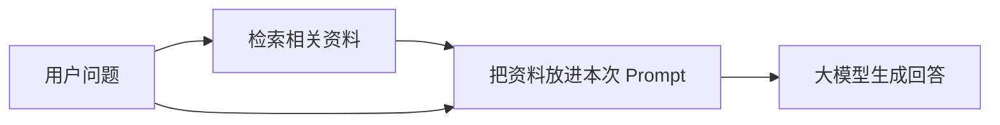
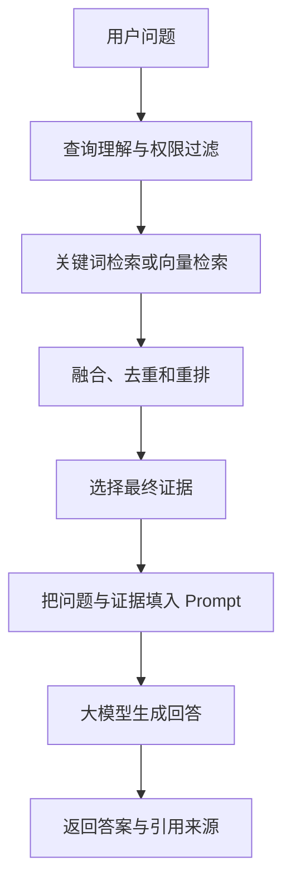
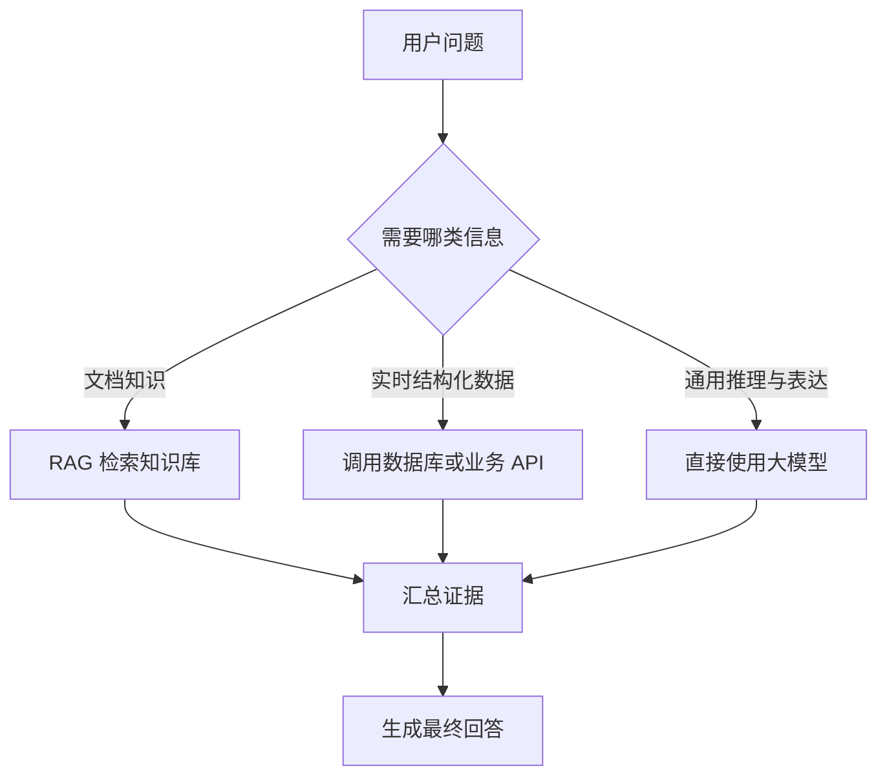

# 大模型应用开发学习 12：RAG 入门：让模型基于自己的资料回答

前面已经把文本切分、Embedding、向量数据库、混合检索和重排分别拆开讨论过。学到这里，很容易产生一个新的疑问：

> 这些技术最后怎样组合起来，变成一个真正能够基于企业资料回答问题的系统？

这正是 RAG 要解决的事情。

RAG 的全称是 Retrieval-Augmented Generation，通常译作**检索增强生成**。这个名字看起来有些抽象，其实只包含两个动作：

```text
先从外部资料中检索相关证据
              ↓
再让大模型基于这些证据生成回答
```

RAG 不是某一种模型，也不等于向量数据库。它更像一套应用架构：把文档处理、知识存储、检索和大模型生成连接成一条完整链路。

这篇先解决几个基础问题：

| 问题 | 这一篇要建立的理解 |
| --- | --- |
| 为什么不能直接问大模型 | 模型未必知道私有资料、最新变化和具体业务规则 |
| RAG 到底增强了什么 | 它在模型回答前动态补充外部证据 |
| 一次 RAG 问答怎样运行 | 先准备知识库，再执行检索和生成 |
| RAG 是否等于向量检索 | 向量检索只是其中一种召回方式 |
| RAG 和长上下文、微调怎么选 | 三者解决的问题不同，也可以组合使用 |
| RAG 会不会彻底消除幻觉 | 不会，它只是让回答更有依据、更容易检查 |

第一次阅读时，先抓住“知识入库”和“在线问答”两条流程即可。代码和工程边界可以在第二遍再看。

## 从一个模型答不出来的问题开始

假设公司有一份内部售后政策：

```text
会员订单签收后 15 日内可以申请退货。
普通订单签收后 7 日内可以申请退货。
定制商品不支持无理由退货。
```

用户问：

```text
会员买的普通商品，签收 10 天后还能退吗？
```

如果直接把问题交给一个通用大模型，它可能出现几种情况：

- 按常见电商规则回答“通常是 7 天”；
- 猜测会员可能享受更长退货期；
- 给出一段听起来合理、却不符合公司政策的回答；
- 坦白自己不知道具体企业规则。

问题并不是模型完全不会理解“退货”，而是它没有获得这家公司当前有效的内部政策。

通用大模型通常存在三个与知识有关的限制。

**第一，模型不一定拥有这份知识。**

企业制度、内部接口文档、项目设计、客户合同等资料通常不会出现在公开训练数据中。

**第二，模型中的知识可能已经过时。**

即使模型知道某项旧规定，业务政策也可能在模型训练完成后发生变化。

**第三，模型能够生成流畅语言，不代表它能自动判断事实是否正确。**

当资料不足时，模型仍可能利用语言模式补出一个看起来像答案的内容。

一种解决思路是重新训练模型，让它把企业资料学进去。但每次制度变化都重新训练，成本高、周期长，也很难保证模型能够准确记住每一条细节。

RAG 采用的是另一条路线：

> **不要求模型提前记住全部资料，而是在每次回答前，先把与问题相关的资料找出来。**

对前面的提问，系统可以先检索到会员政策，再把问题和政策一起交给模型：

```text
已知资料：
会员订单签收后 15 日内可以申请退货。
定制商品不支持无理由退货。

用户问题：
会员买的普通商品，签收 10 天后还能退吗？
```

模型此时不再只能依赖内部记忆，而是有了一份当前问题需要的外部证据。

## RAG 不是让模型重新学会资料

RAG 最容易产生的误解是：

> 把文档放进向量数据库以后，大模型是不是就学会了这些文档？

答案是否定的。

RAG 通常不会修改大模型的参数，也不会把整套知识库永久写进模型。每次提问时，它只是临时完成下面的动作：



一次请求结束后，这些资料并不会因此变成模型永久记忆的一部分。下一次提问时，系统仍然需要重新检索。

可以把大模型想成一位擅长阅读、归纳和表达的工作人员，把知识库想成公司的资料室。

- 没有 RAG：工作人员只能依靠自己记得的内容回答；
- 使用 RAG：工作人员先去资料室找到相关文件，再根据文件回答；
- 更新知识：修改资料室里的文件，不必重新培训这名工作人员。

这个比喻还能说明一个重要边界：找到文件不代表回答一定正确。工作人员可能拿错文件、漏看条件，也可能在总结时曲解原文。因此，RAG 改善的是“模型能够接触到哪些证据”，不是为正确性提供绝对保证。

更准确地说，RAG 为生成过程增加了三种能力：

| 能力 | 含义 |
| --- | --- |
| 外部知识 | 回答可以使用模型参数之外的资料 |
| 动态更新 | 修改知识库后，新问题可以检索到新内容 |
| 来源追踪 | 系统可以保留文档 ID、标题、页码和链接 |

## 一套 RAG 系统其实有两条流程

RAG 经常被画成“问题 → 检索 → 回答”三步，但真正落地时至少包含两条不同的流程：

1. **知识入库流程**：提前把原始资料处理成可检索的知识库；
2. **在线问答流程**：用户提问后，实时检索证据并生成回答。

这两条流程运行的时间也不同。

- 入库流程通常在文档新增、修改或定时同步时运行；
- 问答流程在每一次用户请求到来时运行。

### 知识入库：先把资料变成可检索的证据

原始资料可能来自 PDF、Word、网页、Markdown、数据库或内部系统。它们通常不能不经处理就直接用于检索。

一条常见的入库流程是：


每一步都在解决一个具体问题。

| 步骤 | 解决的问题 | 典型输出 |
| --- | --- | --- |
| 解析 | 从不同文件格式中提取正文和结构 | 标题、段落、表格文本 |
| 清洗 | 去掉页眉、页脚、乱码和重复内容 | 较干净的正文 |
| 切分 | 把长文档拆成适合检索的证据单元 | Text Chunk |
| 补充 Metadata | 保留来源和业务属性 | 文档 ID、页码、部门、权限 |
| 向量化或建索引 | 让文本能够被快速搜索 | 向量索引、倒排索引 |

这里需要注意：**知识库不只是向量。**

一条可用的知识记录通常至少包含：

```json
{
  "chunk_id": "refund-policy-2026-part-03",
  "text": "会员订单签收后 15 日内可以申请退货。",
  "source": "售后政策 2026 版",
  "page": 12,
  "department": "customer-service",
  "effective_date": "2026-07-01",
  "access_level": "internal"
}
```

其中真正用于回答的主要是 `text`，但来源、时间和权限等 Metadata 同样重要：

- `source` 和 `page` 可以支持引用与核验；
- `effective_date` 可以帮助处理新旧制度；
- `department` 可以限制检索范围；
- `access_level` 可以防止用户搜到无权查看的内容。

如果只保存文本向量，却丢掉原始文本和来源信息，系统即使找到了相似向量，也很难把可读证据交给大模型，更难向用户说明答案来自哪里。

### 在线问答：问题到来以后再检索和生成

知识库准备好以后，用户提问会触发另一条流程：



这条链路把前面讨论过的能力连接了起来：

- 文本切分决定知识库中的证据单元；
- Embedding 把问题和文本表示成可以比较的向量；
- BM25、向量检索或混合检索负责召回候选；
- RRF、Rerank 和去重负责整理候选顺序；
- Prompt 把最终证据和问题交给大模型；
- 大模型负责阅读证据、组织语言和生成回答。

因此，RAG 并不等于“向量检索 + 大模型”。检索阶段既可以使用向量，也可以使用 BM25、数据库查询、知识图谱或多种方式组合。只要系统在生成前动态取得外部证据，并让生成过程使用这些证据，就具备 RAG 的核心结构。

## 用一次完整问答看懂数据怎样流动

继续使用前面的售后政策例子。

用户输入：

```text
会员买的普通商品，签收 10 天后还能退吗？
```

**第一步：确定可以搜索的资料范围。**

系统先根据租户、用户权限、业务类型等条件，把搜索范围限制在当前用户有权访问的售后政策中。

这一步必须发生在返回证据之前。不能先从全库检索出机密内容，再指望大模型不要说出来。

**第二步：召回候选资料。**

关键词检索可能抓住“会员”“签收”“10 天”“退”，向量检索可能找到表达不同但语义相近的退货政策。

候选结果可能是：

| 候选 | 内容 | 初步判断 |
| --- | --- | --- |
| A | 会员订单签收后 15 日内可以申请退货 | 直接相关 |
| B | 普通订单签收后 7 日内可以申请退货 | 有对照价值 |
| C | 退款将在审核通过后 3 个工作日内到账 | 同属售后，但回答的是到账时间 |
| D | 定制商品不支持无理由退货 | 说明例外条件 |

**第三步：整理候选证据。**

系统合并不同检索路线的结果，去掉重复文本，并把真正能够回答问题的 A、D 排到更靠前的位置。

**第四步：构造给大模型的上下文。**

最终 Prompt 可以包含角色约束、检索证据、用户问题和输出要求：

```text
你是企业售后助手。请只根据“参考资料”回答问题。

如果参考资料不足以回答，请明确说“现有资料不足”，不要自行补充规则。

参考资料：
[资料 1｜售后政策 2026 版｜第 12 页]
会员订单签收后 15 日内可以申请退货。

[资料 2｜售后政策 2026 版｜第 13 页]
定制商品不支持无理由退货。

用户问题：
会员买的普通商品，签收 10 天后还能退吗？

回答要求：
1. 先直接回答能否退货；
2. 说明判断依据；
3. 在句末标注资料编号。
```

**第五步：模型基于证据生成回答。**

模型可能返回：

```text
可以。会员订单的退货期限是签收后 15 日内，签收 10 天仍在期限内；
同时题目说明是普通商品，不属于定制商品例外。[资料 1][资料 2]
```

这个回答并不是从向量数据库里原样取出来的。向量数据库返回的是相关证据，大模型负责把多条证据和用户问题结合起来，生成自然语言答案。

这也是“检索增强生成”中“生成”二字的意义。

## Prompt 是检索和生成之间的接口

有了正确证据，并不代表模型一定会正确使用。检索结果需要通过 Prompt 清楚地交给模型。

一个最小的 RAG Prompt 通常包含四部分：

| 部分 | 作用 |
| --- | --- |
| 任务说明 | 告诉模型扮演什么角色、完成什么任务 |
| 参考资料 | 放入本次检索得到的证据 |
| 用户问题 | 保留用户真正要解决的问题 |
| 回答规则 | 规定资料不足、引用、格式等行为 |

可以先写成一个简单模板：

```python
RAG_PROMPT_TEMPLATE = """你是企业知识库助手。

请只根据参考资料回答用户问题。
如果资料不足，请明确说明资料不足，不要猜测。

参考资料：
{context}

用户问题：
{question}

请给出简洁回答，并标注使用的资料编号。
"""
```

再把检索结果整理成上下文：

```python
def format_context(documents: list[dict]) -> str:
    sections = []

    for index, document in enumerate(documents, start=1):
        source = document.get("source", "未知来源")
        page = document.get("page", "未知页码")
        text = document["text"]

        sections.append(
            f"[资料 {index}｜{source}｜第 {page} 页]\n{text}"
        )

    return "\n\n".join(sections)


def build_rag_prompt(question: str, documents: list[dict]) -> str:
    context = format_context(documents)

    return RAG_PROMPT_TEMPLATE.format(
        context=context,
        question=question,
    )
```

这段代码没有调用向量数据库或大模型，只负责把“检索结果”变成“模型能够阅读的输入”。它体现了一个容易被忽略的边界：

> 检索器负责找证据，Prompt 负责把证据交代清楚，大模型负责依据证据组织答案。

Prompt 中“只根据资料回答”是一项约束，但不是安全保证。模型仍可能忽略指令、错误理解资料，或者把检索文档里的恶意内容当成指令。因此，真实系统还需要：

- 清楚分隔系统指令、用户问题和外部文档；
- 把检索文档视为不可信数据，而不是系统命令；
- 要求返回引用来源，方便检查；
- 对高风险答案增加规则校验或人工复核；
- 在资料不足时允许系统拒答。

## RAG 和长上下文不是简单替代关系

现在一些模型可以一次接收很长的输入，于是会出现一个自然的问题：

> 既然模型能读长文档，为什么不直接把全部资料放进去，还要做 RAG？

先看两个场景。

**场景一：分析一份 60 页的合同。**

文档数量少，内容都与当前任务有关，而且用户可能会问跨章节问题。这时直接使用长上下文往往更简单。

**场景二：在 50 万份企业文档中回答员工制度问题。**

绝大多数资料和当前问题无关，文档还会持续更新，并且不同员工拥有不同权限。这时先检索再生成通常更合适。

两种方法可以这样比较：

| 对比项 | RAG | 长上下文 |
| --- | --- | --- |
| 输入方式 | 先筛选相关内容，再交给模型 | 把较多原文直接交给模型 |
| 资料规模 | 适合大规模、持续增长的知识库 | 受模型上下文窗口限制 |
| 更新知识 | 更新外部知识库即可 | 每次请求需要提供新的完整内容 |
| 成本 | 增加检索成本，但减少无关输入 | 输入越长，Token 和推理成本通常越高 |
| 实现难度 | 需要构建和维护检索链路 | 流程相对直接 |
| 主要风险 | 检索漏掉正确证据 | 关键信息可能被大量文本淹没 |

RAG 和长上下文也可以组合：

```text
先从大型知识库中检索相关文档
              ↓
再把这些完整文档放进较长的上下文中分析
```

所以真正的问题不是“哪一种永远更好”，而是：

- 资料总量有多大；
- 一次问题需要多少份资料；
- 资料是否经常变化；
- 是否需要权限控制和来源引用；
- 延迟和 Token 成本能否接受。

## RAG、微调和数据库查询分别解决什么

RAG 也经常和微调混在一起。

可以先用一个简化判断区分：

| 需求 | 更优先考虑 |
| --- | --- |
| 让模型知道经常变化的业务资料 | RAG |
| 让模型按照固定格式、语气或任务方式输出 | Prompt 或微调 |
| 查询余额、库存、订单状态等实时结构化数据 | 数据库查询或 API 工具 |
| 同时需要企业资料和稳定表达风格 | RAG 与 Prompt、微调组合 |

微调会改变模型参数，适合让模型学习某种行为模式、语言风格或专业任务能力。它也可能让模型记住部分训练知识，但不适合把它当成一个可以随时精确更新和删除的知识库。

RAG 把知识放在模型外部，更容易更新、追踪来源和控制权限。

对于高度结构化、必须精确实时的数据，向量检索也不一定是最佳入口。例如用户问：

```text
订单 202609180032 当前是什么状态？
```

最可靠的方式通常是通过订单号查询业务数据库或调用订单 API，而不是把订单表切成文本后做语义搜索。

因此，真实应用可能同时包含：



RAG 是解决外部知识问题的重要方法，但不是所有数据问题的唯一答案。

## RAG 为什么仍然可能回答错误

RAG 经常被描述成“减少幻觉”，但不能理解成“用了 RAG 就不会幻觉”。

一条 RAG 链路可能在多个位置出错：


可以把常见失败分成几类。

| 失败位置 | 表现 | 优先检查 |
| --- | --- | --- |
| 数据源 | 不同制度相互矛盾、内容已经过期 | 来源权威性、版本和生效时间 |
| 文档解析 | 表格错位、段落乱序、正文缺失 | 解析结果和原文件对照 |
| 文本切分 | 条件与结论被拆到不同块 | 块大小、重叠和父子结构 |
| 检索 | 正确证据没有进入候选集 | 查询、召回方式和 Top K |
| 排序 | 正确证据存在但排名靠后 | 融合、重排和去重 |
| 上下文 | 证据太多、重复或超出 Token 预算 | 上下文选择和排列 |
| 生成 | 模型忽略证据、混淆条件或自行补充 | Prompt、引用和输出校验 |

其中最根本的一条原则是 GIGO：Garbage In, Garbage Out，也就是“垃圾输入，垃圾输出”。

如果知识库中的原始政策就是错的，大模型不可能通过语言能力把它自动变成正确政策。如果 PDF 解析漏掉了“不”字，后面的向量检索和重排越准确，反而越可能稳定地找到错误内容。

因此，RAG 的质量上限不只由大模型决定，还由整条数据链路共同决定。

## 一个不依赖框架的最小 RAG 结构

为了先看清组件关系，可以把 RAG 写成几个普通函数。这里不绑定具体向量数据库或大模型 SDK。

```python
def answer_with_rag(
    question: str,
    user_context: dict,
    retriever,
    reranker,
    generator,
) -> dict:
    # 1. 根据用户身份和业务条件限制可搜索范围。
    filters = {
        "tenant_id": user_context["tenant_id"],
        "access_level": user_context["access_level"],
    }

    # 2. 第一阶段多召回一些候选。
    candidates = retriever.search(
        query=question,
        filters=filters,
        top_k=30,
    )

    # 3. 对候选重新排序，只保留最终证据。
    evidence = reranker.rank(
        query=question,
        documents=candidates,
        top_k=5,
    )

    # 检索不到证据时停止，不让模型凭空补出政策。
    if not evidence:
        return {
            "status": "insufficient_evidence",
            "answer": "现有资料不足，无法回答这个问题。",
            "retrieved_sources": [],
            "retrieved_count": len(candidates),
        }

    # 4. 把证据和问题组织成模型输入。
    prompt = build_rag_prompt(question, evidence)

    # 5. 生成回答。
    answer = generator.generate(prompt)

    return {
        "status": "generated_pending_verification",
        "answer": answer,
        "retrieved_sources": [
            {
                "chunk_id": item["chunk_id"],
                "source": item["source"],
                "page": item.get("page"),
            }
            for item in evidence
        ],
        "retrieved_count": len(candidates),
    }
```

这里把字段命名为 `retrieved_sources`，而不是直接叫作“答案引用”。它只表示系统交给模型的证据来自哪里，**不表示模型最终写出的每一句话都得到了这些证据支持**。`generated_pending_verification` 也提醒调用方：生成完成不等于核验完成。

上面的空列表判断只是最低限度的拒答条件。即使检索到了五条文本，它们也可能只是主题相近，却没有回答所需的具体条款。生产系统还需要根据带标注的样本校准“证据足够”的判断，不能随便把某个相似度分数当作通用阈值。

这段代码最值得观察的不是具体类名，而是数据边界：

```text
question
  ↓
candidates：可能相关的候选
  ↓
evidence：最终选择的证据
  ↓
prompt：问题 + 证据 + 回答规则
  ↓
answer：模型生成的回答
```

真实项目还会增加日志、缓存、异常处理、超时、权限和更完整的引用校验，但主干不会脱离这条链路。

为了能够排查问题，系统最好记录每个阶段的关键结果：

```python
trace = {
    "question": question,
    "filters": filters,
    "candidate_ids": [item["chunk_id"] for item in candidates],
    "evidence_ids": [item["chunk_id"] for item in evidence],
    "prompt_token_count": 0,
    "answer": answer,
}
```

这里的 `prompt_token_count` 只是预留字段，真实项目需要使用所选模型对应的 Token 计算方式填入。

如果只保存最终回答，不保存候选证据和最终上下文，回答出错时就很难判断问题来自检索还是生成。

## 怎样判断 RAG 真的答对了

检索结果靠前，只说明系统找到了看起来相关的资料。要判断问答系统是否可用，还需要把**检索质量**和**最终答案质量**分开检查。

可以先准备一小组固定问题，并为每题记录：允许使用的资料范围、正确证据的文档 ID、预期答案要点，以及资料不足时是否应该拒答。例如沿用前面的售后政策，可以放入以下四类问题：

| 测试问题 | 应检查什么 |
| --- | --- |
| 会员普通商品签收 10 天后能否申请退货？ | 找回会员期限与定制商品例外；答案正确引用两条依据 |
| 普通订单签收 10 天后能否申请退货？ | 不把会员期限错用到普通订单 |
| 定制商品签收 3 天后能否无理由退货？ | 不因“未超期限”忽略商品例外 |
| 某种未写进政策的特殊商品能否退货？ | 资料不足时说明无法判断，不编造规则 |

检查时按链路逐层定位：

1. **检索**：正确证据是否进入候选集、最终是否进入模型上下文；可以沿用前一篇的 Recall@K、MRR 等指标。
2. **答案**：结论是否符合原文，是否遗漏“会员”“普通商品”“定制商品”等限制条件。
3. **引用**：答案标出的资料编号是否真实存在；进一步逐条核对，引用内容是否真的支持相邻的结论。仅检查编号存在还不够。
4. **拒答**：检索为空、只找到弱相关资料或资料互相冲突时，系统是否能说明缺口，而不是给出确定答案。
5. **运行成本**：同时记录响应时间、输入输出 Token 和调用费用，避免只靠更长的上下文换取表面效果。

刚开始可以人工核查几十道覆盖正常、例外和无答案情况的问题。测试集稳定后，再把“编号存在”“权限正确”“输出格式合法”等可机械判断的项目写成程序检查；对“证据是否真正支持结论”这类语义判断，保留人工抽查或经过验证的评估流程。每次改动切分方式、Embedding 模型、检索参数或 Prompt，都用同一组问题回归比较，才知道变化改善了哪一步。

## 最后收束成一个完整认识

RAG 的核心不是“给大模型接一个向量数据库”，而是建立一条可更新、可检查的外部知识链路：

```text
原始资料
  ↓
解析、切分和建立索引
  ↓
用户问题触发检索
  ↓
候选经过融合、重排和去重
  ↓
证据与问题组成 Prompt
  ↓
大模型基于证据生成回答
  ↓
核对答案、引用与拒答条件
```

这条链路里，可以先立住五个判断：

1. RAG 不会让模型永久学会知识库，它是在每次回答前临时检索证据；
2. RAG 的检索不只可以使用向量，也可以使用关键词、数据库和其他数据源；
3. RAG 能降低无依据回答的概率，但不能彻底消除错误和幻觉；
4. RAG 与长上下文、微调和工具调用不是互斥关系；
5. 回答质量取决于数据、解析、切分、检索、上下文、生成和最终核验整条链路。

理解这套完整结构以后，下一步才适合真正动手：准备一批文档，把入库、检索、Prompt 组装和模型回答连接成一个可以运行的最小系统。

## 参考资料

- [Retrieval-Augmented Generation for Knowledge-Intensive NLP Tasks](https://arxiv.org/abs/2005.11401)
- [Lost in the Middle: How Language Models Use Long Contexts](https://arxiv.org/abs/2307.03172)
- [Sentence-BERT: Sentence Embeddings using Siamese BERT-Networks](https://arxiv.org/abs/1908.10084)


