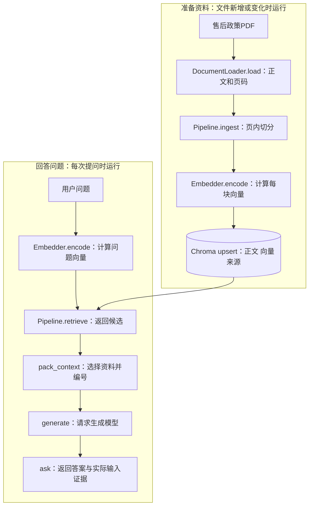

# 大模型应用开发学习 13：RAG 实战：从文档到问答系统

现在要把售后政策问答做成一个本地程序：给它一个PDF文件路径，它能保存资料；再给它一个问题，它能找回原文、请求模型，并把答案和页码一起返回。

第12章已经把RAG的完整架构讲清楚了，也用售后政策演示了证据怎样进入回答。这次沿用相同规则，方便核对程序；新增的任务是把图里的每一段落实成实际调用，检查函数之间有没有把数据传对。

> **配套代码说明：**本章提供完整示例代码，已放在 [GitHub 仓库](https://github.com/benx92/ai-learning-notes/tree/main/examples/13-rag)。建议结合正文对照查看，运行方法见示例目录中的 README。

| 这次实际调用什么 | 要检查的结果 |
| --- | --- |
| `DocumentLoader.load()` | 返回两页正文及各自来源 |
| `Pipeline.ingest()` | 返回单元数、块数和库内总数 |
| `Pipeline.retrieve()` | 返回正文、分数、块编号与位置 |
| `pack_context()` | 产生实际发送的正文与证据清单 |
| `ask()`与`generate()` | 连接检索和生成，返回答案及待核验状态 |

## 先确定程序范围，再准备核对数据

这次实现是单用户、本地运行的文档问答。为了先接通主干，检索只使用向量，没有接入重排和多用户权限过滤；这不是取消它们的作用，更不能把当前程序直接当成多人共用的企业知识库。

完整架构与当前代码可以这样对应：

| 架构中的位置 | 本次实现 | 这里作出的取舍 |
| --- | --- | --- |
| 读取和准备知识 | `DocumentLoader`、`Pipeline.ingest()` | 先处理一份文件，保留原始位置 |
| 检索候选 | `Pipeline.retrieve()` | 本地MiniLM与Chroma，单路向量检索 |
| 融合与重排 | 当前未实现 | 需要时接在候选与上下文组装之间 |
| 权限过滤 | 当前未实现 | 只使用自己有权读取的本地教学资料 |
| 组装模型输入 | `pack_context()`、`generate()` | 增加完整块预算，保留实际选入的证据 |
| 输出来源 | 返回字段`evidence` | 对应实际输入，不等于逐句引用已核验 |

这些名称是本程序的接口，不要求与架构示意代码中的`retriever.search()`等名字相同。要对应的是职责、输入和输出。准备好这份虚构售后政策，作为贯穿所有步骤的核对数据：

| 条款 | 内容 | PDF位置 |
| --- | --- | --- |
| 会员订单 | 签收后15日内可以申请退货 | 第1页 |
| 普通订单 | 签收后7日内可以申请退货 | 第1页 |
| 商品例外 | 定制商品不支持无理由退货 | 第2页 |
| 退款到账 | 审核通过后3个工作日内到账 | 第2页 |

这里“普通订单”指与会员订单相对的订单类别；用户题目里的商品是非定制商品。把这两个条件说清楚，是为了避免仅凭“普通”两个字混用规则。

这次固定测试问题是：“会员买的非定制商品，签收10天后还能申请退货吗？”预期要点是：按会员15日期限判断，10天仍在期限内；非定制商品不触发定制例外，因此可以申请。**可以申请，不等于已经批准，更不等于已经退款。**

这段话是我们用来核对程序的预期结论，不是在线模型的实测回答。先有核对标准，后面才知道系统是真的找对了依据，还是碰巧说了一句看起来合理的话。

文件使用[两页售后政策PDF](https://raw.githubusercontent.com/benx92/ai-learning-notes/main/examples/13-rag/refund-policy.pdf)。第一条任务很简单：先把里面的字读出来。

把实际函数标在运行图上，后面读到代码时，就能找到它在整个程序里的位置：



顺着图读源码时，先找`Pipeline`中的入库与检索，再找类外的`pack_context()`、`generate()`和`ask()`。入库、检索使用的是同一份`Embedder`配置；`generate()`另行请求聊天模型。这样就能知道该在哪个函数里查编码问题，在哪个函数里查接口问题。

准备资料与回答问题共用的是库里的记录，因此两条线必须使用兼容的嵌入配置。也正因为它们分开，才能提前入库、多次使用，而不是每次提问都重新处理文件。

## 第一步：调用加载器，检查两页正文和位置

程序从`refund-policy.pdf`这个文件路径开始。先看加载器内部使用的PDF读取方式，再检查它怎样把正文与位置交给下一步。

这次使用PyMuPDF。下面直接摘自[`loader.py`中的`DocumentLoader._pdf()`](https://github.com/benx92/ai-learning-notes/blob/main/examples/13-rag/loader.py)，展示项目实际怎样逐页读取。它是类中的方法，不是单独运行的脚本：

```python
@staticmethod
def _pdf(path):
    import pymupdf

    with pymupdf.open(path) as document:
        if document.needs_pass:
            raise ValueError("PDF 已加密，请先解密后再解析")
        for number, page in enumerate(document, 1):
            text = page.get_text("text", sort=True).strip()
            if not text:
                raise ValueError(f"PDF 第 {number} 页未提取到文字；请检查空白页或先做 OCR")
            yield text, {"page": number, "location": f"PDF 第 {number} 页"}
```

`path`是传入的PDF路径，`open()`打开文件，`enumerate(document, 1)`从1开始给物理页面编号，`get_text()`取得文字，`.strip()`去掉首尾空白。`sort=True`尝试按页面位置整理文字顺序，不会自动恢复所有复杂表格和多栏关系。[PyMuPDF文本提取说明](https://pymupdf.readthedocs.io/en/latest/recipes-text.html)

项目里的读取函数需要把结果交给后续程序，所以这里用`yield`，而不是`print()`。它每次提供一对数据：这一页的正文，以及包含`page`和`location`的位置字典。`load()`负责逐条收集这些结果、补上文件来源，再生成文本单元；打印只是调用者观察结果的一种方式。

`@staticmethod`表示这个方法不需要读取实例字段，因此没有`self`参数。加密文件和没有提取出文字的页面会明确报错，避免程序把缺失内容当成正常政策继续入库。空白页和扫描页都可能触发空文本检查，仍需对照原件判断；有少量页脚文字的扫描页也可能通过这个检查，所以非空不等于完整。

第1页的关键内容应当是会员15日、普通订单7日，第2页则要保留“不支持”这个否定条件和退款到账说明。先对照文件核对这些内容，再继续。

**为什么还要记页码？**因为最后用户可能问：“你说可以申请，是在哪里看到的？”只留下文字，之后很难回答。于是加载器把正文和位置放在同一条记录中：

```json
{
  "text": "会员订单签收后15日内可以申请退货。",
  "metadata": {"source": "refund-policy.pdf", "page": 1}
}
```

这是省略标题等内容的记录示意。`text`就是正文；`metadata`是附带的说明信息，中文常叫元数据。当前只需要知道，它让这段文字能够回到原文件。

配套程序把这种记录命名为`DocumentUnit`。名字可以晚些记，先抓住结果：**读文件之后，我们得到带来源位置的文字，而不是已经生成的答案。**

要观察上面这个方法的实际结果，在配套目录调用已有的加载器即可。下面是调用示例，直接使用仓库代码，不需要重新抄写`_pdf()`：

```python
from loader import DocumentLoader

units = DocumentLoader().load("refund-policy.pdf")
print("文本单元数：", len(units))
for unit in units:
    print(unit.metadata["page"], unit.text)
```

配套PDF应得到两个单元，页码分别为1、2。若只得到一段拼接全文，说明页边界没有保留下来；若第2页正文缺少“不支持”，先修解析，不能继续入库。这里检查的是函数实际输出，不能用“文件能打开”替代。

## 第二步：运行入库，检查写入数量与记录对应

加载器输出已经核对过，接下来调用`Pipeline.ingest()`把它们写入库。在配套环境、PDF所在目录运行下面的片段，可以先看到这一整步的入口与结果，再看内部怎样处理：

```python
from pathlib import Path
from rag import Pipeline

pipeline = Pipeline(Path("pdf_demo"))
report = pipeline.ingest("refund-policy.pdf")
print({key: report[key] for key in ("units", "chunks", "total")})
```

`Pipeline(...)`准备模型、切分器和数据库连接，`ingest(...)`才处理文件。首次运行可能下载嵌入模型权重。对这份样例PDF，在没有其他资料的新库中，核对结果应是`units=2`、`chunks=2`、`total=2`；库里已有其他文件时，总数可能更大。两个页单元恰好都能各自装进一个块，不代表以后所有PDF都会“一页一个块”。

加载器先保留页的边界，切分器再在每页内部拆块。如果一页很短，它可能只形成一个块；一页很长，则会形成多个块。这样每个块仍能继承准确的页码。代价是跨页句子和表格不会自动合并，需要针对文件补充处理。

内部编码完成后，要把每个块的正文、向量与来源一起写入。同一位置必须属于同一块，下面就沿着这组对应关系检查实现。

一条入库记录可以理解为：

```text
记录编号：找到和更新这条记录
正文：会员订单签收后15日内可以申请退货
向量：用于和问题比较相关程度的一组数字
来源：refund-policy.pdf，第1页
```

配套程序使用本地多语言MiniLM生成向量，使用Chroma保存这些记录。MiniLM负责编码，Chroma负责存储与查找，它们都不会在这一步回答用户问题。

这里选择多语言版本，是因为样例政策和问题主要是中文。它与英文示例中常见的`all-MiniLM-L6-v2`不是同一个模型，不能只看到名字都有MiniLM就混用向量。选模型时要看它面向的语言和任务，再用自己的问题验证；“支持中文”也不等于一定找得准。

`Pipeline`是本程序自己编写的流程类，保存加载器、切分器、嵌入模型和数据库对象。

读代码时，可以把`pipeline`理解为这一套工具的负责人。`self`指当前这份对象，`self.collection`是它持有的数据库集合，`self.embedder`是它持有的编码器。它们是保存好的对象，不是每看到一个名字就要新增一套处理流程。

```text
输入：refund-policy.pdf
  → 加载器返回两页正文与位置
  → 切分器得到适合编码的文本块
  → 嵌入模型为每个块计算向量
  → 数据库一起保存编号、正文、向量和来源
输出：本次写入了多少块
```

**到这里，程序完成的是准备资料。**只要文件没变，用户换一个问题时就可以复用这些记录，不需要重新解析和入库。

实际实现还要检查长度：本例嵌入模型的最大输入长度是128个Token，切分目标设为80、相邻块重叠12，并对实际长度再次检查。Token是模型使用的文本单位，不能直接当成汉字数。不同嵌入模型的限制不同，这几个数是本例配置，不是通用推荐。

如果曾用“80个字符”理解切分，这里要换一下计数单位：同样写80，按字符数和按Tokenizer计数，实际切出来的文字可能不同。看`chunk_size`时还要一起看长度函数，不能只比较这个数字。重叠12也是目标上限，实际交界处会受分隔位置影响，不一定每对块都恰好重复12个Token。

**把切分与编码再展开一层。**本例的切分器优先找段落、换行和中文标点作为边界；某段太长，再尝试更细的分隔符，最后才退到字符级处理。这就是递归切分的直觉：尽量沿现有结构拆，而不是机械地在第80个汉字处剪断。

判断长度使用嵌入模型的Tokenizer，也就是把文字转换成Token的组件。切分时按不含特殊Token的长度估计，正式编码前再把模型需要的特殊Token算进去，检查是否超过128的输入上限。这样做是为了避免程序表面成功，模型实际只编码了被截断的前半段。

相邻块重叠12个Token，是给边界留下少量重复内容。例如“会员订单……”“签收后15日内……”被拆开时，重叠可能让条件和结论在一个块中重新相遇。但重叠只是缓解断裂，不能保证每次都完整；文件标题、表头与例外仍要看实际切分结果。

如果一页包含许多规则，块太大会把不同主题混在一个向量里；块太小又可能只留下“15日内”，丢失适用对象。实践时要同时检查：是否能独立读懂，是否符合模型长度限制，是否容易找到回答所需条款。不能只看块数越多越好。

**正文、向量和来源怎样一起写进库？**假设本次得到两个块，程序准备四个对应列表：两个编号、两段正文、两个向量、两份元数据。四组数据相同位置必须属于同一个块。

下面摘自[`rag.py`中的`Pipeline.ingest()`](https://github.com/benx92/ai-learning-notes/blob/main/examples/13-rag/rag.py)，`start:end`表示当前批次的范围。它依赖该方法前面准备好的四个列表，不是独立脚本：

```python
self.collection.upsert(
    ids=ids[start:end],
    documents=texts[start:end],
    embeddings=vectors[start:end],
    metadatas=metadatas[start:end],
)
```

如果第一段正文与第二个向量错配，数据库仍可能接收，但检索定位与返回文本就错了。因此“写入成功”之后还需要观察正文和来源。`upsert`表示编号存在就更新，不存在就插入；它不会替我们判断这条政策是否最新。

本例自己计算并传入向量，因此集合关闭默认嵌入函数，避免查询时悄悄换成另一个编码器。向量库负责保存与检索，具体使用哪个模型由程序明确决定。

编码函数也值得看一眼。下面摘自[`rag.py`中的`Embedder.encode()`](https://github.com/benx92/ai-learning-notes/blob/main/examples/13-rag/rag.py)，依赖对象保存的Tokenizer、模型和长度上限：

这三个字段在创建编码器时就已准备好：`self.model`是加载的嵌入模型，`self.tokenizer`负责计数，`self.limit`读取该模型的输入上限。下面的`self.model`与前面生成自然语言回答的聊天模型不是同一个对象。

```python
def encode(self, texts):
    for text in texts:
        length = len(self.tokenizer.encode(text, add_special_tokens=True))
        if length > self.limit:
            raise ValueError(f"输入超过嵌入模型上限：{length} > {self.limit}")
    return self.model.encode(
        texts, normalize_embeddings=True, show_progress_bar=False
    ).tolist()
```

`texts`是一组正文，不是文件路径。函数先检查每项能否完整编码，再批量生成向量。`normalize_embeddings=True`将每条向量归一化为单位长度，保持它的方向，便于用方向关系比较；它不把模型分数变成概率，也不保证中文规则一定检索准确。

`.tolist()`把模型返回的数值数组转换为普通Python列表，便于传给数据库。这种类型转换与语义编码不同：真正将文字变成向量的是模型执行，转换列表只是交接格式。

程序没有把元数据中的页码额外拼进编码输入，它仍保存在对应记录里。不过PDF正文若自带“第1页”等页脚，这些字可能已经被提取进`text`，仍需按文件情况清理。模型比较传入的正文，来源信息用来回查；如果需要按政策版本或访问范围限制候选，必须另外设计过滤，不能期待向量自动知道哪些文件当前可用。

## 第三步：单独运行检索，读懂每条返回记录

资料准备好后，现在输入同一个问题：

> 会员买的非定制商品，签收10天后还能申请退货吗？

程序用**入库时相同的嵌入模型和配置**，为问题计算向量，再去库里找接近的文本块。换模型以后，即使向量维度相同，也不能默认与旧库兼容。

这次先单独调用`retrieve()`，不接生成服务。这样答案不对时，可以独立确认资料有没有找回来。

**为什么这里先只做向量检索？**混合检索、融合和重排解决的是“怎样把候选找得更齐、排得更好”，并没有失去作用。这次先用一条检索路线，把文件到答案的交接看清；当前配套程序没有实现BM25或重排。以后发现专有词漏检，可以在这里增加关键词检索并合并候选；候选找到了但排序不理想，可以在交给`pack_context()`之前重排。后面的原文组装和证据回查仍然沿用，不必重做整个问答系统。

例如，我们希望看见两类内容：第1页的会员期限，以及第2页的定制商品例外。只找到“15日”，没有检查适用对象和例外，依据仍然不完整。

在配套程序外观察检索结果时，可以这样调用已有的`Pipeline.retrieve()`：

```python
question = "会员买的非定制商品，签收10天后还能申请退货吗？"
hits = pipeline.retrieve(question, top_k=5, threshold=-1.0)
for hit in hits:
    print(hit["location"], round(hit["score"], 4))
    print(hit["text"])
```

这是调用片段，`pipeline`需要先创建，`question`是问题字符串。`hits`保存取回的候选；`top_k=5`表示最多取回5条；阈值用于过滤分数过低的候选。当前`-1.0`设得很宽，目的是先观察结果，不代表已经找到了可靠的业务分界线。

这里沿用入库片段的`pipeline`即可；若另开进程，使用相同数据库路径和嵌入配置重新创建它。重点读打印出的页码和全文，不是只看最高分。随后换成运费问题，再比较“有返回记录”和“原文能回答”是否一致。

库里的数量少于5条，也只会返回实际存在的记录。本PDF实测形成两个块，因此默认配置会把两个块都取回来。这个小例子适合检查链路，不能证明在大量文件中仍能准确检索。

**分数高，到底说明什么？**在本例配置中，程序将余弦距离转换为`1 - distance`，用它排序。它表达的是向量方向的接近程度，不能读成“答案正确的概率”。

距离转分数可以用一个小数字例子理解。在当前余弦距离约定下，距离越小越接近；程序希望展示一个“越大越接近”的分数，因此使用：

$$
s = 1 - d
$$

其中$d$是数据库返回的余弦距离，理论范围为$0$到$2$；$s$是转换后的分数，理论范围为$-1$到$1$。例如距离为$0.3$，先用1减去0.3，得到分数$0.7$；距离增大到0.8，分数就降到0.2。这只改变表达方向，排序依据仍是向量接近程度，实际浮点计算也可能有微小误差。

因此，0.7不能解释为“70%可以退货”，也不能解释为“答案有70%概率正确”。它没有检查会员身份、签收天数和商品例外，只衡量输入文本在这个编码空间中的接近程度。

一个很直观的反例是：“退货运费由谁承担？”政策没有写运费，检索仍会找回售后相关内容。主题接近，和能回答问题，是两件事。因此不能把“有检索结果”直接翻译为“有答案”。

候选数量与分数阈值控制的是不同事情。最多取回5条，意味着先给我们最多5个可能对象；阈值再决定哪些候选被保留。如果正确条款排在第6位，它没有进入候选，只调阈值也找不回来。反过来，取回很多条却几乎不筛选，后面的模型会读到更多无关内容。

用一组人为构造的分数看区别：

| 候选 | 分数 | `top_k=2`时 | 再设阈值0.6 |
| --- | ---: | --- | --- |
| 会员申请期限 | 0.78 | 进入候选 | 保留 |
| 商品例外 | 0.58 | 进入候选 | 被过滤 |
| 退款到账 | 0.44 | 未进入候选 | 没有参与过滤 |

这些数只是解释参数的示意，不是本次检索实测。例外虽然得分比期限低，却可能决定最终结论；把阈值抬高，不一定让回答更可靠。应使用固定问题检查必要证据是否保留，再决定参数。

Chroma允许一次查询多个问题，所以原始返回值常是“每个问题一组结果”。本例只查一个问题，用`raw["documents"][0]`等字段取得第一组，再把正文、来源、距离和编号整理成`hits`。这个`[0]`取的是第一条问题的结果组，不是只保留排名第一的文本块。

没有命中时，也要区分库为空、阈值过高、查询配置不一致，以及确实没有相关资料。它们都可能表现为候选不足，但处理方式不同。只把空结果转成“知识库里没写”，容易掩盖系统配置问题。

## 第四步：检查实际上下文，再接入生成请求

检索返回了`hits`，现在要检查其中哪些正文真正进入模型输入。准备好的候选不会自动传给聊天模型；实际交接由`pack_context()`完成：

```python
from rag import pack_context

context, evidence = pack_context(hits, budget=6000)
print(context)
print("候选数：", len(hits), "实际选入数：", len(evidence))
```

这个片段接在检索之后，仍不请求生成模型。拿打印出的`context`逐条核对`evidence`：正文、资料编号与原始页码应一一对应。选入数少于候选数时，先检查预算和块长度，而不是直接判断检索漏了资料。

对于开头的问题，模型应当收到类似这样的内容：

```text
要求：依据提供的资料回答。资料没说明的内容，请指出缺口。

[资料1] refund-policy.pdf，第1页
会员订单签收后15日内可以申请退货。
普通订单签收后7日内可以申请退货。

[资料2] refund-policy.pdf，第2页
定制商品不支持无理由退货。
退款将在审核通过后3个工作日内到账。

问题：会员买的非定制商品，签收10天后还能申请退货吗？
```

这里的页码来自原文件，资料编号来自本次选择结果。检索顺序改变时，资料1可以换成另一页，但页码不能跟着换。

**为什么不把所有候选直接拼上去？**因为模型输入有长度限制，更多资料也意味着更多成本和干扰。配套程序的`pack_context()`按长度预算选择完整块，选完再编号，并返回两样东西：模型要读的`context`，以及供人核对的`evidence`证据清单。

这次用6000字符作为简单预算。字符预算方便教学，但不同文字对应的Token数不同；真实应用还要为系统指令、历史消息和模型回答预留Token空间。

假设检索回来了两条，但预算只装得下一条：模型实际只读到一条，最终就不能把两条都展示成“模型使用的依据”。如果一条也装不下，则不发起生成，直接说明没有可用证据。

具体选择怎样影响证据，可以用一个小例子看清。假设预算是700字符，第一个完整资料块含标题共400字符，第二个共350字符。第一块放入后，第二块装不下，就跳过；如果后面还有200字符的小块，程序可以继续尝试放入，而不是在第一条超预算候选处结束全部选择。实际实现还会计入分隔符长度。

编号在选择之后产生，因此最终可以是“资料1、资料2”，不会因为中间跳过一条而缺号。但这个策略只保证预算与编号一致，不保证短块一定更有用。如果被跳过的恰好是定制商品例外，仍要调整候选、块粒度或上下文选择方法。

生成请求中，系统消息保存回答要求，用户消息保存问题与参考资料。配套函数将两者组织为JSON内容，便于明确数据边界：

```text
system：只能依据资料回答；保留条件、例外与审批顺序；引用实际编号
user：reference_material（本次实际选入的正文）
      question（用户问题）
```

把资料放进JSON、加分隔符或写明“这是外部数据”，都有助于表达边界，但不能构成安全保证。外部文件里出现“忽略规则”的命令，仍然只能当作资料内容，不能改变工具权限或用户授权。

把检索、选择资料和生成连接起来的是[`rag.py`中的`ask()`](https://github.com/benx92/ai-learning-notes/blob/main/examples/13-rag/rag.py)。下面是该函数的实际实现：

```python
def ask(pipeline, question, top_k=5, threshold=-1.0, budget=6000, generator=generate):
    hits = pipeline.retrieve(question, top_k, threshold)
    context, evidence = pack_context(hits, budget)
    if not evidence:
        return {"status": "insufficient_evidence", "answer": "现有资料不足，无法回答。",
                "retrieved_count": len(hits), "evidence": [], "model": None}
    generated = generator(question, context)
    return {"status": "generated_pending_verification", **generated,
            "retrieved_count": len(hits), "evidence": evidence}
```

这是完整程序中的函数摘录，需要同文件里的`pack_context()`和`generate()`，不能单独粘贴运行。现在再看它，每行的目的就能对应起来：先取资料，再选资料，没有证据就停，有证据才生成，最后把回答和实际输入证据一起返回。

`generator`默认使用`generate()`调用模型接口；测试时可以替换成固定响应的函数，检查程序有没有走对步骤。`generated_pending_verification`表示“生成完成，待核验”，不是已经认证答案正确。

`generate()`负责最后一次交接：读取生成服务的密钥与模型名，把系统消息、参考资料和问题通过HTTP发到Chat Completions接口，再从响应中取回答文本、模型信息和用量。它不会重新检索数据库。配套实现还检查响应是否正常结束、正文是否为空；超时、鉴权失败或回答被截断时明确报错，不把半段内容当作完整答案。这里的Chat Completions响应格式与其他生成接口不同，不能直接套用另一种接口的取值路径。

模型根据证据组织解释，程序则保留核验入口。提示要求依据资料，有助于约束回答，但仍然需要检查有没有丢掉条件、编造内容或引用错误。

## 用命令行复现，并保存可核对的问答结果

动手时使用[完整代码与安装说明](https://github.com/benx92/ai-learning-notes/tree/main/examples/13-rag)。`examples`只是仓库存放示例的目录，`rag.py`是主程序，`loader.py`负责读取各类文件。正文的片段帮助理解，运行时使用完整文件。

先下载示例目录中的完整文件，在该目录打开PowerShell。以下命令创建Python3.12虚拟环境，再安装这套程序需要的依赖；使用CPU版PyTorch即可完成本例：

```powershell
py -3.12 -m venv .venv
.\.venv\Scripts\python.exe -m pip install torch==2.6.0 --index-url https://download.pytorch.org/whl/cpu
.\.venv\Scripts\python.exe -m pip install -r requirements.txt
```

准备完成后，依次运行：

```powershell
.\.venv\Scripts\python.exe rag.py extract --path refund-policy.pdf
.\.venv\Scripts\python.exe rag.py --db ./pdf_demo ingest --path refund-policy.pdf
.\.venv\Scripts\python.exe rag.py --db ./pdf_demo retrieve -q "会员买的非定制商品，签收10天后还能申请退货吗？"
```

第一行只解析文件；第二行保存资料；第三行只检索。三步都不调用生成接口。首次加载嵌入模型可能需要下载权重；也可按README设置完整的本地模型目录。

这时先不要急着生成，检查以下三件事：解析是否保留了15日、7日和“不支持”；入库后块是否仍有页码；检索是否找回了期限和例外。

三项对得上，再在当前PowerShell设置自己的生成服务凭证和可用模型名：

```powershell
$env:DEEPSEEK_API_KEY = "替换为自己的密钥"
$env:RAG_CHAT_MODEL = "填写账户可用模型名"
.\.venv\Scripts\python.exe rag.py --db ./pdf_demo query -q "会员买的非定制商品，签收10天后还能申请退货吗？"
```

`query`才会把问题和选入的正文发送给模型。脚本读取环境变量，不会自动读取`.env`文件。接口超时或鉴权失败属于调用失败，不能伪装成“原文没有答案”。

最后输出的结构，也应当能支撑这个核对过程：

| 返回字段 | 说明什么 | 不能据此得出什么 |
| --- | --- | --- |
| `answer` | 生成模型的回答文本 | 不代表已逐句验证正确 |
| `evidence` | 本次真正放入上下文的资料及编号 | 不代表每条都被模型正确引用 |
| `retrieved_count` | 最初候选数量 | 不代表模型实际读到同样数量 |
| `model` | 本次生成使用的模型信息 | 不代表业务判断获得认证 |
| `status` | 无证据或生成完成待核验等流程状态 | 不代表真实订单已批准或退款 |

**再主动制造一次“候选有了，但正文装不进去”。**保持已经入库的数据库不变，把上下文预算设为1字符：

```powershell
.\.venv\Scripts\python.exe rag.py --db ./pdf_demo query -q "会员买的非定制商品，签收10天后还能申请退货吗？" --context-chars 1
```

这次应看到`status="insufficient_evidence"`、`evidence=[]`、`model=null`，但`retrieved_count`仍可能大于0。原因是检索已经返回候选，`pack_context()`却装不下任何完整块，`ask()`因此在请求生成服务之前返回。这个实验不调用生成接口；它把“检索到了”和“模型实际收到资料”这两个位置分开验证了。

用户界面可以先展示答案，再展示文件名、页码和关键原文。只展示一串资料编号而不提供回查内容，读者仍很难判断依据是否支持结论。引用检查要看原文实际表达的条件，不只是编号有没有出现。

检查最终回答时，回到开头的标准：是否用了会员15日期限，是否保留商品例外，是否只说可以申请，引用能否找到对应原文。随后换成普通订单10天、定制商品3天和运费问题，分别检查相近规则、例外与信息缺失。

**目前验证到了哪里？**真实PDF解析、真实MiniLM编码和Chroma检索已有运行记录。已记录的原问法是“会员买的普通商品，签收10天后还能退吗”，首位为第1页、分数0.7066；运费问题首位仍得到0.4377，原文却没有答案。这些旧问法的分数不能直接当作上面改写问法的实测值。[查看完整检索记录](https://github.com/benx92/ai-learning-notes/blob/main/examples/13-rag/verification-retrieval.json)

已有十项流程测试通过，使用真实解析、切分和存储组件，测试向量与生成器使用替身。它们检查重复入库、来源传递、预算和更新等程序行为；付费生成接口的端到端答案尚未验证。固定测试通过和真实问答效果需要分别看待。

## 文件改了、问题答错了，怎样继续处理

主流程接通以后，才需要考虑长期使用的问题。

**文件修改后，旧条款怎么办？**如果会员期限变了，只加入新文字而留下旧文字，检索会同时找到两种规定。配套程序为记录生成稳定编号，同来源重新入库时写入新记录并清理旧记录，避免简单重复追加。这里的来源按文件路径识别，不等于完整的制度版本管理；换路径可能形成另一份来源。

再看更新的顺序。程序先解析、切分并计算新向量；这些准备完成，才分批写入新块；最后删除该来源已经过期的旧块。相比先清空再处理，这能避免一次解析或编码失败就把原有资料全部清掉。

编号基于来源路径、块序号和正文生成。同一内容重复入库会复用编号；正文变化时得到新编号，旧编号则在清理阶段被删除。来源路径只标识文件，不能判断两个不同路径中的政策谁生效。

不过，“先写新、再删旧”也有代价：更新期间可能同时查到新旧块；中途失败还可能留下部分新块。整个过程不是数据库意义上的原子事务，不能宣称任意时刻都只看到完整的一个版本。需要严格版本切换时，应另设计完整版本发布与切换机制。

**嵌入配置变了，旧向量怎么办？**本例把模型与切分配置纳入集合标识，避免混用不同配置。修改配置后需要重新入库，不是改个模型名就能继续查旧库。

集合标识是配置摘要，不是“系统已经完整管理所有版本”的证明。如果模型权重在同一路径下被替换，名称没变，程序未必能识别。实际项目还需记录模型权重版本、解析策略和源文件版本，以便重现结果。

**回答错了，先改哪一层？**可以沿着原问题反查：

| 看见的情况 | 在这套程序中怎样定位 |
| --- | --- |
| 提取结果缺少“不支持” | 运行`extract`，对照PDF检查`DocumentLoader._pdf()`的输出 |
| 原文正确，候选没有例外 | 运行`retrieve`，检查块粒度、`top_k`与`threshold`，看第2页有没有被过滤 |
| 候选有例外，模型输入没有 | 打印`pack_context()`的`context`与`evidence`，检查预算是否跳过第2页 |
| 模型读到了例外，回答仍忽略它 | 核对`generate()`实际提交的消息与返回正文，检查是否错误套用条件 |
| 文字结论合理，引用对不上 | 按`evidence`里的`label`、`source`、`location`逐条回查原文 |

当前更新不是原子事务，也没有多用户权限隔离，适合本地教学。数据库并发更新、复杂解析和可靠的无答案判断，都需要围绕实际问题进一步设计。

想深入阅读类的完整实现、Token切分、集合配置、更新顺序和错误处理，可以看[实现细节与运行排查](supplements/13-实现细节与运行排查.md)。这些内容解释主流程如何写得更稳，不是理解一次问答必须先背下来的前置知识。

## 最后收束成一个完整认识

这次交付的核心，是`rag.py`与`loader.py`组成的一套本地程序。`extract`能单独检查PDF，`ingest`把文件写入库，`retrieve`让我们先看候选，`query`再把选入正文送去生成。四个入口让问题能被拆开验证，而不必每次只盯着最后一句回答。

从函数返回值看，加载器交出文本单元，入库返回写入统计，检索交出`hits`，上下文组装返回`context`与`evidence`，问答返回答案和流程状态。把这些交接逐一核对，才知道程序实际做到了哪一步。

换成自己的文档时，先替换文件并观察解析结果，再用一组有明确答案和无答案的问题检查检索与生成。当前的本地向量检索、字符预算和同来源更新都有明确边界；是否增加权限、混合检索或重排，应根据检查中暴露的问题决定。

## 参考资料

- [Sentence Transformers编码接口](https://www.sbert.net/docs/package_reference/sentence_transformer/model.html)
- [本例MiniLM模型卡](https://huggingface.co/sentence-transformers/paraphrase-multilingual-MiniLM-L12-v2)
- [Chroma查询与结果](https://docs.trychroma.com/docs/querying-collections/query-and-get)
- [DeepSeek生成接口](https://api-docs.deepseek.com/api/create-chat-completion/)
- [配套源码、依赖与检查说明](https://github.com/benx92/ai-learning-notes/tree/main/examples/13-rag)
