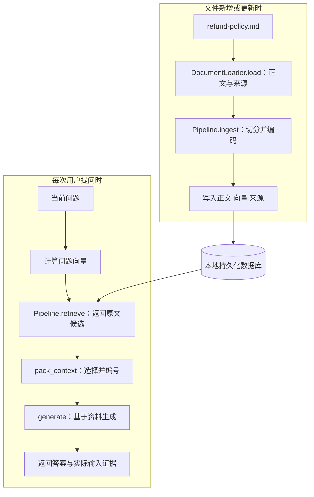

# 大模型应用开发学习 13：RAG 实战：从文档到问答系统

客服问：“会员买的非定制商品，签收10天后还能申请退货吗？”公司的售后政策已经写明申请期限和商品例外。现在要做的是让程序读到这些规定，找出依据，再让模型回答。

先用一份普通文本文件完成这件事。它没有扫描图片、复杂表格和页面排版，读取后就是可检查的文字。这样可以把注意力放在一次完整问答上：文件怎样成为知识库中的记录，检索结果又怎样成为模型实际读到的资料。

[检索质量优化](11-检索质量优化从召回到融合再到重排.md)和[RAG入门](12-RAG入门让模型基于自己的资料回答.md)已经解释过的方法，这里直接使用。Top K仍是候选数量控制，向量仍用于检索；本篇重点看程序的输入、输出和交接，不重新讲一遍算法。

> **配套代码：**完整程序见[示例目录](https://github.com/benx92/ai-learning-notes/tree/main/examples/13-rag)，`rag.py`负责流程，`loader.py`负责读取。正文先使用目录中已有的`refund-policy.md`；PDF和其他格式的读取在[文档解析工具链](14-文档解析工具链网页PDFWordPPTExcel怎么进知识库.md)中展开。

## 固定一份资料、一个问题和核对标准

样例使用虚构售后政策，正文包含四条规则：

| 规则 | 原文要点 |
| --- | --- |
| 会员订单 | 签收后15日内可以申请退货 |
| 普通订单 | 签收后7日内可以申请退货 |
| 商品例外 | 定制商品不支持无理由退货 |
| 退款到账 | 审核通过后3个工作日内到账 |

“普通订单”是与会员订单相对的订单类别；题目中的“非定制商品”是商品属性，两者不能混为一谈。固定问题是：

```text
会员买的非定制商品，签收10天后还能申请退货吗？
```

核对时应当看到：会员适用15日的申请期限，10天仍在范围内，非定制商品不触发定制例外，因此可以申请。不能误用普通订单7日的规定，也不能把退款到账3个工作日当作申请期限。**可以申请不等于申请已经批准。**这是预期判断，不是在线模型的实测回答。

先确定核对标准，再执行程序，才能检查系统是否真的使用了正确证据。

这里有两个独立的运行时机：文件新增或更新时准备知识，用户提问时检索并回答。程序执行关系如下：



入库完成后可以退出程序，之后另开进程连接同一个数据库提问。一份文件可以服务很多次查询；换问题不会重新读取、切分和编码整份政策。

这次先实现单用户、本地运行、单路向量检索的最小系统。它没有上传页面、多用户权限隔离、混合检索或重排。完整架构中可以有这些组件，第一次动手先检查主链路是否接通。

## 读取文本：先得到程序能够使用的知识单元

程序拿到的是文件路径，而切分器和嵌入模型需要的是文字。因此，第一步不是调用模型，而是读取文件。

在配套目录使用已有加载器：

<!-- example-kind: usage -->

```python
from loader import DocumentLoader

units = DocumentLoader().load("refund-policy.md")
print("文本单元数：", len(units))
for unit in units:
    print(unit.metadata)
    print(unit.text)
```

`units`是加载结果列表。对于这份Markdown，基础加载器把全文作为一个单元，所以应看到一个单元、完整政策正文，以及`source`、`file_type`、`location`等来源字段。这里的`location`是“全文”，没有PDF页码。先核对15日、7日和“不支持”是否都在正文中，再继续。

加载器把每个单元表示为`DocumentUnit`。下面是[`loader.py`](https://github.com/benx92/ai-learning-notes/blob/main/examples/13-rag/loader.py)中的实际定义：

<!-- example-source: examples/13-rag/loader.py -->

```python
@dataclass
class DocumentUnit:
    text: str
    metadata: dict
```

`text`保存后续会编码和送给模型阅读的文字；`metadata`保存来源说明，帮助找到原件。`@dataclass`让程序可以方便地保存和访问这两个字段；运行时直接导入已有加载器，不需要重新拼装这个类。

Markdown分支的读取实现很简单：

<!-- example-source: examples/13-rag/loader.py -->

```python
@staticmethod
def _plain(path):
    yield path.read_text(encoding="utf-8-sig"), {"location": "全文"}
```

它按UTF-8读取文件，把“正文、位置”这一对数据交给统一入口；`load()`再补齐来源和文件类型，组成`DocumentUnit`。这里没有解析Markdown标题层级，标题标记仍在原文里。选择这个入口，是因为本次资料已经能直接读成文字。

这一步值得明确下来：后续流程不需要知道文字最初来自哪种文件，它需要一组**可阅读正文与可追踪来源**。现在先用最简单的文件满足这个约定。

## 入库：把正文、向量和来源对应保存

加载器返回的一个单元，不等于最终只有一个检索块。全文可能超出嵌入模型的输入长度，入库流程会继续切分。

调用已有流程：

<!-- example-kind: usage -->

```python
from pathlib import Path
from rag import Pipeline

pipeline = Pipeline(Path("text_demo"))
report = pipeline.ingest("refund-policy.md")
print({key: report[key] for key in ("units", "chunks", "total")})
```

`Pipeline(...)`准备切分器、编码器和数据库连接，`ingest(...)`才正式处理文件。函数内部会重新调用加载器，因此前面的单独读取是观察入口，不是每次入库必须手工执行的前置步骤。

返回的`units`是加载单元数，`chunks`是本次形成的块数，`total`是当前集合的总记录数。它们各自统计不同对象：这份文本的`units`应为1，但不能由此认定`chunks`也等于1。已有其他文件时，`total`还会包含那些文件的记录。

实际处理沿着下面的数据变化进行：

```text
文件路径
  → units：带来源的全文
  → texts：切分后的正文列表
  → vectors：与每段正文对应的向量
  → 正文、向量、来源一起写入数据库
```

程序使用多语言MiniLM生成向量，Chroma保存记录。编码器负责将文字变成向量；数据库负责保存和查询；两者都不会在入库时生成用户问题的答案。

**切分配置沿用已有原理，检查重点放在实际长度。**本例使用模型的Tokenizer计数，目标块长80、相邻块重叠12，编码前再次检查包含特殊Token的长度是否超过模型上限。这里的80不是80个汉字。递归切分会优先沿段落、换行和标点拆分，重叠用于缓解边界处的内容断裂，仍需检查适用对象和例外有没有被拆散。

MiniLM的完整模型名为`sentence-transformers/paraphrase-multilingual-MiniLM-L12-v2`，与英文示例常见的`all-MiniLM-L6-v2`不同。入库与查询使用相同配置，才能在同一个向量空间比较；换编码器后需要重建相应索引。

**写入时，各列表的相同位置必须属于同一个块。**下面摘自[`Pipeline.ingest()`](https://github.com/benx92/ai-learning-notes/blob/main/examples/13-rag/rag.py)，使用该方法已经准备好的编号、正文、向量和元数据：

<!-- example-source: examples/13-rag/rag.py -->

```python
self.collection.upsert(
    ids=ids[start:end],
    documents=texts[start:end],
    embeddings=vectors[start:end],
    metadatas=metadatas[start:end],
)
```

`start:end`选择当前批次。若第一段正文错配了第二段的向量，存储操作可能仍然成功，检索返回的内容却不再对应。因此，要同时保留正文、向量和来源，不能只看“写入成功”。`upsert`按编号插入或更新记录，不负责判断政策是否生效。

准备完成后，这些记录留在本地数据库里，等待之后的问题。

## 检索：用当前问题取回已经保存的原文

下面可以在另一个进程中执行，也可以复用前面创建的`pipeline`：

<!-- example-kind: usage -->

```python
from pathlib import Path
from rag import Pipeline

pipeline = Pipeline(Path("text_demo"))
question = "会员买的非定制商品，签收10天后还能申请退货吗？"
hits = pipeline.retrieve(question, top_k=5, threshold=-1.0)
for hit in hits:
    print(hit["location"], round(hit["score"], 4))
    print(hit["text"])
```

这次传入的是问题，不是文件路径。程序只计算当前问题的向量，查询`text_demo`里的已有记录，再将命中记录的正文和来源整理为`hits`。

Top K在这里落实为`top_k=5`，最多返回5条；`threshold=-1.0`采用宽松筛选，先方便观察候选。参数取舍沿用检索优化篇的思路。本轮先核对：会员期限能否找到，商品例外是否保留，是否误取了退款到账规则。

`score`是本集合中由余弦距离转换得到的接近程度，不是答案正确率。转换细节见[检索实现说明](supplements/13-实现细节与运行排查.md)。阅读输出时，先看原文能否支持判断，再看分数帮助排查，不能把0.7理解成“70%可以退货”。

再问一次“退货运费由谁承担？”这份政策没有写运费，检索却仍可能返回售后相关文字。这个反例要保留下来：有相关结果不等于有足够依据，模型不能根据主题相近就补出运费规则。

如果候选为空，也要检查数据库路径、是否已入库、编码配置和阈值，不能立刻断定原文没有答案。`retrieve`的作用就是让生成前的证据可被单独观察。

## 生成：把候选整理成模型实际读到的资料

检索器返回`hits`以后，模型还没有读到它们。需要先组装上下文：

<!-- example-kind: usage -->

```python
from rag import pack_context

context, evidence = pack_context(hits, budget=6000)
print(context)
print("候选数：", len(hits), "实际选入数：", len(evidence))
```

这段调用接在检索之后。`context`是准备交给模型的文本，`evidence`是实际选入的资料清单。程序选择完整块，装入预算后再编号，保留文件名、位置和块序号。

假设检索找回了期限与例外，模型输入可以读成下面这样的形式。它只示意问题与证据的关系，实际块边界和编号以打印出的`context`为准：

```text
依据参考资料回答；没有写明的内容请说明缺口。

[资料1] refund-policy.md，全文，对应块序号
会员订单签收后15日内可以申请退货。

[资料2] refund-policy.md，全文，对应块序号
定制商品不支持无理由退货。

问题：会员买的非定制商品，签收10天后还能申请退货吗？
```

资料编号来自本次上下文选择，不是源文件中的章节号。改变候选顺序可能改变编号，来源和原始位置仍须跟着对应文字。

本例用6000字符作为简单的上下文预算。它不是模型的精确Token预算；真实使用还需要为系统指令、问题、历史消息和输出预留空间。假设找回两条候选，预算只容得下一条，就只能把这一条列为实际输入证据。如果商品例外被跳过，候选虽然找对了，生成仍可能失去重要条件。

把检索、上下文与生成接起来的是[`rag.py`中的`ask()`](https://github.com/benx92/ai-learning-notes/blob/main/examples/13-rag/rag.py)：

<!-- example-source: examples/13-rag/rag.py -->

```python
def ask(pipeline, question, top_k=5, threshold=-1.0, budget=6000, generator=generate):
    hits = pipeline.retrieve(question, top_k, threshold)
    context, evidence = pack_context(hits, budget)
    if not evidence:
        return {"status": "insufficient_evidence", "answer": "现有资料不足，无法回答。",
                "retrieved_count": len(hits), "evidence": [], "model": None}
    generated = generator(question, context)
    return {"status": "generated_pending_verification", **generated,
            "retrieved_count": len(hits), "evidence": evidence}
```

这是完整程序中的实际函数，需要同文件里的其他定义。它先检索，再选择资料，没有可用上下文就返回，有证据才调用生成服务。`generate()`将回答规则放进系统消息，将问题和资料放进用户消息，调用模型接口并读取回答；它不会重新读取文件或检索数据库。

生成后，`answer`保存模型文本，`evidence`保存实际输入的资料，`retrieved_count`保留候选数量。`generated_pending_verification`明确表示生成完成后仍需核验，不能把“有回答”当作结论已确认。

核对时回到开头的问题：是否用会员15日的规定，是否保留商品例外，是否只说可以申请，引用编号是否能对应到支持结论的原文。资料分隔和回答约束有助于表达边界，但外部文档中的命令仍然只是数据，不能改变系统指令或工具权限。

## 用完整命令运行，并逐层检查结果

在[完整示例目录](https://github.com/benx92/ai-learning-notes/tree/main/examples/13-rag)打开PowerShell，先按README准备Python3.12环境：

```powershell
py -3.12 -m venv .venv
.\.venv\Scripts\python.exe -m pip install torch==2.6.0 --index-url https://download.pytorch.org/whl/cpu
.\.venv\Scripts\python.exe -m pip install -r requirements.txt
```

配套现在提供可直接运行的[`demo_text.py`](https://github.com/benx92/ai-learning-notes/blob/main/examples/13-rag/demo_text.py)，将上面的步骤接在一起，默认读取脚本旁的`refund-policy.md`：

```powershell
.\.venv\Scripts\python.exe demo_text.py --extract-only
.\.venv\Scripts\python.exe demo_text.py
```

第一条只打印知识单元，不加载嵌入模型。第二条使用真实编码器和向量库，依次返回`parsed`、`ingest`、`hits`、`context`与`evidence`，默认不请求生成接口。需要生成时，先配置后文的环境变量，再运行`demo_text.py --generate`；可以用`--output text-run.json`保存这一次的阶段结果。

这个演示入口每次都会重新走一次入库，方便对照全过程；实际服务中仍按文件更新和用户提问分别触发。下面保留分阶段命令，便于单独核对和排查。

先观察文本加载结果，再入库：

```powershell
.\.venv\Scripts\python.exe rag.py extract --path refund-policy.md
.\.venv\Scripts\python.exe rag.py --db ./text_demo ingest --path refund-policy.md
```

`extract`只读文件，不加载嵌入模型，也不调用生成服务。`ingest`完成切分、编码与存储，首次运行可能需要下载模型权重。处理结束后可以关闭程序，资料仍保存在`text_demo`中。

之后打开同一个数据库，检查候选：

```powershell
.\.venv\Scripts\python.exe rag.py --db ./text_demo retrieve -q "会员买的非定制商品，签收10天后还能申请退货吗？"
```

期限和例外都能在原文中核对，再设置自己的生成凭证与可用模型名：

```powershell
$env:DEEPSEEK_API_KEY = "替换为自己的密钥"
$env:RAG_CHAT_MODEL = "填写账户可用模型名"
.\.venv\Scripts\python.exe rag.py --db ./text_demo query -q "会员买的非定制商品，签收10天后还能申请退货吗？"
```

正常问答直接运行`query`即可，它内部已经包含检索。单独执行`retrieve`是为了观察，不要求每次都先手工检索。脚本读取进程环境变量，不会自动加载`.env`；`query`会将问题和选入的资料发送给生成接口。鉴权失败、超时和不完整响应属于调用失败，不能冒充“资料不足”。

**再检查一次候选与实际输入的区别。**把上下文预算改成1字符：

```powershell
.\.venv\Scripts\python.exe rag.py --db ./text_demo query -q "会员买的非定制商品，签收10天后还能申请退货吗？" --context-chars 1
```

这次应返回`insufficient_evidence`、空`evidence`和`model=null`，候选数仍可能大于0。原因是没有任何完整块装得进去，`ask()`在调用生成服务之前就返回了。这个实验用来检查控制流，不会请求付费生成接口。

可以按下面的结果定位问题：

| 观察位置 | 要核对的内容 | 不符合时先检查 |
| --- | --- | --- |
| `extract` | 政策正文完整，来源是当前文件 | 文件内容、编码和加载结果 |
| `ingest` | 有有效块并保存到预期集合 | 模型长度、切分与数据库位置 |
| `retrieve` | 期限与例外进入候选 | 切分、检索配置与筛选 |
| `context`与`evidence` | 必需证据真正进入模型输入 | 块长度与上下文预算 |
| `answer` | 结论与条件正确，引用支持结论 | 提交的资料、回答规则和模型输出 |

同一文件修改后重新入库，程序会写入新块并清理该来源的过期块；这个过程不是原子事务。编码配置变化也需要重新入库。稳定编号、集合配置、更新顺序和错误处理放在[实现细节与运行排查](supplements/13-实现细节与运行排查.md)中，遇到对应问题时再查阅。

配套回归测试覆盖解析、来源传递、存储更新、预算与生成调用条件；新增演示检查还核对纯文本入口、实际选入证据、重复运行及显式生成开关。测试使用真实解析器和向量库，向量和生成器使用测试替身。仓库另有真实MiniLM与Chroma的[PDF检索记录](https://github.com/benx92/ai-learning-notes/blob/main/examples/13-rag/verification-retrieval.json)，那份记录属于PDF样例，不能当作本次Markdown问题的实测分数。付费生成接口的端到端答案尚未验证，本篇给出的结论是人工核对标准。

## 从文本案例引出真实文件的知识转换入口

这次文件本来就是文字，因此`read_text()`已经能交出知识单元。换成真实业务资料，入口会出现新的问题：

| 资料的样子 | 不能直接读取全文的原因 | 需要交给后续流程什么 |
| --- | --- | --- |
| 文字PDF、Word、网页 | 有页面、标题、表格和导航，需要选对内容 | 保留条件和来源的正文 |
| 扫描PDF、截图 | 字在图像里，普通文本读取拿不到 | 经识别与核对的文字及图像位置 |
| PPT图文页 | 规则可能分散在文本框、备注和图示中 | 与原页关联、含必要关系的内容 |
| Excel表格 | 单独的数值离开表头和单位就失去含义 | 字段、值、单位配对后的记录 |

这些变化可以先收敛到一个接口问题：**怎样把不同来源转换成同样能交给入库程序的变量？**现在的交接已经有了名字：

```text
不同来源
  → units：DocumentUnit列表
      text：可检索、可交给模型阅读的内容
      metadata：原件和位置
  → 继续调用已有的切分、编码与入库
```

这里的“统一”是统一数据约定，不是把所有文件拼成一个字符串。Markdown可以先按全文产生单元；PDF可以按页；表格可以按带表头的记录。每个单元都要说明内容是什么、来自哪里，后续再按长度拆成检索块。

还要分清文件格式和模态。PDF、Word、PPT是文件容器；文字、图像、音频等是内容模态，一份文件可以混合多种内容。把扫描文字经OCR转成`text`后，当前系统仍走文本检索；如果要直接保存和检索图像表示，还需要相应的编码、存储与生成输入设计。不能因为接收了PDF，就认为已经实现完整多模态RAG。

因此，下一步先解决最贴近现有程序的扩展：保留同一个`DocumentUnit`接口，按文件内容选择提取、OCR或结构还原方法，核对后再交给入库。图片或图示若无法可靠转成文字，要保留原件与未覆盖范围，不能编造描述填进去。这就是[文档解析工具链](14-文档解析工具链网页PDFWordPPTExcel怎么进知识库.md)接着要串联的过程。

## 最后回到这一次问答

现在可以沿着数据解释一次回答：文本文件成为带来源的知识单元，切分后编码并保存；用户问题触发检索，取回原文；程序选择实际输入的证据，再由模型组织回答并返回核验入口。

这个简单案例先证明主流程怎样连接。真实文件的差异集中在“怎样得到可靠知识单元”这一步；只要接口与来源关系保住，后面的切分、存储、检索和问答就能继续复用。

## 参考资料

- [配套源码、依赖与运行说明](https://github.com/benx92/ai-learning-notes/tree/main/examples/13-rag)
- [Sentence Transformers编码接口](https://www.sbert.net/docs/package_reference/sentence_transformer/model.html)
- [本例MiniLM模型卡](https://huggingface.co/sentence-transformers/paraphrase-multilingual-MiniLM-L12-v2)
- [Chroma查询与结果](https://docs.trychroma.com/docs/querying-collections/query-and-get)
- [DeepSeek生成接口](https://api-docs.deepseek.com/api/create-chat-completion/)
