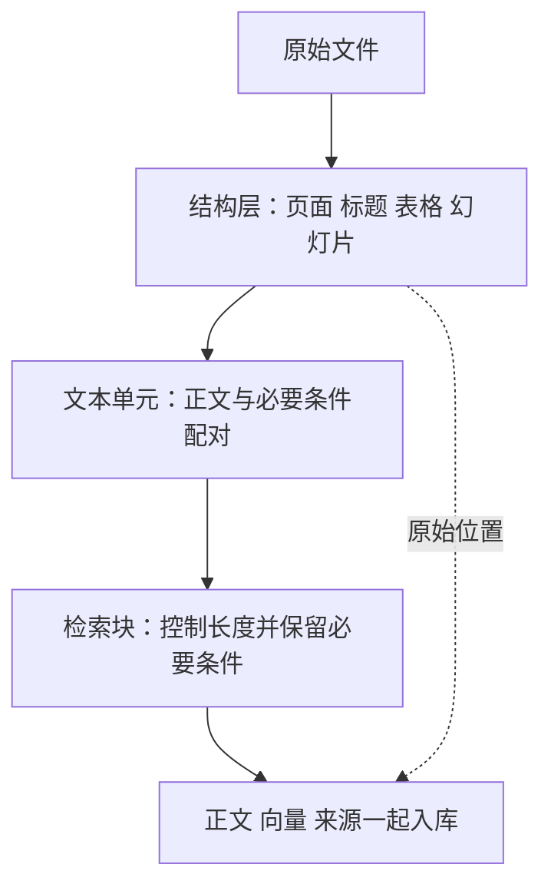
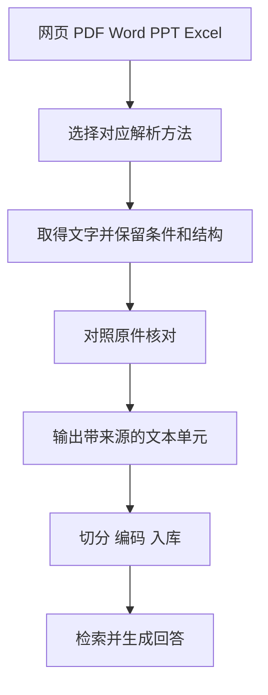

# 大模型应用开发学习 14：文档解析工具链：网页、PDF、Word、PPT、Excel 怎么进知识库

一份PDF里明明写着售后政策，程序提取后却只剩“第2页”。返回值不为空，程序也没报错，可最需要的条款一字都没有。

这时应该先回到读文件这一步。模型收到的资料里没有规定，再好的回答能力也补不回原文件。

问题出在读文件这一步：屏幕上看见的内容，不一定以连续文字保存在文件中。它可能是一张扫描图片，也可能分散在表格、备注和不同文本框里。我们需要先弄清这些内容怎样组成一条完整规则，再决定怎么提取。

> **配套代码说明：**本章与文档问答实战共用 [GitHub配套代码](https://github.com/benx92/ai-learning-notes/tree/main/examples/13-rag)，基础解析实现见 [`loader.py`](https://github.com/benx92/ai-learning-notes/blob/main/examples/13-rag/loader.py)。建议结合正文对照查看，依赖安装方法见示例目录中的README。

基础解析仍使用 `examples/13-rag/loader.py`。本章的正文选择、OCR开关、标题继承、备注和指定表头实验，另存于 [examples/14-parsing](https://github.com/benx92/ai-learning-notes/blob/main/examples/14-parsing/README.md)，正文代码与这些实验文件对应。运行实验只打印解析结果；接入加载器并重新入库以后，知识库才会使用改进后的正文。

| 文件 | 本章使用的工具 | 先观察什么 |
| --- | --- | --- |
| 网页 | Beautiful Soup | 哪一部分才是当前正文 |
| PDF | PyMuPDF，必要时配合OCR | 正文是可读取文字，还是图片里的字 |
| Word `.docx` | python-docx | 条款属于哪个标题，表格怎样接在正文中 |
| PPT `.pptx` | python-pptx | 条件有没有藏在备注、图片或图表里 |
| Excel `.xlsx` | openpyxl | 数字对应什么表头、单位和计算状态 |
| CSV、JSON、JSONL、XML | Python标准库中的相应解析器 | 一条记录在哪里结束，字段属于谁 |

对照源码时，先区分现有分支与本章实验：

| 格式 | 现有 `loader.py` 方法 | 本章另行演示的改进 |
| --- | --- | --- |
| HTML | `_html()`读取本地全文并去除脚本与样式 | `html_demo.py`选择已确认的正文区域 |
| PDF | `_pdf()`逐页取文字，检查加密和空文本 | `pdf_demo.py`显式选择OCR，需额外环境 |
| Word | `_docx()`按顺序读取正文块和表格行 | `word_demo.py`继承规范标题，把表头配入数据行 |
| PPT | `_pptx()`读取文本框、表格和组合形状 | `ppt_demo.py`额外观察已有备注 |
| Excel | `_xlsx()`把首个非空行当表头 | `excel_demo.py`指定工作表与表头行 |
| CSV、JSON、JSONL | `_csv()`、`_json()`、`_jsonl()`做基础读取 | `records_demo.py`按教学字段观察记录；XML尚未接入加载器 |

这些是不同文件的处理分支，不是每份资料都要依次经过的五个步骤。它们最终要交给知识库的东西相同：**读得懂的正文，以及能找到原件的位置。**

## 先看一种最容易忽略的错误：字都在，意思却丢了

继续使用虚构售后规则：会员订单15日内可申请，普通订单7日内可申请，定制商品不支持无理由退货。

假设Excel里写着：

| 客户类型 | 申请期限 | 单位 |
| --- | ---: | --- |
| 会员订单 | 15 | 日 |
| 普通订单 | 7 | 日 |

如果程序只提取出“会员订单、15、日、普通订单、7、日”，人还可以猜。若切分后某块只剩“15”，模型就不知道它是天数、金额还是数量。

因此，更合适的结果是：

```text
会员订单：签收后的申请期限为15日。
普通订单：签收后的申请期限为7日。
```

这不是让模型凭空补规则，而是利用原表头和单元格关系，把文件已经表达的意思保留下来。如果原表没有“签收后”这个起点，就不能自行添加，需要从标题或说明中取得依据。

由此可以区分三个检查：字有没有读全，字之间的关系有没有保住，能不能回到原件。少一个“不”是文字错误，把普通订单配到15日是关系错误，不知道来自哪个版本则是来源问题。

加载器可以继续使用`text`和`metadata`两部分记录。前者放可阅读正文，后者放文件名、页码、工作表等追踪信息。例如：

<!-- example-kind: illustration -->

```json
{
  "text": "会员订单：申请期限15日。",
  "metadata": {"source": "policy.xlsx", "sheet": "退货规定", "row": 2}
}
```

这里有一个容易踩的坑：**适用条件要进入模型能读到的正文。**如果“会员订单”只放在元数据里，发送给模型时却只取`text="15日"`，条件仍然丢了。位置用于回查，条件用于理解，两者要分别保证。

**统一输出，不等于抹掉文件结构。**一页PDF、一张幻灯片和一行Excel都可以转成`DocumentUnit`，但位置字段应该保留各自的含义：

| 字段 | 怎样取得 | 用来做什么 |
| --- | --- | --- |
| `source`、`file_type` | 文件路径与扩展名 | 找到原文件，选择处理方式 |
| `page`、`slide` | 遍历时取得的物理页或幻灯片序号 | 回到对应页面；不能互相冒用 |
| `block`、`sheet`、`row` | 正文块、工作表与记录位置 | 定位办公文档中的内容 |
| `title_path` | 已识别的标题层级 | 说明适用范围；必要部分还要放进正文 |
| `source_revision`、`extract_method` | 已确认的资料版本、实际调用的提取方法 | 排查旧规则与不同解析结果 |

前三类基础定位由配套加载器提供；标题路径、版本和提取方法需要额外处理或配置，不是给字段起好名字就自动出现。文件修改时间不一定是制度生效时间，PDF物理第3页也可能印着“第1页”。缺失的字段先留空或省略，不要猜。

本例向量库使用扁平的字符串和数值元数据。复杂表头、坐标列表或嵌套对象要先确定保存方式，不能直接照搬进现有集合；完整结构可以另存，再用记录编号关联。

**为什么已经补全条件，切分时还会出错？**因为解析单元与检索块不是同一个东西。解析单元可以是一张幻灯片、一页PDF或一行表格；切分器为了适应长度，可能继续拆开它。

例如一张幻灯片开头写“仅适用会员”，下面有十条规则。把标题加在整张幻灯片最前面，切分后只有第一块保留标题，其余块仍可能不知道适用谁。因此，必要条件不仅要在解析结果里存在，还要沿着后续切分继续传递。

可以把处理分成三层：



这张图里的结构层不是要求一定新增一个复杂类。它提醒我们：先识别内容之间的关系，再把它写成适合检索的文字，而不是等文本被切碎以后再猜原来的结构。

**清洗时也要保留证据。**去掉重复页脚、统一换行可以减少噪声，但页脚可能包含版本日期，空单元格可能表示沿用上方类别，换行也可能区分两个列表项。更稳的做法是保留原件与原始提取结果，再生成清洗版本，记录使用了什么规则。

## 网页：先圈出正文，再去掉标签

售后网页的正文写着会员15日，页面导航里却有一个旧活动入口：“30天退换”。把整页文字全部提取出来，就可能把旧宣传语混进政策。

网页使用HTML标签组织内容。`article`常表示独立文章，`main`表示主要区域，`nav`通常是导航。解析时可以利用这些结构先找到正文，再清理脚本和样式。

下面摘自独立实验 [`html_demo.py`](https://github.com/benx92/ai-learning-notes/blob/main/examples/14-parsing/html_demo.py)，使用已拿到的HTML，不访问网站，也不运行网页脚本：

<!-- example-source: examples/14-parsing/html_demo.py -->

```python
from bs4 import BeautifulSoup


if __name__ == "__main__":
    html = """<nav>旧活动：30天退换</nav>
    <article><h1>会员订单退货</h1>
    <p>会员订单签收后15日内可以申请退货。</p></article>"""
    soup = BeautifulSoup(html, "html.parser")
    body = soup.select_one("article")
    if body is None:
        raise ValueError("没有找到正文，请检查页面结构")
    for tag in body.select("script, style, noscript"):
        tag.decompose()
    print(body.get_text(separator="\n", strip=True))
```

这里Beautiful Soup负责解析HTML，`select_one()`选定区域，`get_text()`提取区域里的文字。结果只应包含会员标题和15日条款，旧活动被留在外面。[Beautiful Soup文档](https://www.crummy.com/software/BeautifulSoup/bs4/doc/)

这一步解决的是“正文选错”的问题。不是所有站点都有`article`，一个页面也可能有多个文章区域，需要根据真实页面调整选择范围。

还要区分**拿到网页**和**解析网页**。有的网页初始HTML只有空壳，正文要运行脚本或登录后才能出现。解析器不会替你执行JavaScript。如果输入本来没有正文，反复修改去标签方法也找不出政策。

实际检查可以很具体：浏览器里能看见那句15日吗？拿到的HTML里有这句话吗？选中的正文区域包含它吗？这三问分别定位访问、获取和解析问题。

正文读对以后，再保留来源URL、获取时间和已确认的政策版本。获取时间记录的是何时拿到页面，不自动等于规则生效时间。

正文中的标题和表格也需要继续整理。比如标题是“定制商品”，下一段只有“不支持无理由退货”，两者应该一起进入证据；表格不能仅把单元格逐个串起来，而应保留列名与行类别。

接入现有系统时，修改位置是`DocumentLoader._html()`：原来取整个HTML文本，现在先选择已经确认的正文区域，再返回文字与位置。独立小实验只验证选择效果，修改加载器并重新入库，才会改变实际知识库。

如果已经确认这批页面都用`article`保存正文，可以把上面“解析、选择、去噪、取文字”的代码整理为`extract_article(html)`函数，定义在`loader.py`的类之前；函数返回清理后的字符串。类中的`_html()`再用`yield extract_article(html), {"location": "HTML正文区域"}`提供结果。这里的`yield`一次提供“正文、位置”这一对数据，供统一入口收集；不是直接调用模型。

如果页面有多个`article`，当前代码只取一个，可能漏正文；如果正文主要是图片，选中区域也不会自动识别图片里的字。这些检查仍然回到同一条标准：用户问题所需的规则，到底有没有进入输出。

## PDF：先判断字存在哪里，再判断顺序对不对

回到开头只读出“第2页”的文件：政策正文是一张扫描图片，页脚却是可以直接读取的文字。所以文本提取非空，却没有覆盖正文。

PDF中可直接读取的字符，通常称为文字层。原生PDF可能有文字层；扫描件可能只有图像，也可能已经附有识别后的文字层。能复制文字是一条线索，复制后是否乱码、是否缺内容还要核对。

**正文在图片里怎么办？**需要把图像中的字识别成字符，这叫OCR，即光学字符识别。它解决的是“看见图片中的字”，不是自动理解表格或判断条款真假。

处理当前文件时，可以这样走：

```text
直接提取正文
  → 对照页面，发现只取得页脚
  → 对需要的页面或图片区域执行OCR
  → 核对识别出的条件、数字和否定词
  → 保留页码，再交给切分器
```

假设OCR把“不支持”读成“支持”，总字数几乎没变，结论却反了。因此要重点检查15和7、日和工作日、支持和不支持，不能只检查字符数。

PyMuPDF可以提取文字，也提供配合Tesseract的OCR接口；OCR另需安装识别引擎和语言数据。配套基础加载器只做原生文字提取，没有自动启用OCR。

下面是 [`pdf_demo.py`](https://github.com/benx92/ai-learning-notes/blob/main/examples/14-parsing/pdf_demo.py) 中的 `read_pdf_page()`，明确选择普通提取或OCR，不根据“有几个字”就自动决定：

<!-- example-source: examples/14-parsing/pdf_demo.py -->

```python
def read_pdf_page(page, use_ocr=False):
    if use_ocr:
        text_page = page.get_textpage_ocr(
            language="chi_sim+eng", dpi=300, full=True
        )
        return page.get_text("text", textpage=text_page, sort=True)
    return page.get_text("text", sort=True)
```

调用前先用`pymupdf.open()`取得文档，再传入其中一页。`use_ocr=False`直接读文字层；`True`先识别整页图像，得到识别后的文字对象，再提取文字。`chi_sim+eng`表示使用简体中文和英语识别数据，`dpi=300`是此示例的识别分辨率设置，不保证所有扫描件都适用。

把下面的调用接在函数定义之后，就能先观察配套PDF的普通提取结果。它沿用文档问答示例的依赖环境，并要求当前目录有`refund-policy.pdf`：

<!-- example-kind: usage -->

```python
import pymupdf

with pymupdf.open("refund-policy.pdf") as document:
    for number, page in enumerate(document, 1):
        text = read_pdf_page(page, use_ocr=False)
        print(f"第{number}页：\n{text}")
```

这个文件本来有文字层，因此不需要OCR。检查自己的扫描件时，先换成对应文件，再对已确认需要识别的页选择`use_ocr=True`；并不是把示例里的开关统一打开，结果就一定更好。[PyMuPDF的OCR处理说明](https://pymupdf.readthedocs.io/en/latest/recipes-ocr.html)

与`pip install pymupdf`不同，Tesseract引擎及语言数据属于额外环境。只有Python包而没有引擎，OCR分支仍可能失败。当前OCR环境尚未实测，不把这段接口示例当作识别效果证明；普通文字提取的PDF样例则已有实际验证。

OCR通常比原生提取更耗时，同一页识别后得到的`TextPage`适合复用，不必每次找一句话就重新识别整页。提高分辨率也会增加开销，不能保证消除模糊、倾斜或复杂表格造成的错误。混合页面是否整页识别，需要对照覆盖范围和重复内容判断。

**字都提取到了，顺序仍可能错。**双栏页面如果按坐标简单串行，可能把左栏一句和右栏一句拼在一起。表格也可能读成一串数字，不再保留行列对应。`sort=True`只能辅助排序，不能保证所有复杂版式都恢复正确。[PyMuPDF文字与版面说明](https://pymupdf.readthedocs.io/en/latest/recipes-text.html)

此时要看文字块的位置、栏与表格边界，分别整理后再组合。跨页表格还要关联下一页沿用的表头。页码适合定位，不应被当作所有语义关系的边界。

混合页面则需要同时检查文字与图片：提取出了大标题，不代表图片中的例外也被读到了。复杂图表还可能依赖箭头、颜色和图例，仅识别字符不足以恢复意思，需要视觉解析或人工核对。

表格特别需要“读回一整条”的检查。例如第1页末尾只有“会员订单”，第2页第一行才写“15日内”。按页独立切分虽然页码准确，却可能丢掉配对关系。处理时可以关联两页的表头和记录，同时记录涉及两页；不能为了强行保留一个页码，编造完整单页证据。

对于多栏排版，也不要只检查最后字符串看起来通顺。应选一个横跨关键条件的段落，对照页面看是否跳栏、穿插页脚或重复标题。顺序一旦错了，后面的模型可能把相邻文字误认为同一条规则。

## Word：按正文顺序读取，让条款继承标题

Word里的规则经常这样出现：标题写“会员订单”，下面一段只写“签收后15日内可申请”。人阅读时会自然把两者联系起来，程序如果单独保存段落，就可能丢掉会员条件。

因此，读Word不能只问“取到了多少段落”，还要问“每段属于哪个标题”。可以让正文继承标题路径：

```text
售后政策 > 申请期限 > 会员订单
签收后15日内可以申请退货。
```

标题路径需要从样式、文档结构或人工配置取得，不能凭文件名猜。标题过长或全文被继续切分时，也要检查每块是否保留必要上下文，而不是只在第一块加一次标题。

表格要留在它原来所在的正文位置。如果先读完所有段落，再把所有表格放到末尾，“下表适用于会员订单”就可能和另一张普通订单表配错。python-docx提供正文块遍历能力，可以按原顺序处理段落和表格。[正文块接口](https://python-docx.readthedocs.io/en/latest/api/document.html)

Word中的页数还会随字体、纸张和排版变化。基础解析通常保留正文块、标题或表格行，不应伪造一个固定页码。页眉页脚、修订内容和图片文字也需要按实际文件检查是否覆盖。

**把标题继承落实到代码。**先准备一份`policy.docx`：使用Word的“标题1”写“售后政策”，“标题2”写“会员订单”，再写期限段落；另设同级标题“普通订单”及对应段落。下面摘自 [`word_demo.py`](https://github.com/benx92/ai-learning-notes/blob/main/examples/14-parsing/word_demo.py)，针对规范标题样式和简单表格，不依赖聊天模型：

<!-- example-source: examples/14-parsing/word_demo.py -->

```python
import re
from pathlib import Path
from docx import Document
from docx.table import Table


def read_word_units(path):
    source = str(Path(path).resolve())
    headings = {}
    for number, block in enumerate(Document(path).iter_inner_content(), 1):
        rows = []
        if isinstance(block, Table):
            if not block.rows:
                continue
            headers = [cell.text.strip() for cell in block.rows[0].cells]
            for row_number, row in enumerate(block.rows[1:], 2):
                pairs = []
                for i, (name, cell) in enumerate(zip(headers, row.cells), 1):
                    value = cell.text.strip()
                    if value:
                        field = name or f"列{i}"
                        pairs.append(f"{field}={value}")
                if pairs:
                    rows.append(("；".join(pairs), {"row": row_number}))
        else:
            text = block.text.strip()
            match = re.fullmatch(r"Heading ([1-9])", block.style.name)
            if match:
                level = int(match.group(1))
                headings = {k: v for k, v in headings.items() if k < level}
                headings[level] = text
                continue
            if text:
                rows.append((text, {}))
        title = " > ".join(headings[k] for k in sorted(headings))
        for text, position in rows:
            yield {"text": f"{title}\n{text}" if title else text,
                   "metadata": {"source": source, "block": number,
                                "title_path": title, **position}}


if __name__ == "__main__":
    for unit in read_word_units("policy.docx"):
        print(unit)
```

这里维护的是“当前走到哪个标题下面”。遇到同级标题，就替换旧标题；从较深标题返回上层时，清除离开的下级标题。例如“售后政策 > 会员订单”后遇到同级“普通订单”，下一段就应带“售后政策 > 普通订单”，不能继续沿用会员身份。

`iter_inner_content()`按正文顺序提供段落或表格；表格第一行在这个实验里明确作为表头，数据行转成“字段=值”。因此，标题、表格和后续解释不会被分别搬到文件两端。输出中的`block`是正文块序号，`row`是表格内部行号，都不是Word页码。

表格循环中的`zip(headers, row.cells)`把每个列名与同一位置的单元格配在一起，`enumerate(..., 1)`再从1开始编号；空表头用“列1”等占位名称，不猜业务含义。`headings`中的键是标题级别，遇到新标题时只保留比它更高的层级，再放入当前标题，所以旧的下级条件不会跟过来。

样式名`Heading 1`等是此实验的识别依据。仅把文字加粗放大，不会自动变成这种标题；自定义样式需要调整识别规则。这个函数也没有恢复多级表头、合并单元格、嵌套表格、修订、文本框或自动编号，不应把顶层正文遍历当成整份文件全部读完。

表格前的“仅适用线上订单”、表格后的“定制商品除外”，可能也是必要条件。标题继承只解决其中一种关系，不能自动把所有相邻句子判作表格说明。先核对原件，再决定哪些内容随数据行保留。

## PPT：画面文字、表格与备注要分别核对

**PPT会把同一个意思分散得更开。**幻灯片可能只写“15日内可申请”，演讲者备注才说明“仅适用会员订单”。只取文本框，内容看似完整，适用范围却少了。

解析PPT时，先以幻灯片为单位收集文本框、表格和组合形状，再检查备注。基础加载器已经读取前三类文字，尚未读取演讲者备注；下面先单独观察备注，其他格式实现可对照[格式解析扩展](supplements/14-格式解析扩展.md)。[python-pptx接口说明](https://python-pptx.readthedocs.io/en/latest/user/quickstart.html)

先把“画面文字”这部分展开。幻灯片上不只有一种对象，所以代码分别检查文本框、表格和组合形状；组合形状内部还要继续遍历。下面的两个函数和调用均摘自 [`ppt_demo.py`](https://github.com/benx92/ai-learning-notes/blob/main/examples/14-parsing/ppt_demo.py)：

<!-- example-source: examples/14-parsing/ppt_demo.py -->

```python
def read_slide_texts(shapes):
    for shape in shapes:
        if shape.has_text_frame and shape.text.strip():
            yield shape.text.strip()
        if shape.has_table:
            for row in shape.table.rows:
                yield " | ".join(cell.text.strip() for cell in row.cells)
        if hasattr(shape, "shapes"):
            yield from read_slide_texts(shape.shapes)
```

`yield`表示逐项提供找到的文字，`yield from`继续提供组合形状内部的结果。这里取得的是用于查漏的原始文字，表格行仍需结合表头整理，形状的配对关系仍要看版面。图片中的字、图表的含义也不会因为这段递归遍历而自动出现。

备注读取本身并不复杂，但要防止把空白备注页当作有效信息。下面只取得已有备注，输入`slide`是python-pptx读取出的幻灯片对象：

<!-- example-source: examples/14-parsing/ppt_demo.py -->

```python
def read_slide_notes(slide):
    if not slide.has_notes_slide:
        return ""
    frame = slide.notes_slide.notes_text_frame
    return frame.text.strip() if frame is not None else ""
```

函数定义本身不会打开PPT。准备一份自己的`policy.pptx`，将两个函数和下面的调用放在同一脚本，逐张对照画面文字与备注：

<!-- example-kind: usage -->

```python
from pptx import Presentation

for number, slide in enumerate(Presentation("policy.pptx").slides, 1):
    texts = list(read_slide_texts(slide.shapes))
    notes = read_slide_notes(slide)
    print(f"第{number}张画面文字：", "\n".join(texts) or "（未取得）")
    print(f"第{number}张备注：", notes or "（未取得）")
```

如果画面文字显示“未取得”，但打开PPT能看见规则，检查它是否是一张截图；备注显示“未取得”时，先确认原文件确实有备注。备注函数只读备注文本占位区域，不包括备注页里的所有图片或其他形状。[python-pptx备注接口说明](https://python-pptx.readthedocs.io/en/latest/user/notes.html)

得到备注后，不应无差别拼到所有幻灯片。它要与当前幻灯片关联，标明来自备注，再检查是否是适用条件、讲解提醒，还是与政策无关的讲师笔记。备注中一句“举例时改成30天”也不能自动覆盖正式制度。

也不能把形状的遍历顺序直接当成人的阅读顺序。左侧“会员”、右侧“15日”的配对可能靠位置表达；图表的颜色和箭头可能说明例外。需要结合版面恢复关系，无法可靠判断的内容应保留待核对状态。

例如原图表的横轴是客户类型、纵轴是申请天数，仅取得“会员、普通订单、15、7”仍不够。如果图表对象能读出类别、系列和单位，先保存这些关系；如果只有截图，再考虑OCR或视觉解析。视觉模型生成的图表说明属于派生结果，数字与配对要回查原图，不能把推测加进政策。

基础加载器会跳过没有文本的幻灯片。因此验收时还要对照原文件的总页数与输出的`slide`序号，不能因为程序返回了两张，就认为三张幻灯片全部覆盖。正文与备注若分别保存，保留同一文件和幻灯片序号，并标明内容类型，避免把备注当成正式画面原文。

## Excel：让每个数值都带着自己的字段和单位

对于开头那张简单表，第一行是表头，后续行是记录。读取时把列名和对应值合起来，就能得到“客户类型=会员订单；申请期限=15；单位=日”。

openpyxl能取得工作表和单元格，但它不知道哪个区域业务上才是表头。实际文件可能前两行是公司名和说明，第三行才开始字段。基础加载器假定首个非空行是表头，复杂文件需要自己指定真实范围。

**先把简单表格真正转成记录。**准备一份`policy.xlsx`，工作表叫“退货规定”，第1行使用上面的三个字段，第2、3行放会员与普通订单。下面摘自 [`excel_demo.py`](https://github.com/benx92/ai-learning-notes/blob/main/examples/14-parsing/excel_demo.py)，显式指定表头行，不让程序把公司名误当字段：

<!-- example-source: examples/14-parsing/excel_demo.py -->

```python
from pathlib import Path
from openpyxl import load_workbook


def read_excel_units(path, sheet_name, header_row=1):
    workbook = load_workbook(path, read_only=True, data_only=True)
    try:
        sheet = workbook[sheet_name]
        headers = next(sheet.iter_rows(min_row=header_row, max_row=header_row,
                                       values_only=True))
        if not any(value is not None and value != "" for value in headers):
            raise ValueError("指定行没有表头，请核对位置")
        for number, values in enumerate(
                sheet.iter_rows(min_row=header_row + 1, values_only=True),
                header_row + 1):
            pairs = []
            for i, value in enumerate(values):
                if value is None or value == "":
                    continue
                field = headers[i]
                if field is None or field == "":
                    field = f"列{i+1}"
                pairs.append(f"{field}={value}")
            if pairs:
                yield {"text": f"工作表={sheet_name}；" + "；".join(pairs),
                       "metadata": {"source": str(Path(path).resolve()),
                                    "sheet": sheet_name, "row": number}}
    finally:
        workbook.close()


if __name__ == "__main__":
    for unit in read_excel_units("policy.xlsx", "退货规定", header_row=1):
        print(unit)
```

会员那行的正文应包含“客户类型=会员订单；申请期限=15；单位=日”，元数据中的行号是2。把表头改在第3行时，调用也要改成`header_row=3`。字段与值在每条记录里重新配对，后面即使只检索到一行，也知道15表示什么。

代码先用`next(...)`取得指定的那一行表头，再从下一行开始读取值。`values_only=True`让每行直接提供单元格的值，`headers[i]`就是同一列的字段名。`finally`负责关闭工作簿，处理途中报错也能释放文件。函数逐条提供记录，调用处的`for`把它们依次取出并打印。

这里判断空值用的是`is not None`和空字符串比较，因此数值0不会被当成空白删除。函数适合单层表头的规则表，不会自动判断汇总行、隐藏行或多级表头；也不会替你识别哪些行已经作废。若表里有公式，还要做下面的缓存检查，不能只靠这一种读法确认结果。

合并单元格也要小心。类别“会员订单”可能占三行，下面两个单元格为空。空白可能表示沿用上面的类别，也可能表示确实没填写。需要结合合并范围与表的定义判断，不能对所有空格无条件填充。

多级表头可以先整理成完整字段。例如上层是“线上订单”，下层分“会员期限（日）”与“普通订单期限（日）”，应保留渠道、对象和单位三个层次。仅保留最下面一行的“期限”，数值仍会失去对象。隐藏行列也不等于无效数据，读取范围应按业务确认。

**公式又是另一类问题。**假设某格写着计算期限的公式，程序可以读取公式字符串，也可以尝试读取上次保存的计算结果。openpyxl本身不会替Excel重新计算公式。[openpyxl工作簿读取说明](https://openpyxl.readthedocs.io/en/stable/tutorial.html)

这意味着：读到`None`可能是没有缓存，不等于零；读到数值也可能是旧缓存，不保证与当前输入一致。应让支持计算的电子表格软件重新计算并保存，或者用明确的业务程序重算，再标记结果来源。

需要排查公式时，可以运行 [`formula_demo.py`](https://github.com/benx92/ai-learning-notes/blob/main/examples/14-parsing/formula_demo.py)，对同一工作簿分别读取公式与缓存：

<!-- example-source: examples/14-parsing/formula_demo.py -->

```python
from openpyxl import load_workbook


if __name__ == "__main__":
    formulas = load_workbook("policy.xlsx", data_only=False)
    cached = load_workbook("policy.xlsx", data_only=True)
    print("公式或原值：", formulas["退货规定"]["B2"].value)
    print("已保存的计算值：", cached["退货规定"]["B2"].value)
    formulas.close()
    cached.close()
```

这里假定文件有“退货规定”工作表与B2单元格，实际练习要换成自己的位置。`data_only=True`不是“现在计算”，而是读取文件已有的缓存结果。没有缓存时，应该记录“结果暂不可用”，不能用`value or 0`把缺失数据改成零。

检索用的文本最好同时保留字段、单位和必要条件；来源则记工作表、行号或单元格范围。文件里只有“15”，没有明确单位时，应标记信息缺失，而不是猜成15天。

金额要带币种，百分比要交代尺度，日期要核对实际类型与显示格式。例如Excel显示15%的单元格，读取值可能是0.15；如果只留这个数字，模型可能误说成0.15%。这些信息要在转成正文时一起组织。

还有一条数据边界：“会员期限是多少”可以检索规则，“全部订单的退款金额合计是多少”则需要完整数据范围与确定计算。只找回最相似的几行，不代表已经完成全表统计。统计、筛选和实时记录查询应交给相应程序或数据库，不能用部分候选冒充完整结果。

## CSV、JSON与XML：先读出记录，再保留字段关系

这些格式本身就是文本，但不是任意位置都能切开。CSV用列组织记录，JSON用对象和数组表达层级，JSONL逐行保存JSON，XML用标签和属性表达关系。

| 格式 | 应保留的结构 | 容易出的问题 |
| --- | --- | --- |
| CSV | 表头、完整记录、带引号的字段 | 字段内的逗号或换行被误当分隔位置 |
| JSON | 对象归属、字段名与数组元素 | 只留下15，却丢掉它属于会员的申请期限 |
| JSONL | 每行记录及物理行号 | 跳过空行后，把记录序号误当文件行号 |
| XML | 标签、属性及父子层级 | 去掉标签后，客户类别与期限无法对应 |

下面摘自 [`records_demo.py`](https://github.com/benx92/ai-learning-notes/blob/main/examples/14-parsing/records_demo.py)，用小字符串观察几种解析结果，不需要额外文件。JSON与XML都假定了明确的教学结构，换数据源时要按实际字段调整：

<!-- example-source: examples/14-parsing/records_demo.py -->

```python
import csv
import io
import json
import xml.etree.ElementTree as ET


if __name__ == "__main__":
    csv_text = '客户类型,说明\n会员,"签收后15日内,定制商品除外"\n'
    for record in csv.DictReader(io.StringIO(csv_text, newline="")):
        print("CSV：", record)
    json_text = '{"policies":[{"customer":"会员","return_days":15}]}'
    for record in json.loads(json_text)["policies"]:
        print("JSON：", record)
    jsonl_text = '{"customer":"会员","return_days":15}\n\n{"customer":"普通订单","return_days":7}'
    for line_number, line in enumerate(jsonl_text.splitlines(), 1):
        if line.strip():
            print("JSONL行号：", line_number, json.loads(line))
    xml_text = '<policies><policy customer="会员"><return_days>15</return_days></policy></policies>'
    for element in ET.fromstring(xml_text).findall("policy"):
        print("XML：", {"customer": element.get("customer"),
                       "return_days": element.findtext("return_days")})
```

CSV中的逗号留在“说明”字段里，没有被拆成第三列；JSONL会打印行号1和3，空行仍占一个物理位置。XML示例把属性中的客户类别与子标签中的期限重新放在同一条记录中，不能只取所有标签内部的文字再拼接。

拿到字典以后，还要明确生成什么正文，例如“客户类型=会员；申请期限=15日”，并保存来源与记录位置。JSON中缺少字段不能无条件填零；XML可能有命名空间或更深层级，需要适配查询路径；JSON数字和XML文本的类型也不相同，后续计算前还要校验。

配套基础加载器支持CSV、JSON、JSONL。CSV分支使用标准解析器取得列表，JSON分支保留整体结构，JSONL保留物理行号；它们尚未按上面的业务字段生成专门记录。XML示例是独立实验，基础加载器尚无XML分支。能演示解析方法，与已经接入知识库，是两个不同结果。[Python CSV文档](https://docs.python.org/3.12/library/csv.html)、[ElementTree文档](https://docs.python.org/3.12/library/xml.etree.elementtree.html)

## 这些格式怎样回到同一条问答流程

现在回到文档问答系统。PDF按页读取，PPT按幻灯片读取，Excel按带表头的记录读取，各自方法不同，但都输出正文与位置。后面的切分、编码和检索就不必重新理解文件格式。



这里新增的关键步骤是核对。可以拿最容易改变结论的一条规则来验收：

> 会员订单签收后15日内可以申请退货，定制商品不支持无理由退货。

检查提取结果能否回答：谁适用，起点是什么，期限是多少，例外是什么，原文在哪里。再核对切分后的块，确保这些关系没有在入库前被再次拆散。

配套[`loader.py`](https://github.com/benx92/ai-learning-notes/blob/main/examples/13-rag/loader.py)已经支持新版Office、本地HTML、原生文本PDF和若干结构化文件。它有格式、编码和空正文检查，尚不具备完整OCR、版面恢复、政策版本判断或自动验收能力。旧版`.doc/.ppt/.xls`需要先转换，不能只改扩展名。

**加载器怎样选择这些分支？**统一入口先检查路径确实指向文件，按小写扩展名选择`_pdf()`、`_docx()`、`_pptx()`等方法。各分支逐条返回“文字、位置元数据”，`load()`清理行尾空白、补上文件来源与格式，再组成`DocumentUnit`列表。它不要求所有格式都按页处理。

新格式需要同时补上解析方法和扩展名映射；只把`.xml`写进支持列表，Python并不会自动知道怎样读取业务字段。路径不存在、格式不支持、编码不匹配、正文为空，也应保留明确错误，不能统一返回空字符串掩盖原因。基础文本读取要求UTF-8；编码不符时先确认并转换，不能靠忽略错误静默丢字。

**以Word标题继承为例，接回同一个接口。**若要使用上面的`read_word_units()`，先把它的导入与函数定义放到`loader.py`的`DocumentLoader`类之前，不复制末尾的练习打印循环；再将类中的`_docx()`替换为下面的方法：

<!-- example-kind: adaptation -->

```python
@staticmethod
def _docx(path):
    for record in read_word_units(path):
        metadata = record["metadata"]
        location = f"Word 块 {metadata['block']}"
        if "row" in metadata:
            location += f"，表格第 {metadata['row']} 行"
        yield record["text"], {**metadata, "location": location}
```

这个适配方法仍然返回统一入口需要的那一对数据；`load()`会继续补全`source`与`file_type`。`location`不能漏掉，因为配套检索程序用它说明原始位置。正文中已有标题路径，模型实际读取正文时才不会丢掉适用对象。其他格式的独立实验，也需要做这样的接口交接，不能把一个字典列表直接当成已有加载器的返回格式。

如果补了正文选择、标题继承或备注提取，要把对应处理接到加载器里，先用`extract`观察，再重新入库。只是运行一段独立演示，知识库不会自动用上改进。

在配套目录准备好文件与依赖后，可以这样观察当前解析结果：

```powershell
.\.venv\Scripts\python.exe rag.py extract --path policy.docx
.\.venv\Scripts\python.exe rag.py extract --path policy.pptx
.\.venv\Scripts\python.exe rag.py extract --path policy.xlsx
```

这三条命令只调用当前`loader.py`，不加载嵌入模型、不请求生成服务。尚未接入改进时，它们显示的是基础解析结果；接入后，重新运行同一条命令比较标题、备注或字段有没有保住。PDF也可用相同入口检查；OCR仍须另行接入并准备环境。

核对通过以后，再对同一个文件重新入库，例如：

```powershell
.\.venv\Scripts\python.exe rag.py --db ./pdf_demo ingest --path policy.docx
.\.venv\Scripts\python.exe rag.py --db ./pdf_demo retrieve -q "会员订单的申请期限是多少？"
```

`extract`的输出变化说明解析代码生效，重新入库后候选变化才说明知识库更新生效。选择同一数据库和同一来源路径，才能比较这次改进；改了文件路径会被视为另一份来源。验收不通过时先调整解析，不要覆盖已经核对过的有效索引。

可以用下面这张清单把学习点落实成验收项：

| 处理对象 | 至少应当能检查什么 |
| --- | --- |
| 网页 | 旧活动导航被排除，当前标题与条款仍在 |
| PDF | 原生文字与图片区域分别覆盖，数字和否定词正确，位置能回查 |
| Word | 同级标题切换后不再沿用旧条件，表格仍处在原来的正文顺序 |
| PPT | 文本框、表格、组合形状与备注有明确处理范围，遗漏页可被发现 |
| Excel | 每个值带字段与单位，零值保留，公式缓存缺失不被写成零 |
| 结构化文件 | 一条记录没有被随意拆开，字段与行号含义清楚 |
| 入库前后 | 解析变化、索引更新和实际候选三者可以分别观察 |

可以把验收做成三种明确结果：已核对可入库、需要人工复核、解析失败。它们是建议的设计状态，基础程序尚未自动实现。原文含多栏表格而关系无法判断时，应进入复核；文件损坏或关键页面完全没有正文时，则应保留失败原因。

验收记录也不必一开始就很复杂。至少写清处理范围、未处理区域、提取方法，以及核对过哪些关键规则。比如“正文与表格已读取，图片中的流程图未处理”，比“文件解析成功”更能说明实际覆盖范围。

暂时读不准的文件，保留原件、提取结果和失败原因，换解析方法或人工复核。不能为了让入库命令显示成功，就用猜测内容填满缺口。

正文中的独立代码已使用小型文件检查：网页可以排除区域外导航，Word能切换标题并保留表格顺序，PPT能取得文本框、表格、组合形状和已有备注，Excel能按指定表头生成记录并保留零值。CSV、JSON、JSONL、XML示例与Word接口适配也检查了输出。它们验证的是这些简单输入上的代码行为，OCR识别效果、多栏恢复和复杂文件覆盖仍需另行核对。

## 最后收束成一个完整认识

文档解析要保住的是一条完整意思，而不只是字符。网页先确定正文，PDF检查文字层与版面，Word保留标题和正文关系，PPT补查备注与视觉信息，Excel保留字段、单位和计算状态。

工具帮我们取得文件中的内容，文件本身的结构决定怎样组织它。把条件、结论和来源一起留下，后面的检索与回答才有可靠输入。

## 参考资料

- [基础加载器与运行方法](https://github.com/benx92/ai-learning-notes/tree/main/examples/13-rag)
- [格式解析的完整代码、OCR与验收扩展](supplements/14-格式解析扩展.md)
- [python-docx正文块与样式接口](https://python-docx.readthedocs.io/en/latest/api/document.html)
- [python-pptx形状与组合形状](https://python-pptx.readthedocs.io/en/latest/api/shapes.html)
- [openpyxl工作簿读取](https://openpyxl.readthedocs.io/en/stable/tutorial.html)
- [Python CSV解析](https://docs.python.org/3.12/library/csv.html)
- [Python ElementTree解析](https://docs.python.org/3.12/library/xml.etree.elementtree.html)
