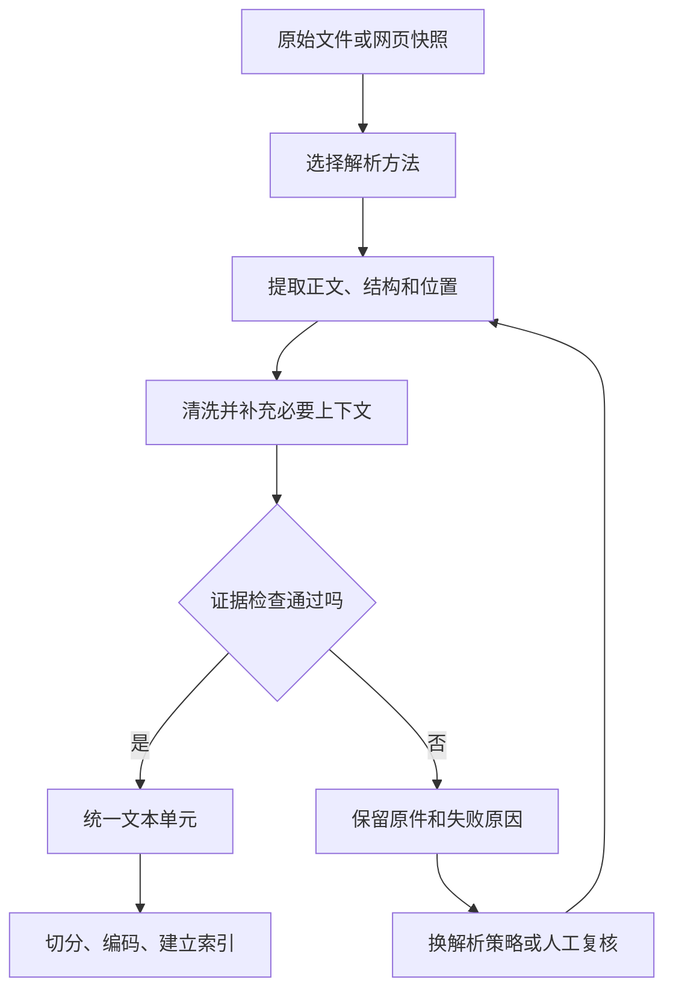

# 大模型应用开发学习 14：文档解析工具链：网页、PDF、Word、PPT、Excel 怎么进知识库

PDF明明写着完整的售后政策，程序提取出来却只有“第2页”。接口没有报错，返回值也不为空，但真正需要的条款一字都没读到。

类似的问题也会出现在办公文档里：Word的表格离开了适用范围，PPT只留下“15日内可申请”，会员条件却在备注中，Excel读出了“15”，却丢了表头和单位。

这些文件的共同难点，是文字和关系一起表达意思。只把字符取出来，可能保住了“15”，却丢掉“谁有15天”。检索和模型再正常，也只能使用已经缺了条件的资料。

因此，文档解析需要解决两件事：取得正文，以及保留读懂正文所需的标题、表头、条件与来源。网页、PDF、Word、PPT和Excel各有不同的保存方式，适合按文件类型分别检查，而不是让每份文件都经过同一套工具。

| 本篇要看清的环节 | 读完后应该能回答的问题 |
| --- | --- |
| 文档结构 | 为什么文字提取完整，意思仍可能不完整 |
| 网页解析 | 怎样区分正文、导航、脚本和动态内容 |
| PDF 解析 | 什么时候直接读取文字，什么时候需要识别图片里的字或恢复排版关系 |
| Word 与 PPT | 标题、表格、备注和图片怎样影响规则理解 |
| Excel 与结构化文件 | 怎样保留表头、单位、公式状态和记录边界 |
| 解析验收 | 怎样判断可以入库，怎样把不确定结果拦在索引之前 |

## 同一条规则，换一种文件就可能变了意思

用一份虚构售后政策看这个问题：会员订单签收后 15 日内可以申请退货，普通订单为 7 日，定制商品不支持无理由退货。下面的网页、办公文档和复杂表格场景都是围绕这些规则构造的教学示意，不代表实际公司制度。

假设这套规则分别存在于四份资料里：

| 资料 | 规则怎样呈现 | 简单提取可能丢掉什么 |
| --- | --- | --- |
| 售后网页 | 正文中写着会员期限，页头还有旧活动入口 | 把旧活动宣传语混入当前政策 |
| 扫描 PDF | “定制商品不支持无理由退货”在图片中 | 整条例外，或者其中的“不”字 |
| 培训 PPT | 幻灯片写“15日内可申请”，备注说明适用会员订单 | 会员这个适用条件 |
| 售后 Excel | 表头是“客户类型、期限、单位”，数据行是“会员、15、日” | 数字与表头、单位的对应关系 |

用户仍然问：“会员买的普通商品，签收 10 天后还能退吗？”

如果解析只留下“15日内可申请”，模型可能把会员规则推广到所有订单。如果例外中的“不”丢了，后面再准确的相似度计算也只是在寻找一条被改写过的规则。

这里有三种不同层次的完整：

1. **文字完整**：原本存在的字、数字、标点有没有读出来。
2. **关系完整**：标题和正文、表头和数值、条件和例外有没有保持对应。
3. **来源完整**：这段内容来自哪个版本、哪一页、哪张幻灯片或哪个单元格。

三者不能互相替代。提取字符很多，不代表关系正确；给一段错误文本标上准确页码，也不会让它成为正确证据。

因此，读完文件后先检查两件事：这条规则还能不能说完整，能不能找到原来写它的位置。仅仅返回了文字，还不足以说明读对了。

## 不同文件读法不同，但交给下一步的内容要说清楚

加载器可以用`DocumentUnit`这样的记录，把正文与元数据放在一起。`text`保存待处理文字，`metadata`保存文件来源、页码等说明：

```text
DocumentUnit
  text      -> 后面要切分、检索和交给模型的正文
  metadata  -> 来源、原始位置及必要的处理信息
```

统一这个接口，并不要求把所有文件都压成一个长字符串。PDF 的自然边界是页面，PPT 是幻灯片，Excel 是带表头的记录；Word 则需要结合标题、段落和表格理解。

如果先把这些边界抹掉，后面的切分器只看到一串字，就无法可靠恢复它们。

解析阶段的“文本单元”与检索使用的“文本块”承担不同职责。加载器先给出一页、一张幻灯片或一条记录，这是文本单元；切分器为了适应模型长度，再把它分成较小的文本块。解析时补全上下文，只是第一步。单元较长时，还要检查切分后的块是否仍带着必要标题和条件，不能假定加过一次标题，所有块就都能读懂。

各节小函数可以独立练习。安装依赖时使用[配套项目的运行说明](https://github.com/benx92/ai-learning-notes/tree/main/examples/13-rag)，在项目目录新建脚本，复制该节函数并接上调用即可。HTML直接使用正文中的字符串，PDF使用`refund-policy.pdf`，PPT和Excel换成自己的`.pptx`、`.xlsx`文件；OCR的额外环境在PDF一节说明。

练习脚本用于检查提取效果。要让问答系统使用改进后的内容，还需把对应处理接入`loader.py`，核对结果后重新入库。

各格式使用不同工具，是因为它们保存内容的方式不同。先记住工具负责哪一步，比先记住一串名字更有用：

| 输入 | 本篇沿用的工具 | 它首先帮我们取得什么 |
| --- | --- | --- |
| 已获取的 HTML | Beautiful Soup | 页面元素中的文本，可先选定正文范围 |
| PDF | PyMuPDF | 页面上的文字及位置信息，必要时配合 OCR |
| `.docx` | python-docx | 正文段落、表格及样式信息 |
| `.pptx` | python-pptx | 幻灯片中的形状、文字、表格及备注 |
| `.xlsx` | openpyxl | 工作表、单元格、公式或缓存值 |

这里的 Word、PPT 和 Excel 示例针对这些新版格式。旧的 `.doc`、`.ppt`、`.xls` 需要先转换，再核对转换后的文字、图表和位置；不能只改文件扩展名。选用工具解决了“怎样读”，标题属于谁、表头对应哪个数值，仍然需要后面的结构处理。

把基础读法与复杂文件的要求放在一起，能够看清哪些信息已经取得，哪些还需要补充：

| 处理对象 | 配套基础加载器已实现 | 需要进一步检查或改进 |
| --- | --- | --- |
| 网页 | 读取本地 HTML，去除脚本与样式 | 确定正文区域，区分原始 HTML 与渲染后内容 |
| PDF | 原生文字提取、物理页序号、空文本页报错 | 检查图片区域、OCR、阅读顺序和跨页关系 |
| Word | 按正文顺序读取段落与表格行 | 继承标题、适用范围、表头和注释 |
| PPT | 读取文本框、表格与组合形状文字 | 单独读取备注，检查图片、图表与条件配对 |
| Excel | 首个非空行作为表头，逐行读取缓存值 | 配置真实表头与数据范围，检查单位、合并关系和缓存状态 |
| 入库验收 | 格式、编码、空正文等程序检查 | 对照原件确认内容覆盖、规则关系和未处理区域 |

后面提出的验收状态、标题路径、版本和提取方法字段，都是可以围绕现有接口增加的设计。基础程序尚未实现自动版面恢复、统一验收状态或完整的版本管理。

**把解释内容需要的上下文放进正文，把追踪信息放进元数据。**

例如，一条会员期限证据可以按下面的设计组织。`source`和`page`来自文件与页面遍历；标题路径和政策版本则需要额外识别或人工确认：

```json
{
  "text": "售后政策 > 退货期限 > 会员订单\n会员订单签收后15日内可以申请退货。",
  "metadata": {
    "source": "refund-policy.pdf",
    "file_type": ".pdf",
    "page": 1,
    "location": "PDF第1页，会员订单条款",
    "title_path": "售后政策 > 退货期限 > 会员订单",
    "source_revision": "教学样例版本A",
    "extract_method": "native_text"
  }
}
```

“会员订单”不能只藏在元数据中。如果模型最终只收到正文，而正文只剩“15日内可以申请”，适用范围仍然丢了。同样，Excel 的列名、单位和必要表头，需要随记录进入可阅读的文本。

页码、单元格位置、源文件版本和提取方法则便于回查、过滤和排错。某些字段会同时出现在正文与元数据中，因为它们分别服务阅读和追踪。

这些字段并不是写进 JSON 就会自动产生。以上面的示意为例：

| 字段 | 含义与来源 |
| --- | --- |
| `source`、`file_type`、`page` | 文件路径、格式和遍历页面时取得的物理页序号，基础加载器已能提供 |
| `location` | 面向人阅读的位置说明；基础实现只到“PDF第1页”，精确到“会员订单条款”还需要定位处理 |
| `title_path` | 从大标题到小标题的层级；需要识别标题并让正文继承，不能仅凭文件名生成 |
| `source_revision` | 资料的版本；来自已确认的发布记录或人工配置，文件修改时间未必就是制度版本 |
| `extract_method` | 实际使用的提取方法；`native_text` 表示直接读取文件中的文字，可由调用的处理分支记录 |

暂时取得不了的字段可以先不写。尤其不要为了凑齐接口，给资料补上猜测的标题、版本或位置。

配套RAG程序向量库中的元数据采用扁平的字符串和数值字段。将来加入坐标数组、复杂表头或嵌套结构时，应先确定存储方案，不能假定这些对象可以不经处理直接写进现有集合；完整结构也可以保存在外部记录中，由一个标识关联。

**清洗应当保留原意。**

删除页眉页脚、统一换行和整理空白可以降低噪声，但清洗本身也会改变证据。表格中的空单元格可能表示沿用上方类别，换行可能区分不同列表项，数字之间的空格也可能来自排版。

更稳的处理顺序是：保留原文件和原始提取结果，再生成清洗后的文本，最后记录使用了什么规则。删除重复页脚时，也要检查它是否包含本次政策的版本、日期或适用区域。

这样处理以后，整条链路会比“文件读完就入库”多一个明确的检查位置：



## 网页：先确定正文，再讨论怎样去掉标签

网页比较容易给人一种错觉：HTML 本来就是文本，去掉标签就能得到正文。

HTML 是描述网页结构的标记文本。比如 `<h1>会员订单退货</h1>` 表示一级标题，`<p>…</p>` 表示段落，`<nav>…</nav>` 通常表示导航。标签包住的文字都可以被读出来，但它们在页面中承担的作用不同。解析器需要利用这种结构区分正文和其他区域。

实际上，一张页面还包含导航、推荐链接、登录提示、广告、页脚、隐藏区域和脚本。把整个页面调用一次 `get_text()`，可能会把这些内容全部带进知识库。

对于售后网页，尤其需要区分“当前政策正文”和“页面上恰好出现的其他文字”。一个旧活动入口里写着“30天退换”，并不代表当前正文里的会员期限已经改成 30 天。

**获取页面和解析页面是两个步骤。**

先获取页面内容，才能交给解析器。静态 HTML 中可能已经包含正文；有些页面只有应用外壳，正文需要浏览器运行脚本、完成登录或加载其他数据后才出现。

Beautiful Soup 可以处理传给它的 HTML，但不会替你运行页面里的 JavaScript。保存的原始 HTML 没有正文，换几个去标签参数通常也不会让正文出现。[Beautiful Soup 文档](https://www.crummy.com/software/BeautifulSoup/bs4/doc/)

可以先用三个问题判断卡在哪一步：浏览器里能否看到正文？拿到的 HTML 里是否包含同一句正文？解析器是否选中了正确区域？三者分别对应页面访问、内容获取和正文提取。

**正文范围确定以后，再去掉噪声。**

下面是一个只处理已获取 HTML 的小函数，适合正文在 `article` 或 `main` 中的简单页面。找不到这些区域时直接报错，便于重新检查站点结构：

`article` 常用于独立文章，`main` 表示页面的主要内容区域。代码中的 `select_one()` 根据选择器找第一个匹配元素，这里使用标签名作为选择条件；先找 `article`，找不到再尝试 `main`。它不会判断哪一段文字业务上最重要。`decompose()` 删除选中区域内的脚本、样式等元素，最后的 `get_text()` 才把剩余文字取出来。

```python
from bs4 import BeautifulSoup


def extract_article(html):
    soup = BeautifulSoup(html, "html.parser")
    body = soup.select_one("article") or soup.select_one("main")
    if body is None:
        raise ValueError("没有找到正文区域，请按页面结构配置选择器")
    for tag in body.select("script, style, noscript"):
        tag.decompose()
    return body.get_text(separator="\n", strip=True)
```

这比对整个页面取文本多了“确定正文边界”这一步，但仍不是通用网页解析器。不同站点的正文选择器不同，`main` 中也可能包含推荐卡片；页面里的表格和标题层级还需要继续处理。

**用同一份输入，看这一步实际改变了什么。**

下面是一个可以直接传给该函数的 HTML 样例，故意把旧活动放在正文之外：

```python
html = """<nav>旧活动入口：30天退换</nav>
<article><h1>会员订单退货</h1>
<p>会员订单签收后15日内可以申请退货。</p></article>"""

print(BeautifulSoup(html, "html.parser").get_text(separator="\n", strip=True))
print("--- 正文提取结果 ---")
print(extract_article(html))
```

前面的全页提取包含“旧活动入口：30天退换”；正文提取只得到：

```text
会员订单退货
会员订单签收后15日内可以申请退货。
```

这次局部检查确认了旧活动入口被排除、会员对象和15日期限被保留，处理过程也没有把原句改写成另一条规则。

要把正文选择接入配套RAG程序，修改位置是`loader.py`的`_html()`方法：先把`extract_article()`定义放在该文件中、`DocumentLoader`类之前，再用下面的方法替换类里原有的HTML分支。其他格式的分支可以继续使用。

```python
    @staticmethod
    def _html(path):
        html = path.read_text(encoding="utf-8-sig")
        yield extract_article(html), {"location": "HTML正文区域"}
```

这里继续返回“文本、位置元数据”这一对结果，由已有的 `load()` 方法补上来源和格式，再封装成 `DocumentUnit`，可继续交给相同的切分与入库流程。只有在站点正文确实使用上述标签时才适合这样替换；若文档有多个 `article` 或其他正文容器，应先调整选择范围。这个替换示例尚未改动配套仓库的加载器。

选择正文区域解决的是当前样例的噪声问题。它还没有补上版本生效判断、标题层级恢复或表格结构，所以仍需逐项验收。

例如，标题“定制商品”与下一段“不支持无理由退货”应建立对应关系，不能在切分时只留下后半句。表格转成文本时也应保留列名，不能把所有单元格按出现顺序简单串起来。

配套`loader.py`中的HTML分支默认读取本地文件并做基础清洗。接入正文选择以后，先用`extract`检查正文范围，再决定是否入库；标题路径仍需单独处理。

网页来源还应保留访问 URL、获取时间和适用版本。之后网页更新，旧答案才能对应到当时的快照；访问时间只是抓取记录，不能自动等同于政策生效时间。

## PDF：文字层、扫描图像和阅读顺序要分别检查

PDF 更接近一张固定版面的页面。屏幕上看起来连贯的段落，在文件内部可能由许多文字片段、坐标、图片和绘图对象共同组成。

“文字层”指文件中保存着可以直接读取的字符；扫描件则可能只是拍照或扫描得到的页面图像。能框选、复制正文通常是存在文字层的线索，但复制内容是否完整、是否乱码仍要检查。有的扫描件已附带识别后的文字层，因此不能只凭文件看起来像扫描件就决定处理方式。

因此，PDF 解析至少需要分清三种情况：

| 页面情况 | 先尝试什么 | 接着检查什么 |
| --- | --- | --- |
| 有可用文字层 | 原生文本提取 | 是否乱码、顺序是否正确、表格关系是否保留 |
| 主要内容是扫描图像 | 图像中的文字识别 | 语言、清晰度、数字和否定词是否正确 |
| 文字与图片混合 | 检查两类内容各自覆盖的区域 | 图片里是否还有规则、图表或补充条件 |

用PyMuPDF按页提取文字、保留页码，适合两页售后政策这种简单文件。`sort=True` 能帮助调整提取顺序，但不能因此认定双栏、跨栏标题和复杂表格都已恢复。[PyMuPDF 文本提取说明](https://pymupdf.readthedocs.io/en/latest/recipes-text.html)

**有文字，不代表主要内容已经提取。**

假设某页的政策正文是一张扫描图片，页脚“第2页”却是真实文字。普通文本提取返回了“第2页”，程序看到非空结果就继续运行，实际规则仍然全部缺失。

所以，“提取为空”只是需要检查的一个信号。还应对照页面，看正文覆盖、段落密度、图片区域以及关键规则是否存在。不能只设一个字符数阈值，就宣称完成了扫描页识别。

**OCR 解决的是把图片里的字识别出来。**

把页面图像中的文字转换成可处理字符，这一步叫光学字符识别，通常简称 OCR。它能够补充扫描页里的文字，但不自动保证表格结构、逻辑关系或识别结果正确。

在当前虚构政策里，“不支持”被识别成“支持”，只少一个字，业务结论就反了。相比检查总字数，更值得逐项核对的是适用对象、期限、金额、单位、否定词和审批顺序。

PyMuPDF 提供与 Tesseract 配合的 OCR 接口；Tesseract 及相应语言数据需要单独准备。下面的函数把普通提取和显式 OCR 分开，调用者在检查页面后决定是否启用：

```python
def read_pdf_page(page, use_ocr=False):
    if use_ocr:
        text_page = page.get_textpage_ocr(
            language="chi_sim+eng", dpi=300, full=True
        )
        return page.get_text("text", textpage=text_page, sort=True)
    return page.get_text("text", sort=True)
```

其中 `page` 是已打开 PDF 的页面对象。这个例子使用整页 OCR，中文和英文语言数据都要可用；这个OCR分支需要显式启用，配套基础加载器仍采用原生文字提取。是否启用应根据页面检查决定，空白页和提取失败需要区别处理。

先不启用 OCR，可以用配套 PDF 检查第一条分支。将函数与下面的调用放在同一个脚本中，在配套项目目录执行：

```python
import pymupdf

with pymupdf.open("refund-policy.pdf") as document:
    page = document[0]
    print(read_pdf_page(page, use_ocr=False))
```

`document[0]` 是第一个物理页面；退出 `with` 后文件会关闭。输出应能找到会员 15 日、普通订单 7 日的条款。确认某页需要图像识别并准备好 OCR 环境后，才将该页调用改为 `use_ocr=True`。[PyMuPDF 文件与页面入门](https://pymupdf.readthedocs.io/en/latest/tutorial.html)

OCR 参数中的 `chi_sim+eng` 表示简体中文加英文，`dpi=300` 指用于识别的页面图像分辨率，`full=True` 表示整页识别。提高分辨率会增加处理开销，也不能保证消除模糊、倾斜和复杂排版导致的错误。若缺少 Tesseract 或对应语言数据，应先补环境，而不是把识别失败解释为页面没有内容。

OCR 往往比原生提取更耗时，同一页的识别结果适合复用；混合页面选择整页识别还是局部识别，也需要比较覆盖范围与重复内容。这些选择不能只靠统一开关代替页面检查。[PyMuPDF OCR 说明](https://pymupdf.readthedocs.io/en/latest/recipes-ocr.html)

**文字识别以后，还要恢复阅读关系。**

双栏页面左边写会员规则，右边写定制商品例外。如果按坐标逐行交错输出，可能得到“会员订单……定制商品……15日……不支持”，每个字都在，句子却被重新组合了。

处理这类页面时，需要利用文字块坐标先识别列或区域，再在区域内部恢复顺序。表格则需要识别行列、表头和跨页延续关系。简单坐标排序、表格提取和能够结合页面图像处理版面的工具，解决的是不同层次的问题，应该拿同一页逐项对照。

可以把“恢复关系”理解成一个具体过程：先确认页面分成哪些区域，再确定区域之间与区域内部的阅读顺序，最后把每条规则转成能独立理解的文字。例如，表头是“客户类型、期限（日）”，一行是“会员、15”，输出应是“客户类型=会员；申请期限=15日”，而不是两个没有联系的字符串。这个过程还需要结合表格上方的适用范围和下方的例外说明。

跨页也不能看到相似表头就直接拼接。应检查是否为同一张表、列的含义是否一致、下一页是否开启了新规则；确认是续表后，去掉重复表头、保留完整记录，并标明覆盖的页范围。无法确认时先保留两个片段和待核对位置。

如果转而让视觉模型描述页面，生成的说明仍属于派生结果。数字、条件和否定关系必须回查原图，不能把模型补出的推测当成原文。

页码也要保持准确：代码中的第 3 个页面是物理页序号，页面上印着的“第1页”可能是正文页码。两者需要分别命名。跨页段落合并后，来源应记录页范围；不要继续给一段覆盖两页的文本标一个单独页码。

## Word：段落顺序正确，还需要标题和表格上下文

Word 的正文比 PDF 更容易取得，但段落、标题、列表和表格之间仍然存在关系。

例如，文档按下面的顺序组织：

```text
标题：会员订单
段落：签收后15日内可以申请退货。
表格：商品类型与例外
段落：以上期限只表示申请窗口，审核另行处理。
```

如果先读完全部段落，再把全部表格追加到末尾，文件里的解释顺序就被改变了。配套加载器按正文块的出现顺序读取段落和表格行，可以保住这种解释顺序。

但“签收后15日内可以申请退货”这一段仍然需要前面的“会员订单”标题。仅按段落切分，可能得到一条失去对象的规则。

**标题应成为后续证据的上下文。**

可以在遍历段落时维护当前标题路径，将“售后政策 > 会员订单”附到对应正文。遇到下一节标题时再更新路径，而不是把所有标题都作为孤立文本块。

例如，依次读到一级标题“售后政策”、二级标题“会员订单”和其正文时，可以得到：

```text
售后政策 > 会员订单
签收后15日内可以申请退货。
```

再遇到同级标题“普通订单”，应替换当前二级标题，后续正文带上“售后政策 > 普通订单”，而不是继续继承会员条件。标题层级向上切换时，也要清掉已经离开的下级标题。这就是“维护标题路径”实际要完成的工作。

标题样式提供了一种线索，但不是所有文档都按规范使用样式。有的标题只是加粗放大，有的正文也可能使用特殊样式。因此自动判断以后，仍应检查是否把提示语、注释或普通段落误判成章节。

`python-docx` 的正文遍历和样式接口可以作为处理入口；复杂文档中的文本框、页眉页脚、修订内容以及嵌套表格则需要明确处理范围。不能把主正文遍历成功理解为读取了整个文件里的所有文字。[Document 接口说明](https://python-docx.readthedocs.io/en/latest/api/document.html)

**表格需要把列名与值带在一起。**

下面两种输出包含相同的主要字符，但后一种更容易成为独立证据：

```text
简单拼接：会员 | 普通商品 | 15 | 日

带字段关系：
客户类型=会员；商品类型=普通商品；申请期限=15；单位=日。
```

如果表格前有“以下规则适用于线上订单”，这条适用范围也需要继承。表格下的注释“定制商品除外”同样不能因为不在单元格里就丢掉。

有些表格通过合并单元格表达多行共享类别。解析时可以根据确认过的表格结构补充上下文，但不能把每个空格都用上一行的值填满：真正缺失、明确不适用和合并显示，含义并不一样。

Word 的页码通常由排版环境决定。只读段落结构时，块序号不能冒充页码；如果确实要提供按页引用，应先有可靠的排版或 PDF 转换结果，再核对分页变化，并保留原文件与转换文件的对应关系。

## PPT：文本框、图表和备注可能共同表达一个结论

PPT 常常只把关键词放在画面上，完整解释由图表、箭头、颜色和演讲者备注补充。

一张幻灯片上写“15日内可申请”，标题是“会员权益”，备注里还有“定制商品不适用”。只取中间的文本框，就会得到一个看起来清楚、实际缺少两个条件的结论。

按幻灯片收集文本框、表格与组合形状文字，可以保留`slide`序号。还要检查两类可能决定结论的信息：备注和视觉关系。

**备注可以提供解释，也可能属于另一种使用范围。**

下面的函数只读取已经存在的备注，避免为了读取而创建新的备注页：

```python
def read_slide_notes(slide):
    if not slide.has_notes_slide:
        return ""
    frame = slide.notes_slide.notes_text_frame
    return frame.text.strip() if frame is not None else ""
```

`slide` 是 `python-pptx` 中的一张幻灯片。返回的备注文本可以作为独立单元，标明“第3张幻灯片备注”，而不是不加区分地混进画面正文。是否纳入知识库，还要看业务是否将备注视作有效资料。[备注接口说明](https://python-pptx.readthedocs.io/en/latest/user/notes.html)

把自己的文件路径传给 `Presentation()`，再逐张调用上面的函数，就能先检查哪些页带有备注：

```python
from pptx import Presentation

presentation = Presentation("training.pptx")  # 换成已有文件路径
for number, slide in enumerate(presentation.slides, 1):
    notes = read_slide_notes(slide)
    print(f"第{number}张备注：{notes or '（没有可读备注）'}")
```

这个调用只输出备注，画面正文仍由原来的幻灯片解析分支读取。返回空字符串表示没有取得备注文本，不能据此判断画面是否有内容。若最终把备注作为独立证据存储，还应保留同一个文件与幻灯片序号；备注只有“定制商品除外”时，需要补充已核对的对应标题和规则，才能独立理解。

如果备注是演讲者的草稿，而画面是已经批准发布的制度，就不能仅因为备注更详细便默认它优先。解析层应保留差异，让后续核验能够判断版本与适用范围。

**图表含义不能只靠文本框列表恢复。**

左右两个框分别写着“会员”和“普通订单”，下面的数字分别是“15”和“7”。如果形状遍历顺序变成“会员、普通订单、15、7”，文字虽然都在，配对关系却不再明确。

如果数据本来是可读取的表格或图表对象，可以优先保留其系列名、类别、单位和数值关系；如果只是截图，则需要 OCR 或结合图像判断。箭头表达的先后、颜色表达的状态，也不能通过数字大小或形状出现顺序猜出来。

让视觉模型生成图表说明时，应把可见事实和不确定判断分开记录。例如“图中会员对应15日”需要能回查到原图，不能将图片没有表达的审批条件补进结论。

对于全图片幻灯片，提取不到文本应当产生可检查的状态。配套基础加载器会跳过无文本页。因此检查结果时，应把输出序号与原文件对照：“第2张没有输出”，可能意味着内容在图片中，需要另选提取方法。

## Excel：先保住字段、单位和公式状态

Excel 的核心难点往往不是“单元格读不出来”，而是读出的值离开表头后失去了含义。

例如，售后规则表是这样组织的：

| 客户类型 | 商品类型 | 申请期限 | 单位 |
| --- | --- | --- | --- |
| 会员 | 普通商品 | 15 | 日 |
| 普通订单客户 | 普通商品 | 7 | 日 |

如果单独把“15”编码，它无法回答“哪一类订单有多少天”。如果整张表只保留一次表头，后续切分又把数据行与表头分开，仍会遇到同样的问题。

因此，每条进入检索的记录应带上足够的字段上下文，例如：

```text
工作表=售后规则；客户类型=会员；商品类型=普通商品；申请期限=15；单位=日。
```

同时在元数据中保留工作表、原始行号，必要时增加单元格范围。正文服务理解，位置服务核对。

**表头位置和业务数据范围需要先确认。**

把首个非空行当作表头，只适合结构简单的表格，配套加载器采用的就是这个假设。工作中的表格第一行可能是“2026年度售后政策”，第二行是说明，第三行才是字段名；还有多级表头、合并单元格、汇总行和脚注。

对格式固定的表格，显式配置表头行、数据起止行、必需字段和单位，通常比猜测所有情况更容易检查。对来源不固定的表格，应先识别候选区域并展示给人确认，再决定怎样转成记录。

多级表头可以先整理成明确字段。例如，上一层是“线上订单”，下一层分为“会员期限（日）”和“普通订单期限（日）”，应得到“线上订单／会员／申请期限（日）”与“线上订单／普通订单／申请期限（日）”两个字段。这样读出 15 和 7 时，各自的渠道、对象和单位都还在。这里的整理依据应是原表的合并关系和业务含义，不是对所有空单元格统一补值。

隐藏行列、不同工作表、空白与零也需要分别处理。隐藏不等于无效，空白不等于零；读取到零值时不能因为它在条件判断中为假就过滤掉。

**公式文本与公式结果是两种数据。**

单元格可能保存公式，也可能带着电子表格软件上次计算时写下的缓存结果。`openpyxl` 的 `data_only` 决定读取公式还是缓存值，它本身不负责执行公式计算。[openpyxl 读取说明](https://openpyxl.readthedocs.io/en/stable/tutorial.html)

可以用下面的函数检查同一个单元格的两种表示：

```python
from openpyxl import load_workbook


def inspect_formula(path, sheet_name, cell):
    formulas = load_workbook(path, read_only=True, data_only=False)
    try:
        cached = load_workbook(path, read_only=True, data_only=True)
        try:
            return {
                "formula_or_value": formulas[sheet_name][cell].value,
                "cached_value": cached[sheet_name][cell].value,
            }
        finally:
            cached.close()
    finally:
        formulas.close()
```

例如，公式是 `=SUM(B2:B4)`，但文件没有可用缓存时，`cached_value` 可能是 `None`。这表示没有取得计算值，不能当成合计为零。已有缓存也可能落后于输入数据，是否可用还需要核对文件更新和重算过程。

调用时需要给出文件路径、工作表名称和单元格地址：

```python
result = inspect_formula("refund.xlsx", "售后规则", "B5")
print(result)
```

这三个参数都要换成实际文件中的值。假设 `B5` 写的是上述公式而文件没有缓存，输出为 `{'formula_or_value': '=SUM(B2:B4)', 'cached_value': None}`；若工作表名不存在，会报错，应先检查原表。需要计算结果时，可以用能够重算公式的电子表格软件重新计算并保存，再读取和核对；这个检查函数只负责比较两种读取结果。

金额还需要保留币种，比例需要保留显示约定，日期需要注意原值与格式。把一个显示为“15%”的值直接转成字符串“0.15”，如果不附单位和字段说明，回答也可能出现尺度错误。

**不是所有表格问题都适合转成文本检索。**

“会员订单的申请期限是多少”适合找规则。“上个月全部订单退款金额合计是多少”则需要完整数据范围、过滤条件和确定的计算过程。只检索最相似的几行，通常不足以完成全表统计。

可以把解释性制度文本放入知识库，把精确筛选、统计和实时查询交给适合的程序或数据库。两种方式可以共同服务一个问题，但不能用部分检索结果冒充完整计算。

**其他结构化文件，也要先保住一条记录的边界。**

Excel 的“字段对应数值”问题，也会出现在系统导出的数据文件中。先认识它们怎样表达记录，就不容易把所有格式都当作普通长文本：

| 格式 | 可以怎样理解 | 解析时先保住什么 |
| --- | --- | --- |
| CSV | 用字段分隔符组织的表格文本 | 列名与值、引号包裹的字段以及完整记录；字段内部也可能有逗号或换行 |
| JSON | 用字段名、对象和数组表达结构 | 字段所属的对象与层级，例如 `member.return_days` 表示会员对象下的退货天数 |
| JSONL | 每个非空行是一条 JSON 记录 | 逐条解析，并区分记录序号和文件物理行号；空行会让两者不同 |
| XML | 用成对标签表达内容与层级 | 标签的含义及父子关系，单独取文字可能丢掉字段名称 |

CSV 应使用真正的 CSV 解析器，不能简单用逗号拆字符串。[Python CSV 文档](https://docs.python.org/3.12/library/csv.html) 配套加载器支持CSV、JSON、JSONL的基础读取；XML需要增加分支，任意JSON怎样转成业务记录也需要明确规则。上表说明的是继续扩展时应保留的信息，而不是新增的格式支持清单。

## 怎样决定解析策略，并检查资料是否可以入库

看到这些差异以后，更容易理解为什么文档解析需要一条工具链：获取资料、识别格式、提取内容、恢复结构、清洗、补充来源、验收，各自解决不同的问题。

不必让每一份简单文件都走最复杂的流程。可以先使用原生解析，发现明确缺口后再增加处理：

| 观察到的缺口 | 下一步优先检查 | 怎样确认改善 |
| --- | --- | --- |
| 网页只有应用外壳 | 是否需要渲染后的正文或正确内容来源 | HTML 中能找到浏览器里同一句正文 |
| PDF 正文是图片 | OCR 是否覆盖正文区域 | 条款、数字和否定词逐项一致 |
| PDF 顺序混乱 | 分栏、块坐标和版面恢复 | 段落顺序与页面阅读顺序一致 |
| Word 条款失去对象 | 标题路径、相邻说明和表格注释 | 独立读一个块仍知道适用范围 |
| PPT 条件缺失 | 标题、备注、图表和图片 | 能指出每个条件来自哪个对象或备注 |
| Excel 数值含义不明 | 表头、单位、合并关系和公式状态 | 值能够对应字段、单位与原始位置 |

复杂版面工具、OCR 和视觉模型可以参与同一流程，但应保留使用方法与结果版本。工具输出越多，也越需要检查重复文本、说明与原文的区别，以及位置映射是否仍然准确。

**先做一次不依赖生成模型的验收。**

可以使用[配套加载器与说明](https://github.com/benx92/ai-learning-notes/tree/main/examples/13-rag)。按其 README 安装依赖后，在 `examples/13-rag` 目录运行：

```powershell
.\.venv\Scripts\python.exe rag.py extract --path refund-policy.pdf
```

这一步只检查解析，不加载嵌入模型，也不调用付费生成服务。本文讨论的 OCR、正文选择、备注读取和公式检查是进一步的策略示例，尚未自动接入该加载器；不能只执行这条命令，就认为这些增强能力已经全部启用。

检查时，把原件与文本单元放在一起，记录下面几项：

| 验收项 | 售后政策的检查例子 |
| --- | --- |
| 内容覆盖 | 会员期限、普通订单期限、定制商品例外是否都存在 |
| 关键字段 | 15日、7日、“不支持”有没有识别或清洗错误 |
| 关系正确 | 15日是否仍属于会员订单，例外是否仍属于定制商品 |
| 来源位置 | 条款能否回查到 PDF 页、幻灯片、Word 块或表格行 |
| 版本与范围 | 旧活动、草稿备注、不同渠道规则是否被混在一起 |
| 未处理内容 | 哪些图片、备注、隐藏区域或公式结果还没有覆盖 |

如果其中一项有疑问，就保留原件、提取结果和失败位置，先调整解析方式。解析质量没有确认以前，不应覆盖已经确认过的有效索引。

对于批量文件，还需要区分“未提取到正文”“只覆盖部分区域”“等待复核”“验收通过”等状态。输出非空和单次运行没有异常，只是技术信号，不应直接代替业务验收状态。

**再把变化带回原来的问答问题。**

换了解析器或清洗规则后，继续使用会员、普通订单、定制商品和运费这几类固定问题，查看正确条款是否进入候选和最终上下文。解析层的改进最终应体现在证据上，而不是只体现在文本更长或格式更漂亮。

以正文区域选择为例，完整的检查顺序是：先对照网页确认“30天退换”确实属于旧活动入口；再用 `extract` 检查会员 15 日等当前条款仍然完整；确认后重新入库，让旧的全页文本被更新；最后重复原来的问题，检查候选证据与回答引用。仅在练习脚本中打印出更干净的文本，还没有改变已有索引。

第一次练习可以只完成网页这一条路径，再选择自己手头的一份 PDF 或办公文档做同样检查。目标不是同时跑通所有工具，而是能够指出一次具体的信息丢失，并证明补充处理后，规则含义与来源都保住了。

本文的正文区域选择、备注读取、公式与缓存对照，以及 PDF 原生提取分支，已在简单输入上检查：正文选择可以排除区域外的活动导航，备注函数不会为无备注幻灯片创建备注页，新建公式单元格没有缓存时返回 `None`。这些检查确认了局部代码行为，不代表复杂文档已经完成验收。OCR 部分还依赖额外引擎与语言数据，本文没有把它写成已完成实测的能力；复杂版面和视觉解析也没有在这里给出准确率承诺。

两页政策形成的两个文本块，只能帮助观察数据如何流转。真实文件增加了版面和结构变化，验收仍要回到原件，看关键规则是否完整。

## 最后收束成一个完整认识

同样一条规则，放进网页、PDF、Word、PPT和Excel后，可能由标题、表头、备注、图片与版面关系共同表达。因此，文档解析的结果应当是一条仍然说得完整、找得到原处的规则，而不只是一串字符。

解析是否可靠，最终落在三件事上：

1. **把字读出来以后，还要保住它们之间的关系。**“会员”“15”“日”要能合成一条完整规则，例外也要跟着适用对象。文字很多，却说不清谁能退、几天内能退，仍然不能直接拿去回答。
2. **交给后续程序时，正文和位置要一起保留。**PDF 按页、PPT 按幻灯片、表格按记录读取，各有各的边界；可以统一返回格式，但不能把标题、表头和备注的区别全部抹掉。
3. **先对照原件检查，再更新知识库。**期限、单位、否定词、版本和遗漏区域都值得核对。OCR 或视觉模型能帮助取得更多信息，识别和生成的内容仍要回到原件确认。

> **可靠的文档问答，要先把文件变成保持原意、带必要上下文并能够回查的证据，再让检索和生成继续工作。**

文档能够解释退货规则，某笔订单的当前退款状态却要向业务系统查询。分清资料与实时记录各自提供什么，才能为不同问题选择合适的处理方式。

## 参考资料

- [PyMuPDF：文本提取、阅读顺序与表格](https://pymupdf.readthedocs.io/en/latest/recipes-text.html)
- [PyMuPDF：OCR 的前提与 TextPage 使用](https://pymupdf.readthedocs.io/en/latest/recipes-ocr.html)
- [python-docx：Document 与正文块](https://python-docx.readthedocs.io/en/latest/api/document.html)
- [python-pptx：文本与表格](https://python-pptx.readthedocs.io/en/latest/user/quickstart.html)
- [python-pptx：演讲者备注](https://python-pptx.readthedocs.io/en/latest/user/notes.html)
- [openpyxl：工作簿、公式与缓存值](https://openpyxl.readthedocs.io/en/stable/tutorial.html)
- [Beautiful Soup：HTML 选择与文本提取](https://www.crummy.com/software/BeautifulSoup/bs4/doc/)
- [Python：CSV 解析](https://docs.python.org/3.12/library/csv.html)
- [配套加载器、样例与验证记录](https://github.com/benx92/ai-learning-notes/tree/main/examples/13-rag)


