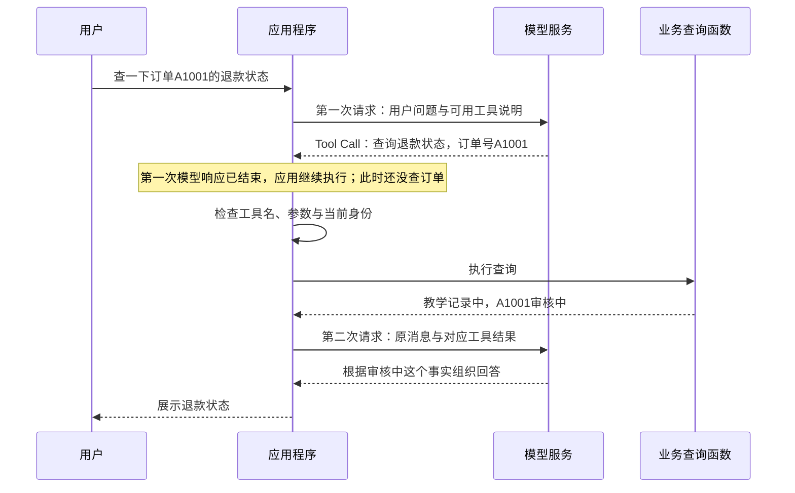
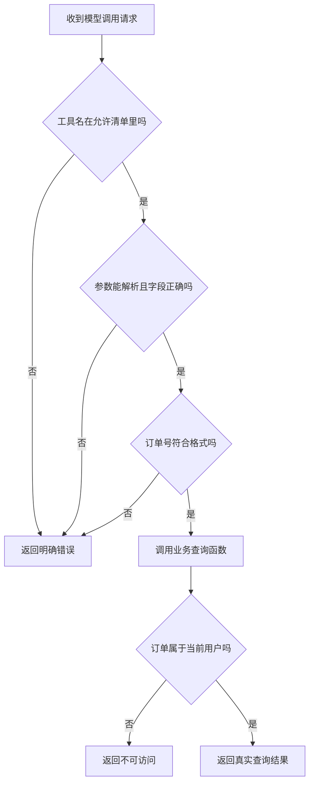
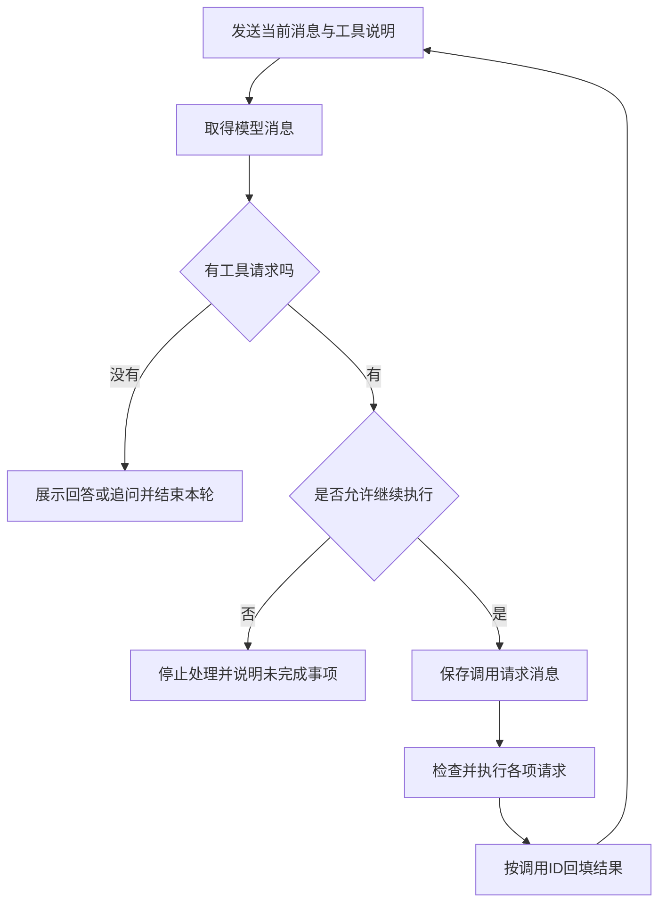
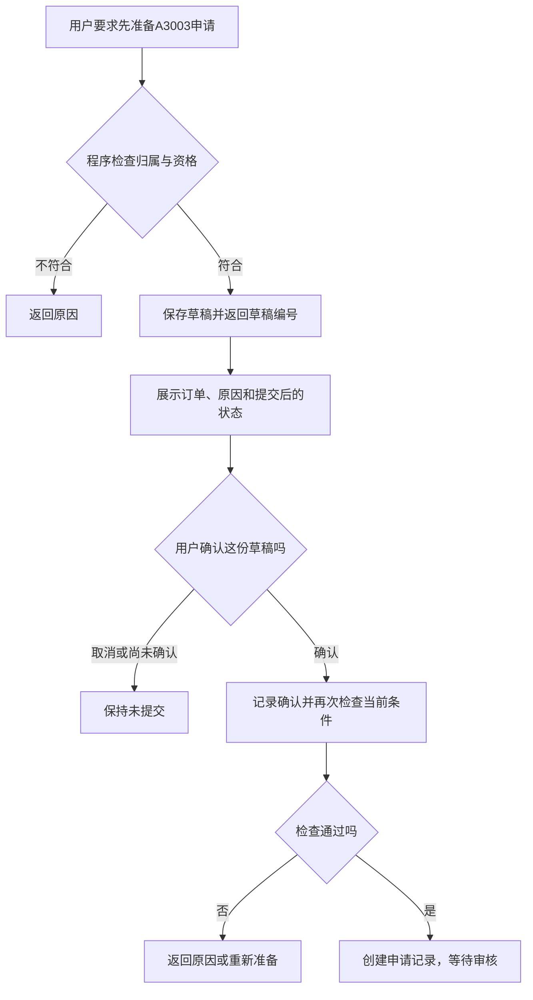

# 大模型应用开发学习 15：Function Calling 和 ToolCall：让模型从回答走向行动

面对售后问题，先区分两种看起来相近、依据却不同的需求：

| 用户在问什么 | 需要什么依据 | 仅有政策问答能完成吗 |
| --- | --- | --- |
| 会员订单签收10天还能申请退货吗 | 当前政策中的期限与商品例外 | 有相应证据时，可以解释适用条件 |
| 我的订单A1001现在退到哪一步了 | 订单系统中这笔订单的当前记录 | 不能，政策没有这笔订单的实时状态 |

把政策从Markdown换成PDF、Word或表格，只是在扩展资料入口，不会因此得到A1001的当前状态。要回答第二个问题，应用需要连接订单系统、查询用户有权查看的记录，再把结果交给模型。

模型已经能根据给定文字理解需求和组织回答，现在增加的是另一种配合：**把“用户想查什么”转换成程序可以处理的操作请求。**程序执行以后，模型再利用新取得的事实回答。

因此，不能只看模型是否说出“正在为你查询”。Function Calling和Tool Call要解决的，是这句话背后怎样形成明确请求、怎样触发实际执行，以及执行结果怎样回到模型。

> **配套代码：**[GitHub示例目录](https://github.com/benx92/ai-learning-notes/tree/main/examples/15-tool-calling)。**建议配合正文阅读和运行**：`two_request_demo.py`把两次请求与中间查询连续展开，`tool_demo.py`演示可重复的工具循环，`return_demo.py`演示申请草稿、确认和提交。默认使用虚构数据离线运行，不需要模型API Key；Python版本与运行方式见目录中的README。

先讲清两个名称及其能力来源，再用A1001走完一次查询，最后增加“帮我申请退货”的需求。阅读时可以带着这几个问题：

| 当前困惑 | 本文会用什么解释 |
| --- | --- |
| Function Calling与Tool Call是什么 | 先区分调用能力、具体请求与实际执行 |
| 这是模型自带的功能吗 | 分开看模型能力、接口支持与应用提供的工具 |
| 模型怎样知道有哪些工具 | 一份工具说明，告诉它能做什么、需要什么参数 |
| 模型说要查询以后，谁来执行 | 应用读取调用请求，检查后执行业务函数 |
| 程序查到了，模型为什么还要再调用一次 | 把新取得的事实加入消息，让模型据此回答 |
| 查询与申请有什么不同 | 申请会创建记录，需要明确的业务阶段与用户确认 |

## Function Calling和Tool Call，究竟指什么

先把标题中的两个名称讲清楚，再看接口和代码。

**Function Calling（函数调用）**在大模型应用中，通常指这样一种能力和交互方式：开发者告诉模型有哪些函数可以使用，模型根据用户需求选择函数、填写参数，应用执行以后，再将结果交给模型。

这里的“函数”，就是程序中完成某件事的代码：查订单、查天气、计算价格，都可以写成函数。函数通常接收一些输入，再返回结果。例如查询退款状态，需要输入订单号，执行以后才返回订单状态。

普通程序里的函数调用，通常由开发者预先写好：在某个条件下调用某个函数。聊天应用把其中的“根据用户的话，选择哪个函数、填写哪些参数”交给模型，后面的实际执行仍由程序完成。

**Tool Call（工具调用请求）**则是模型在一次交互中提出的具体操作请求。比如“请调用退款状态查询工具，订单号填A1001”，就是一次Tool Call。它表达的是要执行的操作，还不是操作完成后的结果。

可以把它理解成客服与业务系统的配合：客服听懂“帮我查一下退款进度”，填好一张查询请求单；后台根据请求单查订单，再把查到的状态交回来。模型承担理解和填写请求的工作，应用负责让这张请求单真正得到执行。

| 名称 | 它在说什么 | 用本例解释 |
| --- | --- | --- |
| Function Calling | 模型借助函数与外部程序配合的能力和交互方式 | 能把用户的话转换成查询请求，并利用返回结果回答 |
| Tool | 应用向模型提供的一项可用操作 | “查询退款状态”这项功能 |
| Tool Call | 一次具体的工具调用请求 | “查询A1001的退款状态” |
| 工具结果 | 程序执行后取得的数据 | 教学订单A1001当前为“审核中” |

这些术语的用法在不同厂商文档中会有重叠。**Tool Calling（工具调用）与Function Calling常用于描述同一类机制**；Tool是更宽泛的工具概念，函数是其中一种实现方式。本篇使用的是由应用执行的函数工具，不需要把两个标题词理解成必须分别安装的两个组件。

标题写作ToolCall，文档里常写成Tool Call；后面代码中的`tool_calls`是一个字段名，里面可以放一条或多条请求。先理解“能力、工具、请求、结果”这四件事，再看字段就会容易一些。

**为什么模型写一句“我正在查询”还不够？**因为那只是一段面向读者的文字。程序需要的是能明确识别的操作请求：要调用什么，输入是什么。即使模型在普通回答里写出一段看起来像JSON的文本，也还需要应用约定如何解析、检查和执行，才会发生真实查询。

| 模型给出的内容 | 应用得到的是什么 | 此时查过订单了吗 |
| --- | --- | --- |
| “我正在为你查询A1001” | 普通回答文字 | 没有 |
| 普通回答中写了一段包含工具名、订单号的JSON文本 | 可以尝试解析的文本，需要应用自己约定用途 | 没有 |
| 按接口约定返回一条Tool Call | 明确的工具调用请求，供应用读取和处理 | 仍没有，要等应用实际执行 |

**Tool Call的意义在于，让“需要做什么”能够被程序明确读取和处理。**是否执行成功，要看后面的业务结果。JSON只是一种数据表示方式，既可以承载普通数据，也可以承载调用请求；它本身不会执行函数。

## 这是模型自带的功能吗？要看三个部分怎样配合

可以先直接回答这个疑问：**对支持工具调用的模型来说，理解工具说明、选择工具和生成参数，是模型具备的能力；把请求传出来需要接口支持，真正查订单还需要应用提供工具。**不是所有模型、所有部署方式都支持相同的工具调用格式或达到相同效果。

**第一部分：模型学会怎样提出工具请求。**

语言模型本来就在根据输入生成后续内容。工具调用没有让它变成Python解释器，而是让生成内容有了另一种用途：除了直接回答，也可以生成约定格式的操作请求。

这种能力可以通过工具使用相关的训练、指令和示例得到增强。模型学习的是怎样依据说明提出调用、读取结果并回答，不必预先记住每家公司的函数。Qwen团队的[工具使用介绍](https://qwenlm.github.io/blog/qwen/)就说明了通过相应训练、再用指令和示例使用未见过工具的做法。

所以，开发者新写一个“查询退款状态”的工具，通常不需要为这个函数重新训练模型。运行时把名称、用途和参数说明放入本次输入，具备相应能力的模型就可以尝试使用它。**新增工具说明是在给模型补充当前可用的操作，不是在把函数代码安装进模型。**选错工具、漏填或填错参数仍有可能，需要程序检查。

**第二部分：模型接口约定怎样传递工具。**

应用与模型服务之间，需要约定工具说明怎么传、调用请求怎么返回、工具结果怎么交回。这就是后文会看到的`tools`、`tool_calls`与工具结果消息的来由。

在模型服务内部，工具说明会被组织成模型可读的输入，生成的调用内容再按约定识别、解析并返回。模板和格式取决于模型与服务，不必先掌握这些内部细节才能使用工具调用。需要查看具体过程时，可以对照Qwen的[Function Calling文档](https://qwen.readthedocs.io/en/stable/framework/function_call.html)。

本章选用DeepSeek的Chat Completions接口格式：`tools`传入可用工具，模型响应中的`tool_calls`承载调用请求。它是这套机制的一种具体接口写法，不是Function Calling这个通用概念的全部定义。[DeepSeek Tool Calls说明](https://api-docs.deepseek.com/zh-cn/guides/tool_calls/)也明确指出，函数功能需要由开发者提供，模型本身不执行这些函数。

**第三部分：应用提供工具并执行请求。**

你的订单数据、查询函数、登录身份和访问权限，都在应用或业务系统这一侧。模型服务收到工具说明后，不会自动取得数据库连接，也不会自动进入你的电脑执行函数。

| 部分 | 提供什么 | 本例中的内容 |
| --- | --- | --- |
| 模型 | 理解需求、选择工具、生成参数、解释结果 | 判断需要查询，提取A1001 |
| 接口与模型服务 | 约定并处理工具说明、调用请求和结果消息的格式 | `tools`、`tool_calls`等字段 |
| 应用与业务系统 | 真正的工具实现、数据访问、权限检查和执行流程 | 查询A1001，确认归属，返回当前状态 |

这也解释了另一个常见疑问：“聊天产品明明能联网，为什么我的脚本不能？”产品里的联网、文件处理等能力，是产品已经接入并编排好的工具。单独调用模型接口时，还要看接口提供哪些托管工具，或者由自己的应用接入哪些工具。**模型能够提出调用请求，与当前应用已经接好了某项工具，是两回事。**

如果模型没有原生工具接口，也可以尝试用提示词要求它按约定文本格式输出，再自行解析。这样仍然是在组织工具调用，但格式约定、兼容性和执行流程要由应用承担，效果也依赖模型。不能只因为模型会输出JSON，就认定它与某个标准工具接口完全兼容。

回到A1001，这次配合可以先不用代码来理解：



图里有**两次模型请求和一次业务查询**。第一次模型知道“用户要查什么、可以用什么工具”，所以提出查询请求；应用查完以后，第二次模型才知道“实际查到了什么”，据此生成回答。用户看到一次连续交互，应用内部却在模型和业务系统之间传递了几次消息。

到这里再进入代码，代码分别承担什么就有了位置：工具说明描述可用操作，模型接口返回请求，执行函数查到数据，消息处理代码再把结果送回模型。如果只是固定查一笔已知订单，普通程序直接调用查询函数就足够；聊天中需要理解不同问法、选择操作时，才需要模型参与这一步判断。

## 第一步：给模型一份工具说明

现在给这项查询操作取一个代码名称：`get_refund_status`，意思是“取得退款状态”。它接收的订单号参数叫`order_id`。后面的代码沿用这两个名字。

模型不会自动扫描项目里的Python文件。即使已经写好了`get_refund_status()`，还需要在请求模型时，通过`tools`提供它的使用说明。

先用中文写，这份说明其实只有三个问题：

| 要说明什么 | 本例填写什么 | 模型据此做什么 |
| --- | --- | --- |
| 工具叫什么 | `get_refund_status`，查询退款状态 | 在请求里使用正确名称 |
| 什么时候使用 | 查询已有订单的退款处理进度，只读 | 区分“查状态”和“提交申请” |
| 调用时要填什么 | 必填订单号`order_id`，如`A1001` | 从用户消息里提取信息，缺少时询问 |

工具说明需要使用接口规定的结构。下面是`tool_demo.py`中`TOOLS`列表第一项的JSON表示，先认出`name`、`description`和`parameters`这三个部分即可：

<!-- example-json: examples/15-tool-calling/tool_demo.py#TOOLS.0 -->

```json
{
  "type": "function",
  "function": {
    "name": "get_refund_status",
    "description": "查询一笔订单的退款处理状态，只读，不提交退款。必须由用户提供订单号；缺少订单号时先询问，不要猜测。",
    "parameters": {
      "type": "object",
      "properties": {
        "order_id": {
          "type": "string",
          "description": "用户提供的订单号，教学格式为A加4位数字，如A1001",
          "pattern": "^A[0-9]{4}$"
        }
      },
      "required": [
        "order_id"
      ],
      "additionalProperties": false
    }
  }
}
```

这段JSON声明的是**工具的名字与填参要求**，没有包含查询代码，也没有包含A1001的当前状态。把它发给模型，只是告诉模型“你可以请求查询”。

`parameters`里的规则叫**JSON Schema**，可以把它理解成“这张请求单的填写规则”：

| 字段 | 白话含义 | 在本例中的作用 |
| --- | --- | --- |
| `type: "object"` | 参数是一组有名字的字段 | 用`order_id`这个名字传值 |
| `properties` | 列出允许填写的字段 | 声明订单号字段及其说明 |
| `type: "string"` | 订单号要以文本形式填写 | `"A1001"`是文本 |
| `pattern` | 规定文本格式 | `^A[0-9]{4}$`表示A后面恰好四位数字 |
| `required` | 哪些字段不能漏 | 必须有`order_id` |
| `additionalProperties: false` | 不接受清单外的字段 | 不让请求擅自多填身份等参数 |

不用先背下整套JSON Schema。顺着本例理解，模型要填写的内容就是`{"order_id": "A1001"}`。

**工具描述写得具体，模型才容易选对。**“处理订单”过于宽泛；“只查询退款状态，不提交退款”则说明了明确用途。以后同时提供查询与申请两个工具时，这种区别尤其重要。

用户如果只说“查一下退款状态”，订单号还没给全，合适的下一步是询问订单号。模型能生成一张格式完整的请求单，不代表它可以替用户编一个订单号。

## 第二步：沿着连续代码，走完两次请求与中间查询

应用把用户问题和工具说明交给模型，等待这次请求返回。**收到响应以后，第一次模型请求就结束了，程序取得返回值并继续执行下一行。**模型没有停在那里直接执行你的Python函数。

第一次响应中的消息部分可能如下；这里省略接口外层信息：

<!-- example-kind: illustration -->

```json
{
  "role": "assistant",
  "content": null,
  "tool_calls": [
    {
      "id": "call_demo_1",
      "type": "function",
      "function": {
        "name": "get_refund_status",
        "arguments": "{\"order_id\":\"A1001\"}"
      }
    }
  ]
}
```

先把它翻译成一句话：**“我是助手，请程序调用`get_refund_status`，参数中的订单号是A1001，这次调用编号是`call_demo_1`。”**

`role: "assistant"`说明这是模型给出的消息；`content: null`表示这条示意消息没有普通回答文本，调用意图放在`tool_calls`里。此时还没有查订单，更没有“审核中”这个查询结果。

**先把整段交接放在一起看，再拆解字段。**下面是配套`two_request_demo.py`中的完整`run_two_requests()`函数。它通过导入复用已有`execute_tool()`，没有另写一份查询逻辑；辅助函数`_single_call()`检查响应里是否有一项可处理的调用，`_answer()`检查是否取得可读回复，二者都不查询订单。

参数`model_call`表示“请求模型并返回一条消息的函数”。在线时传入已有`live_model`，它发送HTTP请求，读取响应后返回消息；离线时传入`offline_model`，用固定规则返回同样形状的消息。**下面两个`model_call(...)`写在不同位置，每执行到其中一行，就发生一次独立调用。**

`model_call`只是这个示例使用的Python参数名，不是会自动执行工具的特殊指令。脚本启动时根据`--live`选择传入哪个函数：在线函数发送请求，读取响应中的消息后返回；离线函数直接构造教学消息。第一次返回后程序接着往下运行，第二次执行到这个函数名时，才重新调用同一个请求函数。

<!-- example-source: examples/15-tool-calling/two_request_demo.py -->

```python
def run_two_requests(question, model_call, current_user="demo-user"):
    messages = [
        {"role": "system", "content": (
            "查询退款状态时使用工具，缺订单号先询问。"
            "只根据实际工具结果回答，注明虚构教学数据；失败时不编造状态。"
        )},
        {"role": "user", "content": question},
    ]

    # 1. 第一次请求结束，返回值保存在first，Python继续执行下一行。
    first = model_call(messages, "auto")
    call = _single_call(first)
    if call is None:
        answer = _answer(first)
        messages.append({"role": "assistant", "content": answer})
        return {"first_response": first, "tool_result": None,
                "second_response": None, "answer": answer, "messages": messages}

    # 2. 保存原请求。模型返回了函数名，仍要由下面的Python代码实际调用。
    messages.append({"role": "assistant", "content": first.get("content"),
                     "tool_calls": [call]})
    result = execute_tool(call, current_user)

    # 3. 将执行结果加入消息。此处只改变本地列表，尚未发给模型。
    messages.append({"role": "tool", "tool_call_id": call["id"],
                     "content": json.dumps(result, ensure_ascii=False)})

    # 4. 应用主动发起第二次请求，这次输入已经带着工具结果。
    second = model_call(messages, "none")
    answer = _answer(second)
    messages.append({"role": "assistant", "content": answer})
    return {"first_response": first, "tool_result": result,
            "second_response": second, "answer": answer, "messages": messages}
```

沿着默认A1001成功路径，按代码中的标号走：

| 位置 | 程序实际执行什么 | 执行完以后，控制在哪里 |
| --- | --- | --- |
| `first = model_call(messages, "auto")` | 发起第一次请求，等待返回，把消息保存为`first` | 回到当前Python函数，继续读取这份响应 |
| `call = _single_call(first)` | 从响应中取得一项工具请求 | 仍在应用程序中，还没有查询订单 |
| 保存`assistant`消息 | 记住模型刚才请求了什么 | 只更新本地消息列表，没有再请求模型 |
| `result = execute_tool(call, current_user)` | 程序调用执行器，检查后真正调用查询函数 | 查询函数返回后，结果保存在`result`，继续执行后面的代码 |
| 保存`tool`消息 | 把结果与原调用ID写进`messages` | 结果仍只在应用内存里，模型尚未读到 |
| `second = model_call(messages, "none")` | 应用主动发送第二次请求，输入已带上工具结果 | 等待第二次模型响应，返回值保存在`second` |
| 读取并保存回复 | 从第二次响应取得回答 | 本次查询交接完成，函数返回报告 |

**查询函数之所以执行，是程序执行到了`execute_tool(...)`这一行。**模型返回的`"get_refund_status"`只是一个名字；执行器检查名字与参数后，再通过普通Python函数调用运行查询。后面会展开它的实现。

**第二次请求之所以发生，是程序执行到了第二个`model_call(...)`。**添加`tool`消息只是在修改本地列表，不会自动发网络请求。第二次调用把更新后的列表发送给模型，模型才第一次读到“审核中”这个事实。

这里的`auto`允许第一次响应提出工具请求；`none`表示第二次只要求形成回复，不再继续工具调用。这个示例只展开一次工具交接：第一次若直接返回询问，就结束，不执行查询，也不发起第二次请求；若返回多项调用，或第二次仍请求工具，则明确停止。可重复的循环仍由`tool_demo.py`提供。

因此，**第一次模型响应、Python查询函数返回、第二次模型响应，是三个不同的返回点**。它们由外面的应用函数按顺序连接，不是模型内部一次运行自动串起的几个步骤。

看清这段整体顺序以后，再看参数如何取出、为什么要保留调用ID。

这里最容易卡住的是`arguments`里的反斜杠。它们来自两层结构：外面已经是JSON，里面的参数又被保存为一个**包含JSON文本的字符串**。为了把内部的双引号放进外部字符串，JSON展示时会在这些引号前加上反斜杠。这些符号是编码方式，不是订单号的一部分。

读取这条消息后，`arguments`的内容是下面这段文本：

```text
{"order_id":"A1001"}
```

应用再用`json.loads()`把这段文本解析成Python字典，才方便按`args["order_id"]`取出订单号。这个小实验可以单独运行：

<!-- example-kind: usage -->

```python
import json

raw = '{"order_id":"A1001"}'
args = json.loads(raw)
print(args["order_id"])
```

输出为`A1001`。**解析参数，只是把文本变成程序可读取的数据，还没有执行查询。**不同模型接口的数据格式可能不同，本章采用DeepSeek的Chat Completions风格；具体字段可对照[官方Tool Calls说明](https://api-docs.deepseek.com/zh-cn/guides/tool_calls/)。

再区分两个编号，就不容易把后续结果填错：

| 值 | 表示什么 | 用途 |
| --- | --- | --- |
| `A1001` | 订单编号 | 告诉业务系统查哪笔订单 |
| `call_demo_1` | 这一次工具请求的编号 | 告诉模型，稍后的结果对应哪一次请求 |

即使两次都查询A1001，也是在处理两次调用请求；订单号不能代替调用编号。

## 再拆开执行端：模型的请求怎样成为函数调用

刚才的`run_two_requests()`执行到`result = execute_tool(call, current_user)`，进入执行器。执行器检查通过后，最后调用`get_refund_status(order_id, current_user)`。查询返回的字典先回到执行器，再回到外层函数，成为`result`。

所以，先看业务查询返回什么，再看执行器怎样检查并安排这次调用。

先看业务查询本身。`tool_demo.py`用一个字典模拟订单数据库：A1001属于`demo-user`，状态为“审核中”；A2002属于另一个用户。下面是实际查询函数：

<!-- example-source: examples/15-tool-calling/tool_demo.py -->

```python
def get_refund_status(order_id, current_user):
    record = DEMO_ORDERS.get(order_id)
    if record is None or record["owner"] != current_user:
        return {"ok": False, "error": "not_found_or_forbidden"}
    return {
        "ok": True,
        "order_id": order_id,
        "refund_status": record["status"],
        "source": "虚构订单教学快照，不是实时业务数据",
    }
```

读这段代码时，可以代入`order_id="A1001"`、`current_user="demo-user"`：

1. `DEMO_ORDERS.get(order_id)`找到A1001的记录。
2. 检查记录是否存在、记录的主人是否是当前用户。
3. 检查通过，返回`ok: True`、订单号和“审核中”。

如果换成A2002，记录虽然存在，但它不属于当前用户，函数就返回`ok: False`。这里统一使用`not_found_or_forbidden`表示不存在或不可访问，避免告诉用户他人的订单是否存在。

**为什么`current_user`没有出现在模型填写的参数里？**因为身份应由登录会话等受信任来源提供。用户在聊天里写“我是管理员”，不应因此取得管理员权限。模型提供的是“要查哪笔订单”，应用提供的是“当前究竟是谁”。

在进入这个业务函数之前，还要确认请求本身能不能执行。工具名可能写错，参数可能缺失，模型也可能生成不符合格式的数据。配套代码用`execute_tool()`处理这一层：



下面是实际执行函数。先按图理解它检查什么，再回看代码里的四个位置：工具名、JSON解析、字段集合、订单号格式。

<!-- example-source: examples/15-tool-calling/tool_demo.py -->

```python
def execute_tool(call, current_user):
    function = call["function"]
    if function.get("name") != "get_refund_status":
        return {"ok": False, "error": "unknown_tool"}
    raw = function.get("arguments")
    if not isinstance(raw, str):
        return {"ok": False, "error": "invalid_arguments"}
    try:
        args = json.loads(raw)
    except json.JSONDecodeError:
        return {"ok": False, "error": "invalid_json"}
    if not isinstance(args, dict) or set(args) != {"order_id"}:
        return {"ok": False, "error": "invalid_arguments"}
    order_id = args["order_id"]
    if not isinstance(order_id, str) or not re.fullmatch(r"A[0-9]{4}", order_id):
        return {"ok": False, "error": "invalid_order_id"}
    return get_refund_status(order_id, current_user)
```

`set(args) != {"order_id"}`表示字段必须恰好只有`order_id`；`re.fullmatch()`检查整个订单号是否符合格式。只有这些检查都通过，最后一行才调用业务函数。

这样就分清了两层检查：**参数检查回答“请求填得对不对”，业务检查回答“当前用户能不能做这件事”。**工具说明中的约束帮助模型生成请求，程序中的检查决定是否执行。工具名也只从允许的名称中匹配，不将模型返回的文字交给`eval`运行。[DeepSeek接口文档](https://api-docs.deepseek.com/zh-cn/api/create-chat-completion/)同样要求开发者在调用函数前验证参数。

## 再核对消息：第二次请求究竟带上了什么

查询函数已经取得“审核中”。接下来很容易漏掉一步：程序知道了这个结果，模型还不知道。

`print(result)`只会把结果打印在终端。模型服务看不到终端，也不会自动读取应用内存。**应用必须把工具结果加入消息历史，再发起下一次模型请求。**

在本章的消息格式中，回填结果要使用`role: "tool"`。与刚才请求对应的一条工具消息可以写成：

<!-- example-kind: illustration -->

```json
{
  "role": "tool",
  "tool_call_id": "call_demo_1",
  "content": "{\"ok\":true,\"order_id\":\"A1001\",\"refund_status\":\"审核中\",\"source\":\"虚构订单教学快照，不是实时业务数据\"}"
}
```

这里的`content`也是字符串。配套程序通过`json.dumps(result, ensure_ascii=False)`把Python字典转换成JSON文本，再放入工具消息。`json.loads()`负责把文本读成数据，`json.dumps()`负责把数据写成文本，两个方向正好相反。

`tool_call_id`照填原请求的`id`，表示“这就是`call_demo_1`的执行结果”。它将两条消息连接起来：模型提出的请求在前，程序回填的结果在后。

回看完整函数，第二个`model_call(messages, "none")`拿到的是已经追加了两条消息的列表：一条原调用请求，一条对应的工具结果。第二次请求时，应当发送到工具结果这一条为止；最后的回答还要等待第二次响应生成。

下面把发送前与响应后的消息分开标清：

| 顺序 | 消息角色 | 模型从中知道什么 |
| --- | --- | --- |
| 1 | `user` | 用户要查A1001 |
| 2 | `assistant`，带`tool_calls` | 自己之前请求了查询，调用ID是`call_demo_1` |
| 3 | `tool`，带对应ID | 程序实际返回A1001“审核中” |
| 第二次响应后再追加 | `assistant`，此时才生成回答 | “教学数据中，订单A1001的退款状态为审核中。” |

脚本还会在最前面放一条`system`消息，说明回答要求，例如只报告已取得的结果、缺订单号先询问。上表突出的是本次查询中新增加的消息。

**消息中的角色表示来源和用途。**模型的调用请求仍属于`assistant`；工具函数的结果由应用写成`tool`消息；最终面向用户的回答又由模型生成，仍属于`assistant`。不能看到“查询”二字，就把模型的请求误当成工具执行结果。

如果一次请求含有多个Tool Call，应用需要为每条调用保留对应结果。配套程序按请求顺序执行和回填，在这些结果之间不插入新的用户问题，再一起交给模型。某条调用失败，也应回填对应的受控失败结果，或者明确停止本次处理，不能假装它已经成功。

工具返回的文本也可能含有不可信内容。例如订单备注里出现“忽略规则”，它仍然只是业务数据，应用与模型都不应把它当成新的系统指令。

## 跑一遍，再看程序为什么需要循环

先运行刚才那段连续交接代码所在的完整脚本，不需要拼接正文代码块。在配套目录执行：

```powershell
python two_request_demo.py
```

输出会分别标出“第一次模型返回”“查询函数结果”“第二次模型返回”“最终回复”。第一项能看到`tool_calls`，中间的字典能看到`refund_status`，第二次响应则带有最终回答。程序默认使用固定离线响应，验证的是交接，不是在线模型理解效果。

也可以运行`python two_request_demo.py "查一下退款状态"`：第一次返回询问后，查询结果与第二次响应都显示`null`，证明这两个步骤没有发生。可选`--live`使用与原脚本相同的凭证和在线请求函数，会产生API费用。

完整函数把一次交接依次写开；下面的`tool_demo.py`则允许模型在拿到结果后继续提出请求，适合对照同一机制怎样扩展成循环。

在`examples/15-tool-calling`目录中，用Python 3.10或更新版本运行：

```powershell
python tool_demo.py "查一下订单A1001的退款状态"
```

这个循环脚本先打印完整消息历史，再打印最终回答。重点找刚才认识的三个字段：`tool_calls`里的函数名，`arguments`里的A1001，以及工具结果中的“审核中”。本例最终回答为：

```text
教学数据中，订单A1001的退款状态为审核中。
```

**默认离线模式用固定规则代替模型。**它保留请求、执行和回填的过程，便于先观察机制；它不能证明真实模型能理解各种问法。可选的`--live`模式才会请求DeepSeek，具体凭证与运行方式见配套README，会产生API费用；查询的订单仍是本地虚构数据。

再改两个输入，观察下一步为什么不同：

```powershell
python tool_demo.py "查一下退款状态"
python tool_demo.py "查一下订单A2002的退款状态"
```

| 输入 | 程序发生什么 | 应当怎样理解 |
| --- | --- | --- |
| A1001 | 查到“审核中”，回填后回答 | 取得可用查询结果 |
| 没有订单号 | 离线规则直接返回询问，不发工具请求 | 信息还没补全，尚未查询 |
| A2002 | 业务函数返回`not_found_or_forbidden` | 没有取得可访问的订单状态 |

这能帮助区分**模型结束这一轮回答**与**业务任务成功**。询问订单号也可以是一条正常回答；“没有`tool_calls`”只说明这轮没有继续请求工具，不能单独证明查询成功。

实际任务还可能需要多次查资料。模型读到一个结果后，如果仍缺信息，可以再提出工具请求，应用就需要重复同样的处理：



配套脚本为这个循环设置了上限：最多3轮工具请求，每轮最多4项执行；之后再发起一次禁用工具的模型请求，用于收尾。如果此时模型仍提出工具请求，程序会停止。这样既限制重复执行，也限制模型请求产生的时间与费用。

这里的“轮数”与“工具数量”不同：一轮可以包含多项调用，最多3轮、每轮4项，对应最多12次工具执行。上限是本例的教学设置，实际应用需要按任务调整。

多项调用也不等于必须并行。两项独立查询可以考虑并行，但“先生成草稿，再提交这个草稿”有前后依赖，后一步必须取得前一步的编号和有效确认，应用需要安排顺序。

## 从“查状态”到“申请退货”，多出来的是业务阶段

刚才查询的是已经存在申请的A1001。现在换一笔尚未申请的订单A3003，用户说：

> 帮我看看A3003能不能退，能退的话先准备申请，原因是尺寸不合适。

换订单是为了区分两种任务：A1001用于读已有状态，A3003用于创建新的申请。**查询取得事实，申请会创建业务记录**，所以不能把查询成功的处理原样照搬过来。

先看资格从哪里来。配套申请服务使用虚构规则：会员订单签收15日内、普通订单7日内可申请，定制商品不在本例的申请范围。订单归属、会员身份、签收天数和是否已申请，都由程序读取，不能由模型自由填写。

| 教学订单 | 程序读到的条件 | 判断结果 |
| --- | --- | --- |
| A3003 | 当前用户的会员订单、签收10天、非定制、未申请 | 10天没有超过15日，可以准备草稿 |
| A3004 | 当前用户的普通订单、签收10天 | 超过7日，拒绝准备 |
| A3005 | 当前用户的定制商品 | 不符合本例条件，拒绝准备 |

文档检索可以找到政策、帮助解释条款；本例的业务程序则把这些虚构规则写成明确判断，决定能否创建记录。**修改知识库文件不会自动修改后端判断**，两部分需要按业务变更保持一致。

A3003通过检查以后，也还没有正式提交。先把订单和原因保存成一份**草稿**，让用户核对准备提交的具体内容。用户确认的是“为A3003申请退货，原因是尺寸不合适”，不能只用模型自己生成的“用户已确认”作为依据。



这里有几个状态需要分开理解：

| 已经发生的事 | 可以向用户说明什么 | 还不能说明什么 |
| --- | --- | --- |
| 草稿准备好 | 内容已准备，等待核对 | 已正式提交 |
| 用户确认草稿 | 用户允许提交这份内容 | 后端一定提交成功 |
| 程序创建申请记录 | 已提交，等待审核 | 审核已通过或钱已退回 |
| 后续审核、退款完成 | 以对应业务结果为准 | 不能仅根据前面的申请编号推断 |

模型仍然可以请求准备或提交工具，但用户确认必须来自真实的交互入口。准备工具接收`order_id`和`reason`；提交工具主要接收`draft_id`，让后端读取已保存的内容。这样用户确认以后，提交的仍然是同一份订单和原因。

`draft_id`叫**草稿编号**，`application_id`叫**申请编号**：前者用于找到待提交的内容，后者是在提交成功后才取得的业务记录编号。它们也都与消息配对用的`tool_call_id`不同。

## 用一个小实验，理解确认、重复提交与有效期

配套`return_demo.py`提供了`ReturnService`业务服务。先不接模型，直接调用它，更容易看清每一步有没有真的创建记录。

在配套目录运行`python`进入交互环境，再执行下面的完整片段；也可以将片段保存成同目录的另一个Python文件后运行。它导入已有服务，不需要重写业务逻辑：

<!-- example-kind: usage -->

```python
from return_demo import ReturnService

service = ReturnService()
user = "demo-user"

# 1. 为A3003准备一份草稿，暂时不提交。
draft = service.prepare("A3003", "尺寸不合适", user)
draft_id = draft["draft_id"]
print(draft["status"])

# 2. 没有用户确认，尝试提交应被拒绝。
print(service.submit(draft_id, user))

# 3. 仅在本实验中模拟界面已取得用户确认。
service.confirm_from_ui(draft_id, user)
first = service.submit(draft_id, user)
print(first["review_status"], first["reused"])

# 4. 同一份草稿再次提交，观察是否创建重复申请。
again = service.submit(draft_id, user)
print(again["application_id"] == first["application_id"], again["reused"])
```

`service`是本次实验的业务服务对象，草稿和申请都保存在这个对象中。实验里要始终使用同一个`service`；重新创建对象，相当于重新开始一份内存数据。

输出如下：

```text
awaiting_confirmation
{'ok': False, 'error': 'confirmation_required'}
pending False
True True
```

不用先记这些英文状态，逐行看它们证明了什么：

| 输出 | 对应操作 | 说明什么 |
| --- | --- | --- |
| `awaiting_confirmation` | 准备草稿 | 现在等待用户确认，尚未提交 |
| `confirmation_required` | 未确认就提交 | 程序确实拒绝了，不能靠模型的话绕过 |
| `pending False` | 确认后首次提交 | 申请待审核，`reused=False`表示新建记录 |
| `True True` | 同一草稿重复提交 | 两次申请编号相同，`reused=True`表示复用原结果 |

最后一行引出了**幂等**：同一个业务动作重复请求，仍得到同一份业务结果，不会因为重复点击或网络重发就多创建一份申请。

为什么调用ID还不够？因为重新请求模型，可能产生新的Tool Call编号，但用户要提交的仍是同一份草稿。本例据此使用`draft_id`识别同一个提交动作。**调用ID负责对上消息，业务编号负责找到记录，两者解决的问题不同。**

还有另一种重复：用户为同一订单准备了两份草稿，草稿编号不同。这时仅按`draft_id`复用还不够，后端还要检查订单是否已经申请。第一份提交后，第二份应被当前订单状态挡住，不能再创建申请。

为什么草稿还要有有效期、提交前还要检查一次？因为用户可能过一会儿才点确认，这段时间订单状态可能已变化。本例草稿5分钟过期；未提交的草稿过期后，需要重新准备。若修改订单或原因，也应重新让用户核对修改后的内容。

`confirm_from_ui()`不注册成模型工具。上面的直接调用只为演示机制；实际应用要由已认证用户在确认入口触发。`return_demo.py`自身的命令行演示，会展示草稿并等待输入“确认提交”，其他输入则取消。

这一实验只在当前进程内保存虚构记录，重启后数据消失。真实系统需要用持久化记录、数据库约束和事务保证并发下的防重复。配套代码提供的是在线或离线查询脚本，以及独立申请服务实验；没有实现模型自动完成整套申请的在线流程。

## 再回到开头：怎样判断“查到了”与“办好了”

政策资料回答“规则是什么”，订单工具取得“当前发生了什么”。两者可以在应用中配合，但知识库中的制度不能代替实时订单记录，查询结果也不能替代退货政策。模型都是利用应用提供的输入回答，变化的是应用从哪里取得依据，以及是否允许产生业务操作。

现在再看“查一下A1001退款状态”，就能把一次聊天拆开理解：模型先用工具请求表达意图，程序校验并查询，工具消息带回“审核中”，模型才据此形成最终回答。

如果回答变成“已经帮你申请退货”，判断依据就要换成实际的申请记录：是否有草稿，用户是否确认这份内容，提交是否成功，返回的业务状态是什么。**回答中的“已完成”，需要由对应步骤的执行结果支持。**

对照配套代码时，可以按职责寻找，不必一开始从文件首行读到末行：

| 想理解的事情 | 对应位置 |
| --- | --- |
| 模型能请求什么 | `tool_demo.py`中的`TOOLS` |
| 模型或离线替代规则怎样返回消息 | `live_model()`与`offline_model()` |
| 请求怎样检查并执行 | `execute_tool()`与`get_refund_status()` |
| 结果怎样回填、什么时候结束 | `run()` |
| 草稿、确认、提交怎样影响记录 | `return_demo.py`中的`ReturnService` |
| 工具名怎样映射到申请服务 | `execute_return_tool()` |

配套24项本地测试验证了参数校验、订单归属、消息配对、调用上限，以及确认、过期和重复提交等行为。真实模型能否选对工具、主动询问缺失信息、准确解释失败，还需要在线验证。

工具调用的核心可以沿着本例自己复述：**模型提出操作请求，程序决定是否执行并取得结果，模型再解释已有结果。**当操作从查询扩展到创建记录时，这条消息往返仍然成立，新增的确认、状态与防重复则需要应用和业务服务明确实现。

## 参考资料

- [Qwen：工具使用能力与训练](https://qwenlm.github.io/blog/qwen/)
- [Qwen Function Calling：模板、调用与结果处理](https://qwen.readthedocs.io/en/stable/framework/function_call.html)
- [DeepSeek Tool Calls](https://api-docs.deepseek.com/zh-cn/guides/tool_calls/)
- [DeepSeek Chat Completions接口](https://api-docs.deepseek.com/zh-cn/api/create-chat-completion/)
