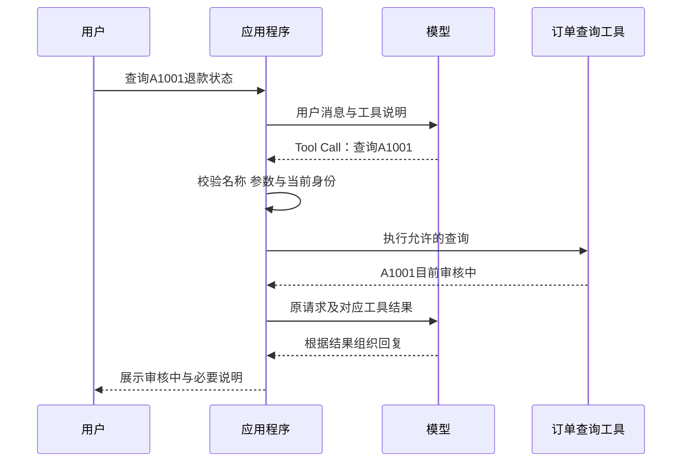
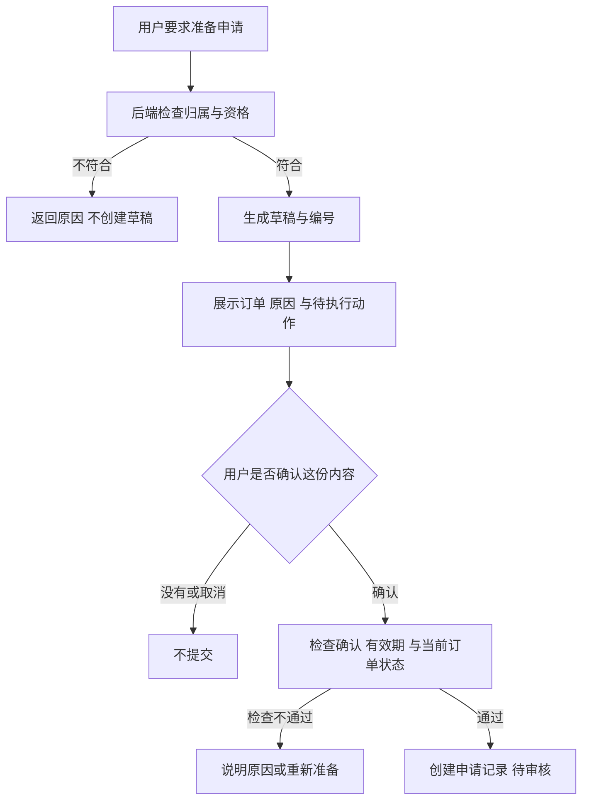

# 大模型应用开发学习 15：Function Calling 和 ToolCall：让模型从回答走向行动

用户问：“会员订单多久可以申请退货？”查政策就能回答。

接着用户又问：“我的A1001现在退到哪一步了？”这次翻政策不够。政策写的是统一规则，A1001的状态却保存在业务系统中，而且可能随时变化。

模型需要请求程序查一下，再根据查到的结果回答。Function Calling讲的就是这种配合：模型提出要调用哪个函数、带什么参数，程序实际执行，再把结果交回来。

先让A1001的状态查询真正完成，再增加“准备退货申请”。两次任务分别观察读取事实与创建记录，工具调用的作用就能一步步看清。

| 当前问题 | 本文要讲清的处理 |
| --- | --- |
| 模型不知道订单状态 | 告诉它有哪些查询工具 |
| 模型决定查询 | 返回结构化请求，而不是已经执行 |
| 程序拿到请求 | 校验、查询、回填结果 |
| 用户要求申请 | 分清准备、确认、提交和审核 |

## 先把一次查询走完，再看专业名称

假设后台提供一个函数，接收订单号，返回当前用户有权查看的退款状态。教学数据中，A1001属于当前用户，状态为“审核中”。

一次成功过程应当是：

```text
用户：查一下A1001的退款状态
模型：请求查询函数，订单号A1001
程序：检查请求和订单归属，执行查询
工具结果：A1001，审核中
模型：这笔订单的退款申请目前还在审核中
```

把先后顺序画出来，能看到一次查询通常包含两次模型请求：第一次提出查询，第二次读取查询结果并组织回复。



图里的应用是执行者，也是中间的检查者。模型请求可能包含错误参数，应用不能因为它来自模型就自动放行。业务工具也需要检查归属，不能只依赖应用外层判断。

模型负责从用户的话里判断要查什么；程序负责实际访问数据。模型没有进入数据库，也没有通过写一句“正在查询”就获得订单事实。

这种能力通常叫Function Calling，中文是函数调用。模型返回的那张“调用请求单”，常叫Tool Call，接口里一般使用`tool_calls`字段。两者不是两套完全独立的机制：一个强调能力，一个指具体请求。

工具也不一定是本机小函数。函数内部可以访问数据库、调用HTTP接口或连接外部服务。对模型而言，重要的是工具说明和参数；对程序而言，还要保证调用权限与结果可信。

## 怎样告诉模型，订单查询工具能做什么

模型不会因为代码里定义了函数，就自动知道它的存在。发起模型请求时，还要提供工具描述：叫什么，什么时候用，需要哪些参数。

查询脚本 [`tool_demo.py`](https://github.com/benx92/ai-learning-notes/blob/main/examples/15-tool-calling/tool_demo.py) 用 `TOOLS` 保存工具列表，下面是其中唯一一项的实际JSON表示；Python源码中的 `False` 在JSON中写作 `false`：

<!-- example-json: examples/15-tool-calling/tool_demo.py#TOOLS.0 -->

```json
{
  "type": "function",
  "function": {
    "name": "get_refund_status",
    "description": "查询一笔订单的退款处理状态，只读，不提交退款。必须由用户提供订单号；缺少订单号时先询问，不要猜测。",
    "parameters": {
      "type": "object",
      "properties": {
        "order_id": {
          "type": "string",
          "description": "用户提供的订单号，教学格式为A加4位数字，如A1001",
          "pattern": "^A[0-9]{4}$"
        }
      },
      "required": [
        "order_id"
      ],
      "additionalProperties": false
    }
  }
}
```

`name`用来定位程序里登记的工具；`description`帮助模型选择；`parameters`说明输入结构。这里使用JSON Schema描述参数：必须有字符串`order_id`，不能随意添加其他字段。

说明应该具体。只写“处理订单”，模型就可能分不清它能查询、修改还是退款。用户没给订单号时，应询问，不能自己编一个。

**身份为什么不让模型填写？**因为“我是管理员”也可以是用户随口写的一句话。当前用户身份应该从登录或受信任的运行环境取得，再由程序传给业务函数。参数格式符合要求，也不等于有权查看这笔订单。

**工具描述影响选择，参数约束影响输入，两者需要配合。**例如同时有`get_refund_status`和`prepare_return_application`，前者必须写明只查询已有状态，后者必须写明创建待确认草稿。若都写“处理售后问题”，模型很难区分。

参数也不是越多越好。查询只需要订单号，就不必要求用户提供原因、邮箱或付款信息；准备草稿需要原因，再在对应步骤取得。这样既减少无关信息，也使模型不必为了补齐字段而猜测。

`required`要求字段存在，`type`约束类型；字段是字符串以后，还需要业务校验。例如`"A1001"`符合本例格式，`"替我查一下A1001"`却是整句话，不能直接当订单号。类型正确只是第一层。

这些声明有助于生成规范请求，但执行端仍要再次校验。工具定义是使用说明，程序检查才决定实际能不能执行。

## 模型返回请求后，程序具体做什么

下面是Chat Completions风格的一条调用示意：

<!-- example-kind: illustration -->

```json
{
  "id": "call_1",
  "type": "function",
  "function": {
    "name": "get_refund_status",
    "arguments": "{\"order_id\":\"A1001\"}"
  }
}
```

这时并没有查询结果。`id`用于之后配对结果，函数名告诉程序要找哪个工具，`arguments`是参数。在这个接口格式里，它是包含JSON的字符串，需要先解析；不同SDK可能整理成对象，不能混用两种形态。[DeepSeek工具调用说明](https://api-docs.deepseek.com/guides/function_calling/)

执行端按顺序处理：

1. 函数名是否在允许清单中。
2. 参数能否解析，是否只有预期字段，类型和订单号格式是否正确。
3. 当前用户能否访问该订单。
4. 允许时查询；拒绝时返回受控的失败说明。

只按允许清单选择函数，不把模型返回的名字交给`eval`执行。订单不存在与不属于当前用户，可以统一返回不可访问，避免泄露他人的订单情况。

上述检查落实在 `tool_demo.py` 的 `execute_tool()` 中。下面是实际函数，使用同文件导入的 `json`、`re` 和业务查询函数；`current_user` 由应用传入：

<!-- example-source: examples/15-tool-calling/tool_demo.py -->

```python
def execute_tool(call, current_user):
    function = call["function"]
    if function.get("name") != "get_refund_status":
        return {"ok": False, "error": "unknown_tool"}
    raw = function.get("arguments")
    if not isinstance(raw, str):
        return {"ok": False, "error": "invalid_arguments"}
    try:
        args = json.loads(raw)
    except json.JSONDecodeError:
        return {"ok": False, "error": "invalid_json"}
    if not isinstance(args, dict) or set(args) != {"order_id"}:
        return {"ok": False, "error": "invalid_arguments"}
    order_id = args["order_id"]
    if not isinstance(order_id, str) or not re.fullmatch(r"A[0-9]{4}", order_id):
        return {"ok": False, "error": "invalid_order_id"}
    return get_refund_status(order_id, current_user)
```

其中 `get_refund_status()` 核对订单归属，返回 `refund_status` 与教学来源 `source`。查到A1001以后，`run()`把结果包装成工具消息；下面用 `call_1` 示意配对，离线脚本实际构造的ID为 `call_demo_1`：

<!-- example-kind: illustration -->

```json
{
  "role": "tool",
  "tool_call_id": "call_1",
  "content": "{\"ok\":true,\"order_id\":\"A1001\",\"refund_status\":\"审核中\",\"source\":\"虚构订单教学快照，不是实时业务数据\"}"
}
```

这个结果要与发起请求的模型消息一起放进消息历史，再调用模型。`tool_call_id`表明它回答的是`call_1`，不是订单的业务编号。

可以把每个字段的来源再核对一遍：

| 数据 | 来自哪里 | 用在哪里 |
| --- | --- | --- |
| 用户问题 | 用户消息 | 帮助模型判断需求 |
| 函数名与参数 | 模型工具请求 | 应用检查后决定执行 |
| 当前用户身份 | 登录或受信任环境 | 后端检查订单归属 |
| 订单状态 | 查询工具实际结果 | 支持最终回复 |
| 工具调用ID | 模型响应 | 配对请求与返回结果 |

其中身份不能让模型自由生成，状态不能根据模型措辞猜测，调用ID也不能当作订单号。把这些来源分清，既容易排查，也能避免工具得到一份看似完整却不可信的参数。

下一次模型才有依据说“审核中”。把工具结果打印在终端，却没加入模型输入，模型实际上仍然不知道查询结果。

实际消息历史至少保留三类信息：用户问题、带调用请求的模型消息、对应工具结果。随后才加入模型的最终回答。不能只回填一个孤立结果，把原来的调用请求丢掉。

失败也需要明确表达。参数不合法、业务上不可访问、网络执行失败是不同情况。工具可以返回受控的失败内容让模型解释；严重协议错误则可以停止运行。无论采用哪种方式，都不能把异常吞掉后补一个成功结果。

如果一次模型响应提出多个调用，每条都需要对应结果。即使某条被拒绝，也要按照协议回填受控结果或终止处理，不能留下半条往返。

## 把往返组织成一个有终点的程序

现在可以把完整运行过程写成下面的伪代码。它表达步骤，不是可直接执行的Python：

```text
加入用户问题
把消息和可用工具说明交给模型

如果模型返回普通回答：
    返回回答，结束
如果模型返回工具请求：
    保存这条模型消息
    检查并执行每个允许的请求
    将各自结果按调用ID加入消息
    再请求模型

重复时检查次数限制，达到限制就停止
```

模型在拿到结果后，可能继续查询另一项资料，所以可以循环。但循环不能无限继续。配套查询脚本限制最多3轮工具请求、每轮最多4项执行，最后再给一次禁用工具的模型调用用于收尾。工具执行最多12次，与模型调用次数不是同一个数。

循环中还要处理两个容易误解的情况。

**第一，没有工具请求不一定表示查询成功。**用户没提供订单号，模型可能正在询问；工具不可用，模型可能正在说明失败。应用要结合任务和实际结果判断，不能只靠“没有`tool_calls`”标记业务成功。

**第二，多个调用可以一起返回，但不一定能一起执行。**查询两笔互不依赖的订单有时可以并行；准备草稿与提交草稿则有数据和授权依赖。程序必须根据动作类型决定顺序，而不是照单并发。

这些是教学上限，实际值要根据任务确定。达到限制时应该明确哪些步骤未完成，不能把停止执行包装成已经办理成功。

想观察真实消息格式，可使用[查询完整脚本](https://github.com/benx92/ai-learning-notes/blob/main/examples/15-tool-calling/tool_demo.py)。它支持固定响应演示，也支持设置凭证后请求模型。固定响应可以检查请求、执行与回填，但不能证明模型能理解各种自然语言问法。

查询部分现在已经闭合：用户问题经过模型变成请求，程序取得事实，事实回到模型，再形成回答。接下来新增的需求，会改变工具的责任。

## 用户说“帮我申请退货”，为什么不能直接提交

假设用户换了一笔订单A3003，说：

> 帮我看看这笔订单能不能退，能退的话准备一份申请，原因是尺寸不合适。

A1001用来演示查询已有申请的状态；A3003用来演示尚未申请的订单。使用两笔订单，是为了避免一边说“审核中”，一边又为同一笔订单新建申请。

教学系统查到A3003属于当前用户，是会员订单、非定制商品、签收10天、尚未申请。按虚构政策，它符合当前示例的申请条件。

这里与“根据文档解释政策”多了一项责任：程序真的要创建记录。RAG可以帮忙找到并解释条款，但模型说“符合条件”，不能直接成为写入许可。本例把会员15日、普通订单7日、定制商品例外写在业务服务的确定规则里，再用可信订单字段判断。真实制度变更时，需要按业务流程更新这些执行规则，不能认为替换知识库文件就会自动更新后端。

例如A3003的检查是：归属正确、尚未申请、非定制，然后按会员身份选择15日上限，比较10是否超过15。哪一项不通过，就返回对应原因。这些判断由程序完成；模型负责提出请求和解释结果，不负责凭一句自然语言放行。

**第一个动作：准备草稿。**程序核对资格，保存订单、原因和草稿编号。返回结果应当说明“待确认”，此时还没有正式申请。

**第二个动作：让用户核对这份草稿。**界面展示“为A3003创建退货申请，原因是尺寸不合适，提交后等待审核”。用户的确认要绑定这个具体草稿，不能只是模型自己写一句“用户已确认”。

**第三个动作：提交。**程序再次检查草稿归属、确认状态、有效期和订单条件，满足要求才创建申请记录，返回申请编号与“待审核”。

```text
准备成功：有草稿，尚未提交
用户确认：允许提交这份具体内容
提交成功：有申请记录，等待审核
审核通过：由后续业务流程决定
退款完成：还需实际退款流程与结果
```

这几个阶段也可以看成一条明确的业务状态路线：



这里确认在草稿之后、写入之前。用户只是要求“先准备”，流程停在展示草稿；后续明确要求提交时，才进入确认与提交处理。

这几步不能都叫“办理完成”。模型可以请求准备和提交，但不能替用户确认，也不能把申请编号当作退款成功凭证。

准备工具可以接收`order_id`与`reason`；提交工具主要接收`draft_id`，让后端按草稿读取已经固定的内容。若提交时又允许模型自由改订单、原因和确认状态，就难以保证用户批准的是同一件事。

后端保存草稿时，还要保存当前用户、创建时间或有效期、确认状态。模型不需要控制这些字段。它获得草稿编号之后，可以说明当前准备结果，但编号本身也不是绕过归属检查的通行证。

## 用代码看清，草稿怎样变成申请

完整的[`return_demo.py`](https://github.com/benx92/ai-learning-notes/blob/main/examples/15-tool-calling/return_demo.py)提供了`ReturnService`。下面的独立调用实验需要把该文件放在同目录，直接调用业务服务，暂不接模型：

`service = ReturnService()`创建本次实验的业务服务对象；`prepare()`、`confirm_from_ui()`和`submit()`会操作这同一份对象里的记录。实验中保持使用同一个`service`，否则新建对象后，上一份草稿不会凭空跟过来。

<!-- example-kind: usage -->

```python
from return_demo import ReturnService

service = ReturnService()
user = "demo-user"

draft = service.prepare("A3003", "尺寸不合适", user)
draft_id = draft["draft_id"]
print(draft["status"])
print(service.submit(draft_id, user))

# 教学实验模拟用户已在界面确认；实际应用只由真实确认入口调用。
service.confirm_from_ui(draft_id, user)
first = service.submit(draft_id, user)
again = service.submit(draft_id, user)
print(first["review_status"], first["reused"])
print(again["application_id"] == first["application_id"], again["reused"])
```

这段实验应该依次让你看到：

```text
awaiting_confirmation
{'ok': False, 'error': 'confirmation_required'}
pending False
True True
```

第二行说明，没有用户确认，程序确实拦住了提交。后两行说明，确认后创建了待审核记录；重复提交同一草稿，返回同一申请，没有再创建一份。

这种重复请求不产生重复业务结果的设计，叫幂等。这里使用草稿编号识别同一业务动作。模型的调用ID只用于消息配对，不能替代业务幂等标识。

幂等需要区分两种重复。第一种是同一草稿因网络重发而提交两次，应该返回同一申请。第二种是同一订单创建了两个草稿，两份都被确认；仅用草稿ID去重还不够，因为两个ID不同。后端还要检查订单是否已经申请，避免第二份草稿再创建记录。

配套服务的提交顺序是：验证草稿和用户，检查确认；已处理的同一草稿复用原结果；未处理时检查有效期及当前资格，最后在保护范围内创建申请并标记订单已申请。重复请求能拿回同一结果，不意味着允许任意新草稿绕过订单状态。

草稿在本例中5分钟后过期，过期需要重新准备。若内容修改，也需要围绕新内容重新确认。提交时再次检查资格，是因为准备和提交之间订单状态可能已经变化。

`confirm_from_ui()`不注册成模型工具。上面直接调用是为了观察机制；真实确认必须来自已认证用户对具体内容的操作。把同一段代码接到模型后无条件调用它，就失去了确认的意义。

这个示例把记录放在当前Python进程内，并用锁保护操作，不是实际公司的售后系统。重启后记录消失；生产环境的防重复和并发检查需要数据库约束、事务及持久记录配合。脚本也尚未提供完整的在线申请Agent，不能把业务实验当成端到端模型办理实测。

接回模型时，仍然沿用查询部分的消息往返，只是执行器增加准备与提交两种受控入口。确认步骤放在用户界面或明确的交互入口，不能交给模型调用；确认后的实际写入，可以由应用直接组织，或在检查有效确认后执行模型提出的提交请求。

这说明Function Calling解决的是“怎样表达和传递动作请求”，不是自动设计完整售后流程。业务状态、批准依据与防重复，需要程序有意识地实现。

## 怎样确认工具确实办对了事

看最终回答之前，先看执行依据。

查询任务检查有没有真的查A1001，返回的状态是什么。准备任务检查有没有草稿、订单和原因是否正确、是否停在提交前。提交任务则检查确认记录、申请编号和重复请求行为。

配套业务规则中，A3004是普通订单、签收10天，超过7日期限；A3005是定制商品，不满足当前无理由申请条件。这两个例子检查的不是模型是否会说“不能退”，而是后端能否真正拒绝不符合条件的准备操作。

源码位置可以按这条顺序对照：`TOOLS` 公布参数，`offline_model()`或 `live_model()`产生模型消息，`run()`检查调用结构和预算，`execute_tool()`校验参数，`get_refund_status()`读取订单，最后回到 `run()`回填结果。申请服务另在 `return_demo.py`，模型工具名通过 `execute_return_tool()`映射到 `ReturnService.prepare()`和 `submit()`，不是同名Python函数。

已有18项本地测试覆盖查询与申请服务。在线模型是否选对工具、是否询问缺失字段、是否如实解释失败，仍需另行验证。工具正常工作，不自动代表模型选得正确。

完整接口请求、循环代码、工具定义和运行命令可查看[实现与消息排查](supplements/15-工具调用实现与排查.md)，或[示例运行说明](https://github.com/benx92/ai-learning-notes/tree/main/examples/15-tool-calling)。

## 最后收束成一个完整认识

Function Calling把一次自然语言需求变成了程序能够检查的请求。模型提出函数名与参数，程序验证并执行，结果再交给模型组织回答。

从查询走到申请，新增的并不是一个更厉害的函数名，而是明确的业务阶段：准备、确认、提交、审核与退款。每个阶段都要有实际记录支持。

理解这条分工，就能判断一句“已经处理好了”背后究竟发生了什么，也知道哪些决定必须留在受控的业务程序里。

## 参考资料

- [DeepSeek Function Calling](https://api-docs.deepseek.com/guides/function_calling/)
- [完整示例与本地测试](https://github.com/benx92/ai-learning-notes/tree/main/examples/15-tool-calling)
