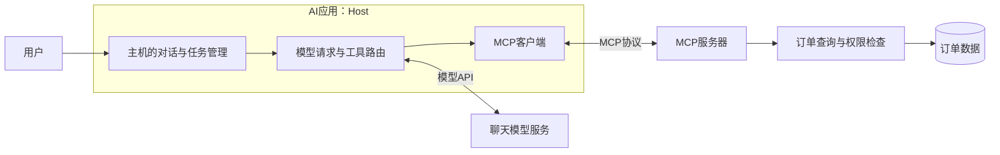
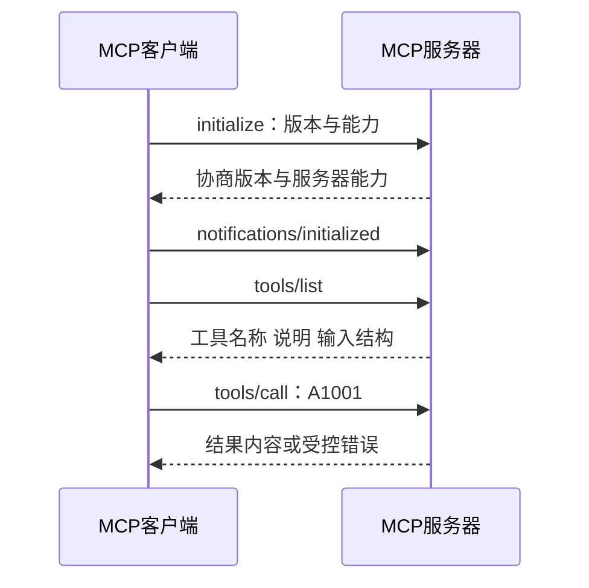

# 大模型应用开发学习 16：MCP 入门：模型如何连接工具和资源

我们已经有一个订单查询函数。如果只有一个售后助手，把函数接进去就能用。但后来网页客服、内部办公助手和另一个AI应用都想查询订单，怎么办？

如果每个应用各写一份连接代码，参数和错误处理很容易各不相同。订单服务更新时，还要逐个修改。

更方便的做法是把订单能力放在一个独立服务中，约定大家用同一种方式问“你有哪些工具”“查这笔订单”。MCP就是这样的连接协议，全名Model Context Protocol，中文常叫模型上下文协议。

我们先让一个客户端连上售后服务，找到查询工具，并拿到A1001的状态。这段通信本身不需要聊天模型；等它走通，再看模型提出的请求怎样接进来。

| 这次逐步完成什么 | 要建立的认识 |
| --- | --- |
| 连上售后服务 | 主机、客户端、服务器各做什么 |
| 找到并调用工具 | 发现能力与执行能力是两个步骤 |
| 读取政策与提示 | 工具、资源和提示的区别 |
| 接回模型 | MCP通信与模型工具请求怎样配合 |

## 先认清，究竟是哪两个程序在通信

“服务器”容易让人想到远程机器，其实本地Python进程也可以提供服务。只要它按MCP约定接收请求、返回能力和结果，就能扮演MCP服务器。

“客户端”负责与这个服务通信。它通常在AI应用里面，而不是指正在聊天的用户。

我们直接使用的整个AI应用叫主机，也就是Host。它组织用户界面、模型请求、连接管理和权限控制。

```text
用户
  ↓
售后AI应用（Host）
  ├─ 请求大模型：理解问题、提出查询请求
  └─ MCP客户端：联系售后MCP服务器
                         ↓
                   订单查询业务代码
```

主机和客户端是职责划分，不一定是两个独立应用。一个主机可以建立到多个服务的连接。服务器提供业务能力，通常不需要自己负责聊天界面。

把职责和通信边界展开，可以看到模型不在MCP连接的另一端：



主机向模型发请求，MCP客户端向工具服务发请求，是两条不同连接。模型服务不可用时，客户端仍可能直接查询工具；MCP连接失败时，模型仍可能生成文本，只是没有取得订单事实。

这个区分对排查很有用：模型没有选查询工具，检查工具说明与模型行为；工具列表拿不到，检查MCP初始化与连接；列表正常却查不到订单，检查参数、授权和业务服务。

下面的教学实验用`client.py`代替主机里的通信部分，用`server.py`提供售后查询。两者都在本机运行。固定订单用于观察协议，不代表实际公司订单。

## 连接成功后，先问有哪些工具，再发查询

客户端不能一连上就随意调用函数。双方先初始化，协商协议版本并交换支持的能力；随后客户端才查询工具列表。

工具列表里包含名称、说明和输入结构。拿到这些信息以后，客户端才知道查询工具叫`get_refund_status`，需要一个字符串`order_id`。

接着发送“调用这个工具，参数为A1001”。服务器执行归属检查和查询，返回“审核中”。

```text
初始化连接
  → 列出工具
  → 找到get_refund_status及参数说明
  → 调用工具，order_id=A1001
  → 服务器返回教学退款状态
```

在Python SDK中，对应的关键调用是：

```python
await session.initialize()
tools = await session.list_tools()
result = await session.call_tool(
    "get_refund_status", arguments={"order_id": "A1001"}
)
```

这是已建立`session`之后的摘录，不是独立脚本。`session`表示当前连接中的会话，`await`表示等待异步操作完成；它不会自动把三个有先后依赖的步骤变成并行。

初始化是一次明确的握手，不只是建立了进程或TCP连接。客户端发出支持的协议版本与自身信息，服务器回应协商结果及能力，客户端再通知“初始化完成”，之后进入正常发现和调用。



使用Python SDK时，`initialize()`负责完成对应握手，我们无需手工再发送一遍通知。服务不一定提供全部能力，客户端根据初始化结果使用已支持的功能，不能看到一个MCP地址就假定工具、资源、提示都存在。

这里先列工具，是为了让初次连接的客户端发现名称与参数，并不是协议要求每次查询前都重新列一遍。已经掌握有效工具说明的客户端，可以在初始化完成后直接调用；长期连接仍要处理能力或工具列表变化。初始化握手与能力发现，解决的是两件不同的事。

SDK负责包装协议消息，我们先关注输入与结果即可。底层使用JSON-RPC：请求带一个ID，响应用同一个ID配对；通知不要求响应。它与模型工具调用ID用途相似，但属于不同通信层，不能混用。

例如模型请求ID为`call_1`，主机转发的MCP请求ID为一个数值，参数里的订单号是`A1001`。三个标识分别追踪模型往返、协议往返与业务对象；同一笔订单可以被多次查询，每次请求的通信ID都可能不同。

还有一层区别：协议请求正常返回，不表示业务查询一定成功。服务器可能正常返回“订单不可访问”；工具也可能报告执行错误。客户端既要检查工具错误标记，也要读业务结果，而不是只看连接有没有断开。

## 用本地示例，实际拿到一次结果

配套服务使用官方Python SDK中的FastMCP注册能力。比如，把查询函数放在`@mcp.tool()`下面，就能把它登记为MCP工具。

注册仍然只是在公布能力。查询A1001的实际逻辑、当前用户归属检查和错误处理，还在服务自己的函数中。[官方Python SDK](https://github.com/modelcontextprotocol/python-sdk)

下面是一个可以单独保存为Python脚本的最小stdio服务，只有查询工具，帮助看清注册与执行。它仍然只使用虚构数据和固定教学身份：

```python
import json
import re
from mcp.server.fastmcp import FastMCP

mcp = FastMCP("after-sales-minimal")
orders = {"A1001": {"owner": "demo-user", "refund_status": "审核中"}}


@mcp.tool()
def get_refund_status(order_id: str) -> str:
    """按用户提供的订单号查询教学退款状态，只读，不提交申请。"""
    if not re.fullmatch(r"A[0-9]{4}", order_id):
        raise ValueError("订单号应为A加4位数字")
    order = orders.get(order_id)
    if order is None or order["owner"] != "demo-user":
        return json.dumps({"ok": False, "error": "not_found_or_forbidden"})
    return json.dumps({"ok": True, "order_id": order_id,
                       "refund_status": order["refund_status"]}, ensure_ascii=False)


if __name__ == "__main__":
    mcp.run(transport="stdio")
```

`FastMCP()`创建服务对象，`@mcp.tool()`登记函数，函数参数类型和说明用于形成工具描述。最后的`run()`启动接收请求的服务过程，**并不是启动后就自动执行所有已登记函数**。

直接运行这个脚本，看不到聊天窗口或主动打印的订单结果是正常的：它正在等待客户端按协议请求。手工在终端输入“查A1001”，也不是有效MCP调用。需要客户端发出对应的初始化和调用消息。

后面运行练习仍使用仓库完整的`server.py`与`client.py`，它们还包含资源、提示及更多查询情况。最小服务用于理解注册机制，不替换配套服务的全部能力。

使用[配套代码与环境说明](https://github.com/benx92/ai-learning-notes/tree/main/examples/16-mcp)，在示例目录准备Python3.12环境：

```powershell
py -3.12 -m venv .venv
.\.venv\Scripts\python.exe -m pip install -r requirements.txt
.\.venv\Scripts\python.exe client.py
```

本例固定MCP SDK1.26.0等依赖，验证过的协议协商版本为2025-11-25。协议和SDK版本都在发展，练习时先沿用依赖文件，不把新版文档片段直接混进旧环境。[MCP架构文档](https://modelcontextprotocol.io/docs/learn/architecture)

`client.py`会启动同目录的`server.py`，通过标准输入输出通信。这个连接方式叫stdio。客户端的输入接到服务的输出，客户端的输出接到服务的输入，不需要你先另开一个服务器窗口。

运行时会列出工具和其他能力，再分别查询A1001、A2002和错误格式的订单号。我们关注的结果是：

| 请求 | 应看到什么 |
| --- | --- |
| A1001 | 当前教学用户可访问，退款状态“审核中” |
| A2002 | 不属于当前教学用户，不返回其退款状态 |
| bad-id | 参数格式错误，不当作有效订单查询 |

脚本还打印协议版本和结果内容。至此已经发生了真实MCP通信，但没有请求聊天模型：查询请求是脚本自己发出的，不能把成功查询解释为模型已经会选工具。

客户端代码里的两层`async with`也有具体作用：外层管理子进程与读写通道，内层管理MCP会话。会话使用期间通道必须保持打开，离开上下文后才进行关闭与清理。

这不是单纯为了少写几行代码。异步会话、后台接收任务和底层流属于同一段连接生命周期，随意在其他任务中创建或关闭，容易发生资源已经关闭、后台任务仍运行等问题。按示例在一致的作用域内初始化、调用和收尾，更容易看清责任。

运行命令使用当前虚拟环境的Python启动服务，并解析`server.py`的绝对路径，避免客户端和服务用了不同依赖环境，或者从另一个工作目录启动后找不到文件。

stdio有一个实际约束：标准输出用于协议通信，服务端随意`print`日志可能干扰消息。日志应走标准错误或单独日志系统，客户端打印结果则不受同样限制。

## 订单查到了，政策资料和回复模板又怎样提供

售后应用除了查询动作，还需要政策正文，以及“怎样组织售后回复”的任务说明。MCP将它们与工具分别提供。

**工具负责执行动作。**例如按订单号查询状态。只读查询也是动作，工具并不等于必须修改数据。

**资源负责提供数据。**例如读取`policy://refund/overview`，得到政策概览。这个URI是服务约定的资源地址，不一定是能直接在浏览器打开的网页。地址固定也不代表内容永远不变，资源可以动态生成。

如果要按会员类别读取规则，可以使用资源模板`policy://refund/customer/{customer_type}`。填入`member`以后，客户端读取对应会员规则。这是地址模板，与下面的提示模板作用不同。

**提示负责提供可复用的任务说明。**例如选择`explain_refund`，传入订单号，服务返回“先查询状态，再结合适用规则说明”的消息内容。取得提示不等于执行查询，也没有生成最终回答。

| 本次拿到的东西 | 已经发生了什么 | 还没发生什么 |
| --- | --- | --- |
| 工具列表 | 知道服务有哪些动作 | 没有查询订单 |
| 查询工具结果 | 执行了具体订单查询 | 没有替用户提交申请 |
| 政策资源 | 读到了规则文本 | 不一定已放进模型输入 |
| 回复提示 | 得到任务说明 | 没有自动完成整项任务 |

资源和提示通常由应用或用户选择使用，工具常由模型提出调用请求；具体控制仍由主机设计。不能因为服务提供了某份资料，就认为模型已经全部看过。

三个接口的调用方式也有区别：工具按名称与参数执行，资源按URI读取，提示按模板名与模板参数取得。例如取得`explain_refund(order_id="A1001")`，返回的是围绕这笔订单的任务说明，不会自动执行其中提到的查询。

资源模板里的`{customer_type}`只是给地址留一个位置。应用确认类别为会员以后，可以读取会员条款；不能因为模型随口填`member`，就把它当成订单会员身份已经验证。模板负责定位内容，订单事实仍要从可信业务查询取得。

| 能力 | 常见协议方法 | 结果接下来由谁使用 |
| --- | --- | --- |
| 工具 | `tools/list`、`tools/call` | 主机把实际执行结果交给模型 |
| 资源 | `resources/list`、`resources/read` | 主机或用户选择是否放入上下文 |
| 资源模板 | `resources/templates/list` | 主机据此构造并读取具体URI |
| 提示 | `prompts/list`、`prompts/get` | 主机或用户选择任务消息 |

返回值也不总是一段字符串。工具结果可以包含多个内容块；资源读取返回资源内容对象；提示返回消息。示例先判断文本内容块类型，再取得文字，不直接把整个SDK对象强制转成字符串当作正文。

客户端示例列出并读取这些能力，是为了观察三种返回结果。真实应用只选择当前任务需要的内容，再明确加入模型上下文。

## 从本地连接换成HTTP，哪些地方改变了

如果售后服务要供其他机器上的应用访问，本机stdio就不够了。可以使用Streamable HTTP：服务在地址上监听，客户端通过HTTP联系它。

本例也提供这种练习。一个终端运行：

```powershell
.\.venv\Scripts\python.exe server.py --transport streamable-http
```

另一个终端运行：

```powershell
.\.venv\Scripts\python.exe http_client.py
```

示例地址为`http://127.0.0.1:8765/mcp`，只在本机练习。工具名称、参数和业务结果仍然相同，改变的是通信方式和进程启动责任：HTTP服务由我们单独启动，客户端连接已有地址。

stdio与HTTP的关键区别可以这样对照：

| 要处理的事 | 本机stdio | Streamable HTTP |
| --- | --- | --- |
| 服务怎样启动 | 客户端按命令启动子进程 | 服务独立启动并监听地址 |
| 消息经过哪里 | 标准输入输出通道 | HTTP连接 |
| 断开时先查什么 | 子进程是否退出、输出是否污染 | 地址、服务状态、网络与认证 |
| 当前例子的用途 | 同机观察连接全过程 | 本机观察独立服务通信 |

换成HTTP不会自动产生登录、租户隔离或权限控制。当前示例身份固定为`demo-user`，没有生产认证。对外部署需要补齐认证和访问控制，再决定哪些能力能提供给哪些应用。

## 最后接回模型：把两种请求接起来

现在用户在AI应用中说“查一下A1001”，主机要做两次不同层面的交接。

先从MCP服务取得工具说明，把`name`、`description`和`inputSchema`转成模型接口所需的工具格式。模型据此提出Tool Call。

随后主机读取模型请求，将工具名与参数转发成MCP的`call_tool()`。服务器返回结果，主机再包装为与原模型调用ID配对的工具消息，交回模型。

```text
MCP服务公布查询能力
  → 主机把说明交给模型
  → 模型提出查询A1001
  → 主机通过MCP客户端转发请求
  → 服务执行并返回状态
  → 主机回填模型工具消息
  → 模型组织最终回复
```

桥接时，最直接的字段对应是：

| MCP工具说明 | 模型接口工具描述 | 是否直接执行 |
| --- | --- | --- |
| `name` | `function.name` | 否，只公布名称 |
| `description` | `function.description` | 否，帮助模型选择 |
| `inputSchema` | `function.parameters` | 否，说明参数结构 |

模型选择工具以后，才有实际执行。桥接层先核对名称在发现的允许列表中，再解析模型参数为对象，调用`session.call_tool()`；随后读取工具结果，并用原模型调用ID回填消息。MCP协议自己的请求ID由通信层处理，不拿来替换模型调用ID。

当前桥接示例主要处理文本内容块。若服务返回图片、其他资源内容或结构化结果，应用要按类型决定如何传递、展示和检查，不能把未知内容静默丢弃后说调用完整成功。

这解释了MCP与Function Calling的关系：一个规定应用怎样连接能力，另一个让模型表达要用什么能力。RAG则是先找资料再回答的应用流程，三者不在同一层。

配套`bridge_demo.py`用固定构造的模型调用观察转换和结果配对，尚未接在线大模型。真实stdio与HTTP通信已有八项协议检查；在线自然语言选工具的表现需要另外验证。完整服务、客户端和桥接代码见[实现与协议扩展](supplements/16-MCP实现与协议扩展.md)。

## 最后收束成一个完整认识

MCP把外部能力的发现、读取和调用组织成统一通信方式。客户端先与服务初始化，再发现能力，按说明发送请求，取得实际结果。

在售后例子里，模型决定是否查询，主机负责转交，MCP客户端负责通信，服务器里的业务代码负责核对和读取订单。把这几个位置分清，就能判断一次请求卡在模型选择、协议连接，还是业务执行。

统一连接方式方便复用，但能力是否开放、当前用户有没有权限、结果是否进入模型输入，仍要由应用明确处理。

## 参考资料

- [MCP架构与角色](https://modelcontextprotocol.io/docs/learn/architecture)
- [MCP Python SDK](https://github.com/modelcontextprotocol/python-sdk)
- [配套示例、固定版本与验证说明](https://github.com/benx92/ai-learning-notes/tree/main/examples/16-mcp)
