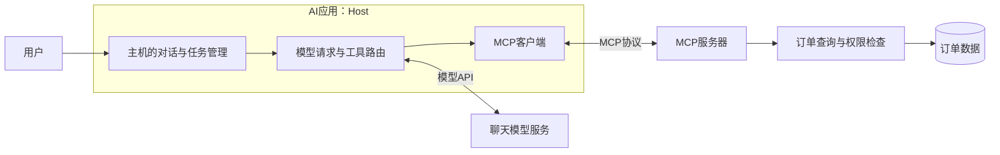
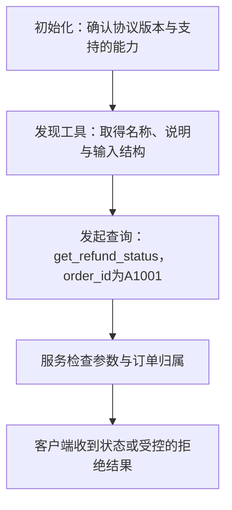
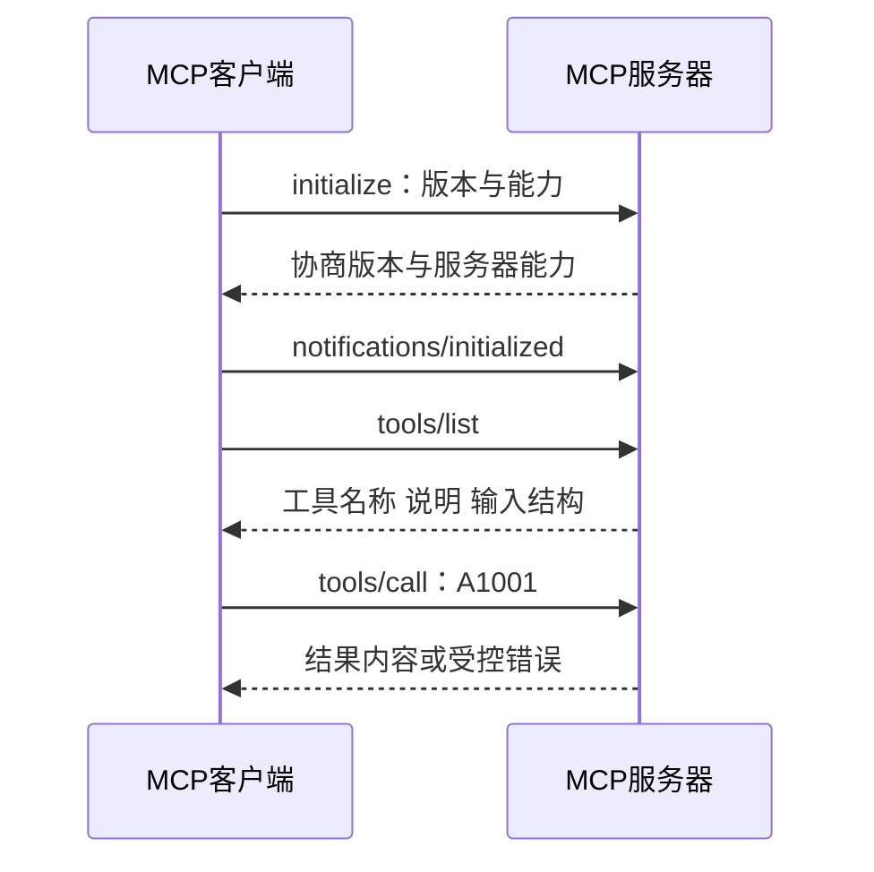
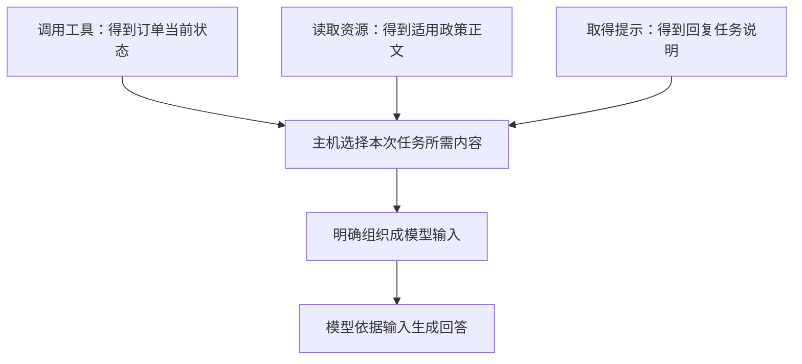
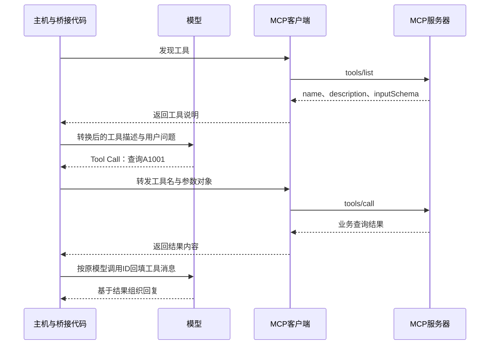

# 大模型应用开发学习 16：MCP 入门：模型如何连接工具和资源

已经能让模型提出“查询A1001退款状态”的请求，应用也能检查参数、执行查询并回填结果。如果只有一个售后助手，直接在应用里调用业务函数就可以完成任务。

后来，网页客服、内部办公助手和另一个AI应用也想使用这项查询。每个应用怎样知道工具叫什么、需要什么参数，又怎样与提供工具的程序通信？这些连接工作，不会因为模型会生成Tool Call就自动完成。

本篇从这个问题引入**MCP**：先讲它与模型能力、工具调用的关系，再用一个本地售后服务看清连接、发现和调用，最后把它接回模型请求。

> **配套代码：**完整示例见[GitHub配套目录](https://github.com/benx92/ai-learning-notes/tree/main/examples/16-mcp)。**建议结合正文与代码一起阅读**：`server.py`提供售后能力，`client.py`和`http_client.py`演示两种连接，`bridge_demo.py`演示请求转换与回填。安装和运行说明见README；这些教学脚本不调用在线模型，不需要模型API Key。

| 阅读中的问题 | 本篇怎样展开 |
| --- | --- |
| 已经有Function Calling，为什么还需要MCP | 先区分模型提出请求与应用连接服务 |
| MCP是模型自带的能力吗 | 解释协议、SDK与服务程序各是什么 |
| 主机、客户端和服务器是谁 | 放进同一次售后查询里看职责 |
| 工具、资源和提示有什么区别 | 分清查询操作、政策资料和任务说明 |
| 接上MCP以后，模型就能回答了吗 | 先观察通信，再看结果如何进入模型输入 |

## 已经会调用工具，为什么还要一种连接协议

先回到工具调用的分工：模型读懂用户需求，提出工具名与参数；应用检查后调用实际函数，把结果交回模型。这里还有一个前提：**应用已经知道这个函数在哪里、怎样访问它。**

同一进程里，可以直接调用Python函数。工具在另一个程序或远程业务系统中，就需要双方约定怎样通信。即使都用HTTP，工具列表放在哪个地址、参数怎样写、结果怎样返回，也可能因服务而异。

假设两个售后服务都能查订单，其中一个要求发送“订单号”，另一个要求“order_id”；返回结果一个叫“status”，另一个叫“refund_status”。应用需要理解这些差异并适配。工具越来越多时，重复连接和发现能力的工作也会增加。

**MCP，全名Model Context Protocol（模型上下文协议），是一套让AI应用与外部能力提供者按共同规则通信的开放协议。**它约定怎样发现服务提供的能力、怎样提出调用或读取请求，以及怎样返回结果。

“协议”可以先理解成双方共同遵守的一份通信约定。它不会自己查询订单；实现协议的程序负责收发消息，业务函数负责查询。MCP统一的是发现与调用的外层规则，工具名、业务参数和数据含义仍由服务描述，不能认为所有订单系统都会因此使用完全相同的字段。

| 连接方式 | 应用需要怎样使用订单查询 | 对接重点 |
| --- | --- | --- |
| 同一程序内直接调用函数 | 已经知道函数位置，传入参数 | 业务函数的输入与返回值 |
| 对接已有业务HTTP接口 | 按接口文档发请求、解析返回 | 各服务约定的地址、认证与数据格式 |
| 使用MCP提供的工具 | 按共同协议发现工具，再按工具说明调用 | 通用连接流程，加上具体业务参数与权限 |

已有HTTP接口也可以被多个应用复用，MCP并不是唯一连接方法。它的价值在于，让兼容的应用和服务复用相同的能力发现与调用机制，减少重复适配。提供者可以把已有订单接口封装在MCP服务器后面，不必重写订单系统。

还有一个容易忽略的区别：**复用同一份MCP服务代码，不一定是共享同一个服务进程。**本地连接可以由每个应用分别启动进程；远程连接则可以访问独立运行的服务。后面会用这两种方式观察同一组售后能力。

## MCP是模型的功能，还是应用使用的协议

**MCP首先是应用与外部服务之间的通信协议，不是一个聊天模型，也不是通过安装就能让模型自动查订单的智能模块。**模型识别需求、选择工具的能力，仍来自模型本身及本次输入；MCP连接由应用一侧的程序实现。

这也解释了为什么本篇可以先不请求模型：客户端脚本已经知道要查A1001，直接按协议发请求，服务器照样可以返回结果。接入模型以后，变化的是“工具名和参数由谁提出”，通信与业务执行依然需要程序完成。

| 问题 | Function Calling主要处理什么 | MCP主要处理什么 |
| --- | --- | --- |
| 模型怎样表达想使用的操作 | 生成工具名与参数，交给应用 | 应用可通过MCP取得工具说明，供模型使用 |
| 工具在外部程序中，怎样找到并联系它 | 模型请求本身不解决连接问题 | 客户端按协议发现、调用或读取 |
| 谁真正取得订单数据 | 应用安排实际执行 | MCP服务器中的业务代码执行并返回 |

两者可以配合。把模型提出的Tool Call转成MCP调用，再将结果包装成模型能够接收的工具消息，就是后文的桥接工作。**模型接口与MCP接口是两层约定，应用负责衔接它们。**

阅读和运行示例时，还会遇到三个相关名称：

| 名称 | 是什么 | 本例中怎样对应 |
| --- | --- | --- |
| **MCP协议** | 共同遵守的通信规范 | 规定发现工具、调用工具、读取资源等操作 |
| **MCP SDK** | 帮开发者实现通信的软件开发工具包 | Python程序使用它建立连接、发送和接收协议消息 |
| **MCP服务器** | 按协议提供具体能力的程序 | 本例`server.py`提供订单查询、政策资料与任务模板 |

安装SDK是让程序能够实现MCP通信，不是在安装一个新模型。服务器是否能查订单，取决于是否写好了查询函数、接入了数据并授予相应权限。模型有多聪明，也不能替代这几项准备。

名字中的“上下文”，可以理解为模型处理任务时能使用的资料、结果和任务说明。MCP为应用取得这些内容提供统一通道，**取得内容后怎样选择、组织和交给模型，仍由应用决定**。它不会自动把整个文件库写进模型记忆。

下面先看这些程序怎样分工，再完成一次不依赖在线模型的查询。这样能把“服务确实能用”与“模型是否选对工具”分别观察。

## 先认清，究竟是哪两个程序在通信

用户直接打开的是售后助手；助手内部需要一段代码联系工具服务；服务另一端则接收请求并查询订单。MCP把这三个位置分别称作Host、Client和Server。

**先理解它们的工作，再对应名称。**它们是职责划分，不代表必须准备三台机器：

| 角色 | 在售后例子里是谁 | 负责什么 |
| --- | --- | --- |
| **Host（主机）** | 用户直接使用的整个AI应用 | 管理对话、模型请求、连接与权限 |
| **Client（客户端）** | 主机内与某个MCP服务通信的模块 | 发出协议请求，接收结果 |
| **Server（服务器）** | 提供售后能力的程序 | 公布工具、资料和提示，执行业务代码 |

Host常译为“主机”，这里指整个AI应用，不特指某一台物理电脑；Server也指提供能力的程序，不一定是远程机器。客户端通常是Host内部的通信组件，而不是用户操作的聊天窗口。

一个Host可以管理多个客户端，分别联系订单服务、文件服务等。每个客户端负责与对应服务器的连接，服务器可以在本机运行，也可以通过网络访问。模型服务则位于另一条连接上。

下面把**模型连接**和**MCP连接**分别画出来：



**主机向模型发请求，MCP客户端向工具服务发请求，是两条不同连接。**模型服务不可用时，客户端仍可能直接查询工具；MCP连接失败时，模型仍可能生成文本，只是没有取得订单事实。

这也决定了本篇的实验顺序：**先让客户端直接取得业务结果，再说明主机怎样转发模型的工具请求**。前一步验证通信，后一步解释两种接口怎样衔接。

下面的教学实验用`client.py`实现客户端检查，用`server.py`提供售后查询，都在本机运行。这里没有完整聊天界面，也没有把模型作为通信参与者；客户端脚本预先知道要执行哪些检查。固定订单用于观察协议，不代表实际公司订单。

## 连接成功后，先问有哪些工具，再发查询

客户端与服务器能收发消息以后，还需要先确认双方使用什么协议版本、支持哪些功能。这一步叫**初始化**。它说明“双方准备按哪些规则通信”，并没有查询任何订单。

本例接着进行**工具发现**：询问服务有哪些可调用操作，取回名称、用途与参数要求。初始化声明支持工具功能，工具发现才给出具体有哪些工具，两者作用不同。

工具列表里包含名称、说明和输入结构。拿到这些信息以后，客户端才知道查询工具叫`get_refund_status`，需要一个字符串`order_id`。

现在客户端才发出**具体调用**：“请调用查询工具，订单号A1001。”服务器检查参数与归属，执行后返回结果。初始化、发现、调用，分别解决“能否按约定交流”“有哪些操作可用”“这次具体做什么”。



这张图是首次连接后完成一次查询的主线。初始化与发现提供的是调用条件，**真正查询订单发生在调用工具以后**。

在本例固定的2025-11-25协议版本中，初始化是一次明确的握手，不只是建立了进程或TCP连接。客户端发出支持的协议版本与自身信息，服务器回应协商结果及能力，客户端再通知“初始化完成”，之后进入正常发现和调用。



配套版本的Python SDK用`initialize()`完成对应握手，我们无需手工再发送一遍通知。服务不一定提供全部能力，客户端根据初始化结果使用已支持的功能，不能看到一个MCP地址就假定工具、资源、提示都存在。

这里先列工具，是为了让初次连接的客户端发现名称与参数，并不是协议要求每次查询前都重新列一遍。已经掌握有效工具说明的客户端，可以在初始化完成后直接调用；长期连接仍要处理能力或工具列表变化。初始化握手与能力发现，解决的是两件不同的事。

在配套 [`client.py`](https://github.com/benx92/ai-learning-notes/blob/main/examples/16-mcp/client.py) 的 `inspect_server(session)` 中，初始化与发现工具的实际代码是：

<!-- example-source: examples/16-mcp/client.py -->

```python
info = await session.initialize()
print("协议版本：", info.protocolVersion)
tools = await session.list_tools()
print("工具：", [tool.name for tool in tools.tools])
print("参数要求：", tools.tools[0].inputSchema)
```

这是已建立`session`之后的摘录，不是独立脚本。稍后同一函数遍历订单号，并调用 `await session.call_tool("get_refund_status", arguments={"order_id": order_id})` 取得结果。`session`表示当前连接中的会话，`await`表示等待异步操作完成；它不会自动把三个有先后依赖的步骤变成并行。

对应上面的过程，`initialize()`先准备会话，`list_tools()`取得工具说明，`call_tool()`才执行具体操作。前两步没有传入订单号，因此也没有理由产生A1001的状态。`inputSchema`是工具输入格式的说明，可以把它看成参数填写要求，而不是函数执行结果。

SDK负责包装协议消息，我们先关注输入与结果即可。底层使用JSON-RPC：请求带一个ID，响应用同一个ID配对；通知不要求响应。它与模型工具调用ID用途相似，但属于不同通信层，不能混用。

这几种编号可以放在同一次查询里对照。下面的值只作示意：

| 标识 | 示例 | 用来配对或定位什么 |
| --- | --- | --- |
| **模型工具调用ID** | `call_1` | 模型提出的请求与回填给模型的结果 |
| **MCP请求ID** | `1` | 客户端发出的协议请求与服务器响应 |
| **业务订单号** | `A1001` | 真正要查询的订单 |

同一订单可以被查询多次，每次通信的ID都可能不同。**订单号不随一次消息往返改变，通信ID也不能替代订单号。**

还有一层区别：协议请求正常返回，不表示业务查询一定成功。服务器可能正常返回“订单不可访问”；工具也可能报告执行错误。客户端既要检查工具错误标记，也要读业务结果，而不是只看连接有没有断开。

## 用本地示例，实际拿到一次结果

概念与通信顺序已经明确，现在把它们对应到实际代码。配套服务使用官方Python SDK中的**FastMCP**，它是一个便于声明服务能力的接口，不是另一种聊天模型。

本例把查询函数放在`@mcp.tool()`下面，意思是把这个函数登记为一个可以经MCP调用的工具。客户端先取得它的说明，随后发送调用请求，才会执行函数内部的代码。

注册仍然只是在公布能力。查询A1001的实际逻辑、当前用户归属检查和错误处理，还在服务自己的函数中。[官方Python SDK](https://github.com/modelcontextprotocol/python-sdk)

下面直接摘录 [`server.py`](https://github.com/benx92/ai-learning-notes/blob/main/examples/16-mcp/server.py) 的 `get_refund_status()`。文件前面已经导入 `json`、`re`，创建 `mcp` 并定义 `ORDERS`；这里保留实际业务检查和返回字段，不另写一份查询函数：

<!-- example-source: examples/16-mcp/server.py -->

```python
@mcp.tool()
def get_refund_status(order_id: str) -> str:
    """按用户提供的订单号查询教学退款状态，只读；不创建申请或执行退款。"""
    if not re.fullmatch(r"A[0-9]{4}", order_id):
        raise ValueError("订单号应为A加4位数字，如A1001")
    order = ORDERS.get(order_id)
    # 固定身份仅用于本机教学，真实服务应从认证信息取得当前用户。
    if order is None or order["owner"] != "demo-user":
        return json.dumps({"ok": False, "error": "not_found_or_forbidden"})
    return json.dumps({"ok": True, "order_id": order_id,
                       "refund_status": order["refund_status"],
                       "source": "虚构教学快照，不是实时订单"}, ensure_ascii=False)
```

接下来会用到**stdio（标准输入输出）**：它让同机两个进程通过输入、输出通道交换协议消息，后文再对照HTTP连接。

文件中的 `FastMCP("after-sales-demo", host="127.0.0.1", port=8765, json_response=True)` 创建服务对象，`@mcp.tool()`登记函数，函数参数类型和说明用于形成工具描述。文件末尾的 `mcp.run(transport=args.transport)` 启动服务，默认使用stdio，也能按命令行参数切换HTTP。**登记工具和启动服务，都不等于已经执行查询。**

直接运行 `server.py`，看不到聊天窗口或主动打印的订单结果是正常的：它正在等待客户端按协议请求。手工在终端输入“查A1001”，也不是有效MCP调用。需要客户端发出对应的初始化和调用消息。

下面运行的就是这份完整 `server.py` 与配套 `client.py`，同一个服务还注册了政策资源和提示。函数返回的 `refund_status` 是退款状态，`source` 标明数据来自教学快照；后面读取结果时保留这两个字段。

在开头链接的配套目录中准备Python3.12环境，再运行客户端：

```powershell
py -3.12 -m venv .venv
.\.venv\Scripts\python.exe -m pip install -r requirements.txt
.\.venv\Scripts\python.exe client.py
```

本例固定MCP SDK1.26.0等依赖，验证过的协议协商版本为2025-11-25。以下握手过程与配套代码按该版本讲解；它不是最新协议版本声明。练习时先沿用依赖文件，版本迁移单独对照规范，不混用不同版本的生命周期流程。[MCP架构文档](https://modelcontextprotocol.io/specification/2025-11-25/architecture)

`client.py`会启动同目录的`server.py`，通过标准输入输出通信。这个连接方式叫stdio。客户端的输入接到服务的输出，客户端的输出接到服务的输入，不需要你先另开一个服务器窗口。

运行时会列出工具和其他能力，再分别查询A1001、A2002和错误格式的订单号。我们关注的结果是：

| 请求 | 工具结果中的表现 | 说明什么 |
| --- | --- | --- |
| A1001 | `isError=False`，业务`ok=True`，状态为“审核中” | 已取得允许查看的订单事实 |
| A2002 | `isError=False`，业务`ok=False` | 工具正常执行，但业务上不可访问 |
| bad-id | `isError=True` | 工具因参数格式错误而未完成查询 |

**连接成功、工具执行完成、业务查询成功是三个不同判断。**客户端要读取结果内容，不能只看连接是否建立。脚本还打印协议版本和结果正文；这里已经发生真实MCP通信，但请求由脚本直接发出，尚未证明模型会选择工具。

`client.py`中的两层`async with`对应两个生命周期：外层管理子进程与通信通道，内层管理MCP会话。初始化、调用和关闭都在这段连接的有效范围内完成；程序使用同一个虚拟环境的Python和服务脚本的绝对路径启动子进程。

**stdio的标准输出用于协议消息**，服务端普通日志应写到标准错误或单独日志系统。具体环境与连接异常见[官方Python SDK说明](https://github.com/modelcontextprotocol/python-sdk)，这里聚焦连接后怎样发现和使用能力。

## 订单查到了，政策资料和回复模板又怎样提供

现在已经通过工具取得了订单状态。若要进一步解释售后情况，还可能需要政策正文，以及“结合事实与政策组织回复”的任务说明。这三类东西作用不同，MCP把它们分别组织为工具、资源与提示。

先用A1001对照，不急着记接口名称：

| 应用需要什么 | 向服务提出什么要求 | 返回的东西 | MCP中的名称 |
| --- | --- | --- | --- |
| 查到当前状态 | 执行一次A1001查询 | 订单状态或错误 | 工具Tools |
| 拿到政策依据 | 读取已提供的政策资料 | 政策内容 | 资源Resources |
| 准备回复任务 | 按A1001生成一份任务说明 | 可复用的提示消息 | 提示Prompts |

工具也可以只读，资源也可以动态变化；这里区分的是接口怎样提供能力，不是按“是否修改数据”机械分类。

**工具（Tools）负责执行动作。**例如按订单号查询状态。只读查询也是动作，工具并不等于必须修改数据。

**资源（Resources）负责提供可读取的数据。**例如读取`policy://refund/overview`，得到政策概览。**URI是用来标识资源的地址**；这里是服务约定的标识，不一定是能直接在浏览器打开的网页。地址固定也不代表内容永远不变，资源可以动态生成。

如果要按会员类别读取规则，可以使用资源模板`policy://refund/customer/{customer_type}`。其中`{customer_type}`是地址中待填的位置，填入`member`后，得到具体URI `policy://refund/customer/member`，客户端再读取对应条款。**资源模板负责定位资料**，与下面组织任务消息的提示模板不同。

**提示（Prompts）负责提供可复用的任务说明。**例如选择`explain_refund`，传入订单号，服务返回“先查询状态，再结合适用规则说明”的消息内容。它相当于帮应用准备好一份任务要求；取得这份要求，没有执行其中提到的查询，也没有生成最终回答。

Prompts是“提供提示消息的接口”，Function Calling是“模型提出操作请求的机制”，不能因为都出现“提示”或“调用”就把它们当成同一件事。

| 本次拿到的东西 | 已经发生了什么 | 还没发生什么 |
| --- | --- | --- |
| 工具列表 | 知道服务有哪些动作 | 没有查询订单 |
| 查询工具结果 | 执行了具体订单查询 | 没有替用户提交申请 |
| 政策资源 | 读到了规则文本 | 不一定已放进模型输入 |
| 回复提示 | 得到任务说明 | 没有自动完成整项任务 |

以A1001的售后说明为例，这三类内容的关系可以这样看：



图中展示的是应用可以组织的流程，不表示获取任意一项就会自动触发其他步骤。**资料已经返回给客户端，不等于已经进入模型上下文。**资源和提示通常由应用或用户选择使用，工具常由模型提出调用请求；具体控制仍由主机设计。

三个接口的调用方式也有区别：工具按名称与参数执行，资源按URI读取，提示按模板名与模板参数取得。例如取得`explain_refund(order_id="A1001")`，返回的是围绕这笔订单的任务说明，不会自动执行其中提到的查询。

资源模板里的`{customer_type}`只是给地址留一个位置。应用确认类别为会员以后，可以读取会员条款；不能因为模型随口填`member`，就把它当成订单会员身份已经验证。模板负责定位内容，订单事实仍要从可信业务查询取得。

| 能力 | 常见协议方法 | 结果接下来由谁使用 |
| --- | --- | --- |
| 工具 | `tools/list`、`tools/call` | 主机把实际执行结果交给模型 |
| 资源 | `resources/list`、`resources/read` | 主机或用户选择是否放入上下文 |
| 资源模板 | `resources/templates/list` | 主机据此构造并读取具体URI |
| 提示 | `prompts/list`、`prompts/get` | 主机或用户选择任务消息 |

返回值也不总是一段字符串。工具结果可以包含多个内容块；资源读取返回资源内容对象；提示返回消息。示例先判断文本内容块类型，再取得文字，不直接把整个SDK对象强制转成字符串当作正文。

客户端示例列出并读取这些能力，是为了观察三种返回结果。真实应用只选择当前任务需要的内容，再明确加入模型上下文。

## 从本地连接换成HTTP，哪些地方改变了

前面的stdio让同机进程通过输入输出通道通信。如果服务要独立运行、让其他机器上的应用通过地址访问，就需要另一种消息传输方式。

**传输方式回答的是“协议消息经过什么通道送达”。**MCP规定的工具发现和调用仍然存在，改变的是消息怎么来回传递。这里使用**Streamable HTTP**：服务器在地址上监听，客户端通过HTTP发送和接收MCP消息。它不等于任意一个返回JSON的普通HTTP接口，双方仍要遵守MCP的消息规则。

本例也提供这种练习。一个终端运行：

```powershell
.\.venv\Scripts\python.exe server.py --transport streamable-http
```

另一个终端运行：

```powershell
.\.venv\Scripts\python.exe http_client.py
```

示例地址为`http://127.0.0.1:8765/mcp`，只在本机练习。工具名称、参数和业务结果仍然相同，改变的是通信方式和进程启动责任：HTTP服务由我们单独启动，客户端连接已有地址。

stdio与HTTP的关键区别可以这样对照：

| 要处理的事 | 本机stdio | Streamable HTTP |
| --- | --- | --- |
| 服务怎样启动 | 客户端按命令启动子进程 | 服务独立启动并监听地址 |
| 消息经过哪里 | 标准输入输出通道 | HTTP连接 |
| 服务进程由谁管理 | 本例客户端负责启动与退出清理 | 服务独立运行，本例手动启动和停止 |
| 当前例子的用途 | 同机观察连接全过程 | 本机观察独立服务通信 |

换成HTTP不会自动产生登录、租户隔离或权限控制。当前示例身份固定为`demo-user`，没有生产认证。对外部署需要补齐认证和访问控制，再决定哪些能力能提供给哪些应用。

## 最后接回模型：把两种请求接起来

客户端已经能够取得真实的教学查询结果，现在才把模型放回这条链路。用户说“查一下A1001”，模型根据工具说明提出请求；主机需要把模型接口与MCP接口接起来。这段转换与转发代码通常称为**桥接**。

可以先对照直接调用业务函数的做法：

| 主机收到模型请求以后 | 直接连接业务函数 | 通过MCP连接 |
| --- | --- | --- |
| 工具说明从哪里来 | 应用自己定义 | 应用先从MCP服务器取得，再转换为模型接口格式 |
| 怎样执行查询 | 应用检查后直接调用函数 | 应用检查后交给MCP客户端，由服务器执行业务函数 |
| 怎样把结果交回模型 | 使用原调用ID回填工具消息 | 仍使用原模型调用ID回填，MCP请求ID由通信层处理 |

所以，**MCP改变了应用联系工具的方式，模型请求与结果回填的核心分工仍然保留。**下面看两次交接：

第一次交接的是**工具说明**。先从MCP服务取得`name`、`description`和`inputSchema`，转成模型接口需要的格式，再与问题一起发给模型。模型据此提出Tool Call。

第二次交接的是**调用与结果**。主机读取模型请求，把工具名和参数转发为MCP调用。服务器返回结果后，主机再包装成与原模型调用ID配对的工具消息，交回模型。



这里完整画出接入模型后的交接。配套桥接脚本只用固定请求验证其中的转换、转发和回填，**没有执行图中的在线模型请求**。

桥接时，最直接的字段对应是：

| MCP工具说明 | 模型接口工具描述 | 是否直接执行 |
| --- | --- | --- |
| `name` | `function.name` | 否，只公布名称 |
| `description` | `function.description` | 否，帮助模型选择 |
| `inputSchema` | `function.parameters` | 否，说明参数结构 |

模型选择工具以后，才有实际执行。桥接层先核对名称在发现的允许列表中，再解析模型参数为对象，调用`session.call_tool()`；随后读取工具结果，并用原模型调用ID回填消息。MCP协议自己的请求ID由通信层处理，不拿来替换模型调用ID。

当前桥接示例主要处理文本内容块。若服务返回图片、其他资源内容或结构化结果，应用要按类型决定如何传递、展示和检查，不能把未知内容静默丢弃后说调用完整成功。

把容易混在一起的几个名称放回各自的位置：

| 概念 | 主要解决什么问题 | 在本例中的位置 |
| --- | --- | --- |
| **MCP** | 应用怎样发现并使用外部能力 | 客户端与售后服务之间的通信 |
| **Function Calling** | 模型怎样表达工具名与参数 | 模型向主机提出查询请求 |
| **RAG** | 怎样先取得资料，再据此回答 | 应用选择资料并组织回答的流程 |

三者可以配合：MCP负责一种能力连接方式，Function Calling传达模型的动作请求，RAG组织取得证据后的回答；它们不是同一个层面的替代方案。

**用桥接演示观察转换结果。**在安装好依赖的同一配套目录运行：

```powershell
.\.venv\Scripts\python.exe bridge_demo.py
```

输出先列出“可交给模型的工具”，再打印“回填历史”。重点对照两处：工具定义中的`inputSchema`是否变成`parameters`；工具结果的`tool_call_id`是否对应原请求中的`call_demo_1`。固定请求能核对协议衔接，不能当作在线模型选工具的实测。

本例已有八项真实stdio与本机HTTP协议检查，尚未验证在线自然语言选工具或远程部署。

## 让连接、执行和模型输入各有明确位置

MCP把外部能力的发现、读取和调用组织成统一通信方式。客户端先与服务初始化，再发现能力，按说明发送请求，取得实际结果。

在接入模型的售后应用里，模型提出是否查询的请求，主机负责检查与转交，MCP客户端负责通信，服务器里的业务代码负责核对和读取订单。本章先由脚本直接调用，证明了通信与教学业务执行；再用固定模型请求观察桥接，尚未验证在线模型选工具。

回到开头的多个助手共享查询能力的问题，MCP让兼容应用按同一种协议发现和使用服务。它没有增加一份新的订单知识，也没有替模型完成判断；应用依然要明确提供哪些工具、执行哪些请求，以及把哪些结果送进模型输入。

统一连接方式方便复用，但能力是否开放、当前用户有没有权限、结果是否进入模型输入，仍要由应用明确处理。

## 参考资料

- [MCP生命周期与初始化（2025-11-25）](https://modelcontextprotocol.io/specification/2025-11-25/basic/lifecycle)
- [MCP架构与角色（配套协议版本2025-11-25）](https://modelcontextprotocol.io/specification/2025-11-25/architecture)
- [MCP Python SDK](https://github.com/modelcontextprotocol/python-sdk)
- [配套示例、固定版本与验证说明](https://github.com/benx92/ai-learning-notes/tree/main/examples/16-mcp)
