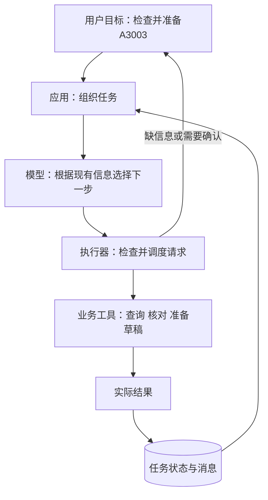
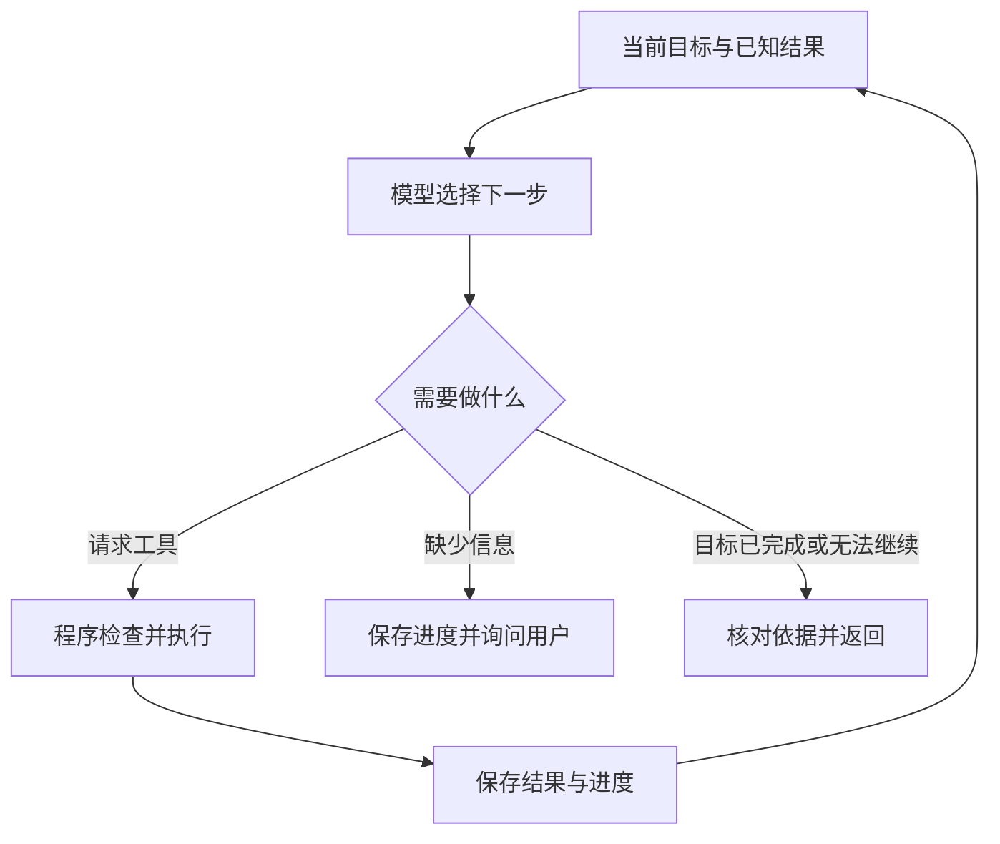
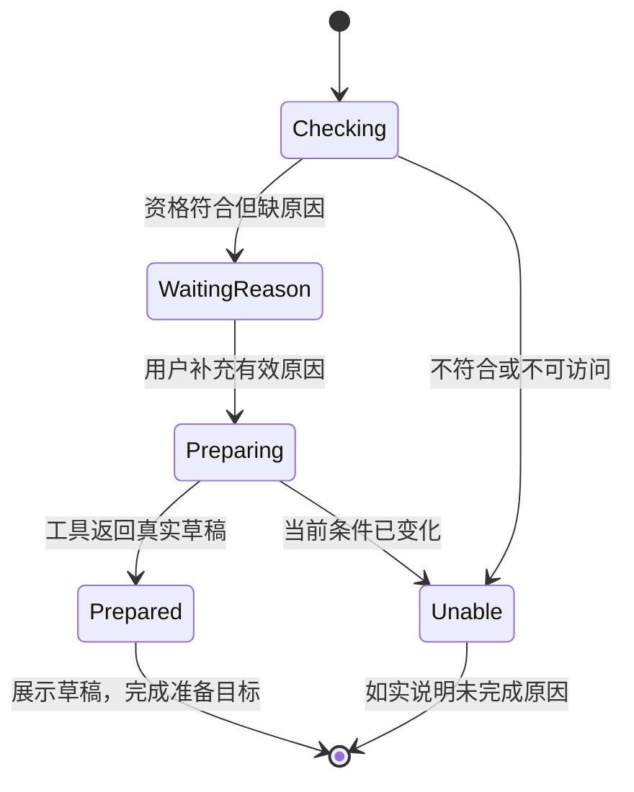

# 大模型应用开发学习 17：Agent 入门：让模型自己规划并使用工具

用户说：“帮我看看A3003能不能退，能退的话先准备一份申请。”

这句话只说了目标，没有交代所有步骤。程序需要先取得订单事实，再核对规则；信息不足时问用户，条件不符时说明原因，符合时才准备草稿。

如果每一步都由开发者预先写好顺序和分支，可以做成固定流程。另一种组织方式是让模型根据当前结果选择下一步，程序检查并执行，再把反馈交回来。这类围绕目标持续处理的应用，通常称为Agent，也就是智能体。

沿着A3003走完“检查并准备”的过程，就能观察每一步为什么发生、结果怎样改变下一步，以及什么时候应当停止。

| 当前要解决的问题 | 观察重点 |
| --- | --- |
| 用户只说了目标 | 怎样确定现在缺什么 |
| 查询结果出来了 | 下一步怎样随结果改变 |
| 需要向用户追问 | 程序怎样保留进度 |
| 草稿准备好了 | 用什么依据判断目标完成 |

## 从目标开始，先找到当前缺少的事实

看到“能不能退”，模型不能只把A3003和会员15日规则拼在一起。它还不知道这笔订单是否属于当前用户、是否会员、签收多久、商品是否定制、是否已经申请。

因此，第一步是请求有权限的订单查询。返回这些事实以后，才有条件选择适用规则。

目标、模型、执行器与业务服务，可以先放在同一张架构图中：



图中的模型负责选择，但它无法凭空产生订单事实。执行器负责把选择变成受控操作，业务工具负责具体数据与规则，状态记录负责让下一轮接得上。只保留模型加提示，缺少后面几个位置，就容易出现“说得像已经做了，实际上没有记录”的情况。

这里需要的是订单详情查询。仅返回“审核中”的`get_refund_status`不足以判断未申请订单的资格，必须有能提供所需字段的业务接口。给工具换个名字，不会自动补出这些数据。

因此，这一节是在设计任务需要的接口，不是在宣称现有查询脚本已经增加了订单详情工具。配套`ReturnService`保存了A3003等教学订单，并在准备时检查资格；它尚未把详情查询、追问和草稿准备接成完整在线Agent。下面先用明确的返回事实把过程讲清。设计中的订单详情查询和等待原因状态，在现有源码中还没有对应实现；已实现的资格检查在 `return_demo.py` 的 `ReturnService._check()`，准备草稿在 `prepare()`。需要观察已经可运行的模型与工具循环，可看 `tool_demo.py` 的 `run()`，它目前只处理退款状态查询。

假设工具返回以下教学事实：

```text
订单：A3003，属于当前用户
订单类别：会员订单
商品：非定制
签收：10天
已有申请：没有
```

这些内容来自业务工具，而不是模型推测。再取得适用的虚构政策：会员15日内可以申请，定制商品不支持无理由退货。程序核对后，当前教学条件符合。

这里的“取得政策”和“核对资格”也有分工：资料检索可以帮助解释规则，业务服务则依据受控规则和订单事实决定能否准备。模型引用了一段政策，不等于后端已经执行资格检查；准备工具仍要自己检查，才能保证解释和实际操作一致。

**至此发生的变化是：原来缺少资格依据，现在有了。**接下来的阻碍不再是能否申请，而是草稿还需要申请原因。

## 跟着反馈走，不把最初计划当成最终答案

用户只说“先准备”，没有提供原因。此时继续调用准备工具可能参数不全，猜一个原因也不合适。正确的下一步是询问：

> 这笔订单符合当前示例的申请条件。你申请退货的原因是什么？

用户补充“尺寸不合适”后，程序保存这个信息，再调用准备草稿工具。业务工具重新核对条件，返回草稿编号、订单、原因和“尚未提交”。

现在目标已经完成：用户要求的是准备，并未要求提交。应用展示草稿，然后结束这项准备任务。

```text
不知道订单情况 → 查询订单
知道订单情况 → 核对适用规则
符合条件，原因缺失 → 询问并暂停
用户补充原因 → 准备草稿
草稿真实存在 → 展示，结束准备任务
```

这就是根据反馈选择下一步。它不是一开始生成一篇很长的计划，然后照着做到底。

如果换成A3004，查询返回普通订单、签收10天，适用7日期限，路径应当停在说明不符合当前条件。若是定制商品A3005，则依据例外处理。不同结果带来不同下一步，才是这种组织方式的实际价值。

**计划究竟存在什么地方？**有的应用会先让模型列一个简短行动安排，有的在每次工具结果后直接选择下一步。两种方式都可以围绕目标推进，不必先输出一份详尽方案才算Agent。

对于当前任务，有用的计划是“先查订单；符合条件且原因齐全时准备；用户只要求准备，不能提交”。其中包含数据依赖和动作边界。无用的计划则可能写成“查询、提交、审核、退款”，看起来完整，却没有等待事实，也超出了用户目标。

取得查询结果后，还应该重看计划是否成立。订单不属于当前用户，停止办理；接口超时，说明暂时无法判断；已经有申请，转向查询现有状态，而不是继续准备新申请。计划是待执行安排，工具结果才是已经发生的事实。

系统提示可以把这种处理策略写清楚，而不是只写“你是一个专业售后助手”：

```text
先理解用户当前目标，区分查询、准备与提交。
判断订单资格前，取得有权限访问的订单事实和适用规则。
缺少订单号或申请原因时询问，不猜测。
用户只要求准备时，得到真实草稿后展示并停止，不提交。
工具失败时说明实际情况，不编造结果。
最后说明已完成什么、依据是什么、还在等待什么。
```

工具说明回答“这个入口能做什么”，系统提示回答“面对任务应按什么策略选择”。两者需要一致：系统要求只准备，但工具被描述为“准备并自动提交”，就会造成行为冲突。

提示可以影响选择，不能替代执行检查。模型违背策略提出提交时，程序仍要拦住；工具返回失败时，最终说明也要以实际结果为准。

同时，明确规则适合由业务程序检查。模型可以安排查询、理解需求和解释结果，不必让它代替确定的资格计算。灵活选择步骤，与稳定执行规则可以放在同一个应用中。

## 程序要记住进度，模型才不会每次从头猜

当用户回答“尺寸不合适”时，这四个字本身没有订单号。应用需要知道它是在补充A3003当前任务的原因。

因此要在模型之外保存任务进度。这些可继续处理的信息，通常称为状态。可以先用一张表理解：

| 时刻 | 已经知道 | 还在等待 |
| --- | --- | --- |
| 刚收到目标 | 订单号A3003，用户只要求准备 | 订单事实 |
| 查询与核对后 | 当前示例资格符合 | 申请原因 |
| 用户补充后 | 原因是尺寸不合适 | 草稿工具结果 |
| 准备成功后 | 草稿编号与内容 | 当前目标完成，无需提交 |

聊天消息让模型了解发生过什么，任务状态让程序知道正在办哪件事，业务记录则证明实际产生了什么。三者有关联，却不是同一个东西。

例如等待原因时，可以保存这样一份状态示意：

<!-- example-kind: illustration -->

```json
{
  "goal": "检查A3003，符合条件时准备申请，不提交",
  "order_id": "A3003",
  "phase": "waiting_for_reason",
  "facts": {"member": true, "days": 10, "custom": false},
  "reason": null,
  "draft_id": null
}
```

这些字段是应用自己的设计，不是所有模型接口都会自动返回的固定格式。`phase`告诉程序现在等待什么，`facts`记录查询事实，`draft_id`只有在准备工具成功后才填写。模型回复“草稿准备好了”，不能自行把阶段改成成功并补一个编造编号。

实际还需要记录事实来源与查询时间。用户隔了几天才回来，签收天数与订单状态都可能变化；不能把上次查询的“10天”当成永远有效。恢复任务时，根据业务规则重新查询关键事实，再推进后续操作。

状态更新也要与消息更新配合。工具已经创建草稿，消息历史却没记录结果，模型可能再次准备；消息里说工具成功，但状态没有保存，用户回来又可能无法找到草稿。关键动作以业务记录为依据，再把相应结果同步进任务与对话。

模型写“已准备”不能替代草稿记录；对话里有一句“可以提交”，也不能替代已认证用户对具体草稿的确认。

用户身份应来自登录状态。订单事实来自业务查询，草稿编号来自工具结果。模型生成的计划或用户自由输入，都不能自行改写这些受信任事实。

本机练习可以先在内存里保存状态，但暂停后若要跨进程、跨设备继续，就需要持久存储和正确的任务关联。只把所有消息不断追加，也会遇到上下文长度和旧信息的问题，需要选择当前真正相关的内容。

## 把“决定、执行、反馈”放进一个循环

现在再看程序怎样组织全过程，就不必先记一长串类名。每轮主要是三件事：



模型提出请求，执行器检查工具、参数、权限和业务前提。结果无论成功还是失败，都影响下一轮。需要追问时暂停，收到补充以后从保存的状态继续。

这种“根据当前信息判断、采取行动、读取反馈、再判断”的思路，与常见的ReAct方法有关。这里需要观察的是行动依据和实际结果，不要求模型公开完整内部思考。[ReAct研究与示例](https://react-lm.github.io/)

多项请求也不能一律并行。查询互不相关的资料有时可以并行；准备草稿需要原因，提交需要具体草稿与确认，依赖顺序不能因为模型同时提出调用就消失。

对于实现，循环可以再拆成六个明确步骤：

```text
1. 读取当前任务与用户新消息，检查是否允许继续
2. 选择模型需要的事实、历史与当前可用工具
3. 调用模型，取得下一步请求或回复
4. 若请求工具，检查名称、参数、权限和依赖后执行
5. 记录成功或失败结果，按调用ID回填，更新任务进度
6. 根据结果继续；缺信息时暂停；完成或无法继续时结束
```

这个伪代码不规定某个厂商API格式，而是划分责任。实际模型响应一般不会直接提供所有任务阶段，应用需要设计怎样识别追问、等待确认与结束，避免单靠一句自然语言判断关键业务状态。

工具请求与结果仍要按调用ID配对。一次成功执行后忘了回填，模型看不到反馈，就可能重复请求；失败结果没有回填，也可能导致它按成功继续处理。

已经有工具调用循环的程序，可能已经具备基础Agent特征。Agent不是一种必须额外安装的模型，也不一定要具备多个角色、长期记忆或复杂规划。术语在不同产品中范围不同，理解时更适合看它究竟怎样推进目标。[工作流与Agent的区别](https://www.anthropic.com/engineering/building-effective-agents)

## 知道什么时候停，比一直执行更重要

在A3003任务里，有两个不同的停止位置。

缺原因时是**暂停**，等待用户补充。草稿准备成功时是**当前目标完成**，因为用户只要求准备。两者不能都用“结束了”模糊处理。

如果用户之后明确要求提交，则进入一个新增动作：展示具体内容、取得确认、再次检查，再提交。补充申请原因不等于确认提交。

准备任务的阶段变化可以这样观察。箭头表示应用允许的转换，不是模型说一句话就能随意跳转：



图里没有自动从`Prepared`转向提交，因为当前目标不包含提交。后续提交是另一项需要明确授权和业务检查的操作。

还有几种常见停止情况：没有访问权限、工具无法使用、用户取消、只完成了部分目标，或者调用预算耗尽。都应该说明已做什么、没做什么、为什么停。

**模型没有再请求工具，不代表任务成功。**它可能是在问问题，也可能说暂时办不了。程序需要结合任务状态与业务结果判断，不能只靠最后一句“已完成”。

为了避免反复空转，可以设置模型调用次数、工具执行次数、整体时间和费用预算。一次模型响应可能有多个工具请求，这些计数需要分开。一次请求卡住很久，调用次数也可能只有1，因此还需要单次超时。

比如一次教学运行限制4次模型调用、6次工具执行。达到限制后保留进度，说明尚未完成；这些数只是示意，不能保证任何任务都够用。

取消也不等于撤销已发生的业务操作。申请已经提交时，停止后续执行不会自动删除申请；响应丢失时，应先核对实际结果，不能直接认定失败并重做。

## 怎样判断它是真的推进了任务

一条流畅的最终回答，看不出有没有查错订单或越过用户要求。需要按时间看执行记录，这通常叫执行轨迹，Trace。

对A3003，合理轨迹可以是下面这样。它是人工构造的过程示意，不是在线模型日志：

```text
查询A3003 → 当前用户的会员订单，非定制，签收10天
取得适用政策并检查 → 当前教学条件符合
原因缺失 → 询问用户，暂停
用户补充尺寸不合适 → 保存原因
准备工具 → 返回具体草稿
展示草稿 → 任务完成，尚未提交
```

轨迹中应当能找到请求的工具、参数、结果、调用ID和状态变化。业务完成还要有真实草稿或申请记录支持。日志不需要保存模型完整内部思考，也不应把访问凭证等敏感信息一起打印。

验收时换几种情况：A3004超出期限，A3005触发例外，订单不属于当前用户，工具查询失败，用户只要求准备。看路径是否随事实变化，并检查没有偷偷提交。

还可以把同一个失败分成三个位置来验收：模型是否提出正确工具，执行器是否拦住不合法请求，业务工具是否产生正确记录。模型选错但被拦住，说明安全边界起作用，却不代表任务质量合格；模型选对但后端没保存草稿，也不算准备完成。

最终回复同样需要核对覆盖范围。用户同时问资格和准备结果，工具可能都执行正确，模型却只回复“可以申请”，漏掉草稿已准备。过程与最终表达要分别检查，不能只看其中一项。

这些是Agent验收设计。已有查询和申请脚本能验证具体业务工具，本章没有新增完整在线Agent，不能把工具测试通过说成模型已经能稳定完成所有路径。更多实现讨论见[执行与状态扩展](supplements/17-Agent执行与状态扩展.md)。

## 步骤清楚时，也可以直接写固定流程

如果用户已经给了订单号，只需要查一次状态，直接调用查询函数通常更简单。把下一步交给模型决定，会增加等待、成本和选择错误的可能。

开发者预先确定步骤与分支的程序，常叫工作流，Workflow。工作流也能调用模型：比如固定地检索政策，再让模型解释结果，并不要求所有代码都是传统规则。

当用户需求变化多、下一步确实依赖取得的信息时，受控的Agent循环比较有价值。提交、审核和退款这类业务顺序，仍适合固定流程保证。

这种灵活性也有成本。假设一次模型响应2秒、一次订单查询0.3秒，一条路径包含3次模型响应和2次串行工具查询，单这些步骤就约6.6秒。它是帮助估算的假设数字，不是本项目实测；网络、人工等待和其他处理还会额外增加时间。

因此，判断资格这种规则明确的计算，不必每个字段都再问一次模型。可以让业务工具一次返回受控判断与原因，让模型组织解释。减少没有价值的往返，通常比单纯要求模型“加快思考”更实际。

实际应用可以混合：模型理解目标、补齐信息、选择入口；业务流程稳定地检查资格、准备草稿和创建记录。是否使用Agent，取决于有没有需要动态决定的步骤，而不是应用名称听起来够不够智能。

## 最后收束成一个完整认识

A3003这次任务并不需要模型预先知道全部答案。它需要发现当前缺什么，取得事实，用结果决定下一步，缺信息时暂停，准备成功后停在用户要求的位置。

Agent的关键就在这个反馈过程。模型提出行动，程序执行检查，状态保存进度，业务记录支持完成结论。看懂它们怎样配合，就能分清“看起来会办事”和“确实按目标推进了任务”。

## 参考资料

- [Anthropic：工作流与Agent](https://www.anthropic.com/engineering/building-effective-agents)
- [ReAct研究](https://react-lm.github.io/)
- [配套查询与申请业务示例](https://github.com/benx92/ai-learning-notes/tree/main/examples/15-tool-calling)
