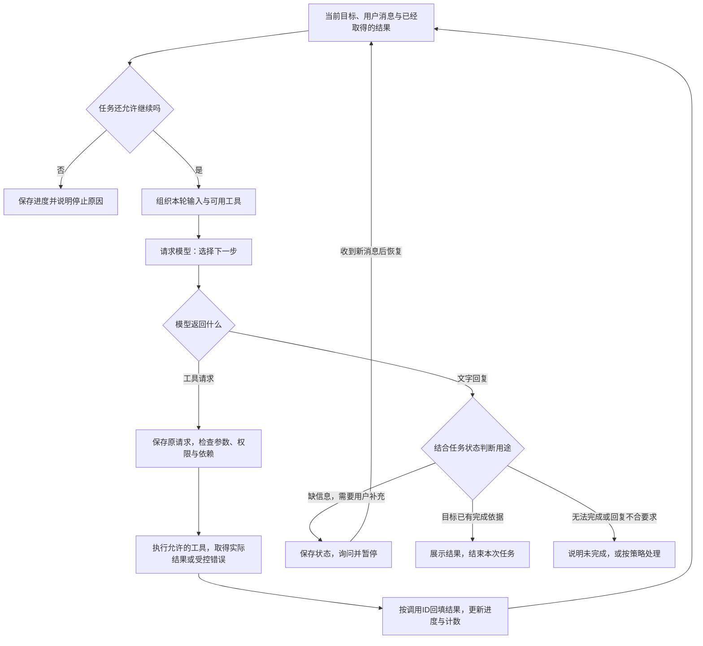
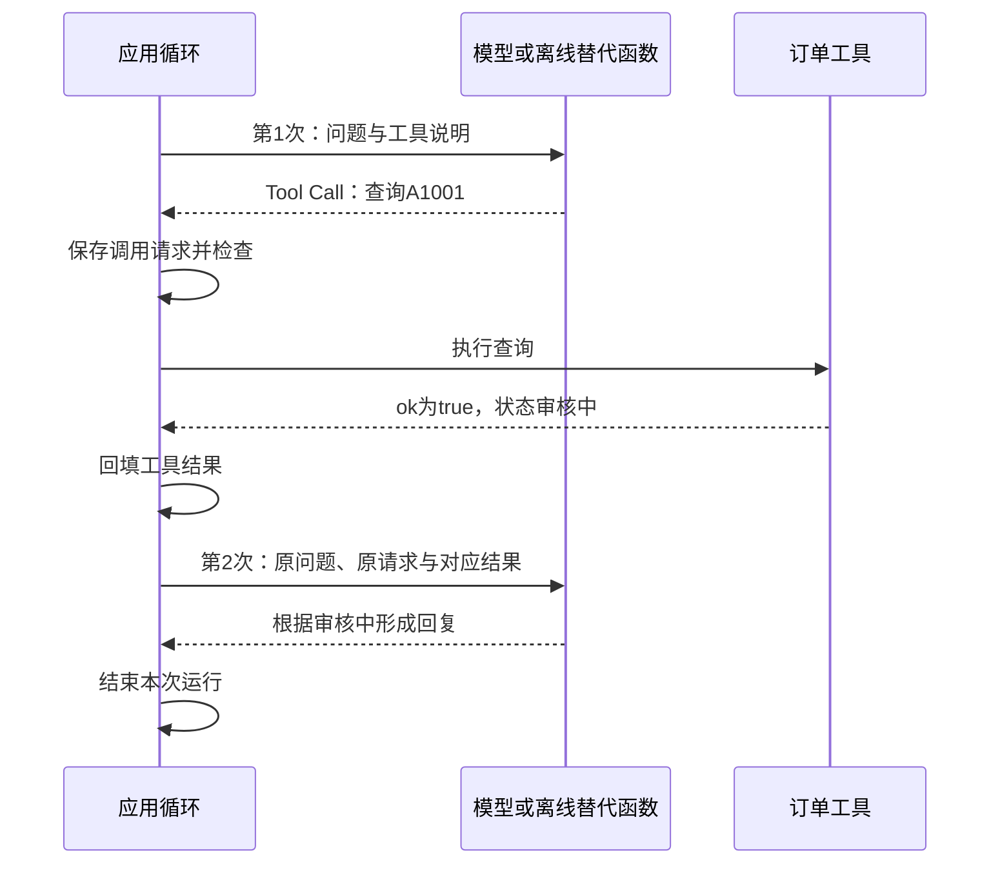
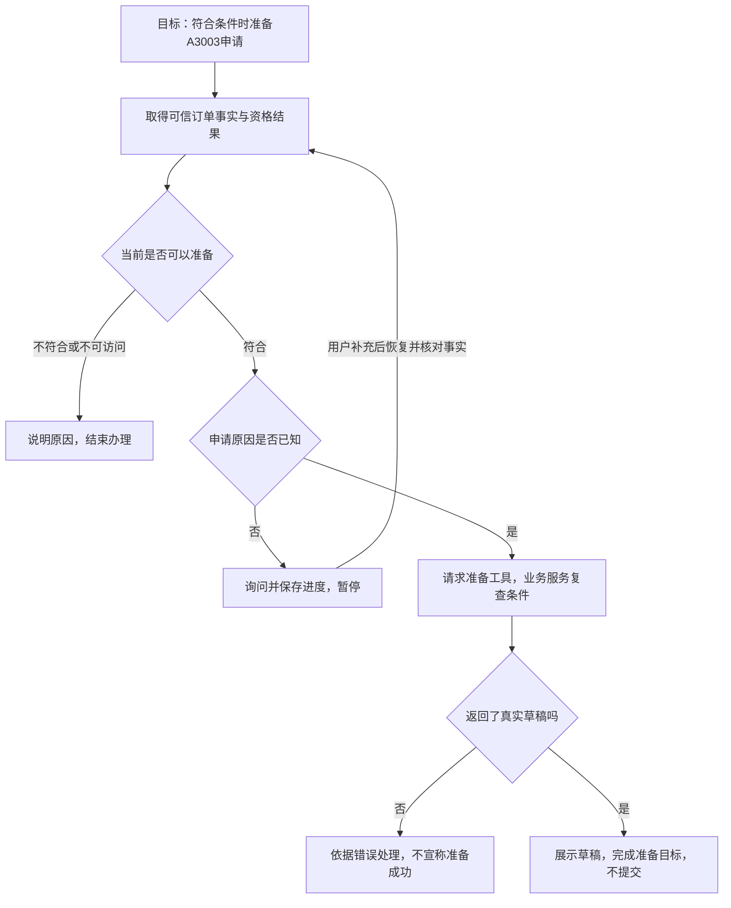
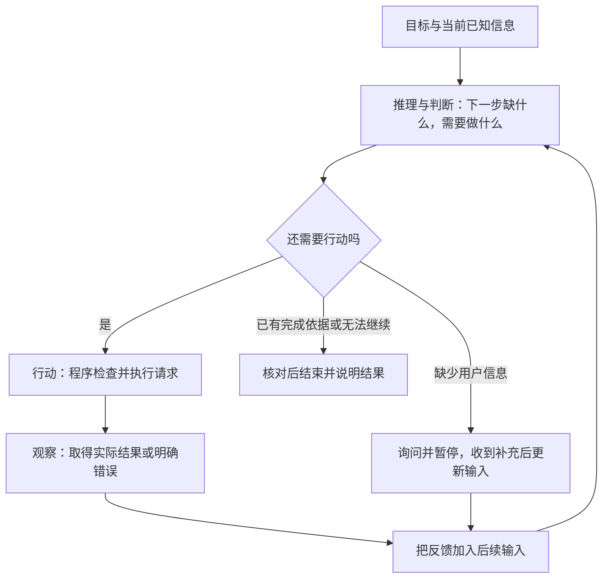
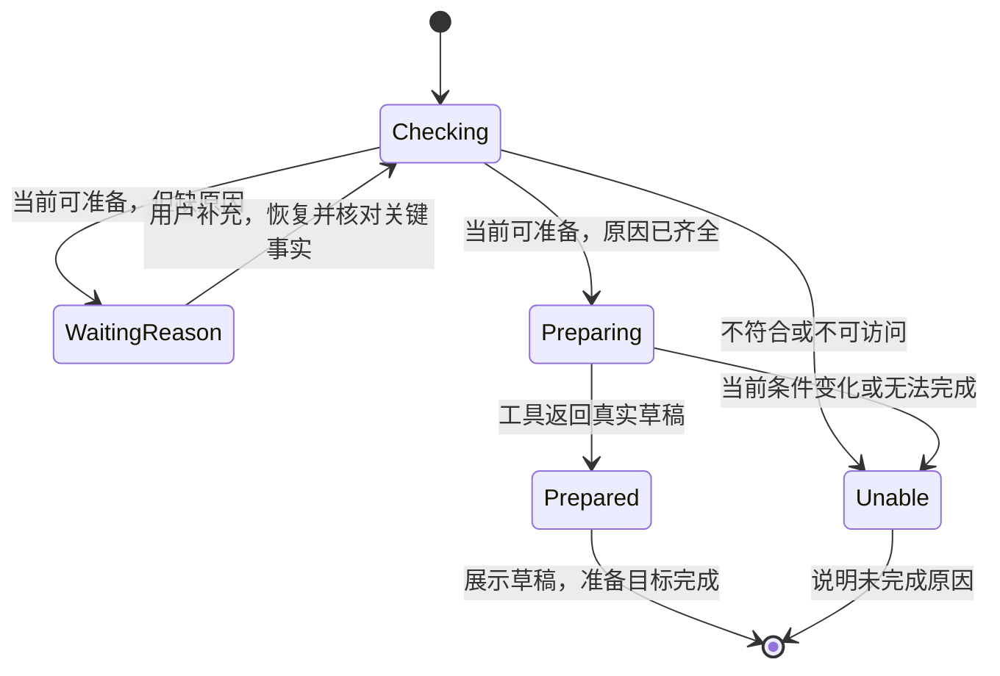

# 大模型应用开发学习 17：Agent 入门：让模型自己规划并使用工具

用户说：“帮我看看A3003能不能退，能退的话先准备一份申请。”

要完成这句话，不能只生成一段退货建议。应用需要取得订单事实，判断条件是否满足；原因没给全时询问用户；得到补充后再准备草稿；草稿真正生成以后，停在“准备完成”，不能顺手提交。

这里最关键的问题是：**第一步执行以后，谁根据结果决定第二步？第二步又怎样接着执行？**如果每次都让用户重新安排，助手只是一次次被动调用工具；如果应用能围绕目标持续组织“选择、执行、读取反馈、再选择”，才形成了本篇要理解的Agent执行过程。

> **配套代码：**[第17章循环观察示例](https://github.com/benx92/ai-learning-notes/tree/main/examples/17-agent)。**建议配合正文观察每轮输入和输出**：`trace_loop.py`直接复用[查询脚本](https://github.com/benx92/ai-learning-notes/blob/main/examples/15-tool-calling/tool_demo.py)的执行循环，默认用固定离线响应，不需要API Key。先用A1001看清最小循环，再用A3003推演更长的任务；两笔订单分别用于已有状态查询和新申请准备。

| 本篇要讲清的问题 | 读完应当能够解释什么 |
| --- | --- |
| Agent是什么 | 模型能力怎样被程序组织成持续处理任务的应用 |
| 一轮循环在做什么 | 模型接收什么，程序执行什么，结果怎样交回 |
| 为什么不是重复问同一句话 | 新取得的事实怎样改变下一轮输入与选择 |
| 多步任务怎样继续 | 计划、消息、任务状态和业务记录怎样配合 |
| 怎样停止 | 区分完成、等待用户、无法继续与预算耗尽 |

## Agent是什么，新增的能力由谁提供

**Agent（智能体）不是一种必须另行安装的聊天模型，而是一种应用组织方式。**在本篇的用法中，模型根据目标和当前反馈选择下一步，程序负责调用模型、执行工具、保存进度，并判断是否继续。

模型已有的语言理解、工具选择和结果解释能力，让它可以参与下一步判断；一次次调用与执行的循环，则由应用代码组织。模型不会因为提示里写了“请自动完成”，就在接口返回后继续操作电脑。

负责组织这些工作的一层程序，有时叫**运行时、执行器或Harness（驾驭层）**。名称可以不同，重要的是它承担哪些职责：准备输入、请求模型、检查动作、调用工具、回填结果、控制继续与停止。业务工具仍负责查询数据、核对规则和创建记录。

| 组成部分 | 本例负责什么 | 产物是什么 |
| --- | --- | --- |
| 目标与任务范围 | 说明用户要查询、准备还是提交 | 当前要完成的事及边界 |
| 模型 | 根据现有信息选择工具、填写参数或给出回复 | 下一步请求或文字回复 |
| 运行程序 | 调用模型、检查并执行、记录反馈、控制循环 | 任务持续推进的过程 |
| 业务工具 | 按权限读取订单、检查资格、准备草稿 | 实际事实、错误或业务记录 |
| 状态与消息 | 记住当前任务已取得什么、还缺什么 | 下一轮能够使用的输入 |

Function Calling让模型表达一次工具请求，MCP可以提供一种联系工具的方式。Agent在应用层把这些步骤组织成**围绕目标、根据反馈继续推进的过程**。它可以直接调用本地函数，也可以经MCP访问服务，并不要求必须采用某个框架。

“让模型自己规划”里的“自己”，指应用将部分下一步选择交给模型，并允许它在给定范围内继续处理。可用工具、用户身份、调用次数和业务权限仍由程序约束。模型可以提出动作，不等于程序必须执行。

**同一个输入框，怎样同时接住政策问题和查单问题？**

前面的[资料问答](13-RAG实战从文档到问答系统.md)已经能用问题找原文，[工具调用](15-FunctionCalling和ToolCall让模型从回答走向行动.md)已经能查订单。Agent要连接的是这些能力的使用过程：应用准备各项工具及其用途，把用户原话交给模型；模型请求某项能力，程序执行，把结果交回，再继续判断。不是用户先替系统挑好文件或工具。

以三个问题看同一入口的接入设计：

| 用户直接说什么 | 第一次需要取得什么 | 反馈到来后怎样继续 |
| --- | --- | --- |
| 会员退货期限是多少 | 用这个问题检索有效政策 | 阅读期限与例外；证据不足就说明缺口 |
| A1001退款到哪一步了 | 查询当前用户有权查看的订单状态 | 使用查询结果解释进度；无权访问时说明失败 |
| A1001的耳机收到十天且已拆封，能退吗 | 查询必要订单事实，再检索适用条款；顺序可随已有信息变化 | 对照期限、品类、例外与申请原因，必要时追问 |

第三行的一条可能轨迹是：先确认订单里确实是什么商品及签收时间；再用“耳机、拆封、退货条件”等信息查条款；如果质量问题和无理由退货适用不同规则，就追问申请原因。模型不应凭“收到十天”直接批准退货。这里不预设最终规则，也没有在示例库中补造耳机政策。

这张表是多能力应用的接入设计，尚未成为本篇一个已运行的混合Agent。本篇实际脚本继续用A1001观察执行循环，13篇的检索实现仍可单独运行。把能力装在同一入口，需要把检索也接成可调用工具，并分别验证选择、参数、证据和执行；不能只把两个脚本放在相邻目录。

下面的固定回复实验只检查“请求提出之后，执行和回填是否正确”。它故意不测试模型能否从任意说法选对工具。读实验前，先把这张表中应当随问题变化的选择，与后面保持稳定的执行循环分开。

## 先看循环全貌：决定、执行、反馈怎样接上

先不展开退货规则，把一轮拆开看。**本篇把一次“准备模型输入并请求下一步”作为一轮的起点**；这一轮若有工具请求，就在执行并回填结果后进入下一轮，若无需继续工具调用，则交由应用判断是否结束或等待。



图中最重要的是**工具结果返回输入端的那条线**。模型在本轮提出“去查订单”，下一轮要能看到查询究竟返回了什么，才有依据决定继续、追问或停止。

每轮的核心可以用四个问题来理解：

| 问题 | 谁回答 | 本例中的含义 |
| --- | --- | --- |
| 现在知道什么，还缺什么 | 模型结合应用提供的输入判断 | 尚未查过订单，或已经知道条件但缺申请原因 |
| 下一步请求做什么 | 模型提出；应用决定是否允许 | 查询订单、准备草稿，或先追问 |
| 这一步实际发生了什么 | 工具和业务系统返回 | 查到记录、拒绝访问、创建草稿或执行失败 |
| 这个结果怎样影响后续 | 应用记录后交给模型 | 更新下一轮依据，再决定是否继续 |

**下一轮不是把原问题原封不动再问一次。**原目标保留，新结果加入，当前工具与任务范围也可能调整。如果输入里始终只有“帮我处理A3003”，模型可能反复请求同一查询，因为它根本看不到查询已经完成。

消息回填没有重新训练模型，也不是给模型增加永久记忆。它是在下一次请求时，把已经发生的事重新作为上下文交给模型。循环能否连续，依靠程序正确保存并传递这些信息。

还有三种“轮”不要混淆：

| 层次 | 在发生什么 | 本篇讨论什么 |
| --- | --- | --- |
| 模型生成内部 | 一次请求中逐步生成Token | 本篇不展开模型内部算法 |
| 应用执行循环 | 多次模型请求与工具执行交替 | 这是本篇主线 |
| 用户对话轮次 | 用户补充信息后，应用继续任务 | 涉及暂停与恢复，可能跨多次运行 |

用户只发了一条消息，应用内部就可能请求模型多次。模型请求了三次，也不等于用户进行了三轮对话，更不等于执行了三次工具。

## 从A1001看清两次模型调用，输入究竟变了什么

先观察最短路径：“查一下订单A1001的退款状态”。它已经有可运行的查询函数，适合把注意力集中在循环本身。

配套离线规则第一次生成查询请求，业务函数实际读取虚构订单，下一次再根据工具结果生成回复。这里没有在线模型推理，但输入、执行和回填经过的程序是真实运行的。

| 时刻 | 交给模型或替代函数的信息 | 返回什么 | 应用接下来做什么 |
| --- | --- | --- | --- |
| 第一次调用前 | 回答要求、用户问题、可用查询工具；尚无查询结果 | 请求查询A1001 | 保存请求，检查并执行查询 |
| 工具执行后 | 应用取得A1001“审核中” | 工具结果，不是模型回复 | 以对应调用ID写入消息 |
| 第二次调用前 | 原有问题，加上查询请求和工具结果 | 依据“审核中”组织回答 | 没有新工具请求，结束本次运行 |

两次调用之间没有新的用户消息，变化来自**应用取得的外部反馈**。如果没有把工具结果加入输入，第二次模型调用仍然不知道“审核中”。



消息历史怎样变化，也值得单独看一次：

| 阶段 | 按顺序保存的角色 | 新增信息 |
| --- | --- | --- |
| 第一次请求前 | `system`、`user` | 回答策略与用户问题 |
| 第二次请求前 | `system`、`user`、`assistant`、`tool` | 模型调用请求、对应的工具结果 |
| 本次运行结束后 | 再追加一个`assistant` | 最终文字回复 |

这里带工具请求的`assistant`消息也必须保留。它说明模型之前请求了什么，后面的`tool`消息通过`tool_call_id`与它配对。只留下结果、不保留原调用，或者把结果配到另一条请求上，都破坏了这次交接。

这条路径用了**2次模型或替代函数调用、1次工具执行**。应用不是在第二次再查询一遍，而是在第二次让模型读取已有结果。

但不要把这两次当成固定公式。如果第一次发现缺订单号，可以直接询问，不执行工具；如果还需要别的资料，第二次也可以再请求工具；如果结果是无权访问，第二次应解释失败。循环是同一套组织机制，具体经过几次由结果与运行策略共同决定。

## 从一次查询扩展到A3003，计划怎样随着反馈变化

现在回到更长的目标：“检查A3003，符合条件时先准备申请”。A1001演示读已有状态，A3003演示创建新草稿，不能把两笔订单的状态混用。

这个目标在开始时并不具备全部输入。除了订单号，还需要可信订单事实、资格判断和申请原因。下面按轮次推演一条可能路径。

**这一段是多步Agent的设计示意。**现有`ReturnService`已经实现资格检查和草稿业务，但没有把订单详情查询、追问、恢复与准备接成完整在线Agent。下表中的详情或资格查询入口需要按设计接入，不能把假设返回当成现有脚本日志。

| 阶段 | 本轮开始时知道什么 | 选择的下一步 | 实际反馈怎样改变后续 |
| --- | --- | --- | --- |
| 第1次判断 | 用户只要求检查并准备；订单号A3003；原因未知 | 请求有权限的详情或资格查询 | 得知会员、非定制、签收10天、尚未申请；当前规则允许准备 |
| 第2次判断 | 资格符合，但准备草稿还需要原因 | 询问退货原因 | 应用保存任务并暂停，等待用户 |
| 用户补充后恢复 | 同一任务收到“尺寸不合适”，必要事实已重新核对 | 请求准备A3003草稿 | 工具再次检查条件并返回真实草稿编号 |
| 下一次判断 | 草稿已经存在，内容符合要求，用户没有要求提交 | 展示草稿与尚未提交状态 | 当前准备目标完成，停止 |

这里有三处必须讲清。

**第一，下一步需要什么数据，决定了当前要调用什么工具。**只返回“审核中”的退款状态查询，不足以判断一笔未申请订单的资格。应用需要有能提供相应事实或受控资格结论的工具，模型不能靠换一个工具名称补出数据。

**第二，资格判断中的确定规则仍由业务程序执行。**教学规则是会员15日、普通订单7日、定制商品例外。A3003是会员、签收10天且非定制，符合当前示例条件；准备工具还要自己复查，模型引用一段政策不能代替后端检查。

**第三，每个结果都可能改变路线。**如果查到A3004是普通订单、签收10天，就应说明超过7日期限，而不是继续问申请原因；如果A3005是定制商品，就按例外处理；如果订单不可访问，就停止办理。不能因为最初计划写了“然后准备”，就忽略中途反馈。



**计划是根据当前信息提出的安排，工具结果才是环境反馈。**有的Agent先生成一份简短计划，有的每次读完结果再选择一步；不必先输出长篇计划才算Agent。对本例有用的安排是：“取得资格依据，缺原因时询问，准备成功后停止。”

**为什么要把判断、行动与反馈交替进行？**

如果只让模型分析“这笔订单能不能退”，没有取得订单事实，它可能围绕不完整的信息推断很久。如果只按预先列好的动作连续执行，又可能在查询已经返回“不符合条件”以后，仍然继续准备草稿。前一种缺少外部依据，后一种没有让反馈改变动作。

更有用的做法是：先判断当前缺口，采取一个能够补上缺口的行动，读取真实结果，再决定下一步。**这类把推理与行动交替组织的方法，叫ReAct。**名字将**Reasoning（推理）**与**Acting（行动）**结合起来，强调判断帮助选择行动，行动带回的信息又帮助修正判断。

ReAct最初作为一种语言模型方法被研究：通过交替生成推理与任务动作，并利用环境反馈推进任务。[原论文与示例](https://react-lm.github.io/)给出了这种组织方式；这里不需要先阅读论文，也可以用售后例子理解它的核心。

| 环节 | 白话含义 | 在A3003任务里做什么 | 由哪里取得 |
| --- | --- | --- | --- |
| **Reasoning：推理与判断** | 根据已知信息，判断当前还缺什么、下一步为什么需要它 | 还不知道订单资格，需要查询 | 模型结合当前目标与上下文判断 |
| **Action：行动** | 提出能取得信息或推进任务的操作 | 请求查询A3003的详情或资格 | 模型提出请求，程序检查后执行 |
| **Observation：观察结果** | 读取外部操作实际返回的反馈 | 会员、非定制、签收10天，当前符合准备条件 | 业务工具返回，程序交回模型 |
| **下一次判断** | 用新结果重新判断，而不是继续原先的猜测 | 资格已确认，但原因还缺，需要询问用户 | 根据更新后的输入继续处理 |

“观察”在这里不特指看图片，也不是让模型猜测“刚才应该成功了”。**它指本轮从工具或环境取得的新反馈，成功结果、明确拒绝和错误都可以成为观察信息。**

把它画出来，关键仍然是那条返回判断环节的线：



沿着当前例子再走一次：先不知道资格，因此查询；查询确认符合条件后，不再重复问“能不能退”，而是发现申请原因仍然缺失；用户补充原因后，再安排准备；工具返回草稿，才有依据说明准备完成。用户补充属于新的输入，应用按用户消息保存，不需要把它伪装成工具结果。

如果第一步反馈换成“不符合条件”，后续就变成解释原因、停止准备。这就是反馈参与下一步决策的意义，**并不保证模型每次都选对行动或理解对结果**，仍需程序检查和结果核验。

**ReAct与Agent、工具调用是什么关系？**Agent是围绕目标处理任务的应用；ReAct是一种组织推理、行动与反馈的方法；Tool Call是其中可以用来表达具体行动请求的形式。采用ReAct思路的Agent可以用工具调用完成行动，但不是所有工具循环都等于完整实现了ReAct，也不是每个Agent都必须采用它。

在原始ReAct示例中，会看到`Thought`、`Action`、`Observation`等文字标签，分别用于表达推理、行动和反馈。它们是示范轨迹的一种写法，**不是每个模型接口都要求填写的三个固定字段**。本篇的聊天接口仍以`tool_calls`表达操作，以工具结果消息交回反馈；实际程序可以记录必要的动作依据与结果，不要求模型公开完整内部思考。

配套`trace_loop.py`用固定离线响应观察执行与消息回填，**没有执行真实模型的ReAct推理，也没有新增一个ReAct框架**。这里补充ReAct，是为了说明前面的反馈循环可以怎样组织判断与行动，而不是再引入一套必须安装的组件。

## 暂停以后怎样接上：消息、任务状态与业务记录

模型问“退货原因是什么”，用户稍后只回复“尺寸不合适”。这四个字没有订单号，应用却需要知道它是在补充A3003当前准备任务的原因。

因此，**暂停是把继续处理所需的信息保存下来，等新输入到来再恢复，不是让模型请求一直挂着等人。**用户等待可能持续几分钟或几天，不能靠反复请求模型“用户回复了吗”来推进。

至少要区分三类记录：

| 记录 | 用来回答什么问题 | 本例保存什么 |
| --- | --- | --- |
| 对话消息 | 模型这一轮需要知道哪些交流与反馈 | 用户目标、查询请求、工具结果、追问与补充 |
| 任务状态 | 程序现在正在办哪件事、卡在哪里 | 订单号、当前阶段、缺少的原因、已用预算 |
| 业务记录 | 现实中到底产生了什么结果 | 草稿内容、编号、确认与申请记录 |

消息里有“准备好了”，不能代替业务系统中的草稿。程序有一个`phase`字段，也不能靠模型随意填写就证明任务完成。

等待原因时，任务状态可以设计成下面这样。字段是教学设计，不是模型接口自动返回的标准格式：

<!-- example-kind: illustration -->

```json
{
  "goal": "检查A3003，符合条件时准备申请，不提交",
  "order_id": "A3003",
  "phase": "waiting_for_reason",
  "facts": {"member": true, "days": 10, "custom": false},
  "reason": null,
  "draft_id": null
}
```

`phase`说明当前等待什么；`reason`在取得有效用户补充后填写；`draft_id`只有在工具真实准备成功后保存。订单事实来自受信任业务接口，用户身份来自登录状态，都不能因为模型写了一段计划就被改写。

恢复时，应用先找到正确用户的正确任务，保存补充信息，再决定哪些事实需要重新查询。例如过了几天，签收天数、订单是否已申请都可能变化，不能一直沿用旧的“10天”。实际状态还应保存事实来源和查询时间，并按业务规则更新。



这张图表示允许的任务阶段变化，不是每个箭头都要请求一次模型。应用可以直接执行确定的检查。它也没有从`Prepared`自动走到提交：用户只要求准备，补充原因不等于确认提交。

恢复还要保留已经发生的关键动作和累计预算。否则重启一次就重新获得全部调用额度，或者忘了草稿已经生成又准备一次，都可能造成重复处理。内存可以支撑同一次运行，跨进程继续则需要持久化、正确任务关联与必要的并发控制。

## 对照代码：是哪几行让结果进入下一轮

理解流程后，再看已有的`tool_demo.py`。本篇复用其中的`run()`，而不是为了讲Agent再引入一套框架API。

**第一处是再次请求模型。**下面摘自`run()`，`messages`包含当前已保留的交流与工具结果：

<!-- example-source: examples/15-tool-calling/tool_demo.py -->

```python
for round_number in range(max_tool_rounds + 1):
    choice = "none" if round_number == max_tool_rounds else "auto"
    message = model_call(messages, choice)
    calls = message.get("tool_calls") or []
```

`model_call()`执行一次模型请求；离线模式则调用替代函数。`calls`取出这轮的工具请求。没有请求时，已有代码检查回复文本并结束本次运行；有请求时，继续检查调用结构和预算。

`max_tool_rounds`默认是3，最后额外允许一次禁用工具的请求用于收尾。`auto`允许模型选择是否请求工具，`none`表示不允许再请求工具。这是本脚本的策略，不是Agent都必须固定采用的次数。

**第二处是保存请求、执行与回填。**前面的校验通过以后，实际代码是：

<!-- example-source: examples/15-tool-calling/tool_demo.py -->

```python
messages.append({
    "role": "assistant",
    "content": message.get("content"),
    "tool_calls": calls,
})
for call in calls:
    result = execute_tool(call, current_user)
    messages.append({
        "role": "tool",
        "tool_call_id": call["id"],
        "content": json.dumps(result, ensure_ascii=False),
    })
```

`messages.append()`先保留模型的请求；`execute_tool()`检查参数并安排业务查询；后一个`append()`把结果与原调用ID一起保存。外层`for`进入下一轮时，传给`model_call()`的就是**已经增加了结果的同一份消息历史**。

这就是从“做过一次工具调用”走向“根据反馈继续执行”的代码连接点。循环不是重新创建一份只含最初问题的输入，也不是只在终端打印结果。

**观察每轮输入。**在`examples/17-agent`目录，使用Python 3.10或更新版本运行：

```powershell
python trace_loop.py
```

这个观察脚本给已有`run()`传入一个记录输入输出的替代函数；业务查询仍由原来的执行器完成。默认结果应包含：

```text
模型调用1的输入角色：system, user
模型调用2的输入角色：system, user, assistant, tool
本轮没有工具请求，返回文字回复
模型调用：2；工具执行：1
```

两行输入角色正好对应本篇前面的消息表。脚本还会打印工具名称、参数与最终回复，输出不只包含上面这几行。

需要逐字段对照时运行`python trace_loop.py --json`，它会输出每次调用前的独立快照；后续追加消息，不会把前一轮快照也变成最后的历史。这些记录的“模型调用次数”是固定替代函数的调用次数，不是付费API请求。

再观察两个分支：

```powershell
python trace_loop.py "查一下退款状态"
python trace_loop.py "查一下订单A2002的退款状态"
```

| 输入 | 调用次数与结果 | 说明什么 |
| --- | --- | --- |
| 缺订单号 | 1次替代函数调用、0次工具执行，返回询问 | 当前运行停止在补信息，脚本没有实现跨轮恢复 |
| A2002 | 2次替代函数调用、1次工具执行，返回不可访问 | 失败结果同样回填，结束不等于业务成功 |

这些实验验证循环控制与消息变化，不验证真实模型理解用户问法的效果。A3003的完整准备Agent仍属于设计示意；已经实现的独立草稿服务在`return_demo.py`，不能把业务工具测试当成在线Agent已经跑通。

## 循环怎样停：完成、等待、失败与预算要分清

如果没有明确停止条件，循环可能一直查同一笔订单，或者在草稿准备好后继续做用户没要求的事。**停止条件是循环定义的一部分，不能等程序跑起来以后再补。**

| 当前结果 | 应怎样处理 | 为什么不能继续原样循环 |
| --- | --- | --- |
| 缺订单号或原因 | 保存进度，询问用户并暂停 | 下一次输入需要新信息，重复请求得不到它 |
| 已有符合目标的真实草稿 | 展示草稿，完成准备任务 | 当前目标不包含提交 |
| 无权访问或明确不符合条件 | 说明原因，结束办理 | 重试不能消除权限或业务限制 |
| 查询暂时超时 | 按受控策略重试或说明暂不可判断 | 不能把超时当成查到了，也不能无限重试 |
| 用户取消 | 停止后续动作，记录已完成部分 | 取消不会自动撤销已经发生的操作 |
| 次数、时间或费用上限已到 | 保存进度，说明尚未完成 | 必须保留执行边界 |

**模型不再请求工具，只代表它这一轮没有继续提出工具动作。**它可能在追问、解释失败，也可能误以为完成。应用要结合任务状态与业务证据，才能判断应该标记完成、等待还是失败。

输出一段普通文字与业务成功，是两个不同判断。已有查询脚本在没有工具请求时会返回文字，因此既可能返回“审核中”，也可能返回“请提供订单号”；更完整的Agent还要为这类结束提供明确的任务状态。

预算也不能只用一个模糊的“最多循环几次”概括：

| 限制 | 数的是什么 | 不能替代什么 |
| --- | --- | --- |
| 模型请求次数 | 向模型请求下一步的次数 | 一次响应可能包含多个工具请求 |
| 工具执行次数 | 程序实际处理的调用数量 | 次数少也可能单次耗时很长 |
| 单次超时与整体时限 | 一次调用及整项任务能等待多久 | 不能只靠次数限制等待时间 |
| Token或费用预算 | 模型调用消耗 | 不等于工具运行时间 |

例如设计上允许4次模型请求、6次工具执行，第一次响应就提出3个工具请求，也只消耗1次模型请求额度。达到上限时即使没有完成目标，也需要明确停止，不能把“预算用完”包装成“任务成功”。这些数是示意，不是本例新增的通用预算实现。

还要防止没有进展的重复。相同参数反复查询同一份未变化的数据、因缺原因反复调用准备工具，都说明下一步没有补上真正的缺口。可以根据实际任务识别重复、要求新信息或停止；但查询长任务状态等场景可能需要受控轮询，不能只看到重复名称就一律判错。

结果未知尤其需要谨慎：请求超时，不一定表示后端没有创建记录。应先核对实际结果，再决定重试；相同业务动作需要防重复。详细的执行前检查可以独立展开，本篇先把它们放回循环里：它们决定这一轮是否执行，以及怎样把结果交给下一轮。

## 有循环就算Agent吗，什么时候直接写固定流程

普通工作流也可以有`for`、`while`、重试和条件分支。**区别不在代码中有没有循环，而在于步骤与路线由谁决定。**

| 组织方式 | 谁决定处理路线 | 对售后问题的处理 |
| --- | --- | --- |
| 固定流程Workflow | 开发者预先写好顺序和分支 | 查订单，按明确规则判断，缺字段走固定补齐入口 |
| Agent循环 | 模型根据当前目标和反馈参与选择下一步，程序约束并执行 | 在允许工具中选择查询、补资料、追问或结束 |
| 混合方式 | 模型处理灵活需求，程序固定关键业务步骤 | 理解目标与补信息较灵活，资格检查和提交顺序确定 |

循环本身是必要的组织机制之一，不是“智能”的证明。若模型只是机械重复一个固定动作，增加往返并不会让系统更有价值；如果任务只需要按已知订单号查一次状态，直接调用工具也可以满足需求。

当下一步确实依赖新取得的信息、用户表达变化较多时，模型参与选择才有价值。工具说明告诉模型每个入口能做什么，系统提示说明当前策略，例如“缺原因先问，用户只要求准备时不提交”；执行程序和业务服务保证具体动作符合条件。

对本例来说，资格计算适合由程序稳定完成，不必每个字段都再问一次模型。模型可以选择取得资格结果，发现原因缺失后追问，再安排准备并解释结果。灵活选择与确定规则不冲突。

这种组织也有成本。假设一次模型响应2秒、一次工具查询0.3秒，一条串行路径有3次模型响应与2次查询，单这些步骤就约6.6秒，还没算人工等待。这是估算示意，不是本项目实测。减少没有价值的模型往返，比单纯要求模型“快点想”更直接。

## 回到用户目标，怎样确认循环确实推进了任务

一段流畅回答不足以说明任务做对了。需要按时间查看执行轨迹，常称为**Trace**：每次输入包含什么，请求了哪个工具，工具返回什么，状态怎样变化，以及为什么继续或停止。

| 检查位置 | A3003准备任务应该能看见什么 |
| --- | --- |
| 起始目标 | 用户只要求检查并准备，没有要求提交 |
| 事实来源 | 有权访问的订单信息与适用规则，不是模型猜测 |
| 每轮交接 | 取得的新结果进入下一轮，而非重复最初问题 |
| 暂停位置 | 缺原因时询问，恢复时关联到同一用户和任务 |
| 完成依据 | 工具确实返回草稿，内容与订单、原因对应 |
| 停止位置 | 展示尚未提交的草稿，准备目标结束 |

再换成不符合条件、无权访问或工具失败的情况，路线也应随事实变化。模型选对工具、执行器正确检查、业务记录真实产生、最终回答准确覆盖目标，是几项分别需要核验的结果。

日志可以记录工具名、必要参数、调用ID、受控结果、耗时与状态变化，不需要保存模型完整内部思考，也不要把访问凭证等敏感信息一并输出。

本篇的离线轨迹可以验证A1001循环的输入变化和执行结果；更长的A3003任务仍需按上面的设计接入并验证。看懂最小循环，并不等于复杂Agent已经稳定完成全部路径。

回到开头那句“符合条件时先准备申请”：**模型根据当前信息提出下一步，程序检查并执行，工具反馈成为下一轮依据；缺信息时保存并暂停，有完成证据时停在用户要求的位置。**这条反馈循环，才把一次次模型调用组织成了可以持续推进的任务。

## 参考资料

- [Anthropic：工作流与Agent的组织区别](https://www.anthropic.com/research/building-effective-agents)
- [ReAct：推理与行动交替的研究](https://react-lm.github.io/)
