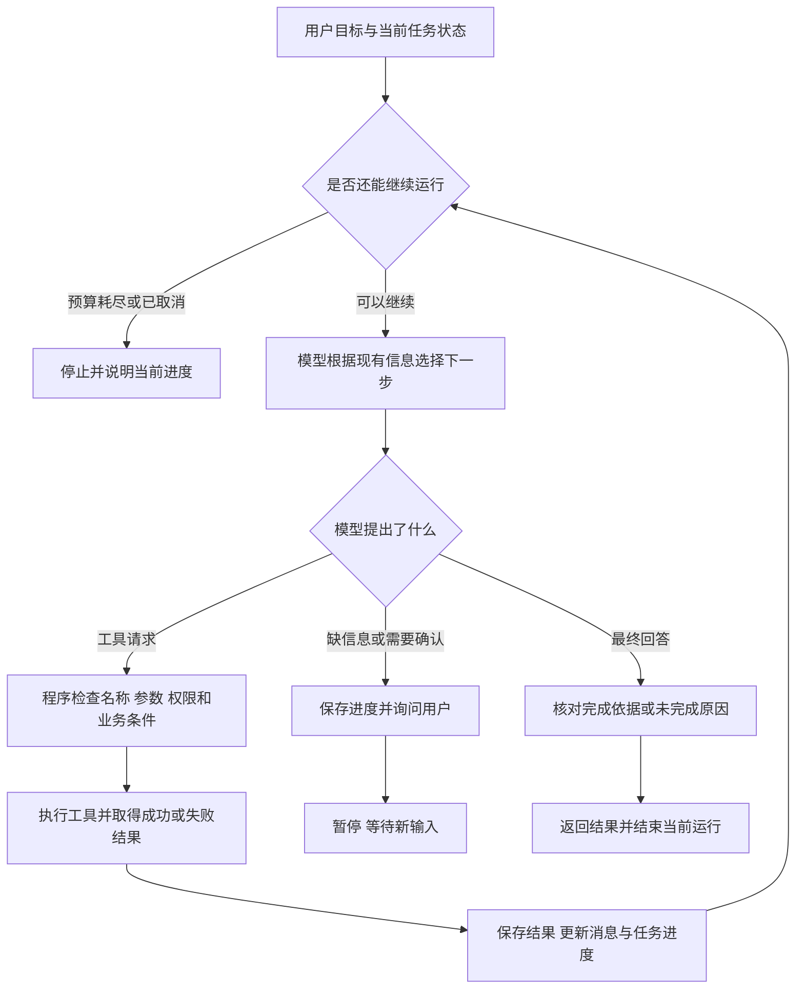

# 大模型应用开发学习 17：Agent 入门：让模型自己规划并使用工具

用户说：“帮我看看A3003能不能退，能的话先准备一下申请。”这句话没有告诉程序具体要调用哪些工具，却给出了一个需要连续处理的目标。

程序要先查订单、核对规则，缺少申请原因时询问用户，信息齐全后再准备草稿。订单属于别人，或者不符合规则，处理路径又会改变。

难点不只是“会不会调用工具”，而是取得一个结果以后，怎样决定下一步。查到了就继续，缺信息就询问，目标已经完成就结束——应用需要把这些选择组织起来。

让模型根据目标和已经取得的结果，持续选择下一步，再由程序检查和执行，这样组织起来的应用，通常称为 **Agent，智能体**。

这里的“自己规划”，指模型根据当前结果选择步骤；程序仍负责检查、执行和保存进度。沿着这笔订单看下去，Agent的规划、状态和执行循环就能对应到具体的办事过程。

| 本篇要看清的环节 | 用大白话说，就是 |
| --- | --- |
| Agent的含义 | 怎样让应用根据当前结果决定下一步 |
| 与已有概念的关系 | RAG、工具调用、MCP分别在什么位置 |
| 多步任务 | 用户一句话怎样拆成可以检查的几件事 |
| 任务状态 | 程序怎样知道做过什么，还缺什么 |
| 规划与调整 | 为什么计划会随着工具结果变化 |
| 执行循环 | 怎样反复判断、执行、接收结果 |
| 暂停与结束 | 什么情况要追问、确认、结束或交给人 |
| 检查质量 | 怎样证明办成了，而不只是回答得好听 |

## 从一次工具调用，到围绕目标继续办事

先比较三个看起来相似的应用。

第一种，用户问“会员订单的退货期限是多少”，程序把问题交给模型，模型返回一段回答。如果需要自己的资料，可以先检索政策，再让模型回答。

第二种，用户问“查一下A1001的退款状态”，模型生成查询请求，程序执行，再把“审核中”的结果交回模型。这个过程已经有工具调用，也有结果反馈。

第三种，用户说“看看A3003能不能退，能的话准备申请”。应用可能需要先查订单，再找适用政策，再根据结果决定是准备草稿、解释不符合条件，还是问用户补充信息。事先不能把每个分支都当作一定会发生。

这篇重点讨论第三种：**应用围绕一个目标，根据已经发生的事情，继续决定下一步。**

Agent并没有一个所有人都完全一致的定义。有的产品把任何会调用工具的助手都叫Agent，有的则强调模型能根据环境反馈调整执行过程。入门时不必靠名字判断能力，先看模型究竟能决定哪些步骤，以及程序怎样约束和检查它。[关于工作流与Agent的区别](https://www.anthropic.com/engineering/building-effective-agents)

**工具调用的往返，本身就包含了这个循环的起点。**

模型提出工具请求，程序执行，结果进入消息历史，模型再根据新结果判断。这不是到了Agent才突然出现的新机制。现在要补充的是：让这套机制服务一个明确目标，并记录进度、处理暂停、判断完成。

模型、检索、工具和运行程序，在任务中各有自己的位置：

| 已经认识的部分 | 在这个任务里做什么 |
| --- | --- |
| 大模型 | 理解目标，提出下一步，解释取得的结果 |
| RAG | 从制度资料中找到相关条款和来源 |
| Function Calling / Tool Call | 用明确格式表达“调用哪个工具、带什么参数” |
| MCP | 帮应用发现外部能力、传递调用和读取资料 |
| 业务工具 | 查询订单、检查资格、准备或提交申请 |
| 组织任务的程序 | 维护进度、检查调用、安排执行、暂停与结束 |

Agent是把这些部分组织成办事过程的一种方式。它不要求每次都使用RAG或MCP：工具可以直接写在本地，任务也可能完全不需要文档检索。反过来，有RAG或接上MCP，也不代表应用已经能够独立完成复杂任务。

**模型负责选择，不代表程序放弃控制。**

模型可以建议“下一步准备申请”，程序仍要确认订单是否属于当前用户、是否符合规则、必需字段是否齐全。对于明确的业务条件，尤其是期限、归属和重复申请检查，应由可靠的程序落实。

实际开发中，把负责模型调用、工具执行、消息维护和运行控制的这一层程序称为 **Harness**，可以理解成“组织并约束整个办事过程的运行程序”。先知道它负责什么即可，不需要再记一个神秘组件。

## 跟着一笔订单，看下一步为什么会改变

继续沿用虚构售后政策：会员订单签收后15日内可以申请无理由退货，普通订单为7日，定制商品不支持无理由退货。这些是教学规则，申请提交以后仍可能需要审核，不能直接等同于退款到账。

这里用两笔订单区分任务：A1001用于查已有申请的状态；A3003用于准备一份新申请。假设订单系统确认A3003属于当前演示用户，是会员订单、非定制商品、签收10天，尚未申请。

用户这次说：

```text
帮我看看A3003能不能退，能的话先准备一下申请。
```

这里其实包含两个目标：“判断是否符合教学规则”和“符合时准备草稿”。“先准备”没有授权提交，申请原因也还没有提供。

一条合理的处理路径可以这样展开。表中按职责列出所需能力，实际接入时需要相应的查询与检查接口：

| 当前步骤 | 取得的结果 | 接下来怎样决定 |
| --- | --- | --- |
| 查询订单信息 | 当前用户的会员订单，非定制，签收10天 | 取得会员期限和商品例外，继续核对条件 |
| 读取适用政策并检查资格 | 教学期限为15日，当前满足条件，尚未申请 | 可以继续准备，但还缺申请原因 |
| 向用户询问原因 | 用户尚未回答 | 保存进度，暂停当前执行 |
| 用户补充“买错型号” | 原因齐全 | 重新核对需要更新的条件，准备草稿 |
| 草稿创建成功 | 返回草稿编号、内容和有效期 | 展示草稿，告知尚未提交 |

到最后一步，当前目标已经完成：确认符合教学条件，并准备了草稿。不能因为程序还有一个提交工具，就顺手把申请提交了。

注意，第一步需要的是包含客户类型、商品类型、签收时间等信息的订单查询。查询示例中的`get_refund_status`只返回退款状态，不能从“审核中”推导出这些字段。真正连接这条任务时，需要增加合适的订单信息接口，或者让已有业务服务提供这些数据。

**同一句需求，换一份查询结果，路径就要改变。**

| 查到的情况 | 应该怎样处理 | 不应继续做什么 |
| --- | --- | --- |
| A3004是普通订单，签收10天 | 说明超过教学规则的7日期限 | 不能为了满足用户而改用会员期限 |
| A3005是定制商品，申请无理由退货 | 说明当前教学规则不支持该申请类型 | 不能仅凭签收时间短就准备可提交草稿 |
| 订单不属于当前用户 | 返回无法访问的结果，停止这笔订单的处理 | 不能换其他方式继续读取对方信息 |
| 订单查询暂时失败 | 说明暂时无法判断，按限制重试或停止 | 不能根据用户描述冒充系统已核实 |
| 订单已有申请 | 说明已有记录，需要时转为查询其状态 | 不能重复创建一份新申请 |

这些变化解释了Agent的价值：模型不只是按预先写好的句子回应，而是要读到结果以后，再选择与当前情况相符的动作。

但它也说明，模型的灵活判断需要可靠事实支撑。用户说“我是会员”可以作为待核对信息；真正办理时，适用哪种规则仍应由业务数据确认。

## 任务状态：把“已经办到哪一步”保存在程序里

如果每次问模型，都只发送最初那句需求，却不告诉它工具查到了什么，模型就像每轮都接待一个新客户。它可能反复查同一笔订单，也可能忘记刚才还在等原因。

因此，程序要保存这次任务的进度。这些“当前知道什么、已经做过什么、还在等什么”的记录，统称为 **状态，State**。

状态不是模型脑子里的永久记忆，也不只是聊天文字。它可以分成几部分：

| 需要保存的内容 | 售后例子 | 由谁提供或更新 |
| --- | --- | --- |
| 用户目标与消息 | 判断资格，符合时准备草稿；用户补充原因 | 用户输入、程序维护的消息历史 |
| 当前任务进度 | 等待原因、草稿已准备、等待确认 | 应用根据实际步骤更新 |
| 已取得的事实 | 订单查询结果、适用政策及来源 | 查询工具、资料读取与核对结果 |
| 运行限制 | 已调用几次模型、花了多久、还有多少预算 | 运行程序统计 |
| 当前用户身份 | 从认证信息取得的用户标识 | 应用的登录与授权系统 |
| 业务记录 | 草稿、确认记录、申请编号 | 业务后端保存 |

下面用一份**任务状态设计**表示进度，字段可按应用需要调整：

```json
{
  "goal": "检查A3003的资格，符合时准备退货草稿",
  "order_id": "A3003",
  "phase": "waiting_for_reason",
  "known_facts": {
    "customer_type": "member",
    "product_type": "non_custom",
    "days_since_delivery": 10,
    "has_existing_application": false
  },
  "missing_fields": ["reason"],
  "draft_id": null,
  "model_calls_used": 2
}
```

`goal`记录要办什么，`phase`记录当前阶段，`known_facts`保存工具已经取得的事实，`missing_fields`列出还缺的信息。`null`表示尚未取得草稿编号，不能解释成已经准备成功。

这份简化示意还没有列出来源和查询时间。实际保存事实时，应能找到对应的工具结果或资料来源，知道它何时取得；临近提交时需要重新检查的条件，不能仅凭很久以前的快照判断。

**聊天记录与业务记录，各有用途。**

消息历史帮助模型理解“刚才问了什么、工具回了什么”。业务记录决定“草稿是否存在、谁确认过、申请是否已经创建”。

用户说“我确认过了”，只是新的一条消息。程序仍要查到针对具体草稿的确认记录，才能执行提交。模型在回答中写出一个申请编号，也不表示业务系统里真的有这份申请。

模型需要知道的信息可以由程序选择后放入上下文，但身份凭证、数据库连接等执行信息不需要一并发给模型。程序仍应从可信的运行环境取得当前用户，并在工具执行时使用。

**暂停后能够继续，也需要状态。**

用户今天补充原因，不应要求他从头再说订单号和目标。应用保存任务后，收到新消息时找到原任务，再继续处理。若草稿已经过期，或者订单情况改变，则要重新核对，不能机械地从上次停下的代码行继续。

把状态存在一个Python变量里，只能在当前进程还活着时使用。程序重启后还要继续，就需要可靠保存和恢复；这属于应用的状态管理能力，不是给模型加一句“请记住”就能完成。

## 规划不是先写一篇方案，而是不断选择合适的下一步

看到“规划”，容易想到模型先输出一长串步骤，再逐条照做。

对于售后任务，可以先有一个粗计划：查订单，核对政策，补齐信息，准备草稿。但刚开始还不知道订单属于谁、是否已有申请。把后面的提交、审核、退款全部写死，反而会让程序忽略实际结果。

更实用的办法是：保留目标和必要约束，每取得一个关键结果，就重新判断下一步。

```text
目标：符合条件时准备A3003的申请草稿

现在缺订单事实 → 查询订单
取得会员与商品信息 → 核对适用规则
资格符合，但缺原因 → 询问用户并暂停
原因齐全 → 准备草稿
草稿返回成功 → 展示草稿，结束“准备”任务
```

这叫根据反馈调整行动。查询成功以后，新增的信息缩小了下一步的选择范围；出现例外时，原来的计划也应随之改变。

**计划里有依赖关系，不能看到两个工具就同时执行。**

申请草稿需要订单信息与原因，就要等这些信息齐全。读取两个互不相关的资料，有时可以并行；“创建草稿”和“提交这个草稿”则有明确先后，还隔着用户确认。

是否允许并行，由程序和业务依赖决定，不能仅因为模型一次返回两个调用请求就一起执行。

**把判断、行动和反馈接起来，是理解ReAct的入口。**

研究中有一种常被提到的思路叫 **ReAct**，把推理与行动交替组织：根据当前信息判断需要做什么，执行动作，读取环境反馈，再继续处理。[ReAct论文与示例](https://react-lm.github.io/)

在本篇场景里，可以先理解为：

| 环节 | 具体含义 |
| --- | --- |
| 判断 | 当前缺签收时间，不能判断资格 |
| 行动 | 请求订单信息查询 |
| 反馈 | 查询返回会员订单、签收10天 |
| 再判断 | 现在可以核对会员期限，但还要考虑商品例外 |

这里的“判断”是为了说明决策依据，不表示必须要求模型输出完整的内部思考过程。应用更需要保存可核验的请求、参数、结果，以及简短的行动说明，例如“正在核对订单信息”。

模型写出的计划和理由，也不能代替事实。它说“已经核实资格”时，要能找到实际查询和检查结果；否则只是写了一句计划完成的描述。

**系统提示可以帮助模型理解办事策略。**

工具说明回答“这个工具怎样用”，系统提示则交代“面对这个任务，什么时候用、什么时候停”。例如，可以给售后助手这样的任务要求：

```text
根据当前用户的目标处理售后问题。
判断具体订单资格前，先取得有权限访问的订单信息和适用规则。
订单号或申请原因缺失时，询问用户，不猜测。
用户只要求准备时，准备草稿后展示内容，不提交。
工具返回失败时，如实说明，不编造订单事实或完成结果。
最终说明已完成什么、依据是什么、还在等待什么。
```

这段提示帮助模型选择行为，真正执行时的归属检查、确认检查和调用限制仍由程序落实。把“不得重复提交”写进提示，不会自动让业务接口具备防重复能力。

## 执行循环：每次取得结果，再决定是否继续

目标、事实与行动，需要由运行程序连在一起。

一次循环大致做四件事：把当前任务与结果交给模型，接收下一步请求，检查并执行工具，把结果保存下来。之后再判断是继续、暂停还是结束。



图里“模型选择下一步”和“程序检查执行”是两个不同位置。模型可能提出一个无效请求，程序要返回对应的失败结果，或者因严重错误停止；不能跳过检查直接执行。

下面用伪代码把责任放到一起。它省略了具体API消息格式、参数校验实现和存储方法，**不是可直接运行的Python脚本**：

```text
载入或创建任务，加入用户的新消息

只要任务尚可运行：
    检查取消状态、调用次数、时间与费用预算
    如果不能继续：
        保存当前进度，返回“尚未完成”及原因

    选择模型需要的事实、历史与工具说明
    请求模型决定下一步，计入本次调用次数

    如果收到工具请求：
        保存发起调用的模型消息
        逐个检查工具名称、参数、权限、依赖与业务条件
        执行允许的调用，记录拒绝或执行失败的结果
        按调用ID回填该轮各请求的对应结果
        根据实际结果更新任务状态
        继续循环

    如果收到询问或确认请求：
        记录缺什么信息、等待哪个草稿的确认
        保存任务，向用户展示问题，暂停当前运行

    如果收到最终回答：
        核对所声称的结果是否有实际依据
        保存“已完成、无法完成或仅完成部分”的状态
        返回回答，结束当前运行
```

这里有三个容易看漏的地方。

第一，**执行失败的结果也要交回来。**查询暂时不可用，模型才能据此说明暂时无法判断。失败后直接假装没有发生过调用，模型就缺少决定下一步所需的信息。

第二，**每一轮工具请求仍要按消息协议配对。**调用ID用于配对模型请求与工具结果，消息历史则让模型看见发生了什么。继续调用模型前，不能留下只有请求、没有对应结果的半轮记录。

第三，**“没有工具请求”不一定表示任务成功。**它可能是在问订单号，也可能是说明无法访问。聊天接口通常不会直接返回本伪代码里的全部任务状态；应用要设计暂停与完成的表达方式，并维护对应状态。涉及写入时，要以业务记录核对结果，不能仅靠解析模型一句“已经完成”。

**把循环对应到具体函数，就能看清各自的责任。**

工具调用示例中的 `model_call` 对应“问一次模型”，执行器对应“检查并调用工具”，`messages`对应模型下一轮能看到的消息历史。MCP桥接示例则把执行位置换成了外部服务。现在新增的关注点，是目标进度、跨轮暂停和完成检查，而不是重新发明一种工具请求格式。

框架也能封装其中一部分工作。例如LangChain的 `create_agent` 提供模型与工具之间的执行循环，输入和返回状态中可以包含消息历史。但框架并不知道你公司的订单规则、用户确认是否有效，或者什么才算申请提交成功，这些仍由应用设计。[LangChain Agent机制说明](https://docs.langchain.com/oss/python/langchain/agents)

此处只用它帮助对应已有认识，不引入新的安装环境与框架代码。看懂手动循环以后，阅读框架示例时就容易分清：哪些工作被封装了，哪些业务责任还在自己的程序里。

## 追问、确认与停止，都是正常的处理结果

Agent并不需要不停地执行才显得有用。遇到信息缺口时停下来，往往比继续猜更接近完成任务。

**追问，是补齐信息。**

用户只说“帮我退一下”，没有订单号，应用应询问处理哪笔订单。已经查到A3003、只缺原因时，则问“这笔订单申请退货的原因是什么”，不必把已核对的内容全部重新问一遍。

可以一次问清当前确实必需的字段，避免每轮只挤出一个小问题；但也不必让用户在第一次就填写与当前目标无关的所有信息。用户只想查状态，就不需要申请原因。

**确认，是授权一个具体动作。**

“原因是买错型号”补齐了申请内容，不等于同意提交。展示草稿时，要说清订单、原因和将执行的操作，再让用户确认这份草稿。

若用户只要求准备，展示草稿后便可以结束当前任务。若用户原先要求办理完整申请，应用可以在展示草稿后进入等待确认阶段。两种情况下都不能把“确认”省略成模型自己替用户点头。

用户确认以后，程序应绑定具体草稿，再检查归属、有效期和订单变化。草稿过期或内容修改了，就要按业务规则重新准备与确认。确认针对的是具体内容，而不只是一次会话。

**停止，还包括无法完成、部分完成和主动取消。**

| 当前结果 | 应当怎样记录与说明 |
| --- | --- |
| 草稿已准备，用户只要求准备 | 当前目标完成，展示草稿，明确尚未提交 |
| 缺订单号或原因 | 等待用户输入，说明还缺什么 |
| 等待用户确认 | 保存具体草稿，暂停，不让模型继续尝试提交 |
| 工具无法访问该订单 | 当前无法办理，说明限制，不泄露他人信息 |
| 多项需求只完成了一部分 | 分项说明已完成和未完成的内容 |
| 用户取消 | 停止安排新的动作，说明已发生的操作 |
| 运行预算耗尽 | 保存进度，说明因限制停止，不能宣称全部完成 |

用户取消也不会自动撤销已经发生的业务操作。如果请求已经发出、结果还不明确，要先查明原操作状态；需要撤销时使用对应业务流程，不能只把聊天里的任务状态改成“取消”。

**停止条件最好由程序明确控制。**

可以为一次运行设置最多模型调用次数、工具执行次数、总时长和费用预算。比如教学练习限制最多4次模型调用、6次工具执行；同一次模型响应可能提出多个工具请求，所以这两个数字不是一回事。

这些值只是示意，不是通用推荐。收到一轮多个请求时，程序要先检查剩余额度，不能每轮只判断一次就超量执行。达到限制以后，记录未完成部分；不要再无限调用模型，让它“再试最后一次”。

调用次数限制也不等于网络超时。一个调用卡住很久，轮数仍可能只计了一次，所以单次请求超时和整体运行期限都需要考虑。若有并行任务，还要考虑取消和收尾。

重复动作同样值得检查。连续几次查询同一订单，结果没有变化、也没有新信息时，应判断为何没有进展。对写入动作尤其不能盲目重试：提交响应丢失，不代表提交失败，先核对原申请，再决定下一步。

这里先把暂停与停止的意义立住。它们是执行循环的一部分，完整的权限控制、拦截与确认实现还需要专门设计。

## 判断质量，要看办事经过和实际结果

假设Agent最后回答：“已为你处理完成。”这句话可能非常流畅，但仍然无法判断它到底做了什么。

用户要求准备草稿，它可能根本没有调用工具；也可能创建了草稿却说成已提交；甚至可能查了A1001，却在回答里写A3003。

因此，检查质量时，需要看一次执行留下的记录。按时间排列的模型请求、工具调用和返回结果，可以称为 **执行轨迹，Trace**。

轨迹不等于模型的完整内部思考。实际排查更需要这些可核验内容：

| 记录什么 | 要回答的问题 |
| --- | --- |
| 用户目标与任务标识 | 这次究竟要完成什么 |
| 模型调用及请求单 | 实际选了哪个工具，参数是什么 |
| 工具调用ID与结果 | 这份结果对应哪次调用，成功还是失败 |
| 资料来源与查询时间 | 用的是哪条政策，事实是否需要更新 |
| 状态变化 | 为什么进入等待原因、等待确认或结束 |
| 耗时与用量 | 时间和费用花在了哪一步 |
| 最终业务结果 | 有没有真实草稿或申请记录，编号是否对应 |

下面是A3003案例的一份**人工构造的轨迹示意**，不是在线模型的运行日志：

```text
任务：检查A3003资格，符合时准备草稿
1. 查询订单 → 返回当前用户的会员订单，非定制，签收10天
2. 取得适用政策并检查 → 教学条件符合，尚无申请
3. 发现原因缺失 → 询问用户，保存任务并暂停
4. 用户补充“买错型号” → 更新当前任务
5. 业务工具核对并创建草稿 → 返回草稿编号与内容
6. 展示草稿 → 当前准备任务完成，尚未提交
```

这份记录能让人检查每个结论的来源，也能看出有没有越过用户目标。真实项目里，日志还应控制个人信息与敏感数据的展示，不能为了排查问题把访问凭证也打印进去。

**过程看起来合理，还要核对最后有没有办成。**

对于“解释规则”，检查是否引用适用条款、有没有丢掉例外。对于“查退款状态”，检查是否查了正确订单、是否如实转述。对于“准备申请”，检查草稿是否真实存在、内容是否一致、是否停在提交之前。

如果任务包括提交，检查依据则是后端申请记录与返回编号，还要检查同一草稿重复提交时有没有多出记录。不能只用模型最后一句话评分。

可以用几笔固定订单检查不同的处理路径：

| 输入情况 | 重点检查 |
| --- | --- |
| 查询A1001的退款状态 | 查到“审核中”后结束，不额外准备申请 |
| A3003符合规则，但没提供原因 | 能否只问缺失信息并暂停 |
| 用户只要求准备A3003草稿 | 有没有越权执行提交 |
| A3004签收10天，适用7日期限 | 是否正确解释不符合当前教学条件 |
| A3005是定制商品，申请无理由退货 | 是否保留商品例外 |
| 查询不属于当前用户的订单 | 是否拒绝，是否没有泄露订单事实 |
| 工具暂时失败 | 是否如实说无法确定，而不是补一个成功结果 |
| 已达到调用预算 | 是否停止并说明进度 |
| 用户需求包含两项，第二项失败 | 是否分项报告，而不是笼统说全部完成 |

这是一份验收设计，不表示这些Agent路径已经全部编写并实测。查询与申请脚本的测试可以验证业务工具行为；模型是否选对工具、是否正确追问、是否覆盖全部目标，还要另外用真实模型和完整应用检查。

**展示进度，也要区分“正在做”和“已经做成”。**

界面可以显示“正在查询订单”“等待你补充原因”，这些是任务进度。有的系统还会逐段显示模型文字，两种更新不是同一件事。

屏幕上出现“正在提交”，不代表申请已经创建。工具返回确定成功后，才能展示实际申请编号；结果不明时应说明正在核对。理解这一点，也就不会把流式输出的热闹程度当成执行可靠性。

## 什么情况下需要Agent，什么情况下固定流程更合适

Agent提供了根据结果调整步骤的灵活性，也增加了不确定性。每多一次模型判断，都可能增加等待、费用和选错下一步的机会。

例如，订单查询耗时0.3秒，模型每次响应约2秒。一条路径如果需要3次模型响应和2次串行工具查询，仅这些步骤就大约需要6.6秒，还没算界面、网络波动和其他处理。这里是假设数字，只是帮助理解：工具本身很快，不代表整项任务也同样快。

因此，步骤明确时，可以直接用固定程序组织。固定顺序、明确分支构成的处理过程，通常称为 **Workflow，工作流**。其中也可以调用模型，并不要求所有步骤都是传统代码。

| 需求 | 更直接的组织方式 | 原因 |
| --- | --- | --- |
| 查询一个已给定订单号的状态 | 固定查询流程，必要时让模型解释 | 已经知道要调用哪个接口 |
| 根据三项明确字段判断教学资格 | 确定的业务检查 | 规则明确，适合程序核对 |
| 在文档中找条款并回答 | 固定RAG流程通常足够 | 不一定需要动态多步行动 |
| 用户表达方式很多，任务可能查规则、查订单或准备草稿 | 模型选择加受控工具循环 | 下一步取决于用户目标与查询结果 |
| 提交、审核、退款有严格顺序 | 固定业务流程，模型参与解释和补齐信息 | 关键顺序与授权不能靠临场猜测 |

实际应用往往是两者结合。模型在前面理解用户目标、收集信息；确定的业务程序在后面检查条件、创建记录。模型可以选择进入哪个流程，但进入以后必须满足该流程的要求。

也不需要因为任务复杂，就立刻安排多个Agent。一个模型加几项清楚的工具，已经可以处理许多多步任务。是否拆成多个角色，应根据职责、权限、上下文和评估结果决定；多个角色不会自动让结果更准确。

回到售后场景，可以先把目标限制为“查清情况并准备草稿”。确认这条路径的事实来源、暂停位置和结束依据都清楚，再决定是否增加其他能力。每增加一种能力，都应能说清它解决了哪个实际问题。

## 最后收束成一个完整认识

这篇沿着工具调用继续往前走：工具可以执行以后，还要把每次结果带回当前目标，决定继续、追问还是结束。

Agent的组织方式，可以从三个方面检查：

1. **Agent是在围绕目标，根据反馈继续办事。**模型提出下一步，程序检查并执行，结果改变后面的选择；不要求一开始把所有步骤写死。
2. **任务进度需要程序保存。**已经取得的事实、缺失信息、草稿与确认各有位置。聊天里说过，不等于业务系统里已经完成。
3. **知道什么时候停，也是能力的一部分。**缺信息时追问，需授权时等待确认，完成后结束，失败或预算不足时如实说明；不能用不停调用工具代替有效推进。

> **可靠的Agent，要把目标、事实、行动和结果接起来：每一步有依据，继续有理由，停止有条件，完成有记录。**

当模型能够连续提出行动请求以后，还需要把限制落实到实际调用位置：哪些工具可以用，参数与结果在哪里检查，哪些步骤必须交给用户确认。这些控制做好，任务才能在明确边界内推进。

## 参考资料

- [Anthropic：工作流、Agent与反馈循环](https://www.anthropic.com/engineering/building-effective-agents)
- [ReAct：推理与行动交替的研究思路](https://react-lm.github.io/)
- [LangChain：Agent的模型、工具与执行循环](https://docs.langchain.com/oss/python/langchain/agents)
- [工具调用配套示例：消息循环、查询与申请确认](https://github.com/benx92/ai-learning-notes/tree/main/examples/15-tool-calling)


