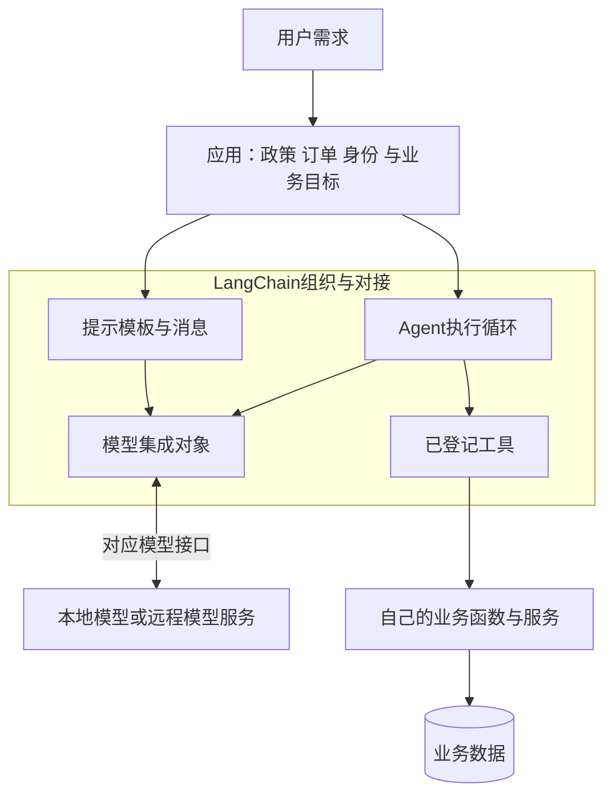
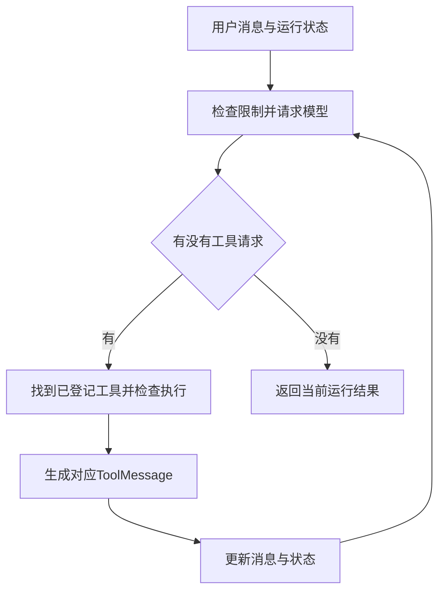

# 大模型应用开发学习 19：LangChain 入门：它到底帮我们封装了什么

做一个售后助手，最开始可能只需要几行代码：准备一段政策，把用户问题放进去，交给模型解释。

后来问题多了，我们开始反复整理提示。再后来需要查询订单，又要处理模型请求、调用函数、回填结果和继续对话。代码逐渐变多，其中不少并不是售后规则，而是在连接这些步骤。

LangChain主要帮助组织这类工作。它是可以安装到Python项目中的框架，提供提示、消息、模型和工具等组件，也能组织模型与工具的执行循环。安装它不会下载一个自动懂业务的新模型。

从普通代码准备一条政策回答开始，逐步换成框架组件；等单次调用看懂以后，再增加订单查询。每换一处，都看它具体接管了什么工作。

| 需求怎样变化 | 为什么引入相应组件 |
| --- | --- |
| 根据已提供的政策回答 | 先看清普通调用的数据 |
| 每次都要整理类似提示 | 用模板管理不变内容和变量 |
| 把准备好的内容交给模型 | 用消息与模型接口对接 |
| 用户询问具体订单 | 用工具连接业务函数 |
| 查完还要继续回复 | 用Agent组织模型与工具往返 |

## 先不用框架，看这件事原本怎样完成

用户问：“会员订单的申请期限是多少？”手里已经有一条虚构政策：“会员订单签收后15日内可以申请退货。”

这次只解释明确提供的条款，不判断某笔实际订单资格。用普通Python准备消息，可以这样写：

<!-- example-kind: usage -->

```python
policy = "会员订单签收后15日内可以申请退货。"
question = "会员订单的申请期限是多少？"

messages = [
    {"role": "system", "content": "解释提供的条款，不推断具体订单的退货资格。"},
    {"role": "user", "content": f"资料：{policy}\n问题：{question}"},
]
print(messages[1]["content"])
```

这段代码可以独立运行，不需要模型，也没有请求网络。它打印的是准备发给模型的内容：

```text
资料：会员订单签收后15日内可以申请退货。
问题：会员订单的申请期限是多少？
```

真正请求模型，还要把消息发给模型服务，再读取返回结果。使用厂商SDK或直接HTTP都可以完成，LangChain不是必要前提。

现在先抓住三件东西：政策是参考资料，问题是这次输入，系统消息说明怎样回答。模型不会因为某个变量叫`policy`就知道政策，必须把它实际放进输入。

## 第一个变化：把重复的提示写成模板

换成“普通订单的申请期限是多少”时，可以换一条政策和一个问题，而“资料：……问题：……”的组织方式不变。

当这种格式要在多处复用时，可以把固定部分保存，把每次变化的政策与问题留成空位。这就是提示模板。

LangChain中的`ChatPromptTemplate`用来准备聊天消息。下面直接摘录 [`reading_demo.py`](https://github.com/benx92/ai-learning-notes/blob/main/examples/19-langchain/reading_demo.py) 的 `prepare_messages()`，它把普通消息与模板消息一起返回，便于对照；`ChatPromptTemplate`在同文件前面导入：

<!-- example-source: examples/19-langchain/reading_demo.py -->

```python
def prepare_messages(policy, question):
    instruction = "解释提供的条款，不推断具体订单的退货资格。"
    plain = [
        {"role": "system", "content": instruction},
        {"role": "user", "content": f"资料：{policy}\n问题：{question}"},
    ]
    prompt = ChatPromptTemplate.from_messages([
        ("system", instruction),
        ("human", "资料：{policy}\n问题：{question}"),
    ])
    prepared = prompt.invoke({"policy": policy, "question": question})
    return plain, prepared.to_messages()
```

`from_messages()`定义模板；`{policy}`和`{question}`是变量位置。`prompt.invoke()`填入这次的数据，`to_messages()`把准备结果转换成消息列表。函数返回普通字典列表 `plain` 和模板生成的消息列表。

直接使用仓库里的函数观察结果，在配套目录运行：

<!-- example-kind: usage -->

```python
from reading_demo import prepare_messages

plain, messages = prepare_messages(
    "会员订单签收后15日内可以申请退货。",
    "会员订单的申请期限是多少？",
)
for message in messages:
    print(type(message).__name__, message.content)
```

打印时会看到`SystemMessage`和`HumanMessage`，分别对应系统要求与用户输入。内容仍然是刚才那条政策和问题。

**这一步省掉了什么？**省掉的是在每处调用手工拼接、检查同样提示格式的重复处理。它还可以更清楚地发现缺少变量，但不会改善一条本来就写错的政策。

尤其要注意：运行到了`prompt.invoke()`，仍然没有请求模型，也没有答案。这里的`invoke`只是“执行当前组件”，当前组件的工作是填模板。

## 第二个变化：把消息交给模型，取得回答对象

模板准备好了，接下来要先配置模型对象，再用它请求生成。以DeepSeek集成为例，配套在线脚本使用下面的配置。它依赖已安装的`langchain-deepseek`，并要求当前进程环境提供自己的凭证和可用模型名；安装与环境变量命令集中放在后面的运行部分。

<!-- example-source: examples/19-langchain/agent_demo.py -->

```python
model = ChatDeepSeek(
    model=os.environ["LC_CHAT_MODEL"],
    timeout=45,
    max_retries=0,
    extra_body={"thinking": {"type": "disabled"}},
)
```

`os`与 `ChatDeepSeek`在 `agent_demo.py` 的文件开头导入。`ChatDeepSeek`会读取对应的`DEEPSEEK_API_KEY`环境变量。`model`参数指定实际服务模型，不是给Python对象随便起的名字；`LC_CHAT_MODEL`则是我们这个示例约定的配置变量。

`timeout=45`约束单次请求等待，`max_retries=0`关闭这一层自动重试，让教学过程更容易观察。`extra_body`传入本例供应商支持的非思考模式设置；这是供应商配置，不是所有模型通用参数。换服务时，要核对集成和能力，不能原样照搬。

创建对象成功主要说明配置与对象构造能成立，不证明凭证有效，也不证明线上模型会按要求回答。把上节准备的`messages`交给它，才走到实际生成步骤：

<!-- example-kind: usage -->

```python
# 调用片段：model是已配置好的聊天模型，messages来自上面的模板。
reply = model.invoke(messages)
print(reply.content)
```

这里执行的是`model.invoke()`，所以通常会请求对应的模型服务；若配置的是本地模型，则在对应的本地环境执行。同样叫`invoke`，行为取决于接收调用的对象。

完整数据变化是：

| 位置 | 手里的内容 | 这一刻有没有模型回答 |
| --- | --- | --- |
| 填模板之前 | 政策字符串、问题字符串 | 没有 |
| `prompt.invoke()`之后 | 填好的提示对象`ChatPromptValue` | 没有 |
| `to_messages()`之后 | 系统消息与用户消息列表 | 没有 |
| `model.invoke()`之后 | 模型消息`AIMessage` | 已有模型响应 |
| 读取`reply.content` | 响应内容 | 需要核对是否正确使用资料 |

这样再见到`ChatPromptValue`这个名字，就能对应到具体东西：它装的是已经填好的模型输入，不是答案。

如果模型正确使用条款，应解释会员订单签收后15日内可以申请。这是预期核对标准；本章没有用真实密钥验证在线生成结果。

**模型对象为什么还要单独配置？**因为框架不提供售后模型服务本身。以DeepSeek集成为例，可以使用`ChatDeepSeek`指定可用模型、凭证和超时；换供应商则使用相应集成。消息与调用方式尽量保持共同接口，但工具支持、上下文长度和供应商参数仍可能不同。[LangChain模型接口](https://docs.langchain.com/oss/python/langchain/models)、[DeepSeek集成](https://docs.langchain.com/oss/python/integrations/chat/deepseek)

先把框架的位置画清楚，避免把安装Python包与获得模型服务混在一起：



图中的模型服务、业务数据都在框架之外。模型集成负责对接服务，工具包装负责对接业务函数，Agent负责在两边组织执行。不是所有请求都需要经过Agent：当前政策解释只使用模板与模型，订单查询才增加工具循环。

厂商SDK主要帮助调用对应厂商接口；LangChain还组织跨组件的数据和执行。应用中的规则、身份与数据源，则仍由开发者提供。

到这里，一次政策解释已经接完整了：资料与问题填入模板，模板变成消息，消息交给模型，返回响应。接下来增加的是另一种信息来源，不需要重新推翻这条路线。

## 用户转而问订单，工具怎样接到业务代码

用户继续说：“查一下A1001现在的退款状态。”政策里没有这笔订单的状态，必须请求订单业务函数。

普通Python函数可以查订单。LangChain中的`@tool`在它外面整理名称、说明和参数结构，形成能登记给模型或Agent的工具对象。

下面直接摘录配套 [`components_demo.py`](https://github.com/benx92/ai-learning-notes/blob/main/examples/19-langchain/components_demo.py) 的工具函数。`json`、`re`、`tool`和两份 `DEMO_*` 教学配置已在同文件中准备好：

<!-- example-source: examples/19-langchain/components_demo.py -->

```python
@tool
def get_refund_status(order_id: str) -> str:
    """查询教学订单的退款状态，不能提交或批准申请。订单号须由用户提供。"""
    if not re.fullmatch(r"A[0-9]{4}", order_id):
        raise ValueError("订单号格式应为A加4位数字")
    order = DEMO_ORDERS.get(order_id)
    if order is None or order["owner"] != DEMO_USER:
        result = {"ok": False, "error": "not_found_or_forbidden"}
    else:
        result = {"ok": True, "order_id": order_id, "status": order["status"]}
    return json.dumps(result, ensure_ascii=False)
```

这里已经保留格式校验、订单归属和结果生成；函数依赖同文件的导入与教学记录，运行时仍使用完整文件。`str`说明参数类型，函数说明帮助选择，`@tool`把这些信息整理成参数要求。

我们先手动调用，不让模型选择：

<!-- example-kind: usage -->

```python
from components_demo import get_refund_status

result = get_refund_status.invoke({"order_id": "A1001"})
print(result)
```

将片段放在配套文件同目录运行，会得到表示成功、订单号A1001、状态“审核中”的JSON字符串。这里执行了工具业务函数，没有调用聊天模型。查询A2002会得到不可访问的受控结果，不返回他人的状态。

现在三种`invoke`就能区分了：模板负责填输入，模型负责生成响应，工具负责实际业务操作。共同方法名方便组合，不代表三个对象做同一件事。

**还有两步没有自动发生。**只定义工具，模型还看不到它；把工具说明绑定给模型，模型可以提出请求，但业务函数还需要执行器调用。`bind_tools()`本身不会替我们完成整个工具往返。[LangChain工具机制](https://docs.langchain.com/oss/python/langchain/tools)

可以把三个入口并排比较：

| 使用方式 | 请求模型后可能取得什么 | 谁执行工具 |
| --- | --- | --- |
| 普通`model.invoke()` | 模型回复 | 没有因为定义工具就自动执行 |
| 绑定工具后的模型调用 | 回复或结构化工具请求 | 应用自己检查与执行 |
| `create_agent()`配置工具后运行 | 经历模型与工具往返的运行状态 | Agent调度，工具内完成业务逻辑 |

所以，如果直接调用绑定工具的模型，拿到了`tool_calls`却没有订单状态，这不是框架漏做了一半查询，而是这个入口本来只负责取得模型响应。选择哪个入口，取决于想手动控制往返，还是使用已组织的Agent循环。

工具消息则负责回填结果。LangChain中模型工具请求的`args`通常已经是字典，与原始Chat Completions中JSON字符串的`arguments`不同。把完整工具调用交给工具执行时，可以取得带相同调用ID的`ToolMessage`；仅传参数字典时，本例返回业务字符串。输入形态不同，返回包装也不同。

例如模型请求可以整理为下面的结构示意：

<!-- example-kind: usage -->

```python
{
    "name": "get_refund_status",
    "args": {"order_id": "A1001"},
    "id": "call_example_1",
    "type": "tool_call",
}
```

`args`里是业务参数，`id`负责配对结果。执行器取得相同ID的工具消息，模型才知道这份“审核中”对应哪次请求。一轮多个查询时尤其需要保留对应关系，不能把结果只按一段无标签文字合起来。

参数校验与业务失败也不同：订单号类型或格式不对，可以在执行前拒绝；格式合法但订单不可访问，则由业务函数返回受控失败。模型需要知道失败的真实含义，才能询问、说明限制或停止，而不是继续编状态。

这层包装有助于配对，但不能替代权限：`@tool`不会自动认证用户，也不会让“查询”获得“提交申请”的能力。

也可以与MCP服务作一个对应：这里的`@tool`直接包装本进程中的Python函数，MCP则可以让应用通过客户端调用另一个服务的能力。LangChain不会因为登记了一个本地工具，就自动建立MCP连接；若要使用MCP服务，仍需适配连接、能力说明与执行结果。工具从哪里来，与Agent怎样组织往返，是两个可以分开选择的问题。

## 第三个变化：让Agent组织查询与回复的往返

手动实现订单查询时，需要携带工具说明请求模型，检查工具请求，执行函数，回填结果，再请求模型组织回答。

LangChain的`create_agent`把这组往返组织成一个入口。我们提供模型、工具和系统要求，它负责运行模型与工具之间的循环。[Agent机制说明](https://docs.langchain.com/oss/python/langchain/agents)

下面直接摘录 [`agent_demo.py`](https://github.com/benx92/ai-learning-notes/blob/main/examples/19-langchain/agent_demo.py) 的 `build_agent(model)`。同文件已经导入 `create_agent`、两个限额中间件和 `get_refund_status`；传入的 `model` 使用前面展示的配置：

<!-- example-source: examples/19-langchain/agent_demo.py -->

```python
def build_agent(model):
    return create_agent(
        model=model,
        tools=[get_refund_status],
        system_prompt=(
            "你是教学售后助手。查询具体订单状态必须使用工具，不得猜测。"
            "订单号缺失时询问用户。查不到时如实说明。"
            "结果是虚构教学数据，不代表真实订单。你不能提交或批准申请。"
        ),
        middleware=[
            ModelCallLimitMiddleware(run_limit=3, exit_behavior="error"),
            ToolCallLimitMiddleware(run_limit=2, exit_behavior="error"),
        ],
    )
```

`build_agent()`返回配置好的Agent，没有马上查询订单。`main()`中再执行下面这段实际调用，才开始一次运行：

<!-- example-source: examples/19-langchain/agent_demo.py -->

```python
agent = build_agent(model)
result = agent.invoke({
    "messages": [{"role": "user", "content": "查一下A1001的退款状态。"}],
})
```

对于这条查询，成功路径应当留下四条消息：

```text
HumanMessage：用户要求查A1001
AIMessage：模型请求get_refund_status，参数为A1001
ToolMessage：返回A1001审核中，与调用ID对应
AIMessage：模型根据结果解释目前审核中
```

这不是政策模板那次回答的后半段。用户新增了订单查询需求，我们让同一售后应用走工具路径；配套Agent脚本只演示这条路径，没有自动保存前一次政策解释的会话历史。

`model.invoke()`返回一条模型消息，`agent.invoke()`返回一次运行的状态。本例的消息轨迹在`result["messages"]`中，不能把两者当作同一种返回值。

框架收起了请求与结果往返的代码，但没有收起业务责任：订单权限在工具里检查，申请资格由业务服务判断，用户确认由受控入口取得。只把“提交申请”加进工具列表，不会自动具备这些保证。

把一行`agent.invoke()`展开，内部仍然是可以理解的循环，而不是另一种神秘的模型能力：



图里“没有工具请求”表示这段模型与工具往返可以返回，不自动证明业务目标成功。它也可能是在询问缺失订单号，或说明查询失败。应用仍要结合结果判断完成、等待输入或无法完成。

这也是框架与普通组件库的一个区别：调用模板时，程序自己决定下一步；运行Agent时，我们把一部分执行顺序交给框架，它按配置组织模型与工具。封装越多，越需要看得见中间消息与限制。

完整[`agent_demo.py`](https://github.com/benx92/ai-learning-notes/blob/main/examples/19-langchain/agent_demo.py)还设置最多3次模型调用、2次工具执行，使用单次45秒超时并关闭模型客户端自动重试。上面的 `build_agent()`已保留两项限额；模型对象中的超时和重试配置见前文，实际运行使用完整文件。

达到限制时，本例选择抛出错误，停止继续执行。面向用户的应用要接住相应错误，说明已有结果和未完成部分。超时、调用次数和业务完成状态分别控制不同事情，不能用一个“最大轮数”代替全部设计。

## 文档、检索、记忆放在哪里，为什么现在才看它们

已经走过政策解释与订单查询，现在可以把其他组件放回具体需求，而不是一开始先背完整目录。

**政策还没读出来时，需要文档处理。**加载器读取PDF等文件，产生正文和来源。LangChain的`Document`通常用`page_content`保存正文，用`metadata`保存来源；创建这个对象只是包装已有文字，不会自动解析PDF。

用代码表示已经取得的文字，可以是：

<!-- example-kind: usage -->

```python
from langchain_core.documents import Document

document = Document(
    page_content="会员订单签收后15日内可以申请退货。",
    metadata={"source": "refund-policy-demo.md", "section": "会员订单"},
)
```

`page_content`是要读的正文，不要求一定是一整页；名字中的page不保证存在PDF页码。`metadata`保存来源等附加信息。若模板只使用`document.page_content`，元数据不会自动进入模型输入，要引用来源时需要应用明确组织。

这也解释了为什么给一段资料加上`Document`包装，不等于已经做完RAG。它还没有被切分、编码、入库，也没有被用户问题检索。

**政策太多时，需要检索。**文本先切分，嵌入模型为块计算向量，向量库保存记录，检索器按问题返回相关文档，再把正文送进模板。嵌入模型常用`embed_documents()`处理一组正文，用`embed_query()`处理单个问题；它不是返回`AIMessage`的聊天模型。

嵌入、向量库与检索器也各有输入输出：

| 组件 | 输入 | 输出或保存的内容 |
| --- | --- | --- |
| 文档加载器 | 文件或数据源 | 正文与来源记录 |
| 切分器 | 较长正文或文档 | 较小文本块及对应来源 |
| 嵌入模型 | 文本 | 用于比较的数值向量 |
| 向量库 | 向量、正文与来源 | 可以查询的存储记录 |
| 检索器 | 用户问题 | 相关文档列表 |
| 提示模板 | 文档正文与问题 | 供聊天模型使用的消息 |

检索器是“给定问题取得相关资料”的接口；向量库是实现这种检索的一种基础设施。检索器还可以对接关键词搜索或其他搜索服务，不必都等同于向量数据库。返回文档列表之后，生成模型仍需应用显式调用。

**对话跨轮继续时，需要状态与记忆。**把当前消息与事实保存下来，才知道“那这笔呢”指什么。跨会话长期保存偏好又是另一种存储需求。只创建Agent，不代表已经有持久会话或自动记住所有历史。

一次运行中的消息列表、检查点保存的会话状态、长期存储的用户偏好，以及业务数据库里的申请记录，要分开理解。检查点用于接回执行，业务数据库证明申请存在，长期记忆用于在合适权限下复用事实。它们不因为都“保存信息”就可以互相替代。

**程序要读取固定字段时，需要结构化输出。**可以约束输出字段与类型，减少随意文本；但字段符合结构，不证明事实正确，更不能代替资格核对。

**执行过程需要控制时，可以加中间件。**重试、限额、人工介入等逻辑放在对应位置，条件仍由应用明确。

这几类组件不是每次回答必须全部使用。当前直接提供一条政策，就无需先建立向量库；只查一笔订单，也无需为了使用框架添加长期记忆。

**这些组件为什么经常都有`invoke`？**LangChain让许多处理对象遵循共同调用约定，常称为Runnable接口。它的价值是方便调用与组合，不是要求每个对象有相同输入输出。

| 调用对象 | 本例输入 | 返回结果 | 是否请求聊天模型 |
| --- | --- | --- | --- |
| 提示模板 | 政策与问题变量 | 填好的提示对象 | 否 |
| 聊天模型 | 消息 | 模型消息 | 是，取决于实际模型配置 |
| 查询工具 | 订单参数或完整工具请求 | 业务结果或工具消息 | 否，执行本例业务函数 |
| Agent | 含用户消息的运行输入 | 含消息轨迹的运行状态 | 会按流程请求模型 |

共同调用接口还包括`stream`、`batch`和`ainvoke`：分别用于逐步接收结果、处理多个输入和异步等待。`batch`的客户端并发不自动等于厂商的离线批处理服务；`ainvoke`也不会保证单次模型推理更快。消息内容在多模态情况下可能是内容块，不能永远按纯字符串处理。更详细的接口例子见[组件与接口扩展](supplements/19-LangChain组件与接口扩展.md)。

## 想运行时，先准备哪些包，怎样检查结果

LangChain不是一个把所有模型和数据库都装好的包。本例主要使用：

| 包 | 在例子里负责什么 |
| --- | --- |
| `langchain-core` | 提示、消息、文档与工具等基础组件 |
| `langchain` | `create_agent`和中间件等入口 |
| `langchain-deepseek` | 对接DeepSeek模型服务 |

导入时会看到下划线，例如`langchain_core`；安装包名中的连字符和Python模块名不必相同。其他文档加载器、切分器和向量库集成按需求添加，不用一开始全装。

LangGraph提供底层执行与状态编排，LangChain Agent构建在它之上；LangSmith用于观测与评估等配套工作，并非运行本地例子的必要条件。Deep Agents提供另一组更高层能力，当前无需为了这个订单查询额外引入它们。

配套环境固定`langchain==1.4.6`、`langchain-core==1.6.10`和`langchain-deepseek==1.1.1`。使用[示例目录](https://github.com/benx92/ai-learning-notes/tree/main/examples/19-langchain)中的依赖文件，在PowerShell运行：

```powershell
py -3.12 -m venv .venv
.\.venv\Scripts\python.exe -m pip install -r requirements.txt
.\.venv\Scripts\python.exe reading_demo.py
.\.venv\Scripts\python.exe components_demo.py
```

`reading_demo.py`沿正文顺序比较普通消息与模板消息，再手动查询订单；`components_demo.py`进一步观察文档对象和带调用ID的工具消息包装。两者都不请求聊天模型。

若要观察在线Agent，在同一会话设置自己的密钥与可用模型名，再运行：

```powershell
$env:DEEPSEEK_API_KEY = "替换为自己的密钥"
$env:LC_CHAT_MODEL = "填写支持本例工具调用的可用模型名"
.\.venv\Scripts\python.exe agent_demo.py
```

在线脚本使用非思考模式配置，读取进程环境变量，不自动加载`.env`。供应商与模型模式改变时，需要核对对应配置。

框架行为已有8项本地检查：使用真实组件与Agent运行程序，把模型替换成固定响应的测试对象，验证模板、参数、权限结果、工具消息、循环和限额。这种替身不理解自然语言；在线模型选择工具与解释结果的效果尚未验证。

排查时先看整个`result["messages"]`，再看最后回复。模板缺字段、工具拒绝订单、模型鉴权失败、调用次数触顶，分别发生在不同位置。代码变短以后，更要知道每一步实际拿到了什么。

| 观察到的现象 | 从哪里开始查 |
| --- | --- |
| 填模板就失败 | 变量名与必需字段是否齐全 |
| 模型没有查询，直接回答状态 | 工具说明、系统要求与实际`tool_calls` |
| 工具参数校验失败 | `args`类型、字段与订单号格式 |
| 工具正常返回不可访问 | 查询结果与当前用户归属 |
| 服务认证或连接失败 | 模型集成的凭证、地址、权限与网络 |
| 连续查同一订单，达到限额 | 工具结果是否回填、模型是否在无进展重复 |
| 查询成功，最终回答说成已退款 | 实际工具状态与最终措辞是否一致 |

框架升级也应沿这些行为复核。导入成功只说明包能加载；接口类型、工具消息包装、错误处理或模型能力变化，可能影响整条路径。在独立环境升级，再用同一组问题比较，是为了让行为变化可见。

## 最后收束成一个完整认识

LangChain的价值可以从这次变化看清：普通消息变成可复用模板，模型调用有共同接口，业务函数整理成工具，模型与工具的往返交给Agent入口组织。

这些封装让连接代码更容易复用，但政策、订单、权限和确认仍然来自实际应用。先理解原本的处理过程，再看框架接管了哪些步骤，就不会把“少写了代码”误解为“业务自动完成了”。

简单任务可以继续用普通函数和厂商SDK。需要复用多种组件、维护工具循环时，再引入合适的框架能力。判断依据是执行是否更清楚、排查是否更方便，而不是用了多少组件。

## 参考资料

- [LangChain框架定位](https://docs.langchain.com/oss/python/langchain/overview)
- [组件关系](https://docs.langchain.com/oss/python/langchain/component-architecture)
- [模型与消息](https://docs.langchain.com/oss/python/langchain/models)
- [工具](https://docs.langchain.com/oss/python/langchain/tools)
- [Agent执行机制](https://docs.langchain.com/oss/python/langchain/agents)
- [配套代码与验证说明](https://github.com/benx92/ai-learning-notes/tree/main/examples/19-langchain)
