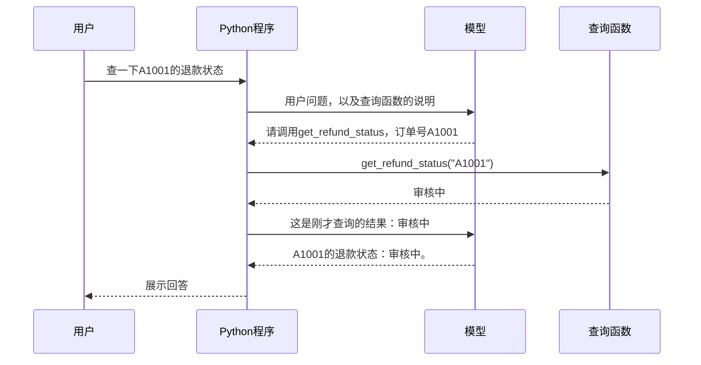
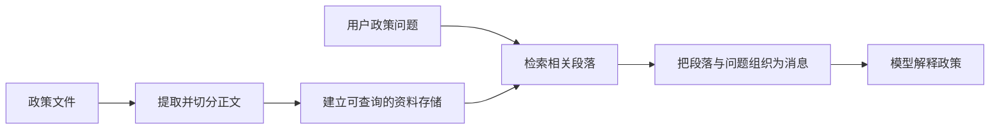

# 大模型应用开发学习 19：LangChain 入门：它到底帮我们封装了什么

开发一个售后助手，往往从“调用模型回答一句话”开始。接着要查订单、读政策、保留对话、返回界面需要的字段，还要在模型反复查询时停下来。每项需求都能用Python实现，但连接这些步骤的代码会越来越多。

**LangChain是用于构建大模型应用的开源框架。它把模型连接、输入输出处理、工具调用和执行组织等常见工作，做成可以复用、组合和配置的组件。**本文使用它的Python实现。理解它，需要同时看到两件事：这些封装想解决什么问题，以及某个封装在实际代码里替我们做了什么。[官方定位](https://docs.langchain.com/oss/python/langchain/overview)

下面先明确框架的位置，再用同一个查单任务对比普通Python与LangChain写法。看懂这段具体封装以后，再把输入组织、知识检索、会话保存等功能接回这个售后场景。

| 本文要回答的问题 | 解释路径 |
| --- | --- |
| LangChain究竟是什么，为何会用到它 | 从一次模型请求扩展成完整应用 |
| 它实际接走了什么代码 | 对照两版查单程序的执行循环 |
| 其他组件分别解决什么问题 | 继续给同一个售后助手增加需求 |
| 哪些能力需要自己提供 | 区分框架、模型服务和业务系统的职责 |

## LangChain处在应用的哪里，解决哪类问题

先把“模型”和“模型应用”分开。模型接收输入，生成回复；售后应用还要知道当前用户是谁、从哪里取得政策、怎样查询订单、何时继续请求模型，以及怎样把结果展示出来。

即使模型能判断“应该查订单”，从这个判断到真正查询，中间仍需要程序连接。LangChain主要服务于这部分应用开发。

可以把售后系统分成三层来看：

| 层次 | 在售后助手里做什么 | 由谁提供 |
| --- | --- | --- |
| 业务应用 | 认证用户、判断订单归属、实现退款规则与界面 | 自己的Python程序和业务服务 |
| 连接与执行 | 整理模型输入、对接服务、转交工具请求、保存执行信息 | 可以自己实现，也可以使用LangChain及相关组件 |
| 实际能力与数据 | 模型生成、订单记录、政策文件、数据库查询 | 模型服务、文件系统与业务后端 |

安装LangChain，得到的是中间这一层的程序接口与实现。运行在线模型仍需配置实际模型服务；订单状态仍来自订单系统；政策仍需应用提供。框架能连接这些来源，资料与权限规则也必须有真实实现。

**为什么这一层值得单独封装？**因为不同应用会反复做相似的事。

今天是售后助手，明天是内部文档助手，后天是工单分析工具。业务内容不同，却可能都需要准备多条消息、请求模型、读取工具参数、回填执行结果、保存历史和处理失败。每个项目各写一套，会重复处理这些问题；调用格式一变，也要分别修改和检查。

LangChain把其中一部分共性整理出来：组件约定输入输出怎样表示，集成负责连接具体服务，执行入口负责安排组件怎样运行。[组件关系](https://docs.langchain.com/oss/python/langchain/component-architecture)

这也解释了“框架”比“几个方便函数”多出的含义：使用单个组件时，下一步由自己的代码决定；使用Agent执行入口时，则把一段循环的调度交给框架，由它在运行中回调我们登记的业务函数。后面的查单对比会直接展示这个差别。

厂商SDK通常帮助我们调用该厂商的服务。LangChain还尝试把不同服务、数据对象和处理步骤接到共同接口上。两者的工作会有重叠，也可以配合使用。共同接口减少的是重复适配，换服务后的模型能力、参数和效果仍需重新核对。

## 先确认：普通Python本来就能完成什么

假设我们已经写好了一个函数：传入订单号，返回当前用户可以查看的退款状态。

下面是配套`comparison_demo.py`中的实际业务函数。为方便观察，订单保存在字典里：A1001属于当前教学用户，状态是“审核中”；A2002属于其他人。真实系统可以在这个函数里查询数据库或调用订单服务。

<!-- example-source: examples/19-langchain/comparison_demo.py -->

```python
def get_refund_status(order_id: str) -> str:
    """查询当前用户订单的退款状态。"""
    if not isinstance(order_id, str) or not re.fullmatch(r"A[0-9]{4}", order_id):
        raise ValueError("订单号格式应为A加4位数字")
    order = ORDERS.get(order_id)
    if order is None or order["owner"] != "demo-user":
        return "订单不存在或无权查看"
    return order["status"]
```

这里的格式检查和归属检查都是普通业务代码。暂时不用关心怎样连接模型，先直接调用：

<!-- example-kind: usage -->

```python
from comparison_demo import get_refund_status

print(get_refund_status("A1001"))
```

结果是：

```text
审核中
```

**如果产品只有一个订单号输入框和一个“查询”按钮，这样就能完成核心查询，不需要模型，也不需要LangChain。**

换成聊天框，用户说“查一下A1001的退款状态”，我们也可以用普通Python提取订单号，调用函数，拼一句“你的退款正在审核中”。如果需求始终这么固定，这种写法仍然很合适。

所以，引入框架的理由不能是“Python不会查订单”。我们需要先看到另一段工作。

## 加入模型以后，多出来的工作在哪里

现在希望这个聊天助手能处理不同需求：询问政策时解释资料，缺少订单号时反问，要查具体订单时选择查询函数。应用把可用函数的名称、用途和参数要求告诉模型，让模型结合用户问题提出下一步动作。

对于“查一下A1001的退款状态”，一次成功的过程是：



注意模型第一次返回的东西。它不是订单状态，而是“请程序查询”的请求。模型服务并没有直接运行我们电脑里的Python函数。

应用收到这个请求以后，还要做几件事：找到对应函数、传入参数、执行查询、保存结果，再把结果发给模型。第二次模型请求也得由程序发起。

这里把“模型可以请求程序使用的函数入口”称为 **Tool（工具）**，把“模型提出动作、程序执行并反馈、再继续判断”的整段循环称为 **Agent**。当前例子只有一个工具，循环很短；同一机制也可以支持多个工具和更多次往返。

**LangChain在这个例子里的作用，就是提供运行这段循环的现成实现。**业务函数仍然由我们提供，模型服务仍然需要接入。[Agent官方说明](https://docs.langchain.com/oss/python/langchain/agents)

## 第一版：用普通Python把往返写出来

先把模型回复的形状看清楚。为了让两版程序得到完全相同的条件，配套实验先用一个普通函数`scripted_reply()`返回预先写好的回复：第一次提出查询请求，收到工具结果以后，再把实际结果放进最终回答。它不是大模型，也不理解任意自然语言；这里只用它观察执行顺序。

它第一次返回的核心内容如下：

<!-- example-kind: illustration -->

```python
{
    "role": "assistant",
    "content": "",
    "tool_calls": [{
        "name": "get_refund_status",
        "args": {"order_id": "A1001"},
        "id": "call_comparison_1",
        "type": "tool_call",
    }],
}
```

读这几个字段就够了：`name`告诉程序调用谁，`args`给出订单号，`id`让程序把结果与这次请求对应起来。`tool_calls`表示这一轮提出的工具请求列表。

接下来，用普通Python处理这个回复。以下是`comparison_demo.py`中的`run_python()`，这部分没有使用LangChain：

<!-- example-source: examples/19-langchain/comparison_demo.py -->

```python
def run_python(call_model):
    messages = [
        {"role": "system", "content": INSTRUCTION},
        {"role": "user", "content": QUESTION},
    ]
    tools = {"get_refund_status": get_refund_status}
    for _ in range(3):
        reply = call_model(messages, TOOL_SPECS)
        messages.append(reply)
        requests = reply.get("tool_calls", [])
        if not requests:
            return messages
        for request in requests:
            function = tools[request["name"]]
            result = function(**request["args"])
            messages.append({
                "role": "tool",
                "content": result,
                "tool_call_id": request["id"],
            })
    raise RuntimeError("达到3次模型调用上限")
```

按一次查单的顺序读这段代码：

1. `messages`先保存要求和用户问题。`INSTRUCTION`是“查询退款状态必须使用工具，不能猜测”，`QUESTION`是“查一下A1001的退款状态”。
2. `call_model(messages, TOOL_SPECS)`取得一轮回复。`TOOL_SPECS`说明查询函数叫什么、做什么、需要一个字符串订单号。在这个离线实验中，`call_model`传入的就是刚才的`scripted_reply`。
3. 回复有工具请求，就从`tools`字典找到对应Python函数，把请求参数交给它执行。`**request["args"]`在此相当于传入`order_id="A1001"`。
4. 把函数返回的“审核中”追加到`messages`，并带上对应的请求ID。
5. 进入下一轮，把包含查询结果的消息再交给回复函数。收到没有工具请求的最终回复，就返回。

这里的`messages`是按顺序保存交互内容的列表。它让第二轮不仅知道用户问过什么，也知道程序刚刚查到了什么。

`for _ in range(3)`最多允许三轮模型调用。如果一直提出工具请求而不结束，就抛错停止。虽然成功路径只需两轮，程序仍需要安排怎样停止。

**这些就是我们手写的循环代码。**其中只有`function(**request["args"])`这一行真正进入查单业务，其余大多是在传递请求、保存结果、安排下一轮。

真实接入时，还需要把`call_model`换成请求模型服务的实现，处理服务要求的格式、认证和网络错误。这里的字典是本实验约定的数据格式，不能直接当作任意供应商的API请求体。

## 第二版：把同一段往返交给LangChain

业务函数`get_refund_status()`保持原样。使用LangChain时，把模型对象、可调用的函数和要求交给`create_agent()`：

<!-- example-source: examples/19-langchain/comparison_demo.py -->

```python
def run_langchain(model):
    from langchain.agents import create_agent
    from langchain.agents.middleware import ModelCallLimitMiddleware

    agent = create_agent(
        model=model,
        tools=[get_refund_status],
        system_prompt=INSTRUCTION,
        middleware=[ModelCallLimitMiddleware(run_limit=3, exit_behavior="error")],
    )
    result = agent.invoke({
        "messages": [{"role": "user", "content": QUESTION}],
    })
    return result["messages"]
```

这段函数来自同一个`comparison_demo.py`。`model`是接到框架接口的模型对象；离线运行时，它读取相同的预设回复。在已有的在线练习里，则使用接到模型服务的对象。

先看最关键的三项配置：

- `model=model`：这一轮向谁请求判断和回答。
- `tools=[get_refund_status]`：运行过程中允许调用哪个函数。
- `system_prompt=INSTRUCTION`：告诉模型处理这类问题的要求。

普通函数也可以直接放进这个工具列表，LangChain会依据函数名、说明和类型注解整理工具信息。本例不必先学习装饰器或手工编写参数结构。[工具官方说明](https://docs.langchain.com/oss/python/langchain/tools)

`middleware`里的配置把模型调用限制为最多三次，与手写版的上限对应；读主流程时，先把它理解成停止保护即可。

然后，`agent.invoke(...)`启动运行。`invoke`在这里就是执行这个Agent。结果中的`messages`保存本次运行的消息，既有用户输入，也有模型提出的工具请求、程序得到的工具结果和最终回答。

**手写版里的循环、工具查找、结果回填和下一轮调度，在这一版里由框架组织。**所以代码中没有再出现那段`for`循环，但查询过程仍然存在。

两版的对应关系可以直接对上：

| 需要完成的工作 | 手写Python版 | LangChain版 |
| --- | --- | --- |
| 告诉模型有哪些函数可用 | 准备`TOOL_SPECS` | 提供`tools=[get_refund_status]`，框架整理说明 |
| 检查这一轮是否请求函数 | 读取`tool_calls` | Agent运行程序处理 |
| 按名称找到函数并执行 | `tools`字典加函数调用 | Agent调度登记的工具 |
| 回填查询结果并关联请求 | 自己追加带ID的消息 | 框架组织对应工具消息 |
| 查询后再次请求模型 | 进入下一轮循环 | 框架继续运行 |
| 查询订单、检查归属 | `get_refund_status()` | 仍是同一个`get_refund_status()` |

这才是本次对比要观察的变化：**程序员提供业务函数与配置，LangChain复用了一段通用执行逻辑。**两版同样使用Python，区别是这段逻辑由谁维护。

## 实际运行后，怎样确认框架真的做了这些事

配套目录里的`comparison_demo.py`可以一次运行两版。安装与完整命令见[示例README](examples/19-langchain/README.md)。如果已经安装本章依赖，在该目录运行：

```powershell
python comparison_demo.py
```

两版都应经过下面四条记录。输出中的角色名称略有不同，但表示同样的过程：

| 顺序 | 记录的内容 | 这一刻发生了什么 |
| --- | --- | --- |
| 1 | 用户：查一下A1001的退款状态 | 保存任务 |
| 2 | 模型：请求`get_refund_status`，参数A1001 | 提出查询，尚未获得状态 |
| 3 | 工具：审核中 | Python函数已经执行 |
| 4 | 模型：A1001的退款状态：审核中。 | 读取结果后形成回复 |

不要只比较最后一句话。真正值得检查的是：中间有没有查询请求，有没有执行函数，有没有把真实函数返回值交回去。

配套检查还会把底层状态改成“已退款”，验证两版回复都随之变化；把订单改成属于他人时，两版都应返回不可查看的结果。这样可以确认最终内容来自函数结果，而不是在演示里始终写死“审核中”。

这个离线实验验证的是两种程序怎样组织执行。真实模型能否从不同问法中选对工具，需要再接入模型服务检查；已有`agent_demo.py`保留了在线练习。固定响应的适配代码、依赖版本和运行细节集中放在[扩展说明](supplements/19-LangChain组件与接口扩展.md)。

## 查单循环之外：模型输入与输出还封装了什么

查单例子展开了Agent循环，但LangChain提供的封装不止这一段。现在保留同一个售后助手，看看其他需求会带来哪些重复工作。下面是功能关系与扩展设计，当前配套查单脚本没有把这些能力全部接入。

**连接不同模型：减少请求与响应的适配工作。**

手写版里，`call_model`需要自己实现。真实服务要求怎样发送消息、怎样描述工具、怎样读取工具参数与生成内容，都需要对应代码。换到另一家服务，这些细节可能改变。

LangChain的聊天模型集成对象负责连接具体服务，并把常见输入输出转换成框架使用的表示。应用通常通过`model.invoke(messages)`取得模型响应，也可以按组件支持使用批量、异步和流式调用。这里的模型对象是服务适配与调用入口；实际生成仍发生在接入的模型中。[模型接口](https://docs.langchain.com/oss/python/langchain/models)

例如售后助手原先使用远程模型，后来测试本地模型，可以替换相应集成，尽量保留上层的消息处理和执行代码。框架提供共同接口，但本地模型是否会选对工具、是否支持同样的输出方式，需要重新验证。密钥、地址、超时与供应商专用设置也仍要配置。

**组织交互内容：用消息表示谁提供了什么。**

查单过程中，用户说“A1001”，模型说“请查A1001”，工具说“审核中”。三者的来源和用途不同。若只把文字拼起来，程序就很难判断哪句是用户输入，哪句是已经执行后的结果。

LangChain用消息对象统一表示这类数据：`HumanMessage`表示用户侧内容，`AIMessage`表示模型响应，`ToolMessage`表示工具结果，`SystemMessage`表示系统要求。它们除了内容，还可以携带角色、工具请求、结果对应的调用ID等信息。受支持的入口也接受前面使用的角色字典。[消息说明](https://docs.langchain.com/oss/python/langchain/messages)

封装的价值在于，让模型集成和执行程序能够按约定读取这些字段。它并不会仅凭角色名证明内容真实：工具返回值是否可信，要看工具实际查询了什么。

**复用输入格式：把提示中的固定部分与变量分开。**

假设助手还要解释退货政策。每次请求都需要一段固定要求、一份当前政策和一个用户问题。普通Python可以用字符串格式化完成；多处使用同样格式时，也需要自己维护变量和消息角色。

聊天提示模板可以保留固定要求与变量位置，每次填入政策和问题，得到准备好的模型输入。本章原有的`reading_demo.py`就是这种可选实验。它封装的是输入组织与复用，没有请求模型，也没有查询资料。

这时再区分三个名称：**Message是一条输入或输出记录；Prompt是本轮交给模型的输入安排；Prompt Template是反复生成这种输入的模板。**查单例子直接传入`system_prompt`和用户消息，也能构成提示，不要求先创建模板对象。

**连接固定步骤：统一怎样调用组件，检查数据怎样交接。**

政策解释的顺序如果已经确定，可以由程序固定安排“填模板 → 请求模型 → 读取回复”。LangChain中许多组件遵循一套共同的执行接口，叫 **Runnable**；这让它们能以相近方式被调用和组合。

例如模板和模型都能执行`invoke`，但工作并不相同：

| 调用的对象 | 接收什么 | 产生什么 |
| --- | --- | --- |
| 提示模板 | 政策、问题等变量 | 填好的模型输入 |
| 聊天模型 | 提示或消息 | 模型响应 |
| 组合后的处理链 | 这条流程需要的输入 | 最后一个步骤的输出 |

`prompt | model`表示将模板输出交给模型，这种组合写法属于LCEL。它把固定交接关系写出来，调用组合时再依次执行。连接仍需保证前一步输出适合后一步输入。[Runnable接口](https://reference.langchain.com/python/langchain-core/runnables/)

所以，Runnable是一套接口，链是一种组合，Agent是一段运行中根据模型请求继续调度的循环。它们的关系是“怎样调用”“怎样连接”“怎样决定下一步”，并非三种互相替代的模型。

**让结果可供程序读取：约定输出字段与类型。**

用户可以阅读“A1001正在审核中”，界面却可能需要订单号、状态、查询是否成功三个独立字段。如果每次都从自然语言里拆词，措辞变化就可能影响程序。

LangChain提供结构化输出入口，可以依据所选模型与配置组织字段约束、结果解析和校验。调用后，程序读取明确字段，再绘制状态卡片。这减少了围绕自由文本编写解析代码的工作。[结构化输出](https://docs.langchain.com/oss/python/langchain/structured-output)

这里必须区分两种保证：字段能被正确读取，说明格式符合约定；状态是否真实，仍要以查单结果为准。输出中有一个合法的`status`字段，并不能证明它查过数据库。

## 同一个助手继续扩展：资料、记忆与执行控制

输入输出接好了，助手仍可能答不了政策问题，也可能接不住下一句追问。下面几项功能分别补上不同缺口。

**政策散在很多文件里：先找到相关内容，再让模型回答。**

查订单得到的是实时业务状态。用户问“会员订单签收多久还能退”，需要的却是政策条款。模型不会因为程序能访问一个文件夹，就自动读到全部政策。

自己实现时，需要读取文件、提取正文和来源、切分长文、建立搜索方式，再按问题取得相关段落。LangChain生态提供这条路径上的组件和集成：

| 遇到的具体工作 | 对应组件 | 交给下一步的内容 |
| --- | --- | --- |
| 从文件或数据源读出文字 | Loader，文档加载器 | 正文与来源等信息，常用Document表示 |
| 让长文可以按段查找 | Splitter，文本切分器 | 较小的文档块 |
| 用语义相近程度查找 | Embedding，嵌入模型 | 表示文本的数值向量 |
| 保存并搜索向量记录 | Vector Store，向量存储 | 可查询的向量、正文与来源记录 |
| 按用户问题取回资料 | Retriever，检索器 | 相关文档列表 |

这些名称对应资料处理的不同步骤。[检索组件说明](https://docs.langchain.com/oss/python/deepagents/retrieval)、[嵌入模型集成](https://docs.langchain.com/oss/python/integrations/embeddings)

对当前问题，检索器可能返回“会员订单签收后15日内可以申请退货”及来源。应用把这段文字和问题组织进消息，模型才有依据解释。用取回的资料支持生成，通常称为RAG。

这里的封装覆盖文档表示、处理接口与外部检索系统的连接，实际文件、嵌入模型和存储仍需提供。加载器也不能自动保证扫描件识别正确；检索器返回了资料，也要检查是不是当前有效政策。

资料准备和使用可以这样接起来。下图是扩展设计，不是查单脚本已实现的功能：



如果每次政策问答都必须查资料，就由普通程序固定安排检索；如果模型需要在“查订单、查政策、直接回答”之间选择，也可以把检索包装成工具交给Agent。**检索解决取得什么资料，Agent解决运行中怎样选择和组织动作。**

**用户继续追问：保存历史，并取出本轮需要的信息。**

用户查完A1001，再说“那这笔什么时候能处理完”，应用需要知道“这笔”指A1001。模型只会读取本轮实际收到的信息，下一次请求需要由程序带回相关历史。

自己实现时，要安排会话标识、读写历史、隔离不同用户，以及控制发给模型的历史长度。LangChain Agent把消息等内容纳入运行状态，并能通过配置的检查点保存和恢复同一会话；会话通常用`thread_id`区分。[短期记忆](https://docs.langchain.com/oss/python/langchain/short-term-memory)

这里的 **Memory**是保留并复用信息的能力，**State**是运行中保存的当前消息、订单号或任务进度等数据。框架提供相关状态与存储接口，应用仍要选择存储、绑定正确会话，并决定本轮给模型看什么。仅在进程内保存的记录，也不会自动跨重启保留。

如果要跨会话保留“用户偏好简短回复”，则涉及长期记忆存储与读取策略。[长期记忆](https://docs.langchain.com/oss/python/langchain/long-term-memory)

政策检索与会话记忆可以共用某些存储技术，但用途不同：前者查找外部规则，后者找回先前交互或保存的事实。记住“刚才查的是A1001”，也不代表知道A1001此刻的最新状态；需要实时事实时仍应重新查询。

**模型反复查，或某些动作需要确认：在执行位置加处理。**

前面的手写循环用三轮上限停止，LangChain版配置了`ModelCallLimitMiddleware`。假设还需要对模型请求计数、记录工具耗时，或在提交申请之前暂停审核，若自己写，就要在相应步骤加入这些处理。

LangChain提供 **Middleware（中间件）**机制，在模型或工具调用附近插入公共处理。调用限额、摘要、重试或人工审核等能力，可以按需要通过内置或自定义中间件接入，而不用每次重写整段循环。[中间件说明](https://docs.langchain.com/oss/python/langchain/middleware/overview)

它封装的是“在哪里介入、怎样改变或停止本轮执行”。审核谁能批准、订单是否允许退款、重复提交怎样处理，仍是业务规则。即使程序在提交前暂停，也需要应用展示具体待办内容，并验证恢复操作的权限。

到这里，可以把功能对应回三个开发问题：输入输出组件让数据能被稳定交接；检索与记忆提供本轮需要的资料和历史；Agent与中间件组织并控制执行。**共同接口让这些部分可以组合，但每个任务只需要其中合适的一部分。**

## 怎样选用这些封装，又有哪些工作不会被接走

现在可以更具体地判断一次需求要用哪部分：

| 需求 | 可使用的封装 | 应用仍需提供 |
| --- | --- | --- |
| 请求模型解释给定政策 | 模型集成、消息，按需使用提示模板 | 模型服务、有效政策与问题 |
| 按已知顺序处理输入并生成 | Runnable组件与固定组合 | 每步的输入输出设计 |
| 根据问题查询订单或政策 | Tool与Agent循环 | 查询函数、数据源和权限检查 |
| 从大量政策里找证据 | 文档处理与检索组件 | 原始资料、索引与检索质量检查 |
| 下一轮继续同一话题 | 状态与配置的记忆存储 | 会话绑定、存储与历史选择规则 |
| 限制调用，或执行前审核 | 中间件与相关执行控制 | 限额、审批内容与业务规则 |
| 返回界面需要的字段 | 结构化输出 | 字段定义与事实核验 |

**LangChain、LangGraph和LangSmith又处在什么关系里？**它们分别解决执行入口、底层编排和过程观察的问题。

当前查单程序使用LangChain的`create_agent()`，配置好模型和工具，就能运行常见循环。这个Agent构建在LangGraph之上。若流程变成“查单 → 指定人员审核 → 通过才提交 → 失败时转人工”，开发者需要更明确地设计步骤、分支、暂停和恢复，就可以直接使用LangGraph编排。它是独立的底层框架，也能组织不由模型决策的固定步骤。[LangGraph说明](https://docs.langchain.com/oss/python/langgraph/overview)

查单回答错了，还要查清原因：模型没选工具，还是工具查错订单？返回政策过期，还是模型误读了正确资料？LangSmith用于记录和检查调用轨迹、耗时与错误，并支持评估应用效果。它帮助观察前面的运行过程；本章本地对比用打印记录即可，不要求接入这个平台。[LangSmith观测](https://docs.langchain.com/langsmith/observability)

这些分工也有助于理解包的组成：`langchain-core`提供消息、提示和共同接口等基础内容；`langchain`提供本例的Agent与中间件入口；模型、文档源和数据库的具体连接由对应集成包提供。安装了基础包，并不等于已经配置全部外部服务。

如果只查询固定字段、只请求一次模型，普通函数和模型服务SDK往往足够。需要多个工具、反复复用相似流程，或在多处统一处理调用和状态时，框架提供的共同实现才更容易发挥价值。代价是增加依赖、新的数据类型和框架自身的排查路径。

回到A1001：订单函数负责查到真实状态，模型负责根据输入提出查询或组织回复，LangChain Agent负责它们之间的往返。扩大到完整售后助手以后，LangChain还可以通过输入输出、检索、状态与中间件组件，接住更多重复的连接工作。

理解框架的用途，需要能说出每项封装接走了哪段程序，以及哪份数据、哪条规则仍必须由自己的系统提供。这样无论选用整段Agent循环，还是只选一个模型或检索组件，都有明确依据。

## 参考资料

- [LangChain框架定位](https://docs.langchain.com/oss/python/langchain/overview)
- [Agent执行机制](https://docs.langchain.com/oss/python/langchain/agents)
- [函数与工具](https://docs.langchain.com/oss/python/langchain/tools)
- [第19章配套代码](https://github.com/benx92/ai-learning-notes/tree/main/examples/19-langchain)
- [模型与消息接口](https://docs.langchain.com/oss/python/langchain/models)
- [文档与检索组件](https://docs.langchain.com/oss/python/deepagents/retrieval)
- [短期记忆与状态](https://docs.langchain.com/oss/python/langchain/short-term-memory)
- [中间件](https://docs.langchain.com/oss/python/langchain/middleware/overview)
- [结构化输出](https://docs.langchain.com/oss/python/langchain/structured-output)
- [LangGraph](https://docs.langchain.com/oss/python/langgraph/overview)
- [LangSmith](https://docs.langchain.com/langsmith/observability)
