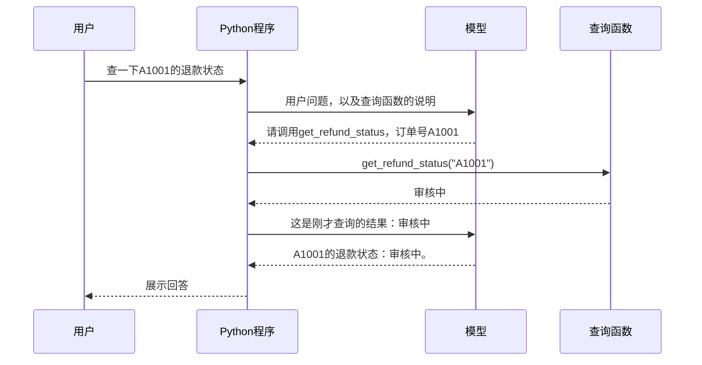

# 大模型应用开发学习 19：LangChain 入门：它到底帮我们封装了什么

用户在聊天框里输入“查一下A1001的退款状态”。模型能理解这句话，但订单状态保存在业务系统里。程序需要让模型提出查询请求，执行查询，再把结果交回模型形成回答。

普通Python可以把这个过程完整写出来。那么，安装LangChain以后，究竟少写了哪部分？为什么还需要自己提供模型和查询函数？

**LangChain是用于构建大模型应用的开源框架，本文使用它的Python实现。它提供模型连接、交互数据表示和通用执行流程等可复用的实现，帮助开发者把模型与自己的程序接起来。**[官方定位](https://docs.langchain.com/oss/python/langchain/overview)

这个定义仍然有些抽象。下面只做一次退款查询：先看普通函数能完成什么，再手写模型与函数之间的往返，最后把同一段往返交给LangChain。每一步都围绕A1001。

**先抓住代码上的区别：两版共用同一个查询函数。手写版自己维护“请求模型、检查工具请求、执行函数、回传结果、继续调用”的循环；LangChain版提供模型和函数列表，由Agent组织这段循环。**

| 阅读时先分清的代码 | 负责什么 | 实际开发时怎样使用 |
| --- | --- | --- |
| `get_refund_status()` | 校验并读取真实业务数据 | 两版都需要自己提供 |
| `run_python()` | 手动安排模型与工具往返 | 自己维护执行循环 |
| `run_langchain()` | 创建Agent并启动框架循环 | 配置模型、工具和要求，再执行`invoke()` |
| `scripted_reply()`、`make_scripted_model()` | 给离线对比提供相同的预设回复 | 它们是实验辅助；接入现成的在线模型客户端时通常不需要写 |

这次接着[工具调用](15-FunctionCalling和ToolCall让模型从回答走向行动.md)和[Agent循环](17-Agent入门让模型自己规划并使用工具.md)比较“同一段工作由谁组织”。为了隔离职责，代码使用新的小型退款函数与固定响应，不是把此前的RAG、申请服务全部迁入LangChain。名称相似的示例也有不同返回格式，连接时仍需适配。

框架创建Agent，不会自动发现知识库。希望它查资料，仍要接入第13篇的检索实现、提供可用工具说明，并检查返回的原文与来源。本篇增加物流工具，只验证扩充能力时的代码变化，没有因此完成政策检索接入。

下面代码里的“步骤1—6”会标出同一段工作的对应位置。先比较两种执行函数，再看实验辅助怎样让代码离线运行。

本文配套代码已放在[GitHub仓库](https://github.com/benx92/ai-learning-notes)，示例集中在[`examples/19-langchain`](https://github.com/benx92/ai-learning-notes/tree/main/examples/19-langchain)。阅读时可以同时打开下面三个入口：

| 入口 | 与正文的对应关系 |
| --- | --- |
| [comparison_demo.py](https://github.com/benx92/ai-learning-notes/blob/main/examples/19-langchain/comparison_demo.py) | 单工具主实验，包含业务函数、固定响应、手写循环、框架循环和启动入口 |
| [two_tools_demo.py](https://github.com/benx92/ai-learning-notes/blob/main/examples/19-langchain/two_tools_demo.py) | 追加物流查询，核对增加一个工具需要修改哪些地方 |
| [README与运行说明](https://github.com/benx92/ai-learning-notes/blob/main/examples/19-langchain/README.md) | 安装依赖、运行命令、测试和可选在线练习 |

正文按执行顺序拆开讲解，实际运行使用仓库中的完整文件；下面的片段都摘自对应源码。

## LangChain处在应用的哪里，解决哪类问题

先把“模型”和“模型应用”分开。模型接收输入，生成回复；查单应用还要知道当前用户是谁、怎样查询订单、何时继续请求模型，以及怎样把结果展示出来。

即使模型能判断“应该查订单”，从这个判断到真正查询，中间仍需要程序连接。LangChain主要服务于这部分应用开发。

可以把售后系统分成三层来看：

| 层次 | 在售后助手里做什么 | 由谁提供 |
| --- | --- | --- |
| 业务应用 | 认证用户、判断订单归属、实现退款规则与界面 | 自己的Python程序和业务服务 |
| 连接与执行 | 整理模型输入、对接服务、转交查询请求、回传查询结果 | 可以自己实现，也可以使用LangChain |
| 实际能力与数据 | 模型生成、订单记录、数据库查询 | 模型服务与业务后端 |

安装LangChain，得到的是中间这一层的程序接口与实现。运行在线模型仍需配置实际模型服务；订单状态仍来自订单系统；用户能查看哪些订单，也仍由业务代码判断。

**为什么这一层值得单独封装？**因为不同应用会反复做相似的事。

今天是售后助手，明天是内部文档助手，后天是工单分析工具。业务内容不同，却可能都需要准备模型输入、请求模型、读取查询参数、回填执行结果，再判断是否继续。每个项目各写一套，会重复处理这些问题；调用格式一变，也要分别修改和检查。

LangChain把其中一部分共性整理出来：组件约定输入输出怎样表示，集成负责连接具体服务，执行入口负责安排组件怎样运行。[组件关系](https://docs.langchain.com/oss/python/langchain/component-architecture)

这也解释了“框架”比“几个方便函数”多出的含义：使用单个组件时，下一步由自己的代码决定；使用Agent执行入口时，则把一段循环的调度交给框架，由它在运行中回调我们登记的业务函数。后面的查单对比会直接展示这个差别。

厂商SDK通常帮助我们调用该厂商的服务。LangChain还尝试把不同服务、数据对象和处理步骤接到共同接口上。两者的工作会有重叠，也可以配合使用。共同接口减少的是重复适配，换服务后的模型能力、参数和效果仍需重新核对。

## 先确认：普通Python本来就能完成什么

假设我们已经写好了一个函数：传入订单号，返回当前用户可以查看的退款状态。

先看[主实验文件](https://github.com/benx92/ai-learning-notes/blob/main/examples/19-langchain/comparison_demo.py)开头的输入和教学数据，避免后面出现尚未定义的变量：

<!-- example-source: examples/19-langchain/comparison_demo.py -->

```python
import json
import re


QUESTION = "查一下A1001的退款状态。"
INSTRUCTION = "查询退款状态必须使用工具，不能猜测。"
ORDERS = {
    "A1001": {"owner": "demo-user", "status": "审核中"},
    "A2002": {"owner": "other-user", "status": "已退款"},
}
```

`re`用于检查订单号格式，`json`只用于最后打印工具请求。`QUESTION`是一次运行的用户输入，`INSTRUCTION`约束回答方式，`ORDERS`则是查询函数真正读取的数据。`owner`表示订单归属；这里用固定的`demo-user`模拟当前用户，真实应用必须从认证信息取得用户身份。

下面是配套`comparison_demo.py`中的实际业务函数。为方便观察，订单保存在字典里：A1001属于当前教学用户，状态是“审核中”；A2002属于其他人。真实系统可以在这个函数里查询数据库或调用订单服务。

<!-- example-source: examples/19-langchain/comparison_demo.py -->

```python
def get_refund_status(order_id: str) -> str:
    """查询当前用户订单的退款状态。"""
    # 【两版共用的业务代码】格式检查、归属检查和查询规则仍由开发者实现。
    if not isinstance(order_id, str) or not re.fullmatch(r"A[0-9]{4}", order_id):
        raise ValueError("订单号格式应为A加4位数字")
    order = ORDERS.get(order_id)
    if order is None or order["owner"] != "demo-user":
        return "订单不存在或无权查看"
    return order["status"]
```

这里的格式检查和归属检查都是普通业务代码。暂时不用关心怎样连接模型，先直接调用：

<!-- example-kind: usage -->

```python
from comparison_demo import get_refund_status

print(get_refund_status("A1001"))
```

结果是：

```text
审核中
```

**如果产品只有一个订单号输入框和一个“查询”按钮，这样就能完成核心查询，不需要模型，也不需要LangChain。**

换成聊天框，用户说“查一下A1001的退款状态”，我们也可以用普通Python提取订单号，调用函数，拼一句“你的退款正在审核中”。如果需求始终这么固定，这种写法仍然很合适。

所以，引入框架的理由不能是“Python不会查订单”。我们需要先看到另一段工作。

## 加入模型以后，多出来的工作在哪里

现在希望这个聊天助手能根据用户的说法判断怎样处理：缺少订单号时反问，问到具体订单时提出查询，拿到状态以后再组织回复。应用把可用函数的名称、用途和参数要求告诉模型，让模型结合用户问题提出下一步动作。

对于“查一下A1001的退款状态”，一次成功的过程是：



注意模型第一次返回的东西。它不是订单状态，而是“请程序查询”的请求。模型服务并没有直接运行我们电脑里的Python函数。

应用收到这个请求以后，还要做几件事：找到对应函数、传入参数、执行查询、保存结果，再把结果发给模型。第二次模型请求也得由程序发起。

这里把“模型可以请求程序使用的函数入口”称为 **Tool（工具）**，把“模型提出动作、程序执行并反馈、再继续判断”的整段循环称为 **Agent**。当前例子只有一个工具，循环很短；同一机制也可以支持多个工具和更多次往返。

一次查询成功时，模型通常参与两轮：第一轮提出工具请求，第二轮读取实际查询结果形成回答。只有中间的Python函数真正读取订单数据。

**LangChain在这个例子里的作用，就是提供运行这段循环的现成实现。**业务函数仍然由我们提供，模型服务仍然需要接入。[Agent官方说明](https://docs.langchain.com/oss/python/langchain/agents)

## 第一版：用普通Python把往返写出来

手写版先准备一份给回复函数看的工具说明。这份说明来自主实验的`TOOL_SPECS`：

<!-- example-source: examples/19-langchain/comparison_demo.py -->

```python
TOOL_SPECS = [{
    "name": "get_refund_status",
    "description": "查询当前用户订单的退款状态。",
    "parameters": {
        "type": "object",
        "properties": {"order_id": {"type": "string"}},
        "required": ["order_id"],
    },
}]
```

`name`与实际函数名一致，`description`说明什么时候用它，`parameters`约束参数为包含字符串`order_id`的对象，`required`表示订单号不能省略。它只是说明书，不包含订单数据，也不会执行查询。真正可调用的函数还要在后面的`tools`字典中登记。

先把模型回复的形状看清楚。为了让两版程序得到完全相同的条件，配套实验先用一个普通函数`scripted_reply()`返回预先写好的回复：第一次提出查询请求，收到工具结果以后，再把实际结果放进最终回答。它不是大模型，也不理解任意自然语言；这里只用它观察执行顺序。

在线应用里，“查A1001退款”和“包裹到哪了”应可能产生不同工具请求；缺订单号时应先询问。下面把选择固定为查A1001，目的是让两版执行程序收到完全相同的请求。因此实验的成功表示循环分工正确，不表示已经验证任意提问的工具选择。

下面是完整的固定响应函数：

<!-- example-source: examples/19-langchain/comparison_demo.py -->

```python
def scripted_reply(messages, tool_specs):
    """程序写好的两种响应；不是大模型，也不理解用户问题。"""
    # 【离线实验辅助】只返回请求或回答，真正的订单查询由外部执行循环完成。
    if not any(spec["name"] == "get_refund_status" for spec in tool_specs):
        raise ValueError("没有提供查询工具说明")
    results = [m for m in messages if m["role"] == "tool"]
    if results:
        # 第二轮：读取执行循环传回的实际结果，不把“审核中”写死在回答中。
        return {"role": "assistant", "content": f"A1001的退款状态：{results[-1]['content']}。"}
    # 第一轮：只提出“请查A1001”的请求，此时尚未执行查询函数。
    return {"role": "assistant", "content": "", "tool_calls": [{
        "name": "get_refund_status",
        "args": {"order_id": "A1001"},
        "id": "call_comparison_1",
        "type": "tool_call",
    }]}
```

第一次调用时，`messages`里没有`role="tool"`的记录，于是走最后一个`return`，提出查询A1001的请求。查询函数执行后，循环会追加一条工具消息；第二次调用时，`results`不再为空，于是读取最后一条工具消息的`content`，生成最终回答。

因此，订单号和调用选择是预设的，查询状态却来自实际函数结果。把`ORDERS["A1001"]["status"]`改为“已退款”，最终回复也应变化。这个实验能验证执行与数据传递，不能验证模型是否理解了任意订单号或用户问法。

读这几个字段就够了：`name`告诉程序调用谁，`args`给出订单号，`id`让程序把结果与这次请求对应起来。`tool_calls`表示这一轮提出的工具请求列表。

接下来，用普通Python处理这个回复。以下是`comparison_demo.py`中的`run_python()`，这部分没有使用LangChain：

<!-- example-source: examples/19-langchain/comparison_demo.py -->

```python
def run_python(call_model):
    # 步骤1：自己准备消息，以及“工具名 -> 实际函数”的查找表。
    messages = [
        {"role": "system", "content": INSTRUCTION},
        {"role": "user", "content": QUESTION},
    ]
    tools = {"get_refund_status": get_refund_status}
    # 自己维护执行循环，最多允许3次模型调用。
    for _ in range(3):
        # 步骤2：取得一轮模型回复；离线时call_model就是scripted_reply。
        reply = call_model(messages, TOOL_SPECS)
        messages.append(reply)
        # 步骤3：自己检查是否请求工具；没有请求时，返回最终消息记录。
        requests = reply.get("tool_calls", [])
        if not requests:
            return messages
        for request in requests:
            # 步骤4：自己找函数并执行；本例相当于get_refund_status(order_id="A1001")。
            function = tools[request["name"]]
            result = function(**request["args"])
            # 步骤5：自己把结果放回消息，用请求ID标明它回答的是哪次调用。
            messages.append({
                "role": "tool",
                "content": result,
                "tool_call_id": request["id"],
            })
        # 步骤6：进入下一轮循环，让模型读取工具结果，再判断是否继续。
    raise RuntimeError("达到3次模型调用上限")
```

按代码里的六个步骤走一遍：先准备消息和工具查找表；取得第一轮回复；发现工具请求；执行`get_refund_status(order_id="A1001")`；把“审核中”写成带请求ID的工具消息；进入第二轮，让回复函数读取结果并生成最终回答。

其中`**request["args"]`是在展开参数字典。请求参数为`{"order_id": "A1001"}`时，这一行就相当于调用`function(order_id="A1001")`；具体是哪一个函数，由上一行的工具名查找决定。

这里的`messages`是按顺序保存本次交互内容的列表。每条记录有`role`和`content`：`system`是给模型的处理要求，`user`是用户的话，`assistant`是模型回复，`tool`是程序执行函数后的结果。这里的系统要求与用户问题一起构成本轮交给模型的提示内容。

第二轮之所以能回答“审核中”，是因为列表里已经追加了查询结果。删掉这条结果，模型就拿不到本次查询得到的状态。这些记录是程序传给模型的数据，不能只看最后一句回复而忽略中间的传递过程。

`for _ in range(3)`最多允许三轮模型调用。如果一直提出工具请求而不结束，就抛错停止。虽然成功路径只需两轮，程序仍需要安排怎样停止。

**这些就是我们手写的循环代码。**其中只有`function(**request["args"])`这一行真正进入查单业务，其余大多是在传递请求、保存结果、安排下一轮。

真实接入时，还需要把`call_model`换成请求模型服务的实现，处理服务要求的格式、认证和网络错误。这里的字典是本实验约定的数据格式，不能直接当作任意供应商的API请求体。

## 第二版：把同一段往返交给LangChain

业务函数`get_refund_status()`保持原样。使用LangChain时，把模型对象、可调用的函数和要求交给`create_agent()`：

<!-- example-source: examples/19-langchain/comparison_demo.py -->

```python
def run_langchain(model):
    from langchain.agents import create_agent
    from langchain.agents.middleware import ModelCallLimitMiddleware

    # 步骤1：提供模型、业务函数和要求；创建Agent时还没有执行订单查询。
    agent = create_agent(
        model=model,
        # 传函数本身，不写get_refund_status("A1001")；参数稍后由工具请求提供。
        tools=[get_refund_status],
        system_prompt=INSTRUCTION,
        # 对应手写版的range(3)：限制本次运行最多调用模型3次。
        middleware=[ModelCallLimitMiddleware(run_limit=3, exit_behavior="error")],
    )
    # 步骤2—6：invoke启动框架循环，完成模型调用、请求判断、工具执行、结果回填与继续。
    # 我们不再手写for循环和按名称查找函数的代码，业务函数仍是上面同一个函数。
    result = agent.invoke({
        "messages": [{"role": "user", "content": QUESTION}],
    })
    # 返回整个过程的消息；最后一条通常是最终回答，中间保留工具请求与结果。
    return result["messages"]
```

这段函数来自同一个`comparison_demo.py`。`model`是接到框架接口的模型对象；离线运行时，它读取相同的预设回复。在在线练习里，则使用接到模型服务的对象。两种模型对象都交给Agent使用，业务开发通常使用后者。

先看最关键的三项配置：

- `model=model`：这一轮向谁请求判断和回答。
- `tools=[get_refund_status]`：运行过程中允许调用哪个函数。
- `system_prompt=INSTRUCTION`：告诉模型处理这类问题的要求。

普通函数也可以直接放进这个工具列表，LangChain会依据函数名、说明和类型注解整理工具信息。本例不必先学习装饰器或手工编写参数结构。[工具官方说明](https://docs.langchain.com/oss/python/langchain/tools)

`middleware=[ModelCallLimitMiddleware(...)]`这一行在本例只做一件事：最多调用模型三次，超过就报错，与手写版的上限对应。它没有增加新的查单步骤。

然后，`agent.invoke(...)`启动运行。`invoke`在这里就是执行这个Agent。结果中的`messages`保存本次运行的消息，既有用户输入，也有模型提出的工具请求、程序得到的工具结果和最终回答。

**手写版里的循环、工具查找、结果回填和下一轮调度，在这一版里由框架组织。**所以代码中没有再出现那段`for`循环，但查询过程仍然存在。

**这几行配置怎样代替手写循环？**

前面的手写版标了六个步骤。框架版中，步骤1由`create_agent(...)`完成配置，步骤2—6由`agent.invoke(...)`启动框架执行。这里没有省掉实际查询，而是改变了谁负责安排查询。

| 同一步工作 | 手写版在哪里做 | 框架版在哪里做 |
| --- | --- | --- |
| 步骤1：准备输入与工具 | `messages`、`TOOL_SPECS`、`tools`字典 | `create_agent()`登记工具和要求，`invoke()`接收用户消息 |
| 步骤2：请求模型 | `call_model(messages, TOOL_SPECS)` | Agent调用传入的`model` |
| 步骤3：判断是否请求工具 | `reply.get("tool_calls", [])`与`if` | Agent读取模型回复并选择继续或结束 |
| 步骤4：执行函数 | 查`tools`字典，再`function(**args)` | Agent调度登记的函数 |
| 步骤5：把结果交回 | 自己追加带`tool_call_id`的工具消息 | Agent组织对应的工具结果消息 |
| 步骤6：请求下一轮 | 进入下一轮`for` | Agent继续调用模型，直到结束或触发限制 |

**特别留意`tools=[get_refund_status]`：这里传的是函数本身，没有括号，也没有订单号。**它表示“允许使用这个函数”。如果写成`tools=[get_refund_status("A1001")]`，Python会先执行查询，再把返回的字符串放进列表，这不等于登记一个供Agent调度的函数。

订单号在运行过程中由工具请求提供。离线实验固定为A1001；在线运行则由实际模型根据问题与工具说明提出参数。`create_agent()`负责创建执行对象，`agent.invoke()`才启动处理问题。只创建Agent，不会自动完成一次查询。[工具与Agent用法](https://docs.langchain.com/oss/python/langchain/quickstart)

离线实验需要的`make_scripted_model()`只做消息和工具说明的转换，不执行订单查询。它是为了让两版收到相同的固定回复，不是实际应用都要实现的模块；完整带注释代码及逐步解释放在[实验适配说明](https://github.com/benx92/ai-learning-notes/blob/main/supplements/19-LangChain组件与接口扩展.md)，可以在理解主对比后再读。

## 实际运行后，怎样确认框架真的做了这些事

先取得完整仓库。下面命令适用于尚未下载仓库的读者，在准备保存项目的目录执行：

```powershell
git clone https://github.com/benx92/ai-learning-notes.git
cd ai-learning-notes
```

已有仓库的读者直接进入自己的仓库根目录，不必再次克隆。然后进入示例目录，用Python 3.12创建独立环境并运行：

```powershell
cd examples/19-langchain
py -3.12 -m venv .venv
.\.venv\Scripts\python.exe -m pip install -r requirements.txt
.\.venv\Scripts\python.exe comparison_demo.py
```

示例固定的直接依赖是`langchain==1.4.6`、`langchain-core==1.6.10`和`langchain-deepseek==1.1.1`，详见[requirements.txt](https://github.com/benx92/ai-learning-notes/blob/main/examples/19-langchain/requirements.txt)。主对比实验不需要API Key，也不会请求聊天模型服务；第一次安装依赖需要网络。使用虚拟环境内Python的完整路径，不需要先执行环境激活脚本。

运行脚本时，文件底部的入口会调用`main()`，其中真正启动两条路径的是这两行：

<!-- example-source: examples/19-langchain/comparison_demo.py -->

```python
    python_messages = run_python(scripted_reply)
    framework_messages = run_langchain(make_scripted_model())
```

第一行把普通函数传给手写循环；第二行先创建模型适配器，再交给LangChain循环。后面的打印代码遍历两份消息记录。只定义`run_python()`或`run_langchain()`不会自动发生查询，必须有这一步调用。

这份脚本的实际输出如下，空的`[]`表示该条消息没有工具请求：

```text
固定响应只用来比较执行过程，不验证自然语言理解。
手写Python版：
user 查一下A1001的退款状态。 []
assistant  [{"name": "get_refund_status", "args": {"order_id": "A1001"}, "id": "call_comparison_1", "type": "tool_call"}]
tool 审核中 []
assistant A1001的退款状态：审核中。 []
LangChain版：
human 查一下A1001的退款状态。 []
ai  [{"name": "get_refund_status", "args": {"order_id": "A1001"}, "id": "call_comparison_1", "type": "tool_call"}]
tool 审核中 []
ai A1001的退款状态：审核中。 []
```

两版都应经过下面四条记录。输出中的角色名称略有不同，但表示同样的过程：

| 顺序 | 记录的内容 | 这一刻发生了什么 |
| --- | --- | --- |
| 1 | 用户：查一下A1001的退款状态 | 保存任务 |
| 2 | 模型：请求`get_refund_status`，参数A1001 | 提出查询，尚未获得状态 |
| 3 | 工具：审核中 | Python函数已经执行 |
| 4 | 模型：A1001的退款状态：审核中。 | 读取结果后形成回复 |

不要只比较最后一句话。真正值得检查的是：中间有没有查询请求，有没有执行函数，有没有把真实函数返回值交回去。

可以继续在同一示例目录运行测试：

```powershell
.\.venv\Scripts\python.exe -m unittest -v
```

[对比测试源码](https://github.com/benx92/ai-learning-notes/blob/main/examples/19-langchain/test_comparison.py)会把底层状态改成“已退款”，验证两版回复都随之变化；把订单改成属于他人时，两版都应返回不可查看的结果。这样可以确认最终内容来自函数结果，而不是在演示里始终写死“审核中”。

这个离线实验验证的是两种程序怎样组织执行。真实模型能否从不同问法中选对工具，需要再接入模型服务检查。[在线示例agent_demo.py](https://github.com/benx92/ai-learning-notes/blob/main/examples/19-langchain/agent_demo.py)使用`ChatDeepSeek`连接模型，把实际模型对象交给`build_agent()`，再执行`agent.invoke()`。它使用[extensions/components_demo.py](https://github.com/benx92/ai-learning-notes/blob/main/examples/19-langchain/extensions/components_demo.py)中已封装的查询工具，数据仍是教学快照。

**接入真实模型时，自己的代码到底怎么写？**

在线入口的`build_agent(model)`负责组装模型、查询工具、提示要求和调用限额，作用与前面的`run_langchain()`中创建Agent的部分一致。下面直接摘录`agent_demo.py`的`main()`，按“配置→模型客户端→Agent→运行→查看结果”的顺序阅读：

<!-- example-source: examples/19-langchain/agent_demo.py -->

```python
def main():
    # 步骤1：检查运行配置；密钥来自环境变量，不写进源码。
    if not os.environ.get("DEEPSEEK_API_KEY") or not os.environ.get("LC_CHAT_MODEL"):
        raise RuntimeError("请先设置自己的DEEPSEEK_API_KEY和可用的LC_CHAT_MODEL")
    # 步骤2：创建在线模型客户端，替代离线实验的固定响应与适配器。
    # 构造客户端不等于已经发送聊天请求；真正请求发生在下面invoke运行过程中。
    model = ChatDeepSeek(
        model=os.environ["LC_CHAT_MODEL"],
        timeout=45,
        max_retries=0,
        extra_body={"thinking": {"type": "disabled"}},
    )
    agent = build_agent(model)
    # 步骤4：交给Agent运行“模型请求 -> 执行工具 -> 回传结果 -> 再请求模型”的循环。
    result = agent.invoke({
        "messages": [{"role": "user", "content": "查一下A1001的退款状态。"}],
    })
    # 步骤5：查看完整消息，确认工具是否执行、结果是否交回，最后再看最终回答。
    for message in result["messages"]:
        print(type(message).__name__, message.content)
        if getattr(message, "tool_calls", None):
            print("工具请求：", message.tool_calls)
```

这里的`ChatDeepSeek`是已安装集成包提供的模型客户端，认证使用`DEEPSEEK_API_KEY`。`build_agent()`只负责创建执行对象；`agent.invoke()`内部才会实际请求服务，根据模型回复调用工具，并把结果交回。开发者没有再编写工具分发和消息回填循环。

这个在线示例复用的扩展工具返回包含`ok`、`order_id`和`status`等字段的JSON字符串，离线主对比的普通函数返回状态文本；这是工具返回格式的差异，循环分工相同。读者可以先运行离线主对比观察步骤，再用在线入口观察真实模型怎样提出工具请求。

如果已有可用的DeepSeek账户，在同一个PowerShell窗口和示例目录设置自己的参数，再运行在线脚本：

```powershell
$env:DEEPSEEK_API_KEY = "填写自己的密钥"
$env:LC_CHAT_MODEL = "填写账户可用且支持工具调用的模型名"
.\.venv\Scripts\python.exe agent_demo.py
```

这个脚本读取进程环境变量，不自动加载`.env`。在线调用会使用账户额度，最终措辞也可能不同；检查重点仍是工具请求、实际结果与最终回答是否对应。当前核验使用固定响应运行真实框架，没有使用真实密钥验证在线回答效果。

更多组件与接口细节见[扩展说明](https://github.com/benx92/ai-learning-notes/blob/main/supplements/19-LangChain组件与接口扩展.md)。

## 从这次查单看清：封装到底落在哪里

看完两版代码，容易得出“LangChain替我写了一个循环”的印象。循环确实是本例最直观的变化，但这段循环能复用，还依赖几个地方对得上。

**第一处是模型的请求与回复。**手写版的`call_model`要接收消息和函数说明，再返回程序能读取的内容。真实模型服务各有自己的请求与响应格式，应用需要做对应转换。

LangChain的模型集成承担相应服务的连接与格式转换，让上面的Agent可以按框架约定读取模型回复。这里传给`create_agent`的`model`就是这样的调用对象，实际生成回答的仍然是它接入的模型服务。离线实验用固定回复代替生成，只验证后续执行，不验证真实模型的理解能力。[模型集成说明](https://docs.langchain.com/oss/python/langchain/models)

例如更换模型服务时，我们希望保留查单函数和循环，只调整模型连接。这需要新的模型也支持当前的工具请求方式，还要重新检查它是否会选对函数、传对参数；统一接口能减少适配代码，不能保证不同模型效果相同。

**第二处是函数说明与实际函数的对应。**手写版有两份相关信息：`TOOL_SPECS`向模型说明可以查什么，`tools`字典让程序找到实际函数。两边的名称、用途与参数必须一致。模型提出的名字如果在字典里找不到，程序就无法执行。

LangChain版接收`tools=[get_refund_status]`，从函数名、说明文字和类型注解整理模型需要的信息，也保留实际可调用的函数。因此开发者不必在这个例子里分别维护函数说明和查找字典。但函数说明仍要写清楚，函数内部仍要检查参数与权限。

**第三处是请求、结果与下一轮的衔接。**模型提出查询以后，框架执行对应函数，把返回值附在正确的请求后面，再发起下一轮。前面看到的请求ID，就是结果与请求之间的对应依据。若只调用了函数，却没有把结果交回模型，这次往返仍未完成。

这些工作共同支持了同一件事：我们提供模型和业务函数，框架按约定连接并运行它们。不能只比较代码行数；还要看到原来需要自己保持一致的几处关系，现在由共同实现来维护。

## 如果再加一个查询函数，需要改哪里

现在用户又提出一个需求：“查一下A1001的物流状态。”我们保留原来的退款查询，再增加物流查询。完整实现放在[two_tools_demo.py](https://github.com/benx92/ai-learning-notes/blob/main/examples/19-langchain/two_tools_demo.py)，下面按实际修改位置对照。

**第一步：两版都要新增物流查询函数。**

原来的`get_refund_status()`返回退款状态。新增函数读取单独的物流记录，继续保留订单号与归属检查：

<!-- example-source: examples/19-langchain/two_tools_demo.py -->

```python
SHIPPING = {"A1001": "运输中，已到达杭州转运中心"}
```

<!-- example-source: examples/19-langchain/two_tools_demo.py -->

```python
def get_shipping_status(order_id: str) -> str:
    """查询当前用户订单的物流状态。"""
    # 【两版都要新增】框架不替我们实现物流查询及订单归属检查。
    if not isinstance(order_id, str) or not re.fullmatch(r"A[0-9]{4}", order_id):
        raise ValueError("订单号格式应为A加4位数字")
    order = ORDERS.get(order_id)
    if order is None or order["owner"] != "demo-user":
        return "订单不存在或无权查看"
    return SHIPPING.get(order_id, "暂无物流记录")
```

这里复用了原来的`ORDERS`检查订单属于谁，用`SHIPPING`保存教学物流快照。直接调用`get_shipping_status("A1001")`，就会返回“运输中，已到达杭州转运中心”。真实项目应在这个函数里请求物流服务。

写好函数，只说明Python已经有了查询能力。还需要让模型知道它能查物流，并让执行程序收到请求时找到这个函数。

**第二步：手写版要补两处登记。**

先补给模型看的说明。下面的`REFUND_TOOL_SPECS`就是从原脚本导入的退款函数说明；用列表相加保留它，再追加物流说明：

<!-- example-source: examples/19-langchain/two_tools_demo.py -->

```python
TOOL_SPECS = REFUND_TOOL_SPECS + [{
    "name": "get_shipping_status",
    "description": "查询当前用户订单的物流状态。",
    "parameters": {
        "type": "object",
        "properties": {"order_id": {"type": "string"}},
        "required": ["order_id"],
    },
}]
```

`name`对应函数名，`description`说明用途，`parameters`说明调用时必须给出字符串`order_id`。这份数据只描述函数，不会执行函数；本实验把它交给`call_model(messages, TOOL_SPECS)`。

再修改`run_python()`里的`tools`字典，保留退款函数，增加物流函数：

<!-- example-source: examples/19-langchain/two_tools_demo.py -->

```python
    # 手写版需要登记：模型返回工具名后，用这个字典找到实际函数。
    tools = {
        "get_refund_status": get_refund_status,
        "get_shipping_status": get_shipping_status,
    }
```

字典左边是请求里使用的名称，右边是真正的Python函数。名称必须与前面说明里的`name`一致。

循环里原有的两行继续使用，不需要再加一个“如果是物流就怎样”的分支：

<!-- example-source: examples/19-langchain/two_tools_demo.py -->

```python
            # 从请求的名称找到函数，参数直接来自请求；物流与退款沿用同一段分发代码。
            function = tools[request["name"]]
            result = function(**request["args"])
```

当模型请求里的`name`是`"get_shipping_status"`，第一行便取出物流函数；参数是`{"order_id": "A1001"}`，第二行就相当于执行`get_shipping_status(order_id="A1001")`。返回结果、追加消息、再次请求模型，继续沿用原来的循环。

因此手写版增加的是**业务函数、给模型看的说明、程序查找函数的登记**。原来的通用循环仍然可以复用。

**第三步：LangChain版把新函数放进工具列表。**

对照前面的`run_langchain()`，主要变化是`tools`从一个函数变成两个函数；系统要求也从“退款查询”改成覆盖两种查询。完整调用如下：

<!-- example-source: examples/19-langchain/two_tools_demo.py -->

```python
def run_langchain(model, question=QUESTION):
    from langchain.agents import create_agent
    from langchain.agents.middleware import ModelCallLimitMiddleware

    # 步骤1：登记模型、工具和要求；此时不执行查询。
    agent = create_agent(
        model=model,
        # 【框架版新增登记】追加物流函数，工具说明与函数查找由框架组织。
        tools=[get_refund_status, get_shipping_status],
        system_prompt=INSTRUCTION,
        middleware=[ModelCallLimitMiddleware(run_limit=3, exit_behavior="error")],
    )
    # 步骤2—6：沿用框架循环；无需为物流查询另写分发、回填和再次调用。
    result = agent.invoke({
        "messages": [{"role": "user", "content": question}],
    })
    return result["messages"]
```

这次不必再手写物流函数的说明字典，也不必另建名称到函数的查找字典。LangChain依据`get_shipping_status`的函数名、说明文字和`order_id: str`整理工具信息，Agent收到对应请求后执行函数。[工具定义说明](https://docs.langchain.com/oss/python/langchain/tools)

`question`是本次传入的用户问题，默认值为“查一下A1001的物流状态”。`INSTRUCTION`现在是“查询退款或物流状态必须使用对应工具，不能猜测”。增加查询能力与改变本次问题是两件事：两个函数都登记好以后，可以分别询问退款或物流。

**运行一次，检查新增函数是否真的接进去了。**

安装示例所需的依赖后，在示例目录运行：

```powershell
.\.venv\Scripts\python.exe two_tools_demo.py
```

物流查询的执行记录应依次是：

```text
用户问题：查一下A1001的物流状态。
请求函数：get_shipping_status，参数 order_id=A1001
函数返回：运输中，已到达杭州转运中心
最终回复：A1001的物流状态：运输中，已到达杭州转运中心。
```

脚本随后还会查询退款，两版仍应调用`get_refund_status`并返回“审核中”，确认增加物流查询后原有功能仍能使用。

这里沿用固定响应实验：`scripted_reply()`按“物流”或“退款”关键词产生预设请求，两版使用相同规则。它只帮助核对请求有没有交给正确函数、结果有没有回传；真实模型能否理解“包裹到哪了”等问法，需要接入模型服务验证。适配代码集中在完整脚本中，正文只对照新增能力需要修改的位置。

两版都需要开发者实现真实业务函数。手写版自行维护函数说明与查找登记；LangChain版接收函数列表，接着处理说明整理、请求分发和结果回传。工具增加以后，这个职责差异就更容易看清。

回到A1001，可以明确分清三份职责：

| 部分 | 这次运行中负责什么 | 不能由它代替的工作 |
| --- | --- | --- |
| 查询函数 | 检查订单归属，返回实际状态 | 它本身不理解任意聊天问法 |
| 模型 | 根据输入提出查询，读结果后组织回复 | 它不能凭一句“请查询”就执行本地函数 |
| LangChain Agent | 转交模型请求、执行登记函数、回传结果并继续运行 | 它不能提供真实订单，也不能替业务代码定义访问权限 |

如果产品只有输入订单号再点击查询，直接调用业务函数已经足够。如果只是把一段已知文字交给模型处理，一次模型调用也可能足够。这里引入框架，是因为我们需要模型与业务函数之间反复交互，而且希望复用组织这段交互的程序。

把一次查询串起来看，过程就是用户提出问题、模型提出函数请求、程序执行并取得状态，再由模型读取状态组织回复。LangChain把其中反复出现的连接与执行代码整理成共同实现；查什么数据、允许谁查询，仍然留在自己的业务函数里。理解这层分工，再看新增工具时的代码变化，就更容易知道哪些地方需要自己写。

## 参考资料

- [LangChain框架定位](https://docs.langchain.com/oss/python/langchain/overview)
- [Agent执行机制](https://docs.langchain.com/oss/python/langchain/agents)
- [函数与工具](https://docs.langchain.com/oss/python/langchain/tools)
- [模型集成](https://docs.langchain.com/oss/python/langchain/models)
- [查单示例完整代码](https://github.com/benx92/ai-learning-notes/tree/main/examples/19-langchain)
