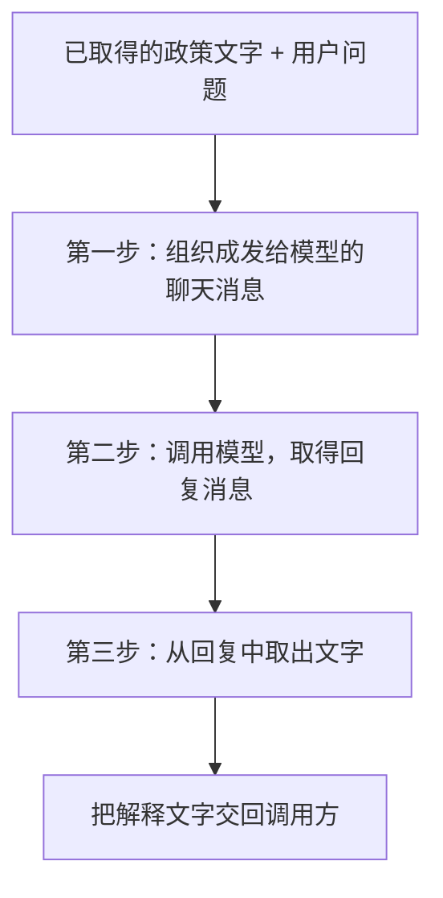

# 大模型应用开发学习 20：用LangChain组织一次政策解释

商城的售后页面需要解释退货政策。例如，用户想知道“会员订单的申请期限是多少”，系统已经取得相关条款，接下来需要根据这些文字组织一段回答。

这里的任务可以明确为：**输入一份政策资料和一个问题，输出一段基于这份资料的解释。**应用需要把资料和问题交给模型，拿到回复，再取出可以展示的文字。步骤顺序事先就能确定。

这篇沿着这一项任务，先逐步执行，再把相同的步骤组合成一条LangChain链。提示模板、模型调用、文本解析，以及随后出现的Runnable和LCEL，都围绕这一次政策解释展开。

## 先确定这次解释的输入与结果

用户的问题是：

> 会员订单的申请期限是多少？

本次提供给程序的政策文字是：

> 教学政策：会员订单签收后15日内可以申请退货，商品例外需另行核对。来源：demo-policy/member。

这是虚构的教学条款。针对这份资料，一段合适的解释应说明：期限为签收后15日内；仍需核对商品例外，不能仅凭期限就认定某笔订单一定符合条件。

使用模型，是为了把提供的文字组织成针对问题的解释。这个很短的例子便于观察代码；如果产品只需显示一个固定天数，直接返回配置中的数值就足够了。在资料较长、提问方式多样的解释功能里，下面的输入组织和调用过程仍然适用。

**资料已经取得，是这次演示的起点。**完整应用可以把检索结果传进来，资料检索的实现见[文档问答案例](13-RAG实战从文档到问答系统.md)。本例直接提供上面这段文字，集中观察取得资料以后的处理。

程序需要完成三个有先后依赖的动作：



对应的知识点也只沿这三个动作展开：

| 当前需要 | 使用的组件或接口 | 在本例里完成什么 |
| --- | --- | --- |
| 每次把资料、问题和固定要求组织到一起 | `ChatPromptTemplate` | 创建消息模板，运行时填入本次内容 |
| 把准备好的消息交给模型 | 模型对象的`invoke` | 取得一条回复消息 |
| 把回复变成可展示的文字 | `StrOutputParser` | 从回复消息中取得文本 |
| 把上述三步作为一个整体执行 | Runnable接口与LCEL组合 | 按顺序交接数据，对外接收输入并返回文字 |

最后一行不增加新的业务动作。它改变的是这三个动作如何组织和调用，后面会用同一份输入对照。

## 配套代码在哪里，怎样先运行一次

完整仓库：[benx92/ai-learning-notes](https://github.com/benx92/ai-learning-notes)。这次政策解释的代码在[examples/20-lcel](https://github.com/benx92/ai-learning-notes/tree/main/examples/20-lcel)。阅读正文时只需关注以下入口：

| 文件 | 与正文的关系 |
| --- | --- |
| [basic_demo.py](https://github.com/benx92/ai-learning-notes/blob/main/examples/20-lcel/basic_demo.py) | 主入口：用同一份输入比较逐步调用与整链调用 |
| [chain_demo.py](https://github.com/benx92/ai-learning-notes/blob/main/examples/20-lcel/chain_demo.py) | 正文复用其中的政策数据、`make_prompt`、`make_model`和`build_basic_chain`；文件里的其他实验不属于正文阅读主线 |
| [requirements.txt](https://github.com/benx92/ai-learning-notes/blob/main/examples/20-lcel/requirements.txt) | 固定本例的直接依赖版本 |
| [README](https://github.com/benx92/ai-learning-notes/blob/main/examples/20-lcel/README.md) | 环境准备、可选在线配置及验证范围 |

首次下载时，在准备保存项目的目录打开PowerShell，使用Python 3.12执行：

```powershell
git clone https://github.com/benx92/ai-learning-notes.git
cd ai-learning-notes
cd examples/20-lcel
py -3.12 -m venv .venv
.\.venv\Scripts\python.exe -m pip install -r requirements.txt
.\.venv\Scripts\python.exe basic_demo.py
```

已有仓库则直接进入`examples/20-lcel`。请保留整个目录，因为基础入口会导入同目录的复用函数。

**默认程序使用离线固定回复，不需要API Key。**它不理解问题，无论收到什么内容，都返回预先写好的文字。这样可以先验证三步之间的数据交接。在线模式才会请求模型服务；配置方式见README，调用会使用自己的服务额度。本例没有用真实密钥验证在线回答效果。

下面的函数定义是对应文件的源码摘录；调用片段则从这些文件导入已有函数。若按正文逐段实验，请在该目录的同一个Python会话中依次执行调用片段；也可以直接运行`basic_demo.py`观察完整对照。

## 第一步：把资料和问题填进消息模板

每次解释变化的是政策文字和用户问题，固定要求可以保持一致：只解释提供的资料，不判断具体订单资格，不查询或提交申请。

程序可以预先保存“固定要求放哪里、资料和问题填哪里”的格式。这样的格式称为**提示模板**。LangChain的`ChatPromptTemplate`用于创建聊天消息模板；源码通过`from langchain_core.prompts import ChatPromptTemplate`导入这个类。

[chain_demo.py中的make_prompt](https://github.com/benx92/ai-learning-notes/blob/main/examples/20-lcel/chain_demo.py)创建本例模板：

<!-- example-source: examples/20-lcel/chain_demo.py -->

```python
def make_prompt():
    # make_prompt是本例自定义函数；ChatPromptTemplate是框架提供的模板组件。
    # from_messages根据“角色+文字格式”创建模板，不是向模型发送消息。
    # 步骤1：声明消息格式；{context}和{question}到invoke时才填入。
    # 创建模板不会请求模型，也不会检索资料。
    return ChatPromptTemplate.from_messages([
        # system保存处理要求；human中的两个占位符接收本次资料与问题。
        ("system", "只解释提供的教学政策，不判断具体订单资格，不查询或提交申请。"),
        ("human", "资料：{context}\n问题：{question}"),
    ])
```

这段代码里的名称可以按用途理解：

- `make_prompt`是本例自己定义的函数，调用它会创建模板。
- `ChatPromptTemplate.from_messages(...)`根据给出的消息格式创建模板对象。
- `system`表示放处理要求的系统消息；`human`表示用户侧消息，这里包含应用提供的资料和原问题。
- `{context}`和`{question}`是留待填入的占位符。`context`在本例里就是政策文字，`question`就是用户问题；`\n`表示换行。

创建模板时还没有填入本次内容，更没有请求模型。接下来准备输入并填写：

<!-- example-kind: usage -->

```python
from chain_demo import POLICIES, make_prompt

inputs = {
    "context": POLICIES["member"],  # 开发者在本实验中选定的会员教学条款。
    "question": "会员订单的申请期限是多少？",
}
prompt = make_prompt()  # 创建格式。
prepared = prompt.invoke(inputs)  # 把字典里的值填入同名占位符。
for message in prepared.to_messages():
    print(message.content)  # 只检查准备好的消息，不调用模型。
```

`POLICIES`是示例中保存教学条款的Python字典，`POLICIES["member"]`取得的就是开头那段会员政策文字。这个取值由开发者写定，用来代替上游已经提供的资料；它没有根据问题搜索资料。

`inputs`里两个键的名称要与模板占位符一致。执行后，模型将收到下面两条消息：

```text
系统消息：只解释提供的教学政策，不判断具体订单资格，不查询或提交申请。

用户侧消息：
资料：教学政策：会员订单签收后15日内可以申请退货，商品例外需另行核对。来源：demo-policy/member。
问题：会员订单的申请期限是多少？
```

`prepared`保存这份已填好的聊天输入，其类型名叫`ChatPromptValue`。`.to_messages()`让我们查看里面的具体消息。

这里第一次出现的`invoke`表示“执行这个对象的工作”。模板的工作是填消息，因此`prompt.invoke(inputs)`的结果是模型输入，不是模型回答。

## 第二步与第三步：取得模型回复，再读出文字

输入准备好后，把上一节的`prepared`交给模型对象：

<!-- example-kind: usage -->

```python
from chain_demo import make_model

model = make_model()  # 本例默认创建离线固定回复对象。
reply = model.invoke(prepared)  # 用准备好的消息取得一轮回复。
print(type(reply).__name__)  # AIMessage：回复消息的类型名。
print(reply.content)  # 本例纯文本回复里的内容。
```

`make_model`也是仓库自定义的函数。默认调用创建离线替身；在线运行时，它负责创建模型服务客户端。创建对象是准备连接配置，调用`model.invoke(...)`才进入取得回复的步骤。

在在线模式下，模型服务根据收到的消息生成解释。当前离线替身交回的文字则预先固定为：

```text
教学固定响应：会员订单的申请期限为签收后15日，商品例外仍需核对。
```

这句话与本次教学条款对应，但不是离线对象读懂条款后生成的。因此，修改输入不会让固定回复自行变化；这次实验观察的是输入与响应的交接。

`reply`是一条回复消息，类型为`AIMessage`。当前例子的回答文字在它的`content`字段里。消息对象还可以包含其他信息，调用方若只需要展示文字，就需要明确取出文本。

LangChain提供`StrOutputParser`来完成这个收口步骤。这个名字可以理解为“输出字符串的解析组件”；`Str`指字符串，`OutputParser`指输出解析器。它处理已经取得的回复，不会再请求一次模型：

<!-- example-kind: usage -->

```python
from langchain_core.output_parsers import StrOutputParser

parser = StrOutputParser()  # 创建取文字的组件。
answer = parser.invoke(reply)  # 输入已有回复，输出普通字符串。
print(answer)
print(isinstance(answer, str))  # True：可以作为文字交给调用方。
```

在当前纯文本消息中，解析结果与`reply.content`一致。这里把它单独做成一个组件，是为了随后让三个步骤都参与组合。解析器负责读取文字，不负责判断政策解释是否正确。

到这里，一次解释已经逐步走完：

| 步骤 | 接收的数据 | 执行的工作 | 交出的数据 |
| --- | --- | --- | --- |
| 模板 | 含`context`和`question`的字典 | 填入要求、资料和问题 | `ChatPromptValue`聊天输入 |
| 模型 | 准备好的聊天输入 | 取得一轮回复 | `AIMessage`回复消息 |
| 解析器 | 已有回复消息 | 取出回答文字 | `str`字符串 |

三个对象都有`invoke`，工作却不同。只有模型那一步需要取得模型回复；不能因为看到三次`invoke`，就把它算成三次模型请求。

## 把同样的三步组织成一条链

如果多处都需要调用这段政策解释，可以先把刚才的过程写进普通Python函数。[basic_demo.py中的run_stepwise](https://github.com/benx92/ai-learning-notes/blob/main/examples/20-lcel/basic_demo.py)就是逐步调用的实现：

<!-- example-source: examples/20-lcel/basic_demo.py -->

```python
def run_stepwise(model, context, question):
    # 准备三个处理对象。创建对象本身不会请求模型。
    prompt = make_prompt()
    parser = StrOutputParser()
    inputs = {"context": context, "question": question}
    # 第一步：模板把资料和问题填成聊天消息。
    prepared = prompt.invoke(inputs)
    # 第二步：请求模型；默认离线时，这里只取得预设回复。
    reply = model.invoke(prepared)
    # 第三步：解析器读取已有回复中的文本，不再请求模型。
    return parser.invoke(reply)
```

函数里使用的`make_prompt`来自`chain_demo.py`，`StrOutputParser`来自`langchain_core.output_parsers`，完整文件已导入它们。这个函数接收模型、资料和问题，返回回答文字。调用方已经可以复用它；普通函数完全能够组织这三个步骤。

再看LangChain提供的组合方式。模板、模型和解析器遵守共同的调用约定，可以接收输入、执行处理、返回结果，并参与组合。框架把这类处理单元称为**Runnable**。

这里“共同”指调用方式，输入输出的类型仍然不同。正因为模板交出的聊天输入能被模型接收，模型交出的回复又能被解析器接收，这三步才能顺序相连。

于是，前面已经创建的三个对象可以这样组合：

<!-- example-kind: usage -->

```python
# 沿用前面创建的prompt、model和parser。
chain = prompt | model | parser  # 这里只建立先后连接，不执行。
answer = chain.invoke(inputs)  # 到这里才执行三个步骤。
print(answer)
```

`|`在这里表示“把左边的输出交给右边”。这种组合写法称为**LCEL**，全名是LangChain Expression Language。它是Python代码中组合处理对象的方式；发给模型的仍然是模板准备好的消息，模型不会看到这行管道表达式。

这条组合对象的类型叫`RunnableSequence`，表示按顺序执行的Runnable组合。整条链本身也能通过共同接口调用：`chain.invoke(inputs)`从第一个组件开始，逐步传递数据，最后交回字符串。

两种写法可以直接对照：

| 自己逐步安排 | 交给链安排 |
| --- | --- |
| 调用模板，保存`prepared` | 第一个组件接收`inputs`并准备聊天输入 |
| 调用模型，保存`reply` | 第二个组件接收前一步输入并取得回复 |
| 调用解析器，取得文字 | 第三个组件接收回复并交出文字 |
| 普通函数统一返回结果 | 整条链统一返回结果 |

**业务目标、输入资料和模型工作没有变化，变化的是调用与数据传递由谁组织。**两种方式都能集中复用。使用Runnable组合后，单个组件和组合结果还遵守同一套执行约定，便于继续替换、组合步骤，而不需要在每个调用位置重新排列内部过程。

本例用[chain_demo.py中的build_basic_chain](https://github.com/benx92/ai-learning-notes/blob/main/examples/20-lcel/chain_demo.py)保存这个组合：

<!-- example-source: examples/20-lcel/chain_demo.py -->

```python
def build_basic_chain(model):
    # 模板负责准备输入；解析器只提取文本，不再次调用模型。
    prompt = make_prompt()
    # StrOutputParser是组件类名；加()创建对象，保存到自定义变量parser中。
    # 它把AIMessage中的文本交给下一步；当前纯文本例子也可以直接读reply.content。
    parser = StrOutputParser()
    # 步骤1 -> 步骤2 -> 步骤3：填模板 -> 调模型 -> 从响应中取出文本。
    # 这里只建立连接；chain.invoke(inputs)才会真正按顺序执行。
    return prompt | model | parser
```

`build_basic_chain`是本例自定义的函数名。它创建模板与解析器，把传入的模型接在中间，然后返回组合对象。调用这个函数只是在组装；随后运行返回对象的`invoke`才会处理具体问题。

## 运行结果怎样对应这一次政策解释

理解内部三步后，在另一个脚本使用这个功能，只需要导入已经定义好的入口。下面这段可在配套目录单独运行，不依赖前面会话中的变量：

<!-- example-kind: usage -->

```python
from chain_demo import POLICIES, build_basic_chain, make_model

model = make_model()  # 创建离线固定回复对象。
chain = build_basic_chain(model)  # 组装三步，尚未执行。
answer = chain.invoke({
    "context": POLICIES["member"],  # 仍然使用开头的同一份教学条款。
    "question": "会员订单的申请期限是多少？",  # 仍然回答同一个问题。
})
print(answer)  # 调用方收到解释文字。
```

这一段里，`context`与`question`是这次功能需要的输入，`answer`是它交回的结果。调用方可以是脚本或页面后端。仓库提供的是命令行示例，页面只用于说明使用场景。

运行正文开头的`basic_demo.py`，默认输出为：

```text
离线固定回复只用于观察步骤，不验证模型理解能力。
逐步调用： 教学固定响应：会员订单的申请期限为签收后15日，商品例外仍需核对。
整链调用： 教学固定响应：会员订单的申请期限为签收后15日，商品例外仍需核对。
```

“逐步调用”使用`run_stepwise`依次运行三个对象；“整链调用”使用`build_basic_chain`创建的组合。两条路径各取得一次固定回复，所以默认对照会使用替身两次。在线模式只运行整链路径，避免为演示对照重复请求服务。

两条路径交回相同文字，说明同样的输入能按两种安排走完处理过程。这不证明真实模型总能正确解释条款。在线使用时，仍需核对回答是否只依据提供的资料，是否把“可申请期限”误说成“必然符合退货资格”。

如果运行结果不符合预期，可以顺着本例的三个交接位置排查：

| 出现的问题 | 先检查哪里 |
| --- | --- |
| 模板报缺少变量 | `inputs`是否同时提供`context`和`question`，名称是否一致 |
| 回答像是没有看到资料 | 先查看`prepared.to_messages()`，确认实际发给模型的消息含有本次政策 |
| 拿到的是消息对象，展示代码却需要文字 | 确认链末端接了文本解析器，或调用方明确读取了所需文本 |
| 修改条款后，离线答案始终一样 | 确认是否仍在使用固定回复替身；替身不会理解新内容 |

链不会替程序猜字段对应，也不会修正不匹配的数据类型。上一步交出的内容必须能被下一步接收。逐步执行的意义也在这里：先看清每一站拿到了什么，再核对整条链的结果。

## 一次政策解释的完整过程

这次政策解释从两项已经给定的输入开始：会员教学条款和“申请期限是多少”的问题。模板将它们与固定要求组织为聊天输入，模型取得输入并交回回复，文本解析器把回复收成字符串。调用方最终得到的是可用于展示的解释文字。

Runnable提供共同的执行与组合约定，LCEL用`|`把这三个处理单元按顺序连接起来。整条链因此可以作为一个整体使用，而每一步的职责仍然清楚：模板准备输入，模型生成回复，解析器读取文字。

这里能够集中复用的是一次政策解释的处理过程。资料是否适用、解释是否忠于原文，还要结合实际输入与回答核对。无论采用逐步函数还是链式组合，这条数据路径都应该能被说明白：**给了什么资料，怎样交给模型，模型返回什么，程序最终交出了什么。**

## 参考资料

- [ChatPromptTemplate：聊天消息模板](https://reference.langchain.com/python/langchain-core/prompts/chat/ChatPromptTemplate)
- [RunnableSequence：顺序组合](https://reference.langchain.com/python/langchain-core/runnables/base/RunnableSequence)
- [StrOutputParser：取得文本输出](https://reference.langchain.com/python/langchain-core/output_parsers/string/StrOutputParser)
