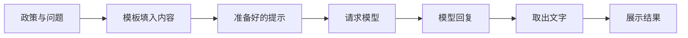
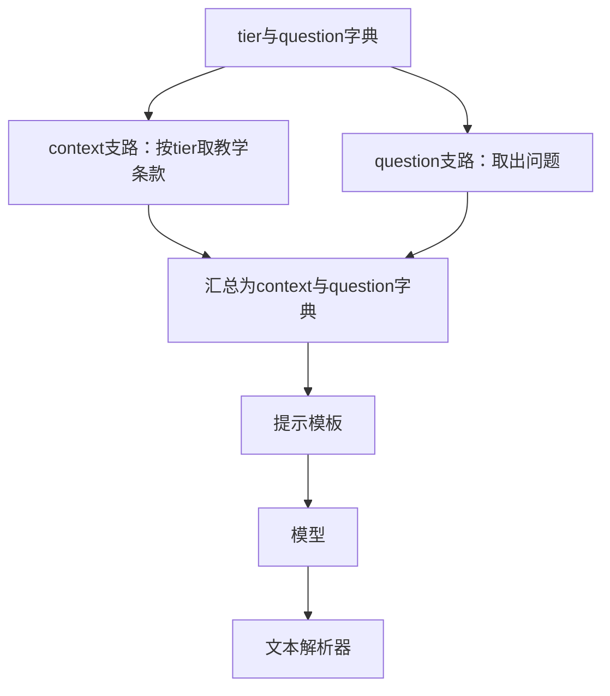
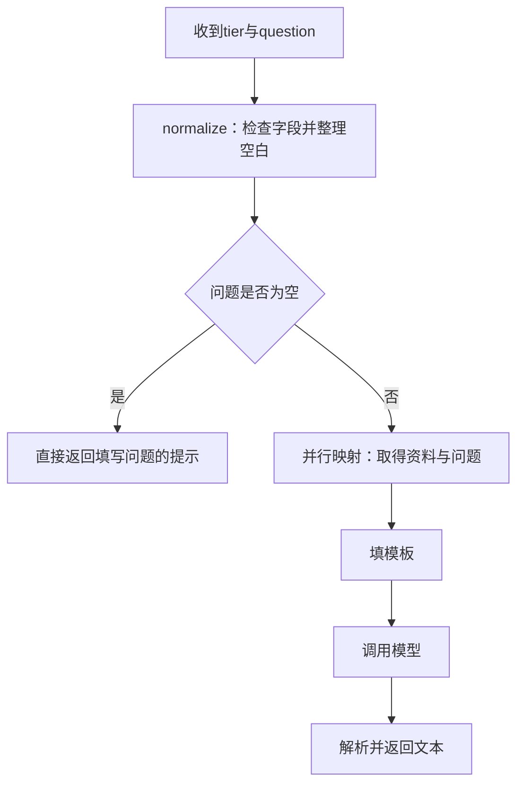
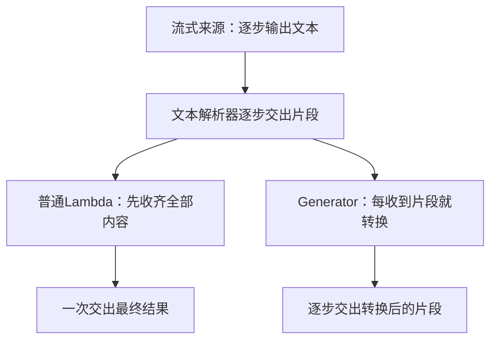

# 大模型应用开发学习 20：用LangChain组织一次政策解释

查单例子里，我们提供查询函数，模型提出查询请求，LangChain负责执行函数、回传结果并继续运行。这样能看清框架接走了哪些代码，但完整应用里还有一种更常见的过程：步骤早就确定，只需要程序按顺序完成。

还是这个售后助手。用户除了查退款，也会问“会员订单的申请期限是多少”。假设有效政策已经准备好，这次不需要模型决定查询哪个函数：程序先把政策和问题放进输入，再请求模型解释，最后取出回答文字。

**LangChain既提供工具调用循环，也提供可以单独使用的组件。准备输入、调用模型、读取结果，可以由这些组件分别完成，再按确定的顺序接起来。**这仍然是在看框架的封装，只是从“把模型与业务函数接起来”，转到“把几个确定的处理步骤接起来”。

先逐步执行这段政策解释流程，再看框架怎样把同样的步骤组合成一个整体。重点观察政策和问题怎样变成模型输入、模型响应又怎样变成回答文字。这里完成的是一次内容处理，最终结果是一段政策说明；是否允许某笔订单退货、申请办理到了哪一步，需要另外的业务记录来判断。

## 先把准备输入、调用模型和读取结果分开执行

使用一条已给定的教学政策：“会员订单签收后15日内可以申请退货，商品例外需另行核对。”用户问：“会员订单的申请期限是多少？”

程序要做三件事：

| 步骤 | 具体工作 | 得到什么 |
| --- | --- | --- |
| 准备输入 | 把政策、问题和回答要求放到一起 | 可以交给模型的输入 |
| 请求模型 | 让模型根据给定政策解释期限 | 模型回复 |
| 读取结果 | 从回复中取出回答文字 | 可以展示的文本 |

普通Python完全可以组织这个顺序，也可以把它写进一个函数。这里继续使用LangChain，是为了看清它提供的组件怎样配合，而不是因为三步任务必须使用框架。

先看第一步。查单时，我们直接提供处理要求和用户消息。现在问题每次不同，政策也可能换，可以保留一份固定格式，每次填入当前内容。这就是**提示模板**。本例使用`ChatPromptTemplate`表示聊天输入的模板：

<!-- example-source: examples/20-lcel/chain_demo.py -->

```python
def make_prompt():
    return ChatPromptTemplate.from_messages([
        ("system", "只解释提供的教学政策，不判断具体订单资格，不查询或提交申请。"),
        ("human", "资料：{context}\n问题：{question}"),
    ])
```

`context`是待填的政策文字，`question`是用户问题。花括号表示填入位置；`system`保存处理要求，`human`表示用户侧消息。模板只负责准备输入，还没有请求模型。

第二步使用模型对象发起请求，第三步使用`StrOutputParser`读取回复文字。这个名字可以直接理解成“文本输出解析器”：它从模型消息中取出文本，不会再调用一次模型，也不检查政策内容是否正确。

在[配套示例目录](examples/20-lcel/README.md)安装依赖后，可以逐步运行下面这段代码。`make_prompt()`就是上面的模板，`make_model()`默认返回固定响应对象：

<!-- example-kind: usage -->

```python
from chain_demo import POLICIES, make_model, make_prompt
from langchain_core.output_parsers import StrOutputParser

inputs = {
    "context": POLICIES["member"],
    "question": "会员订单的申请期限是多少？",
}
prompt = make_prompt()
model = make_model()
parser = StrOutputParser()

prepared = prompt.invoke(inputs)
reply = model.invoke(prepared)
answer = parser.invoke(reply)
print(answer)
```

`POLICIES["member"]`取出示例中保存的会员政策。这里直接提供资料，没有搜索文件或查询订单。最后打印：

```text
教学固定响应：会员订单的申请期限为签收后15日，商品例外仍需核对。
```

为了专心观察执行过程，默认模型对象总是返回这段预设文本，不理解任意问题；模板、消息和后续组合使用真实LangChain组件。接入真实模型后，生成发生在模型服务中，还需要另行核对回答效果。

前面见过的`invoke`表示执行一次调用。这里三个对象都有这个方法，但每个对象做的事情不同：

| 代码 | 收到什么 | 返回什么 |
| --- | --- | --- |
| `prompt.invoke(inputs)` | 政策与问题的字典 | 填好内容的提示对象，类型为`ChatPromptValue` |
| `model.invoke(prepared)` | 准备好的提示 | 一条模型响应，类型为`AIMessage` |
| `parser.invoke(reply)` | 模型响应 | 回答字符串 |

`ChatPromptValue`装着填好的消息，模型接口能够直接接受它；`AIMessage`装着模型的回复，解析器能够从中读取文字。需要观察具体消息时，可以对提示对象调用`.to_messages()`取得消息列表。每个名字都对应当前代码中的一份实际数据。



三步之间传递的不是同一种东西：字典先变成提示，提示交给模型得到响应，响应再变成文字。因此组合时既要确定先后顺序，也要确认下一步能够接受上一步的结果。

## 把同样的三个步骤收成一个整体

现在三步分别能够运行。接下来想把它们作为一个“政策解释过程”复用：页面提交一份政策与问题，得到回答；另一个入口也能调用相同过程，不必再次展开内部步骤。

手写一个Python函数当然也能完成这个封装。LangChain进一步提供一套共同约定，让单个步骤和组合后的整体都能用相近的方法调用。

**遵循这套执行约定的组件，称为Runnable。**刚才使用的模板、模型和文本解析器都是这样的组件：各自接收输入、完成处理、返回结果，都有`invoke`入口。共同接口不等于相同输入类型，模型收到提示，解析器收到模型消息，二者仍然要区分。

有了这套约定，就可以写出它们的连接关系：

<!-- example-kind: usage -->

```python
chain = prompt | model | parser
answer = chain.invoke(inputs)
print(answer)
```

这段代码承接前面的`prompt`、`model`、`parser`和`inputs`。`|`表示把左边的输出交给右边：先准备提示，再请求模型，最后取出文字。`chain`是给这个组合起的变量名，这样一段处理流程通常称为**链**。

**在LangChain里，用`|`等写法组合这些组件的方式称为LCEL，全名LangChain Expression Language。**它是Python对象提供的组合写法，不需要把这行代码发给模型理解，也不需要另学一种独立运行的语言。[执行接口与组合](https://reference.langchain.com/python/langchain-core/runnables/)

两段程序可以逐行对上：

| 分别调用时 | 组合运行时内部发生的事 |
| --- | --- |
| `prepared = prompt.invoke(inputs)` | 第一步接收整条链的输入 |
| `reply = model.invoke(prepared)` | 第二步接收第一步的结果 |
| `answer = parser.invoke(reply)` | 第三步接收第二步的结果，并作为整链结果返回 |

`chain = prompt | model | parser`只是建立连接关系，还没有请求模型；执行`chain.invoke(inputs)`才开始处理。这里三步存在先后依赖，也不会因为写在一行就同时运行。

配套`chain_demo.py`把这个连接封装在已有函数里：

<!-- example-source: examples/20-lcel/chain_demo.py -->

```python
def build_basic_chain(model):
    prompt = make_prompt()
    parser = StrOutputParser()
    return prompt | model | parser
```

这种顺序组合的具体类型叫`RunnableSequence`。组合结果仍遵循Runnable接口，因此既能单独调用，也能作为一个步骤接进更大的流程。原来需要逐步调用的内部实现，被收成了可以复用的组件。

**它与查单Agent的差别，在于下一步由谁决定。**查单时，模型先提出函数请求，程序执行后再让模型判断是否继续；这里的三步顺序由开发者事先确定，模型只负责解释政策，无须决定程序接下来执行哪个组件。它们都是LangChain提供的应用组织方式，分别适合不同任务。

只处理这一次请求时，手写函数已经足够清楚。需要重复组合步骤、复用内部流程，或统一使用批量、异步和流式入口时，这套共同接口才更有价值。后面增加自己的处理函数时，也要保持每一步的数据交接明确。

还有一个具体选择：如果后面需要读取工具请求、用量等响应信息，不要太早只留下文本。`StrOutputParser`适合当前纯文本任务；解析成字符串以后，调用方就不能再把结果当完整模型消息使用。

## 在链中加入自己的函数，先明确输入输出

基础链需要`context`和`question`，而页面收到的输入可能是：

<!-- example-kind: illustration -->

```json
{"tier": "member", "question": "会员订单的申请期限是多少？"}
```

这里的`tier`只是教学配置，用于选择会员或普通条款，不是让用户自报身份后直接获得会员权益。真实业务中的身份、订单类型与资格，需要从受信任的数据中取得。

输入进入模板前，需要检查类型、去掉问题两端空白，并根据`tier`取得资料。这些都是普通Python逻辑，不需要请模型判断。

LangChain提供 **RunnableLambda**，把普通函数接到共同调用接口上。名称里有Lambda，不代表只能接匿名函数，具名函数也可以。

本例的`normalize`函数摘录如下：

<!-- example-source: examples/20-lcel/chain_demo.py -->

```python
def normalize(data):
    if not isinstance(data, dict):
        raise TypeError("输入必须是字典")
    tier = data.get("tier")
    question = data.get("question")
    if tier not in POLICIES:
        raise ValueError("tier必须是member或general")
    if not isinstance(question, str):
        raise TypeError("question必须是字符串")
    return {"tier": tier, "question": question.strip()}
```

`RunnableLambda(normalize)`就可以放在链的最前面。它返回一个新字典，没有修改原输入，也没有请求模型。`normalize`之所以检查类型，是因为这些规则在函数里明确实现了；不能因为外面包了Runnable，就假定全部业务字段已经自动校验。

**`|`只连接结果，不会猜测字段对应。**前一步返回`{"text": "..."}`，后面的模板需要`question`，框架不会自动理解两个字段意思相近。前一步返回`AIMessage`，后面的函数直接调用`.strip()`，也会因为把消息当字符串而出错。

| 接口没对齐的情况 | 应怎样改 |
| --- | --- |
| 字段叫text，模板要question | 明确取值并重建相应字段 |
| 后一步要字符串，前面返回模型消息 | 在合适位置解析文本，或显式读取需要的内容 |
| 函数只保留question，后面还要tier | 在转换时保留它，或重新安排数据结构 |
| 参数结构符合要求，业务含义却不成立 | 在业务逻辑中继续核对条件 |

普通函数放进受支持的LCEL组合位置时，也可以自动转换成Runnable；本文显式使用`RunnableLambda`，是为了让读者看清哪里在接入自己的处理步骤。复杂函数可以用`@chain`等方式封装，选择哪种写法不改变“输入什么、返回什么”的基本要求。

## 同一份输入分成两路，再汇总成模板变量

现在缺少的不是另一次模型生成，而是把`tier`转换成资料，同时把原问题保留下来。这两项工作都只依赖同一份输入，可以分成两路处理。

**RunnableParallel把同一份输入交给各条支路，再用支路名称汇总结果。**本例的输入整理函数如下：

<!-- example-source: examples/20-lcel/chain_demo.py -->

```python
def build_inputs():
    return RunnableParallel(
        context=RunnableLambda(select_policy),
        question=RunnableLambda(itemgetter("question")),
    )
```

`select_policy`从本地`POLICIES`字典选择条款；`itemgetter("question")`取出输入里的问题字段。两个函数都已在完整文件中准备或导入。不要因为第二条支路叫`question`，就以为框架只给它传了问题字符串：**两条支路接收的都是完整输入字典。**



汇总结果有两个键：`context`对应条款，`question`对应问题。这就恰好符合模板的需要。原来的`tier`没有出现在结果中，因为本次映射没有保留它。[并行组合](https://reference.langchain.com/python/langchain-core/runnables/base/RunnableParallel)

**并行不是把输入拆成互不相干的几块，也不是让后一条支路读取前一条的结果。**若问题支路需要资料支路的输出，就存在先后依赖，应当放到汇总之后处理，而不是期待并行支路按书写顺序互相传值。

这里的本地取值很快，使用并行映射主要为了说明数据形状。若支路是独立的网络查询，并发安排可能减少等待，但实际耗时还受并发上限、服务限速与最慢支路影响。若三条支路分别调用模型，仍然是三份模型工作与相应费用，不会因并行自动变成一次。

在序列中看到`{"context": ..., "question": ...}`这样的字典组合时，它也可能被框架转换为并行映射；离开组合语境，普通Python字典本身没有`invoke`方法。先区分“配置映射关系”和“已经计算出的结果字典”。

**如果想保留原输入，再追加资料字段呢？**这时可以用`RunnablePassthrough.assign`：

<!-- example-source: examples/20-lcel/chain_demo.py -->

```python
def build_preserved_inputs():
    return RunnablePassthrough.assign(context=RunnableLambda(select_policy))
```

`Passthrough`表示透传，即保留输入经过当前步骤。单独的`RunnablePassthrough()`通常原样交出输入；`.assign(...)`要求输入是字典，再把计算字段合并到结果。对于本例，会得到`tier`、`question`、`context`三个字段。

它不是聊天记忆，也不会把字段永久保存到数据库。同名字段可能被新计算结果覆盖；多个新增字段若彼此依赖，应分步追加，不能默认在同一次`assign`里按书写顺序执行。[字段保留与追加](https://reference.langchain.com/python/langchain-core/runnables/passthrough/RunnablePassthrough)

## 条件分支：由程序选择路径，再调用整条链

用户没有填问题时，仍然调用模型既浪费，也难以得到有用结果。可以在检查与整理之后设置一条规则：空问题直接返回提示，有问题才进入资料与生成流程。

这种按条件选择处理路径的组件叫 **RunnableBranch**。本例完整的组装函数如下，里面使用的基础链与输入整理函数就是前面已经解释的实现：

<!-- example-source: examples/20-lcel/chain_demo.py -->

```python
def build_pipeline(model):
    answer = build_inputs() | build_basic_chain(model)
    route = RunnableBranch(
        (lambda data: not data["question"],
         RunnableLambda(lambda data: "请先填写政策问题。")),
        answer,
    )
    return RunnableLambda(normalize) | route
```

先执行`normalize`。问题两端空白被去掉后，再判断它是否为空；为空时，运行固定提示函数；否则运行最后的默认分支`answer`。`RunnableBranch`按条件顺序检查，选择第一个成立的分支；条件都不成立，才使用默认处理。[条件分支](https://reference.langchain.com/python/langchain-core/runnables/branch/RunnableBranch)



**条件由程序定义，不是框架临时替用户理解意图。**本例只看问题是否为空，没有让模型分类。若某个应用先让模型分类，再把分类结果交给分支，那是额外设计的一步模型调用，需要单独验证分类是否可靠。

两条路径都返回文本，因此调用方可以统一展示。不同分支当然也可以返回不同类型，但调用方就需要处理这种差异，不能假定框架会自动整理成同一份业务结果。

这也是固定链与Agent的区别：当前路径的条件与后续步骤事先已经定义；Agent则可能让模型根据反馈提出不同工具请求，运行程序再组织下一轮。LCEL可以包装或参与Agent中的某些步骤，但把几个函数接起来，不会因此自动获得自主规划、持久会话或人工审批能力。

## 同一条链，怎样处理单次、批量与异步请求

整条链组装好了，使用者主要关心外部输入与结果，不需要在每个调用点重写内部步骤。但一次链调用包含几次模型请求，仍要看链里具体放了什么。

本例正常问题走过一次模型；空问题不经过模型。若把两个模型步骤接在一起，一次`chain.invoke()`也可能产生两次模型请求。

| 方法 | 外部处理方式 | 容易误解的地方 |
| --- | --- | --- |
| `invoke(input)` | 一份输入，返回这次完整结果 | 一次链调用不等于一次模型调用 |
| `batch(inputs)` | 多份独立输入，返回对应结果列表 | 不是把问题拼成长提示，只请求一次 |
| `ainvoke(input)` | 异步等待一份输入的结果 | 不会让单次模型推理自动变快 |
| `stream(input)` | 执行过程中交出输出片段 | 有这个方法不保证每步都增量透传 |

在配套目录导入已有流水线，批量调用可以这样观察：

<!-- example-kind: usage -->

```python
from chain_demo import DEMO_INPUT, build_pipeline, make_model

pipeline = build_pipeline(make_model())
results = pipeline.batch(
    [DEMO_INPUT, {"tier": "member", "question": ""}],
    config={"max_concurrency": 2},
    return_exceptions=True,
)
for result in results:
    print(result)
```

结果列表仍对应输入位置，完成先后不等于返回列表顺序。`return_exceptions=True`使本次批量的错误也以对应位置的异常对象返回；应用需要逐项判断，不能把异常对象直接当成一条正常回答。它也不表示已成功的调用可以撤销。

`max_concurrency`是执行并发配置，不是“每分钟最多多少请求”的服务限速器。整条链内部还可能有并行支路或下层重试，控制真实成本时，需要按实际调用路径统计。

异步调用则在异步函数中等待：

<!-- example-kind: usage -->

```python
import asyncio
from chain_demo import DEMO_INPUT, build_pipeline, make_model

async def main():
    result = await build_pipeline(make_model()).ainvoke(DEMO_INPUT)
    print(result)

asyncio.run(main())
```

这是完整脚本的入口写法；已有事件循环的应用应在对应异步环境中`await`，而不是嵌套运行一个新的事件循环。框架可为部分同步组件提供异步适配，但自定义的阻塞逻辑、下游客户端和并发限制仍需要明确安排。

## 流式输出为什么会在中间停住

假设模型逐步交出文本，界面也希望边收到边显示。只有下游步骤能够接收并交出片段，增量信息才能持续到达界面。

普通后处理函数`str.upper`接收完整字符串后返回大写结果。把它包成`RunnableLambda`接在流式来源后面，输入会先收齐，再执行转换。因此最后文本可能完全正确，但中间片段已经消失。



配套实验使用固定字符响应`a b`观察这件事，记录到的结果是：

| 处理方式 | 本地实验收到的输出 |
| --- | --- |
| 模板、固定模型与文本解析器 | `['a', ' ', 'b']` |
| 后面加`RunnableLambda(str.upper)` | `['A B']` |
| 后面加增量生成器 | `['A', ' ', 'B']` |

这是本地固定响应的分片结果，不是线上Token边界或耗时测量。在线体验还要观察首个有效片段何时到达，不能仅凭片段数量判断是否及时展示。

处理增量输入时，可以使用 **RunnableGenerator**：它包装接收迭代器、逐步产出结果的生成器函数。本例函数摘自`chain_demo.py`：

<!-- example-source: examples/20-lcel/chain_demo.py -->

```python
def uppercase_chunks(chunks: Iterator[str]) -> Iterator[str]:
    for chunk in chunks:
        yield chunk.upper()
```

完整实验的关键调用如下，`chain`是前面那条基础链，`inputs`是已经填好的变量字典：

<!-- example-source: examples/20-lcel/chain_demo.py -->

```python
    direct = list(chain.stream(inputs))
    buffered = list((chain | RunnableLambda(str.upper)).stream(inputs))
    incremental = list((chain | RunnableGenerator(uppercase_chunks)).stream(inputs))
```

函数里的`yield`表示逐步交出结果。`RunnableGenerator`明确按片段处理；普通`RunnableLambda`更适合一次收齐输入后再计算的逻辑。[增量处理](https://reference.langchain.com/python/langchain-core/runnables/base/RunnableGenerator)

**逐片处理也要符合操作本身的语义。**大写转换适合这个小实验；跨片段匹配一句话、解析完整JSON、对整段文本做去空白，不能简单对每片独立操作。例如逐片`.strip()`可能删掉词语之间本该保留的空格。

模型之前的输入整理，通常只影响何时开始请求模型；流式来源之后的非增量步骤，则会让后续等待内容收齐。需要最终审核后才能展示的信息，也不能仅为追求流式体验而提前放出。使用哪种输出方式，取决于业务需要。

## 配置、重试与回退，要放在明确的执行范围

已经看懂正常路径以后，再考虑运行中的控制。Runnable除了能组合，还可以加配置或包装，但每个开关都有实际边界。

`with_config`可以设置执行名称、标签或并发等配置。例如在调用时传入`run_name`，便于区分哪次是在运行政策解释。**设置名字不会自动创建可视化监控，也不会自动把数据上传到某个平台**；若要追踪服务，还需要明确接入与数据发送范围。

**重试是再次执行同一步，回退是失败后改走另一处理。**配套`reliability_demo.py`用一个只读模拟函数，前两次抛超时，第三次返回结果：

<!-- example-source: examples/20-lcel/reliability_demo.py -->

```python
def run_retry_demo():
    attempts = []

    def temporary_lookup(value):
        attempts.append(value)
        if len(attempts) < 3:
            raise TimeoutError("模拟只读查询暂时超时")
        return "教学查询恢复"

    step = RunnableLambda(temporary_lookup).with_retry(
        retry_if_exception_type=(TimeoutError,),
        stop_after_attempt=3,
        wait_exponential_jitter=False,
    )
    result = step.invoke("policy-demo")
    return {"attempts": len(attempts), "result": result}
```

这里`stop_after_attempt=3`表示**总共最多尝试3次**，包含首次；它不同于其他接口里“失败后再试几次”的`max_retries`。实验关闭等待只是为了快速观察次数，真实服务应根据错误类型、等待要求和总期限安排退避。

本例只重试`TimeoutError`。参数缺失、权限不足、政策不存在，通常不能靠原样请求变正确。重试应包在确实需要重试的步骤附近：包住整条链，可能让已经成功的模型与查询也全部再跑一遍，增加成本或重复副作用。

`with_fallbacks`则在指定错误发生后，依次尝试备用Runnable。本例返回“暂时无法取得资料，尚未完成政策核对”，而不是用固定话术冒充成功。若更换备用模型，也要核对它是否支持当前输入、工具或输出约束。[调用包装与回退](https://reference.langchain.com/python/langchain-core/runnables/base/Runnable)

| 要控制什么 | 放置和验证的重点 |
| --- | --- |
| 某次只读查询偶发超时 | 在该步骤有限重试，检查实际尝试次数 |
| 主处理持续不可用 | 在明确错误类型下回退，并说明结果来源或失败状态 |
| 整条任务成本过高 | 统计真实模型、工具与重试次数，设置总预算 |
| 创建申请等业务写入 | 先落实授权、确认、幂等与业务记录，不能直接套全链重试 |

一条顺序链可以组织这些调用与失败处理；它并没有因此定义完整的业务审批规则。是否允许重试、怎样确认写入，仍需要结合具体业务决定。

## 运行完整示例，再回到这条链的意义

在[示例目录](https://github.com/benx92/ai-learning-notes/tree/main/examples/20-lcel)打开PowerShell，用Python 3.12运行：

```powershell
py -3.12 -m venv .venv
.\.venv\Scripts\python.exe -m pip install -r requirements.txt
.\.venv\Scripts\python.exe chain_demo.py
.\.venv\Scripts\python.exe reliability_demo.py
.\.venv\Scripts\python.exe -m unittest -v
```

本例固定`langchain-core==1.6.10`、`langchain-deepseek==1.1.1`。核心实验使用前者，后者供可选在线集成使用，不需要为了这条链安装全部数据库或Agent组件。

`chain_demo.py`会依次打印原始输入、模板变量、提示与消息类型、模型响应类型、文本结果、整链结果和空问题分支。它为了对照先手动调用再运行整链，离线响应因此会被使用多次；在线模式则只运行一次完整政策解释流程。

如果要换成真实模型，在同一会话设置自己的凭证与支持本例模式的模型名：

```powershell
$env:DEEPSEEK_API_KEY = "填写自己的密钥"
$env:LC_CHAT_MODEL = "填写账户可用的模型名"
.\.venv\Scripts\python.exe chain_demo.py --live
```

脚本读取进程环境变量，不自动加载`.env`。在线调用产生相应服务费用；账户、额度与可用模型在[DeepSeek平台](https://platform.deepseek.com/)和[官方API文档](https://api-docs.deepseek.com/)核对，集成说明见[LangChain的DeepSeek文档](https://docs.langchain.com/oss/python/integrations/chat/deepseek)。勿把真实密钥写进代码或提交到Git。

配套有12项本地测试，覆盖构造时不调用模型、逐步类型、输入校验、字段保留、并行支路重叠、空问题不调用模型、批量异常位置、异步调用、流式缓冲、类型错误、重试次数与回退结果。它们验证组件和执行行为，**不表示固定模型理解了政策，也不表示线上回答效果已经验证**。本例没有做向量检索、订单资格判断或申请写入。

读链时可以沿着三个问题走：当前输入长什么样，这一步返回什么，下一步是否能接受它。出错时先拆开观察中间值；若在线拆链会重复请求模型，需留意费用与副作用，可以先用固定响应或已保存的受控结果定位接口问题。

回到政策解释流程里的`prompt | model | parser`：它声明的是一段有明确数据交接的执行关系。Runnable给各步共同的调用方式，LCEL把它们组合成可复用对象；模型负责生成，普通函数负责确定处理，程序安排的条件决定路径。**链变得简短以后，输入输出与执行责任仍应当看得清。**

## 参考资料

- [Runnable：共同接口与组合](https://reference.langchain.com/python/langchain-core/runnables/)
- [RunnableSequence：顺序与流式交接](https://reference.langchain.com/python/langchain-core/runnables/base/RunnableSequence)
- [RunnableParallel：相同输入与结果映射](https://reference.langchain.com/python/langchain-core/runnables/base/RunnableParallel)
- [RunnableLambda：接入普通处理函数](https://reference.langchain.com/python/langchain-core/runnables/base/RunnableLambda)
- [RunnablePassthrough：透传与追加字段](https://reference.langchain.com/python/langchain-core/runnables/passthrough/RunnablePassthrough)
- [RunnableBranch：条件与默认路径](https://reference.langchain.com/python/langchain-core/runnables/branch/RunnableBranch)
- [RunnableGenerator：增量输入输出](https://reference.langchain.com/python/langchain-core/runnables/base/RunnableGenerator)
