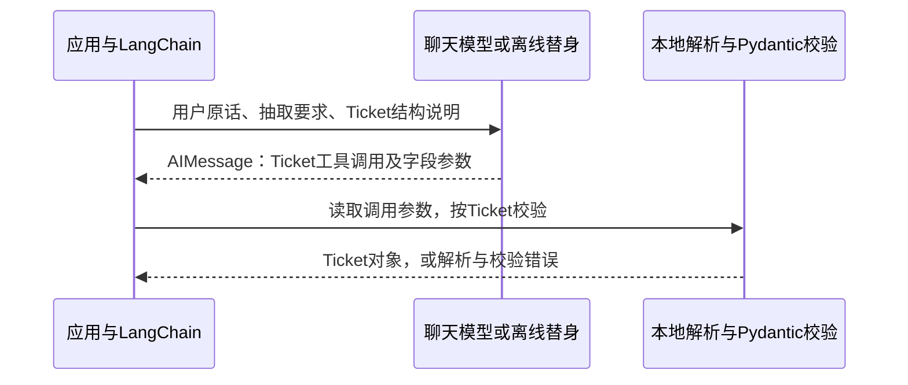
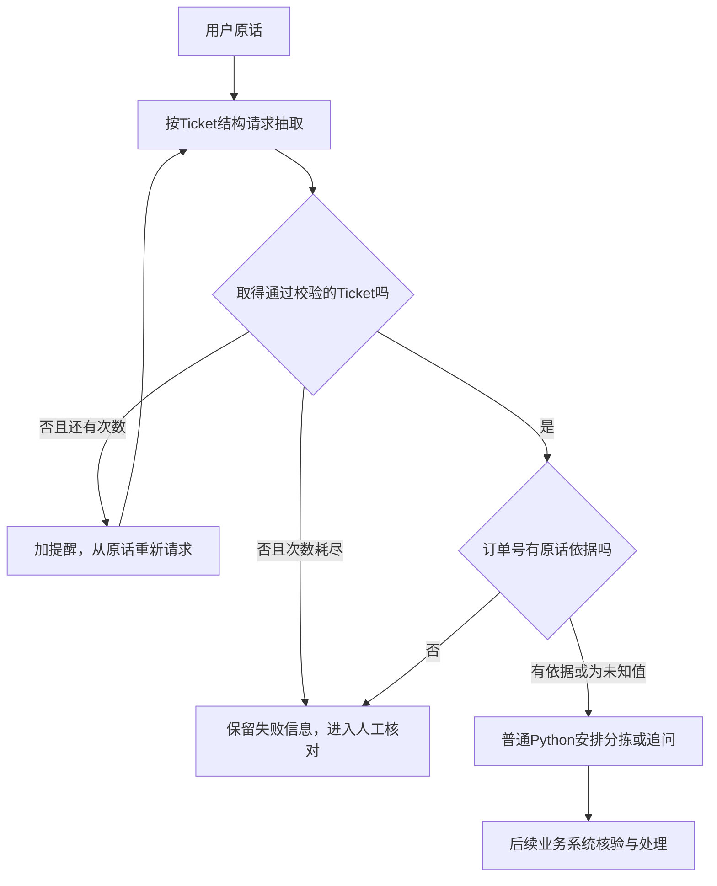

# 大模型应用开发学习 21：结构化输出：让模型结果变成程序能用的数据

用户在售后窗口里发来一句话：

> A1001的退款申请还没处理，麻烦帮我跟进一下，我挺着急。

模型可以回复：“你想跟进A1001的退款进度，而且比较着急。”人读得懂，但程序接下来要创建工单草稿、分配处理队列，还要把订单号显示到对应字段里。此时，知道一句话的意思还不够，程序需要拿到稳定的字段。

**结构化输出要解决的，就是让模型按约定返回数据，使程序能够读取和检查结果。**这份约定可以说明有哪些字段、每个字段是什么类型、允许哪些值，以及缺少信息时怎么表示。

这篇用同一条售后描述走完一段处理：先看自由文本与JSON各自能做到什么，再定义工单字段，最后用LangChain取得经过校验的对象，交给普通Python决定下一步。这里整理的是用户诉求草稿；订单是否存在、退款是否真的未处理，仍需业务系统核验。

| 要解决的问题 | 本文怎样展开 |
| --- | --- |
| 为什么“请返回JSON”还不够 | 区分文字、合法JSON和符合字段约定的数据 |
| 字段约定具体怎么写 | 用一个工单类说明类型、枚举、长度和未知值 |
| LangChain封装了哪部分工作 | 对照手工解析与结构化模型调用 |
| 抽取不完整或格式错误怎么办 | 保留原始响应、有限重试，再进入失败分支 |
| 取得对象以后能不能直接执行业务 | 继续核对来源，并与订单事实检查分开 |

与前面的政策解释相比，这次改变的是输出给谁使用：解释政策时要一段文字；整理工单时要分类、订单号等字段。后面的处理仍是一条事先安排好的链，不需要重新引入工具决策循环。

在同一个售后入口里，三类处理可以分别存在：解释期限时使用检索证据，查询进度时读取订单系统，整理用户诉求时形成工单字段。本篇研究第三项，[前面的生成链](20-用LangChain组织一次政策解释.md)提供的“准备输入→模型→读取结果”仍然适用，只是末端从字符串换成校验后的对象。

`Ticket.category`给工单分派使用，不是给整个知识库确定搜索目录，也不意味着用户必须先选分类。程序可以先检索再抽取，也可以对原话直接抽取；采用哪条业务路径需明确设计，结构化输出接口不会自动替我们安排。

代码在[GitHub示例目录](https://github.com/benx92/ai-learning-notes/tree/main/examples/21-structured-output)。建议先跑本地字段检查，再看完整抽取；离线模型的适配细节可以后看：

| 文件 | 阅读用途 |
| --- | --- |
| [schemas.py](https://github.com/benx92/ai-learning-notes/blob/main/examples/21-structured-output/schemas.py) | 工单字段规则、原话来源检查、下一步建议 |
| [validation_demo.py](https://github.com/benx92/ai-learning-notes/blob/main/examples/21-structured-output/validation_demo.py) | 不接模型，先观察JSON解析与字段校验 |
| [extract_demo.py](https://github.com/benx92/ai-learning-notes/blob/main/examples/21-structured-output/extract_demo.py) | 主实验：准备输入、结构化调用、有限重试、草稿判断 |
| [fixtures.py](https://github.com/benx92/ai-learning-notes/blob/main/examples/21-structured-output/fixtures.py) | 实验辅助：返回预设消息，让主实验离线运行 |
| [agent_demo.py](https://github.com/benx92/ai-learning-notes/blob/main/examples/21-structured-output/agent_demo.py) | 可选对照：Agent怎样返回最终结构数据 |
| [README与运行说明](https://github.com/benx92/ai-learning-notes/blob/main/examples/21-structured-output/README.md) | 安装步骤、预期现象与测试范围 |

首次下载，在准备保存项目的目录执行：

```powershell
git clone https://github.com/benx92/ai-learning-notes.git
cd ai-learning-notes
cd examples/21-structured-output
py -3.12 -m venv .venv
.\.venv\Scripts\python.exe -m pip install -r requirements.txt
.\.venv\Scripts\python.exe validation_demo.py
.\.venv\Scripts\python.exe extract_demo.py
```

已有仓库直接进入`examples/21-structured-output`，使用安装好本例依赖的环境即可。默认不需要API Key。正文的源码块是完整文件摘录；带导入语句的Python调用示例，应在该目录的Python会话或另存的脚本中运行。

## 先看程序究竟卡在哪里

面对用户原话，普通文本回答可能是“退款进度，用户很着急”，也可能是“建议交给售后跟进，订单为A1001”。两句话都合理，但如果程序依赖“订单为”后面的文字，稍微换种说法就得重新解析。

一种直接改进是让模型返回JSON。JSON用固定语法表达对象、数组、字符串和数值等内容，Python可以把JSON文本解析成字典、列表等数据。

期望这条输入变成：

<!-- example-kind: illustration -->

```json
{
  "category": "退款进度",
  "order_id": "A1001",
  "urgency": "着急",
  "summary": "用户催促跟进退款申请"
}
```

程序可以读取`data["order_id"]`，不再从一句回复里截取订单号。

这里要先分清：JSON是一种文本格式，Python字典是程序已经能按键读取的数据。它们看起来相似，但不是同一种东西。下面不调用模型，直接解析一段手工提供的JSON：

<!-- example-kind: usage -->

```python
import json  # Python标准库，负责JSON文本与Python数据的转换。

raw_text = '{"category":"退款进度","order_id":"A1001","urgency":"着急","summary":"用户催促跟进退款申请"}'
print(type(raw_text).__name__)  # str：目前只是一段文字。
data = json.loads(raw_text)  # loads把JSON文本读成Python数据。
print(type(data).__name__)  # dict：这时才是字典。
print(data["order_id"])  # A1001：按字段名读取，不再截取自然语言。
```

当前JSON以花括号表示一组键值，解析成字典；下面会定义另一种叫`Ticket`的Python数据对象，两者也要分开看。


但“合法JSON”只是一项语法要求。下面也是合法JSON：

<!-- example-kind: illustration -->

```json
{
  "问题": "退款",
  "订单": "A1001",
  "紧急程度": "特别特别急"
}
```

它能被解析，却没有程序期待的`category`和`order_id`，紧急程度也使用了另一个词。甚至一个JSON数组或字符串，也可以在语法上成立，却完全不符合工单接口。

所以，要分别回答两个问题：**这段文字能不能解析成JSON？解析后得到的数据，是否符合我们约定的字段和取值？**后者需要一份明确的数据结构约定，通常叫 **Schema**。

| 检查层次 | 要回答什么 | 本例中的失败 |
| --- | --- | --- |
| JSON语法 | 能不能解析 | 缺引号、少括号、前后夹了解释文字 |
| 字段结构 | 有没有所需字段，类型与取值是否符合要求 | 缺少分类，或紧急程度填“特别特别急” |
| 业务与来源 | 数据有没有依据，是否可以用于当前业务 | 订单号格式正确，却不是用户提供的订单 |

结构化输出围绕前两层建立稳定交接；第三层仍要根据真实来源和业务规则继续检查。

## 先定义需要的工单，再让模型填写

我们希望得到一份工单草稿，先控制在四个字段：

| 字段 | 用途 | 约定 |
| --- | --- | --- |
| `category` | 进入哪类处理队列 | 退款进度、退货申请、其他 |
| `order_id` | 关联用户提及的订单 | A加4位数字；没有提供时允许为空 |
| `urgency` | 标记用户是否明确催促 | 普通、着急 |
| `summary` | 在列表中概括诉求 | 1～60个字符，不添加新事实 |

字段少一些，是为了让每个字段都对应一个明确用途。“退款是否到账”不放进这份抽取结构，因为用户原话没有给出可以核验的到账事实。

**先想清“字段约定”，再选择用什么代码表达。**普通字典能保存工单字段，却不会因为键叫`urgency`就拒绝“非常非常急”。需要程序实际执行检查，例如分类是否在允许的几项中、订单号是否符合格式。

Python里可以用 **Pydantic**完成这类数据定义和检查。它是单独的数据校验库，不是模型服务，也不依赖LangChain才能使用。在下面的写法中：

| 名称或写法 | 具体作用 |
| --- | --- |
| `class Ticket(BaseModel):` | 我们定义名为Ticket的工单类型，使用Pydantic的BaseModel提供校验能力；这里的Model指数据模型，不是大语言模型 |
| `category: ...`、`summary: str` | 声明字段名和期望类型；冒号后面是类型说明，不是已经填好的字段值 |
| `Literal[...]` | Python的类型声明方式，列出固定候选值；Pydantic会按这些候选值检查输入，这也叫枚举 |
| `Field(...)` | 给某个字段补充默认值、格式、长度和用途说明，不是调用模型生成这个字段 |
| `ConfigDict(...)` | 设置整份数据如何校验，例如拒绝多余字段 |

**Ticket是数据规则的定义，ticket是后面保存某一份已填写数据的变量。**定义一个类不会自动生成工单，就像定义函数不会立刻运行函数。


下面是配套`schemas.py`的实际导入与完整`Ticket`定义。先看每个字段的用途，再看限制条件：

<!-- example-source: examples/21-structured-output/schemas.py -->

```python
from typing import Literal  # 列出字段允许使用的固定值，不让模型自由命名分类。

from pydantic import BaseModel, ConfigDict, Field  # 数据对象基类、校验配置、字段约束。


class Ticket(BaseModel):
    """从用户原话整理的售后工单草稿，不表示订单事实已核验。"""

    # Ticket是我们定义的数据结构；BaseModel提供校验方法，不是大语言模型。
    # 拒绝多余字段，并关闭本例不需要的宽松类型转换。
    model_config = ConfigDict(extra="forbid", strict=True)

    # Literal只允许这三个分类；没有默认值，所以category必须提供。
    category: Literal["退款进度", "退货申请", "其他"] = Field(description="用户主要诉求")
    order_id: str | None = Field(
        default=None,  # 允许省略订单号；省略时用Python空值，不自动编造。
        pattern=r"^A[0-9]{4}$",  # 若提供字符串，必须完整符合A加4位数字。
        description="只提取原话明确出现的订单号，未提供时为null，不猜测",
    )
    # description解释字段含义；是否忠实原话仍需评估，不由类型校验保证。
    urgency: Literal["普通", "着急"] = Field(description="仅在用户明确表达着急或催促时填着急")
    summary: str = Field(min_length=1, max_length=60, description="概括原话，不添加退款状态等新事实")
```

`Ticket`描述一份工单应该长什么样。定义这个类，不会调用模型，也不会创建真实工单。

可以逐项阅读：`Literal[...]`列出允许的分类值；`str | None`表示订单号既可以是字符串，也可以是Python空值；`pattern`限制字符串格式；`min_length`和`max_length`检查摘要长度。`description`解释字段含义，后面会随结构说明一起提供给模型。

`extra="forbid"`让未约定字段报错。例如模型额外返回一个`refund_status="已到账"`，本例不会静默接收。`strict=True`使本地类型校验更严格，减少自动类型转换；它与模型服务接口里的严格输出开关不是同一个设置。[Pydantic模型](https://docs.pydantic.dev/latest/concepts/models/)、[严格模式](https://docs.pydantic.dev/latest/concepts/strict_mode/)

订单号的`pattern`使用正则表达式描述格式：`^`和`$`要求匹配整个字符串，`A`是固定开头，`[0-9]{4}`表示后面恰好四个数字。因此A1001能通过，A10010或“订单A1001”不能作为整个字段值通过。

可以先手工填写一份工单，完全不接模型：

<!-- example-kind: usage -->

```python
from schemas import Ticket

ticket = Ticket(
    category="退款进度",
    order_id="A1001",
    urgency="着急",
    summary="用户催促跟进退款申请",
)
print(type(ticket).__name__)  # Ticket：一份通过字段检查的数据对象。
print(ticket.order_id)  # 对象用点号读取字段；字典则用data["order_id"]。
print(type(ticket.model_dump()).__name__)  # dict：转回普通字典。
```

这一段的字段是我们手工提供的。后面接入模型，改变的是“谁来填写这些值”，本地检查仍使用同一份Ticket约定。

还要区分“文字说明”和“可执行约束”：`description`写“不要添加新事实”，并不能让Pydantic判断摘要是否真实；而`max_length=60`是本地确实会执行的检查。两者共同使用，但提供的保证不同。

Schema可以进一步表达成 **JSON Schema**，也就是用JSON描述数据约定。Pydantic通过`Ticket.model_json_schema()`生成这种表示，框架再根据调用方式将它交给模型服务。它描述的是结构，不是一份已经填好的工单。

| Python里的约定 | JSON Schema里的含义 |
| --- | --- |
| `category`等字段 | `properties`，定义对象属性 |
| `Literal["普通", "着急"]` | `enum`，限定候选值 |
| 没有默认值的必填字段 | `required`，要求字段出现 |
| `max_length=60` | `maxLength`，限制字符串长度 |
| 禁止额外字段 | `additionalProperties: false` |

这几个以`model_`开头的方法都是Pydantic数据对象的方法，不是调用大语言模型的命令：

| 方法 | 输入与结果 | 用在什么时候 |
| --- | --- | --- |
| `Ticket.model_validate(data)` | 字典等输入→校验后的Ticket对象 | 检查已经收到的数据 |
| `ticket.model_dump()` | 某份Ticket对象→普通字典 | 交给后续Python处理 |
| `ticket.model_dump_json()` | 某份Ticket对象→JSON字符串 | 编码成文本用于展示或传输 |
| `Ticket.model_json_schema()` | Ticket类型→描述字段规则的字典 | 给框架或服务说明期望结构 |

前两种转换处理的是“填好的数据”，最后一种处理的是“如何填写的规则”。它们本身都不会请求生成服务，也不会写入数据库。

模型服务对JSON Schema的支持范围可能不同，服务端能接受哪些约束，要看具体接口；收到结果后仍按本地约定校验。[JSON Schema对象说明](https://json-schema.org/understanding-json-schema/reference/object)

## 普通Python能解析和校验，缺的是生成时的约束

先不接模型，假设已经取得一段JSON文本。可以用标准库解析，再让Pydantic检查：

<!-- example-source: examples/21-structured-output/validation_demo.py -->

```python
def parse_ticket(raw_text):
    data = json.loads(raw_text)  # 步骤1：JSON文本转Python数据，只检查JSON语法。
    return Ticket.model_validate(data)  # 步骤2：按Ticket检查字段，成功才创建工单数据对象。
```

这段函数来自`validation_demo.py`，文件导入了`json`和`Ticket`。传入前面的工单JSON后，返回一个`Ticket`对象，程序可以用`ticket.category`和`ticket.order_id`读取字段。

这里的两行检查职责不同：`json.loads()`把文本解析成Python数据；`Ticket.model_validate()`检查字段和取值，成功后创建数据对象。对于后者，输入不符合约定时会抛出`ValidationError`。

遇到不符合字段约定的数据，Pydantic会抛出名为`ValidationError`的异常。异常是程序报告当前步骤失败的方式；`try/except`允许调用方接住这个失败，决定显示错误或重新处理。可以故意填错一个值观察：

<!-- example-kind: usage -->

```python
from pydantic import ValidationError
from schemas import Ticket

try:
    Ticket(category="退款进度", order_id="A1001", urgency="非常急", summary="催促跟进")
except ValidationError:
    print("校验失败：urgency只能是普通或着急")
```

这不是模型生成失败，而是本地字段检查拒绝了数据；即使不接模型，同样会触发。

运行配套验证实验，可以直接观察这些情况：

| 返回内容 | JSON解析 | Ticket校验 |
| --- | --- | --- |
| 四个字段符合本例约定 | 通过 | 通过 |
| 少了必填的`urgency` | 通过 | 拒绝 |
| `urgency`填“非常急” | 通过 | 拒绝 |
| `summary`超过60个字符 | 通过 | 拒绝 |
| 多出`refund_status`字段 | 通过 | 拒绝 |
| `order_id`填JSON空值`null` | 通过，转成`None` | 通过 |

这些能力普通Python配合校验库就能完成。可是，它们发生在回复到达之后，并没有告诉生成模型应该填哪些字段。

如果只在提示里写“返回JSON”，仍要另外说明字段、取得回复、解析、检查并处理失败。**LangChain的结构化输出入口把Schema带进模型调用，再把返回数据接到解析与校验步骤。**它复用的是这段调用前后的连接工作。

这些连接也可以用厂商SDK和普通Python完成：按服务接口发送工具结构或原生Schema，再接上解析与校验。LangChain提供的是可复用入口和数据交接，结构化输出并不以使用LangChain为前提。它也不会替我们决定怎样设计工单，或凭空提高模型对每条描述的理解能力。

## 用LangChain接通一次完整抽取

先给模型准备输入。`extract_demo.py`里的`make_prompt()`把固定要求和每次变化的用户原话放在两条消息中：

<!-- example-source: examples/21-structured-output/extract_demo.py -->

```python
def make_prompt():
    # 步骤1：声明抽取要求与原话的位置；validation_hint首次为空，失败后才追加提醒。
    return ChatPromptTemplate.from_messages([
        ("system", "从用户原话整理售后工单草稿，只抽取诉求，不核定退款事实。"
         "订单号未提供时使用JSON null，不生成订单号。{validation_hint}"),
        ("human", "用户原话：{text}"),
    ])
```

其中`text`是本次原话，`validation_hint`开始为空，后面只在结构校验失败需要再尝试时加入提醒。用户原话是待分析资料，系统要求说明怎样抽取。

前面的纯文本链把模型响应交给文本解析器，只留下回答文字。现在需要的是工单对象，因此把末尾改成“按Ticket读取并校验”，不再接`StrOutputParser`提取消息正文。

这里用到的新入口叫`with_structured_output(...)`，是聊天模型集成提供的配置方法。把`Ticket`类交给它，得到变量`extractor`保存的执行组件；以后调用这个组件时，框架才会把结构要求连同输入交给模型，并处理回复。它没有在配置这一行就自动填出一份工单。

接着，把模型配置成按`Ticket`返回结果，再和提示模板连接：

<!-- example-source: examples/21-structured-output/extract_demo.py -->

```python
def build_chain(model):
    # 步骤2：按Ticket类的规则配置输出，不是创建一份已经填写好的工单。
    # 这一步只组装组件；invoke才请求模型并处理返回值。
    extractor = model.with_structured_output(
        # function_calling用工具参数承载数据；include_raw保留原始消息和解析状态。
        Ticket, method="function_calling", include_raw=True,
    )
    # 与纯文本链不同，这里直接返回解析后的对象及状态，不接StrOutputParser取正文。
    return make_prompt() | extractor
```

这里的`model`是已经准备好的聊天模型对象。`with_structured_output()`接收类`Ticket`，表示“按这份结构填写”；传的不是一份工单实例。`method="function_calling"`选择本例的工具调用格式，具体过程下一节展开。

`include_raw=True`让调用后保留三项信息：

| 字段 | 保存什么 | 本例成功时 |
| --- | --- | --- |
| `raw` | 原始模型消息 | `AIMessage`，带工具调用参数 |
| `parsed` | 解析并校验后的结果 | `Ticket`对象 |
| `parsing_error` | 解析或校验时捕获的错误 | `None` |

如果使用本例的Pydantic结构，并关闭`include_raw`，成功时通常直接返回`Ticket`对象；打开后，外层变成含上述字段的字典。因此不能把整个结果字典当作工单读取。[模型层结构化输出](https://docs.langchain.com/oss/python/langchain/models#structured-output)

`build_chain()`只是配置处理关系。真正运行`chain.invoke(...)`，才会准备提示、调用模型并处理回复。

配套目录已经准备了离线模型替身`ScriptedModel`。它按预先写好的内容返回一次`Ticket`工具请求，**不理解自然语言，也不请求网络**；模板、模型接口、解析器和Pydantic校验使用真实组件。这样可以先看清输入输出，在线效果另行验证。

当前实例重新准备一段原话与固定参数，观察输出数据形状；没有导入20篇的链，也没有导入13篇知识库。这里“接通完整抽取”只指从原话输入到经过检查的工单数据，不等于完整售后Agent已经接通。成功后交给下游的是对象字段，不能因此把用户对退款状态的描述当作订单系统事实。

下面的离线调用里有几个本例自定义的名称，先分清它们的用途：

| 名称 | 来自哪里、做什么 |
| --- | --- |
| `DEMO_TEXT` | fixtures.py中保存的开篇用户原话 |
| `GOOD_ARGS` | 同文件里预先写好的四字段工单字典，内容与开篇期望结果一致 |
| `tool_reply(GOOD_ARGS)` | 把字典放进AIMessage的工具调用参数，模拟服务交回一条回复 |
| `ScriptedModel(responses=[...])` | 依次交回预设回复的测试对象，列表里有几条，就准备了几次响应 |

这些名称都是离线实验辅助，不是业务开发必须重新实现的框架接口。在线时用`make_live_model()`创建服务客户端即可，字段检查与后续草稿处理继续复用。

在配套目录安装依赖后，可用下面的调用观察结果：

<!-- example-kind: usage -->

```python
from extract_demo import build_chain
from fixtures import DEMO_TEXT, GOOD_ARGS, ScriptedModel, tool_reply

# 准备一条已写好的响应；不会从DEMO_TEXT智能抽取内容。
model = ScriptedModel(responses=[tool_reply(GOOD_ARGS)])
chain = build_chain(model)  # 只组装模板、结构要求和解析步骤。
result = chain.invoke({"text": DEMO_TEXT, "validation_hint": ""})  # 此时才执行。
print(type(result["parsed"]).__name__)  # 外层字典的parsed字段里才是工单对象。
print(result["parsed"].order_id)
```

输出是：

```text
Ticket
A1001
```

这已经完成了从用户原话输入到可读取字段的程序路径。离线响应预先写好，所以这次运行证明的是接口和校验能衔接，不是模型已经学会抽取。

## 工具调用格式，为什么能用于结构化输出

先看本例一次成功调用的内部过程：



模型返回的调用名字是`Ticket`，参数包括`category`、`order_id`等字段。LangChain读取这些参数，再创建`Ticket`对象。当前路径里，`raw.content`可以为空，数据在`raw.tool_calls`中；只打印正文内容，可能误以为模型什么也没返回。

**这里借用了工具调用的参数格式，没有执行查单函数。**`Ticket`是提交抽取结果的结构名，不是能读取订单数据库的业务工具。取得`Ticket(order_id="A1001", ...)`，只能说明输出给出了这个订单号，还不能说明系统查过A1001。

可以接着查看刚才那份`result`，核对字段到底放在哪里：

<!-- example-kind: usage -->

```python
from extract_demo import build_chain
from fixtures import DEMO_TEXT, GOOD_ARGS, ScriptedModel, tool_reply

result = build_chain(ScriptedModel(responses=[tool_reply(GOOD_ARGS)])).invoke(
    {"text": DEMO_TEXT, "validation_hint": ""},
)
print(repr(result["raw"].content))  # ''：本例消息正文为空。
print(result["raw"].tool_calls[0]["name"])  # Ticket：结构名称。
print(result["raw"].tool_calls[0]["args"]["order_id"])  # A1001：原始参数字典中的值。
print(result["parsed"].order_id)  # A1001：同一数据经过本地检查后成为对象字段。
```

`tool_calls`是请求列表，`[0]`取第一项，`args`是该项的参数字典；当前例子只有一项。`repr()`让空字符串明确显示为`''`，便于与“根本没有打印”区分。这也说明取消息正文的文本解析器不适合当前数据位置。

实际的结构化输出不只有这一条路径：

| 方式 | 在哪里提出格式要求 | 仍需注意什么 |
| --- | --- | --- |
| 提示要求输出JSON | 提示内容 | 可能附带文字或出现字段漂移，需自行解析校验 |
| JSON模式，常见名`json_mode` | 模型服务要求合法JSON；字段说明仍需提供 | 合法JSON不等于符合Ticket |
| 工具调用，常见名`function_calling` | 用工具参数结构表达所需字段 | 需读取工具参数，并处理缺失或不符合约定的结果 |
| 原生结构化输出，常见名`json_schema` | 支持该功能的服务接收Schema并施加约束 | 支持的结构子集、拒绝或中断情况仍依赖服务 |

这些名称描述不同的约束与传输方式，不是四种新的模型。`method`参数也不是所有模型集成都支持同样的值。本文明确选择工具调用路线，换模型时先核对对应集成。[方式与支持范围](https://docs.langchain.com/oss/python/langchain/models#structured-output)

本例选择Pydantic类，是因为框架会接入相应的本地字段校验。也可以用字典描述结构，但“拿到一个字典”不代表完成了同样的校验；这些可选接口的差别留在文末扩展说明，当前先沿Ticket对象读完处理过程。

## 信息不足时，怎样表示未知，而不是逼模型填写

现在把原话换成：

> 退款申请还没处理，我挺着急，帮我跟进一下。

用户仍然要催退款，只是没有订单号。合理的工单可以保留分类和摘要，把`order_id`写为JSON空值`null`，再由程序询问订单号。

空值与缺字段是两种不同情况。在Pydantic 2中，下面两个定义就能看出差别，摘自`schemas.py`：

<!-- example-source: examples/21-structured-output/schemas.py -->

```python
class RequiredNullable(BaseModel):
    # 值允许None，但没有默认值，所以字段不能省略。
    order_id: str | None
```

<!-- example-source: examples/21-structured-output/schemas.py -->

```python
class OmittableNullable(BaseModel):
    # 值允许None，也提供了默认值，所以整个字段可以省略。
    order_id: str | None = None
```

| 输入 | RequiredNullable | OmittableNullable |
| --- | --- | --- |
| `{"order_id": "A1001"}` | 通过 | 通过 |
| `{"order_id": null}` | 通过 | 通过 |
| `{}`，省略字段 | 拒绝 | 使用默认值`None` |

`str | None`回答“值可以是什么”，`= None`提供省略字段时的默认值。**要求字段必须出现，同时允许值为null，是一种完全合理的接口设计。**不应把“必填”直接等同于“必须编一个非空字符串”。某些模型服务的严格Schema也要求字段都出现，再用空值表达未知。[Pydantic默认值](https://docs.pydantic.dev/latest/concepts/fields/#default-values)、[JSON Schema的null](https://json-schema.org/understanding-json-schema/reference/null)

本例的`Ticket.order_id`采用允许省略、默认`None`的设计，也明确提示没有订单号就使用JSON空值。换到原生严格输出服务时，仍要按照该服务支持的Schema规则适配。

还要区分`null`与字符串`"null"`。前者解析后是`None`；后者是四个字符组成的字符串。若字段只允许`str | None`而没有更多约束，字符串`"null"`可能通过类型校验。本例同时规定订单号必须符合A加4位数字，所以`"null"`、空字符串和“未知”都会被拒绝。

有的接口会把历史数据中的空字符串等归一化为空值。可以这样设计，但要明确转换规则；不要把任何无效订单号都自动改成`None`，否则模型输出错误会被掩盖成“用户没提供”。当前实现保留错误，交给失败处理。

## 解析失败以后，重试什么，什么时候停止

模型可能返回了不合法的参数，也可能只输出一段文字而没有提供工单。在`include_raw=True`下，本例会检查两个条件：没有解析错误，而且`parsed`确实是`Ticket`对象。

后一个条件不能省略。本地测试中，模型只返回普通文字时，可能得到`parsed=None`、`parsing_error=None`；“没有异常”并不能单独代表取得了有效工单。

`extract_demo.py`使用下面的有限尝试逻辑：

<!-- example-source: examples/21-structured-output/extract_demo.py -->

```python
def extract_with_retry(model, text, max_attempts=2):
    # 最多尝试次数包含首次；默认一次失败后只再尝试一次。
    if max_attempts < 1:
        raise ValueError("max_attempts必须至少为1")
    chain = build_chain(model)
    hint = ""
    for attempt in range(1, max_attempts + 1):
        # 每次都用原始text重新填模板；hint是本次附加的校验提醒。
        result = chain.invoke({"text": text, "validation_hint": hint})
        result = {**result, "attempts": attempt}  # 复制结果字典并追加当前尝试次数。
        # 同时检查错误和结果类型；没有异常，不代表一定拿到了Ticket。
        if result["parsing_error"] is None and isinstance(result["parsed"], Ticket):
            return result
        # 只有结构结果失败才继续；网络或模型调用异常会直接向上抛出。
        hint = "上次未得到有效工单。检查必填字段、分类取值、摘要长度和订单号格式，再提交Ticket数据。"
    # 次数耗尽交回最后一次失败信息，不伪造一份成功结果。
    return result
```

函数中的`result`仍是前面含`raw/parsed/parsing_error`的字典，`{**result, "attempts": attempt}`复制已有字段并追加尝试次数。`isinstance(..., Ticket)`检查解析结果是不是一份工单对象。两项条件都成立才返回成功，避免把“没有报错但没有工单”当成成功。

下面故意准备“第一次紧急程度不合法、第二次合法”两条固定回复，观察为什么会再执行一次：

<!-- example-kind: usage -->

```python
from extract_demo import extract_with_retry
from fixtures import DEMO_TEXT, GOOD_ARGS, ScriptedModel, tool_reply

bad_args = GOOD_ARGS.copy()  # 先复制，避免改变共用的合法样例。
bad_args["urgency"] = "非常急"  # 不在Ticket允许的取值中。
model = ScriptedModel(responses=[tool_reply(bad_args), tool_reply(GOOD_ARGS)])
result = extract_with_retry(model, DEMO_TEXT)
print(result["attempts"])  # 2：包含第一次失败和第二次成功。
print(result["parsing_error"])  # None：这是第二次返回的校验状态。
```

默认最多尝试两次，包含首次。第一次没得到有效工单，下一次重新从原始用户描述发起请求，加一条字段检查提醒；两次仍失败，就把最后的响应和失败信息交回上层，不制造一份“看起来正常”的空工单。

每次尝试重新准备系统消息与用户原话，没有把上一轮带工具请求的模型消息直接塞回去。若采用继续工具对话的方式修正，则必须保持工具请求与结果的正确配对，不能留下未处理的调用记录。

**为什么不直接给整条链套普通重试？**因为`include_raw=True`可以把解析错误放进结果字典，调用本身正常返回。依赖“抛异常才重试”的包装未必会触发。本例显式检查结果，保证停止条件看得见。

这也不是对所有失败都重复生成：

| 失败 | 当前处理或需要的处理 |
| --- | --- |
| 字段缺失、枚举错误、没有结构结果 | 本例最多两次模型尝试，仍失败则转核对 |
| 凭证无效、服务不支持该调用方式 | 修正配置与能力选择，不能靠重复同一请求解决 |
| 网络或模型执行异常 | 本例向上抛出，由调用方处理；未伪装成解析失败 |
| 订单号格式合格但没有来源 | 后面的来源检查拒绝草稿，不自动重复生成 |
| 用户本来就没提供订单号 | 用合法空值保留缺口，再向用户询问 |

`include_raw`便于定位错误，但它不是“捕获所有错误”的开关。排查时先区分服务调用失败、回复解析失败，以及业务核对不通过，才能决定应修正哪一步。

## 有了合格对象，再接回业务判断

拿到`Ticket`以后，普通Python就可以依据分类和订单号安排下一步。配套`next_step()`的规则是：其他诉求交人工分拣；退款或退货诉求没有订单号时先追问；有订单号时再进入对应处理队列。

在进入这个判断之前，`schemas.py`还做一项有限的来源检查：**抽取的订单号必须在用户原话中独立出现。**例如输出A9999，而原话只有A1001，即使格式完全正确，也拒绝继续生成可用草稿。

先看取得对象之后怎样使用字段。这是`schemas.py`中的实际处理建议函数，全部是普通Python判断：

<!-- example-source: examples/21-structured-output/schemas.py -->

```python
def next_step(ticket):
    # 只返回处理建议，不创建工单、不查询订单，也不执行退款。
    if ticket.category == "其他":
        return "人工分拣"
    if ticket.order_id is None:
        return "请用户补充订单号"
    if ticket.category == "退款进度":
        return "进入退款跟进队列"
    return "进入退货咨询队列"
```

函数返回“进入队列”等建议字符串，外部没有接任何队列服务。`check_order_evidence()`则只检查文本依据；`EvidenceMismatch`是本例为“原话不包含该订单号”定义的异常名，后面用`except`接住它。

下面的`prepare_draft()`把结构与来源检查接到一起。文件中已定义`Ticket`、`EvidenceMismatch`、`check_order_evidence()`和`next_step()`：

<!-- example-source: examples/21-structured-output/schemas.py -->

```python
def prepare_draft(envelope, original_text):
    # 步骤1：envelope是包含parsed/parsing_error等字段的结果字典。
    ticket = envelope["parsed"]
    if envelope["parsing_error"] is not None or not isinstance(ticket, Ticket):
        return {"state": "needs_review", "reason": "invalid_structure", "draft": None}
    # 步骤2：结构合格后，再核对订单号是否来自用户原话。
    try:
        check_order_evidence(ticket, original_text)
    except EvidenceMismatch:
        return {"state": "needs_review", "reason": "order_not_in_source", "draft": None}
    # 步骤3：数据对象转为普通字典，并给出下一步建议；这里不写数据库。
    return {"state": "ready", "draft": ticket.model_dump(), "next_step": next_step(ticket)}
```

这里的`envelope`只是函数参数名，接收的就是前面完整的结果字典；`ticket.model_dump()`把对象变为字典，方便放进草稿。`state`、`draft`和`next_step`都是本例自定义的返回字段，不是LangChain的自动业务状态。

可以把完整调用接起来，观察三层数据：

<!-- example-kind: usage -->

```python
from extract_demo import extract_with_retry
from fixtures import DEMO_TEXT, GOOD_ARGS, ScriptedModel, tool_reply
from schemas import prepare_draft

model = ScriptedModel(responses=[tool_reply(GOOD_ARGS)])
packet = extract_with_retry(model, DEMO_TEXT)  # 模型响应与解析结果字典。
ticket = packet["parsed"]  # 校验后的Ticket对象。
draft = prepare_draft(packet, DEMO_TEXT)  # 来源检查后的业务草稿字典。
print(ticket.order_id)  # A1001。
print(draft["state"])  # ready。
print(draft["next_step"])  # 进入退款跟进队列。
```

成功路径运行完整`extract_demo.py`，会打印：

<!-- example-kind: illustration -->

```json
{
  "state": "ready",
  "draft": {
    "category": "退款进度",
    "order_id": "A1001",
    "urgency": "着急",
    "summary": "用户催促跟进退款申请"
  },
  "next_step": "进入退款跟进队列"
}
```

`ready`在这里仅表示草稿通过了本例检查，可以供后续分派使用；脚本并未写入工单库或执行退款。如果没有订单号，合法结果仍可保留为草稿，但`next_step`会变为“请用户补充订单号”。来源或结构不符时，`state`变为`needs_review`，`draft`为`null`。

整段处理关系是：



订单号出现在原话里，也只说明有文本依据，不证明用户有权访问它。用户可能写错订单号，或提到他人的订单。后续仍需认证、核对归属，并查询实时业务记录。

同样，本例的字段校验无法证明摘要忠实，也无法完整判断“着急”标记是否合理。这些需要用有预期标注的真实问法做评估。若一句话提到多个订单，当前单订单结构也可能丢信息，应先明确拆单或列表设计，再扩展Schema。

结构化输出让字段可被稳定消费，来源与业务检查决定字段能被用于什么动作。两者接起来，程序才有可解释的处理路径。

## 运行示例，并区分模型层与Agent层入口

开头已给出下载和安装命令。在`examples/21-structured-output`目录运行以下三个独立入口和测试：

```powershell
.\.venv\Scripts\python.exe validation_demo.py
.\.venv\Scripts\python.exe extract_demo.py
.\.venv\Scripts\python.exe agent_demo.py
.\.venv\Scripts\python.exe -m unittest -v
```

`validation_demo.py`不调用模型，直接观察JSON与字段检查；`extract_demo.py`默认使用固定响应，运行模板、结构化接口、校验和草稿判断；`agent_demo.py`单独对照Agent入口。它们不查询真实订单，也不执行写入。

配套环境固定`langchain==1.4.6`、`langchain-core==1.6.10`、`langchain-deepseek==1.1.1`和`pydantic==2.14.1`。14项本地检查覆盖Schema传递、缺失值、无效参数、原始响应保留、重试次数、来源拒绝，以及Agent返回字段等行为。

若要使用自己的在线模型，在同一会话设置凭证与支持本例工具调用方式的可用模型名：

```powershell
$env:DEEPSEEK_API_KEY = "填写自己的密钥"
$env:LC_CHAT_MODEL = "填写账户可用的模型名"
.\.venv\Scripts\python.exe extract_demo.py --live
```

在线脚本不自动加载`.env`，最多两次生成尝试，单次请求超时45秒，模型客户端自动重试关闭。它采用DeepSeek集成的非思考模式配置；换供应商或模式时应核对接口支持，不能原样照搬。[DeepSeek集成](https://docs.langchain.com/oss/python/integrations/chat/deepseek)

本次没有使用真实密钥请求线上模型，因此没有把离线结果当作抽取效果验证。在线请求使用自己的服务额度，不要把真实密钥写入代码或Git。

**如果已经在使用Agent，结构化输出放在哪里？**模型层的入口处理一次生成；Agent层的入口约束一段运行最终返回的数据。后者使用`create_agent(response_format=...)`，结果从`structured_response`读取，而不是把整个运行状态当作工单。

`ToolStrategy`是Agent结构化输出的一种策略组件，意思是“用工具调用参数提交最终工单”，不是执行订单操作。把它放进`response_format`，是在配置Agent应怎样交回最终数据。配套`agent_demo.py`显式使用`ToolStrategy(Ticket, handle_errors=False)`，通过工具参数承载最终数据，关闭策略内的自动修正，便于单独观察返回结果；模型调用也设有上限。其他服务原生输出策略与自动选择行为留在扩展说明，使用时仍需核对模型和框架版本。[Agent结构化输出](https://docs.langchain.com/oss/python/langchain/structured-output)

这个Agent实验没有订单业务工具，轨迹最后可以是确认结构结果的`ToolMessage`。它表示框架接收了工单数据，不表示已创建业务工单。完整入口代码和更详细的返回类型对照放在[实现与接口说明](https://github.com/benx92/ai-learning-notes/blob/main/supplements/21-结构化输出实现与接口说明.md)。

回到最初的诉求：程序需要的不是从回复中猜出“用户挺着急”，而是拿到可检查的分类、订单号和摘要。Schema把约定写出来，模型按约定填写，框架连接请求与解析，本地校验和业务规则决定怎样继续。这样既能让下游稳定读取，也能在信息不足或结果有误时留下明确出口。

## 参考资料

- [LangChain模型层结构化输出](https://docs.langchain.com/oss/python/langchain/models#structured-output)
- [LangChain Agent结构化输出](https://docs.langchain.com/oss/python/langchain/structured-output)
- [Pydantic模型与校验](https://docs.pydantic.dev/latest/concepts/models/)
- [Pydantic字段与默认值](https://docs.pydantic.dev/latest/concepts/fields/)
- [JSON Schema对象](https://json-schema.org/understanding-json-schema/reference/object)
- [JSON Schema空值](https://json-schema.org/understanding-json-schema/reference/null)
