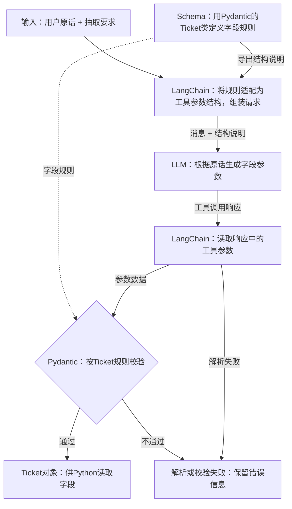

# 大模型应用开发学习 21：结构化输出：让模型结果变成程序能用的数据

售后系统收到用户消息后，客服通常要先读懂诉求，再把订单号、问题类别和紧急程度填进工单，交给对应人员处理。现在希望让模型接过“读消息、整理字段”这一步，程序再根据字段给出处理建议。

例如，用户在售后窗口发来一句话：

> A1001的退款申请还没处理，麻烦帮我跟进一下，我挺着急。

模型可以把它整理成“用户想跟进 A1001 的退款申请，情绪比较着急”。人读这句话没有困难，但接收结果的程序要做的是读取订单号、判断类别、填入工单草稿。它需要明确的字段名和取值，才能知道哪部分数据交给哪段处理逻辑。

如果程序靠“跟进”后面的位置截取订单号，模型把回复改成“订单 A1001 需要跟进”，原来的截取逻辑就可能失效。订单号可以用正则表达式辅助提取，但“退款申请还没处理”和“退回的商品怎么寄”分别属于什么诉求，仍需要结合语义判断。这里让模型负责理解原话，让程序负责读取固定字段、检查结果和决定下一步。

因此，希望同一条消息得到的是这样一份数据。字段名由开发者事先约定，字段值由模型根据原话填写：

<!-- example-kind: illustration -->

```json
{
  "category": "退款进度",
  "order_id": "A1001",
  "urgency": "着急",
  "summary": "用户催促跟进退款申请"
}
```

有了固定字段，程序可以读取 `order_id`，再根据 `category` 给出分派建议。但只在提示里写“请返回 JSON”还没有解决全部问题：即使返回的是合法 JSON，模型也可能把字段写成“订单”，把紧急程度写成程序没有处理过的“特别特别急”。

**这里要解决的核心问题是：怎样把模型对自然语言的理解，交接为字段明确、取值可检查、失败能识别的程序数据。**结构化输出为这次交接建立约定：先定义字段和规则，再把要求交给模型，最后解析并校验实际结果。

这份结果定位为工单草稿。原话里的“还没处理”是用户的描述，不能直接证明退款的实时状态；订单号没提供时，也应保留未知，留给后续追问。

[政策解释](20-用LangChain组织一次政策解释.md)把模型回复收成可展示的文字；这里沿用消息输入与模型调用的方式，把结果交接改为可校验的工单字段。

## 参考代码示例：每个文件用来观察什么

配套代码在 [GitHub 示例目录](https://github.com/benx92/ai-learning-notes/tree/main/examples/21-structured-output)，环境准备与运行命令见 [README](examples/21-structured-output/README.md)。下表按正文理解顺序列出入口；定义规则的文件供其他脚本导入，不需要逐个直接运行。

| 要理解的问题 | 参考代码 | 是否调用真实模型 | 应观察的结果 |
| --- | --- | --- | --- |
| 字段怎样定义，缺信息时怎样表达 | [schemas.py](examples/21-structured-output/schemas.py)：`Ticket` | 否，供脚本导入 | 四字段约定，以及允许为空的订单号 |
| 合法 JSON 为什么仍会被拒绝 | [validation_demo.py](examples/21-structured-output/validation_demo.py)：`parse_ticket()` | 否，使用固定数据 | 非法枚举、额外字段被拒绝，空订单号可以通过 |
| 一次在线调用怎样得到对象 | [quick_start.py](examples/21-structured-output/quick_start.py) | 是，需要密钥 | 从 `parsed` 读取 `Ticket` 和订单号 |
| 怎样串起模板、抽取、失败检查和草稿处理 | [extract_demo.py](examples/21-structured-output/extract_demo.py)：`build_chain()`、`extract_with_retry()`；[schemas.py](examples/21-structured-output/schemas.py)：`prepare_draft()` | 默认否；`--live` 时调用 | 解析状态、工单草稿和下一步建议；错误分支由测试覆盖 |
| 离线实验为什么能复现指定响应 | [fixtures.py](examples/21-structured-output/fixtures.py)：`ScriptedModel`、`tool_reply()` | 否，供实验与测试导入 | 预设工具响应进入真实的解析与校验流程，不验证语义抽取效果 |
| 失败分支是否被正确接住 | [test_examples.py](examples/21-structured-output/test_examples.py) | 否，运行离线测试 | 有限重试、重试耗尽、缺信息和来源不符等分支的断言结果 |
| 可选：Agent 的最终结构结果从哪里读取 | [agent_demo.py](examples/21-structured-output/agent_demo.py) | 否，使用固定响应 | 从 `structured_response` 读取最终结果，详见[扩展说明](supplements/21-结构化输出实现与接口说明.md) |

先把字段规则与本地校验弄清楚，再运行最小在线示例；没有密钥时，也可以用默认离线的完整示例观察数据交接。

## 从输出约定到本地校验：各个组件接走哪部分工作

要完成这次交接，需要有人理解原话、有人描述字段规则、有人检查收到的数据。下面用到四个名称，分别对应这些工作；先看职责，再看具体接口。

| 角色 | 在这次抽取中的工作 | 具体例子 |
| --- | --- | --- |
| LLM，大语言模型 | 根据输入生成字段值 | 判断诉求是“退款进度”，提取A1001 |
| Schema，数据结构约定 | 规定字段、类型、候选值与约束 | `urgency`只能是“普通”或“着急” |
| Pydantic，Python数据校验库 | 用Python定义约定，生成结构说明，校验数据并创建对象 | `Ticket`类、`model_validate()` |
| LangChain，应用框架 | 经模型集成传递结构要求，读取响应并接上校验 | `with_structured_output(Ticket, ...)` |

下面把规则与数据放进同一张图。实线表示数据传递，虚线表示校验使用的规则：



**Schema是约定，Pydantic是表达和执行约定的工具。**Python类先转成服务能接收的说明，LLM返回字段数据，本地程序才创建`Ticket`对象。不使用LangChain，也可以直接请求模型服务，再用Pydantic校验。

先看字段约定为什么必须独立于 JSON 语法。JSON只规定文本的语法：对象怎么写、字符串如何加引号。下面同样是合法JSON：

<!-- example-kind: illustration -->

```json
{"订单": "A1001", "紧急程度": "特别特别急"}
```

但程序需要的是`order_id`和`urgency`，而且后者只有两个候选值。**能解析，和符合接口约定，是两层要求。**

不接模型也能观察这个区别。按配套 README 准备环境后，可在示例目录运行下面的独立片段；这里只用固定文本检查数据，不发送模型请求：

<!-- example-kind: usage -->

```python
import json
from pydantic import ValidationError
from schemas import Ticket

raw_text = '{"category":"退款进度","order_id":"A1001","urgency":"非常急","summary":"催促跟进"}'
data = json.loads(raw_text)  # JSON文本 -> Python字典，语法正确，所以成功。
try:
    ticket = Ticket.model_validate(data)  # 字典 -> Ticket，需要继续检查字段。
except ValidationError:
    print("字段校验失败：urgency只能是普通或着急")
```

`raw_text`是字符串，`data`是字典；校验成功后得到`Ticket`对象，可以用`ticket.order_id`读取字段。

## 把工单规则写清楚，也给“未知”留位置

字段应由接收数据的程序需要什么来决定。当前程序需要识别诉求、关联订单，并给客服一段简短描述，因此这个草稿只保留四项。类别和紧急程度使用固定候选值，是为了让后续条件判断有明确的取值范围：

| 字段 | 程序用它做什么 | 规则 |
| --- | --- | --- |
| `category` | 选择处理队列 | 退款进度、退货申请、其他 |
| `order_id` | 关联用户提到的订单 | A加4位数字；未提供时允许为空 |
| `urgency` | 标记明确的催促 | 普通、着急 |
| `summary` | 在工单列表显示诉求 | 1～60个字符，不添加新事实 |

[schemas.py](https://github.com/benx92/ai-learning-notes/blob/main/examples/21-structured-output/schemas.py)用Pydantic表达这份约定。以下是实际导入与完整`Ticket`定义，省略了源码中的解释性注释：

<!-- example-source: examples/21-structured-output/schemas.py -->

```python
from typing import Literal

from pydantic import BaseModel, ConfigDict, Field


class Ticket(BaseModel):
    """从用户原话整理的售后工单草稿，不表示订单事实已核验。"""

    model_config = ConfigDict(extra="forbid", strict=True)

    category: Literal["退款进度", "退货申请", "其他"] = Field(description="用户主要诉求")
    order_id: str | None = Field(
        default=None,
        pattern=r"^A[0-9]{4}$",
        description="只提取原话明确出现的订单号，未提供时为null，不猜测",
    )
    urgency: Literal["普通", "着急"] = Field(description="仅在用户明确表达着急或催促时填着急")
    summary: str = Field(min_length=1, max_length=60, description="概括原话，不添加退款状态等新事实")
```

`BaseModel`是Pydantic的数据对象基类，这里的Model指“数据模型”。继承它以后，`Ticket`就有了校验和转换方法。定义这个类是在写规则；调用`Ticket(...)`或`Ticket.model_validate(data)`才是在用规则创建一份数据。

几个关键声明可以直接对应业务需求：

- `Literal[...]`列出允许的值，Pydantic会拒绝“非常急”这样的其他写法。
- `pattern`规定订单号格式：`^`和`$`约束整个字符串，`[0-9]{4}`表示四位数字。因此A1001通过，A10010和“订单A1001”不能作为整个字段值通过。
- `min_length`、`max_length`检查摘要长度；`extra="forbid"`拒绝多出的字段，例如未经约定的`refund_status`。
- `strict=True`收紧本地类型校验，减少自动类型转换。它不是模型服务的严格输出开关。

`description`的作用有所不同。它解释“着急”是什么意思、没有订单号时怎么填，可以随结构说明交给模型；但“不要添加新事实”是一句要求，不是Pydantic能够自动执行的事实核验。长度和枚举可以直接检查，摘要是否忠实则需要结合原话判断。

还有一个问题来自输入本身：用户不一定一次提供完整信息。如果字段只允许填写订单号字符串，模型面对没有订单号的消息，就无法忠实地表达“没提供”。给未知值留位置，后续程序才能把它转成追问。

**信息不足时，正确结果可以是不完整的业务信息，但仍然应是合法的数据。**

例如把原话改成“退款申请还没处理，我挺着急，帮我跟进一下”，用户没有给订单号。此时应把`order_id`填为JSON空值`null`，解析到Python里就是`None`，后续程序据此追问。

这里有一个值得单独记住的Pydantic 2规则：允许空值，不等于允许省略字段。

| 字段声明 | `{"order_id": null}` | `{}`省略字段 |
| --- | --- | --- |
| `order_id: str \| None` | 通过，值为`None` | 拒绝，字段仍必填 |
| `order_id: str \| None = None` | 通过，值为`None` | 通过，使用默认值`None` |

`str | None`决定允许的类型，默认值决定省略字段时怎么办。本文的`Ticket`采用第二种设计。要求字段必须出现、同时允许它的值为`null`，也是合理的接口约定。

另外，`null`与`"null"`不同：前者是空值，后者是字符串。本文的订单号格式检查会拒绝`"null"`、空字符串和“未知”，不会把它们悄悄改成`None`。这样才能区分“原话没给信息”和“抽取出了错误数据”。

## 先跑通：从一条消息拿到工单对象

配套代码在[GitHub示例目录](https://github.com/benx92/ai-learning-notes/tree/main/examples/21-structured-output)，完整准备步骤见[README](https://github.com/benx92/ai-learning-notes/blob/main/examples/21-structured-output/README.md)。首次下载，在PowerShell中执行：

```powershell
git clone https://github.com/benx92/ai-learning-notes.git
cd ai-learning-notes
cd examples/21-structured-output
py -3.12 -m venv .venv
.\.venv\Scripts\python.exe -m pip install -r requirements.txt
```

已有仓库直接进入`examples/21-structured-output`。本例使用DeepSeek的LangChain集成；在同一个PowerShell会话设置自己的密钥和支持工具调用的模型名：

```powershell
$env:DEEPSEEK_API_KEY = "填写自己的密钥"
$env:LC_CHAT_MODEL = "填写账户可用的模型名"
.\.venv\Scripts\python.exe quick_start.py
```

[quick_start.py](https://github.com/benx92/ai-learning-notes/blob/main/examples/21-structured-output/quick_start.py)直接请求模型服务，使用自己的服务额度。这里导入刚才定义的 `Ticket`，将同一份四字段规则用于模型调用：

<!-- example-source: examples/21-structured-output/quick_start.py -->

```python
"""最小在线抽取：配置模型、约定输出结构、读取工单字段。"""

import os

from langchain_deepseek import ChatDeepSeek

from schemas import Ticket


model = ChatDeepSeek(
    model=os.environ["LC_CHAT_MODEL"],
    temperature=0,
    timeout=45,
    max_retries=0,
    extra_body={"thinking": {"type": "disabled"}},
)
extractor = model.with_structured_output(
    Ticket, method="function_calling", include_raw=True,
)
result = extractor.invoke([
    ("system", "从原话整理售后工单草稿，只抽取诉求，不核定退款事实。"
     "未提供的订单号用null，不猜测。"),
    ("human", "A1001的退款申请还没处理，麻烦帮我跟进一下，我挺着急。"),
])
ticket = result["parsed"]
print(type(ticket).__name__)
print(ticket.order_id)
print(ticket.model_dump())
```

这段成功路径只有三个动作：`ChatDeepSeek`创建模型客户端，`with_structured_output()`配置输出规则，`invoke()`发送消息并解析响应。密钥由集成从环境变量读取；非思考模式、超时和重试配置与完整示例一致。

成功时可以看到类似结果，分类和订单号应与原话一致，摘要措辞可能不同：

```text
Ticket
A1001
{'category': '退款进度', 'order_id': 'A1001', 'urgency': '着急', 'summary': '用户催促跟进退款申请'}
```

没有密钥时，可先运行`extract_demo.py`观察离线流程；固定响应的用途在失败实验中说明。

## 拆开一次调用：规则怎样出去，数据怎样回来

最小示例传给`with_structured_output()`的是类`Ticket`，表示“按这份规则填写”。下面沿图中的请求与响应路径，看看这份规则怎样发挥作用。

### 去程：把Python约定变成服务能接收的说明

Pydantic可以通过`Ticket.model_json_schema()`，把类中的约定导出为 **JSON Schema**：一种用JSON描述数据结构的标准。比如`Literal`对应`enum`，长度上限对应`maxLength`，必填字段列在`required`里，禁止额外字段对应`additionalProperties: false`。

LangChain的模型集成会把规则转换为所选接口需要的格式。本文明确使用`method="function_calling"`，因此把`Ticket`作为工具结构名称，把工单字段作为工具参数约定，连同抽取要求和用户原话交给模型服务。实际请求可能经过格式转换，并非把`model_json_schema()`的结果不加处理地照搬。

这借用了[工具调用](15-FunctionCalling和ToolCall让模型从回答走向行动.md)的参数通道。区别在于：这里用参数提交最终抽取结果，没有等待执行一个查单函数。

### 回程：从工具参数创建本地对象

在线时，LLM仍然逐Token生成内容，只是任务从自由写一段回复，变成按给定字段生成工具参数。服务通过工具调用格式返回，LangChain将响应统一为`AIMessage`，读取参数，再按Pydantic类校验。成功才创建`Ticket`对象。

`include_raw=True`让最终结果保留三个字段，方便对照：

| 字段 | 内容 |
| --- | --- |
| `raw` | 原始响应消息`AIMessage` |
| `parsed` | 解析并校验后的`Ticket`；未取得有效结构时可能为`None` |
| `parsing_error` | 解析或校验时捕获的错误；没有此类错误时为`None` |

关闭`include_raw`时，本例Pydantic路径成功后直接返回`Ticket`；打开后，需要从外层字典的`parsed`读取工单。

在`quick_start.py`末尾继续加上这些打印，可以查看原始参数与对象字段的对应关系。下面是一次成功的工具调用响应示意，正文内容和摘要措辞由模型决定：

<!-- example-kind: usage -->

```python
print(repr(result["raw"].content))               # 工具调用响应的正文可能为空。
print(result["raw"].tool_calls[0]["name"])       # Ticket。
print(result["raw"].tool_calls[0]["args"]["order_id"])  # A1001。
print(result["parsed"].order_id)                # A1001：本地校验后的字段。
```

本例从`tool_calls`读取工单字段。[政策解释示例](20-用LangChain组织一次政策解释.md)末尾的`StrOutputParser`用于提取文字，这里不再接它。

请求中的结构说明用于引导生成，本地校验检查实际结果；前者不能替代后者。

一些服务还提供原生结构化输出，常见名为`json_schema`；JSON模式则通常只保证JSON语法，字段说明仍需提供。可用方式、Schema子集和严格约束能力取决于服务与模型集成，不能保证只换一个`method`就可运行。方式对照见[实现与接口说明](supplements/21-结构化输出实现与接口说明.md)。

### 在原来的链里替换输出部分

如果沿用提示模板与LCEL，只需把“普通模型加文本解析器”换成结构化组件。[extract_demo.py](https://github.com/benx92/ai-learning-notes/blob/main/examples/21-structured-output/extract_demo.py)的实际组合如下，同文件已导入`ChatPromptTemplate`和`Ticket`；摘录省略了已在正文解释的注释：

<!-- example-source: examples/21-structured-output/extract_demo.py -->

```python
def make_prompt():
    return ChatPromptTemplate.from_messages([
        ("system", "从用户原话整理售后工单草稿，只抽取诉求，不核定退款事实。"
         "订单号未提供时使用JSON null，不生成订单号。{validation_hint}"),
        ("human", "用户原话：{text}"),
    ])
```

<!-- example-source: examples/21-structured-output/extract_demo.py -->

```python
def build_chain(model):
    extractor = model.with_structured_output(
        Ticket, method="function_calling", include_raw=True,
    )
    return make_prompt() | extractor
```

`text`填本次原话；`validation_hint`是示例自定义的校验提醒，首次为空，失败重试时才补内容。`|`仍然表示把左侧输出交给右侧，只是整条链的返回值现在是结构化结果字典。

Pydantic的几个方法也可以沿这条数据流记，而不用背名字：

| 要处理什么 | 方法 | 得到什么 |
| --- | --- | --- |
| 发出规则说明 | `Ticket.model_json_schema()` | 描述结构的字典 |
| 检查收到的数据 | `Ticket.model_validate(data)` | 通过校验的`Ticket` |
| 交给普通程序使用 | `ticket.model_dump()` | 保存字段值的字典 |

这些都是本地方法：第一行处理“规则”，后两行处理“数据”。

## 接住失败：什么值得重试，什么时候追问

约定字段以后，程序仍可能收到缺字段、非法取值，甚至一段普通文字。若直接读取订单号继续处理，结构失败就会传到后续业务。最小示例只展示成功路径，完整程序还必须先确认这次确实拿到了工单，失败时才能决定是否重试。本文的成功条件是：`parsing_error`为空，且`parsed`确实是`Ticket`。

为什么不能只看错误？模型如果只返回一段普通文字，没有匹配的工具调用，本例解析器可能同时给出`parsed=None`、`parsing_error=None`。没有解析异常，不等于有可用数据。

`extract_demo.py`用一个有限循环处理结构失败，默认最多尝试两次，包含首次。下面省略重复注释，保留完整逻辑：

<!-- example-source: examples/21-structured-output/extract_demo.py -->

```python
def extract_with_retry(model, text, max_attempts=2):
    if max_attempts < 1:
        raise ValueError("max_attempts必须至少为1")
    chain = build_chain(model)
    hint = ""
    for attempt in range(1, max_attempts + 1):
        result = chain.invoke({"text": text, "validation_hint": hint})
        result = {**result, "attempts": attempt}  # 复制结果字典并追加当前尝试次数。
        if result["parsing_error"] is None and isinstance(result["parsed"], Ticket):
            return result
        # 只有结构结果失败才继续；网络或模型调用异常会直接向上抛出。
        hint = "上次未得到有效工单。检查必填字段、分类取值、摘要长度和订单号格式，再提交Ticket数据。"
    return result
```

第一次失败后，程序保留原话，追加一条检查提醒，再发起新请求。它没有逐字段分析并自动修正错误。次数耗尽则返回最后一次失败结果，交给后续核对。

这里显式检查返回值，是因为`include_raw=True`会把解析错误放进结果字典，调用未必抛异常；只套“遇到异常就重试”的包装，可能根本不会触发。每次尝试也重新构造消息，没有把未完成的工具请求直接接入下一轮对话。

为了稳定复现“第一次非法枚举、第二次合法”，下面改用离线替身`ScriptedModel`。`GOOD_ARGS`是预设的四字段字典，`tool_reply()`将它包装成工具响应；替身依次返回两条响应，不理解输入、不请求网络，但实际执行LangChain解析与Pydantic校验：

<!-- example-kind: usage -->

```python
from extract_demo import extract_with_retry
from fixtures import DEMO_TEXT, GOOD_ARGS, ScriptedModel, tool_reply

bad_args = {**GOOD_ARGS, "urgency": "非常急"}
model = ScriptedModel(responses=[tool_reply(bad_args), tool_reply(GOOD_ARGS)])
result = extract_with_retry(model, DEMO_TEXT)
print(result["attempts"])       # 2。
print(result["parsing_error"])  # None：第二次通过了校验。
```

是否重试，要看失败发生在哪一层：

| 情况 | 本例的处理 |
| --- | --- |
| 缺少必填字段、非法枚举、没有结构结果 | 有限重试，仍失败则转核对 |
| 用户原本没提供订单号 | 接受合法空值，向用户追问，不为此重试 |
| 凭证错误或接口不支持 | 修正配置，重复生成不能解决 |
| 网络或模型执行异常 | 向上抛出，由调用方处理；`include_raw`不捕获所有异常 |
| 订单号格式正确，却不在原话中 | 来源检查拒绝草稿，不进入生成重试 |

把缺信息、结构失败和业务不符分开，程序才知道下一步该问用户、再试一次，还是修正接入配置。

## 从字段到草稿：让普通Python接着处理

模型已经完成“把原话整理成字段”的工作。接下来按类别分派、缺订单号时追问，使用普通条件判断即可。`schemas.py`中的实际函数是：

<!-- example-source: examples/21-structured-output/schemas.py -->

```python
def next_step(ticket):
    # 只返回处理建议，不创建工单、不查询订单，也不执行退款。
    if ticket.category == "其他":
        return "人工分拣"
    if ticket.order_id is None:
        return "请用户补充订单号"
    if ticket.category == "退款进度":
        return "进入退款跟进队列"
    return "进入退货咨询队列"
```

在此之前，`prepare_draft()`还会确认结构结果有效，并调用`check_order_evidence()`检查订单号是否在原话中独立出现，避免把A10010中的A1001误当来源。如果原话只有A1001，输出的A9999即使格式正确，也不能作为有效草稿继续使用。

完整调用继续使用刚才的离线替身，便于核对草稿结果；在线运行时，将`model`换成最小在线示例配置的真实模型即可：

<!-- example-kind: usage -->

```python
from extract_demo import extract_with_retry
from fixtures import DEMO_TEXT, GOOD_ARGS, ScriptedModel, tool_reply
from schemas import prepare_draft

model = ScriptedModel(responses=[tool_reply(GOOD_ARGS)])
result = extract_with_retry(model, DEMO_TEXT)
draft = prepare_draft(result, DEMO_TEXT)
print(draft)
```

成功时，得到的草稿结构如下：

<!-- example-kind: illustration -->

```json
{
  "state": "ready",
  "draft": {
    "category": "退款进度",
    "order_id": "A1001",
    "urgency": "着急",
    "summary": "用户催促跟进退款申请"
  },
  "next_step": "进入退款跟进队列"
}
```

`state`、`draft`、`next_step`是示例自己定义的业务字段。`ready`表示通过草稿检查；没有订单号时，也可以保留草稿，但下一步变为“请用户补充订单号”。结构或来源检查失败则返回`needs_review`，草稿为`None`。这里给出的是处理建议，脚本没有连接工单库、队列服务或退款接口。

到业务交接处，再集中看三层检查的区别：

| 层次 | 保证什么 | 不能据此推断什么 |
| --- | --- | --- |
| JSON语法 | 文本能被解析 | 字段名称和类型正确 |
| Schema校验 | 字段、类型、枚举等符合约定 | 内容有来源、摘要忠实、分类合理 |
| 来源与业务核对 | 文本有依据，业务信息可进一步核实 | 仅凭文本出现就证明订单归属或退款状态 |

本文的来源检查只覆盖订单号的文本依据。真实接入时，还要核对身份、订单归属和实时记录；分类、紧急程度与摘要是否准确，需要用带预期标注的真实问法评估。用户一句话提到多个订单时，也应先决定拆单还是用列表，当前单订单结构无法完整表达。

## 实践与回顾

`quick_start.py`用于最小在线调用。下面三个入口默认不请求网络，用固定数据核对本地校验、完整抽取和失败分支：

```powershell
.\.venv\Scripts\python.exe validation_demo.py
.\.venv\Scripts\python.exe extract_demo.py
.\.venv\Scripts\python.exe -m unittest -v
```

配套依赖固定为`langchain==1.4.6`、`langchain-core==1.6.10`、`langchain-deepseek==1.1.1`和`pydantic==2.14.1`。配套示例此前在 Python 3.12.13 环境验证过离线脚本与14项测试，并用模拟HTTP响应检查最小在线示例的请求构造和解析；未请求真实模型服务，因此没有验证线上字段准确率。

在线抽取的配置见[README](examples/21-structured-output/README.md)。Agent最终结果接口、其他输出方式与流式差别放在[实现与接口说明](supplements/21-结构化输出实现与接口说明.md)，不影响当前单次抽取的实践。

回到开头那条退款催促：LLM填写字段，LangChain传递规则并解析响应，Pydantic校验后创建`Ticket`，普通Python再给出处理建议。**结构化输出建立的是有约定、能检查的数据交接。**成功时读取字段，缺信息时追问，结构失败时有限重试，业务事实另行核实，这份工单草稿才能被可靠地接下去。

## 参考资料

- [LangChain DeepSeek集成](https://docs.langchain.com/oss/python/integrations/chat/deepseek)
- [LangChain模型层结构化输出](https://docs.langchain.com/oss/python/langchain/models#structured-output)
- [Pydantic模型与校验](https://docs.pydantic.dev/latest/concepts/models/)
- [Pydantic JSON Schema生成](https://docs.pydantic.dev/latest/concepts/json_schema/)
- [Pydantic字段与默认值](https://docs.pydantic.dev/latest/concepts/fields/)
