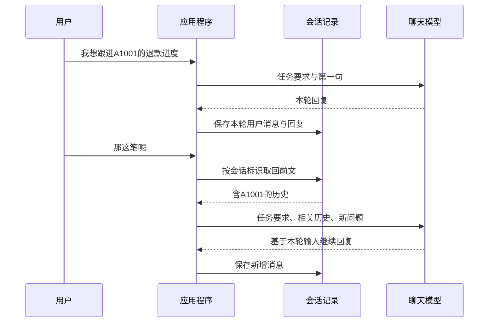

# 大模型应用开发学习 22：Memory：短期记忆、长期记忆和会话状态

用户先说：“我想跟进A1001的退款进度。”接着又问：“那这笔呢？”

人会顺着前文理解“这笔”指A1001。程序如果第二次只把“那这笔呢”发给模型，输入里却没有A1001，就缺少了指代依据。即使两次使用同一个模型对象、同一个API Key，这段前文也不一定会自动出现在第二次请求中。

**AI应用里的Memory，首先是围绕模型保存、找回并复用信息的机制。**要理解它，需要看清一份信息存在哪里、以什么范围找回，以及本次到底把什么交给了模型。

这篇沿同一段售后对话展开：先用普通Python维护历史，再观察LangChain怎样恢复会话；然后讨论重启、状态字段、跨会话偏好和长历史。示例只验证信息交接，不查询真实订单，也不把“记得订单号”当成“知道最新退款状态”。

| 要弄清的问题 | 用什么来观察 |
| --- | --- |
| 第二轮为什么接不上第一轮 | 对照只传新问题与带历史的请求 |
| 框架怎样保存并找回对话 | 同一会话两轮、另一会话一轮、实际模型输入 |
| 状态保存了，模型是否就能使用 | 对照状态字段与发送给模型的消息 |
| 短期与长期记忆有什么区别 | 会话历史与跨会话用户偏好的不同读取方式 |
| 记录能保存多久，历史太长怎么办 | 两个进程恢复SQLite检查点，以及触发摘要 |

## 第二轮需要的前文，从哪里来

先不考虑框架。两次独立生成请求，如果发送的内容分别如下：

| 请求 | 模型实际收到的用户侧内容 | 能从输入中找到什么 |
| --- | --- | --- |
| 第一次 | 我想跟进A1001的退款进度 | 明确出现A1001 |
| 第二次 | 那这笔呢 | 没有订单号，也没有前文 |

第二次输入没有告诉模型“这笔”是谁。它可以追问，也可能猜测；更好的应用行为，是先让程序找回相关前文，再组织请求。

聊天产品让人感觉一直在和同一个助手交流，背后通常有会话记录管理。不同模型服务也可能提供服务端会话功能，但仍要按对应接口提供会话关联；仅复用一个客户端对象并不等于启用了这种能力。本文观察的是应用把消息组织到模型调用中的过程。

补上历史后，第二次请求会包含：最初的用户描述、上一轮助手回复，以及这次新问题。模型是在本次输入里重新读到订单号，而不是因为上一轮调用偷偷修改了模型权重。



这就是连续对话最基本的信息路径。接下来“保存在哪里”“取回多少”可以有不同实现，但信息交接仍要发生。

## 用普通Python维护历史，先看清实际工作

最简单的办法是用一个字典保存各场会话的消息。配套`manual_demo.py`中的`chat_with_history()`这样处理一次新输入：

<!-- example-source: examples/22-memory/manual_demo.py -->

```python
def chat_with_history(histories, conversation_id, text, call_model):
    messages = [*histories.get(conversation_id, []), {"role": "user", "content": text}]
    reply = call_model([{"role": "system", "content": BASE_PROMPT}, *messages])
    histories[conversation_id] = [*messages, {"role": "assistant", "content": reply}]
    return reply
```

`histories`保存各会话的记录；`conversation_id`决定找哪一段历史；`text`是本轮新话；`call_model`负责取得模型回复。`BASE_PROMPT`是同文件中的固定售后要求。

这段函数先取出已有消息，加上新问题，调用模型后再保存新增回复。它只使用普通列表、字典和函数调用。消息里既要保留用户说过什么，也要保留助手如何回应，后续才知道哪些问题已经问过、哪些信息还缺。

为了直接观察输入，本章提供了一个简单探针：它只用规则在**这次收到的用户消息和系统消息**中找订单号，不读取自己的旧调用记录。它不是大模型，不理解任意语言，也不会查退款；框架实验通过`ProbeModel`把同一规则接到真实模型接口上。

运行`manual_demo.py`可以观察到：

```text
只发送最新一句：本轮输入没有订单号，需要用户补充。
同一会话第2轮：本轮输入可找到订单号A1001；尚未查询实时状态。
另一场会话：本轮输入没有订单号，需要用户补充。
```

这不是在测模型有多聪明，而是在检查订单号是否确实进入了本次输入。探针能指出输入缺口，真实模型能否正确理解和使用前文，仍需另外验证。

自己维护历史完全可以构建正式应用。接到Web服务后，还要安排记录落库、会话归属、并发请求顺序、失败时怎样保存，以及历史过长怎样处理。框架的价值在于复用其中一部分状态管理，而不是让普通Python失去完成这些工作的能力。

## 交给框架以后：会话标识与检查点各做什么

LangChain Agent运行在LangGraph之上，可以通过检查点存储保存并恢复会话状态。这里先认识两个名称：

- **thread_id**：标识当前是哪一条会话线，用来关联连续交互。
- **checkpointer**：读写检查点的组件；检查点记录运行状态，消息通常是其中一部分。

配套`conversation_demo.py`的创建函数如下。同文件已导入`create_agent`和调用限额中间件：

<!-- example-source: examples/22-memory/conversation_demo.py -->

```python
def build_agent(model, checkpointer):
    return create_agent(
        model=model,
        tools=[],
        system_prompt=BASE_PROMPT,
        checkpointer=checkpointer,
        middleware=[ModelCallLimitMiddleware(run_limit=1, exit_behavior="error")],
    )
```

`model`负责生成；`checkpointer`负责状态保存；固定系统要求说明怎样回复。这个例子没有工具，一次用户输入只需一次模型调用，上限也设为一次。

先创建一个进程内检查点存储，再把它交给Agent。以下调用片段可放在配套目录运行：

<!-- example-kind: usage -->

```python
from langgraph.checkpoint.memory import InMemorySaver
from conversation_demo import build_agent, two_turns
from probe_model import ProbeModel

model = ProbeModel()
checkpointer = InMemorySaver()
agent = build_agent(model, checkpointer)
result = two_turns(agent, "conversation-a")
print(result["messages"][-1].content)
```

其中`two_turns()`正是同文件中的两轮调用：

<!-- example-source: examples/22-memory/conversation_demo.py -->

```python
def two_turns(agent, thread_id):
    config = {"configurable": {"thread_id": thread_id}}
    agent.invoke({"messages": [{"role": "user", "content": FIRST}]}, config=config)
    result = agent.invoke({"messages": [{"role": "user", "content": FOLLOWUP}]}, config=config)
    return result
```

`FIRST`是“我想跟进A1001的退款进度”，`FOLLOWUP`是“那这笔呢”。第二次只提交了新问题，仍使用同一个`thread_id`。框架会读取这条会话的已有状态，合并新消息，继续运行并保存结果。[短期记忆](https://docs.langchain.com/oss/python/langchain/short-term-memory)

这与前面的Python函数接走了相似工作：自己不再按会话手工取出整段历史、追加回复和写回，而是配置存储与会话标识，让运行程序处理状态交接。检查点还可支持任务中断后的恢复，范围比只存一份聊天列表更广。[检查点与存储](https://docs.langchain.com/oss/python/langgraph/persistence)

**要确认它起作用，先检查记录与实际输入。**

在这个例子中，同一会话两轮运行后，`agent.get_state(config).values["messages"]`有4条记录：用户、助手、用户、助手。第二轮探针实际收到的消息则是：

| 顺序 | 角色 | 内容 |
| --- | --- | --- |
| 1 | system | 固定售后要求 |
| 2 | human | 我想跟进A1001的退款进度。 |
| 3 | ai | 本轮输入可找到订单号A1001；尚未查询实时状态。 |
| 4 | human | 那这笔呢？ |

注意这两份列表不是同一个范围：本例通过`system_prompt`注入的系统要求用于模型调用，没有作为一条常驻消息保存进会话`messages`。第二轮生成的回复，也是在这次模型调用结束之后才加入状态。

换成`conversation-b`再问“那这笔呢”，探针输入里就没有A1001。由此可以区分：同一个Agent对象可以服务多场会话，历史找哪一份取决于会话关联，而不是给每个用户重新创建一个模型对象。

## 能接着聊，不等于重启以后还能恢复

`InMemorySaver`把检查点保存在当前Python进程内。只要复用同一份存储对象，同一会话就能继续；重新创建一份空的存储，即使沿用同样的`thread_id`，也找不回原来的记录。

当服务进程退出，进程内数据也不会自动写到磁盘。要重启后继续，需要配置有实际持久存储的实现。

本章另外提供`persistence_demo.py`，使用`SqliteSaver`将检查点写入本地SQLite文件。安装依赖后，在配套目录先运行：

```powershell
python persistence_demo.py seed --db memory-demo.sqlite
```

这个进程发出包含A1001的第一句，保存两条消息，然后退出。接着运行另一个进程：

```powershell
python persistence_demo.py resume --db memory-demo.sqlite
```

新进程创建了新的Agent和探针对象，但连接相同数据库文件，并使用相同会话标识。它只发送“那这笔呢”，仍能从恢复的输入中找到A1001；结束后消息数从2变成4。配套测试确实启动两个独立进程验证了这条路径。

若再次执行`seed`且该会话已有记录，脚本会拒绝覆盖式演示，提示改用新文件或新会话标识。它没有自动清空已有数据库。

**这里有两个彼此独立的问题：信息在哪些会话间复用，信息能保存多久。**

| 设计维度 | 在本例里问什么 | 由什么决定 |
| --- | --- | --- |
| 使用范围 | 是否继续同一场对话 | 会话标识与业务关联规则 |
| 存储寿命 | 退出进程后记录还在不在 | 进程内存、SQLite或其他持久存储 |

所以，保存在数据库中的会话历史仍然可以属于短期记忆；“短期”强调同一会话范围，并不等于“只能存在内存”。后面演示的长期偏好即使用了进程内Store，也只是验证跨会话复用，不表示它已能跨重启保存。

SQLite适合这个本地恢复实验。多实例服务还要根据并发、部署与恢复要求选择存储；换成共享数据库也仍需处理同一会话的并发更新、迁移和保留策略。[LangGraph检查点实现](https://reference.langchain.com/python/langgraph/checkpoints/)

会话标识也不能充当访问凭证。应用需要从登录身份检查这条会话是否属于当前用户，再把正确的`thread_id`交给框架。框架按编号找到记录，并不证明发来编号的人有权读取它。

## State保存了什么，本轮模型又能读到什么

消息是会话状态的一部分，但很多业务进度不适合每次从长对话里重新猜。例如，用户已经明确选定A1001，应用可以把它保存到`active_order_id`字段。

配套`state_demo.py`扩展了Agent状态：

<!-- example-source: examples/22-memory/state_demo.py -->

```python
class SupportState(AgentState):
    active_order_id: NotRequired[str | None]
```

`AgentState`已有消息字段，这里再增加一个可选的当前订单号。创建Agent时，还要通过`state_schema=SupportState`声明使用这份结构。

这个字段由程序明确写入。与结构化抽取衔接时，可以将校验后的订单号作为候选，再结合用户选择与业务检查更新状态；本例直接传入固定候选，用来源与格式检查观察状态变化，没有自动连接工单抽取脚本。

**写进去，并不代表模型已经看见。**

`state_demo.py`做了一个刻意简化的实验：每次模型调用，只发送最新一条用户消息和系统要求，但在会话中仍保存全部4条消息与`active_order_id`。这仅用于对照“已保存”和“本轮发送”，不是生产会话的通用裁剪方案。

两组实验的状态完全一样，差别只在是否把字段组织进系统提示。对应中间件如下：

<!-- example-source: examples/22-memory/state_demo.py -->

```python
@dynamic_prompt
def prompt_with_order(request):
    order_id = request.state.get("active_order_id")
    return BASE_PROMPT + (f" 当前会话选定的订单号：{order_id}。" if order_id else "")
```

`dynamic_prompt`在本轮调用前读取状态并准备提示。模型真正读到的是这段提示里的订单号，不是Python字典里所有字段的自动展开。[状态与模型上下文](https://docs.langchain.com/oss/python/langchain/context-engineering)

运行两组对比，可以观察到：

| 情况 | 已保存的字段 | 本轮发送的消息 | 探针能否找到A1001 |
| --- | --- | --- | --- |
| 只保存字段 | `active_order_id=A1001` | 固定要求、新问题 | 不能 |
| 读取字段并组织进提示 | 同样保存A1001 | 含订单号的要求、新问题 | 能 |

这时可以给几个名称安排位置：**State是当前运行的数据，Memory是信息保留与复用的机制，模型上下文是本次实际发给模型的内容。**它们有关联，但不是同一个对象。

程序运行时还有一种常见的`context`，用于传入当前用户身份、服务依赖等信息。它供程序和中间件使用，也不意味着会自动发送给模型。下一节用其中的用户身份选择偏好记录。[运行时Context](https://docs.langchain.com/oss/python/langchain/runtime)

有了专用字段，还要定义更新和清除：用户切换到另一笔订单时应该替换当前订单；用户说“不讨论这笔了”时，应清除或重新确认。把旧值长期留着再反复注入，同样会让系统接错话。

## 换一场会话，还需要记住什么：长期偏好的读写

用户今天结束对话，明天新开一个会话。“昨天聊的是A1001”未必应该自动继承，但用户主动设置的“回复尽量简短”，可能希望继续生效。

这类跨会话复用的信息属于长期记忆。LangGraph提供 **Store**接口，用命名空间与键组织记录；应用决定写什么、何时更新、按什么身份读取，再把相关内容交给本轮使用。[长期记忆](https://docs.langchain.com/oss/python/langchain/long-term-memory)

本例只保存用户明确选择的回复风格，不让模型从任何一句话里自动推断长期偏好。`preferences_demo.py`的写入函数是：

<!-- example-source: examples/22-memory/preferences_demo.py -->

```python
def set_reply_style(store, user_id, style):
    if style not in {"简短", "详细"}:
        raise ValueError("不支持的回复风格")
    store.put(("users", user_id, "preferences"), "reply_style",
              {"value": style, "source": "用户主动设置"})
```

可以把一条记录读成三部分：

| 部分 | 本例的值 | 用途 |
| --- | --- | --- |
| namespace | `("users", "user-a", "preferences")` | 按用户和信息类别组织 |
| key | `"reply_style"` | 定位回复风格这条记录 |
| value | `{"value": "简短", "source": "用户主动设置"}` | 保存内容与来源说明 |

命名空间是数据组织方式。用户身份应由应用的可信登录信息提供，不能让模型自己指定“我是哪个用户”。本地演示使用固定`Viewer("user-a")`代替实际认证，不具备登录系统。

**只把Store传给Agent，还缺读取动作。**同文件的提示中间件按当前用户读取记录：

<!-- example-source: examples/22-memory/preferences_demo.py -->

```python
@dynamic_prompt
def prompt_with_preference(request):
    user_id = request.runtime.context.user_id
    item = request.runtime.store.get(("users", user_id, "preferences"), "reply_style")
    style = item.value["value"] if item else None
    return BASE_PROMPT + (f" 回复偏好：{style}。" if style in {"简短", "详细"} else "")
```

`store.get()`命中时返回一条记录，内容在`item.value`中；没有记录时返回`None`。中间件将受支持的风格值放进系统提示，模型才有机会按该偏好回答。

`preferences_demo.py`用同一份Store运行两场会话：第一场提到A1001；第二场只说“那这笔呢”。第二场的探针能找到“回复偏好：简短”，却找不到A1001。换成另一位用户，也不会读取到user-a名下的偏好。

这个结果说明，长期记录的复用与会话历史的恢复是两条独立路径。即使Store能在多场会话间共享，也不会自动把昨天所有消息复制到今天；是否需要找回某笔旧订单，需要另外设计明确的业务关联与授权。

这里用的`InMemoryStore`同样只存在进程内。正式保存跨重启偏好仍需持久化Store；前面的SQLite检查点实验也不会自动替这份Store落库。

长期记忆也不等于向量数据库。回复风格只有一个明确的键，直接读取即可；记录很多、需要按语义寻找相关事实时，才考虑语义索引。政策文件问答则要按资料来源、版本与检索目标组织，不能把“给用户保存偏好”和“查政策证据”混成同一份可信事实。

## 历史越长越好记吗：保存与送入模型要分开控制

会话继续增长时，一种直接做法是每轮重传全部记录。但模型能接收的上下文有长度限制，历史越长也会增加输入处理成本。已经过期的话题与重复内容，还可能干扰当前判断。

因此有两个独立的管理目标：存储里保留哪些记录，本轮选哪些信息给模型。前面的状态实验已经表明，二者可以不同；裁剪、删除与摘要也有不同作用。

| 做法 | 改变什么 | 适合观察的代价 |
| --- | --- | --- |
| 临时选择模型输入 | 本轮读取的消息，状态记录可保持完整 | 省输入，但可能漏掉关键前文 |
| 更新当前状态，移除部分消息 | 后续恢复到的当前消息列表 | 后续也不再直接读取这段原文 |
| 生成摘要替代一段历史 | 用较短记录表达旧内容 | 多一次处理，且摘要可能遗漏或误写 |
| 把明确关键项放入专用字段 | 让订单等进度可以独立读取 | 需要校验、更新、清除与注入规则 |

**摘要需要实际触发，也需要验证压缩后保留了什么。**

配套`summary_demo.py`使用真实`SummarizationMiddleware`。参数`trigger=("messages", 4)`在消息数达到相应条件时触发，`keep=("messages", 2)`要求保留近期消息，旧内容进入摘要处理；消息边界会影响具体保留结果，不应把它误读为“最终一定只剩两条”。[摘要中间件](https://docs.langchain.com/oss/python/langchain/middleware/built-in#summarization)

三轮用户输入依次是：提到A1001、说“谢谢”、问“那这笔呢”。调用前第三轮已有5条消息，触发摘要。实验用固定摘要模型返回“本次讨论A1001，尚未查询实时状态”，运行结果是：

```text
第1轮结束：2条消息
第2轮结束：4条消息
第3轮结束：4条消息
摘要模型调用：1次
```

没有压缩时三轮通常会有6条消息。当前实验的第一条记录已经变成摘要加包装文本，探针本轮仍能从输入中定位A1001。但摘要内容是预设的，**这验证了中间件触发和状态替换，没有证明真实模型能忠实压缩任意历史**。

实际使用时，要核对订单号、用户更正、未完成问题和已经执行的动作有没有保留。摘要也会请求模型，触发过于频繁可能增加延迟和费用；阈值应结合上下文预算、输入输出大小和实际任务验证。

有工具的会话还要保留调用请求与结果的配对，不能简单按最后几条任意截断。并且，缩短当前`messages`不等于删掉所有历史检查点、日志或备份。本地测试能在旧检查点里读到压缩前的原话；数据保留和清除需要按实际存储层分别设计。[消息删减与边界](https://docs.langchain.com/oss/python/langchain/short-term-memory#delete-messages)

## 记忆中的内容，什么时候需要更新或重新核验

回到退款场景：记忆告诉应用“正在讨论A1001”，却不能证明A1001此刻仍在审核中。昨日的工具结果、用户陈述和今天的实时订单记录，各自回答不同问题。

| 信息 | 可以帮助判断什么 | 不能直接证明什么 |
| --- | --- | --- |
| 用户曾提到A1001 | “这笔”可能指哪笔订单 | 当前用户有权访问该订单 |
| 上轮工具查到审核中 | 上次查询时的结果 | 当前状态仍未变化 |
| 长期偏好是简短回复 | 本轮怎样组织表达 | 用户已经同意执行退款 |
| 会话里记录了某次确认 | 过去确认过哪项内容 | 新的金额、订单或动作仍在授权范围内 |

所以，记忆主要提供上下文与线索；需要实时事实时重新查询业务服务，需要授权时按当前身份与具体动作核验。把一次模型的猜测再写成长期事实，会让后续对话不断引用同一个错误。

偏好发生变化时也要显式处理。用户从“简短”改为“详细”，本例对同一个`reply_style`键重新写入；用户取消偏好时删除这条记录。Store的`put`替换的是该键的整条值，不是自动合并任意档案字段；如果把多项偏好放在一份记录里，需要自己设计合并、并发更新与清除语义。

会话标识与命名空间只是定位机制。两场本该隔离的会话用了同一编号，或者读取Store时拿错用户身份，保存得再稳定也会接错信息。生产应用要先绑定正确的身份与会话，再讨论模型回答得是否自然。

还有一个容易在接入时出现的重复问题：本例Agent已经配置检查点，每轮通常只交新消息即可。框架的消息合并按消息ID识别更新；带相同ID的对象或字典可以更新已有消息，重新构造而没有ID的旧消息则可能被再次追加。关键是ID和合并规则，而不是“对象一定去重、字典一定重复”。[消息状态与合并](https://docs.langchain.com/oss/python/langgraph/graph-api#working-with-messages-in-graph-state)

## 运行完整实验，再检查信息是否真的接上

完整示例在[22-memory](examples/22-memory/README.md)。在该目录打开PowerShell，使用Python 3.12：

```powershell
py -3.12 -m venv .venv
.\.venv\Scripts\python.exe -m pip install -r requirements.txt
.\.venv\Scripts\python.exe manual_demo.py
.\.venv\Scripts\python.exe conversation_demo.py
.\.venv\Scripts\python.exe state_demo.py
.\.venv\Scripts\python.exe preferences_demo.py
.\.venv\Scripts\python.exe summary_demo.py
.\.venv\Scripts\python.exe -m unittest -v
```

跨进程SQLite实验使用前面的`seed`和`resume`命令，共用同一个文件路径与会话标识。各脚本是独立实验，没有自动组成一个带真实查单、认证和长期数据库的售后产品。

配套依赖固定LangChain 1.4.6、langchain-core 1.6.10、LangGraph 1.2.16、langgraph-checkpoint 4.3.0、SQLite检查点集成3.1.2；可选在线练习使用langchain-deepseek 1.1.1。13项本地检查覆盖会话恢复、实际模型输入、不同会话、新存储对象、状态注入、偏好读取、消息合并、摘要触发与两个独立进程恢复。

若想看真实模型如何理解两轮对话，在同一会话配置自己的凭证和可用模型名：

```powershell
$env:DEEPSEEK_API_KEY = "填写自己的密钥"
$env:LC_CHAT_MODEL = "填写账户可用的模型名"
.\.venv\Scripts\python.exe conversation_demo.py --live
```

在线脚本不自动加载`.env`，运行同一会话两轮和另一会话一轮，正常路径共3次生成请求；每轮模型调用上限一次，单次超时45秒，客户端自动重试关闭。它采用DeepSeek集成的非思考模式配置，换服务或模式时需要核对接口。在线请求使用自己的服务额度，本次未使用真实密钥验证在线回复效果。

实现细节与状态操作对照放在[会话存储与状态扩展](supplements/22-Memory会话存储与状态扩展.md)。读实验输出时，可以沿下面几份证据检查：

| 想检查什么 | 看哪里 |
| --- | --- |
| 是否找回了同一条会话 | thread配置与`get_state(config).values` |
| 保存的订单号有没有交给模型 | 本轮模型实际收到的消息与提示 |
| 新会话为什么仍有某个偏好 | Store读取时使用的用户身份、命名空间与键 |
| 重启后为什么找不到历史 | 是否连接同一持久存储与同一会话 |
| 摘要是否真的工作 | 触发前后当前状态，以及摘要模型实际调用 |
| 退款状态是否最新 | 业务查询记录，不能只看模型复述 |

“那这笔呢”能接上，依赖的是应用找对前文并将相关内容交给模型。短期记忆组织同一会话的连续状态，长期记忆复用跨会话信息，持久存储决定记录能否跨进程保留。把保存、找回和本轮使用分别看清，才能知道系统究竟记住了什么，以及哪里仍然缺少信息。

## 参考资料

- [LangChain短期记忆](https://docs.langchain.com/oss/python/langchain/short-term-memory)
- [LangChain长期记忆](https://docs.langchain.com/oss/python/langchain/long-term-memory)
- [LangGraph检查点与Store](https://docs.langchain.com/oss/python/langgraph/persistence)
- [LangChain上下文组织](https://docs.langchain.com/oss/python/langchain/context-engineering)
- [LangChain运行时Context](https://docs.langchain.com/oss/python/langchain/runtime)
- [摘要中间件](https://docs.langchain.com/oss/python/langchain/middleware/built-in#summarization)
