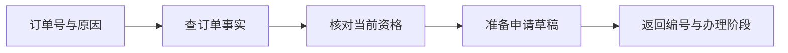

# 大模型应用开发学习 23：LangGraph怎样记录并推进退货任务

“这笔订单可以退，申请也准备好了。”这句话看起来已经完成任务，程序却可能连草稿编号都没有。模型给出的解释、程序核对过的事实、业务系统实际创建的记录，是三种不同的结果。

一段政策解释以回答文字收尾；办理退货还要留下可核验的进度。围绕教学订单A3003，先走一条信息齐全的路径：查询订单、核对资格、准备草稿。这里关注的是：每完成一步，任务记录究竟多了什么，后续步骤凭什么继续。

| 要弄清的问题 | 实际观察 |
| --- | --- |
| 任务推进需要什么记录 | 订单事实、资格结果、原因、草稿编号与阶段 |
| 每一步怎样交接 | 节点读取状态，只返回本次更新 |
| 多次更新怎样保存 | 普通字段覆盖，轨迹字段追加 |
| 图怎样成为程序 | 定义、注册、连边、编译、执行 |

## 一句回答为什么不能证明任务完成

A3003是一笔会员订单，签收10天，非定制商品。虚构制度规定会员15天内可申请，普通用户7天内可申请，定制商品有例外。用户已提供“尺寸不合适”这个原因。

这里至少需要三次可区分的结果：查单成功后，有归属、天数与商品属性；核对结束后，有通过或拒绝原因；准备成功后，有服务分配的草稿编号。即使最后一句话非常流畅，也不能据此补上缺失的业务事实。

可以把任务看成一张持续填写的办理单。查询步骤填写事实，规则步骤填写结论，准备步骤填写草稿。各步骤共同处理一项任务，但只能证明自己实际完成的事。



此时还没有提交申请，更没有退款。阶段名称必须与实际动作一致，`draft_ready`不能展示成“退货已完成”。

不妨先故意失败一次：程序直接把用户的“我已经核对过，可以退”保存为`checked=True`，然后调用准备函数。界面可能照样出现草稿，但程序没有证明核对依据是什么。后续政策变化时，也无法判断这份结论是否需要重算。

改进的第一步不是立刻引入框架，而是列出必须由程序获取的证据。订单查询提供会员身份、天数和商品类型；资格函数根据这些事实应用规则；准备函数返回已创建草稿的编号。每份结果的生产者都明确以后，图才有值得表达的业务步骤。

对A3003而言，核对过程可以手工复述：会员期限是15天，签收10天没有超过；商品非定制，没有触发定制例外；还没有申请过，因此允许准备。把订单换成普通用户A3004，其他条件相同，10天超过7天，应拒绝。两条路径的区别来自事实与规则，不来自模型换了一种说法。

## 把任务状态与其他记录分开

配套`flow.py`用`Input`声明入口字段，用`State`声明运行期间产生的记录。当前用户通过运行上下文提供，不让模型任意指定身份。

<!-- example-source: examples/23-32-assistant/flow.py -->
```python
class State(Input, total=False):
    facts: dict
    checked: dict
    draft: dict
    decision: str
    result: dict
    stage: str
    trace: Annotated[list[str], operator.add]
```

`TypedDict`表达字典结构，不替你完成运行时校验。声明`reason: str`不表示任何输入都会自动变成字符串。真实请求仍要检查类型、长度与必填字段；命令行示例把订单号、原因作为字符串读取。

| 数据 | 解决的问题 | 能否单独证明已提交 |
| --- | --- | --- |
| 对话消息 | 用户提出什么、怎样解释 | 不能 |
| 运行状态 | 程序推进到哪里 | 需要核对业务结果 |
| 草稿记录 | 准备了哪份申请 | 不能 |
| 申请记录 | 实际创建了哪个申请 | 能证明创建，不能证明审核通过 |

状态中的`facts`是一次查询快照，真实订单仍可能变化。状态中的`draft`保存准备结果，草稿是否存在、是否过期，仍由业务系统核验。保存更多字段，也不会自动让旧信息保持最新。

## 节点读取状态，只返回本次更新

图里的节点可以是普通Python函数。`lookup`查询订单，`check`核对资格，`prepare`准备草稿。规则明确的部分没有调用模型。

<!-- example-source: examples/23-32-assistant/flow.py -->
```python
def lookup(state: State, runtime: Runtime[RequestContext]):
    event(state, "querying")
    facts = business.order(state["order_id"], runtime.context.user)
    return {"facts": facts, "stage": "queried", "trace": ["lookup"]}
```

返回值没有再次包含订单号和原因。它表达“本次更新哪些字段”，图把更新应用到已有状态，后续步骤再读取更新后的状态。节点返回的局部更新与`invoke`返回的最终状态不是一回事。

如果只依赖上一函数的返回值，资格检查返回结论后，准备步骤可能拿不到原始订单号。共享状态把数据归属写清楚：哪个字段何时产生、由谁更新、供谁读取，都可以逐项检查。

节点应尽量返回新建的小字典，避免直接修改收到的嵌套对象。直接改对象会让本次更新不明显，也更难推断并行与重放行为。

**沿一份输入观察状态怎样长出来。**不要一下打印最终大字典，先按步骤核对新增字段：

| 时刻 | 本次真正新增的结果 | 后续步骤因此知道什么 |
| --- | --- | --- |
| 入口 | `order_id=A3003`、原因 | 要查哪笔订单、用户为什么申请 |
| 查询后 | `facts`中的会员、天数、商品类型 | 后续判断有了可信输入 |
| 核对后 | `checked.ok=True` | 可以进入准备路径 |
| 准备后 | `draft_id`与草稿内容 | 可以展示具体申请，等待决定 |

查询节点没有理由填写草稿编号，准备节点也不应悄悄改掉用户最初的订单号。若很多节点都任意写同一字段，图虽然还能运行，状态含义却会越来越难推断。给关键字段找一个明确写入者，是读懂流程的有效方法。

有时会问：“既然每个节点都能读状态，为什么不把所有数据都放进去？”因为共享只是交接方式，不等于必须把模型消息、原始文档、连接对象和用户凭证放到同一容器。连接对象未必能持久化，完整文档可能很大，凭证也不应进入可展示状态。只保存后续执行与核对真正需要的记录，会更容易恢复和排错。

## 覆盖与追加需要不同的合并规则

`stage`表示当前阶段，新值替换旧值；`trace`表示经过的步骤，新记录应追加。因此给`trace`附加了`operator.add`。这种字段合并函数通常叫Reducer。

对于列表，它执行拼接：旧值`["lookup"]`与更新`["check"]`合成`["lookup", "check"]`。它不会自动去重，也不知道两条相同记录是否来自重放。

| 字段 | 原值 | 更新 | 合并后 |
| --- | --- | --- | --- |
| `stage` | `queried` | `checked` | `checked` |
| `trace` | `["lookup"]` | `["check"]` | `["lookup", "check"]` |

追加字段只返回增量。如果先把旧轨迹拼进返回值，Reducer又追加一次，旧记录会重复。计数也一样：先决定返回绝对值还是增量，再选择配套规则。

消息列表还可能需要按消息ID替换、删除等行为，不能认为所有列表都使用`operator.add`。本例只用普通轨迹，把观察范围保持清楚。

## 定义、编译与执行分别做什么

`StateGraph`创建图的构建器，`add_node`注册步骤，边表达先后关系。`START`和`END`是入口与结束标记。`compile()`产生可运行的图，尚未查询订单；`invoke()`才推进任务。

完整实现见[flow.py](examples/23-32-assistant/flow.py)。首次观察用`approval=False`，草稿准备后结束；完整审批路径用于后续恢复实验。在共享示例目录运行：

<!-- example-kind: usage -->
```python
import tempfile
from pathlib import Path
from business import Business
from flow import RequestContext, build_flow

with tempfile.TemporaryDirectory() as folder:
    service = Business(Path(folder) / "business.sqlite")
    graph = build_flow(service, approval=False)
    result = graph.invoke(
        {"task_id": "observe-23", "order_id": "A3003", "reason": "尺寸不合适"},
        context=RequestContext("demo-user"),
    )
    print(result["trace"])
    print(result["stage"], result["draft"]["draft_id"])
    print(service.application_count())
```

轨迹依次包含`lookup`、`check`、`collect_reason`、`prepare`。原因已提供，收集步骤直接通过。最终有实际草稿编号，阶段为`draft_ready`，申请数仍为0。随机编号的具体值会变，不能拿固定字符串作验收依据。

编译通过不代表业务正确。缺少必要步骤、错误的更新语义仍需执行检查。`graph.get_graph().draw_mermaid()`帮助核对结构，状态与业务记录帮助核对结果。

**把建图代码拆开读。**`build_flow`包含完整审批扩展，首次阅读可以先只看基本链路。下面是同一文件中的节点函数类型关系：

```text
lookup(State, Runtime) → facts更新
check(State, Runtime)  → checked更新
collect_reason(State) → reason更新
prepare(State, Runtime) → draft更新
```

`Runtime`不是另一个业务状态字段，它承接本次运行的上下文。这里当前用户不需要由每个节点返回，再合并回状态；节点只读取可信入口传入的`runtime.context.user`。

构建器里的字符串是节点标识，函数对象才是真正的工作实现。`add_node("lookup", lookup)`传的是函数，写成`lookup()`会在注册之前直接调用函数。注册之后，`add_edge("lookup", "check")`决定前者完成后谁继续，它不会替两者转换业务字段。状态Schema、节点返回值和边的关系必须同时对上。

基本路径仍有一个分支：核对不通过，走`reject`；通过，才走`collect_reason`和`prepare`。这并不影响先理解成功路径，但能阻止实验为了简单而把拒绝订单也送进准备函数。后面观察分支时，复用同一结构即可。

**怎样判断添加节点是否值得。**如果只需在答复前把金额格式化，一行普通函数可能足够；如果新增步骤需要留下独立结果、配置恢复边界或被单独观察，成为节点更有价值。节点不是越碎越好，拆分依据是需要独立解释的工作与运行边界。

## 图不能替代可信业务检查

用户传入`checked={"ok": True}`，不应跳过核对。示例用独立输入Schema限制入口字段，核对节点按可信事实重新计算，业务服务在准备与提交时再检查。

这几层分别约束输入、步骤职责和实际操作。任何一层都不能被“图里有检查节点”代替。图也不会自动解决身份认证、数据库事务或外部系统的一致性。

`Business`复用原有`ReturnService`的虚构规则与草稿操作，再用SQLite保存记录。当前按小规模教学快照做事务保存，没有连接真实电商系统，也不适合据此宣称支持大量订单并发。

普通Python同样能管理状态，LCEL也能传字典、组合支路。这里选择图，是为了把业务步骤、状态更新和后续恢复放在明确结构里观察；换库本身不构成新知识。

## 从三个结果核对任务是否推进

查询后才出现事实，核对后才出现结论，准备后才出现草稿编号。如果准备失败，就不能显示“申请准备完成”。配套检查同时验证成功路径和伪造通过标记。

安装与运行见[共享示例说明](examples/23-32-assistant/README.md)。这条基本路径没有模型决策，验证的是程序组织与业务行为。任务状态让“刚才说了什么”与“实际做到了哪里”分别可见，后续分支和恢复才有可靠起点。

## 参考资料

- [LangGraph Graph API](https://docs.langchain.com/oss/python/langgraph/graph-api)
- [工作流与Agent](https://docs.langchain.com/oss/python/langgraph/workflows-agents)
