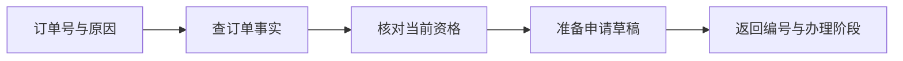
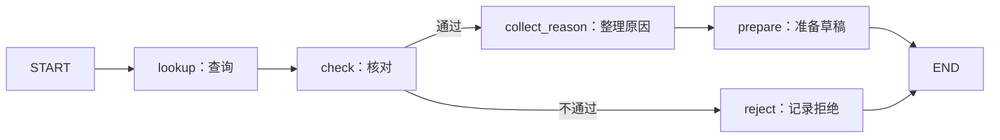

# 大模型应用开发学习 23：LangGraph怎样记录并推进退货任务

售后助手已经能记住正在讨论哪笔订单，也能解释退货政策。现在用户提出一个进一步的要求：“A3003尺寸不合适，帮我准备退货申请。”这次需要交付的就不只是一段回答，而是一份实际存在、能继续办理的申请草稿。

如果助手回复“这笔订单可以退，申请也准备好了”，程序却拿不出资格检查结果和草稿编号，就无法知道它究竟查过订单、执行过准备操作，还是只生成了一句承诺。模型给出的解释、程序核对过的事实、业务系统实际创建的记录，是三种不同的结果。

因此，办理流程要逐步留下证据：查询后记录订单事实，核对后记录是否符合规则，准备后记录服务返回的草稿编号。后一步还必须有明确的进入条件，资格不符就不能继续准备。

**这里要解决的问题是：怎样把一次退货请求拆成可执行的步骤，并用任务状态记录每一步的结果，让后续处理有据可依。**围绕教学订单 A3003，先走一条信息齐全的路径，最终停在草稿准备完成。

[会话记忆](22-助手怎样接着上一次对话继续处理.md)解决“这次追问指的是哪笔订单”；任务状态还要说明“这笔业务做到了哪一步”。两者可以使用相同的状态管理机制，但保存消息本身不会替程序查询、核对或创建草稿。本例复用[工具调用示例](15-FunctionCalling和ToolCall让模型从回答走向行动.md)中的虚构退货规则，由普通函数执行固定业务步骤，LangGraph 负责组织节点、状态更新和执行顺序。这是一条由程序预先定义的工作流，不需要模型自行选择路径。

**配套代码：**[共享示例目录](https://github.com/benx92/ai-learning-notes/tree/main/examples/23-32-assistant)、[环境与运行说明](https://github.com/benx92/ai-learning-notes/blob/main/examples/23-32-assistant/README.md)、[flow.py](https://github.com/benx92/ai-learning-notes/blob/main/examples/23-32-assistant/flow.py)。请保留仓库目录关系，业务服务还会导入已有示例。下面只观察一次运行内的更新，最终停在草稿准备完成；不把它当作跨进程恢复或已提交申请的验证。

## 参考代码示例：从哪里看任务怎样推进

| 要弄清的问题 | 参考代码 | 实际观察 |
| --- | --- | --- |
| 任务要保存什么，每一步怎样交接 | [flow.py](https://github.com/benx92/ai-learning-notes/blob/main/examples/23-32-assistant/flow.py)：`Input`、`State` 与 `build_flow()` 内的节点 | 入口字段保留，节点只返回本次更新；阶段覆盖，轨迹追加 |
| 图怎样决定执行顺序 | [flow.py](https://github.com/benx92/ai-learning-notes/blob/main/examples/23-32-assistant/flow.py)：`build_flow()` 的注册与连边部分 | 查单后核对，通过才准备；`approval=False` 时准备后结束 |
| 资格和草稿由谁实际产生 | [business.py](https://github.com/benx92/ai-learning-notes/blob/main/examples/23-32-assistant/business.py)：`order()`、`check()`、`prepare()` | 本地业务服务读取教学数据、执行规则并保存草稿 |
| 原始订单与退货规则是什么 | [return_demo.py](https://github.com/benx92/ai-learning-notes/blob/main/examples/15-tool-calling/return_demo.py)：`ReturnService` | A3003 是会员，A3004 是普通用户，均签收10天；规则结论不同 |
| 怎样运行完整的状态实验 | [experiments.py](https://github.com/benx92/ai-learning-notes/blob/main/examples/23-32-assistant/experiments.py)：`state_demo()` | 输出节点轨迹、草稿编号、阶段与申请数，默认不请求模型 |
| 成功路径和伪造通过标记是否被正确处理 | [test_series.py](https://github.com/benx92/ai-learning-notes/blob/main/examples/23-32-assistant/test_series.py)：`test_23_updates_and_input_filter()`、`test_rejected_input_cannot_fake_pass()` | 成功后只有草稿；不合格订单即使传入通过标记也被拒绝 |

`flow.py` 同时包含审批、恢复与事件扩展。首次阅读只跟踪 `approval=False` 的路径，不必先读完共享目录中的全部程序。

## 一句回答为什么不能证明任务完成

A3003是一笔会员订单，签收10天，非定制商品。虚构制度规定会员15天内可申请，普通用户7天内可申请，定制商品有例外。用户已提供“尺寸不合适”这个原因。

这里至少需要三次可区分的结果：查单成功后，有归属、天数与商品属性；核对结束后，有通过或拒绝原因；准备成功后，有服务分配的草稿编号。即使最后一句话非常流畅，也不能据此补上缺失的业务事实。

可以把任务看成一张持续填写的办理单。查询步骤填写事实，规则步骤填写结论，准备步骤填写草稿。各步骤共同处理一项任务，但只能证明自己实际完成的事。



此时还没有提交申请，更没有退款。阶段名称必须与实际动作一致，`draft_ready`不能展示成“退货已完成”。

一种容易出错的设计是：把用户的“我已经核对过，可以退”直接存成通过标记，再据此进入准备步骤。如果准备服务也信任这个标记，就可能绕过规则检查。这里先说明这种设计风险；配套实现不会这样处理，业务服务会自行核对，后面还会用不合格订单验证。

改进的第一步不是立刻引入框架，而是列出必须由程序获取的证据。订单查询提供会员身份、天数和商品类型；资格函数根据这些事实应用规则；准备函数返回已创建草稿的编号。每份结果的生产者都明确以后，图才有值得表达的业务步骤。

对A3003而言，核对过程可以手工复述：会员期限是15天，签收10天没有超过；商品非定制，没有触发定制例外；还没有申请过，因此允许准备。把订单换成普通用户A3004，其他条件相同，10天超过7天，应拒绝。两条路径的区别来自事实与规则，不来自模型换了一种说法。

## 把任务状态与其他记录分开

先明确图里的三个部分：**状态保存办理记录，节点执行一项工作，边决定哪项工作接着运行。**图并不是要把对话画成方框，而是把这些数据和执行关系写成程序。

配套 `flow.py` 用 `Input` 声明入口字段，用 `State` 声明运行期间产生的记录。当前用户通过运行上下文提供，不让模型任意指定身份。

<!-- example-source: examples/23-32-assistant/flow.py -->
```python
class Input(TypedDict):
    task_id: str
    order_id: str
    reason: str


class State(Input, total=False):
    facts: dict
    checked: dict
    draft: dict
    decision: str
    result: dict
    stage: str
    trace: Annotated[list[str], operator.add]
```

`task_id`标识这次任务，`order_id`指定订单，`reason`保存用户给出的原因；这些是入口允许提供的字段。其余字段由执行过程产生。`TypedDict`、`Annotated`和`operator`来自完整模块的导入，这段源码片段用于对照数据定义，实际运行使用已有文件。

`State` 继承 `Input`，所以订单号和原因不会在查单结束后消失；`total=False` 允许执行中产生的字段尚未出现。入口没有 `draft`，准备节点成功后才有它，这比预先填一份看似成功的空草稿更能表达实际进度。`decision` 和 `result` 还供完整审批或拒绝路径使用，当前成功路径不需要每个字段都出现。

`TypedDict`表达字典结构，不替你完成运行时校验。声明`reason: str`不表示任何输入都会自动变成字符串。真实请求仍要检查类型、长度与必填字段；命令行示例把订单号、原因作为字符串读取。

| 数据 | 解决的问题 | 能否单独证明已提交 |
| --- | --- | --- |
| 对话消息 | 用户提出什么、怎样解释 | 不能 |
| 运行状态 | 程序推进到哪里 | 需要核对业务结果 |
| 草稿记录 | 准备了哪份申请 | 不能 |
| 申请记录 | 实际创建了哪个申请 | 能证明创建，不能证明审核通过 |

状态中的`facts`是一次查询快照，真实订单仍可能变化。状态中的`draft`保存准备结果，草稿是否存在、是否过期，仍由业务系统核验。保存更多字段，也不会自动让旧信息保持最新。

## 节点读取状态，只返回本次更新

图里的节点可以是普通Python函数。`lookup`查询订单，`check`核对资格，`prepare`准备草稿。规则明确的部分没有调用模型。

<!-- example-source: examples/23-32-assistant/flow.py -->
```python
def lookup(state: State, runtime: Runtime[RequestContext]):
    event(state, "querying")
    facts = business.order(state["order_id"], runtime.context.user)
    return {"facts": facts, "stage": "queried", "trace": ["lookup"]}
```

返回值没有再次包含订单号和原因。它表达“本次更新哪些字段”，图把更新应用到已有状态，后续步骤再读取更新后的状态。节点返回的局部更新与`invoke`返回的最终状态不是一回事。

要注意当前实现的核对依据：`facts`保留查单快照供观察，`check`调用`business.check()`重新读取业务记录并应用规则，没有直接把旧快照或用户传来的通过标记当作资格证明。状态负责交接和记录，实际操作仍以业务服务的检查为准。以下是同一文件中的完整核对与准备节点：

<!-- example-source: examples/23-32-assistant/flow.py -->
```python
def check(state: State, runtime: Runtime[RequestContext]):
    checked = business.check(state["order_id"], runtime.context.user)
    return {"checked": checked, "stage": "checked", "trace": ["check"]}
```

<!-- example-source: examples/23-32-assistant/flow.py -->
```python
def prepare(state: State, runtime: Runtime[RequestContext]):
    draft = business.prepare(state["task_id"], state["order_id"],
                             state["reason"], runtime.context.user)
    event(state, "draft_ready" if draft["ok"] else "prepare_failed")
    return {"draft": draft, "stage": "draft_ready" if draft["ok"] else "failed",
            "trace": ["prepare"]}
```

这些函数定义在 `build_flow(business, ...)` 内部，所以可以使用外层传入的业务服务 `business`，不必把数据库连接放进状态。`runtime.context.user` 来自运行入口传入的 `RequestContext`；`event()` 只发出观察进度的事件，不代替业务调用，也不自动更新 `stage`。状态更新以节点返回的字典为准。

如果只依赖上一函数的返回值，资格检查返回结论后，准备步骤可能拿不到原始订单号。共享状态把数据归属写清楚：哪个字段何时产生、由谁更新、供谁读取，都可以逐项检查。

节点应尽量返回新建的小字典，避免直接修改收到的嵌套对象。直接改对象会让本次更新不明显，也更难推断并行与重放行为。

**沿一份输入观察状态怎样长出来。**不要一下打印最终大字典，先按步骤核对新增字段：

| 时刻 | 本次真正新增的结果 | 后续步骤因此知道什么 |
| --- | --- | --- |
| 入口 | `task_id`、`order_id=A3003`、原因 | 要处理哪次任务、哪笔订单 |
| 查询后 | `facts`中的会员、天数、商品类型 | 有了查单结果供核对；资格函数仍会重新读业务记录 |
| 核对后 | `checked={"ok": True, "error": None}` | 条件边可以选择准备路径 |
| 原因整理后 | 去掉首尾空白的 `reason` | 准备节点可以使用已提供的原因 |
| 准备后 | `draft` 中的 `draft_id` 与草稿内容 | 可以展示具体草稿，等待决定 |

查询节点没有理由填写草稿编号，准备节点也不应悄悄改掉用户最初的订单号。若很多节点都任意写同一字段，图虽然还能运行，状态含义却会越来越难推断。给关键字段找一个明确写入者，是读懂流程的有效方法。

有时会问：“既然每个节点都能读状态，为什么不把所有数据都放进去？”因为共享只是交接方式，不等于必须把模型消息、原始文档、连接对象和用户凭证放到同一容器。连接对象未必能持久化，完整文档可能很大，凭证也不应进入可展示状态。只保存后续执行与核对真正需要的记录，会更容易恢复和排错。

## 覆盖与追加需要不同的合并规则

`stage`表示当前阶段，新值替换旧值；`trace`表示经过的步骤，新记录应追加。因此给`trace`附加了`operator.add`。这种字段合并函数通常叫Reducer。

对于列表，它执行拼接：旧值`["lookup"]`与更新`["check"]`合成`["lookup", "check"]`。它不会自动去重，也不知道两条相同记录是否来自重放。

| 字段 | 原值 | 更新 | 合并后 |
| --- | --- | --- | --- |
| `stage` | `queried` | `checked` | `checked` |
| `trace` | `["lookup"]` | `["check"]` | `["lookup", "check"]` |

追加字段只返回增量。如果先把旧轨迹拼进返回值，Reducer又追加一次，旧记录会重复。计数也一样：先决定返回绝对值还是增量，再选择配套规则。

消息列表还可能需要按消息ID替换、删除等行为，不能认为所有列表都使用`operator.add`。本例只用普通轨迹，把观察范围保持清楚。

## 定义、编译与执行分别做什么

`StateGraph`创建图的构建器，`add_node`注册步骤，边表达先后关系。`START`和`END`是入口与结束标记。`compile()`产生可运行的图，尚未查询订单；`invoke()`才推进任务。

完整实现见[flow.py](https://github.com/benx92/ai-learning-notes/blob/main/examples/23-32-assistant/flow.py)。首次观察用`approval=False`，草稿准备后结束；完整审批路径用于后续恢复实验。

先把节点函数接起来。下面是 `build_flow()` 中从创建构建器到接入准备节点的连续源码，省略的是前面已解释的节点定义和后面的审批扩展：

<!-- example-source: examples/23-32-assistant/flow.py -->
```python
builder = StateGraph(State, input_schema=Input, context_schema=RequestContext)
for name, node in [("lookup", lookup), ("check", check), ("collect_reason", collect_reason),
                   ("prepare", prepare), ("reject", reject)]:
    builder.add_node(name, node)
builder.add_edge(START, "lookup")
builder.add_edge("lookup", "check")
builder.add_conditional_edges("check", lambda s: "collect_reason" if s["checked"]["ok"] else "reject",
                              ["collect_reason", "reject"])
builder.add_edge("reject", END)
builder.add_edge("collect_reason", "prepare")
```

构建器里的字符串是节点标识，函数对象才是真正的工作实现。`add_node("lookup", lookup)` 传的是函数，写成 `lookup()` 会在注册之前直接调用函数。`add_edge("lookup", "check")` 决定前者完成后谁继续，它不会替两者转换业务字段。

`add_conditional_edges()` 在 `check` 完成后读取更新后的 `checked.ok`，返回要继续执行的节点名。这是普通条件判断，选择依据就是刚才业务服务返回的结果。`collect_reason` 会去掉原因首尾空白；当前输入已有合法原因，直接继续，缺少原因时的暂停与补充留给恢复实验。

在这段源码之后，`approval=False` 使函数进入 `else`，执行 `builder.add_edge("prepare", END)`；最后通过 `builder.compile(checkpointer=saver)` 返回可运行的图。当前没有传 `saver`，因此不会保存可供下次恢复的检查点。



图走到 `END` 只表示这次程序运行结束。业务上可能是草稿准备成功、资格被拒绝，也可能准备失败；必须查看最终状态和业务结果，不能把结束标记当成成功标记。

可以先按配套README在仓库根目录准备环境，再执行现成入口，不必先把正文片段拼成脚本：

```powershell
.\.venv-series\Scripts\python.exe -X utf8 examples/23-32-assistant/experiments.py state
```

它使用临时教学数据，输出轨迹、草稿、阶段和申请数。下面是同一路径的调用方式，需在`examples/23-32-assistant`目录运行，或保存为该目录下的练习脚本后用同一环境执行：

<!-- example-kind: usage -->
```python
import tempfile
from pathlib import Path
from business import Business
from flow import RequestContext, build_flow

with tempfile.TemporaryDirectory() as folder:
    service = Business(Path(folder) / "business.sqlite")
    graph = build_flow(service, approval=False)
    result = graph.invoke(
        {"task_id": "observe-23", "order_id": "A3003", "reason": "尺寸不合适"},
        context=RequestContext("demo-user"),
    )
    print(result["trace"])
    print(result["stage"], result["draft"]["draft_id"])
    print(service.application_count())
```

轨迹依次包含`lookup`、`check`、`collect_reason`、`prepare`。原因已提供，收集步骤直接通过。最终有实际草稿编号，阶段为`draft_ready`，申请数仍为0。随机编号的具体值会变，不能拿固定字符串作验收依据。

成功时，三个打印对应下面的输出形状，其中 `<随机编号>` 只是占位说明：

```text
['lookup', 'check', 'collect_reason', 'prepare']
draft_ready draft_<随机编号>
0
```

再用 A3004 对照，其他条件不变，并为新任务使用不同的 `task_id`。两个案例应得到：

| 输入订单 | 业务核对结果 | 执行轨迹 | 最终阶段与业务记录 |
| --- | --- | --- | --- |
| A3003：会员，签收10天 | `ok=True` | `lookup → check → collect_reason → prepare` | `draft_ready`；有草稿，申请数0 |
| A3004：普通用户，签收10天 | `ok=False`，`outside_application_window` | `lookup → check → reject` | `rejected`；没有 `draft` 字段，申请数0 |

拒绝路径不会生成草稿，因而不能继续照搬成功路径的 `result["draft"]["draft_id"]`。调用方应先读 `stage`，再按成功或拒绝分支读取对应结果。`stage="checked"` 也只表示核对已经执行，是否通过要看 `checked["ok"]`。

本次没有传入检查点保存器，临时业务数据库也会在示例结束后清理。因此，这里证明的是一次运行中的状态交接；需要等待用户或重启后继续时，还必须明确检查点、任务标识和业务数据的保存方式。

编译通过不代表业务正确。缺少必要步骤、错误的更新语义仍需执行检查。`graph.get_graph().draw_mermaid()`帮助核对结构，状态与业务记录帮助核对结果。

**怎样判断添加节点是否值得。**如果只需在答复前把金额格式化，一行普通函数可能足够；如果新增步骤需要留下独立结果、配置恢复边界或被单独观察，成为节点更有价值。节点不是越碎越好，拆分依据是需要独立解释的工作与运行边界。

## 图不能替代可信业务检查

用户传入`checked={"ok": True}`，不应跳过核对。示例用独立输入 Schema 筛选入口字段，未列入 `Input` 的通过标记不会作为入口状态写入；核对节点按可信事实重新计算，业务服务在准备与提交时再检查。字段筛选不等于身份认证或完整的请求校验。

这几层分别约束输入、步骤职责和实际操作。任何一层都不能被“图里有检查节点”代替。图也不会自动解决身份认证、数据库事务或外部系统的一致性。

`Business`复用原有`ReturnService`的虚构规则与草稿操作，再用SQLite保存记录。当前按小规模教学快照做事务保存，没有连接真实电商系统，也不适合据此宣称支持大量订单并发。

普通Python同样能管理状态，LCEL也能传字典、组合支路。这里选择图，是为了把业务步骤、状态更新和后续恢复放在明确结构里观察；换库本身不构成新知识。

## 从三个结果核对任务是否推进

查询后才出现事实，核对后才出现结论，准备后才出现草稿编号。如果准备失败，就不能显示“申请准备完成”。配套检查同时验证成功路径和伪造通过标记。

安装与运行见[共享示例说明](https://github.com/benx92/ai-learning-notes/blob/main/examples/23-32-assistant/README.md)。这条基本路径没有模型决策，验证的是程序组织与业务行为。任务状态让“刚才说了什么”与“实际做到了哪里”分别可见，后续分支和恢复才有可靠起点。

## 参考资料

- [LangGraph Graph API](https://docs.langchain.com/oss/python/langgraph/graph-api)
- [工作流与Agent](https://docs.langchain.com/oss/python/langgraph/workflows-agents)
