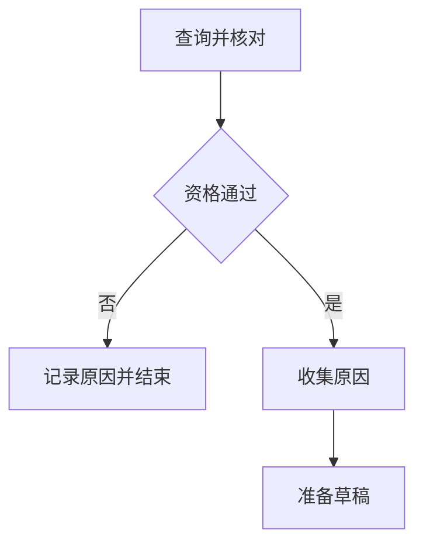

# 大模型应用开发学习 24：任务怎样选择路径循环重试和并行处理

同样是申请退货，有的订单符合规则，有的超过期限，有的查询暂时失败。把它们都塞进固定路径，会出现“资格没通过仍准备草稿”的问题。用户还可能一次核对多笔订单，数量只有运行时才知道。

这些变化都指向一个问题：根据已经得到的状态，下一步应该安排什么，什么时候结束？

| 场景 | 机制 | 要核对的结果 |
| --- | --- | --- |
| 通过或拒绝 | 条件路径 | 拒绝后不会准备草稿 |
| 暂时错误 | 有界循环 | 持续失败也会停止 |
| 多笔独立核对 | 动态派发与汇总 | 每项输入有对应结果 |

## 把结果计算和路径选择分开

查询与核对先产生状态更新，路由函数再读取`checked.ok`，决定进入原因收集还是拒绝。路由不创建草稿、不更新订单，只回答去哪；重复求值不会重复业务动作。



`add_conditional_edges`可以显式声明出口，让代码与图容易核对。返回未知节点名、拼错名称或漏掉返回值，都不应留到用户反馈“没有结果”时再发现。

同一个节点同时有固定边与条件边时，不要以为条件边会覆盖固定边。本意若是二选一，就不能再连一条无条件通往准备节点的边，否则拒绝路径与准备路径可能一起被安排。

路由输入必须是上游已经形成的结果。以A3004为例：查询得到普通用户、签收10天；核对返回`outside_application_window`；路由读取`ok=False`，进入拒绝节点；最终结果保留拒绝原因，轨迹中没有`prepare`。读者可以据此判断，拒绝是在哪里形成、又在哪里真正改变执行方向。

若把核对写在Prompt中，却保留一条无条件走准备的边，模型回答“我不能办理”并不能阻止后面的函数继续执行。这说明自然语言结论和程序控制流要分别观察。另一方面，图里有拒绝分支也不代表核对函数一定正确，规则仍需要单独验证。

固定出口表还把业务词与节点名分开。路由可以返回“可以准备”这一类别，再由映射表转到`collect_reason`；这样重命名函数时不必同时改变所有业务分类。无论选择哪种写法，都应保留一处清楚列出的出口范围。

## 重查要有依据，也要有预算

“查询超时”可以重试，“订单超过期限”通常不能靠重复查询解决。示例`routing.py`用可控失败次数去掉网络波动，先观察循环机制。

<!-- example-source: examples/23-32-assistant/routing.py -->
```python
def retry_graph():
    def query(state):
        attempts = state["attempts"] + 1
        return {"attempts": attempts, "ok": attempts > state["failures"]}

    def route(state):
        if state["ok"]:
            return "done"
        return "query" if state["attempts"] < 3 else "failed"

    builder = StateGraph(RetryState)
    builder.add_node("query", query)
    builder.add_node("done", lambda s: {"status": "done"})
    builder.add_node("failed", lambda s: {"status": "failed"})
    builder.add_edge(START, "query")
    builder.add_conditional_edges("query", route, ["query", "done", "failed"])
    builder.add_edge("done", END)
    builder.add_edge("failed", END)
    return builder.compile()
```

`attempts`保存新的绝对次数，没有累加Reducer；每轮读取上次值再加1。路由先看成功，再看剩余预算，最多尝试3次，包括第一次。

| 模拟前几次失败 | 总尝试次数 | 最终状态 |
| --- | --- | --- |
| 0 | 1 | `done` |
| 2 | 3 | `done` |
| 8 | 3 | `failed` |

真实查询还应设置单次超时与总耗时预算。若SDK内部尝试3次，图又重试3轮，最多可能发出9次请求。必须把各层次数一并计算，不能只看表面的循环上限。

## 步数保护不能代替业务退出

`recursion_limit`限制图的推进步数，不等于模型调用次数、订单数或业务轮数。一轮可能跨多个节点，并行节点也不能简单逐个加总。

<!-- example-kind: usage -->
```python
from routing import retry_graph

result = retry_graph().invoke(
    {"attempts": 0, "failures": 8, "ok": False, "status": ""},
    {"recursion_limit": 15},
)
print(result)
```

正常退出由业务预算决定。撞上步数限制时，应检查出口、计数与意外回边，不能只不断调高上限。节点抛出异常后，下游不会像`finally`一样自动执行；必要失败记录要设计在错误处理位置。

模型节点与确定性节点可以混用。模型分类先校验枚举，再供路由使用；它说“允许退款”不能直接代替业务资格。路径决定由谁提供，也需要在图的解释中说清楚。

**手工走一遍“失败两次再成功”。**初始`attempts=0`、`failures=2`。第一次查询把次数更新为1，`1 > 2`不成立，失败但还有预算；第二次更新为2，仍失败；第三次更新为3，`3 > 2`成立，转到成功节点。若`failures=8`，第三次仍失败，但预算耗尽，转到失败节点。

路由之所以能看到新的次数，是因为查询返回的更新已经并入状态。假如误把`attempts`设成累加Reducer，却仍返回`state["attempts"] + 1`，它就会把“新的绝对值”当作“本次增量”，次数增长失真。这类错误不会必然抛异常，却会让重试提前结束。因此计数器的声明与节点返回值必须一起读。

查询重试与重复创建草稿还有本质差别。只读查询超时后再查，通常可以接受；创建请求超时，服务端却可能已经创建成功。后一种情况先按请求编号查结果，才能决定是否重发。不能因为两者都叫超时，就套同一段循环。

## 固定分支和动态派发有什么不同

固定两路可以让同一份输入分别查政策、查订单。多笔订单则要求每个执行者拿到不同输入，不能每条支路又重复处理整个列表。

`Send`把目标节点与该项输入放在一起。保留`index`，即使订单号重复，也能区分它们是两项原始输入。

<!-- example-source: examples/23-32-assistant/routing.py -->
```python
def dispatch(state):
    if not state["order_ids"]:
        return "collect"
    return [Send("worker", {"index": i, "order_id": order_id})
            for i, order_id in enumerate(state["order_ids"])]
```

空列表直接进入汇总，返回空结果。不要假设至少有一个工作节点会触发收尾。示例只并行执行只读资格核对，没有并行批量创建申请，避免把调度机制和写入授权混在一起。

## 汇总要检查完整性

多个工作节点都写`results`，所以这个字段使用列表追加Reducer，每个节点只返回自己的一项。没有明确合并规则时，同时写同一普通字段可能冲突；依赖“最后一次覆盖”不能形成可靠汇总。

支路也不应依赖书写顺序读取另一支路尚未完成的更新。需要后者输出时，应把依赖步骤放到汇总之后。

<!-- example-source: examples/23-32-assistant/routing.py -->
```python
def collect(state):
    ordered = sorted(state["results"], key=lambda item: item["index"])
    if [r["index"] for r in ordered] != list(range(len(state["order_ids"]))):
        raise ValueError("子任务结果缺失或重复")
    return {"ordered": ordered}
```

先按原始位置排序，再核对位置是否正好覆盖全部输入。4项输入只收到3项，不能包装成“全部完成”；重复位置也不能被字典覆盖后悄悄消失。

规则拒绝以`ok=False`作为该项结果保留，不会丢掉其他订单。未预料的程序异常仍抛出。若产品允许部分成功，应定义哪些错误可转成单项失败，以及整批怎样表达未完成部分。

动态派发的工作函数很短，但它解释了两种状态的交接：每项工作收到的是`Send`提供的局部输入，写回的是父图认识的`results`更新。
<!-- example-source: examples/23-32-assistant/routing.py -->
```python
def worker(job):
    result = business.check(job["order_id"], user)
    return {"results": [{"index": job["index"], "order_id": job["order_id"], **result}]}
```

假设输入为`[A3003, A3004, A3003]`，派发出的三份工作分别带位置0、1、2。两个A3003的业务结果可能相同，工作身份却不同。若用订单号当唯一字典键，最后只剩两项，便无法证明原始三项都处理了。

汇总时排序解决展示顺序，位置完整性检查解决是否漏项；这两个目的不同。即使运行环境恰好总按输入顺序返回，也仍应保留明确位置，避免把偶然的调度表现当作接口约定。

Reducer追加也不会校验结果结构。某个worker漏掉`index`，或返回了另一个任务的订单号，需要汇总或结果Schema检查发现。框架负责合并数据，业务负责判断这批数据是否足以交付。

## 用不同输入观察同一张图

在共享示例目录运行：

<!-- example-kind: usage -->
```python
import tempfile
from pathlib import Path
from business import Business
from routing import batch_graph

with tempfile.TemporaryDirectory() as folder:
    graph = batch_graph(Business(Path(folder) / "business.sqlite"), "demo-user")
    result = graph.invoke(
        {"order_ids": ["A3003", "A3004", "A3003", "missing"], "results": [], "ordered": []},
        {"max_concurrency": 2},
    )
    print(result["ordered"])
```

A3003通过，A3004超过普通订单期限，未知订单返回不可访问。两个A3003保留不同位置。检查还覆盖空列表与单项列表。

并发不等于节省模型费用。十项各调用一次模型仍是十份工作，`max_concurrency`只限制同时执行多少项，不能代替服务端速率控制。本例SQLite事务还会串行保护小型业务快照，不会因为`Send`获得线性加速。

## 让每条路径都有明确结局

条件分支决定不同结果怎样继续，循环处理暂时错误，动态派发处理运行时出现的工作数量。共同要求是出口明确、更新可解释、结果完整。

一条路结束不代表每个支路成功，一次查询重试成功也不代表业务写入可以重复。路径结构与业务语义分别检查，才能知道程序为什么走到这里、究竟完成什么。

## 参考资料

- [Graph API：条件边与Send](https://docs.langchain.com/oss/python/langgraph/graph-api)
- [执行步数限制](https://docs.langchain.com/oss/python/langgraph/errors/GRAPH_RECURSION_LIMIT)
