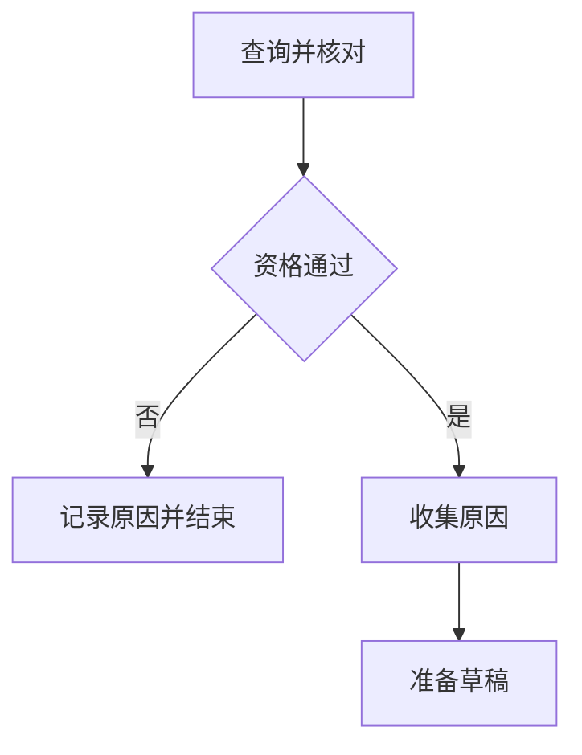
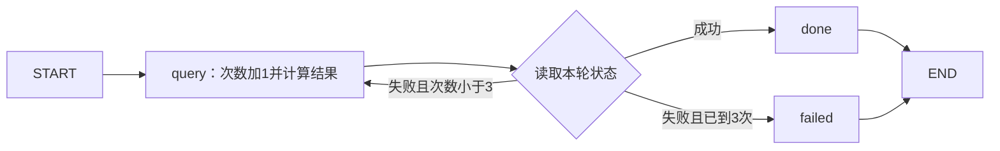
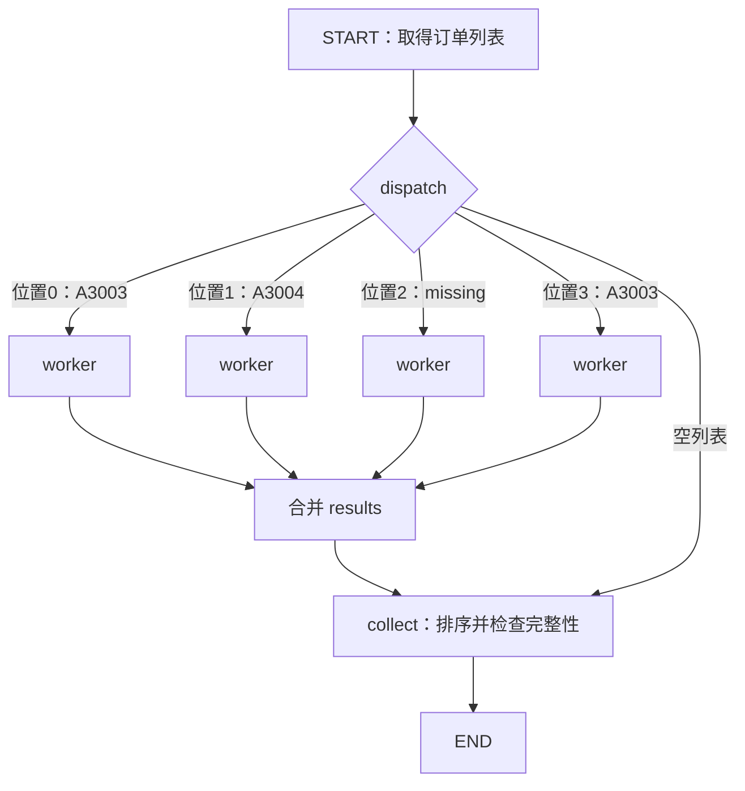

# 大模型应用开发学习 24：任务怎样选择路径循环重试和并行处理

售后程序已经能按“查询订单 → 核对资格 → 准备草稿”处理一笔信息齐全的退货请求。但客服处理的订单不会总有相同结果：A3003 符合会员15天内申请的规则，A3004 是普通用户、签收10天，已经超过7天期限。如果不看核对结果就继续，拒绝订单也会被送到准备步骤。

再增加两个真实需求，固定顺序就更不够用了。第一，查询服务偶尔超时，需要在有限次数内重查，但超过退货期限不应反复重试。第二，客服希望“一次核对这几笔订单”，订单数量到运行时才知道，各笔核对结果还必须完整对应回原始列表。

应用需要决定函数什么时候运行、运行多少次，以及怎样确认所有工作都有结果。**这里要解决的核心问题是：程序怎样根据已有状态选择下一步，并让分支、重试和批量工作都有明确的结束条件。**

| 场景 | 机制 | 要核对的结果 |
| --- | --- | --- |
| 通过或拒绝 | 条件路径 | 拒绝后不会准备草稿 |
| 暂时错误 | 有界循环 | 持续失败也会停止 |
| 多笔独立核对 | 动态派发与汇总 | 每项输入有对应结果 |

沿用[退货任务](23-LangGraph怎样记录并推进退货任务.md)的教学订单与规则，先展开已有的资格分支，再单独观察重查与批量核对。后两项是独立实验：重查用计数模拟暂时失败，批量核对调用本地业务服务，没有把模拟重查自动接到每笔订单上。所有路径都由普通 Python 逻辑决定，不需要模型选择节点，也不创建真实退货申请。

## 参考代码示例：选择、重查和汇总分别看哪里

代码在 [GitHub 共享示例目录](https://github.com/benx92/ai-learning-notes/tree/main/examples/23-32-assistant)，下载和环境准备见 [README](examples/23-32-assistant/README.md)。保留仓库目录关系，`business.py` 会导入已有的教学退货服务。

| 要理解的问题 | 参考代码 | 应观察什么 |
| --- | --- | --- |
| 资格结果怎样改变方向 | [flow.py](examples/23-32-assistant/flow.py)：`build_flow()` 的条件边 | `checked.ok=False` 后进入拒绝节点，轨迹里没有准备步骤 |
| 重查怎样计数、何时停止 | [routing.py](examples/23-32-assistant/routing.py)：`RetryState`、`retry_graph()` | 首次成功、第三次成功、预算耗尽三种结局 |
| 运行时怎样生成多份工作 | [routing.py](examples/23-32-assistant/routing.py)：`batch_graph()` 内的 `dispatch()`、`worker()` | 一项输入生成一份带位置的工作，结果写回父图 |
| 多份结果怎样完整交付 | 同文件的 `BatchState`、`collect()` | 追加结果、按位置排序、检查缺失或重复位置 |
| 怎样一键比较这些结果 | [experiments.py](examples/23-32-assistant/experiments.py)：`routing_demo()` | 三组重查输入，以及空列表、重复与未知订单的批量输入 |
| 有哪些已有行为检查 | [test_series.py](examples/23-32-assistant/test_series.py)：`test_retry_bound()`、`test_dynamic_batch_empty_duplicates_errors()` | 重试次数有上限，每项批量输入都有对应结果 |

## 把结果计算和路径选择分开

查询与核对先产生状态更新，路由函数再读取`checked.ok`，决定进入原因收集还是拒绝。路由不创建草稿、不更新订单，只回答去哪；重复求值不会重复业务动作。



`add_conditional_edges`可以显式声明出口，让代码与图容易核对。返回未知节点名、拼错名称或漏掉返回值，都不应留到用户反馈“没有结果”时再发现。

`flow.py` 中实际使用的是下面这段连边代码。它位于 `build_flow()` 内，`builder` 与各节点已在同一函数中创建和注册：

<!-- example-source: examples/23-32-assistant/flow.py -->
```python
builder.add_conditional_edges("check", lambda s: "collect_reason" if s["checked"]["ok"] else "reject",
                              ["collect_reason", "reject"])
```

第一个参数表示在 `check` 完成后选择路径；第二个参数是读取更新后状态的函数；第三个参数列出这段路由可能返回的节点名。函数返回 `"reject"` 是选择方向，不是调用 `reject()`，也不是返回一份新的业务状态。

同一个节点同时有固定边与条件边时，不要以为条件边会覆盖固定边。本意若是二选一，就不能再连一条无条件通往准备节点的边，否则拒绝路径与准备路径可能一起被安排。

路由输入必须是上游已经形成的结果。以A3004为例：查询得到普通用户、签收10天；核对返回`outside_application_window`；路由读取`ok=False`，进入拒绝节点；最终结果保留拒绝原因，轨迹中没有`prepare`。读者可以据此判断，拒绝是在哪里形成、又在哪里真正改变执行方向。

若把核对写在Prompt中，却保留一条无条件走准备的边，模型回答“我不能办理”并不能阻止后面的函数继续执行。这说明自然语言结论和程序控制流要分别观察。另一方面，图里有拒绝分支也不代表核对函数一定正确，规则仍需要单独验证。

固定出口表还把业务词与节点名分开。路由可以返回“可以准备”这一类别，再由映射表转到`collect_reason`；这样重命名函数时不必同时改变所有业务分类。无论选择哪种写法，都应保留一处清楚列出的出口范围。

## 重查要有依据，也要有预算

“查询超时”可以重试，“订单超过期限”通常不能靠重复查询解决。示例`routing.py`用可控失败次数去掉网络波动，先观察循环机制。

这里没有真的发出网络请求，也没有捕获超时异常。开发者预设 `failures`，表示“前几次查询视为失败”；`query()` 据此返回 `ok`。这样可以稳定比较循环的三个出口，而不会把网络运气当成实验结果。

先看 [routing.py](examples/23-32-assistant/routing.py) 中的完整状态定义。同文件已导入 `TypedDict` 与建图组件：

<!-- example-source: examples/23-32-assistant/routing.py -->
```python
class RetryState(TypedDict):
    attempts: int
    failures: int
    ok: bool
    status: str
```

`attempts` 是当前尝试总数，从0开始；`failures` 是实验预设；`ok` 记录最近一次查询是否成功；`status` 由结束节点写成 `done` 或 `failed`。下面是完整创建函数，定义函数本身不会执行重查，调用返回图的 `invoke()` 才开始运行：

<!-- example-source: examples/23-32-assistant/routing.py -->
```python
def retry_graph():
    def query(state):
        attempts = state["attempts"] + 1
        return {"attempts": attempts, "ok": attempts > state["failures"]}

    def route(state):
        if state["ok"]:
            return "done"
        return "query" if state["attempts"] < 3 else "failed"

    builder = StateGraph(RetryState)
    builder.add_node("query", query)
    builder.add_node("done", lambda s: {"status": "done"})
    builder.add_node("failed", lambda s: {"status": "failed"})
    builder.add_edge(START, "query")
    builder.add_conditional_edges("query", route, ["query", "done", "failed"])
    builder.add_edge("done", END)
    builder.add_edge("failed", END)
    return builder.compile()
```

`attempts`保存新的绝对次数，没有累加Reducer；每轮读取上次值再加1。路由先看成功，再看剩余预算，最多尝试3次，包括第一次。



**手工走一遍“失败两次再成功”。**初始 `attempts=0`、`failures=2`：

| 查询次数 | 节点写回的 `attempts` | 本轮判断 | 路由选择 |
| --- | --- | --- | --- |
| 第一次 | 1 | `1 > 2` 为假 | 未到3次，再去 `query` |
| 第二次 | 2 | `2 > 2` 为假 | 未到3次，再去 `query` |
| 第三次 | 3 | `3 > 2` 为真 | 去 `done` |

第三次先检查成功，再检查是否耗尽次数，所以最后一次机会成功仍会正确结束。若 `failures=8`，第三次仍失败，才进入 `failed`。

在共享示例目录中运行下面的片段，比较三种输入：

<!-- example-kind: usage -->
```python
from routing import retry_graph

graph = retry_graph()
for failures in (0, 2, 8):
    result = graph.invoke(
        {"attempts": 0, "failures": failures, "ok": False, "status": ""},
        {"recursion_limit": 15},
    )
    print(failures, result["attempts"], result["status"])
```

其中 `recursion_limit` 是图的执行保护，稍后再解释；正常结束仍由上述次数判断决定。应得到：

| 模拟前几次失败 | 总尝试次数 | 最终状态 |
| --- | --- | --- |
| 0 | 1 | `done` |
| 2 | 3 | `done` |
| 8 | 3 | `failed` |

真实查询还应设置单次超时与总耗时预算。若SDK内部尝试3次，图又重试3轮，最多可能发出9次请求。必须把各层次数一并计算，不能只看表面的循环上限。

## 步数保护不能代替业务退出

`recursion_limit`限制图的推进步数，不等于模型调用次数、订单数或业务轮数。一轮可能跨多个节点，并行节点也不能简单逐个加总。

这里的步数可以理解为执行阶段：同一阶段内可安排多个独立节点，等这些工作结束、更新合并后，再进入后续阶段。它也不等于 Python 函数递归调用的深度。给图配置15步，只是允许它在这个范围内推进，不会把业务重试上限从3次改成15次。

<!-- example-kind: usage -->
```python
from langgraph.errors import GraphRecursionError
from routing import retry_graph

try:
    retry_graph().invoke(
        {"attempts": 0, "failures": 8, "ok": False, "status": ""},
        {"recursion_limit": 1},  # 故意设得太低，观察保护异常。
    )
except GraphRecursionError:
    print("图达到步数限制，尚未按业务预算正常结束")
```

这个片段会进入异常分支；与前面返回 `status="failed"` 的正常业务退出不同，它没有得到完整的最终结果。示例中的异常提示由程序固定打印，不是模型回答。

正常退出由业务预算决定。撞上步数限制时，应检查出口、计数与意外回边，不能只不断调高上限。节点抛出异常后，下游不会像`finally`一样自动执行；必要失败记录要设计在错误处理位置。

模型节点与确定性节点可以混用。模型分类先校验枚举，再供路由使用；它说“允许退款”不能直接代替业务资格。路径决定由谁提供，也需要在图的解释中说清楚。

路由之所以能看到新的次数，是因为查询返回的更新已经并入状态。假如误把`attempts`设成累加Reducer，却仍返回`state["attempts"] + 1`，它就会把“新的绝对值”当作“本次增量”，次数增长失真。这类错误不会必然抛异常，却会让重试提前结束。因此计数器的声明与节点返回值必须一起读。

查询重试与重复创建草稿还有本质差别。只读查询超时后再查，通常可以接受；创建请求超时，服务端却可能已经创建成功。后一种情况先按请求编号查结果，才能决定是否重发。不能因为两者都叫超时，就套同一段循环。

## 固定分支和动态派发有什么不同

前面的资格分支解决“几个已知出口中选哪一个”。如果两项工作始终都要做，也可以事先连接两条固定支路，例如分别查询政策和订单。但一次输入可能有1笔、4笔或0笔订单，无法事先给每个位置注册一个节点。

这里把任务改为“逐项核对这份订单列表”，不准备草稿。每笔订单使用相同核对函数，彼此不需要等待其他订单的结论；因此可以在运行时生成多份工作。需要确定的是：每份工作拿哪个订单号，结果又对应列表的哪个位置。

父图的状态定义如下，来自 `routing.py`。同文件已导入 `Annotated` 与 `operator`：

<!-- example-source: examples/23-32-assistant/routing.py -->
```python
class BatchState(TypedDict):
    order_ids: list[str]
    results: Annotated[list[dict], operator.add]
    ordered: list[dict]
```

`order_ids` 是整批输入，`results` 接收逐项返回的结果，`ordered` 保存排序和完整性检查之后的交付结果。先把未完成的收集区与最终交付区分开，才不会把“收到一部分”误认为“整批结束”。

`Send` 把目标节点与该项输入放在一起；同文件通过 `from langgraph.types import Send` 导入它。下面是 `batch_graph()` 内的实际派发函数。保留 `index`，即使订单号重复，也能区分它们是两项原始输入：

<!-- example-source: examples/23-32-assistant/routing.py -->
```python
def dispatch(state):
    if not state["order_ids"]:
        return "collect"
    return [Send("worker", {"index": i, "order_id": order_id})
            for i, order_id in enumerate(state["order_ids"])]
```

空列表直接进入汇总，返回空结果。不要假设至少有一个工作节点会触发收尾。示例只并行执行只读资格核对，没有并行批量创建申请，避免把调度机制和写入授权混在一起。

这里“动态”的是工作数量和每项输入，`worker` 节点本身仍然只注册一次。同一个函数会处理多份任务，而不是在运行时生成许多新的 Python 函数。

每项工作收到的是 `Send` 提供的局部输入，写回的是父图认识的 `results` 更新：

<!-- example-source: examples/23-32-assistant/routing.py -->
```python
def worker(job):
    result = business.check(job["order_id"], user)
    return {"results": [{"index": job["index"], "order_id": job["order_id"], **result}]}
```

`job` 只有位置和订单号，不是整个 `BatchState`；`business` 和 `user` 则来自外层 `batch_graph(business, user)` 的参数。业务核对返回 `ok` 与 `error`，工作函数把它们连同来源位置一起放进一项结果中。

假设输入为 `["A3003", "A3004", "missing", "A3003"]`，派发出的四份工作分别带位置0、1、2、3。两个 A3003 的业务结果可能相同，工作身份却不同。若用订单号当唯一字典键，最后只剩三项，便无法证明原始四项都处理了。



图中的四个 `worker` 表示同一个节点的四份工作；“合并 results”表示框架应用字段合并规则，不是源码里另建了一个节点。

## 汇总要检查完整性

多个工作节点都写`results`，所以这个字段使用列表追加Reducer，每个节点只返回自己的一项。没有明确合并规则时，同时写同一普通字段可能冲突；依赖“最后一次覆盖”不能形成可靠汇总。

支路也不应依赖书写顺序读取另一支路尚未完成的更新。需要后者输出时，应把依赖步骤放到汇总之后。

<!-- example-source: examples/23-32-assistant/routing.py -->
```python
def collect(state):
    ordered = sorted(state["results"], key=lambda item: item["index"])
    if [r["index"] for r in ordered] != list(range(len(state["order_ids"]))):
        raise ValueError("子任务结果缺失或重复")
    return {"ordered": ordered}
```

先按原始位置排序，再核对位置是否正好覆盖全部输入。4项输入只收到3项，不能包装成“全部完成”；重复位置也不能被字典覆盖后悄悄消失。

将派发、工作和汇总连起来，`batch_graph()` 最后使用下面这段实际代码：

<!-- example-source: examples/23-32-assistant/routing.py -->
```python
builder = StateGraph(BatchState)
builder.add_node("worker", worker)
builder.add_node("collect", collect)
builder.add_conditional_edges(START, dispatch, ["worker", "collect"])
builder.add_edge("worker", "collect")
builder.add_edge("collect", END)
return builder.compile()
```

非空列表在入口派发一组工作。本例每份工作都只有一次 `worker` 执行，框架等这一执行阶段结束、结果合并后，再运行 `collect`。它不是每收到一项就把整批当作完成。空列表则没有工作节点，入口直接安排 `collect`。如果以后某些支路还要额外经过多步或循环，应重新核对汇合条件，不能直接照搬“一步工作后汇总”的结论。

规则拒绝以`ok=False`作为该项结果保留，不会丢掉其他订单。未预料的程序异常仍抛出。若产品允许部分成功，应定义哪些错误可转成单项失败，以及整批怎样表达未完成部分。

汇总时排序解决展示顺序，位置完整性检查解决是否漏项；这两个目的不同。即使运行环境恰好总按输入顺序返回，也仍应保留明确位置，避免把偶然的调度表现当作接口约定。

Reducer 追加也不会校验结果结构。当前 `collect()` 只核对位置完整性：缺少 `index` 会在排序时报错，但订单号与原输入位置是否匹配，尚未逐项校验。若以后工作函数可能返回外部生成的数据，还应补上字段、来源和对应关系检查。框架负责合并数据，业务负责判断这批数据是否足以交付。

## 用不同输入观察同一张图

在共享示例目录运行：

<!-- example-kind: usage -->
```python
import tempfile
from pathlib import Path
from business import Business
from routing import batch_graph

with tempfile.TemporaryDirectory() as folder:
    graph = batch_graph(Business(Path(folder) / "business.sqlite"), "demo-user")
    result = graph.invoke(
        {"order_ids": ["A3003", "A3004", "missing", "A3003"], "results": [], "ordered": []},
        {"max_concurrency": 2},
    )
    print(result["ordered"])
```

A3003通过，A3004超过普通订单期限，未知订单返回不可访问。两个A3003保留不同位置。检查还覆盖空列表与单项列表。

打印结果按原始位置排列，对照如下。`None` 表示没有拒绝原因，不是缺少一项结果：

| `index` | `order_id` | `ok` | `error` |
| --- | --- | --- | --- |
| 0 | A3003 | `True` | `None` |
| 1 | A3004 | `False` | `outside_application_window` |
| 2 | missing | `False` | `not_found_or_forbidden` |
| 3 | A3003 | `True` | `None` |

这里整批完成的含义是“四项核对都有结果”，不要求四笔订单都允许退货。把 `order_ids` 换成 `[]`，并仍以空的 `results`、`ordered` 开始，最终应得到 `ordered=[]`。这些初始列表由调用方显式提供，每次独立实验从空结果开始。

并发不等于节省模型费用。十项各调用一次模型仍是十份工作，`max_concurrency`只限制同时执行多少项，不能代替服务端速率控制。本例SQLite事务还会串行保护小型业务快照，不会因为`Send`获得线性加速。

## 运行与核对：每条路径交付了什么

按共享 README 准备 `.venv-series` 后，在仓库根目录运行现成入口：

```powershell
.\.venv-series\Scripts\python.exe -X utf8 examples/23-32-assistant/experiments.py routing
```

该入口用临时教学数据，分别输出三组重查结果和两组批量结果：空列表，以及包含重复、未知订单的列表。非空列表与前面调用片段一致，`missing` 位于位置2，第二个 A3003 位于位置3。

读取输出时，重查先检查 `attempts` 与 `status` 是否同时符合预期；批量先检查 `ordered` 的长度与位置是否覆盖输入，再逐项读取 `ok` 和 `error`。两类图都返回状态字典，但成功含义不同：`status="done"` 是模拟查询成功，批量结果完整则可以同时包含允许与拒绝。

## 让每条路径都有明确结局

条件分支决定不同结果怎样继续，循环处理暂时错误，动态派发处理运行时出现的工作数量。共同要求是出口明确、更新可解释、结果完整。

一条路结束不代表每个支路成功，一次查询重试成功也不代表业务写入可以重复。路径结构与业务语义分别检查，才能知道程序为什么走到这里、究竟完成什么。

## 参考资料

- [Graph API：条件边与Send](https://docs.langchain.com/oss/python/langgraph/graph-api)
- [执行步数限制](https://docs.langchain.com/oss/python/langgraph/errors/GRAPH_RECURSION_LIMIT)
