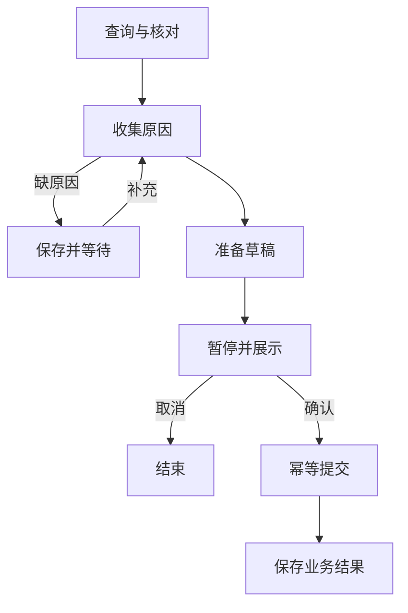

# 大模型应用开发学习 25：任务怎样等待确认并在重启后继续

售后程序已经能核对 A3003 的退货资格，用“尺寸不合适”准备一份草稿。用户看过内容，却说“稍后再确认”。查询和准备都已完成，提交又必须等用户决定：程序不能让模型一直空转，也不能在稍后收到“同意”时，重新猜测准备了哪份申请。

如果中间程序关闭，还要找回同一任务，停在正确位置，核对同一草稿，并避免重复创建申请。[会话记忆](22-助手怎样接着上一次对话继续处理.md)已经解释怎样保存和找回前文；这里继续处理业务执行的位置与结果。检查点机制可以复用，但保存聊天历史并不自动代表业务已经具备安全恢复能力。

[退货任务](23-LangGraph怎样记录并推进退货任务.md)的首次实验用 `approval=False`，到草稿就结束；[路径选择](24-任务怎样选择路径循环重试和并行处理.md)解释了分支与重试。这次启用同一个 `build_flow()` 的审批路径并接入持久检查点，沿 A3003 观察“等待 → 新进程找回 → 确认或取消 → 核对业务结果”。**核心问题是：用户的回答跨越一次调用甚至一次进程以后，怎样仍然推进正确任务，并且不重复提交。**

示例全程使用本地教学订单，不调用模型或真实电商接口。草稿仍沿用300秒有效期，先在期限内观察恢复，再单独检查过期；能长期找回任务不代表旧草稿长期有效。

| 观察 | 需要的依据 |
| --- | --- |
| 等待补充原因 | 原输入与等待问题 |
| 等待批准 | 草稿编号、内容、暂停位置 |
| 关闭后继续 | 持久检查点与稳定标识 |
| 重复确认 | 业务幂等记录 |

## 参考代码：等待与恢复分别由谁处理

代码在 [GitHub 共享示例目录](https://github.com/benx92/ai-learning-notes/tree/main/examples/23-32-assistant)，取得完整仓库、安装固定依赖与下载配套包的步骤见 [README](examples/23-32-assistant/README.md)。这里复用第15篇的 `ReturnService`，需要保留仓库目录关系。

| 位置 | 负责什么 | 观察依据 |
| --- | --- | --- |
| [flow.py](examples/23-32-assistant/flow.py)：`collect_reason()`、`review()` | 提出等待问题，接收恢复值 | 中断类型、草稿与节点返回字段 |
| 同文件：`build_flow()` | 接入检查点，连接确认、提交和取消 | `approval=True` 的连边与 `compile(checkpointer=saver)` |
| [assistant.py](examples/23-32-assistant/assistant.py)：`Assistant` | 找回任务、检查归属、组织恢复调用 | `flow()`、`config()`、`show()`、`resume()` |
| [business.py](examples/23-32-assistant/business.py)：`Business` | 持久保存业务记录，复用草稿与申请 | `register()`、`prepare()`、`submit()` |
| [test_series.py](examples/23-32-assistant/test_series.py) | 核对恢复与失败行为 | 两进程恢复、重复确认、取消、过期与身份检查 |

## 等待的对象是一项业务任务

同一个用户可能同时办理两笔订单，一场聊天也可能有多个申请。恢复时只依赖“最近提到的订单”，迟到确认就容易对应错误动作。

示例给任务分配`task_id`，把它作为图的`thread_id`，另存任务归属与初始输入。这是本例的映射选择，不意味着会话、任务和执行在所有系统中天然相同。

| 记录 | 用途 | 不能替代什么 |
| --- | --- | --- |
| 当前用户 | 判断访问归属 | 不能由模型任意填写 |
| 任务编号 | 找回执行 | 不是登录凭证 |
| 草稿编号 | 找到具体内容 | 不是批准 |
| 申请编号 | 找到业务结果 | 不是审核通过或退款 |

同一编号重复提交相同输入，入口返回已有进度；换了订单或原因则拒绝复用，避免一次请求重试悄悄重定义旧任务。

## 检查点与业务记录分别保存什么

检查点保存图状态和进度，业务存储保存订单、草稿、申请。两者都持久，不代表处于同一事务。

假如申请已创建，但提交节点完成的检查点还没写下就崩溃，恢复后节点可能再次执行。只看检查点无法判断业务操作是否已经发生，需要按稳定动作编号核对业务记录。



示例用两个SQLite文件分别保存检查点和业务记录，让职责可见。即使将表迁到同一数据库，也不会自动让框架与业务写入合成原子事务。

可以用一条时间线理解两类存储的配合：

| 时刻 | 业务存储 | 图检查点 | 如果此时退出 |
| --- | --- | --- | --- |
| 查单完成 | 订单仍在 | 有查询结果 | 后续可按已保存状态继续 |
| 草稿创建完成 | 有实际草稿 | 可能尚未保存准备结果 | 重执行准备时要复用同一草稿 |
| 等待确认 | 草稿仍在且有期限 | 知道停在审批节点 | 新进程找回等待内容 |
| 申请创建完成 | 有实际申请 | 可能尚未保存提交结果 | 再次提交应返回原申请 |

最难处理的不是“什么都没做就退出”，而是动作已经发生、进度还没记下。框架持久化能够帮助找回运行位置，却不知道外部业务动作是否可以安全重复。这也是为什么业务幂等不应只藏在前端的按钮禁用逻辑里。

把数据库备份下来也不等于保存了正确恢复点。恢复出来的业务库与检查点如果来自不同时刻，仍可能出现动作存在而状态缺失。应用需要能从业务标识重新核对结果，而不是相信两份存储永远同步。

## 中断恢复时，节点会重新进入

普通条件边读取已有状态决定走向；等待确认时，决定所需的输入还没有到达。可以自己保存等待记录并在请求入口分派，也可以使用框架提供的中断机制。LangGraph 的 `interrupt()` 把可序列化的等待内容交给调用方，暂停图。之后调用 `Command(resume=...)`，恢复值成为对应中断调用的返回值。

这不是在节点里调用 `input()` 等待终端输入，也不是反复查询用户有没有回答。中断发生后，本次图调用交回控制权，命令行可以退出；未来的新调用根据检查点重新推进。

下面是 `build_flow()` 内的审批节点，`State` 沿用第23篇的定义，`interrupt` 来自 `langgraph.types`：

<!-- example-source: examples/23-32-assistant/flow.py -->
```python
def review(state: State):
    decision = interrupt({"kind": "approval", "draft": state["draft"],
                          "effect": "创建本地教学申请，等待审核；不会退款"})
    if (not isinstance(decision, dict) or decision.get("draft_id") != state["draft"]["draft_id"]
            or decision.get("action") not in {"approve", "cancel"}):
        raise ValueError("批准必须对应当前草稿，action只能为approve或cancel")
    return {"decision": decision["action"], "trace": ["review"]}
```

第一次进入时，`interrupt()` 发出 `kind="approval"` 与当前草稿，函数尚未执行到 `return`，所以状态里还没有新的 `decision`。恢复时，程序传回例如 `{"action": "approve", "draft_id": "当前草稿编号"}`，这个字典成为 `decision`，经过检查后才写入状态；取消则写入 `decision="cancel"`。

`build_flow()` 的条件边随后依据该字段选择 `submit` 或 `cancel`。前者调用业务服务并按结果写入 `submitted` 或 `failed`，后者写入 `cancelled` 并结束，不创建申请。`stage="draft_ready"` 只说明草稿准备好了；是否正在等待，还要检查中断记录，不能从阶段名推断用户已经批准。

审批节点核对草稿编号与动作，真实服务还要核对登录身份、草稿版本和批准范围；不能把模型生成的“用户同意”当作可信批准。

恢复时，包含中断的节点会从函数开头重新进入，并不是把Python进程冻结到某一行。因此不要在`interrupt()`前发送通知、创建申请或生成新的随机业务编号，再假设这些动作只执行一次。

示例将准备、审批、提交分开；准备按任务编号复用草稿，提交按草稿编号复用申请。不同位置的重执行需要不同去重依据。中断还依赖框架内部控制机制，不要用宽泛异常捕获吞掉它，也不要随意改变多个中断的顺序。

## 检查点怎样接回同一份图

暂停位置必须由检查点保存器留下，恢复时还要能定位它。第22篇已对照过内存保存与文件保存，这里直接看 `Assistant.flow()` 的实际连接方式。以下两个方法均来自 `Assistant` 类；同文件导入了 `SqliteSaver`，`self.folder` 是命令行 `--data` 指定的数据目录：

<!-- example-source: examples/23-32-assistant/assistant.py -->
```python
@contextmanager
def flow(self):
    with SqliteSaver.from_conn_string(str(self.folder / "checkpoints.sqlite")) as saver:
        yield build_flow(self.business, saver)

@staticmethod
def config(task):
    return {"configurable": {"thread_id": task}, "recursion_limit": 30}
```

`build_flow()` 默认启用审批，最终用 `builder.compile(checkpointer=saver)` 编译。每次命令都可以重新创建图对象，执行进度来自同一文件中的检查点，而不是上一次的 Python 对象。`thread_id` 决定找该文件里的哪项任务；换了数据目录或任务编号，就不能指望找到原来的暂停位置。`recursion_limit` 仍是执行步数保护，不控制用户可以等多久。

读取与恢复同样是两件事。`show()` 先通过 `Business.register(task, user)` 核对任务归属，再调用 `graph.get_state()`，从快照的 `tasks` 中取出中断内容。它不会因为读到了待办就自动提交。`resume()` 据此检查当前在等原因还是等批准，构造 `response` 后才执行下面两行实际源码：

<!-- example-source: examples/23-32-assistant/assistant.py -->
```python
with self.flow() as graph:
    graph.invoke(Command(resume=response), self.config(task), context=RequestContext(user))
```

其中 `Command` 来自 `langgraph.types`；等待批准时，`response` 包含入口校验过的 `action` 和从当前中断取出的 `draft_id`。`RequestContext(user)` 为本次执行提供用户身份，保存了状态并不意味着以后可以跳过入口身份检查。

| 调用时机 | 交给图的输入 | 含义 |
| --- | --- | --- |
| 创建任务 | `task_id`、`order_id`、`reason` | 从入口开始处理一项新任务 |
| 查看任务 | `get_state(config)` | 读取已保存状态，不推进业务 |
| 回答暂停问题 | `Command(resume=response)` | 让中断取得回答，继续未完成节点 |

入口还做了一层防重复处理：`start()` 发现相同任务已有状态时只返回进度；`resume()` 发现没有待回答的中断时也只返回当前状态。因此，任务已完成后的再次确认通常不会再调用图。业务层仍需幂等，因为提交过程中崩溃、检查点尚未更新的情况无法仅靠入口判断排除。

## 调试断点与业务确认要分开

如果只是排查“准备草稿前拿到了哪些字段”，不一定要把业务节点改成一次人工提问。LangGraph 还提供静态断点：编译时设置 `interrupt_before=["prepare"]`，会在节点开始之前停下；`interrupt_after=["prepare"]` 则在节点完成之后停下。两者都需要检查点，查看后用 `graph.invoke(None, config)` 续跑。

| 需要 | 暂停方式 | 如何继续 |
| --- | --- | --- |
| 让用户回答当前草稿是否提交 | 节点内部的 `interrupt(payload)` | `Command(resume=回答)`，回答成为中断的返回值 |
| 调试时检查节点输入或输出 | `interrupt_before` / `interrupt_after` | `invoke(None, config)`，不向节点提供确认值 |

静态断点没有用户要回答的问题，不能仅凭 `next` 非空就画一个“批准”按钮。动态中断已经在等待批准时，单独 `invoke(None, config)` 也不能代替回答；它可能重新进入节点并再次停住。两种机制虽然都会暂停，输入契约不同。

独立实验 [wait_variants.py](examples/23-32-assistant/wait_variants.py) 的 `static_demo()` 在普通 `work` 节点前暂停：首次节点调用数为0，快照的 `next` 指向 `work`，没有待回答的中断对象；传入 `None` 后节点执行1次。这里只检查断点语义，没有业务写入，也不能据此推断真实操作在崩溃后永远只执行一次。

## 确认内容变化与多项待办怎样处理

人工协同通常还会遇到“改一下再办”和“需要两个人分别回答”。它们不能简单塞进当前入口的 `approve` 字符串。

**改动要先形成新的确认对象。**当前退货程序只接受批准或取消，没有修改草稿的接口。若用户想改原因，应取消旧草稿，在新任务中重新准备后再确认。产品允许同一任务编辑时，可以让恢复值包含动作、新内容和版本，审批节点先校验字段与业务范围，再形成新版本；要求改稿时应回到准备与展示环节，而不是绕过核对直接提交。

“修改后批准”与“要求改稿”是两件事：前者是有权审批者明确批准修改后的具体内容，后者只是提出修改意见，还没有批准新结果。若引入模型改稿，循环必须有次数上限，每稿有独立版本；批准绑定当前稿，执行节点只接收通过检查的版本。这里讲的是扩展设计，现有 `Assistant.resume()` 不支持这些动作，也不提供小额免确认或自动退款。

不要为方便改单，直接把不可信的恢复请求透传成 `Command(update=...)`。它会写状态并使用字段已有的 Reducer，追加字段不会自动变成覆盖；状态变化也不代表业务记录与批准已经同步更新。恢复时临时增加 `goto` 还可能与已有边的调度叠加，不能把它当成跳过业务门槛的入口。

**多项等待必须逐项关联。**第24篇已经有并行分发；如果两个分支各自调用 `interrupt()`，一次暂停就可能包含两个中断。任务编号定位整条执行线，草稿编号定位业务内容，中断 `id` 则定位当前哪一个问题。调用方读取当前待办后，用 `Command(resume={中断id: 对应回答})` 回答指定项，不应按列表第一项猜测，也不应长期缓存旧中断ID。

`wait_variants.py` 的 `parallel_demo()` 用两个无业务副作用的分支模拟这个关系：两项同时等待，先按 A 的ID回答，再重新读取仍待答的 B，最后回答 B。代码从当前快照的 `tasks` 中选择名字仍在 `snapshot.next` 的任务，再提取它们的中断；这样部分恢复时不会把已答项继续当作待办。普通任务查询不是审批授权，真实服务仍要检查每一项的审批人及范围。

在共享示例目录运行：

```powershell
python -X utf8 wait_variants.py
```

预期先输出静态断点续跑后执行1次，再输出“2项待答 → 按ID答1项 → 剩1项 → 全部结束”。这是内存机制实验，不能替代下面的持久恢复验证，也没有把两名审批人自动加到 A3003 流程中。

如果把审批封装成子图，内部中断可以传到父图调用方；查看嵌套执行位置时需按接口要求展开子图状态。尤其是父节点通过函数调用子图时，恢复还会重新进入调用子图的父节点，因此父节点调用之前的代码也要能安全重执行。父子共享带追加规则的字段时，不要把子图返回的全量轨迹当作增量再追加；可用独立字段，或由包装节点明确返回本次更新。

工具调用审批也有类似边界：暂停发生在整个工具执行节点中时，同批其他工具可能重新执行。只有读状态和提出问题的审批节点最容易推断；实际写操作仍应独立执行并由业务服务去重。框架中间件可以封装工具审批，但不能替代业务授权和幂等检查。

## 用两个真实进程观察恢复

依赖与目录见[共享运行说明](examples/23-32-assistant/README.md)。在示例目录执行：

```powershell
python -X utf8 assistant.py --data ./data/reading25 start return-25 A3003 --reason "尺寸不合适"
```

应出现`kind: approval`、草稿编号、订单与原因。此时进程已退出，但申请没提交。

JSON 输出中的对应字段是 `"kind": "approval"`；同一任务的 `stage` 仍是 `draft_ready`，`next` 包含 `review`，`interrupts` 包含当前草稿。这三项分别表示业务进度、待执行节点和正在等待的内容。再启动新进程：

```powershell
python -X utf8 assistant.py --data ./data/reading25 show return-25
python -X utf8 assistant.py --data ./data/reading25 resume return-25 --action approve
```

新进程重新创建图与连接，从同一文件、同一任务恢复。成功后阶段是`submitted`，结果有`application_id`和`review_status: pending`，它表示创建本地虚构申请，不能展示成已退款。

可立即重复最后一条 `resume ... --action approve`，对照两次 `result.application_id`，应保持一致；完成后 `next` 和 `interrupts` 都为空。编号是运行时生成的，不要把某次编号写死作为预期结果。各次调用观察的关系如下：

| 调用 | 进入前 | 返回后 | 申请记录 |
| --- | --- | --- | --- |
| `start`，已有原因 | 新任务 | 等待 `review` | 0份 |
| 新进程 `show` | 已有检查点 | 仍等待同一草稿 | 0份 |
| `resume --action approve` | 等待批准且草稿有效 | `submitted` | 1份待审核申请 |
| 再次同样确认 | 已完成 | 返回原结果 | 仍为1份 |

首次缺原因时会先返回`need_reason`，补充后才进入审批：

```powershell
python -X utf8 assistant.py --data ./data/reading25b start return-25b A3003
python -X utf8 assistant.py --data ./data/reading25b resume return-25b --reason "尺寸不合适"
python -X utf8 assistant.py --data ./data/reading25b resume return-25b --action cancel
```

两组用不同数据目录，避免第一组已申请的订单影响第二组。已有数据需要保留，不必为了重跑删除它。

**恢复调用与新任务调用看起来相近，含义不同。**新任务输入描述要做什么；`Command(resume=...)`回答的是已经保存的等待问题。再次传入一份新输入，可能重新启动入口路径，不能拿它代替恢复。

配套入口先读任务快照，再根据当前中断类型构造恢复值。等待原因时只能补原因，等待批准时才接收批准或取消。这样“同意”不会误填进原因字段，“尺寸不合适”也不会被当作批准。

观察`show`中的`next`与`interrupts`，可以分别回答“还有哪些步骤待推进”和“当前具体等待什么”。只有聊天消息写着“请确认”，却没有这些可恢复记录时，程序重启后往往只能重新猜测。

如果补充了无效原因，示例会再次等待合法输入。这个过程不是模型无休止循环，而是节点重新挂起、把控制权交回用户。用户迟迟不答时，本次调用已经返回，不需要持续占用一次模型请求。

## 幂等为什么要在业务层实现

幂等不是保证函数只调用一次，而是同一动作重复到达，不生成第二份不应存在的结果。网络重试、崩溃和重复点击都可能让代码再跑。

<!-- example-source: examples/23-32-assistant/business.py -->
```python
def submit(self, draft_id, user):
    """只供可信审批入口后的节点调用，不暴露为模型可随意调用的工具。"""
    with self.transaction() as (service, _):
        # 已成功的同一动作重复到达时，先返回既有业务记录。
        if draft_id in service.applications:
            draft = service.drafts.get(draft_id)
            if not draft or draft["user"] != user:
                return {"ok": False, "error": "invalid_draft"}
            return {"ok": True, "reused": True, **copy.deepcopy(service.applications[draft_id])}
        confirmed = service.confirm_from_ui(draft_id, user)
        if not confirmed["ok"]:
            return confirmed
        return service.submit(draft_id, user)
```

适配器在同一SQLite写事务内读取已有申请、确认、提交、保存更新。`draft_id`代表同一次动作；已存在时返回原记录。它展示业务去重的位置，没有承诺分布式事务。

原`ReturnService`用单调时钟记录进程内有效期；持久适配器换算成`expires_at`保存，恢复后再换算。不能把旧进程的单调时钟数值直接跨进程使用。

草稿沿用300秒期限。“任务几小时后还能找回”不等于“旧草稿几小时后仍可提交”。过期返回 `draft_expired`，图记录为 `failed` 并结束。本例没有自动刷新草稿的恢复分支；要重新办理，需要在重新核对后使用新任务编号准备草稿并再次确认，不能把同一旧任务重新 `start` 当成续期，更不能自动延长旧授权。时钟校准、长期有效期策略属于实际产品需要进一步明确的部分。

**为什么还要保留草稿，而不只保留一句原因？**确认的对象应是具体内容，包括订单、原因、动作和后果。若用户批准A3003的草稿，程序却在恢复时读取了后来改成A3004的新草稿，即使状态叫`approved`，这次批准也不成立。

当前教学程序准备后不提供修改草稿的接口，因此草稿编号就能关联固定内容。产品允许编辑时，应增加版本号或内容摘要：编辑产生新版本，批准绑定该版本，执行前再核对。如果内容已变，应要求重新确认，而不是让旧批准覆盖新内容。

重试返回原申请也不能无条件泄露结果。业务层先确认当前用户与草稿归属，再返回已有记录。否则攻击者只要猜到幂等键，就可能读取另一用户的申请。去重键是关联标识，不是访问凭证。

本例把“确认”封在可信入口后的调用链中，没有作为模型工具公开。真实网页接入时，要在接收按钮请求的服务端执行身份、任务与版本校验，不能只检查浏览器是否显示过确认按钮。

## 正确恢复还要覆盖例外

| 输入变化 | 应观察的行为 |
| --- | --- |
| 批准当前草稿 | 创建一份待审核申请 |
| 取消 | 不创建申请 |
| 其他用户恢复 | 读取任务内容前拒绝 |
| 草稿过期 | 返回失败原因 |
| 相同确认再次到达 | 返回同一结果 |
| 相同编号替换输入 | 拒绝并要求新编号 |

`test_real_process_restart`实际启动两个Python进程，验证本地恢复。默认`--user demo-user`只是教学身份，可由操作者修改，不能作为服务认证。

同一任务不应由多个进程无约束地同时恢复。业务事务保护申请去重，不表示图的并发状态更新已经全部解决。真实入口应按任务串行化、校验版本或采用适当协调机制。

本轮核查使用 Context7 的 LangGraph 官方文档与配套源码。实际在 Python 3.14.6 上检查了业务数据库重读、同任务草稿复用、同草稿提交返回原申请、身份拒绝和任务输入绑定。默认环境与已有 Python 3.12.13 虚拟环境均缺少 SQLite 检查点集成，因此没有重跑上面的两进程图恢复及完整共享测试；命令结果是供读者对照的预期，不冒充本轮实测。现有 `test_real_process_restart` 保留为完整环境中的验证入口。

补充机制实验实际运行 `wait_variants.py`，通过静态断点续跑、两个并行中断按ID分别回答和部分恢复后的待办检查。编辑批准、模型改稿、子图恢复和工具中间件在此只解释设计与边界，没有声称已接入现有退货流程。

## 恢复要继续正确动作

从 A3003 和退货原因开始，程序先留下草稿与暂停记录，新进程再按同一任务编号找回它。用户确认使 `review` 得到回答，业务服务核对草稿后创建一份待审核申请；重复确认返回已有结果，取消和过期则有各自的结束状态。

等待时留下接力所需记录，恢复时用对当前等待问题的回答推进同一任务。事实变化、用户取消和批准过期都应进入明确检查位置，避免“恢复成功”却办错事情。

## 参考资料

- [中断与恢复](https://docs.langchain.com/oss/python/langgraph/interrupts)
- [持久化](https://docs.langchain.com/oss/python/langgraph/persistence)
- [持久执行与幂等](https://docs.langchain.com/oss/python/langgraph/durable-execution)
