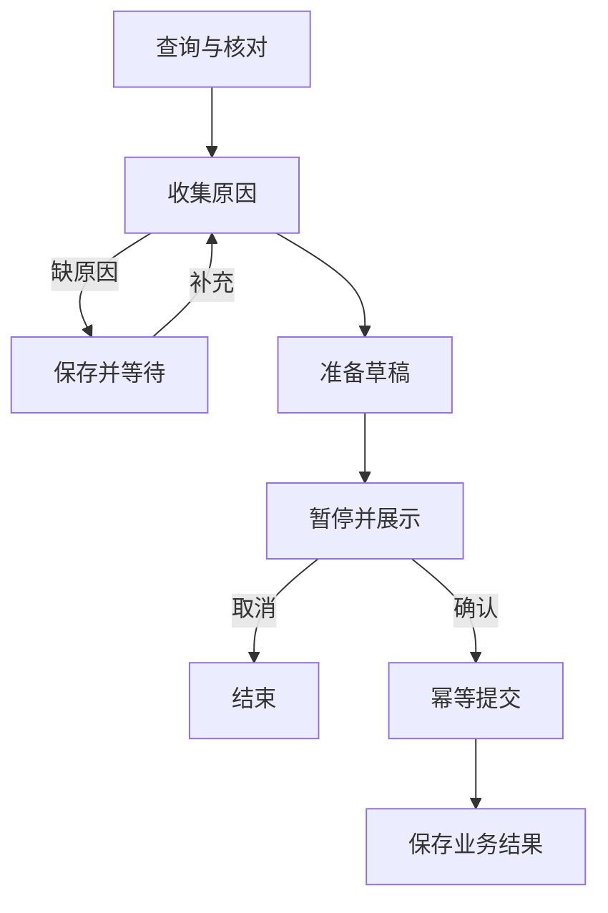

# 大模型应用开发学习 25：任务怎样等待确认并在重启后继续

用户看过草稿，说“晚上再确认”。程序不能让模型一直空转，也不能在第二天收到“同意”时，重新猜测昨天准备了哪份申请。

如果中间程序关闭，还要找回同一任务，停在正确位置，核对同一草稿，并只创建一次申请。保存聊天历史并不自动解决这些问题：历史记录说过什么，业务执行还要记录下一步做什么。

| 观察 | 需要的依据 |
| --- | --- |
| 等待补充原因 | 原输入与等待问题 |
| 等待批准 | 草稿编号、内容、暂停位置 |
| 关闭后继续 | 持久检查点与稳定标识 |
| 重复确认 | 业务幂等记录 |

## 等待的对象是一项业务任务

同一个用户可能同时办理两笔订单，一场聊天也可能有多个申请。恢复时只依赖“最近提到的订单”，迟到确认就容易对应错误动作。

示例给任务分配`task_id`，把它作为图的`thread_id`，另存任务归属与初始输入。这是本例的映射选择，不意味着会话、任务和执行在所有系统中天然相同。

| 记录 | 用途 | 不能替代什么 |
| --- | --- | --- |
| 当前用户 | 判断访问归属 | 不能由模型任意填写 |
| 任务编号 | 找回执行 | 不是登录凭证 |
| 草稿编号 | 找到具体内容 | 不是批准 |
| 申请编号 | 找到业务结果 | 不是审核通过或退款 |

同一编号重复提交相同输入，入口返回已有进度；换了订单或原因则拒绝复用，避免一次请求重试悄悄重定义旧任务。

## 检查点与业务记录分别保存什么

检查点保存图状态和进度，业务存储保存订单、草稿、申请。两者都持久，不代表处于同一事务。

假如申请已创建，但提交节点完成的检查点还没写下就崩溃，恢复后节点可能再次执行。只看检查点无法判断业务操作是否已经发生，需要按稳定动作编号核对业务记录。



示例用两个SQLite文件分别保存检查点和业务记录，让职责可见。即使将表迁到同一数据库，也不会自动让框架与业务写入合成原子事务。

可以用一条时间线理解两类存储的配合：

| 时刻 | 业务存储 | 图检查点 | 如果此时退出 |
| --- | --- | --- | --- |
| 查单完成 | 订单仍在 | 有查询结果 | 后续可按已保存状态继续 |
| 草稿创建完成 | 有实际草稿 | 可能尚未保存准备结果 | 重执行准备时要复用同一草稿 |
| 等待确认 | 草稿仍在且有期限 | 知道停在审批节点 | 新进程找回等待内容 |
| 申请创建完成 | 有实际申请 | 可能尚未保存提交结果 | 再次提交应返回原申请 |

最难处理的不是“什么都没做就退出”，而是动作已经发生、进度还没记下。框架持久化能够帮助找回运行位置，却不知道外部业务动作是否可以安全重复。这也是为什么业务幂等不应只藏在前端的按钮禁用逻辑里。

把数据库备份下来也不等于保存了正确恢复点。恢复出来的业务库与检查点如果来自不同时刻，仍可能出现动作存在而状态缺失。应用需要能从业务标识重新核对结果，而不是相信两份存储永远同步。

## 中断恢复时，节点会重新进入

`interrupt()`把可序列化的等待内容交给调用方，暂停图。之后调用`Command(resume=...)`，恢复值成为对应中断调用的返回值。

<!-- example-source: examples/23-32-assistant/flow.py -->
```python
def review(state: State):
    decision = interrupt({"kind": "approval", "draft": state["draft"],
                          "effect": "创建本地教学申请，等待审核；不会退款"})
    if (not isinstance(decision, dict) or decision.get("draft_id") != state["draft"]["draft_id"]
            or decision.get("action") not in {"approve", "cancel"}):
        raise ValueError("批准必须对应当前草稿，action只能为approve或cancel")
    return {"decision": decision["action"], "trace": ["review"]}
```

审批节点核对草稿编号与动作，再选择提交或取消。真实服务还要核对登录身份、草稿版本和批准范围；不能把模型生成的“用户同意”当作可信批准。

恢复时，包含中断的节点会从函数开头重新进入，并不是把Python进程冻结到某一行。因此不要在`interrupt()`前发送通知、创建申请或生成新的随机业务编号，再假设这些动作只执行一次。

示例将准备、审批、提交分开；准备按任务编号复用草稿，提交按草稿编号复用申请。不同位置的重执行需要不同去重依据。中断还依赖框架内部控制机制，不要用宽泛异常捕获吞掉它，也不要随意改变多个中断的顺序。

## 用两个真实进程观察恢复

依赖与目录见[共享运行说明](examples/23-32-assistant/README.md)。在示例目录执行：

```powershell
python -X utf8 assistant.py --data ./data/reading25 start return-25 A3003 --reason "尺寸不合适"
```

应出现`kind: approval`、草稿编号、订单与原因。此时进程已退出，但申请没提交。再启动新进程：

```powershell
python -X utf8 assistant.py --data ./data/reading25 show return-25
python -X utf8 assistant.py --data ./data/reading25 resume return-25 --action approve
```

新进程重新创建图与连接，从同一文件、同一任务恢复。成功后阶段是`submitted`，结果有`application_id`和`review_status: pending`，它表示创建本地虚构申请，不能展示成已退款。

首次缺原因时会先返回`need_reason`，补充后才进入审批：

```powershell
python -X utf8 assistant.py --data ./data/reading25b start return-25b A3003
python -X utf8 assistant.py --data ./data/reading25b resume return-25b --reason "尺寸不合适"
python -X utf8 assistant.py --data ./data/reading25b resume return-25b --action cancel
```

两组用不同数据目录，避免第一组已申请的订单影响第二组。已有数据需要保留，不必为了重跑删除它。

**恢复调用与新任务调用看起来相近，含义不同。**新任务输入描述要做什么；`Command(resume=...)`回答的是已经保存的等待问题。再次传入一份新输入，可能重新启动入口路径，不能拿它代替恢复。

配套入口先读任务快照，再根据当前中断类型构造恢复值。等待原因时只能补原因，等待批准时才接收批准或取消。这样“同意”不会误填进原因字段，“尺寸不合适”也不会被当作批准。

观察`show`中的`next`与`interrupts`，可以分别回答“还有哪些步骤待推进”和“当前具体等待什么”。只有聊天消息写着“请确认”，却没有这些可恢复记录时，程序重启后往往只能重新猜测。

如果补充了无效原因，示例会再次等待合法输入。这个过程不是模型无休止循环，而是节点重新挂起、把控制权交回用户。用户迟迟不答时，本次调用已经返回，不需要持续占用一次模型请求。

## 幂等为什么要在业务层实现

幂等不是保证函数只调用一次，而是同一动作重复到达，不生成第二份不应存在的结果。网络重试、崩溃和重复点击都可能让代码再跑。

<!-- example-source: examples/23-32-assistant/business.py -->
```python
def submit(self, draft_id, user):
    """只供可信审批入口后的节点调用，不暴露为模型可随意调用的工具。"""
    with self.transaction() as (service, _):
        # 已成功的同一动作重复到达时，先返回既有业务记录。
        if draft_id in service.applications:
            draft = service.drafts.get(draft_id)
            if not draft or draft["user"] != user:
                return {"ok": False, "error": "invalid_draft"}
            return {"ok": True, "reused": True, **copy.deepcopy(service.applications[draft_id])}
        confirmed = service.confirm_from_ui(draft_id, user)
        if not confirmed["ok"]:
            return confirmed
        return service.submit(draft_id, user)
```

适配器在同一SQLite写事务内读取已有申请、确认、提交、保存更新。`draft_id`代表同一次动作；已存在时返回原记录。它展示业务去重的位置，没有承诺分布式事务。

原`ReturnService`用单调时钟记录进程内有效期；持久适配器换算成`expires_at`保存，恢复后再换算。不能把旧进程的单调时钟数值直接跨进程使用。

草稿沿用300秒期限。“任务几小时后还能找回”不等于“旧草稿几小时后仍可提交”。过期返回`draft_expired`，需要重新核对和准备，不能自动延长旧授权。时钟校准、长期有效期策略属于实际产品需要进一步明确的部分。

**为什么还要保留草稿，而不只保留一句原因？**确认的对象应是具体内容，包括订单、原因、动作和后果。若用户批准A3003的草稿，程序却在恢复时读取了后来改成A3004的新草稿，即使状态叫`approved`，这次批准也不成立。

当前教学程序准备后不提供修改草稿的接口，因此草稿编号就能关联固定内容。产品允许编辑时，应增加版本号或内容摘要：编辑产生新版本，批准绑定该版本，执行前再核对。如果内容已变，应要求重新确认，而不是让旧批准覆盖新内容。

重试返回原申请也不能无条件泄露结果。业务层先确认当前用户与草稿归属，再返回已有记录。否则攻击者只要猜到幂等键，就可能读取另一用户的申请。去重键是关联标识，不是访问凭证。

本例把“确认”封在可信入口后的调用链中，没有作为模型工具公开。真实网页接入时，要在接收按钮请求的服务端执行身份、任务与版本校验，不能只检查浏览器是否显示过确认按钮。

## 正确恢复还要覆盖例外

| 输入变化 | 应观察的行为 |
| --- | --- |
| 批准当前草稿 | 创建一份待审核申请 |
| 取消 | 不创建申请 |
| 其他用户恢复 | 读取任务内容前拒绝 |
| 草稿过期 | 返回失败原因 |
| 相同确认再次到达 | 返回同一结果 |
| 相同编号替换输入 | 拒绝并要求新编号 |

`test_real_process_restart`实际启动两个Python进程，验证本地恢复。默认`--user demo-user`只是教学身份，可由操作者修改，不能作为服务认证。

同一任务不应由多个进程无约束地同时恢复。业务事务保护申请去重，不表示图的并发状态更新已经全部解决。真实入口应按任务串行化、校验版本或采用适当协调机制。

## 恢复要继续正确动作

能读出历史，证明信息留下了；能重新执行函数，证明代码又跑起来。可靠恢复还要核对归属、内容、有效期和业务结果。

等待时留下接力所需记录，恢复时用新输入推进同一任务。事实变化、用户取消和批准过期都应进入明确检查位置，避免“恢复成功”却办错事情。

## 参考资料

- [中断与恢复](https://docs.langchain.com/oss/python/langgraph/interrupts)
- [持久化](https://docs.langchain.com/oss/python/langgraph/persistence)
- [持久执行与幂等](https://docs.langchain.com/oss/python/langgraph/durable-execution)
