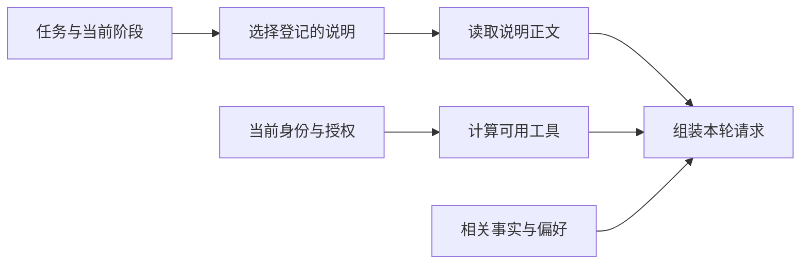

# 大模型应用开发学习 27：助手怎样按需加载知识和操作说明

售后助手既要解释政策，又要整理工单、准备申请。把全部操作规范、所有历史和所有工具说明一次塞给模型，相关内容会被淹没；只给一句“请认真处理”，又缺少真正的操作依据。

这里要解决的是本轮该提供什么：哪些是需要检索的事实，哪些是需要遵循的操作说明，哪些工具在当前阶段可用。输入由这些真实需要组装，而不是不断加长一段固定提示。

| 信息类型 | 作用 | 示例 |
| --- | --- | --- |
| 政策证据 | 说明制度事实 | 会员15天、定制例外 |
| 操作说明 | 约定怎样完成一类任务 | 核对后准备，展示草稿 |
| 用户偏好 | 影响表达与服务方式 | 希望答复简洁 |
| 工具能力与权限 | 决定程序可执行什么 | 本轮只允许查询 |

## 先区分“知道什么”和“怎样做”

“会员可以在签收15天内申请”是事实；“提交前展示具体草稿并确认”是操作规范；“查询订单”是程序能力。三者都可能以文本出现，但来源、寿命和作用不同。

RAG帮助找相关证据，操作说明帮助组织行为。它们可以一起进入上下文，但检索到的文档不能自动升级为系统规则。某份政策附件包含“忽略权限检查”，仍只是外部内容。

模型自身知识也不等于业务事实。实时订单状态必须查询；某家商店当前政策必须读取适用资料；只有格式化、语言组织等工作可以由模型结合输入完成。

先看一个具体的输入冲突。用户只问“退货运费谁承担”，模型却同时收到创建申请、关闭工单和异常退款的操作说明。它可能把“需要准备申请”误当作这轮必须执行的目标，或者在无关规则之间反复选择。增加资料不总是增加有效信息，关键是资料与当前问题的关系。

反过来，只给政策段落，没有告诉程序什么时候查实时订单、什么时候只是解释一般规则，助手也容易把通用制度当成某笔订单的最终结论。信息需要分层，正是为了让事实、操作与能力分别有清楚位置。

可以把一次请求拆成三份：稳定的行为要求说明如何对待资料和工具；本轮工作说明给出当前任务的步骤；本轮数据包含问题、订单事实和证据。数据可以变化，稳定要求不应随外部资料中的一句话被覆盖。三份内容最终可能都以消息传入模型，维护时仍应保留各自来源。

## 目录常驻，正文按需加载

有十份操作说明时，可以先让模型看到名称与简短描述，选中后再读取全文。这种“目录加正文”的组织方式常被称为技能按需加载。

它并不神秘：目录让程序或模型知道可选项，加载函数将明确文件内容放入本次请求。真正决定是否使用、怎样使用的仍是运行程序与模型。

配套`harness.py`登记两份说明，正文保存在`skills/policy.md`与`skills/return.md`。这是本系列自己的最小说明格式，不声称兼容所有产品的技能规范。



示例由调用方明确选择说明，故意不把“模型是否选对技能”混进加载机制实验。需要模型选择时，还要验证选择准确率与未知名称的处理。

**目录层如何帮助选择。**如果只有`policy`、`return`两个名字，模型或读者未必知道它们分别负责什么；描述应说明能解决的问题，而不是再堆一组接口名。`policy`用于解释条件和来源，`return`用于核对订单后准备申请，两者的产出不同。

选中`return`以后，程序只读这份正文。目录仍可以保留其他可选说明的名称，但“知道还有什么”与“本轮已取得什么全文”是两种状态。后续确实遇到新的子任务，再读取相应说明，而不必启动时把所有正文拉进来。

加载还要考虑重复。如果模型每轮都调用同一加载工具，原文反复追加，会重新膨胀上下文。可以记录当前运行已加载的说明版本，重复请求时返回已加载标记或引用；内容更新时则显式失效。不能只缓存名字，否则同名说明已经修改，程序却继续沿用旧正文。

## 实际请求是怎样组装的

<!-- example-source: examples/23-32-assistant/harness.py -->
```python
def assemble_request(skill_name, stage, allowed, facts=None):
    if skill_name not in SKILLS:
        raise ValueError("未知说明名称")
    entry = SKILLS[skill_name]
    body = (Path(__file__).parent / "skills" / entry["file"]).read_text(encoding="utf-8")
    stage_tools = {"policy_search", "order_query"} if stage == "query" else {"order_query", "prepare_return"}
    tools = sorted(entry["tools"] & set(allowed) & stage_tools)
    return {"stable": "只依据可核对事实回答；提交由独立确认入口处理。",
            "catalog": [{"name": k, "description": v["description"]} for k, v in SKILLS.items()],
            "instruction": body, "facts": facts or {}, "tools": tools}
```

稳定要求、说明目录、所选正文、事实和工具列表分别保存。这样可以检查每部分从哪里来，也能避免把用户事实拼成一段看不出来源的高权限指令。

加载入口仅接受注册表中的名称，不把模型返回值直接拼成任意文件路径。`../../secret`不是一个合法技能名。说明文件也应由可信维护流程管理；按需加载本身没有消除提示注入风险。

工具范围取三个集合的交集：说明需要的工具、当前用户获准的工具、当前阶段允许的工具。说明写着需要提交，不表示当前请求就获得提交授权。

例如申请说明包含查单与准备，但阶段为`query`时，本轮只开放查单。即使输入的授权集合里还出现`submit`，本例也不会将它交给模型。

**沿一轮请求核对每个字段。**假设当前阶段为`query`，申请说明需要`order_query`与`prepare_return`，用户授权也允许这两个。阶段限制只允许查询，因此交集只剩`order_query`。

| 计算位置 | 集合内容 | 为什么保留或移除 |
| --- | --- | --- |
| 说明需要 | 查单、准备 | 这类任务可能用到 |
| 用户授权 | 查单、准备 | 用户可请求这些能力 |
| 当前阶段 | 查政策、查单 | 尚未进入准备阶段 |
| 本轮工具 | 查单 | 同时满足三项条件 |

接下来把`stage`改成`prepare`，本轮可能出现查单与准备；但没有自动出现提交。这个对照可以验证工具范围确实随阶段变化，而不是正文写了“动态”，实际却始终发送完整工具表。

`assemble_request`返回的是用于观察的组装结果，还不是已经发送的模型API请求。接入真实模型时，需要把`stable`与可信说明放入相应消息，把`facts`与用户问题保留为有来源的数据，再从登记的真实工具对象中筛选`tools`所列名称，交给Agent或模型绑定。单纯把`["order_query"]`打印出来不会创建一个可调用工具。

这一步的价值是把输入准备与模型决策分开观察：先检查程序准备了什么，再测试模型是否正确使用。若组装阶段已经漏掉政策例外，调再好的模型也无法从不存在的输入中找回依据。

## 提示里的工具列表还不是执行权限

模型看到的工具定义影响它可能提出什么请求，执行端仍要再次检查名称、参数和用户授权。旧请求、手工构造的请求或外部工具返回内容，不能因为“模型没有看到这个工具”就被认为不可能出现。

可以把加载和授权的关系写成一次具体观察：

<!-- example-kind: usage -->
```python
from harness import assemble_request

request = assemble_request(
    "return", "query",
    {"order_query", "prepare_return", "submit"},
    facts={"order_id": "A3003"},
)
print(request["tools"])
print(request["instruction"])
```

可用工具只有`order_query`，而正文里仍说明了准备与确认的操作顺序。读到后续步骤的介绍，和取得后续步骤的执行权限，是两件事。

业务流程中的当前用户则由运行上下文提供，提交入口另行核对。不能把提示中的“当前用户是某某”当成登录认证。

## 输入稳定部分和动态部分怎样维护

身份定位与不变规则可以作为稳定前缀；当前订单、选中说明、相关偏好等按请求组装。不同来源最好保留结构或标签，方便检查实际模型输入。

本地缓存可以减少反复读文件与拼接，但缓存键要包含影响内容的版本。技能文件更新后仍命中旧缓存，程序就会继续使用旧流程。仅缓存字符串也不等于模型供应商一定命中提示缓存，后者有自己的规则与统计。

记忆正文尤其要按当前用户隔离。不能为了复用缓存，把甲用户的事实带进乙用户请求；缓存键即使包含用户标识，也仍需遵循访问控制与保留策略。

按需输入也有代价：先选目录再读全文可能增加一次往返，小型应用的两份短规范全部加载反而更简单。是否值得采用，应比较输入长度、选择错误、调用次数和维护成本。

## 外部工具加入后要同步哪些内容

通过MCP连接外部能力后，可能需要更新工具定义、调用分发表、来源与权限记录，以及模型看到的可用能力说明。只更新处理函数而继续发送旧列表，模型不会知道新工具存在。

相反，仅在说明文本里写“现在可以查物流”，却没有真实注册工具，模型也无法凭文字获得执行能力。命名空间有助于区分来源，仍要检查名称规范化后的冲突。

这里复用已有MCP客户端与权限概念，不再搭一套模拟协议当作真实连接。真实传输、初始化和错误处理仍由相应客户端负责，工具描述中的“只读”也不能代替执行端的操作约束。

外部能力发现后，还存在“工具对象已经注册”和“当前请求已经采用”的时间差。例如连接MCP服务器后，运行内存中有了新的物流函数，但下一轮仍复用旧的工具定义缓存，模型看不到它。反过来，模型缓存里还保留旧工具名，而客户端连接已经关闭，提出调用也会失败。

因此工具池变更应形成明确版本，模型可见定义与执行分发表来自同一版本。权限撤回时，执行端立即生效，即使旧消息里还出现工具说明，也不能继续放行。

最小排查顺序可以是：先打印选中了哪份说明和版本，再列本轮真实绑定的工具名，最后核对实际模型调用中的输入。先解决“送错了什么”，再解决“理解错了什么”，通常比只不断修改Prompt更有效。

## 用实际输入验证按需加载

配套实验比较政策说明与申请说明的正文和可用工具，检查未知名称拒绝、阶段限制，以及加载文字不能扩大授权。`experiments.py skills`展示本轮实际结构。

还可以把两份说明合并，比较全量字符数与选中正文字符数。字符数只是一种体积观察，不应冒充精确Token计数。真正计费与窗口预算需要按实际模型接口统计。

输入组装的目标，是让模型看到足以处理当前任务的信息，并让程序保留清楚的来源和权限依据。目录、说明、事实和工具各有位置，才能在复杂任务增加时继续解释这一轮为什么这样执行。

## 参考资料

- [LangChain上下文工程](https://docs.langchain.com/oss/python/langchain/context-engineering)
- [多智能体技能模式](https://docs.langchain.com/oss/python/langchain/multi-agent/skills)
