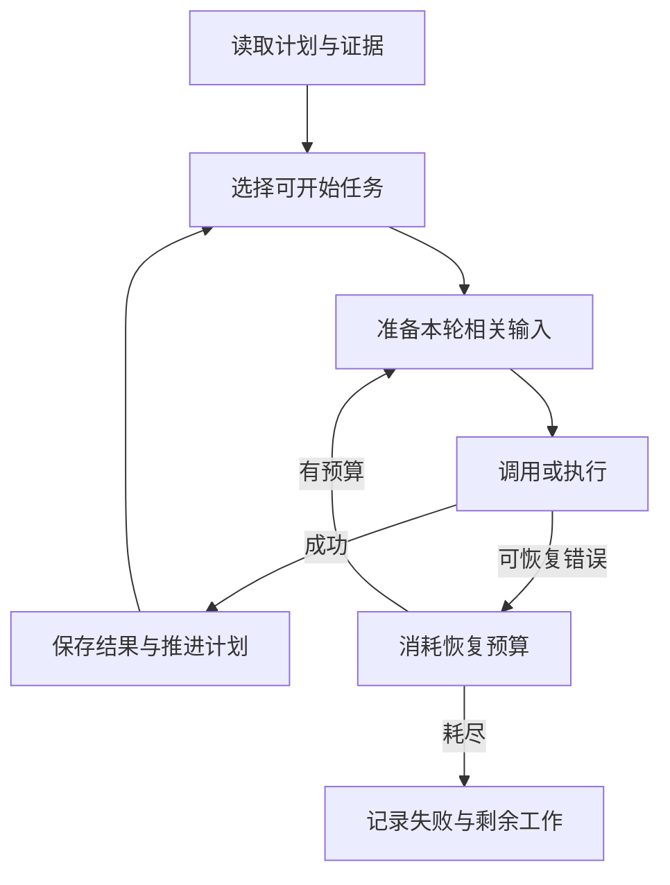

# 大模型应用开发学习 28：长任务怎样保持计划记忆并处理运行错误

助手要核对一批售后事项，做到第三项时查询超时。它重试、读日志、重新解释原因，几轮之后，原来还有哪些订单没处理已经说不清了。

能记得上次聊过什么，并不足以保证长任务继续向目标推进。这里把计划、完成证据、输入预算和错误恢复放回同一批工作，观察遇到干扰后怎样继续，而不再从头介绍Memory。

| 要维持的东西 | 不能只依赖什么 |
| --- | --- |
| 还有什么没做 | 最近一段聊天 |
| 哪项确实完成 | 模型自己勾选 |
| 关键事实在哪里 | 一份概括性摘要 |
| 出错后怎样继续 | 无限重试 |

## 计划是工作记录，完成需要证据

一次申请可以拆成核对事实、准备草稿、等待确认。但计划里的“核对完成”要对应实际查询结果，“准备完成”要对应草稿编号。写一条待办不会自动产生业务结果。

短清单适合会话内提醒，跨进程工作需要持久任务记录。配套`TaskBoard`保存编号、描述、依赖、状态、负责人和证据。新任务只能依赖已创建任务，不提供任意修改依赖的入口，从创建顺序上避免本例出现环。

| 字段 | 用处 |
| --- | --- |
| `id` | 稳定找回同一项工作 |
| `deps` | 哪些结果必须先完成 |
| `status` | 等待、处理中、完成或失败 |
| `owner` | 谁在处理 |
| `evidence` | 完成或失败的可核对依据 |

任务表和业务状态图也不同：前者组织工作项和依赖，后者组织一次业务执行。两者可以关联，但不应复制一整份状态后互相猜测谁是准确信息。

用三项工作看清任务图与办理图的差别：A核对订单事实，B整理政策依据，C汇总可办理事项。C依赖A和B，A与B没有先后要求。如果A成功而B失败，C仍不能开始；这不是程序“忘了继续”，而是依赖条件尚未满足。

任务图记录工作之间的条件，真正核对订单的内部流程仍可能使用已有业务图。把两者关联时，可以让A的证据指向该次业务运行编号，不必把订单的每个状态字段再复制进任务表。

计划也会随事实变化。核对发现商品定制时，原来的“准备申请”应改为“解释例外或转人工”，不能为了把清单全部勾完而继续原步骤。自动修改计划需要保留变更原因，读者才能看出哪些是原目标，哪些是根据新信息调整的执行安排。

## 依赖与进度怎样实际更新

任务B依赖A，A没完成时不能认领B。成功认领后才进入`in_progress`；完成时要求负责人匹配，并提供非空证据。

<!-- example-source: examples/23-32-assistant/harness.py -->
```python
def complete(self, task, owner, evidence):
    if not evidence:
        raise ValueError("缺少可核对的完成证据")
    with closing(sqlite3.connect(self.path)) as db, db:
        count = db.execute("UPDATE tasks SET status='completed',evidence=? WHERE id=? AND owner=? AND status='in_progress'",
                           (json.dumps(evidence, ensure_ascii=False), task, owner)).rowcount
        if count != 1:
            raise ValueError("任务未认领、已完成或负责人不匹配")
```

这段检查能阻止空证据和错误负责人，但不能证明任意非空内容都真实。实际产品需要按任务类型核验，例如查草稿表、读取测试报告、确认产物摘要。不能把一个`{"done": true}`当成任何任务都通过的凭证。

配套调用先创建核对，再创建依赖它的准备任务：

<!-- example-kind: usage -->
```python
import tempfile
from pathlib import Path
from harness import TaskBoard

with tempfile.TemporaryDirectory() as folder:
    board = TaskBoard(Path(folder) / "tasks.sqlite")
    board.add("check", "核对A3003事实")
    board.add("draft", "准备申请", ["check"])
    print(board.claim("draft", "worker"))
    board.claim("check", "worker")
    board.complete("check", "worker", {"order_id": "A3003", "source": "教学查询结果"})
    print(board.claim("draft", "worker"))
```

前一次认领失败，后一次成功。这里的证据对象是机制示意，不冒充真实查询日志；完整申请实验另由业务服务提供实际结果。

**逐项检查一次从阻塞到可执行的变化。**调用`add`时把依赖保存到数据库；第一次认领准备任务，发现核对任务仍是`pending`，返回False；核对被认领后变成`in_progress`，准备任务仍然阻塞；只有核对保存证据并进入`completed`，准备才能认领。

| 核对任务状态 | 能否开始准备 | 原因 |
| --- | --- | --- |
| `pending` | 不能 | 尚未执行 |
| `in_progress` | 不能 | 还没形成完成结果 |
| `failed` | 不能 | 依赖没有成功交付 |
| `completed` | 可以尝试认领 | 依赖条件成立，但还需原子认领 |

“可以开始”仍不等于“已经由我取得”。多执行者时，还要通过认领竞争确定唯一负责人。持久化则保证重新打开任务表后读到这些状态，而不是从聊天摘要重新推断。

若任务状态写成完成，但证据指向不存在的文件，后续汇总依然缺失依据。因此完成检查应和产物管理连接：记录文件存在、所属任务、版本或摘要；需要更强验证时，再核对报告的具体内容。非空字符串只是最小守卫，不是充分的业务验收。

## 先减少无用输入，再考虑摘要

一次工具返回上万行记录，不一定都需要进入下一轮模型请求。可以先将全文保存，保留路径、摘要校验值、长度与短预览，需要时再读取相关部分。

<!-- example-source: examples/23-32-assistant/harness.py -->
```python
def persist_output(text, folder, preview_chars=120):
    folder = Path(folder)
    folder.mkdir(parents=True, exist_ok=True)
    digest = hashlib.sha256(text.encode()).hexdigest()
    path = folder / (digest + ".txt")
    path.write_text(text, encoding="utf-8")
    return {"path": str(path), "sha256": digest, "chars": len(text), "preview": text[:preview_chars]}
```

哈希把预览与全文关联起来，方便检查“看到的是哪份输出”。它不证明内容真实，也不能替代访问控制。真实服务的产物路径应按用户和任务隔离，读取时再次校验权限。

然后再按预算选择相关结果、保留必要消息组，最后才用摘要压缩较老历史。若已经保存更详细原文，摘要错误时仍有核对来源；如果原文也被删除，摘要就成为有损的唯一版本。

消息处理还要保留工具请求与结果的对应关系。不能只按条数删除中间消息，留下无请求的工具结果或缺结果的工具调用；也不能用伪造“成功”补齐不明执行结果。整理目标是合法、可解释的消息链。

## 重要事实要能独立找回和更新

“用户后来把原因改为尺码不合适”可能被摘要成“讨论过退货原因”。长任务继续时，可以另外保存有来源的关键事实，再按当前用户与任务找回。

本例`remember`按`owner + key`更新，`recall`要求相同所有者。来源字段记录事实从哪里来，便于再次核验。它是精确键读取的最小实验，没有实现语义检索、自动提取或真实模型去重。

长期保存也不意味着永远正确。偏好可由后续更正替换，实时订单状态应重新查询，过期规则需要失效处理。若加入模型自动提取，应先校验字段和来源，明确写入权限，不能让外部文档随意改写全局规则。

**假设输入预算只剩2000个Token，该保留什么？**当前目标、未完成任务、用户最新更正与下一步需要的事实优先；几十轮前某条失败命令的完整输出可以变为产物引用。这里的优先级来自工作需要，而不是简单“保留最新N条”。

先归档原文，再把大输出改为预览，最后才压缩较老消息，是为了分别控制存储与模型输入。归档保留追溯，预览支持快速判断，摘要帮助缩短阅读；三者不会互相自动完成。实际Token预算还要给系统要求、工具Schema和预期输出预留空间。

记忆更新也可用一次更正说明：旧记录为“退货原因是颜色不喜欢”，新消息明确改为“尺寸不合适”。如果只新增第二条而不处理第一条，下一次检索可能两条都返回。可以让同一任务的原因使用稳定键更新，并记录来源与修改时刻；若需要审计，再另外保留历史版本。

实时状态不同于偏好。偏好“希望简洁答复”可以跨会话使用，订单“尚未申请”一旦被执行改变就过时。长期记忆不是避开业务查询的捷径，找回记录之后仍应判断它是否需要刷新。

## 不同错误需要不同恢复动作

| 错误 | 可考虑的动作 | 必须保留的边界 |
| --- | --- | --- |
| 短暂超时、过载 | 有限退避重试 | 单次超时、总次数与耗时 |
| 输入超窗口 | 选择相关信息或摘要后重发 | 不反复扩大同一输入 |
| 输出截断 | 减少任务、调整输出预算后重做 | 半截工具参数不能执行 |
| 参数或权限不合法 | 修正输入或明确停止 | 不靠重复请求绕过 |
| 业务写入结果不明 | 先按幂等键查询 | 不能盲目再写一遍 |

配套`bounded_call`只捕获模拟的`TimeoutError`，其他错误向上交付。默认等待是无操作，便于可控实验；真实使用传入`time.sleep`，并按SDK异常类型做适配。

<!-- example-source: examples/23-32-assistant/harness.py -->
```python
def bounded_call(call, *, attempts=3, wait=lambda seconds: None):
    """仅重试TimeoutError；真实SDK错误应在适配层归类，等待函数由调用方提供。"""
    if attempts < 1:
        raise ValueError("attempts必须大于0")
    for number in range(attempts):
        try:
            return call()
        except TimeoutError:
            if number == attempts - 1:
                raise
            wait(min(2 ** number, 8))
```

第1次失败等待1秒，第2次等待2秒，最多3次尝试。这里没有随机抖动，也不代表适合所有服务。收到服务端明确的等待建议时应尊重相应策略；备用模型还需要核对工具能力、数据范围与预算，不能把切换当作完全等价。

## 把恢复接回计划，而不是遗忘原目标

发生错误后，先保留当前任务标识与完成证据，判断能否恢复，再继续未完成项。已经完成的业务动作不因“重新开始这一轮”就丢弃记录或重复执行。



图中返回选择步骤时，还需要在全部完成或无可推进项时结束。无可推进可能来自等待用户、依赖失败或任务定义错误，不能一律继续空转。

恢复时可以先问三个具体问题：这次尝试是否已经产生外部动作，当前错误是否因输入不合法而永久存在，剩余预算是否足以再试。如果答案不清楚，立即重新执行并不稳妥。

例如读工具超时，可以有限重查；准备申请超时，应先按任务键找草稿；模型输出被截成半个JSON，则没有一份合法参数可交给执行器。等待模型把缺失字符“续上”，还要保证请求与结果对应，不能把两个不同候选动作拼成一个工具调用。

调用成功后，恢复计数也要按约定重置。若每轮都无条件重置失败预算，一个长期任务仍可能无限经历“失败三次、换轮再试三次”。可以区分单次请求预算与整个任务预算，并把后者持久保存，才能解释累计耗时和停止原因。

这些决策最后要回写计划：成功保存证据，失败保留原因，等待标出所缺输入，取消保留已产生的业务结果。模型说“我会继续处理”并不代表程序已经具备可继续的任务记录。

## 用中断实验检查长任务是否还可解释

`experiments.py long-task`展示依赖阻塞、重新打开任务表、输出落盘、事实找回和受控超时恢复。各部分在同一项核对工作中交接，没有调用真实模型摘要。

配套测试覆盖任务重新打开、认领条件、非空完成证据、记忆归属、全文保存与有限重试。摘要忠实度、自动计划合理性仍需真实模型实验，不能由这些本地断言推出。

长任务可靠的依据是：目标留在任务记录里，进度对应结果，信息能回溯来源，恢复预算耗尽后有明确交代。这样即使对话增长、错误打断或进程重启，仍能说清哪些做完、哪些待做、为什么停下。

## 参考资料

- [上下文工程](https://docs.langchain.com/oss/python/langchain/context-engineering)
- [长期记忆](https://docs.langchain.com/oss/python/langchain/long-term-memory)
- [持久执行](https://docs.langchain.com/oss/python/langgraph/durable-execution)
