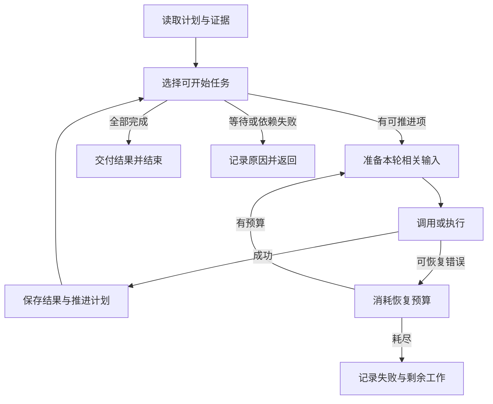

# 大模型应用开发学习 28：长任务怎样保持计划记忆并处理运行错误

用户说：“A3003 尺寸不合适，帮我准备退货申请。”助手已经加载申请准备说明，接下来应核对订单、整理政策依据，再准备具体草稿。假设查询途中超时，助手转去重试、读日志和排查输入；几轮之后，它记住了错误，却忘了申请还没有准备。

这不是缺少一份聊天记录。[会话记忆](22-助手怎样接着上一次对话继续处理.md)已能找回前文，[退货任务](23-LangGraph怎样记录并推进退货任务.md)与[等待恢复](25-任务怎样等待确认并在重启后继续.md)已能记录业务位置；[按需加载](27-助手怎样按需加载知识和操作说明.md)则决定本轮提供哪些说明。现在缺的是：工作被错误打断、输入被压缩以后，怎样仍然知道目标是什么、哪些已完成、下一步需要什么。

**这里解决的是长任务怎样在干扰后继续推进：用计划组织剩余工作，用证据核对完成情况，用产物和记忆保留必要信息，再按错误类型选择有限恢复。**A3003 仍是会员、签收10天、非定制商品，沿用会员15天、普通用户7天和定制例外的规则；准备草稿之后仍须独立确认才能提交。

**参考代码：**[GitHub共享示例目录](https://github.com/benx92/ai-learning-notes/tree/main/examples/23-32-assistant)、[环境与运行说明](examples/23-32-assistant/README.md)、[harness.py](examples/23-32-assistant/harness.py) 和 [long_task_demo.py](examples/23-32-assistant/long_task_demo.py)。实验只演示 A3003 核对记录的保存与汇总，使用固定响应，不创建申请草稿；它尚未自动接入退货业务图。

| 要维持的东西 | 不能只依赖什么 |
| --- | --- |
| 还有什么没做 | 最近一段聊天 |
| 哪项确实完成 | 模型自己勾选 |
| 关键事实在哪里 | 一份概括性摘要 |
| 出错后怎样继续 | 无限重试 |

## 计划是工作记录，完成需要证据

一次申请可以拆成核对事实、准备草稿、等待确认。但计划里的“核对完成”要对应实际查询结果，“准备完成”要对应草稿编号。写一条待办不会自动产生业务结果。

会话内的待办清单通常只有事项与状态。模型可以通过工具先列步骤，再随执行结果更新；运行程序也可以在多轮未更新时提醒它核对剩余工作。提醒只是让计划重新进入注意范围，不会替模型执行查询，更不能为了让进度好看而自动勾选完成。固定三轮还是其他间隔，是应用策略，不是通用标准；本例未接入自动提醒。

短清单适合会话内提醒，跨进程工作需要持久任务记录。配套`TaskBoard`保存编号、描述、依赖、状态、负责人和证据。新任务只能依赖已创建任务，不提供任意修改依赖的入口，从创建顺序上避免本例出现环。

| 字段 | 用处 |
| --- | --- |
| `id` | 稳定找回同一项工作 |
| `deps` | 哪些结果必须先完成 |
| `status` | 等待、处理中、完成或失败 |
| `owner` | 谁在处理 |
| `evidence` | 完成或失败的可核对依据 |

任务表和业务状态图也不同：前者组织工作项和依赖，后者组织一次业务执行。两者可以关联，但不应复制一整份状态后互相猜测谁是准确信息。

以 A3003 的准备工作作设计示意：A核对订单事实，B整理适用政策，C形成准备依据。C依赖A和B，A与B没有先后要求。如果A成功而B失败，C仍不能开始。这个三项关系用于解释依赖，不是配套实验已经运行的三个任务；后面的最小实验只保留“核对记录 → 汇总记录”两项，以便逐步观察。

任务图记录工作之间的条件，真正核对订单的内部流程仍可能使用已有业务图。把两者关联时，可以让A的证据指向该次业务运行编号，不必把订单的每个状态字段再复制进任务表。

计划也会随事实变化。如果换成一笔定制商品订单，原来的“准备申请”就应改为“解释例外或转人工”；这是假设对照，不改变 A3003 的商品设定。计划变更应保留原因。当前任务表未提供自动改计划接口，业务图也仍须通过原有资格核对，不能因计划中出现“准备申请”就跳过。

## 依赖与进度怎样实际更新

任务B依赖A，A没完成时不能认领B。成功认领后才进入`in_progress`；完成时要求负责人匹配，并提供非空证据。

<!-- example-source: examples/23-32-assistant/harness.py -->
```python
def complete(self, task, owner, evidence):
    if not evidence:
        raise ValueError("缺少可核对的完成证据")
    with closing(sqlite3.connect(self.path)) as db, db:
        count = db.execute("UPDATE tasks SET status='completed',evidence=? WHERE id=? AND owner=? AND status='in_progress'",
                           (json.dumps(evidence, ensure_ascii=False), task, owner)).rowcount
        if count != 1:
            raise ValueError("任务未认领、已完成或负责人不匹配")
```

这段检查能阻止空证据和错误负责人，但不能证明任意非空内容都真实。实际产品需要按任务类型核验，例如查草稿表、读取测试报告、确认产物摘要。不能把一个`{"done": true}`当成任何任务都通过的凭证。

先单独观察两项任务的依赖，不执行实际业务。下面在共享示例目录运行，创建核对与依赖它的汇总任务：

<!-- example-kind: usage -->
```python
import tempfile
from pathlib import Path
from harness import TaskBoard

with tempfile.TemporaryDirectory() as folder:
    board = TaskBoard(Path(folder) / "tasks.sqlite")
    board.add("check", "核对A3003事实")
    board.add("summary", "汇总核对记录", ["check"])
    print(board.claim("summary", "worker"))
    board.claim("check", "worker")
    board.complete("check", "worker", {"order_id": "A3003", "source": "教学查询结果"})
    print(board.claim("summary", "worker"))
```

输出依次为 `False`、`True`：前一次认领失败，后一次成功。这里的证据对象是机制示意，不冒充真实查询日志；汇总任务也只是被认领，尚未完成。实际申请仍由已有业务服务准备。

调用 `add()` 时依赖保存到数据库；第一次认领汇总任务，核对仍是 `pending`，所以失败。核对被认领后变成 `in_progress`，仍未满足依赖；只有保存证据并进入 `completed`，汇总才可认领。`claim()` 在同一个写事务中检查依赖和更新负责人，避免先检查、后更新之间被其他执行者抢先。

| 核对任务状态 | 能否开始汇总 | 原因 |
| --- | --- | --- |
| `pending` | 不能 | 尚未执行 |
| `in_progress` | 不能 | 还没形成完成结果 |
| `failed` | 不能 | 依赖没有成功交付 |
| `completed` | 可以尝试认领 | 依赖条件成立，但还需原子认领 |

“可以开始”仍不等于“已经由我取得”。多执行者时，还要通过认领竞争确定唯一负责人。持久化则保证重新打开任务表后读到这些状态，而不是从聊天摘要重新推断。

重新读到状态，也不等于自动恢复执行。当前 `TaskBoard` 没有失联执行者回收或失败任务重置接口；执行者在 `in_progress` 时退出，重新打开数据库后仍会看到这一状态，不能直接再次 `claim()`。它演示的是任务记录与依赖条件的保存，不替代[等待与恢复](25-任务怎样等待确认并在重启后继续.md)中的业务执行位置和幂等检查。

若任务状态写成完成，但证据指向不存在的文件，后续汇总依然缺失依据。因此完成检查应和产物管理连接：记录文件存在、所属任务、版本或摘要；需要更强验证时，再核对报告的具体内容。非空字符串只是最小守卫，不是充分的业务验收。

## 先减少无用输入，再考虑摘要

一次工具返回上万行记录，不一定都需要进入下一轮模型请求。可以先将全文保存，保留路径、摘要校验值、长度与短预览，需要时再读取相关部分。

<!-- example-source: examples/23-32-assistant/harness.py -->
```python
def persist_output(text, folder, preview_chars=120):
    folder = Path(folder)
    folder.mkdir(parents=True, exist_ok=True)
    digest = hashlib.sha256(text.encode()).hexdigest()
    path = folder / (digest + ".txt")
    path.write_text(text, encoding="utf-8")
    return {"path": str(path), "sha256": digest, "chars": len(text), "preview": text[:preview_chars]}
```

哈希把预览与全文关联起来，方便检查“看到的是哪份输出”。它不证明内容真实，也不能替代访问控制。真实服务的产物路径应按用户和任务隔离，读取时再次校验权限。

对 A3003 而言，下一步整理准备依据，需要的是订单相关事实、政策条件和退货原因，通常不需要排错日志全文。把日志改成预览和可读取的产物引用，才真正减少了本轮输入；仅在磁盘另存一份、却继续发送全部原文，并没有节省上下文。

可以按代价从低到高组织处理：

| 处理 | 保留什么 | 主要代价与风险 |
| --- | --- | --- |
| 大输出落盘，输入保留预览与引用 | 完整产物仍可找回 | 多一次按需读取；预览可能没覆盖关键行 |
| 移除不再相关的消息组 | 当前步骤所需的对话与工具往返 | 删除前要确认结果已归档、无需再次推断 |
| 缩短较早工具结果 | 调用关系与结果位置 | 不能丢掉唯一的证据地址 |
| 对较老历史生成摘要 | 目标、决定、约束、未完成工作与来源 | 增加模型调用，且摘要可能遗漏或曲解 |

前几项可以由本地程序完成，模型摘要通常更贵，也有额外失败点。摘要前宜先归档原对话，并保留档案引用。特别是已经执行过的准备或提交操作，应从业务记录读取结果；不能为了找回被裁剪的输出而重新执行一次写入。

压缩有三个常见触发时机：调用前发现预算接近上限，由程序自动整理；模型判断材料过多，主动请求整理；服务已拒绝超长输入，再做一次应急整理。它们改变的是触发时机，不是事实可信度。应急摘要本身也受窗口限制，不能把已经过大的输入原封不动交给同一个受限调用；应先选择相关片段或分段处理，并限制恢复次数。

然后再按预算选择相关结果、保留必要消息组，最后才用摘要压缩较老历史。若已经保存更详细原文，摘要错误时仍有核对来源；如果原文也被删除，摘要就成为有损的唯一版本。

消息处理还要保留工具请求与结果的对应关系。不能只按条数删除中间消息，留下无请求的工具结果或缺结果的工具调用；也不能用伪造“成功”补齐不明执行结果。整理目标是合法、可解释的消息链。

例如助手一次提出调用 `order_query`，编号为 `q1`，后面对应一条 `tool_call_id=q1` 的查询结果。保留请求却删掉结果，或者只保留结果，都可能破坏消息格式。更稳妥的是按完整往返组保留或移除，并将已归档结果的位置写入摘要。若实际执行结果未知，就应标明未知并查询业务记录；格式上的补齐不能成为“查询成功”或“申请已创建”的证据。

摘要应让下一轮能继续工作。例如一份手工编写的目标摘要可以是：“用户请求为 A3003 准备申请，原因是尺寸不合适；查询曾超时；核对记录是否成功保存以任务证据为准；尚未取得业务草稿编号，不得提交。”它比“讨论了退货并排查错误”多保留了目标、结果边界和剩余工作。这是摘要内容示意，配套代码没有调用模型生成它。

## 重要事实要能独立找回和更新

“用户后来把原因改为尺码不合适”可能被摘要成“讨论过退货原因”。长任务继续时，可以另外保存有来源的关键事实，再按当前用户与任务找回。

本例`remember`按`owner + key`更新，`recall`要求相同所有者。来源字段记录事实从哪里来，便于再次核验。它是精确键读取的最小实验，没有实现语义检索、自动提取或真实模型去重。

读取过程仍需接回本轮输入：程序先按可信身份确定记忆范围，再根据任务选择键，最后把找回的值与来源交给输入组装函数。数据库里保存着“尺寸不合适”，不代表下一次模型请求已经包含它。这里承接[按需加载](27-助手怎样按需加载知识和操作说明.md)的思路：可以先维护简短目录，再读取选中正文，而不是每轮发送所有记忆。

记忆多了以后，选择器可以使用精确键、关键词、语义检索或模型筛选。每种方式都可能漏选或错选；查不到时不应编造用户偏好。本例直接使用 `A3003:reason`，是因为已知道当前订单与所需字段，无需为了演示记忆再增加一轮模型调用。

写入也应有明确时机。用户明确提供的原因，可以校验后写入；由模型自动提取时，应从仍有足够原始信息的记录生成候选，再检查字段、来源与归属后保存。若先丢弃细节、再要求提取器“记住细节”，信息已经无从恢复。重复、过时或相互冲突的记录还需更新或合并；“放在压缩范围之外”不等于“永远正确”。

长期保存也不意味着永远正确。偏好可由后续更正替换，实时订单状态应重新查询，过期规则需要失效处理。若加入模型自动提取，应先校验字段和来源，明确写入权限，不能让外部文档随意改写全局规则。

**假设本轮业务材料只剩2000个Token额度，该保留什么？**当前目标、未完成任务、用户最新更正与下一步需要的事实优先；较早失败命令的全文可以变为产物引用。这里的2000是扣除稳定要求、工具定义和输出预留后的教学预算，不是某个模型的窗口大小。字符数和文件字节数可作体积预警，但不能冒充实际Token计数；最终仍要按所用模型的计数方式核对。

先归档原文，再把大输出改为预览，最后才压缩较老消息，是为了分别控制存储与模型输入。归档保留追溯，预览支持快速判断，摘要帮助缩短阅读；三者不会互相自动完成。实际Token预算还要给系统要求、工具Schema和预期输出预留空间。

记忆更新也可用一次更正说明：旧记录为“退货原因是颜色不喜欢”，新消息明确改为“尺寸不合适”。如果只新增第二条而不处理第一条，下一次检索可能两条都返回。可以让同一任务的原因使用稳定键更新，并记录来源与修改时刻；若需要审计，再另外保留历史版本。

这是更正场景的假设，不改变前文 A3003 一直使用“尺寸不合适”的输入。当前记忆表只保存所有者、键、值和来源，没有修改时刻或历史版本。更新记忆也不会修改已有业务任务：前文的任务入口会核对已绑定的初始输入，不能通过覆盖记忆绕过这一检查。

实时状态不同于偏好。偏好“希望简洁答复”可以跨会话使用，订单“尚未申请”一旦被执行改变就过时。长期记忆不是避开业务查询的捷径，找回记录之后仍应判断它是否需要刷新。

## 不同错误需要不同恢复动作

| 错误 | 可考虑的动作 | 必须保留的边界 |
| --- | --- | --- |
| 短暂超时、过载 | 有限退避重试 | 单次超时、总次数与耗时 |
| 输入超窗口 | 选择相关信息或摘要后重发 | 不反复扩大同一输入 |
| 输出截断 | 减少任务、调整输出预算后重做 | 半截工具参数不能执行 |
| 参数或权限不合法 | 修正输入或明确停止 | 不靠重复请求绕过 |
| 业务写入结果不明 | 先按幂等键查询 | 不能盲目再写一遍 |

配套`bounded_call`只捕获模拟的`TimeoutError`，其他错误向上交付。默认等待是无操作，便于可控实验；真实使用传入`time.sleep`，并按SDK异常类型做适配。

<!-- example-source: examples/23-32-assistant/harness.py -->
```python
def bounded_call(call, *, attempts=3, wait=lambda seconds: None):
    """仅重试TimeoutError；真实SDK错误应在适配层归类，等待函数由调用方提供。"""
    if attempts < 1:
        raise ValueError("attempts必须大于0")
    for number in range(attempts):
        try:
            return call()
        except TimeoutError:
            if number == attempts - 1:
                raise
            wait(min(2 ** number, 8))
```

第1次失败等待1秒，第2次等待2秒，最多3次尝试。这里没有随机抖动，也不代表适合所有服务。收到服务端明确的等待建议时应尊重相应策略；备用模型还需要核对工具能力、数据范围与预算，不能把切换当作完全等价。

退避让请求暂缓，抖动则给等待时间加入小幅随机差异，减少许多客户端同时重试。具体哪些服务端错误适合重试，要按实际接口归类；同样是限流，也应先区分暂时频率限制与需要修改配置的额度问题。若SDK内部已重试，外层次数要合并计算，[路径与重查](24-任务怎样选择路径循环重试和并行处理.md)中的总预算仍然有效。

输出截断需要另一种处理。生成解释文字太长，可以缩小任务或在接口支持范围内调整输出预算；半截工具参数则必须停在执行之前，重新生成并校验完整参数。不能把两次不同候选输出拼成一次业务动作。扩大输出预算还会占用窗口或增加成本，并不是所有模型都支持相同上限。

## 把恢复接回计划，而不是遗忘原目标

发生错误后，先保留当前任务标识与完成证据，判断能否恢复，再继续未完成项。已经完成的业务动作不因“重新开始这一轮”就丢弃记录或重复执行。



这是应用层的恢复设计图，不是 `TaskBoard` 自动执行的调度器。无可推进可能来自等待用户、依赖失败或任务定义错误，不能一律继续空转。

恢复时可以先问三个具体问题：这次尝试是否已经产生外部动作，当前错误是否因输入不合法而永久存在，剩余预算是否足以再试。如果答案不清楚，立即重新执行并不稳妥。

例如读工具超时，可以有限重查；准备申请超时，应先按任务键找草稿；模型输出被截成半个JSON，则没有一份合法参数可交给执行器。等待模型把缺失字符“续上”，还要保证请求与结果对应，不能把两个不同候选动作拼成一个工具调用。

调用成功后，恢复计数也要按约定重置。若每轮都无条件重置失败预算，一个长期任务仍可能无限经历“失败三次、换轮再试三次”。可以区分单次请求预算与整个任务预算，并把后者持久保存，才能解释累计耗时和停止原因。

当前 `bounded_call()` 只限制一次函数调用中的尝试次数；总耗时、任务累计预算与跨进程恢复计数都未实现。上面的整体恢复流程是应用设计，不能把它当作这个函数已有的能力。

这些决策最后要回写计划：成功保存证据，失败保留原因，等待标出所缺输入，取消保留已产生的业务结果。模型说“我会继续处理”并不代表程序已经具备可继续的任务记录。

## 用可控实验看清结果怎样交接

按共享README准备环境并进入 `examples/23-32-assistant` 后，运行独立入口。它只使用Python标准库，不要求安装框架或配置密钥：

```powershell
python -X utf8 long_task_demo.py
```

[long_task_demo.py](examples/23-32-assistant/long_task_demo.py) 的 `long_task_demo()` 展示依赖阻塞、重新打开任务表、输出落盘、事实找回和受控超时恢复。已有 `experiments.py long-task` 也导入同一个函数；后者的其余实验入口仍依赖共享框架环境。

实验先创建 `check` 和依赖它的 `summary`，第一次认领后者被阻塞。`flaky()` 前两次抛出教学超时，第三次返回 A3003、尺寸不合适与固定来源；`bounded_call()` 的等待函数仅记录 `[1, 2]`，不实际休眠。程序把响应文本重复100次制造6000字符日志，保存产物引用，并把原因写入带订单号的记忆键，再完成核对记录任务。重复文本是体积演示，不是一份待解析的JSON文档。

重新打开同一数据库后，`summary` 可以认领。程序按产物路径读回全文、核对哈希，再找回原因，生成含订单号、原因、原日志哈希和“未创建草稿或申请”的汇总文件；最后把这份文件作为汇总完成证据。两项任务都结束，但完成的是教学记录整理，实际申请准备仍未执行。

| 输出字段 | 本次实测值 | 能说明什么 |
| --- | --- | --- |
| `initially_blocked` | `true` | 核对前不能认领汇总 |
| `calls` | `3` | 前两次失败，第三次取得固定响应 |
| `simulated_delays` | `[1, 2]` | 记录了两次等待，没有实际睡眠 |
| `ready_after_reopen` | `true` | 重开数据库后仍能检查已完成依赖 |
| `output_verified` | `true` | 读回内容与保存的哈希一致 |
| `memory` | 原因及固定响应来源 | 精确键能够找回值和来源 |
| `tasks` | 两项均为 `completed` | 核对记录与汇总文件均已保存 |

本次在 Python 3.12.14 上运行独立入口，得到上述结果。临时路径随运行变化，脚本退出后会清理；正式产品需要把产物放在生命周期足够长的目录。实验在同一进程内重开数据库，没有模拟进程在执行中崩溃，也没有测试用户确认、草稿过期或真实模型摘要。

配套测试覆盖任务重新打开、认领条件、非空完成证据、记忆归属、全文保存与有限重试。摘要忠实度、自动计划合理性仍需真实模型实验，不能由这些本地断言推出。

从“为 A3003 准备申请”出发，查询错误不应把目标改成无限排错，摘要也不应把未准备写成已完成。计划保留剩余工作，产物引用保留核对依据，记忆保留本轮需要的明确事实，分类恢复则在预算内继续或说明停止原因。实验交付的是能追溯的核对记录与汇总；真正准备草稿仍交给原业务流程，提交仍等待对具体草稿的确认。这样每次继续都有据可查，也能明确告诉用户当前还缺哪一步。

## 参考资料

- [短期记忆与历史整理](https://docs.langchain.com/oss/python/langchain/short-term-memory)
- [长期记忆](https://docs.langchain.com/oss/python/langchain/long-term-memory)
