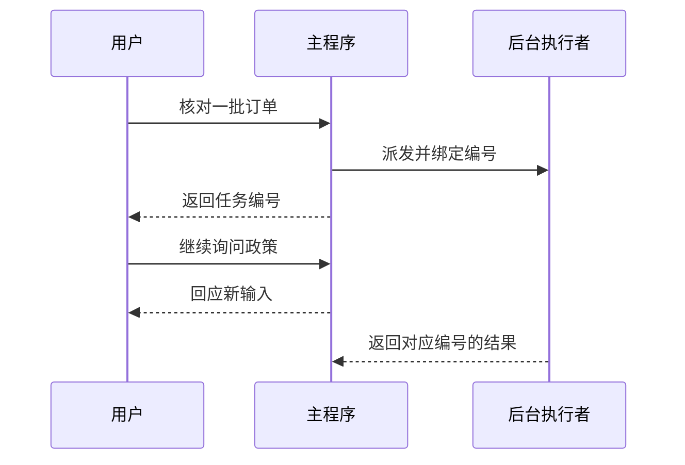

# 大模型应用开发学习 29：耗时任务怎样放到后台并按计划继续

核对一大批订单需要几十秒，用户却还想继续问政策。把核对函数放在当前调用里等待，主程序就无法及时回应。另一项工作要在明天上午开始，即使函数很快，也不能现在执行。

前者需要后台执行，后者需要时间触发。它们可以配合，但不是同一个机制：后台解决派发后怎样继续响应，调度解决何时产生执行请求。

| 概念 | 解决的问题 | 结果在哪里 |
| --- | --- | --- |
| 异步调用 | 等待期间让出执行机会 | 当前调用关系中 |
| 后台任务 | 派发后先返回，稍后取结果 | 任务句柄与结果记录 |
| 持久任务 | 重启后仍知道工作与进度 | 持久存储 |
| 时间调度 | 到指定时刻产生请求 | 调度账本与执行队列 |

## 收到回执不等于任务完成

主程序派出工作后可以立即返回`job_id`。这个编号只能证明任务已接收，不能证明核对成功，更不能把它直接当作业务申请编号。

完整交接至少需要启动、查状态、取结果三步。状态还要区分执行中、成功、失败与取消，结果始终关联原编号。如果用户随后改问另一项任务，迟到结果也不能覆盖当前界面。



一次图执行内的并行支路通常仍由本次执行汇总。后台任务允许原请求先返回，稍后再回收，因此还需要结果保存和生命周期管理。

一个容易误解的例子是：把函数改成`async def`，然后在请求里直接`await slow_query()`。这可能让同进程其他协程继续运行，但当前请求仍然等结果。用户拿不到可稍后查询的任务编号，因此它不自动成为产品意义上的后台任务。

后台入口要先确认工作已接收、保存关联，再返回句柄；后续查询另走结果入口。若连任务接收都没保存就立即回复“已开始”，进程恰好退出，用户手里会拿到找不到的编号。

本例句柄保存在内存，适合演示主程序不阻塞；持久交付则要把接收写入数据库或可靠队列，并明确接收失败如何反馈。先决定需要保证到哪一步，再选择技术实现，不能仅靠线程名字判断可靠性。

## 一个最小后台执行器

配套`Background`使用`ThreadPoolExecutor`，保存编号对应的`Future`与停止信号。它适合本地实验，没有把线程池当作持久队列。

<!-- example-source: examples/23-32-assistant/harness.py -->
```python
def start(self, function):
    job_id = uuid.uuid4().hex
    stop = Event()
    self.jobs[job_id] = (self.pool.submit(function, stop), stop)
    return job_id
```

`get`查看是否结束，完成后才读取结果；异常转成失败类别。真正产品还应保存可排查的异常日志，但不向所有用户回传完整堆栈或凭证。

线程适合等待较多的工作。CPU密集计算、外部进程与跨机器执行需要不同选择。把函数放进线程，并没有消除资源上限；仍应限制并发数量、队列长度、超时和输出体积。

## 取消请求与实际停止分开

`Future.cancel()`只能取消尚未开始的工作，已经运行的线程不会因此被强制终止。示例另提供`Event`，工作函数主动观察它并安全退出。

<!-- example-source: examples/23-32-assistant/harness.py -->
```python
def cancel(self, job_id):
    future, stop = self.jobs[job_id]
    stop.set()
    return {"requested": True, "cancelled_before_start": future.cancel()}
```

因此返回`requested=True`只说明已发出取消请求。工作函数若忽略停止信号，仍会继续运行。演示中函数用`stop.wait()`响应信号，最终返回“已观察到取消”；`Future`仍可处于正常完成状态，不能把两种状态混为一谈。

有外部写入时，取消还要面对动作已经发生的情况。请求取消不能撤销已创建的申请，迟到结果也不能简单丢掉；应记录实际结果，再决定是否需要后续业务处理。

关闭示例执行器会发送停止信号并等待线程结束。运行中的函数必须自行设置合理上限，否则关闭也可能等待很久。

观察演示时，先等工作线程发出`started`信号，再查询状态。这样能证明任务确实已经开始，而不是恰好还在队列里。随后主程序处理一条无关输入，最后发取消信号并收回结果。

若停止信号在工作完成以后才到达，结果仍应保留已完成，而不是追溯性改成“从未执行”。若只取消尚未开始的`Future`，它没有业务结果；若工作观察到信号后返回，可能是“提前停止并保存部分结果”。几种情况需要不同表达。

取消不需要强制杀线程才能成立。对批量只读任务，可以在每项之间检查信号，记录已完成位置，再退出。对单个不可中断外部请求，则给它超时、等待结果回来后明确标记，不能承诺立即停止。

## 重启后任务靠什么存在

内存中的`Future`、线程与结果字典在进程退出后消失。任务描述已经落盘，不代表执行过程也能恢复。需要区分“知道还有工作”与“知道这次工作实际做到了哪里”。

持久后台系统通常保存任务输入、状态、尝试、结果或产物引用，由执行者认领。执行者失联后如何判断可重试，需要租约、心跳或明确恢复策略；写入动作继续依赖业务幂等。

本例`Background`明确不承诺跨重启继续。另一个`Schedule`类持久保存的是调度与触发记录，用来观察重启后不会丢掉待处理的时间事件，两者职责不同。

## 时间触发要留下每次发生的记录

计划描述什么时候执行，触发实例描述哪一次到点。周期任务“每天检查”只有一份计划，却会产生多次实例，必须分别关联结果和去重。

配套用UTC时间戳保存`due`，用`job + due`唯一标识实例，事务内写入实例并推进下一时间。这里实现固定秒数间隔，不解析cron表达式。

<!-- example-source: examples/23-32-assistant/harness.py -->
```python
def tick(self, now):
    emitted = []
    with closing(sqlite3.connect(self.path, timeout=10)) as db, db:
        db.execute("BEGIN IMMEDIATE")
        for job, due, interval, remaining in db.execute("SELECT id,due,interval,remaining FROM schedules WHERE active=1 AND due<=?", (now,)).fetchall():
            # 每次tick最多补发每个计划的一次；离线积压策略在正文解释。
            db.execute("INSERT INTO occurrences VALUES(?,?,'queued')", (job, due))
            db.execute("UPDATE schedules SET due=?,remaining=?,active=? WHERE id=?",
                       (due + interval, remaining - 1, int(remaining > 1), job))
            emitted.append((job, due))
    return emitted
```

可控时钟传入99、100、100：第一次未到期，第二次产生一次触发，第三次不重复。重新创建对象后，`pending()`仍能找到未确认实例。处理完成后调用`acknowledge`，失败则保持待处理以便重试。

调度去重不等于执行一次。消费者读取到事件后崩溃，可能再次处理；因此执行动作仍要按同一实例键做幂等。不能先标记完成再执行，崩溃会丢工作；也不能执行后只依靠内存标记避免重复。

**把三个编号分开。**业务任务编号代表核对目标，计划编号代表执行安排，触发实例代表哪一次到点。同一个计划可以每天触发一次，每次又启动一个后台执行实例。如果全部只叫`task_id`，日志很难区分重复触发与正常下一天执行。

在可控实验里，计划`check-later`首次到期为100，间隔60，次数2。时钟99没有实例；时钟100创建`(check-later,100)`，下一到期改为160；再次传100，不会再创建同一个实例。到了160，才会出现第二次触发。

进程在创建实例后、执行前退出，重新读取`pending`还能找回；在执行成功后、确认前退出，则可能再次消费同一实例。这是“至少可能再处理一次”的交付方式，要求执行端幂等，而不是声称任何时候都只执行一次。

如果使用常见五字段cron约定，`0 9 * * 1-5`通常表达工作日当地时间9点。五列分别描述分钟、小时、日期、月份和星期，但具体解析器对范围、星期和日期组合的规则需要核对。它是日历规则，不是“距上次执行满24小时”。当前示例没有解析这种表达式，固定间隔实验用于先理解实例账本。

## 时区、错过时刻与输入竞争

“每天北京时间9点”需要保存时区与本地日历规则；“每隔86400秒”并不总等于任何地区的“每天同一当地时间”。有夏令时的地区还要明确重复或不存在的时刻怎样处理。

此处时间戳由调用方提供，周期是固定秒数，不宣称实现这些日历规则。实际产品采用cron解析器时，也要确认字段数量、周日编号以及日期与星期组合语义。

离线期间错过5次，回来后应补5次、只做最新一次，还是跳过？本例每次`tick`最多补发每项计划的一次，持续调用会逐次赶上，不会一次无限补发。选择哪种策略应由业务明确。

调度事件与用户输入同时到来时，不能并发修改同一份会话消息。可以先入队，再按会话串行消费；后台只执行独立工作，结果通过事件重新交给主循环。队列满、重复触发与停止条件也需要处理。

同一会话里，后台结果与用户更正还可能竞争。用户先让查A3003，随后改成只查A3004；A3003的迟到结果仍属于旧任务，不能因它最后到达就覆盖当前订单。消费结果时既要看执行编号，也要看任务是否仍有效、版本是否对应。

调度触发同样不能无限继承创建时的权限。一个用户昨天有权执行的操作，今天权限可能撤回；周期任务每次执行仍要核验当前范围。时间到点只提供“应该尝试处理”的信号，不是新的业务批准。

离线补发也需要限额。如果一周积压形成大量模型请求，应控制批次和速率，或者选择只做最新核对。把积压一口气并行派发，会让原本用于减轻阻塞的机制反过来耗尽资源。

## 用可控实验验证稍后执行

在共享示例目录运行：

```powershell
python -X utf8 experiments.py background
```

输出展示后台运行时主程序处理另一输入、协作取消、可控到期、重复时刻不重发、重开账本与取消计划。计划取消会同时取消本例中尚未处理的触发记录，但不会强行终止已被外部执行者拿走的工作。

这套实验不运行常驻调度服务，也没有替用户创建真实定时任务。后台与时间触发都服务于同一件事：在当前回合之外安排工作，同时保留可查询的身份、状态和结果。

## 参考资料

- [Python Future与取消](https://docs.python.org/3/library/concurrent.futures.html)
- [线程事件](https://docs.python.org/3/library/threading.html#event-objects)
- [日期与时区](https://docs.python.org/3/library/datetime.html)
