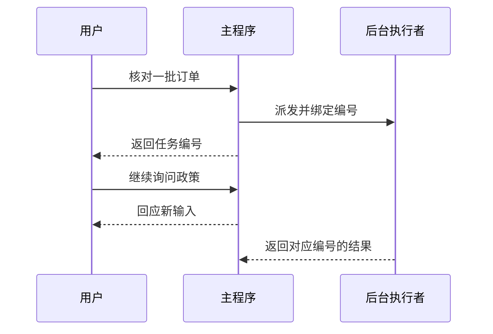
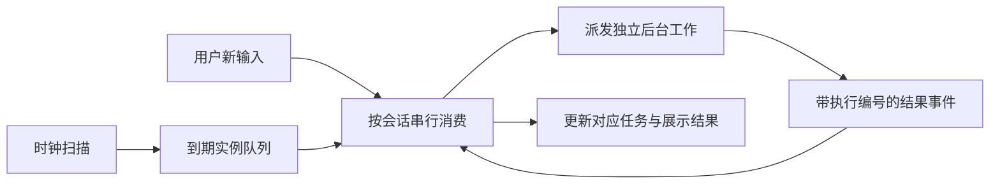

# 大模型应用开发学习 29：耗时任务怎样放到后台并按计划继续

用户让助手为 A3003 准备退货申请，原因仍是“尺寸不合适”。[长任务的计划与记忆](28-长任务怎样保持计划记忆并处理运行错误.md)已说明怎样保留目标、核对记录和剩余工作。现在假设核对服务需要几十秒，用户在等待时又问：“会员的申请期限是多少天？”如果唯一的会话处理循环一直等核对结果，就不能及时处理这条新输入。

用户也可能说：“稍后再核对这笔订单。”这时缺的不是更快的执行器，而是能在约定时刻产生一次请求的程序。把“稍后核对”记进计划，并不会让时钟到点时自动运行。

前者需要后台执行，后者需要时间触发。它们可以配合，但不是同一个机制：后台解决派发后怎样继续响应，调度解决何时产生执行请求。

**这里要解决的是：工作离开当前回合以后，程序怎样继续接收输入，并把稍后产生的结果准确交回原任务。**案例只安排只读核对，不自动准备或提交申请。A3003 仍沿用会员、签收10天、非定制商品的设定；会员15天、普通用户7天、定制例外和具体草稿独立确认均保持不变。稍后执行时应重新读取实时事实，不能把今天的资格结论永久沿用。

| 概念 | 解决的问题 | 结果在哪里 |
| --- | --- | --- |
| 异步调用 | 等待期间让出执行机会 | 当前调用关系中 |
| 后台任务 | 派发后先返回，稍后取结果 | 任务句柄与结果记录 |
| 持久任务 | 重启后仍知道工作与进度 | 持久存储 |
| 时间调度 | 到指定时刻产生请求 | 调度账本与执行队列 |

## 参考代码与阅读顺序

代码位于 [GitHub 共享示例目录](https://github.com/benx92/ai-learning-notes/tree/main/examples/23-32-assistant)，取得仓库、目录准备与完整依赖见 [README](examples/23-32-assistant/README.md)。这次新增的独立入口只需 Python 标准库，无需模型密钥；源码链接对应本地文件的仓库路径，不表示新增文件已经推送发布。

| 文件 | 用途与阅读顺序 |
| --- | --- |
| [harness.py](https://github.com/benx92/ai-learning-notes/blob/main/examples/23-32-assistant/harness.py) | 先读 `Background` 的派发、查询、取消，再读 `Schedule` 的到期实例、确认与取消；这是被导入的辅助模块 |
| [background_demo.py](https://github.com/benx92/ai-learning-notes/blob/main/examples/23-32-assistant/background_demo.py) | 再运行的独立入口：先观察运行中取消，再让到期实例启动一次固定教学核对，并关联结果后确认实例 |
| [experiments.py](https://github.com/benx92/ai-learning-notes/blob/main/examples/23-32-assistant/experiments.py) | 原有 `background` 命令入口，现在导入同一个实验函数；它的其他导入仍要求共享框架环境 |

实验返回的是固定教学记录，不查询真实订单，也没有把后台执行器接进已有业务图或聊天循环。它把“到期实例 → 执行编号 → 核对结果”接起来，帮助观察交接关系；完整服务还需要持久结果、执行认领和消息消费。

## 收到回执不等于任务完成

主程序派出工作后可以立即返回`job_id`。这个编号只能证明任务已接收，不能证明核对成功，更不能把它直接当作业务申请编号。

完整交接至少需要启动、查状态、取结果三步。状态还要区分执行中、成功、失败与取消，结果始终关联原编号。如果用户随后改问另一项任务，迟到结果也不能覆盖当前界面。



在[批量路径与并行汇总](24-任务怎样选择路径循环重试和并行处理.md)中，多份核对结果最终由本次图执行收齐。后台任务允许原请求先返回，稍后再回收，因此还需要结果保存和生命周期管理。两种方式都能让工作重叠；区别在于谁等待最终结果、后续请求怎样找到它。

一个容易误解的例子是：把函数改成`async def`，然后在请求里直接`await slow_query()`。这可能让同进程其他协程继续运行，但当前请求仍然等结果。用户拿不到可稍后查询的任务编号，因此它不自动成为产品意义上的后台任务。

后台入口要先确认工作已接收、保存关联，再返回句柄；后续查询另走结果入口。若连任务接收都没保存就立即回复“已开始”，进程恰好退出，用户手里会拿到找不到的编号。

本例句柄保存在内存，适合演示主程序不阻塞；持久交付则要把接收写入数据库或可靠队列，并明确接收失败如何反馈。先决定需要保证到哪一步，再选择技术实现，不能仅靠线程名字判断可靠性。

## 一个最小后台执行器

配套 [harness.py](https://github.com/benx92/ai-learning-notes/blob/main/examples/23-32-assistant/harness.py) 中的 `Background` 使用 `ThreadPoolExecutor`，保存编号对应的 `Future` 与停止信号。`Future` 是稍后读取返回值或异常的对象；`Event` 是工作函数可以观察的停止标记。它适合本地实验，没有把线程池当作持久队列。

<!-- example-source: examples/23-32-assistant/harness.py -->
```python
def start(self, function):
    job_id = uuid.uuid4().hex
    stop = Event()
    self.jobs[job_id] = (self.pool.submit(function, stop), stop)
    return job_id
```

`get`查看是否结束，完成后才读取结果；异常转成失败类别。真正产品还应保存可排查的异常日志，但不向所有用户回传完整堆栈或凭证。

调用 `start(function)` 时，线程池接收的函数必须能接收一个 `stop` 参数。`submit(function, stop)` 安排调用，返回的 `Future` 和停止信号一起存入 `jobs`。如果线程池拒绝接收，函数会抛出异常，不会成功返回编号。接收成功也可能只表示排队，不能保证工作线程已开始。

<!-- example-source: examples/23-32-assistant/harness.py -->
```python
def get(self, job_id):
    future, _ = self.jobs[job_id]
    if future.cancelled():
        return {"status": "cancelled"}
    if not future.done():
        return {"status": "running"}
    try:
        return {"status": "completed", "result": future.result()}
    except Exception as exc:
        return {"status": "failed", "error": type(exc).__name__}
```

这里先判断取消，再判断结束，最后才取返回值。`done()` 为真不等于成功：取消、正常返回和抛异常都可能结束一次调用。这个最小接口还把排队和执行中都写成 `running`，没有提供精确排队位置；未知编号会抛出 `KeyError`，也未做用户归属检查。真实查询入口需要将这些情况转成明确响应。

线程适合等待较多的工作。CPU密集计算、外部进程与跨机器执行需要不同选择。把函数放进线程，并没有消除资源上限；仍应限制并发数量、队列长度、超时和输出体积。

当前 `workers=2` 只限制同时运行的线程数，没有限制可提交任务的总数，也不会自动清理 `jobs` 中已经结束的记录。教学程序结束时整体释放对象；长期服务需要另外规定接收限额、结果保留期与清理方式。共享字典由主程序顺序访问，不能直接把这个类当成支持任意并发调用的服务端注册表。

## 完成通知怎样回到下一轮输入

用户收到编号后，程序可以定期查询，也可以在后台完成时把事件送入队列。不论用哪一种方式，最终都要由会话的消费入口关联原任务，再选择是否进入本轮模型输入。结果已经写进字典，不代表模型已经看见。

一次工具调用通常只回填一份对应的工具结果。假设模型发出查询请求 `q1`，程序立即回填“已接收，执行编号为 j1”，这份结果已经完成 `q1` 的请求与响应配对。几秒后得到的核对记录应成为关联 `j1` 的新事件，不能无条件再向旧 `q1` 塞入第二份工具结果。[历史整理](28-长任务怎样保持计划记忆并处理运行错误.md)仍须保留合法的工具往返关系。

完成事件至少应包含原任务标识、执行编号、状态和结果或产物引用。消费者先核对归属与当前任务版本，再把必要内容交给助手；大输出可以沿用前文的预览与产物引用。通知正文和核对结果都是待解释的数据，不能因为包装成系统事件就取得新的操作权限。

还要区分“收集”和“唤醒”。只在主循环开头查询结果，意味着下一次进入循环时能看到它；如果循环已经退出，程序正停在等待用户输入的位置，后台完成并不会自动产生下一次模型请求。需要主动通知时，应让事件唤醒消费入口，或由客户端轮询；不应为等结果让模型反复说“还在处理中”。

本例采用主程序显式读取结果并组装事件，不实现自动推送、通知确认或模型输入注入。重复调用 `get()` 会读到同一份结果，并不会自动消费或删除它。生产环境若要避免重复展示，需要另存事件编号与消费记录，不能把读取过一次等同于用户已经收到。

## 取消请求与实际停止分开

`Future.cancel()`只能取消尚未开始的工作，已经运行的线程不会因此被强制终止。示例另提供`Event`，工作函数主动观察它并安全退出。

<!-- example-source: examples/23-32-assistant/harness.py -->
```python
def cancel(self, job_id):
    future, stop = self.jobs[job_id]
    stop.set()
    return {"requested": True, "cancelled_before_start": future.cancel()}
```

因此返回`requested=True`只说明已发出取消请求。工作函数若忽略停止信号，仍会继续运行。演示中函数用`stop.wait()`响应信号，最终返回“已观察到取消”；`Future`仍可处于正常完成状态，不能把两种状态混为一谈。

有外部写入时，取消还要面对动作已经发生的情况。请求取消不能撤销已创建的申请，迟到结果也不能简单丢掉；应记录实际结果，再决定是否需要后续业务处理。

关闭示例执行器会发送停止信号并等待线程结束。运行中的函数必须自行设置合理上限，否则关闭也可能等待很久。`ThreadPoolExecutor` 的线程会在解释器正常退出前被等待，不能当作“主程序一退出就自动丢弃”的守护线程；同样，这种等待也不提供跨重启恢复。

观察演示时，先等工作线程发出`started`信号，再查询状态。这样能证明任务确实已经开始，而不是恰好还在队列里。随后主程序处理一条无关输入，最后发取消信号并收回结果。

若停止信号在工作完成以后才到达，结果仍应保留已完成，而不是追溯性改成“从未执行”。若只取消尚未开始的`Future`，它没有业务结果；若工作观察到信号后返回，可能是“提前停止并保存部分结果”。几种情况需要不同表达。

取消不需要强制杀线程才能成立。对批量只读任务，可以在每项之间检查信号，记录已完成位置，再退出。对单个不可中断外部请求，则给它超时、等待结果回来后明确标记，不能承诺立即停止。

## 重启后任务靠什么存在

内存中的`Future`、线程与结果字典在进程退出后消失。任务描述已经落盘，不代表执行过程也能恢复。需要区分“知道还有工作”与“知道这次工作实际做到了哪里”。

持久后台系统通常保存任务输入、状态、尝试、结果或产物引用，由执行者认领。执行者失联后如何判断可重试，需要租约、心跳或明确恢复策略；写入动作继续依赖业务幂等。

本例`Background`明确不承诺跨重启继续。另一个`Schedule`类持久保存的是调度与触发记录，用来观察重启后不会丢掉待处理的时间事件，两者职责不同。

这也与[检查点恢复](25-任务怎样等待确认并在重启后继续.md)不同。图的检查点保存待推进位置，不会替外部线程保存调用栈；任务表记录“核对中”，也不会自动找回已经丢失的 `Future`。把它们接起来时，应持久关联业务任务、执行编号和完成证据，并明确失联以后是查询既有结果、重试只读步骤还是停止。

## 时间触发要留下每次发生的记录

计划描述什么时候执行，触发实例描述哪一次到点。周期任务“每天检查”只有一份计划，却会产生多次实例，必须分别关联结果和去重。

配套 `Schedule` 用数值保存 `due`，用计划编号和计划到期时刻的组合唯一标识实例，事务内写入实例并推进下一时间。真实接入可以统一使用 UTC 时间戳；实验中的99、100、160只是同一数值时间轴上的教学刻度，不是现实日期。这里实现固定秒数间隔，不解析 cron 表达式。

`add("check-later", 100, interval=60, count=2)` 保存一份两次执行的计划：首次100，下一次160。`count=1`、默认 `interval=0` 则表示单次计划。计划表记录 `due`、间隔、剩余次数和是否继续触发；实例表记录每次到点的 `queued`、`done` 或 `cancelled`。实例已经进入 `queued`，只表示待处理，尚未运行核对函数。

<!-- example-source: examples/23-32-assistant/harness.py -->
```python
def tick(self, now):
    emitted = []
    with closing(sqlite3.connect(self.path, timeout=10)) as db, db:
        db.execute("BEGIN IMMEDIATE")
        for job, due, interval, remaining in db.execute("SELECT id,due,interval,remaining FROM schedules WHERE active=1 AND due<=?", (now,)).fetchall():
            # 每次tick最多补发每个计划的一次；离线积压策略在正文解释。
            db.execute("INSERT INTO occurrences VALUES(?,?,'queued')", (job, due))
            db.execute("UPDATE schedules SET due=?,remaining=?,active=? WHERE id=?",
                       (due + interval, remaining - 1, int(remaining > 1), job))
            emitted.append((job, due))
    return emitted
```

可控时钟传入99、100、100：第一次未到期，第二次产生一次触发，第三次不重复。重新创建对象后，`pending()`仍能找到未确认实例。处理完成后调用`acknowledge`，失败则保持待处理以便重试。

`BEGIN IMMEDIATE` 让同一 SQLite 数据库中的写事务顺序修改计划；实例插入和下一时刻推进一起提交。重复扫描100时，计划已推进到160，因此不再生成同一实例，组合主键也限制相同实例重复插入。下一时间使用 `due + interval`，不是 `now + interval`：迟到扫描不会自动把后续周期向后平移。

`tick()` 仍需要调用方主动执行。文件落盘不会让操作系统自行唤醒 Python；无人调用 `tick()`，就不会出现新的实例。当前类也不保存订单号、用户、原因或待执行函数，实验用单独映射把 `check-later` 关联到 A3003 与“尺寸不合适”，该映射只存在本次运行中，不能据此声称完整业务安排已经持久化。

调度去重不等于执行一次。消费者读取到事件后崩溃，可能再次处理；因此执行动作仍要按同一实例键做幂等。不能先标记完成再执行，崩溃会丢工作；也不能执行后只依靠内存标记避免重复。

**把三个编号分开。**业务任务编号代表核对目标，计划编号代表执行安排，触发实例代表哪一次到点。同一个计划可以每天触发一次，每次又启动一个后台执行实例。如果全部只叫`task_id`，日志很难区分重复触发与正常下一天执行。

在可控实验里，计划`check-later`首次到期为100，间隔60，次数2。时钟99没有实例；时钟100创建`(check-later,100)`，下一到期改为160；再次传100，不会再创建同一个实例。到了160，才会出现第二次触发。

进程在创建实例后、执行前退出，重新读取`pending`还能找回；在执行成功后、确认前退出，则可能再次消费同一实例。这是“至少可能再处理一次”的交付方式，要求执行端幂等，而不是声称任何时候都只执行一次。

如果使用常见五字段cron约定，`0 9 * * 1-5`通常表达工作日当地时间9点。五列分别描述分钟、小时、日期、月份和星期，但具体解析器对范围、星期和日期组合的规则需要核对。它是日历规则，不是“距上次执行满24小时”。当前示例没有解析这种表达式，固定间隔实验用于先理解实例账本。

## 时区、错过时刻与输入竞争

“每天北京时间9点”需要保存时区与本地日历规则；“每隔86400秒”并不总等于任何地区的“每天同一当地时间”。有夏令时的地区还要明确重复或不存在的时刻怎样处理。

此处时间戳由调用方提供，周期是固定秒数，不宣称实现这些日历规则。实际产品采用cron解析器时，也要确认字段数量、周日编号以及日期与星期组合语义。

离线期间错过5次，回来后应补5次、只做最新一次，还是跳过？本例每次`tick`最多补发每项计划的一次，持续调用会逐次赶上，不会一次无限补发。选择哪种策略应由业务明确。

调度事件与用户输入同时到来时，不能并发修改同一份会话消息。可以先入队，再按会话串行消费；后台只执行独立工作，结果通过事件重新交给主循环。队列满、重复触发与停止条件也需要处理。

同一会话里，后台结果与用户更正还可能竞争。用户先让查A3003，随后改成只查A3004；A3003的迟到结果仍属于旧任务，不能因它最后到达就覆盖当前订单。消费结果时既要看执行编号，也要看任务是否仍有效、版本是否对应。

这是两个独立查询的竞争示意，不表示已有办理任务允许更换绑定订单。原业务入口仍按任务编号核对初始输入；要办理另一笔订单，需要新的业务任务，不能靠改会话显示或后台映射绕过输入绑定。

调度触发同样不能无限继承创建时的权限。一个用户昨天有权执行的操作，今天权限可能撤回；周期任务每次执行仍要核验当前范围。时间到点只提供“应该尝试处理”的信号，不是新的业务批准。

离线补发也需要限额。如果一周积压形成大量模型请求，应控制批次和速率，或者选择只做最新核对。把积压一口气并行派发，会让原本用于减轻阻塞的机制反过来耗尽资源。

完整的自动唤醒可以拆成四个职责：时钟扫描产生到期事件，队列保存待处理事件，消费器在会话可处理时取得事件，主循环再选择输入并调用模型或普通函数。调度线程负责投递，不能和用户输入线程同时改消息列表；会话级队列或互斥协调负责顺序。后台只读查询仍可并行，但结果回填应经过同一个消费入口。



这张图是接入服务时的职责设计。配套仅用手动 `tick()`、SQLite 待处理实例和顺序消费验证其中的局部交接，没有常驻扫描线程、聊天锁或自动模型唤醒。`pending()` 也没有认领操作，两个消费者可能读到同一实例；去重和认领不能只依赖生成端的事务。

时间触发不会延长草稿300秒有效期。若将来安排“明天再处理”，应在执行时重新核对事实、准备当前草稿并取得针对它的确认，不能定时恢复旧批准后直接提交。当前实验到期后只形成教学核对记录，保留这一边界。

## 用可控实验验证稍后执行

按共享 README 取得仓库并进入 `examples/23-32-assistant` 后，先运行标准库独立入口：

```powershell
python -X utf8 background_demo.py
```

已安装共享依赖时，也可运行 `python -X utf8 experiments.py background`，两个入口调用同一个函数。

实验先让 `slow()` 发出 `started` 信号，再停在 `stop.wait()`；主程序不等待它返回，就能读取 `running` 并构造另一条输入记录。`other_input` 是开发者固定文字，用来标明主程序继续执行到这里，没有真的启动网页、接收键盘或生成政策答复。随后发出取消信号并关闭执行器，取得协作停止的返回值。

第二部分创建计划、扫描99、100、100，再重新打开同一个数据库。主程序从 `pending()` 取回首次实例，根据教学映射启动 `check()`，得到 A3003 与原因的固定记录；读取结果后组装含 `plan_id`、`due`、`job_id` 的事件，成功才调用 `acknowledge()`。记录对象保存在输出中，没有写入实际业务库。

| 输出 | 本次应观察的关系 |
| --- | --- |
| `before.status` | `running`，核对尚未返回 |
| `cancel` | `requested=true`，`cancelled_before_start=false`，工作已开始，只能协作停止 |
| `after` | `status=completed`，但 `cancel_requested=true`、`record_created=false`，不能展示成核对成功 |
| `ticks` | 空、首次实例、空；同一时刻不会重复产生实例 |
| `pending_before_consume` | 重开账本仍能读到 `check-later` 的100时刻实例 |
| `deliveries` | 带实例与执行编号的成功事件，记录包含 A3003、尺寸不合适，草稿与申请均未创建 |
| `pending_after_ack` | 空，首次实例已经确认 |
| `second_tick` | 160时刻的第二次实例，与首次不是同一次执行 |
| `pending_after_cancel`、`after_cancel` | 均为空，第二次待处理实例已取消，后续扫描也不再触发 |

计划取消会同时取消本例中尚未处理的触发记录，但不会强行终止已被外部执行者拿走的工作。`cancel()` 与 `acknowledge()` 当前没有核验更新前状态的竞争条件；不能直接当作多消费者下的完整取消协议。示例成功后才确认实例，但结果还在内存，确认后进程退出仍会丢掉结果；产品要先可靠保存结果或产物引用，再确认消费。

本次使用 Python 3.12.13 运行独立入口，得到表中状态与交接关系；并独立执行已有的后台取消、调度重开与去重两项标准库测试。当前环境缺少 LangGraph，原综合入口与整份共享测试模块未能导入，没有把它们标为通过。时钟由参数控制，没有等待真实的明天或60秒；重开的是数据库对象，没有模拟进程崩溃。临时目录在退出后清理，线程与结果仍不持久；没有验证真实查询耗时、在线模型、推送通知或最终博客渲染。

这套实验不运行常驻调度服务，也没有替用户创建真实定时任务。后台与时间触发都服务于同一件事：在当前回合之外安排工作，同时保留可查询的身份、状态和结果。

## 总结

从 A3003 和“尺寸不合适”出发，后台执行让主程序先返回执行编号，随后继续处理其他输入；结果回收再把成功、失败或协作停止准确关联回这次工作。时间调度增加的是“何时产生请求”，到期实例仍要交给执行者，结果可靠保存后再确认处理。

实验把一次到期事件接到固定核对记录，展示了回执、运行状态、结果和消费确认各自的位置。任务表保留目标，检查点保留业务位置，后台执行器承接当前工作，调度账本记录每次到点；这些记录需要显式关联。它们都不会自动补足实时核对、业务幂等或草稿确认，稍后执行才能继续遵守原任务的规则。

## 参考资料

- [Python 执行器、Future 与取消](https://github.com/python/cpython/blob/main/Doc/library/concurrent.futures.rst)
- [Python 线程与事件](https://github.com/python/cpython/blob/main/Doc/library/threading.rst)
