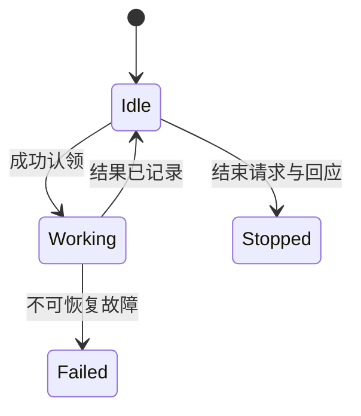

# 大模型应用开发学习 31：助手团队怎样通信认领任务并正确收尾

一次性子助手调用结束，结果可以直接返回。若两个执行者各自工作，主助手继续响应用户，结果却会在不同时间到达。这时“分工”之外，还需要通信、任务归属与结束约定。

问题不在于多加几个角色，而在于知道哪条结果属于哪项工作、谁有权推进任务，以及主助手结束前还有没有未收回的责任。

| 需要协调什么 | 最小记录 |
| --- | --- |
| 消息属于什么请求 | 请求编号、任务编号、类型 |
| 工作被谁认领 | 状态、负责人、依赖 |
| 执行者是否仍在工作 | 生命周期与未完成项 |
| 是否可以结束团队 | 结果、失败与结束回应 |

## 通信消息先有类型和关联

“我同意了”没有说明批准哪份计划。“完成了”没有说明哪项任务。最低限度应保留发送者、接收者、消息类型、任务编号、请求编号与内容。

任务编号关联业务目标，请求编号关联一次协商。一个任务可以先发计划审批，再发关机请求，两者必须用不同请求编号区分。迟到的计划回应不能恰好批准新的关机请求。

配套`MessageBus`把消息保存到SQLite，收件人读取未确认消息，处理完成后再`ack`。读取不立即删除，避免消费者读完就崩溃导致消息消失。

重复投递仍可能发生，因此处理应幂等；消息保存也不等于完整可信传输。本地实验的发送者字段由调用程序填写，真实跨进程或网络入口需要认证发送方。

把一次结束协商写成具体消息：主助手向alice发`shutdown_request`，任务是`team-run`，请求号为R1；alice完成手头结果保存后，回`shutdown_response`，仍带R1。主助手核对发送者、任务、请求和类型，才把这项协商从等待改成已批准。

如果bob误用了R1，应被拒绝；如果alice回复的是另一个任务的R1，也不能通过；如果alice先回应R1，网络重复投递第二次，应识别已经处理。请求号解决关联，其他字段校验解决是否真是期待的回应。

消息正文可以是自然语言，但决定状态转换的关键字段应结构化。模型可以解释“为什么暂时不能退出”，程序用明确的布尔决定或枚举更新协议，不从句子里猜测是否同意。

## 协议要校验谁回答了什么

`Protocol.request`登记预期执行者、类型与任务，`receive`逐项核对，匹配后才改变请求状态。

<!-- example-source: examples/23-32-assistant/team.py -->
```python
def receive(self, message):
    pending = self.pending.get(message["request"])
    if not pending or pending["status"] != "pending":
        return False
    if (message["sender"] != pending["worker"] or message["recipient"] != "lead"
            or message["task"] != pending["task"] or message["kind"] != pending["kind"] + "_response"):
        return False
    pending["status"] = "approved" if json.loads(message["payload"]).get("approve") is True else "rejected"
    return True
```

相同请求的重复回应不会再次推进状态；错误发送者、错误类型或错误任务都会被拒绝。正文中的“类型匹配”是协议校验，不是完整权限认证，不能代替业务执行端检查。

例如`shutdown`只能被相应执行者的`shutdown_response`回应。`plan_response`即使带着相同编号，也不会被当成结束确认。一个清楚的状态机比扫描自然语言里的“同意”可靠。

当前`Protocol`追踪表在内存，消息账本持久。主程序重启后若要接着处理原协商，还必须保存或恢复协议追踪表；不能只因为消息仍在，就声称审批状态全部恢复。

## 看见任务与成功认领不同

两个执行者同时看见`pending`，都可能以为可以开始。先读后写若没有原子条件，后写者可能覆盖负责人，实际两边已经重复工作。

<!-- example-source: examples/23-32-assistant/harness.py -->
```python
def claim(self, task, owner):
    with closing(sqlite3.connect(self.path, timeout=10)) as db, db:
        db.execute("BEGIN IMMEDIATE")
        row = db.execute("SELECT deps FROM tasks WHERE id=? AND status='pending'", (task,)).fetchone()
        if not row:
            return False
        for dep in json.loads(row[0]):
            if db.execute("SELECT status FROM tasks WHERE id=?", (dep,)).fetchone() != ("completed",):
                return False
        return db.execute("UPDATE tasks SET status='in_progress',owner=? WHERE id=? AND status='pending'",
                          (owner, task)).rowcount == 1
```

示例用SQLite的`BEGIN IMMEDIATE`串行保护检查与更新，同时在`UPDATE`条件中要求仍为`pending`，用受影响行数判断认领是否成功。依赖也在该事务内核对。

这比“文件里有owner就不改”更明确。普通内存锁只保护当前进程，不会保护其他进程；文件检查与写入也不能自动成为原子操作。

完成时仍核对负责人和状态。将来若允许任务失联后重新分配，还应加入租约或尝试版本，防止旧执行者恢复后覆盖新结果。当前例子未实现自动回收，宁可明确保留未完成项，也不伪装完成。

**按并发时序看认领竞争。**alice与bob都扫描到任务one。alice先取得SQLite写事务，检查依赖已完成，将状态改为`in_progress`并写入负责人，提交；bob随后进入事务，已经查不到仍为`pending`的同一任务，返回False。只有成功认领的一方进入实际工作。

如果把检查移到事务外，两方就都可能看到旧状态。再分别写负责人，最终表面只剩bob，alice却已经执行了同一动作。数据库里“只有一个owner”不能单独证明没有重复执行，必须检查执行前的原子认领。

工作完成也不是单纯把状态改成字符串。保存证据与完成状态应具备一致的更新关系；如果先标完成、后写证据时崩溃，下游会看到一项没有产物的完成任务。当前小实验将证据和状态一起更新，用一条SQL交付。

## 执行者的空闲状态有意义

有活执行，做完等待消息或认领下一项，收到结束请求后回应再退出，是一个简单生命周期。空闲不等于整个团队完成，也不等于执行者已经消失。



本例工作循环先消费消息，再查看看板，避免结束请求一直被新任务压后。真实执行很慢时，还要在可中断位置检查取消，不应只在所有工作做完后才看消息。

轮询需要退让等待，不能无休止空转调用模型。状态检查通常是程序逻辑，无需每隔几毫秒让模型“想一想有没有任务”。

## 计划批准必须连接执行门控

团队里可能需要先提交计划，主助手审查后再允许某类动作。协议层记录`approved`只能证明收到了匹配批复，不表示工具执行已经受限。

真正执行前，应校验批准的计划版本、动作范围与有效期。计划变更后，旧批准不能无限覆盖新动作；主助手或队友的文本消息也不能提高用户授予的权限。

结束协商则不同：请求执行者安全收尾并退出，回应后还要核对它没有遗留未记录结果。不能收到一条关机回应就把其负责的所有任务自动标成完成。

主助手还要维护一个“本次需要收回的结果集合”。开始派发one和two时登记两项，收到one只移除one，不能因为某个队友已经空闲就认为two也完成。空闲描述执行者当下没有动作，不等于所需任务全部交付。

可将等待过程列成四种情况：

| 看板与消息 | 主助手怎样判断 |
| --- | --- |
| 两项有证据，结果已匹配 | 可以进入结束协商 |
| 一项仍处理中 | 继续等待或到期处理 |
| 一项失败 | 明确失败与剩余范围，不伪装全成功 |
| 消息说完成但看板没有证据 | 核对来源与持久结果 |

`Protocol.finished()`仅表示没有待回应的协议请求，不表示所有回应都批准，也不表示业务任务全部成功。收尾程序应另外检查请求结果和任务结果。当前演示成功路径中两位执行者均批准退出，测试再核对所有任务确实完成，因此不能只取这个布尔值作通用完成条件。

超时不是失败事实的证明。执行者可能仍在运行，只是回应迟到。主助手可以停止等待并报告未收回部分，但应保留原任务和请求编号，后续迟到结果仍归到原处，不混入新的团队运行。

## 用两个执行者走完一个团队案例

```powershell
python -X utf8 experiments.py team
```

该实验创建两项只读核对工作，启动两个线程执行者。每个执行者读取同一看板，通过原子认领取得任务，保存固定教学结果后发回消息，主程序最后发送带请求编号的结束请求并等待回应。

结果可看到两项任务均有唯一负责人和证据，结束请求得到匹配回应，线程被收回。调度具有不确定性，可能一个执行者恰好拿走两项工作；“两个线程”不保证每个都分到一项。

这里运行的是固定执行者，验证通信和协调机制，不是两个真实模型Agent。可以将工作部分换成受限Agent循环，但还需要增加模型预算、工具权限与结果校验，不能仅替换名字就认为完成集成。

配套测试额外检查竞争认领、缺证据拒绝、错误发送者、错误响应类型与消息确认。执行者故障与迟到回应的完整自动恢复仍需另行实现。

实际演示循环有两个退出条件：任务完成后发结束请求，或达到等待期限后收束。它还通过线程池等待工作线程返回，避免主函数输出成功却把执行者留在后台。

如果把固定核对替换成真实Agent，工作阶段需要额外限制轮数与工具预算。Agent遇到异常时要保存失败并回信，而不是线程悄悄退出、看板永远留在处理中。自动重新派发前，还要确认旧执行者不会继续写结果。

这些机制不要求先搭一套完整分布式平台，但需要说明每个责任由谁承担：任务表管归属，消息管交接，协议管协商，业务服务管真实动作。只有角色名称而没有这些交接，读者很难判断一个“团队”到底运行了什么。

## 文件产物与团队结束分别管理

执行者需要修改文件时，应给任务绑定独立工作目录，操作见[worktree工具说明](supplements/工具笔记-worktree多工作区.md)。目录隔离避免直接覆盖，不保证两个分支合并后没有冲突，也不隔离外部数据库或共享服务。

本售后实验不需要改代码，所以没有为了展示worktree而创建工作区。实际编程协作中，完成依据应包含提交或产物清单、测试结果、审查与集成状态。任务完成、目录保留、分支合并是三个独立决定。

团队最终收尾要回答：所需任务是否完成，失败是否有交代，消息是否处理，迟到结果归到哪里，执行者是否退出，产物是否可追溯。主助手说“结束了”不能替代这些检查。

## 参考资料

- [LangChain多智能体概览](https://docs.langchain.com/oss/python/langchain/multi-agent)
- [SQLite事务控制](https://docs.python.org/3/library/sqlite3.html#transaction-control)
- [Git worktree](https://git-scm.com/docs/git-worktree)
