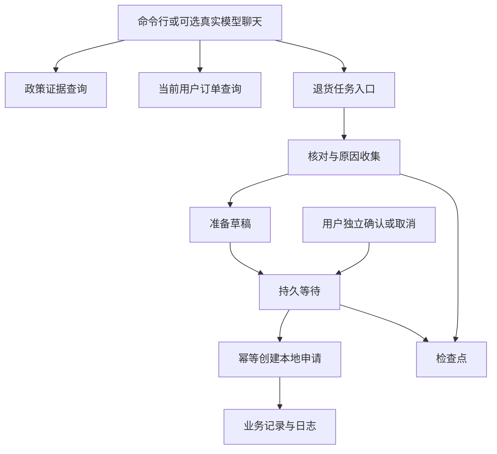

# 大模型应用开发学习 32：把学过的能力接成一个售后助手

用户说：“会员订单A3003签收10天了，尺寸不合适，能帮我处理退货吗？”一个完整助手需要做的，远不止写出“可以退”。它要找到适用政策，核对当前订单，保留原因，准备草稿，等待用户对具体动作确认，再返回实际创建的申请。

这里把已有模块接到一个本地可运行应用中。最终目标很明确：能回答政策，能查询订单，能追问原因，能准备并确认或取消申请，重启后还能找到同一项工作。

| 用户需要 | 实际交付 |
| --- | --- |
| 看适用政策 | 证据、来源与条件 |
| 看当前订单 | 有归属检查的查询结果 |
| 办理申请 | 状态、草稿、明确确认入口 |
| 隔一段时间继续 | 持久检查点与任务标识 |
| 知道出了什么问题 | 失败结果、固定案例与必要日志 |

## 先约定应用的完成范围

应用使用虚构政策与教学订单。创建申请只在本地数据库留下待审核记录，不连接真实电商、不执行退款。默认离线模式展示可核对证据与业务流程；可选聊天入口才让真实模型理解自然语言和调用工具。

这两种模式共享业务函数，但验证目标不同。离线流程适合复现状态和边界，在线模式需要单独评估理解、选工具与表达质量。不能因为固定流程通过，就宣称真实模型效果已验证。

后台、定时和团队协作没有强制接入。一个申请没有这些产品需要时，加入它们只会增加状态与排错成本。学过的机制可以在独立实验里成立，综合应用选择实际所需能力即可。

## 模块怎样接成同一项任务



入口区分用户请求与可信身份。示例命令行的`--user`是操作者指定的教学身份，不能据此宣称实现登录；部署时必须从认证会话取得用户，不接受模型填写的用户编号。

代码位于[23—32共享示例](examples/23-32-assistant/README.md)：`assistant.py`提供入口，`flow.py`推进任务，`business.py`适配业务存储。政策侧复用原`DocumentLoader`、`ask`和证据包装，业务侧复用原`ReturnService`规则。

先用同一条用户请求按数据流拆解：“会员订单A3003签收10天，尺寸不合适，想申请退货。”政策查询回答制度条件，订单查询确认当前事实，退货入口创建可恢复任务。模型如果参与，只负责理解这些意图并调用相应入口，不直接把句子写入申请表。

| 应用边界 | 输入 | 输出 | 谁对结果负责 |
| --- | --- | --- | --- |
| 资料入口 | 政策文件 | 带来源的知识单元 | 加载与检索程序 |
| 政策解释 | 问题与证据 | 引用条件的说明 | 生成与结果核对 |
| 业务查询 | 当前用户与订单号 | 订单事实 | 业务服务 |
| 任务执行 | 订单号、原因、任务号 | 草稿与等待位置 | 图与持久存储 |
| 确认提交 | 用户决定与当前草稿 | 申请编号 | 可信入口与业务事务 |

沿这张表可以定位问题：政策没找到，不应先改申请状态机；订单归属不对，不应让模型猜身份；重复申请，先查业务去重；消息接不上，才去核对会话输入。系统分工明确以后，排查就不必从Prompt开始碰运气。

## 先运行无需密钥的完整路径

在仓库根目录按运行说明安装固定依赖，然后进入`examples/23-32-assistant`：

```powershell
python -X utf8 assistant.py --data ./data/reading32 policy "会员签收10天能退货吗"
python -X utf8 assistant.py --data ./data/reading32 order A3003
python -X utf8 assistant.py --data ./data/reading32 start return-32 A3003
```

政策查询返回来源和条件，订单查询返回会员、天数与商品属性。创建任务时未给原因，先等待`need_reason`：

```powershell
python -X utf8 assistant.py --data ./data/reading32 resume return-32 --reason "尺寸不合适"
python -X utf8 assistant.py --data ./data/reading32 show return-32
```

此时应得到具体草稿与`approval`。核对订单、原因与“创建申请、等待审核”的后果后，选择一项：

```powershell
python -X utf8 assistant.py --data ./data/reading32 resume return-32 --action approve
```

或者使用`--action cancel`取消。两种动作是替代选择，不是按顺序都执行。批准后会得到申请编号；取消后不会创建申请。

进程每条命令都重新启动，因此这些命令同时展示了持久恢复。草稿有效期仍为300秒，超时会失败，需要重新核对准备，不会自动延长旧授权。

**把每次命令的结果串起来读。**`start`先登记任务归属，再查询订单与资格。没有原因时，`interrupts`中出现`need_reason`，`next`保留尚需推进的执行位置；补原因后才出现草稿编号和`approval`；批准后`interrupts`为空，结果里有申请编号，业务记录数变成1。

| 操作以后 | 能确认的事 | 还不能确认的事 |
| --- | --- | --- |
| 查政策 | 有适用条款 | 某笔订单已经通过资格 |
| 查订单 | 有当前教学事实 | 用户已经授权提交 |
| 准备草稿 | 有具体内容与编号 | 申请已经创建 |
| 批准并提交成功 | 有待审核申请 | 审核通过、钱已退回 |

取消实验应使用另一项新练习任务或新数据目录，不能在已经提交的任务后再输入取消，并期待它撤销已发生的动作。当前取消的含义是“尚未提交时停止这条路径”，不是撤回已提交申请的业务接口。

重复确认时，应用先检查任务是否还有中断，没有则返回已保存状态；即使重放进入业务提交，业务层仍按草稿编号返回原申请。这两层检查分别减少无用重跑和保护实际写入，不应只保留前一层。

## 政策证据与生成回答怎样交接

默认`TextEvidence`从同一政策文件读取知识单元，按明确关键词返回完整相关单元，再交给原`ask`和`pack_context`。文件很小，保留完整条款有助于同时看到会员、普通用户与定制例外。

它是确定性关键词检索，没有调用嵌入模型，也不是向量数据库。离线结果明确标记`evidence_only`，直接展示证据，避免把固定文字伪装成模型回答。

如果需要复用完整语义检索，安装原RAG示例依赖，加`--vector`，应用会使用原`Pipeline`与Chroma；首次可能需要下载嵌入模型。若再加`--online-policy`，则复用原生成接口，需设置`DEEPSEEK_API_KEY`与`RAG_CHAT_MODEL`。

检索没有证据时，不调用生成器，返回`insufficient_evidence`。关键词误召回、语义检索遗漏、模型误读条件是不同问题，需要分别观察候选、证据与最终回答，不能只看一句答复是否顺眼。

下面是政策查询的实际接入点。它不再重新实现加载、检索、证据预算和生成，而是把检索器与生成器选择交给同一`ask`入口：
<!-- example-source: examples/23-32-assistant/assistant.py -->
```python
def policy(self, question):
    result = ask(self.retriever, question, generator=generate if self.online_policy else evidence_only)
    if not self.online_policy and result["evidence"]:
        result["status"] = "evidence_only"
    return result
```

在线与离线生成器的返回结构相近，离线模式却明确改成`evidence_only`。这样上层界面可以判断展示的是原始证据还是模型回答，不会因为都存在`answer`字段就混为一种能力。

切换向量检索也不应改变业务工具语义。检索器仍提供文本、来源和位置，证据包装继续使用同一接口；申请资格仍由业务规则核对。将来替换嵌入模型或向量库时，不需要顺手重写确认与幂等逻辑。

这也解释了为什么综合应用没有把所有示例复制进一个巨型脚本。模块复用的关键是输入输出契约与职责稳定，而不是文件必须集中。读者可以顺着对象构造，找到本次选用的实际实现。

## 接入真实模型后，业务边界仍由程序维护

可选聊天入口使用`create_agent`和`ChatDeepSeek`。模型可调用政策检索、订单查询、建立准备任务、补充原因四种工具，**没有批准或提交工具**。

```powershell
python -X utf8 assistant.py --data ./data/chat32 chat
```

运行前设置`LC_CHAT_MODEL`为账户可用模型，并配置密钥。模型负责理解自然语言、提出工具请求和组织回复；确认仍由独立命令入口处理，读取并展示实际草稿后批准。

聊天中可以先说“核对A3003能否退货”，再说“帮我准备，原因是尺寸不合适”。实际是否选对工具，要看调用结果与保存的任务。若任务先等待原因，`supply_reason`只允许补充原因，不允许借此批准草稿。

当前聊天记录用内存检查点，关闭后不会自动接续对话；退货业务任务则已持久保存，可通过编号继续。这正好说明聊天记忆寿命与业务任务寿命应分别声明。

默认读取密钥不会自动执行在线实验。本文的离线验收未请求真实模型，在线和向量选项是可用接入路径，需在自己的环境中另行验证费用、延迟与效果。

## 存储、请求关联和日志要能解释

数据目录至少有业务数据库、检查点数据库和事件日志。使用同一相对路径时，要确认工作目录一致；文件保存在磁盘，不代表另一台机器自动拥有它们。

应用在读取任务前检查归属，同一编号不允许更换初始输入。需要并发服务时，可信身份与请求编号可显式传递，或在合适范围使用[ContextVar](supplements/工具笔记-ContextVar请求上下文.md)关联日志。它不会替代权限检查或数据库隔离。

`events.jsonl`保留任务、操作、阶段、等待标记与失败类别，不把全部政策、用户原因和完整模型请求无条件写入。排查时从任务编号找到日志，再核对状态与业务结果。

例如失败为`draft_expired`，应检查草稿有效期与确认时刻，而不是先改Prompt；资格为`outside_application_window`，应核对用户类别与签收天数。程序错误和模型错误需要不同证据。

SQLite足以支撑这个单机实验。迁移PostgreSQL时，业务表、检查点和长期Store分别设计，连接池也不会自动解决同一任务的并发恢复。相关最小SQL与事务说明放在[PostgreSQL工具说明](supplements/工具笔记-PostgreSQL持久化存储.md)。

**沿一次实际失败排查。**用户说无法提交，日志阶段为`failed`，错误为`draft_expired`。先`show`找到草稿与任务，核对本次确认是否超过300秒；若是，按产品需要重新准备并确认。这个问题没有必要通过增加模型温度或改系统角色解决。

如果错误是`not_found_or_forbidden`，先确认教学身份与订单归属；错误将不存在与无权限合并表达，避免查询接口无意泄露订单存在性。若模型答复声称已完成，但业务状态仍是等待，就看模型是否把准备回执误读为提交结果。

真实模型评测可以在已有固定案例上加入表达变化：“那笔还能退吗”“原因改一下”“先别提交”“刚才确认的是哪份”。分别核对指代、用户更正、取消意图和批准对象。自然语言答案通顺只是一项观察，工具轨迹与业务结果仍是判断任务完成的主要依据。

工程检查和模型效果应保留两份结论。前者可以断言相同草稿重复提交只生成一条记录；后者需要记录模型是否选对工具、是否引用了正确条款，以及在多次运行中表现如何。把二者合在一句“全部测试通过”里，会掩盖尚未验证的能力。

## 用固定案例确认闭环真的成立

| 案例 | 预期结果 |
| --- | --- |
| 会员政策问题 | 返回相关条款与来源 |
| 无关问题且无证据 | 明确资料不足 |
| A3003 | 符合教学规则，可准备 |
| A3004、A3005 | 分别因期限、定制例外拒绝 |
| 缺原因 | 等待补充，不提交 |
| 取消 | 无新增申请 |
| 其他身份恢复 | 拒绝访问 |
| 重复确认 | 同一申请编号，记录数为1 |
| 草稿过期 | 明确失败，不创建申请 |
| 关闭进程后批准 | 找回同一草稿并继续 |

在仓库根目录运行：

```powershell
python -X utf8 -m unittest discover -s examples/23-32-assistant -p test_series.py -v
python -X utf8 examples/check_article_sync.py
```

第一项验证离线机制，第二项核对正文代码摘录与文件。真实模型还需固定一组自然语言表达，检查选工具、追问、事实引用和最终结论；不要用离线断言代替效果评测。

如果修改提示或模型，先用同一组案例对比；如果修改状态或业务函数，则重新跑恢复、去重与例外路径。每次变更都应能指出影响了哪个可观察行为。

## 系列在一个可以检查的应用处结束

现在政策、订单、对话、状态与业务动作各有明确位置。读者既能沿命令观察固定路径，也能通过真实模型入口体验自然语言工具调用，并知道哪些结果还需要另行验证。

应用的完成不取决于用了多少组件。能够解释资料从哪里来、工具由谁执行、任务为什么暂停、结果凭什么算完成，并在失败时找回相应证据，这条应用开发路线就有了清楚的落点。

## 参考资料

- [LangChain Agents](https://docs.langchain.com/oss/python/langchain/agents)
- [LangGraph持久化](https://docs.langchain.com/oss/python/langgraph/persistence)
- [人工介入](https://docs.langchain.com/oss/python/langchain/human-in-the-loop)
