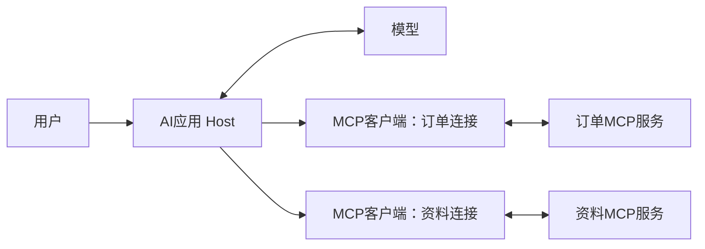

# MCP实现与协议扩展

这是[第16章正文](../16-MCP入门模型如何连接工具和资源.md)的可选扩展。正文先讲完整任务，这里保留详细实现、接口字段、边界与排查方法，适合在对应步骤遇到问题时查阅。无需先读完这里才能理解正文。

正文先区分MCP协议、SDK和服务器，说明它与Function Calling的衔接；这里集中保留实现细节。配套使用SDK1.26.0与2025-11-25协议流程，初始化以[对应版本规范](https://modelcontextprotocol.io/specification/2025-11-25/basic/lifecycle)为准。

代码片段可能是类方法或依赖其他函数的摘录；运行时使用正文链接的完整示例，不要把全部代码块直接拼成一个脚本。独立实验、固定测试与在线模型验证的范围以各节说明为准。

## 已经会调用函数了，为什么还要MCP

先回到之前的退款状态查询。原来代码知道 `get_refund_status` 在哪里，直接调用就行。

现在假设有两个应用：客服聊天窗口和内部售后工作台。它们都需要查订单。若每个应用都各写一份“怎样连接订单服务”的代码，订单接口变化时，就得分别维护。

可以让一个程序专门提供订单查询能力，对外说明：

```text
我能提供的工具：get_refund_status
用途：查询退款状态
需要的信息：order_id，也就是订单号
调用以后：返回查询结果或明确错误
```

支持MCP的应用可以先按约定取得这份说明，再按约定发出调用请求。工具内部连接哪个数据库、调用哪个订单接口，仍然由提供工具的程序实现。

这减少了重复对接的工作，但不表示接上以后什么都自动完成。工具描述要清楚，应用要支持所需能力，登录、权限和业务条件仍然要落实。

**原有的业务接口仍然可以继续用。**

假设公司已经有一个查订单的HTTP API，MCP服务里的查询函数可以继续调用它。业务接口负责真正查单，MCP服务负责按统一方式向AI应用介绍这项能力、接收调用并返回结果。通常是给已有能力增加一种接入方式，不是把原来的业务系统重新做一遍。

也可以把文档检索程序提供成一个MCP工具，例如“根据问题搜索售后政策”。MCP负责把这次搜索请求送过去，RAG程序仍然负责切分、检索和组织证据。两者可以配合，但用了MCP，资料不会自动变成高质量知识库。

**MCP与Function Calling接在不同位置。**

| 问题 | 哪一部分负责 |
| --- | --- |
| 用户这句话需要哪个工具、参数是什么 | 模型的Function Calling能力 |
| 应用怎样取得外部工具清单、转发调用和取回结果 | MCP连接与对应程序 |
| 这笔订单是不是当前用户的、能不能提交申请 | 业务后端的检查 |

可以把整条线读成：模型说“请查A1001”，应用把请求转给MCP服务，服务里的查询函数去办，再把结果沿原路送回来。MCP不会替模型理解用户，也不会把查询工具自动升级成有退款权限的工具。

只有几个本地函数时，直接调用也很合适。需要让工具独立维护、供多个应用使用时，统一连接方式的价值才更明显。


## 谁在和谁说话：先认清三个角色

MCP文档里经常出现Host、Client和Server。先不用把它们想成三台机器，它们是在分工：

| 名称 | 本篇怎么理解 | 售后场景里的职责 |
| --- | --- | --- |
| Host，主机 | 用户使用的整个AI应用 | 管理聊天、请求模型、选择资料、展示确认界面 |
| Client，客户端 | 应用中负责MCP联络的部分 | 向服务发请求、接结果 |
| Server，服务器 | 提供工具与资料的程序 | 提供订单查询、政策和模板 |

一个应用可以连接多个MCP服务，比如订单服务和知识库服务。通常每个服务由对应的客户端连接来联络。这里的“服务器”是一个提供能力的程序，也可以就在你的电脑上运行，不一定在远程机器上。

图里把订单服务和资料服务分开，是为了展示一个应用连接多个服务。下面的教学代码则把查询、政策和提示放在同一个服务里；两种组织方式都可以，不要求每一种能力都单独启动一个程序。



模型通常不直接操作网络连接。它提出需求，应用决定是否执行，再通过客户端与服务通信。应用还决定哪些工具、资料可以给模型看。[MCP架构说明](https://modelcontextprotocol.io/docs/learn/architecture)

下面会写一个测试客户端，用它直接查看服务。这段程序只承担联络和检查工作，没有聊天界面，也不是一个已经接入模型的完整AI应用。


## 工具、资源、提示：一个办事，一个给资料，一个给模板

继续使用同一个售后场景，MCP服务可以提供三类内容：

| 类型 | 例子 | 取回来以后有什么 |
| --- | --- | --- |
| Tool，工具 | 查订单A1001的退款状态 | 执行查询后得到的结果 |
| Resource，资源 | 会员退货政策 | 可供阅读的条款内容 |
| Prompt，提示模板 | “解释一笔订单的售后情况” | 一段填好订单号的任务说明 |

**工具可以查信息，也可以改数据。**

工具表示一个可执行的入口。查退款状态是只读工具，提交申请则会写入数据。因此不能简单地把“工具”理解成“会改数据”。是否有写入动作，要看具体工具的实现。

在AI应用中，通常由模型根据问题提出调用哪个工具；应用或用户仍然可以限制它。下面的测试代码也能直接调用工具，不需要先经过模型选择。

**资源像一份有编号的资料。**

本例给政策概览一个地址：`policy://refund/overview`。这类用来标识资料的地址叫URI。可以先理解成资料的编号，不必把它当成能在浏览器打开的网址。

读取这个地址，得到政策文本。资源内容也可以随着业务变化而更新，所以“固定地址”不等于“内容永远不变”。资源只提供资料，不通过读取资源来提交退货申请。

还有一种地址带空位：`policy://refund/customer/{customer_type}`。把空位填成 `member` 就读取会员规则，填成 `ordinary` 就读取普通订单规则。这叫资源模板，是一条取资料的地址规则，不是聊天提示模板。[MCP资源说明](https://modelcontextprotocol.io/specification/2025-11-25/server/resources)

**提示模板只是把任务说明准备好。**

比如用户选择“解释售后情况”，填入A1001，应用取得一段任务说明：“先读适用政策，再查A1001的状态，根据结果回答。”

取得模板以后，还需要应用读取资料、调用工具或请求模型。模板自己不会去查订单，也不会自动生成最终回答。通常是用户或应用选择使用哪个模板，具体展示方式由应用决定。[MCP提示模板说明](https://modelcontextprotocol.io/specification/2025-11-25/server/prompts)

同样，读到了政策也不表示模型已经看到了。应用还要选择需要的内容，放进模型的上下文；很长的资料仍需要切分、检索或长度控制。

**把三种内容放进同一次售后回复，就能看出各自的作用。**

假设用户问：“帮我说明一下A1001的退货规则和退款进度。”下面是完整AI应用可以采用的一条处理路径：

| 顺序 | 应用在做什么 | 用到哪种内容 |
| --- | --- | --- |
| 1 | 用户选择“解释售后情况”，应用填入订单号，取得任务说明 | 提示模板：告诉后续怎样组织任务 |
| 2 | 从可靠的业务信息确认客户类型，再读取适用政策 | 资源：提供规则原文 |
| 3 | 请查询工具读取A1001当前的退款状态 | 工具：执行具体查询 |
| 4 | 把任务说明、政策和查询结果一起交给模型 | 应用组织上下文 |
| 5 | 模型根据取得的事实回答，缺信息时说明还不能确定什么 | 模型组织表达 |

这里假设应用已经从业务信息确认该订单适用会员规则，才读取 `member` 对应资源。不能因为用户问了会员政策，就认定他的订单一定是会员订单。下面的测试脚本直接指定读取会员条款，是为了演示读取方法；它尚未实现自动判定客户类型，也没有执行第4、5步的模型回答。

这条路径也不是MCP强制规定的顺序。如果用户已经把任务说得很清楚，应用可以不用提示模板；只问退款进度时，也可以只查询工具。三类内容是按需要使用的能力，不要求每个问题都走全套。


## 连接以后先问清楚：有哪些能力，怎样调用

先看一次连接要做哪些事：

```text
建立连接
  ↓
确认双方使用的规则和支持的能力
  ↓
问：有哪些工具、资料和模板？
  ↓
选择具体内容，发出查询或读取请求
  ↓
取得结果，最后关闭连接
```

为了让代码能按同一环境复现，本篇固定使用Python 3.12、官方Python SDK `mcp==1.26.0`，对应示例协商到的协议版本为 `2025-11-25`。安装文件还固定了配置依赖，避免新旧依赖混用造成提示信息。SDK是已经写好的开发工具包，帮我们处理协议消息，不用从头造一套通信程序。

版本要分清：`1.26.0`是Python包版本，`2025-11-25`是协议版本。官方SDK已有2.x版本，新规范的发现流程也有变化；本文使用的是明确固定的教学环境，不把旧版初始化步骤当成所有版本的共同要求。阅读其他版本的示例时，应使用对应版本的接口说明。[本篇固定版本的SDK文档](https://github.com/modelcontextprotocol/python-sdk/tree/v1.26.0)

在本文这个版本里，客户端先发初始化请求，双方交换版本与能力，客户端再通知“准备好了”。调用 `await session.initialize()` 时，SDK会完成这组步骤，之后才开始查工具、读资料。[对应协议的生命周期](https://modelcontextprotocol.io/specification/2025-11-25/basic/lifecycle)

下面这些名字就是具体请求的名称，不需要一开始背下来：

| 协议方法 | 大白话意思 | 本篇SDK写法 |
| --- | --- | --- |
| `tools/list` | 你能办哪些事 | `list_tools()` |
| `tools/call` | 请你办这件事 | `call_tool()` |
| `resources/list` | 有哪些固定地址的资料 | `list_resources()` |
| `resources/templates/list` | 有哪些按参数取资料的地址规则 | `list_resource_templates()` |
| `resources/read` | 把这份资料给我 | `read_resource()` |
| `prompts/list` | 有哪些现成的任务模板 | `list_prompts()` |
| `prompts/get` | 填好这份任务模板给我 | `get_prompt()` |

列清单只是看目录，不会把所有内容都读出来。服务只提供了工具，也不代表一定提供资源和提示；应用应按实际支持的能力使用。

“支持某种能力”与“允许当前用户使用某个工具”也要分开。服务说支持工具，表示它能处理这类协议请求；至于哪些工具对当前用户开放、某笔订单是否能查，还要由应用和服务端检查。初始化成功没有替用户完成登录或业务授权。

**请求与回复也要对上号。**

MCP用一种叫JSON-RPC的消息约定，说明调用什么方法、带哪些参数，并用ID对上结果。比如一条工具调用在协议中可以写成：

<!-- example-kind: illustration -->

```json
{
  "jsonrpc": "2.0",
  "id": 12,
  "method": "tools/call",
  "params": {
    "name": "get_refund_status",
    "arguments": {"order_id": "A1001"}
  }
}
```

这里的 `arguments` 已经是参数对象，与Chat Completions里编码后的JSON参数字符串不同。应用收到模型的参数字符串，要先解析，再交给MCP客户端。协议回复带着同一个ID；不需要回复的通知则没有请求ID。实际代码里的这些封装由SDK处理。

MCP消息ID与模型的调用ID也各管一段：一个对上客户端和MCP服务的请求，一个对上模型和应用的请求。应用负责把两段结果接起来，不能把它们当成同一个订单编号。

第一次读到这里，能复述这一句话就够了：应用先问服务能提供什么，再按服务的说明发送请求，服务把对应结果交回来。后面的代码是在把这句话具体实现出来。


## 先写一个能提供售后资料和查询的服务

下面用独立服务提供只读查询、政策资料和任务模板：A1001可供演示用户查询，A2002用于检查归属拒绝。客户端可以不接模型就检查这些能力；提交申请的草稿与确认逻辑尚未接入这个服务。

本篇配套代码放在 `examples/16-mcp`。正文按文件名提供完整内容；也可以使用文末配套说明指向的示例目录：

```text
examples/16-mcp/
  server.py         提供工具、政策资源和任务模板
  client.py         在本机连接并逐项检查
  http_client.py    换成HTTP连接，重复同一组检查
  bridge_demo.py    检查MCP与模型工具格式之间的转换
  requirements.txt 固定运行依赖
  test_protocol.py  实际协议与错误路径检查
```

这次每个文件的用途都在下面展开。不要把几个文件的代码拼到同一个脚本里。这个示例有自己的依赖，按下面命令在该目录新建环境即可，不需要安装RAG项目的整套依赖。

如果只想先验证最基本的连接，准备 `server.py`、`client.py` 和 `requirements.txt`，运行一次 `client.py` 即可。看懂输出后，再尝试HTTP和桥接示例；测试文件用于检查实现，不是阅读正文的前置要求。

```powershell
py -3.12 -m venv .venv
.\.venv\Scripts\python.exe -m pip install -r requirements.txt
```

`requirements.txt`内容为：

```text
mcp==1.26.0
pydantic-settings==2.12.0
```

这里使用的是官方 `mcp` 包中包含的FastMCP，不需要另装一个名叫 `fastmcp` 的包。`pydantic-settings`是SDK的配置依赖，本例固定它的版本，不需要自己调用它。

**把下面完整代码保存为 `server.py`。**

<!-- example-source: examples/16-mcp/server.py -->

```python
"""本地售后 MCP 教学服务：提供虚构查询、政策资料和回复模板。"""

import argparse
import json
import re

from mcp.server.fastmcp import FastMCP

mcp = FastMCP("after-sales-demo", host="127.0.0.1", port=8765, json_response=True)

POLICIES = {
    "member": "教学政策：会员订单签收后15日内可以申请退货，定制商品不支持无理由退货。",
    "ordinary": "教学政策：普通订单签收后7日内可以申请退货，定制商品不支持无理由退货。",
}
ORDERS = {"A1001": {"owner": "demo-user", "refund_status": "审核中"},
          "A2002": {"owner": "other-user", "refund_status": "已退款"}}


@mcp.tool()
def get_refund_status(order_id: str) -> str:
    """按用户提供的订单号查询教学退款状态，只读；不创建申请或执行退款。"""
    if not re.fullmatch(r"A[0-9]{4}", order_id):
        raise ValueError("订单号应为A加4位数字，如A1001")
    order = ORDERS.get(order_id)
    # 固定身份仅用于本机教学，真实服务应从认证信息取得当前用户。
    if order is None or order["owner"] != "demo-user":
        return json.dumps({"ok": False, "error": "not_found_or_forbidden"})
    return json.dumps({"ok": True, "order_id": order_id,
                       "refund_status": order["refund_status"],
                       "source": "虚构教学快照，不是实时订单"}, ensure_ascii=False)


@mcp.resource("policy://refund/overview", mime_type="text/plain")
def refund_overview() -> str:
    """退货政策概览，只提供教学资料。"""
    return "\n".join(POLICIES.values())


@mcp.resource("policy://refund/customer/{customer_type}", mime_type="text/plain")
def refund_policy(customer_type: str) -> str:
    """按客户类型读取教学条款：member或ordinary。"""
    if customer_type not in POLICIES:
        raise ValueError("客户类型只能是member或ordinary")
    return POLICIES[customer_type]


@mcp.prompt()
def explain_refund(order_id: str) -> str:
    """生成售后回复的任务模板；不查询订单，也不生成最终回答。"""
    return (f"请解释订单{order_id}的售后情况。先读取适用政策并查询退款状态，"
            "根据取得的事实回答。注明教学数据；资料不足就说明缺少什么，"
            "不要把申请提交、审核通过和退款完成混为一谈。")


if __name__ == "__main__":
    parser = argparse.ArgumentParser(description=__doc__)
    parser.add_argument("--transport", choices=["stdio", "streamable-http"], default="stdio")
    args = parser.parse_args()
    mcp.run(transport=args.transport)
```

先看三个带 `@` 的位置。`@mcp.tool()` 把函数登记成工具；`@mcp.resource(...)` 登记一份资料或取资料的规则；`@mcp.prompt()` 登记任务模板。可以把这些标记理解成“把下面这个函数加入对应清单”。

函数里的 `order_id: str` 告诉SDK订单号是字符串，函数说明会成为工具描述。SDK因此能生成工具清单与参数要求；它不会自动补全订单归属、退货资格等业务检查。

读这个服务脚本时，可以先找到 `get_refund_status()`，它负责查询退款状态；再看两个政策函数，分别对应“读概览”和“按客户类型读条款”；最后看 `explain_refund()`，它只拼出任务说明。先理解四个函数各自返回什么，再看外围的登记标记，会更容易。

查询使用两笔虚构订单：A1001可供演示用户查询，A2002属于别人，不返回它的状态。固定的`demo-user`只为本机教学服务，实际系统要从认证信息取得用户身份。

资源和提示也不是装饰：政策函数会实际返回条款，提示函数会实际返回任务说明。它们返回的是不同用途的内容。

代码最后选择连接方式，默认 `stdio`。先不要单独运行服务，下一节的客户端会替你启动它。


## 写个客户端，亲眼看到工具、资料和结果

`stdio`是本机程序之间的一种连接方式：客户端启动服务程序，把请求写进它的输入通道，再从输出通道读回复。它没有需要填写的网络网址。

文档里常见的三个英文名称，对应三条不同用途的通道：

| 名称 | 在这个服务进程里用来做什么 |
| --- | --- |
| `stdin`，标准输入 | 接收客户端发来的协议消息 |
| `stdout`，标准输出 | 把协议消息回复给客户端 |
| `stderr`，标准错误 | 输出日志或报错信息，便于人排查问题 |

“标准错误”这个名字容易让人误会：这条通道也可以放普通运行日志，不表示出现其中任何一行就一定失败。关键是把供程序解析的消息与供人阅读的日志分开。

有一个容易踩的坑：服务端的标准输出是协议通道，不要往里面随便 `print("启动成功")`。日志写到标准错误通道；客户端打印检查结果则没问题，因为那是客户端自己的输出。[对应版本的传输说明](https://modelcontextprotocol.io/specification/2025-11-25/basic/transports)

**保存下面完整代码为 `client.py`。**

<!-- example-source: examples/16-mcp/client.py -->

```python
"""不调用模型，直接检查 MCP 服务的工具、资源和提示模板。"""

import asyncio
import sys
from pathlib import Path

from mcp import ClientSession, StdioServerParameters, types
from mcp.client.stdio import stdio_client
from pydantic import AnyUrl


async def inspect_server(session):
    info = await session.initialize()
    print("协议版本：", info.protocolVersion)
    tools = await session.list_tools()
    print("工具：", [tool.name for tool in tools.tools])
    print("参数要求：", tools.tools[0].inputSchema)

    resources = await session.list_resources()
    print("资源：", [str(resource.uri) for resource in resources.resources])
    templates = await session.list_resource_templates()
    print("资源模板：", [template.uriTemplate for template in templates.resourceTemplates])
    for uri in ("policy://refund/overview", "policy://refund/customer/member"):
        result = await session.read_resource(AnyUrl(uri))
        for block in result.contents:
            if isinstance(block, types.TextResourceContents):
                print("政策：", block.text)

    prompts = await session.list_prompts()
    print("提示模板：", [prompt.name for prompt in prompts.prompts])
    prompt = await session.get_prompt("explain_refund", arguments={"order_id": "A1001"})
    for message in prompt.messages:
        if isinstance(message.content, types.TextContent):
            print("任务说明：", message.content.text)

    for order_id in ("A1001", "A2002", "bad-id"):
        result = await session.call_tool("get_refund_status", arguments={"order_id": order_id})
        print("查询：", order_id, "工具执行出错：", bool(result.isError))
        for block in result.content:
            if isinstance(block, types.TextContent):
                print("结果：", block.text)


async def main():
    server_path = Path(__file__).with_name("server.py").resolve()
    params = StdioServerParameters(command=sys.executable, args=[str(server_path)])
    async with stdio_client(params) as (read, write):
        async with ClientSession(read, write) as session:
            await inspect_server(session)


if __name__ == "__main__":
    sys.stdout.reconfigure(encoding="utf-8")
    asyncio.run(main())
```

可以从最下面的 `main()` 开始读：找到旁边的 `server.py`，用当前环境的Python启动它，建立会话，再调用 `inspect_server()` 逐项检查。

`sys.executable`表示“正在运行这个客户端的Python”。这样客户端和子进程使用同一个环境，能减少“客户端装了包，服务端却找不到包”的问题。

`async with`可以先理解成“进入这段时建立连接，离开时把连接和相关程序收好”；`await`表示等待这一步完成。第一次读不需要先掌握完整异步编程，先按调用顺序看它做了什么。

`AnyUrl(uri)`用于检查并包装资源地址，不是在打开浏览器；`types.TextResourceContents`表示“这块返回内容是文本资源”。看到代码判断类型后再取 `.text`，可以读成“先确认拿到的是文字，再把文字打印出来”。这些都是读取结果的辅助步骤。

运行：

```powershell
.\.venv\Scripts\python.exe client.py
```

你会看到协议版本、工具名和参数要求，然后是资源地址、资源模板、政策文本、提示模板，最后是三次查询。重点核对这些输出：

```text
协议版本：2025-11-25
工具：['get_refund_status']
资源：['policy://refund/overview']
资源模板：['policy://refund/customer/{customer_type}']
提示模板：['explain_refund']
A1001：取得教学状态“审核中”
A2002：返回not_found_or_forbidden
bad-id：工具执行出错
```

上面整理的是输出重点，不是逐字符复制的完整终端记录。服务日志可能同时出现在终端，只要不写进协议通道，就不会与这些结果混在一起解析。

**两种“没查成”，还要分开看。**

查A2002时，函数正常运行并返回 `ok: false`，意思是没取得可访问的订单。`isError`可以仍为false，因为工具确实按业务规则给出了结果。

订单号是 `bad-id` 时，函数发现格式错误并抛出异常，SDK返回 `isError: true`，错误说明放在内容中。也就是说，要同时看“工具执行是否出错”和“业务结果是否成功”，不能只看一个开关。

再往外看，还可能是连接本身失败，或者协议请求没有被正确处理。排查时可以按下面四层区分：

| 在哪里出了问题 | 例子 | 此时能得出什么结论 |
| --- | --- | --- |
| 连接层 | HTTP服务没启动，地址无法连接 | 请求还没有正常送到服务 |
| 协议层 | 请求的方法不受支持，或消息结构不符合协议 | 这次协议请求没处理成功；SDK可能抛出异常，不能只查 `isError` |
| 工具执行层 | 本例 `bad-id` 导致查询函数报错 | 收到了工具失败结果，查看 `isError` 与错误内容 |
| 业务结果层 | 本例A2002没有可访问的订单 | 工具正常给出拒绝结果，查看业务字段 `ok` 与 `error` |

本例把格式不符作为函数错误处理；其他服务也可以采用不同的参数校验与错误表达。判断时要看实际返回位置，不要把所有失败都叫成“工具查不到数据”。[MCP工具与错误处理说明](https://modelcontextprotocol.io/specification/2025-11-25/server/tools)

工具结果的内容列表叫 `content`，读取资源返回的列表叫 `contents`，提示模板返回的是 `messages`。代码按实际类型取出文本，没有只拿第一段就假设结果读全了。MCP还可以返回其他类型的内容，本篇只展示文本，不把文本处理函数当成通用图片或文件处理器。

有的工具还会通过 `structuredContent` 直接提供结构化结果，例如带字段名的对象。本例返回JSON文本，客户端先取得文本，再由应用读取其中的业务字段。以后遇到直接返回对象、图片或资源链接的工具，要按它声明和实际返回的类型读取，不能统一假定结果只有一段文字。

这一步没有调用模型。它证明的是客户端确实能找到服务、读资料、调用函数，还没有验证模型会不会为自然语言问题选择正确工具。


## 换成HTTP连接：改的是联络方式

如果服务不由每个客户端单独启动，而是先运行在一个地址上，应用可以通过HTTP连接它。MCP把这种标准连接方式称为 **Streamable HTTP**。

大白话理解：`stdio`像应用直接启动旁边的程序，与它对话；HTTP则是服务已经在那里，应用根据地址去找它。HTTP服务也可以在本机运行，不等于已经部署到了互联网。

| 本例的区别 | stdio | Streamable HTTP |
| --- | --- | --- |
| 谁启动服务 | 客户端自动启动子进程 | 先在一个终端启动服务 |
| 用什么定位服务 | Python命令和脚本路径 | `http://127.0.0.1:8765/mcp` |
| 换连接方式后，查询函数要不要重写 | 不需要 | 不需要 |
| 客户端退出后 | 所启动的子进程会被收尾 | 独立启动的服务继续运行 |

先在终端一运行：

```powershell
.\.venv\Scripts\python.exe server.py --transport streamable-http
```

保持这个终端运行，再在同一个目录打开终端二。保存下面代码为 `http_client.py`：

<!-- example-source: examples/16-mcp/http_client.py -->

```python
"""连接已经启动的本机 HTTP 服务，重复同一组 MCP 检查。"""

import asyncio
import sys

from mcp import ClientSession
from mcp.client.streamable_http import streamable_http_client

from client import inspect_server


async def main():
    async with streamable_http_client("http://127.0.0.1:8765/mcp") as (read, write, _):
        async with ClientSession(read, write) as session:
            await inspect_server(session)


if __name__ == "__main__":
    sys.stdout.reconfigure(encoding="utf-8")
    asyncio.run(main())
```

然后运行：

```powershell
.\.venv\Scripts\python.exe http_client.py
```

它会使用 `client.py` 中同一个 `inspect_server()`，所以工具、资源、模板和查询结果应该一致。区别只是打开连接的方式；这也是把检查逻辑单独写成函数的原因。

`127.0.0.1`表示本机，8765是本例端口，`/mcp`是服务路径。改地址或端口时，客户端也要对应修改。本例绑定本机地址，不提供远程登录认证；检查结束后，在终端一按Ctrl+C关闭服务。

现在有三种看起来像“地址或名称”的东西，可以放在一起分清：

| 写法 | 它在定位什么 | 应用怎样使用 |
| --- | --- | --- |
| `http://127.0.0.1:8765/mcp` | 要连接的MCP服务 | 先用这个地址建立HTTP连接 |
| `policy://refund/customer/member` | 该服务提供的一份政策资料 | 在已建立的连接里请求读取这个URI |
| `get_refund_status` | 该服务提供的一个工具 | 在已建立的连接里调用它，并附订单号 |

因此，不要把政策URI填写到HTTP客户端的服务器地址里。前者回答“读哪份资料”，后者回答“先与哪个服务建立联系”。

“Streamable”不表示每次结果都必须逐段返回。本文设置 `json_response=True`，工具结果可以用完整JSON响应；需要流式返回时，协议也允许采用SSE，意思是服务在同一连接中持续推送事件。它也不等于模型生成文字时的Token流。[Streamable HTTP说明](https://modelcontextprotocol.io/specification/2025-11-25/basic/transports)

HTTP连接是否保存会话、怎样处理断开或恢复，要看对应协议版本与服务配置。不要认为有了会话ID就等于用户登录成功，或一定能找回退货草稿；业务记录仍要按业务要求保存。


## 接回模型：把两边的请求和结果接起来

服务可以调用以后，还需要把工具介绍交给模型。模型接口接收工具名称、说明和参数要求，而MCP清单里的字段与聊天接口的字段并不完全一样：

| MCP工具说明 | 本例聊天工具格式 |
| --- | --- |
| `name` | `function.name` |
| `description` | `function.description` |
| `inputSchema` | `function.parameters` |

应用把说明转好，交给模型；模型返回调用请求后，应用解析参数，转给MCP服务；服务回结果，应用再把结果放进带模型调用ID的工具消息中。

可以按下面这条线复述：

```text
MCP服务介绍工具 → 应用把介绍交给模型
模型提出调用请求 → 应用请MCP服务执行
MCP服务返回结果 → 应用把结果交回模型
```

**把下面代码保存为 `bridge_demo.py`，检查这段连接。**

<!-- example-source: examples/16-mcp/bridge_demo.py -->

```python
"""把 MCP 工具说明转成聊天接口格式；用固定请求检查结果回填，不调用模型。"""

import asyncio
import json
import sys
from pathlib import Path

from mcp import ClientSession, StdioServerParameters, types
from mcp.client.stdio import stdio_client


def to_model_tools(tools):
    return [{"type": "function", "function": {
        "name": tool.name, "description": tool.description or "",
        "parameters": tool.inputSchema,
    }} for tool in tools]


async def execute_model_call(session, call, allowed_names):
    function = call["function"]
    name = function["name"]
    try:
        if name not in allowed_names:
            raise ValueError("工具不在允许列表中")
        arguments = json.loads(function["arguments"])
        if not isinstance(arguments, dict):
            raise ValueError("工具参数必须是对象")
        result = await session.call_tool(name, arguments=arguments)
        text = "\n".join(block.text for block in result.content
                         if isinstance(block, types.TextContent))
        payload = {"tool_execution_error": bool(result.isError), "text": text}
    except (ValueError, TypeError) as error:
        payload = {"tool_execution_error": True, "text": str(error)}
    return {"role": "tool", "tool_call_id": call["id"],
            "content": json.dumps(payload, ensure_ascii=False)}


async def main():
    params = StdioServerParameters(command=sys.executable,
                                   args=[str(Path(__file__).with_name("server.py").resolve())])
    async with stdio_client(params) as (read, write):
        async with ClientSession(read, write) as session:
            await session.initialize()
            tools = (await session.list_tools()).tools
            allowed = {tool.name for tool in tools}
            print("可交给模型的工具：", json.dumps(to_model_tools(tools), ensure_ascii=False))
            # 固定请求替代模型输出，仅检查转换和转发；不是在线模型实测。
            message = {"role": "assistant", "content": None, "tool_calls": [{
                "id": "call_demo_1", "type": "function", "function": {
                    "name": "get_refund_status", "arguments": '{"order_id":"A1001"}'}}]}
            history = [message]
            for call in message["tool_calls"]:
                history.append(await execute_model_call(session, call, allowed))
            print("回填历史：", json.dumps(history, ensure_ascii=False, indent=2))


if __name__ == "__main__":
    sys.stdout.reconfigure(encoding="utf-8")
    asyncio.run(main())
```

运行：

```powershell
.\.venv\Scripts\python.exe bridge_demo.py
```

先看到可交给模型的工具说明，再看到一条 `assistant` 调用消息和对应的 `tool` 结果。调用ID仍然是 `call_demo_1`，内容中有A1001的教学查询结果。

这个脚本用固定请求验证格式转换、转发与回填。接入真实模型时，需要把用户消息与工具说明发送给模型，保存调用消息，执行转发，再回填结果并请求最终回答；还要限制执行次数。固定请求只验证中间的连接部分，在线选择工具的效果需要另外检查。

`allowed_names`是应用允许使用的工具清单。本例把测试服务提供的工具放进清单；真实应用可以再缩小范围。接多个服务时还要避免重名，例如两个服务都提供 `search`，应用应保存“模型可见名称对应哪个服务、哪个原始名称”的关系，才能转发正确。

这份桥接代码只处理文本结果，不支持所有MCP内容类型。它也没有把资源和提示自动塞给模型；应用仍需先选择、读取，并按需要放进上下文。

读桥接代码时先抓两个函数：`to_model_tools()` 把MCP的工具介绍换成聊天接口认识的字段；`execute_model_call()` 则把模型那张请求单送到MCP服务，再把结果包装回来。最下面的固定请求只是在测试这两个方向是否接对，不负责理解用户的话。

**连接成功以后，还要知道哪些事没有自动解决。**

| 情况 | 应用仍要做什么 |
| --- | --- |
| 服务提供了提交退货工具 | 核对具体草稿的确认、用户归属与重复提交，连接协议不会替代这些业务检查 |
| 工具返回的资料里夹带“忽略规则” | 作为数据处理，不能让它扩大工具权限 |
| 远程服务要求登录 | 使用对应的认证流程，不把密码或当前用户身份交给模型编造 |
| 两次查询之间连接断开 | 检查是否需要重连；写入结果不明时先查原操作状态 |
| 资源内容很长 | 选择相关资料并控制上下文长度，不因用了MCP就全部发送 |
| 清单很长或分多页 | 按分页继续取所需内容，再决定给模型哪些工具；本例清单很小，只取一页 |

配套检查使用真实子进程和本机HTTP服务，覆盖工具发现、参数要求、资源读取、模板取得、查询成功与拒绝、执行错误，以及模型格式的转发与ID配对。运行方式为：

```powershell
.\.venv\Scripts\python.exe -m unittest -v
```

测试会短暂占用本机8765端口，先关闭自己启动的演示服务。本文的8项检查已通过；没有进行远程部署、真实身份认证或在线模型选择工具的验收，不把本地连通当成这些能力已经完成。

如果运行没有得到预期结果，可以先定位在哪一步停住：

| 现象 | 先检查什么 |
| --- | --- |
| 提示找不到 `mcp` | 是否用创建的虚拟环境运行，是否安装了固定依赖 |
| stdio连接后解析失败 | 服务有没有把普通打印写到标准输出 |
| HTTP连接被拒绝 | 终端一的服务是否在运行、地址端口是否一致 |
| 8765端口已被占用 | 是否已经运行了一份演示服务，不要直接结束不明程序 |
| 工具列表为空 | 是否注册了工具、连接的是否为目标服务 |
| 读不到模板资源 | 是否读取了填好参数的URI，而不是带花括号的地址规则 |
| 提示 `isError: true` | 查看工具错误内容和传入参数，不能直接当成查到空结果 |


## 参考资料

- [MCP：架构与分工](https://modelcontextprotocol.io/docs/learn/architecture)
- [MCP 2025-11-25：连接生命周期](https://modelcontextprotocol.io/specification/2025-11-25/basic/lifecycle)
- [MCP 2025-11-25：stdio与Streamable HTTP](https://modelcontextprotocol.io/specification/2025-11-25/basic/transports)
- [MCP 2025-11-25：资源](https://modelcontextprotocol.io/specification/2025-11-25/server/resources)
- [MCP 2025-11-25：工具与错误处理](https://modelcontextprotocol.io/specification/2025-11-25/server/tools)
- [MCP 2025-11-25：提示模板](https://modelcontextprotocol.io/specification/2025-11-25/server/prompts)
- [官方Python SDK v1.26.0：本篇固定版本](https://github.com/modelcontextprotocol/python-sdk/tree/v1.26.0)
- [官方Python SDK：当前版本与迁移文档入口](https://github.com/modelcontextprotocol/python-sdk)
- [本篇配套代码与运行说明](../examples/16-mcp/README.md)
