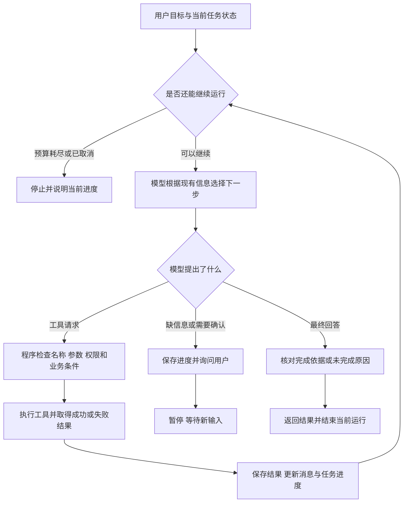

# Agent执行与状态扩展

这是[第17章正文](../17-Agent入门让模型自己规划并使用工具.md)的可选扩展。正文先讲完整任务，这里保留详细实现、接口字段、边界与排查方法，适合在对应步骤遇到问题时查阅。无需先读完这里才能理解正文。

代码片段可能是类方法或依赖其他函数的摘录；运行时使用正文链接的完整示例，不要把全部代码块直接拼成一个脚本。独立实验、固定测试与在线模型验证的范围以各节说明为准。

订单A1001用于查询已有申请状态；A3003用于符合教学条件的申请准备，A3004超出普通订单期限，A3005为定制商品。这些是不同任务的固定教学数据。

## 任务状态：把“已经办到哪一步”保存在程序里

如果每次问模型，都只发送最初那句需求，却不告诉它工具查到了什么，模型就像每轮都接待一个新客户。它可能反复查同一笔订单，也可能忘记刚才还在等原因。

因此，程序要保存这次任务的进度。这些“当前知道什么、已经做过什么、还在等什么”的记录，统称为 **状态，State**。

状态不是模型脑子里的永久记忆，也不只是聊天文字。它可以分成几部分：

| 需要保存的内容 | 售后例子 | 由谁提供或更新 |
| --- | --- | --- |
| 用户目标与消息 | 判断资格，符合时准备草稿；用户补充原因 | 用户输入、程序维护的消息历史 |
| 当前任务进度 | 等待原因、草稿已准备、等待确认 | 应用根据实际步骤更新 |
| 已取得的事实 | 订单查询结果、适用政策及来源 | 查询工具、资料读取与核对结果 |
| 运行限制 | 已调用几次模型、花了多久、还有多少预算 | 运行程序统计 |
| 当前用户身份 | 从认证信息取得的用户标识 | 应用的登录与授权系统 |
| 业务记录 | 草稿、确认记录、申请编号 | 业务后端保存 |

下面用一份**任务状态设计**表示进度，字段可按应用需要调整：

<!-- example-kind: illustration -->

```json
{
  "goal": "检查A3003的资格，符合时准备退货草稿",
  "order_id": "A3003",
  "phase": "waiting_for_reason",
  "known_facts": {
    "customer_type": "member",
    "product_type": "non_custom",
    "days_since_delivery": 10,
    "has_existing_application": false
  },
  "missing_fields": ["reason"],
  "draft_id": null,
  "model_calls_used": 2
}
```

`goal`记录要办什么，`phase`记录当前阶段，`known_facts`保存工具已经取得的事实，`missing_fields`列出还缺的信息。`null`表示尚未取得草稿编号，不能解释成已经准备成功。

这份简化示意还没有列出来源和查询时间。实际保存事实时，应能找到对应的工具结果或资料来源，知道它何时取得；临近提交时需要重新检查的条件，不能仅凭很久以前的快照判断。

**聊天记录与业务记录，各有用途。**

消息历史帮助模型理解“刚才问了什么、工具回了什么”。业务记录决定“草稿是否存在、谁确认过、申请是否已经创建”。

用户说“我确认过了”，只是新的一条消息。程序仍要查到针对具体草稿的确认记录，才能执行提交。模型在回答中写出一个申请编号，也不表示业务系统里真的有这份申请。

模型需要知道的信息可以由程序选择后放入上下文，但身份凭证、数据库连接等执行信息不需要一并发给模型。程序仍应从可信的运行环境取得当前用户，并在工具执行时使用。

**暂停后能够继续，也需要状态。**

用户今天补充原因，不应要求他从头再说订单号和目标。应用保存任务后，收到新消息时找到原任务，再继续处理。若草稿已经过期，或者订单情况改变，则要重新核对，不能机械地从上次停下的代码行继续。

把状态存在一个Python变量里，只能在当前进程还活着时使用。程序重启后还要继续，就需要可靠保存和恢复；这属于应用的状态管理能力，不是给模型加一句“请记住”就能完成。


## 执行循环：每次取得结果，再决定是否继续

目标、事实与行动，需要由运行程序连在一起。

一次循环大致做四件事：把当前任务与结果交给模型，接收下一步请求，检查并执行工具，把结果保存下来。之后再判断是继续、暂停还是结束。



图里“模型选择下一步”和“程序检查执行”是两个不同位置。模型可能提出一个无效请求，程序要返回对应的失败结果，或者因严重错误停止；不能跳过检查直接执行。

下面用伪代码把责任放到一起。它省略了具体API消息格式、参数校验实现和存储方法，**不是可直接运行的Python脚本**：

```text
载入或创建任务，加入用户的新消息

只要任务尚可运行：
    检查取消状态、调用次数、时间与费用预算
    如果不能继续：
        保存当前进度，返回“尚未完成”及原因

    选择模型需要的事实、历史与工具说明
    请求模型决定下一步，计入本次调用次数

    如果收到工具请求：
        保存发起调用的模型消息
        逐个检查工具名称、参数、权限、依赖与业务条件
        执行允许的调用，记录拒绝或执行失败的结果
        按调用ID回填该轮各请求的对应结果
        根据实际结果更新任务状态
        继续循环

    如果收到询问或确认请求：
        记录缺什么信息、等待哪个草稿的确认
        保存任务，向用户展示问题，暂停当前运行

    如果收到最终回答：
        核对所声称的结果是否有实际依据
        保存“已完成、无法完成或仅完成部分”的状态
        返回回答，结束当前运行
```

这里有三个容易看漏的地方。

第一，**执行失败的结果也要交回来。**查询暂时不可用，模型才能据此说明暂时无法判断。失败后直接假装没有发生过调用，模型就缺少决定下一步所需的信息。

第二，**每一轮工具请求仍要按消息协议配对。**调用ID用于配对模型请求与工具结果，消息历史则让模型看见发生了什么。继续调用模型前，不能留下只有请求、没有对应结果的半轮记录。

第三，**“没有工具请求”不一定表示任务成功。**它可能是在问订单号，也可能是说明无法访问。聊天接口通常不会直接返回本伪代码里的全部任务状态；应用要设计暂停与完成的表达方式，并维护对应状态。涉及写入时，要以业务记录核对结果，不能仅靠解析模型一句“已经完成”。

**把循环对应到具体函数，就能看清各自的责任。**

工具调用示例中的 `model_call` 对应“问一次模型”，执行器对应“检查并调用工具”，`messages`对应模型下一轮能看到的消息历史。MCP桥接示例则把执行位置换成了外部服务。现在新增的关注点，是目标进度、跨轮暂停和完成检查，而不是重新发明一种工具请求格式。

框架也能封装其中一部分工作。例如LangChain的 `create_agent` 提供模型与工具之间的执行循环，输入和返回状态中可以包含消息历史。但框架并不知道你公司的订单规则、用户确认是否有效，或者什么才算申请提交成功，这些仍由应用设计。[LangChain Agent机制说明](https://docs.langchain.com/oss/python/langchain/agents)

此处只用它帮助对应已有认识，不引入新的安装环境与框架代码。看懂手动循环以后，阅读框架示例时就容易分清：哪些工作被封装了，哪些业务责任还在自己的程序里。


## 判断质量，要看办事经过和实际结果

假设Agent最后回答：“已为你处理完成。”这句话可能非常流畅，但仍然无法判断它到底做了什么。

用户要求准备草稿，它可能根本没有调用工具；也可能创建了草稿却说成已提交；甚至可能查了A1001，却在回答里写A3003。

因此，检查质量时，需要看一次执行留下的记录。按时间排列的模型请求、工具调用和返回结果，可以称为 **执行轨迹，Trace**。

轨迹不等于模型的完整内部思考。实际排查更需要这些可核验内容：

| 记录什么 | 要回答的问题 |
| --- | --- |
| 用户目标与任务标识 | 这次究竟要完成什么 |
| 模型调用及请求单 | 实际选了哪个工具，参数是什么 |
| 工具调用ID与结果 | 这份结果对应哪次调用，成功还是失败 |
| 资料来源与查询时间 | 用的是哪条政策，事实是否需要更新 |
| 状态变化 | 为什么进入等待原因、等待确认或结束 |
| 耗时与用量 | 时间和费用花在了哪一步 |
| 最终业务结果 | 有没有真实草稿或申请记录，编号是否对应 |

下面是A3003案例的一份**人工构造的轨迹示意**，不是在线模型的运行日志：

```text
任务：检查A3003资格，符合时准备草稿
1. 查询订单 → 返回当前用户的会员订单，非定制，签收10天
2. 取得适用政策并检查 → 教学条件符合，尚无申请
3. 发现原因缺失 → 询问用户，保存任务并暂停
4. 用户补充“买错型号” → 更新当前任务
5. 业务工具核对并创建草稿 → 返回草稿编号与内容
6. 展示草稿 → 当前准备任务完成，尚未提交
```

这份记录能让人检查每个结论的来源，也能看出有没有越过用户目标。真实项目里，日志还应控制个人信息与敏感数据的展示，不能为了排查问题把访问凭证也打印进去。

**过程看起来合理，还要核对最后有没有办成。**

对于“解释规则”，检查是否引用适用条款、有没有丢掉例外。对于“查退款状态”，检查是否查了正确订单、是否如实转述。对于“准备申请”，检查草稿是否真实存在、内容是否一致、是否停在提交之前。

如果任务包括提交，检查依据则是后端申请记录与返回编号，还要检查同一草稿重复提交时有没有多出记录。不能只用模型最后一句话评分。

可以用几笔固定订单检查不同的处理路径：

| 输入情况 | 重点检查 |
| --- | --- |
| 查询A1001的退款状态 | 查到“审核中”后结束，不额外准备申请 |
| A3003符合规则，但没提供原因 | 能否只问缺失信息并暂停 |
| 用户只要求准备A3003草稿 | 有没有越权执行提交 |
| A3004签收10天，适用7日期限 | 是否正确解释不符合当前教学条件 |
| A3005是定制商品，申请无理由退货 | 是否保留商品例外 |
| 查询不属于当前用户的订单 | 是否拒绝，是否没有泄露订单事实 |
| 工具暂时失败 | 是否如实说无法确定，而不是补一个成功结果 |
| 已达到调用预算 | 是否停止并说明进度 |
| 用户需求包含两项，第二项失败 | 是否分项报告，而不是笼统说全部完成 |

这是一份验收设计，不表示这些Agent路径已经全部编写并实测。查询与申请脚本的测试可以验证业务工具行为；模型是否选对工具、是否正确追问、是否覆盖全部目标，还要另外用真实模型和完整应用检查。

**展示进度，也要区分“正在做”和“已经做成”。**

界面可以显示“正在查询订单”“等待你补充原因”，这些是任务进度。有的系统还会逐段显示模型文字，两种更新不是同一件事。

屏幕上出现“正在提交”，不代表申请已经创建。工具返回确定成功后，才能展示实际申请编号；结果不明时应说明正在核对。理解这一点，也就不会把流式输出的热闹程度当成执行可靠性。


## 什么情况下需要Agent，什么情况下固定流程更合适

Agent提供了根据结果调整步骤的灵活性，也增加了不确定性。每多一次模型判断，都可能增加等待、费用和选错下一步的机会。

例如，订单查询耗时0.3秒，模型每次响应约2秒。一条路径如果需要3次模型响应和2次串行工具查询，仅这些步骤就大约需要6.6秒，还没算界面、网络波动和其他处理。这里是假设数字，只是帮助理解：工具本身很快，不代表整项任务也同样快。

因此，步骤明确时，可以直接用固定程序组织。固定顺序、明确分支构成的处理过程，通常称为 **Workflow，工作流**。其中也可以调用模型，并不要求所有步骤都是传统代码。

| 需求 | 更直接的组织方式 | 原因 |
| --- | --- | --- |
| 查询一个已给定订单号的状态 | 固定查询流程，必要时让模型解释 | 已经知道要调用哪个接口 |
| 根据三项明确字段判断教学资格 | 确定的业务检查 | 规则明确，适合程序核对 |
| 在文档中找条款并回答 | 固定RAG流程通常足够 | 不一定需要动态多步行动 |
| 用户表达方式很多，任务可能查规则、查订单或准备草稿 | 模型选择加受控工具循环 | 下一步取决于用户目标与查询结果 |
| 提交、审核、退款有严格顺序 | 固定业务流程，模型参与解释和补齐信息 | 关键顺序与授权不能靠临场猜测 |

实际应用往往是两者结合。模型在前面理解用户目标、收集信息；确定的业务程序在后面检查条件、创建记录。模型可以选择进入哪个流程，但进入以后必须满足该流程的要求。

也不需要因为任务复杂，就立刻安排多个Agent。一个模型加几项清楚的工具，已经可以处理许多多步任务。是否拆成多个角色，应根据职责、权限、上下文和评估结果决定；多个角色不会自动让结果更准确。

回到售后场景，可以先把目标限制为“查清情况并准备草稿”。确认这条路径的事实来源、暂停位置和结束依据都清楚，再决定是否增加其他能力。每增加一种能力，都应能说清它解决了哪个实际问题。


## 参考资料

- [Anthropic：工作流、Agent与反馈循环](https://www.anthropic.com/engineering/building-effective-agents)
- [ReAct：推理与行动交替的研究思路](https://react-lm.github.io/)
- [LangChain：Agent的模型、工具与执行循环](https://docs.langchain.com/oss/python/langchain/agents)
- [工具调用配套示例：消息循环、查询与申请确认](https://github.com/benx92/ai-learning-notes/tree/main/examples/15-tool-calling)


