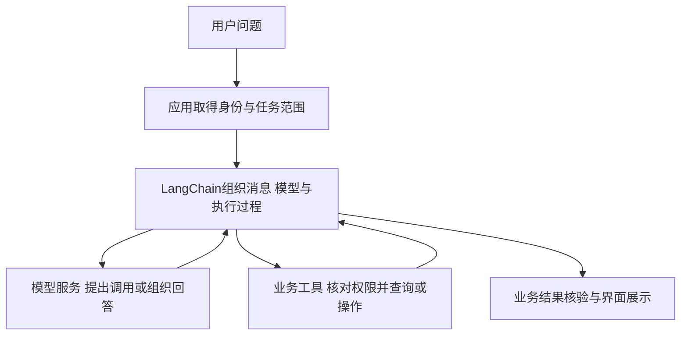

# LangChain组件与接口扩展

这是[第19章正文](../19-LangChain入门它到底帮我们封装了什么.md)的可选扩展。正文只沿同一次退款查询，解释框架定位、两版代码以及封装接走的具体职责。本页先补充主实验的对比条件，其余部分保留输入模板、接口、检索组件和模型配置等独立实验，适合学习相应主题后查阅；它们不是读懂第19章的前置要求，也不需要按本页顺序全部运行。

## 主实验：怎样保证两种写法比较的是同一件事

正文主实验是`examples/19-langchain/comparison_demo.py`，可选组件实验集中在同目录的`extensions/`，不与正文入口混放。

- `get_refund_status()`是两版共用的普通业务函数，读取同一份教学订单并检查归属。
- `scripted_reply()`是两版共用的预设回复逻辑。没有工具结果时，提出查询A1001；有工具结果时，读取结果组成回答。它不调用业务函数，也不理解自然语言。
- `run_python()`只使用普通列表、字典、函数与循环组织往返。
- `run_langchain()`使用真实`create_agent()`，直接登记相同的普通函数，由框架整理工具说明并执行循环。
- `make_scripted_model()`把相同的预设回复逻辑适配成框架模型对象。它只转换消息与工具说明，未把执行工具、回填结果或继续运行的逻辑藏进适配层。

主实验刻意固定两边的模型回复，比较执行程序的职责变化。手写版的`TOOL_SPECS`是实验内部格式，真实接入时需按供应商接口实现模型请求与格式转换。框架版的在线请求可参考`agent_demo.py`；主实验未实现在线手写适配器。

`test_comparison.py`增加两项差异验证：改变A1001状态，确认两版结果随之变化；改变订单归属，确认两版均保留访问检查。请求ID与工具结果配对也一并核对。安装和执行命令见[示例README](../examples/19-langchain/README.md)。

正文还配套`two_tools_demo.py`：在相同场景增加物流函数，手写版补充工具说明与函数查找字典，框架版扩充函数列表。它复用`make_scripted_model(reply_function=...)`，两版采用同一个按关键词返回预设请求的函数；原实验不传参数时行为保持不变。`test_two_tools.py`检查两种工具的分发、实际返回值、消息配对和访问拒绝。

以下内容是可选组件实验，未与主实验自动组合为一个完整应用。代码片段可能是类方法或依赖其他函数的摘录；运行时使用对应完整脚本。

## 离线实验：固定回复怎样接进框架

手写版可以直接调用`scripted_reply(messages, TOOL_SPECS)`，框架需要的则是聊天模型对象。主实验里的`make_scripted_model()`补上这层格式转换：

<!-- example-source: examples/19-langchain/comparison_demo.py -->

```python
def make_scripted_model(reply_function=scripted_reply):
    """把同一个scripted_reply接到框架模型接口，不在适配器里执行工具。"""
    # 【离线实验辅助】让两版收到相同回复；使用已有在线模型客户端时不需要写这个适配器。
    from langchain_core.language_models.chat_models import BaseChatModel
    from langchain_core.messages import AIMessage
    from langchain_core.outputs import ChatGeneration, ChatResult
    from langchain_core.utils.function_calling import convert_to_openai_tool
    from pydantic import Field

    class ComparisonModel(BaseChatModel):
        specs: list = Field(default_factory=list)

        @property
        def _llm_type(self):
            return "comparison-fixed-responses"

        def bind_tools(self, tools, **kwargs):
            # 只保存给回复函数看的工具说明，不执行工具。
            specs = [convert_to_openai_tool(t)["function"] for t in tools]
            return self.model_copy(update={"specs": specs})

        def _generate(self, messages, stop=None, run_manager=None, **kwargs):
            # 把框架消息转成固定响应函数认识的格式，再把响应包装成框架消息。
            roles = {"human": "user", "ai": "assistant"}
            plain = [{"role": roles.get(m.type, m.type), "content": m.content}
                     for m in messages]
            reply = reply_function(plain, self.specs)
            message = AIMessage(content=reply["content"], tool_calls=reply.get("tool_calls", []))
            return ChatResult(generations=[ChatGeneration(message=message)])

    return ComparisonModel()
```

按数据流看，这个适配器只做四件事：

1. `ComparisonModel`继承`BaseChatModel`，让框架能按聊天模型接口使用它；`_llm_type`提供实现标识。
2. `bind_tools()`接收框架整理的工具，用`convert_to_openai_tool()`提取函数说明，保存在返回的模型副本中。这里借用转换函数整理数据，不会请求OpenAI服务。`Field(default_factory=list)`为每个实例创建独立的说明列表。
3. `_generate()`把框架消息对象转换为固定响应函数认识的字典。框架里的`human`对应`user`，`ai`对应`assistant`，`tool`仍然表示工具结果。
4. 调用同一个`reply_function()`后，把返回字典包装成`AIMessage`，再用`ChatGeneration`和`ChatResult`返回给框架。`tool_calls`随消息一起交回Agent。

注意，这里面没有调用`get_refund_status()`。它只产生或转换消息，真正的工具执行留给Agent。这样两版比较的才是同一响应条件下，手写程序与框架分别怎样安排查询。

这是为了离线对照额外写的测试适配器。日常接入已有模型集成时，一般直接创建对应的模型客户端，不需要为每个业务写一个自定义聊天模型类。

## 模型与消息：统一的是调用方式，不是模型能力

直接请求聊天接口时，应用常见的输入是角色与内容组成的消息列表，输出则包含回答、工具请求和用量等信息。LangChain把这些内容放进模型对象与消息对象中。

例如，聊天模型通常可以通过 `model.invoke(...)`调用。`invoke`在这里表示执行一次调用：传入消息，取得一条模型响应。具体请求哪个服务，由创建的模型对象和配置决定。[模型接口说明](https://docs.langchain.com/oss/python/langchain/models)

**统一接口主要帮助应用减少格式转换。**

| 应用关心的内容 | LangChain中常见的表示 | 意义 |
| --- | --- | --- |
| 全局任务要求 | `SystemMessage` | 约束任务范围与行为 |
| 用户输入 | `HumanMessage` | 当前用户的问题或补充信息 |
| 模型输出 | `AIMessage` | 回答文字、工具请求与响应信息 |
| 工具执行结果 | `ToolMessage` | 把某次调用结果交回模型 |

这些名字表示消息的用途，不是四个不同模型。应用也可以在受支持的入口使用角色字典，框架再处理相应转换。

模型响应中的 `content`保存内容，`tool_calls`保存工具调用请求，`usage_metadata`等字段可以提供用量信息。不同服务返回的细节和完整程度仍有差异；使用时应检查实际内容。[消息与工具结果](https://docs.langchain.com/oss/python/langchain/messages)

有一个很实用的区别：某些聊天API里的工具参数是JSON字符串，而LangChain规范化后的 `AIMessage.tool_calls`中，`args`通常已经是参数字典。继续拿它当字符串做一次 `json.loads()`，反而会出错。

因此，换了一层接口以后，要重新确认输入输出，不要把底层API字段与框架字段混着读取。

**同一个方法名，不表示完成同一件事。**

LangChain组件经常使用 `invoke`作为入口，但返回结果取决于调用对象：

| 调用对象 | 传入什么 | 取得什么 |
| --- | --- | --- |
| 提示模板 | 用来填充空位的字段 | 组织好的提示或消息 |
| 聊天模型 | 提示或消息 | 模型响应消息 |
| 工具 | 参数，或带调用ID的请求 | 函数结果，或对应的工具消息 |
| 检索器 | 查询问题 | 找回的文档记录 |
| Agent | 包含消息的任务状态 | 运行后的状态，通常含消息轨迹 |

对提示模板调用 `invoke`，不会因此请求模型；对本地工具调用 `invoke`，可能直接执行Python函数；对在线聊天模型调用，则会请求对应服务。

看代码时先问“现在调用的是哪个对象”，比只记住 `invoke`这个名字更有帮助。

**从一个问题走到一条回答，数据怎样变化？**

以“会员订单的申请期限是多少”为例，假设已经从有效资料中取得会员条款，并准备好了聊天模型对象：

| 顺序 | 程序里正在处理什么 | 结果交给谁 |
| --- | --- | --- |
| 1 | 字典中的`policy`与`question`两个值 | 提示模板 |
| 2 | `prompt.invoke(...)`填入模板，形成提示对象 | 消息转换步骤 |
| 3 | `.to_messages()`取得系统消息与用户消息列表 | 聊天模型 |
| 4 | `model.invoke(messages)`请求模型 | 对应模型服务 |
| 5 | 模型集成把响应整理为`AIMessage` | 业务代码 |
| 6 | 应用读取回答、用量等信息，再核对与展示 | 用户界面或下一步程序 |

第2步返回的提示对象，可以理解成“已经填好的一份模型输入”，常见类型名为`ChatPromptValue`。它保存的是提示内容；`.to_messages()`只是取得消息列表，没有执行生成。

真正调用模型发生在第4步。这里没有工具选择，也没有Agent循环，仍然可以使用LangChain。若只是按已知资料生成一次解释，到这条路径就能说明基本机制。

消息列表中的内容也未必全是文本。模型支持图片等输入时，会使用对应内容结构；`AIMessage.content`也可能包含内容块。读取普通文本时可以关注文本接口，读取工具请求和用量时则访问对应字段，不要把整个响应都当成一段字符串。

**执行一次、分批执行与流式返回，各在改变什么？**

共同接口还会出现几种相关入口：

| 入口 | 可以怎样理解 | 容易混淆的地方 |
| --- | --- | --- |
| `invoke` | 处理一份输入，取得这次结果 | 一次Agent调用内部仍可能有多次模型与工具步骤 |
| `batch` | 对多份输入分别执行，取得对应结果列表 | 聊天模型通常由客户端并发安排调用，不等于供应商另行提供的批处理API |
| `stream` | 执行过程中逐步交出结果或更新 | 模型文本片段、工具请求片段和Agent步骤更新不是同一种内容 |
| `ainvoke`等异步入口 | 让异步程序等待结果时可以安排其他工作 | 不保证单次模型推理变快，也不自动补齐并发、限额与错误处理 |

这些是理解接口的定位，不要求一开始就全部使用。共同执行接口在LangChain里与`Runnable`这一名称有关，可以先把它理解成“能够接收输入并执行的组件约定”。具体怎样连接多个组件，再建立在这里的输入输出认识上。

**模型可以替换，但不能假定完全等价。**

统一接口能够减少更换供应商时的格式改动，却不能保证两个模型在工具调用、图片输入、结构化输出、长度限制和参数含义上完全相同。切换以后，还要检查集成包、模型能力、费用与实际效果。

它解决的是对接问题，模型选型与验收仍然需要单独完成。


## 提示、工具与文档：每种组件只负责一段工作

组件多起来以后，容易把“框架支持这项能力”理解成“创建一个对象就全部完成”。区分它们的数据用途，可以避免这种误会。

**提示模板组织消息，不会自行判断政策。**

售后解释每次都需要任务要求、规则原文和用户问题，可以把不变部分写成模板，把变化的内容作为字段传入。

例如模板里保留 `{policy}`和 `{question}`两个空位。填充后得到消息列表，再把消息交给模型。模板帮助程序稳定组织输入，但规则是否有效、用户是否属于会员、证据是否完整，仍要从资料和业务结果判断。

其中的花括号只是字段占位符。模板变量叫 `policy`，调用时就需要提供相应值；这比散落在不同函数里的字符串拼接更容易检查。

**工具声明整理“如何使用”，业务函数实现“真正做什么”。**

把一个查询函数登记成工具，可以为它生成名称、说明和参数结构。LangChain常用 `@tool`完成这一步：函数的说明文字帮助模型理解用途，类型注解帮助形成参数要求。

但登记工具不会自动建立订单数据库，也不会自动验证用户归属。函数里查哪份记录、怎样拒绝越权、返回哪些字段，仍由应用实现。[工具定义与调用](https://docs.langchain.com/oss/python/langchain/tools)

同时，模型看见工具说明，并不代表工具已经执行。还要有工具调用请求，以及安排执行的程序。单独为模型绑定工具说明，与使用Agent自动组织往返，是不同层次的工作。

可以用同一笔订单区分三种调用：

| 用法 | 谁安排步骤 | 实际可能发生什么 |
| --- | --- | --- |
| 普通聊天模型调用 | 业务代码安排一次生成 | 模型返回回答；缺少订单事实时，程序不能把它当作查单结果 |
| 为模型绑定工具后调用 | 模型可以提出工具请求，应用仍要安排执行 | 取得“请查A1001”的请求，但订单可能还没有查询 |
| 使用Agent调用 | 框架按配置组织模型与工具循环 | 执行查询、回填结果，再让模型继续回应 |

这里的“绑定工具”，是把工具说明交给支持该能力的模型，常见入口名为`bind_tools`。它与把工具实际执行一遍是两件事。只有应用或运行程序接住请求并执行，模型才能在后续消息里读到结果。

**文档记录保存正文与来源，不等于已经解析或入库。**

LangChain常用 `Document`表示一份文字记录：`page_content`保存正文，`metadata`保存来源、页码等说明。它可以表示一整篇资料，也可以表示切分后的一个块，粒度由处理流程决定。

创建 `Document`时直接填写一段政策，只是在创建数据对象，没有读取PDF、计算向量或写入数据库。文档加载器、切分器、嵌入模型与向量库，分别处理不同步骤。

嵌入模型接收文本，返回数字向量，常见入口是`embed_documents`和`embed_query`：前者处理文档文本列表，后者处理一条查询。它们不返回自然语言答案，也说明了并非所有组件都使用`invoke`。向量库负责保存与查找记录，检索器则向应用提供“用问题取得相关文档”的入口，职责同样不同。[嵌入模型接口](https://docs.langchain.com/oss/python/integrations/embeddings)

例如一个保留了 `text`与 `metadata`的自定义解析结果，可以把正文放入 `page_content`，再保留原来的元数据。这个转换解决结构衔接；OCR质量、标题关系和页码是否准确，仍由实际解析与检查决定。

文件加载器产生的页码约定也可能不同。自己的页码从1开始，另一个加载器却用从0开始的序号，接入时就要明确转换与展示方式，不能只因为字段都叫 `page`就直接混用。

**检索器是取资料的接口，资料质量不会因换接口自动提高。**

一个检索器接收问题，返回相关 `Document`记录。内部可以查询向量库，也可以使用其他检索方式。用共同接口取得资料以后，模型输入仍要选择、编号并控制长度，回答仍需核对证据。[检索与文档组件](https://docs.langchain.com/oss/python/deepagents/retrieval)

把这些组件放回售后政策，职责就比较清楚：

```text
文件加载器取得规则 → Document保存正文与来源
切分器形成可检索的块 → 嵌入模型与数据库组织索引
检索器取回相关记录 → 提示模板组织问题与资料
聊天模型生成解释 → 应用核对并展示答案
```

这条固定流程可以直接使用这些组件，不要求必须经过Agent。只有需要模型根据当前结果动态选择下一步时，才有必要考虑工具循环。

**对话记忆也需要明确保存与读取。**

用户补充“刚才那笔订单”时，模型能否理解，取决于应用这次有没有提供相关历史或状态。框架可以帮助维护消息、保存检查点，再在后续调用中恢复；具体存在哪里、怎样找到同一会话、哪些内容进入模型，仍需要配置。对话状态与订单数据库也承担不同职责，不能用一条“申请已提交”的聊天记录代替真实申请记录。

一次任务内部的消息历史，可以让模型使用刚得到的查询结果；跨次调用还要恢复同一任务的状态。需要跨不同会话保留用户偏好或其他信息时，又涉及长期存储与检索。它们不是“创建一个模型对象以后，模型就永久记住所有用户”的同一种能力。

**结构化输出整理结果形状，不负责证明业务事实。**

应用有时需要字段明确的结果，例如`order_id`、`status`和给用户看的说明。LangChain提供让模型或Agent按结构要求返回数据的相关接口，再配合字段校验使用。这与单纯要求模型“请输出JSON”不同：格式符合要求以后，字段值是否有真实依据，还要核对工具结果或资料。[结构化输出说明](https://docs.langchain.com/oss/python/langchain/structured-output)

因此，结构化输出可以减少应用解析自由文本的困难，不能把模型猜出的“已退款”变成真实退款记录。它是输出处理的一层，不应与订单系统的状态更新混用。


## 包与相关产品：不要把相近的名字都装进同一个项目

查安装说明时，经常会同时看到 `langchain`、`langchain-core`、模型集成包和LangGraph。它们不是一串必须手动安装的前置条件，而是按职责拆分的部分。

| 包 | 主要负责什么 | 在售后应用中的用途 |
| --- | --- | --- |
| `langchain-core` | 消息、提示、工具、文档等核心接口 | 保存政策记录、组织消息、声明工具 |
| `langchain` | Agent等高层入口与相关能力 | 组织模型与工具之间的执行循环 |
| `langchain-deepseek`等 | 对应模型服务的集成 | 把共同调用接口接到具体模型 |
| `langchain-text-splitters` | 文本切分 | 把解析正文整理成适合检索的块 |
| `langchain-chroma`等 | 对应向量库的集成 | 保存与查询文档向量 |
| `langchain-community` | 一部分社区组件与集成 | 按具体数据源需要选用 |
| `langgraph` | 状态与执行流程的底层组织 | 支撑Agent运行，或构建更明确的分支流程 |

安装高层包时，包管理器会安装它声明的依赖；接入某个模型或数据库时，再选择对应集成。并不需要为了查一个订单，就把所有解析器和向量库都装进去。

**LangChain、LangGraph与LangSmith也不是同一个职责。**

LangChain提供可以使用的模型和工具组件，以及可配置的Agent入口。LangGraph关注执行状态、步骤、分支与恢复；LangChain的Agent基于它运行。LangSmith则用于观察、调试与评估执行过程，是配套观测能力，不是模型，也不是订单数据库。[框架与相关产品的分工](https://docs.langchain.com/oss/python/langchain/overview)

因此，依赖里出现LangGraph，不表示每个应用都要自己编写一张流程图；没有开通LangSmith，也可以先在本机运行组件和打印消息。需要接入外部追踪服务时，再配置它，并决定哪些数据允许发送。

还可能看到Deep Agents这个名称，它在现有Agent能力上提供更多现成的任务组织功能。认识它的用途即可，不必为了一次简单查询就扩展成另一套系统。

**读示例时先确认版本与入口。**

本章使用LangChain 1.x的接口，Agent入口为 `create_agent`。网上较早的示例可能采用不同包路径和链式封装方式，不能把不同代的导入、参数和返回值随意拼在一起。

“导入失败”不一定是业务代码写错，也可能是安装包、版本与示例不一致。把依赖和实际接口对齐以后，再检查程序逻辑，会比不断增加安装命令更有效。


## 不请求模型，先看组件实际返回什么

概念清楚以后，可以先做一个很小的实验：创建一条政策记录，填充提示模板，声明查询工具，再用一条固定请求执行它。

这样可以观察框架怎样组织数据，不需要模型密钥，也不会把模型的随机回答混进接口检查。

脚本包含两个独立实验：前半段把会员条款填进消息模板，后半段执行一次退款状态查询。它们只是放在同一文件中便于观察，没有把会员政策用于判断A1001的资格，也没有组成一个完整RAG问答。模板实验停在“消息准备好”，查询实验停在“工具结果已返回”。

本章配套文件位于 `examples/19-langchain`，运行时使用该目录完整脚本。它们使用单独环境，Python以3.12为例。在示例目录打开PowerShell后执行：

```powershell
py -3.12 -m venv .venv
.\.venv\Scripts\python.exe -m pip install langchain==1.4.6 langchain-core==1.6.10 langchain-deepseek==1.1.1
```

这组直接依赖版本已经在本地检查；本次复核环境中的LangGraph为1.2.16。包管理器还会安装它们的间接依赖，需要长期保存环境时，可将实际安装版本另行记录。官方安装要求与可用集成以对应说明为准。[安装说明](https://docs.langchain.com/oss/python/langchain/install)

`.venv`是这次练习单独使用的Python环境目录。安装时的`.venv\Scripts\python.exe -m pip`与运行脚本时的同一个Python对应，可以避免“包装进一个环境，程序却由另一个环境执行”。命令里指定虚拟环境的Python路径，也就不必先激活环境。

`pip`用于安装包，`import`用于在代码中使用模块，两者的名字不一定相同。例如安装名为`langchain-core`，导入路径是`langchain_core`；`langchain-deepseek`对应`langchain_deepseek`。名称中的连字符与下划线不要混用。

下面是`extensions/components_demo.py`的完整代码；文件已在仓库中，直接运行即可：

<!-- example-source: examples/19-langchain/extensions/components_demo.py -->

```python
import json
import re

from langchain_core.documents import Document
from langchain_core.messages import AIMessage
from langchain_core.prompts import ChatPromptTemplate
from langchain_core.tools import tool


DEMO_USER = "demo-user"
DEMO_ORDERS = {
    "A1001": {"owner": "demo-user", "status": "审核中"},
    "A2002": {"owner": "other-user", "status": "已退款"},
}


@tool
def get_refund_status(order_id: str) -> str:
    """查询教学订单的退款状态，不能提交或批准申请。订单号须由用户提供。"""
    if not re.fullmatch(r"A[0-9]{4}", order_id):
        raise ValueError("订单号格式应为A加4位数字")
    order = DEMO_ORDERS.get(order_id)
    if order is None or order["owner"] != DEMO_USER:
        result = {"ok": False, "error": "not_found_or_forbidden"}
    else:
        result = {"ok": True, "order_id": order_id, "status": order["status"]}
    return json.dumps(result, ensure_ascii=False)


def main():
    policy = Document(
        page_content="会员订单签收后15日内可以申请退货。",
        metadata={"source": "refund-policy-demo.md", "section": "会员订单"},
    )
    prompt = ChatPromptTemplate.from_messages([
        ("system", "解释提供的条款，不推断具体订单的退货资格。"),
        ("human", "资料：{policy}\n问题：{question}"),
    ])
    messages = prompt.invoke({
        "policy": policy.page_content,
        "question": "会员订单的申请期限是多少？",
    }).to_messages()
    for message in messages:
        print(type(message).__name__, message.content)

    print("参数类型：", get_refund_status.args["order_id"]["type"])
    request = AIMessage(content="", tool_calls=[{
        "name": "get_refund_status",
        "args": {"order_id": "A1001"},
        "id": "call_demo_1",
        "type": "tool_call",
    }])
    result = get_refund_status.invoke(request.tool_calls[0])
    print(type(result).__name__, result.tool_call_id, result.content)


if __name__ == "__main__":
    main()
```

这段代码可以按三个动作阅读。

**第一，创建资料并填充模板。**`Document`保存的是直接写入的教学条款，`source`也是示意来源，不表示程序读取了一个真实文件。模板填入正文和问题以后，`.to_messages()`把结果转成消息列表。

注意，传进去的是 `policy.page_content`。元数据不会因为与正文存在同一个对象里，就自动出现在模型输入中。若回答需要展示来源，应用还要明确加入来源与位置。

这个例子只放入会员期限条款，适合说明模板填充。若要判断具体订单能否退货，还需取得完整的适用条件、商品例外与订单事实，不能只用“会员15日”这一句话完成资格判断。

**第二，把函数变成有说明的工具。**`@tool`处理以后，`get_refund_status`是工具对象，可以取得参数结构，并通过 `invoke`调用。函数体仍然由我们写：检查订单号、读取固定记录、核对演示用户，再返回业务结果。

`order_id: str`表示订单号参数是字符串，函数开头三引号中的文字是用途说明。框架根据这些信息整理参数要求和描述；函数里的格式检查与归属判断，则是开发者额外写出的业务逻辑。

固定的 `DEMO_USER`只用于本机教学，不是实际登录系统。真实应用应从可信运行信息取得用户，再由后端核对归属；不能让模型自行填写用户身份。

**第三，用带ID的请求执行工具。**`AIMessage`里的请求由代码直接构造，参数已经是字典。把完整工具调用交给 `invoke`以后，框架可以将函数结果包装为对应 `ToolMessage`，并带回同一个调用ID。

如果只传 `{"order_id": "A1001"}`这样的普通参数字典，本例取得的是函数返回的字符串。带完整工具调用时取得的是工具消息。这解释了为什么同一个工具入口会有不同的结果包装。

运行：

```powershell
.\.venv\Scripts\python.exe -m extensions.components_demo
```

本次实际输出为：

```text
SystemMessage 解释提供的条款，不推断具体订单的退货资格。
HumanMessage 资料：会员订单签收后15日内可以申请退货。
问题：会员订单的申请期限是多少？
参数类型： string
ToolMessage call_demo_1 {"ok": true, "order_id": "A1001", "status": "审核中"}
```

它验证了提示组织、参数声明、工具执行与结果包装。整段代码没有聊天模型，没有生成政策答案，也没有让模型理解自然语言后选择工具。

这些检查先完成，接入模型时就能少排查几类问题：模板字段是否齐全，工具参数是否符合要求，返回结果是不是自己以为的类型。


## 交给Agent入口以后，哪些循环代码被收起来了

如果要让用户直接说“查一下A1001的退款状态”，还需要模型根据问题提出工具请求。只创建工具对象，尚未完成这一步。

手动实现时，应用要反复请求模型、检查工具请求、执行工具、回填结果，再请求下一轮。LangChain的 `create_agent`把这组常见往返组织成一个运行入口，模型、工具、系统提示和中间件作为配置提供。

它收起的主要是这一组控制代码：

| 手动程序中的工作 | 使用Agent以后由谁处理 |
| --- | --- |
| 把可用工具说明交给模型 | Agent与模型集成组织 |
| 检查本轮是否有工具请求 | Agent运行程序判断 |
| 按请求找到已登记工具并执行 | Agent调度工具对象，工具内部执行业务代码 |
| 把结果包装为对应工具消息 | 工具与运行程序配对回填 |
| 继续调用模型或结束本次执行 | Agent循环与已配置的限制共同控制 |
| 判断订单归属、资格与确认是否有效 | 业务程序仍然负责 |

这张表也解释了为什么“少写了循环代码”不等于“少写了业务检查”。框架知道怎样转交一次工具请求，工具才知道当前用户能否读取这笔订单。

下面用相同的查询工具，说明这些配置怎样落到代码。在线入口保留在示例根目录的`agent_demo.py`，从`extensions`导入组件实验的查询工具：

<!-- example-source: examples/19-langchain/agent_demo.py -->

```python
import os

from langchain.agents import create_agent
from langchain.agents.middleware import ModelCallLimitMiddleware, ToolCallLimitMiddleware
from langchain_deepseek import ChatDeepSeek

# 使用扩展实验中已封装的只读工具；业务检查在工具内部，返回JSON字符串。
from extensions.components_demo import get_refund_status


def build_agent(model):
    # 步骤3：组装执行对象；这一步登记工具，还没有开始查询。
    return create_agent(
        model=model,
        # 传工具对象本身，Agent收到模型请求后才会调用它。
        tools=[get_refund_status],
        system_prompt=(
            "你是教学售后助手。查询具体订单状态必须使用工具，不得猜测。"
            "订单号缺失时询问用户。查不到时如实说明。"
            "结果是虚构教学数据，不代表真实订单。你不能提交或批准申请。"
        ),
        middleware=[
            # 最多3次模型调用、2次工具调用；超限停止并报错。
            ModelCallLimitMiddleware(run_limit=3, exit_behavior="error"),
            ToolCallLimitMiddleware(run_limit=2, exit_behavior="error"),
        ],
    )


def main():
    # 步骤1：检查运行配置；密钥来自环境变量，不写进源码。
    if not os.environ.get("DEEPSEEK_API_KEY") or not os.environ.get("LC_CHAT_MODEL"):
        raise RuntimeError("请先设置自己的DEEPSEEK_API_KEY和可用的LC_CHAT_MODEL")
    # 步骤2：创建在线模型客户端，替代离线实验的固定响应与适配器。
    # 构造客户端不等于已经发送聊天请求；真正请求发生在下面invoke运行过程中。
    model = ChatDeepSeek(
        model=os.environ["LC_CHAT_MODEL"],
        timeout=45,
        max_retries=0,
        extra_body={"thinking": {"type": "disabled"}},
    )
    agent = build_agent(model)
    # 步骤4：交给Agent运行“模型请求 -> 执行工具 -> 回传结果 -> 再请求模型”的循环。
    result = agent.invoke({
        "messages": [{"role": "user", "content": "查一下A1001的退款状态。"}],
    })
    # 步骤5：查看完整消息，确认工具是否执行、结果是否交回，最后再看最终回答。
    for message in result["messages"]:
        print(type(message).__name__, message.content)
        if getattr(message, "tool_calls", None):
            print("工具请求：", message.tool_calls)


if __name__ == "__main__":
    main()
```

`build_agent(model)`接收可用的聊天模型，返回配置好的Agent。工具仍然是同一个 `get_refund_status`，因此固定订单记录的读取与归属检查没有因更换组织方式而消失。

这里有两个对象：`model`负责调用具体模型服务，`agent`负责围绕这个模型组织执行。把工具放进`tools`列表，是告诉Agent有哪些入口可以调度，不是在创建对象时就查询订单。

`from extensions.components_demo import get_refund_status`从`extensions/components_demo.py`取得已经定义的工具。由于组件脚本用`if __name__ == "__main__"`保护演示入口，导入工具时不会顺便打印模板或执行那条固定查询。

在线Agent只使用退款状态查询工具，没有使用组件脚本里的政策模板。这样能够单独观察“用户自然语言怎样变成一次工具请求”，避免把文档问答与订单查询的流程混在一起。

`ChatDeepSeek`负责接到具体服务；它不是LangChain的定义，也不是唯一可选模型。`LC_CHAT_MODEL`是本例自己约定的环境变量，用来提供账户可用、支持本例工具调用方式的模型名，LangChain不会自动替我们选择它。[DeepSeek集成说明](https://docs.langchain.com/oss/python/integrations/chat/deepseek)

`timeout=45`限制单次请求等待，`max_retries=0`关闭该模型客户端的自动重试。`extra_body`传入本例所用的非思考模式配置，以免同时引入思考内容回传问题。更换供应商或模式时，需要调整对应配置。

模型调用最多3次，工具执行最多2次，达到限制时抛出错误；这两个限额控制不同的动作，不能当作一个统一轮数。脚本用于观察接口，异常会停止运行，面向用户的服务还需捕获错误并展示适当说明。

**创建对象与实际请求，也要分开。**

创建 `ChatDeepSeek`和Agent，主要是在准备配置、工具和执行结构。运行到 `agent.invoke(...)`以后，才会请求模型，并根据返回内容安排工具。

这个例子没有配置跨次调用的检查点存储，也没有完整聊天界面。它检查的是一次用户请求内部的往返；下一次重新运行脚本，不会自动接着上一段会话继续。

在线练习需要使用自己的密钥和模型名。在当前PowerShell中设置后运行：

```powershell
$env:DEEPSEEK_API_KEY = "填写自己的密钥"
$env:LC_CHAT_MODEL = "填写账户可用的模型名"
.\.venv\Scripts\python.exe agent_demo.py
```

这些命令中的文字是占位内容，需要替换。脚本读取进程环境变量，没有自动读取 `.env`文件；两种配置方式不要混为一谈。

本地已经检查了集成对象的构造与Agent运行结构，未使用真实密钥发起在线模型请求。预期的成功路径是：

| 消息 | 在这次查询里意味着什么 |
| --- | --- |
| 用户消息 | 请求查询A1001 |
| 模型消息，带工具请求 | 选择查询函数，填入订单号 |
| 工具消息 | 返回“审核中”与对应调用ID |
| 最终模型消息 | 根据查询结果组织回复 |

`result`是运行后的状态，本例从`result["messages"]`取得消息轨迹；它不是单条`AIMessage`。这与直接调用`model.invoke(messages)`的返回值不同。每条消息还有自己的内容与类型，工具调用ID负责把请求和结果对上，订单号则负责定位业务记录。

具体措辞与调用次数仍取决于模型。提示要求查询，不是成功率保证；在线运行时应检查实际工具请求与结果，不能只看最后一句话是否像查过订单。


## 封装以后，仍然要看得见数据和执行过程

代码变短以后，最容易忽略的是中间结果。`agent.invoke()`外表只是一行调用，内部可能已经运行了多次模型与工具步骤。

因此，示例打印整个消息列表，而不只打印 `messages[-1].content`。先看有没有请求查询工具，再看返回的订单号、状态和调用ID，最后判断模型有没有如实表达结果。

还要区分不同对象的错误：

| 现象 | 优先检查哪里 |
| --- | --- |
| 模板报缺字段 | 填充模板时是否提供了全部变量 |
| 工具参数校验失败 | 模型请求或手动调用的参数类型与必需字段 |
| 工具业务结果为 `ok: false` | 订单是否可访问，工具返回了什么受控结果 |
| 模型认证或连接失败 | 对应服务的凭证、地址、网络与集成配置 |
| 达到调用限额 | 是否反复提出相同动作，已经完成了哪些步骤 |
| 最终回答没有查询依据 | 轨迹里是否真的执行过工具 |

框架能够统一部分类型与消息处理，但业务失败仍是业务失败。工具正常返回 `ok: false`，不表示模型请求网络失败；模型没有提出工具调用，也不意味着订单已经不存在。

**已有业务能力可以逐步接入，不必全部重写。**

例如售后应用可以保留经过验证的解析器和检索程序，把它的结果转换成共同文档记录；或者把已有查询服务包装成工具，再交给Agent使用。需要连接独立MCP服务时，则由相应客户端或适配层取得外部工具能力。



图中的业务工具可以调用自己的数据库或服务，模型集成可以请求外部服务。框架处在组织与对接的位置，既没有替代业务后端，也没有替代模型本身。

如果要给A3003增加申请能力，应接入草稿、具体确认和防重复逻辑，而不是仅在工具列表里增加一个叫“提交申请”的空函数。相同地，把文档检索登记成工具，也不会自动处理政策生效版本和引用真实性。

**本地检查可以先验证框架行为，再单独验证模型效果。**

配套测试使用真实LangChain组件与Agent执行程序，把聊天模型换成返回固定请求的测试对象。它不是本地大模型，也不理解自然语言，只为稳定检查调度过程。

扩展测试位于`extensions/test_examples.py`，包含以下8项检查；正文主实验和双工具实验另有4项检查：

| 检查对象 | 实际核对的行为 |
| --- | --- |
| 提示模板 | 字段填充得到预期消息，缺字段时报错 |
| 工具参数与成功结果 | 参数要求是字符串，A1001返回教学状态 |
| 归属与不存在情况 | A2002和不存在订单不返回状态 |
| 无效参数 | 错误订单号和缺少字段被拒绝 |
| 工具消息包装 | 完整调用得到对应 `ToolMessage`与调用ID |
| Agent循环 | 实际经过用户、模型请求、工具、模型回答四条消息 |
| 调用限额 | 固定模型持续请求时，工具限额阻止继续执行 |
| 共同调用入口 | 用固定文本响应检查`invoke`、`batch`、`stream`与`ainvoke`的返回方式 |

在配套目录中可以执行：

```powershell
.\.venv\Scripts\python.exe -m unittest -v
```

测试确认框架与本例函数按预期工作；真实模型能否从各种问法中选对工具、拒绝编造、正确解释结果，仍属于另一组验收。两种检查分开，才不会把固定测试响应的成功当作模型能力已经达标。


## 什么时候值得用框架，什么时候可以先保持简单

LangChain减少了一部分重复代码，也会带来新的依赖、对象类型和排查路径。它是否省事，要结合应用规模和团队需要判断。

| 当前任务 | 可以优先考虑什么 | 原因 |
| --- | --- | --- |
| 发一次提示，取得一段文字 | 厂商SDK或直接HTTP请求 | 执行过程简单，共同组件收益有限 |
| 多个应用需要相似的模型与消息处理 | 模型集成和共同消息接口 | 减少格式转换的重复实现 |
| 要维护多工具、循环与公共检查 | Agent入口与中间件 | 复用执行组织，集中处理公共能力 |
| 已有稳定的RAG流程 | 按接口逐步接入所需组件 | 可以保留已验证的解析和检索方法 |
| 审批分支、暂停恢复和执行顺序有严格要求 | 明确业务状态与步骤，再选择编排方式 | 关键流程仍需由应用设计 |

一个常见误区是为了“使用框架”，把已经清楚的函数改写成很多陌生对象，结果出错时反而不知道数据从哪里来。引入组件以后，至少应能说明：输入什么、返回什么、是否发网络请求、状态保存在哪里。

也不要把所有供应商参数都藏起来。超时、重试、模型名、工具能力与用量信息会直接影响行为，需要能在适当的位置配置和观察。

框架版本与集成包需要一起管理。验证过的环境先保留，在独立环境中尝试升级，再用相同问题检查消息结构、工具参数、错误处理和结果；不要只凭导入成功就判断升级完成。

引入框架以后，如果更容易复用、测试和排查，它就发挥了价值。如果一个简单任务因为封装变得难以理解，也可以继续使用清楚的普通函数和直接接口。


## 参考资料

- [LangChain：框架定位与相关产品](https://docs.langchain.com/oss/python/langchain/overview)
- [LangChain：组件之间的关系](https://docs.langchain.com/oss/python/langchain/component-architecture)
- [LangChain：模型接口](https://docs.langchain.com/oss/python/langchain/models)
- [LangChain：消息与工具调用结果](https://docs.langchain.com/oss/python/langchain/messages)
- [LangChain：工具定义](https://docs.langchain.com/oss/python/langchain/tools)
- [LangChain：文档与检索组件](https://docs.langchain.com/oss/python/deepagents/retrieval)
- [LangChain：嵌入模型接口](https://docs.langchain.com/oss/python/integrations/embeddings)
- [LangChain：结构化输出](https://docs.langchain.com/oss/python/langchain/structured-output)
- [LangChain：DeepSeek集成](https://docs.langchain.com/oss/python/integrations/chat/deepseek)
- [LangChain：安装说明](https://docs.langchain.com/oss/python/langchain/install)
- [本章配套代码与检查说明](../examples/19-langchain/README.md)


