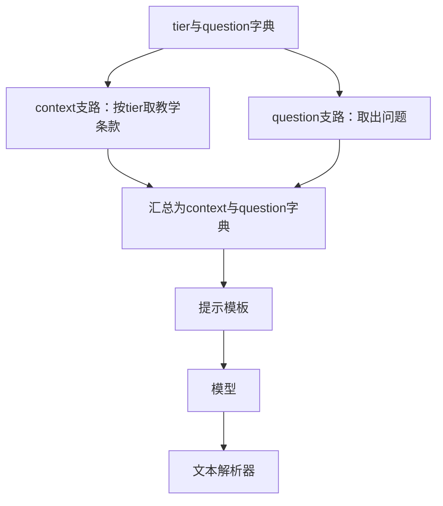
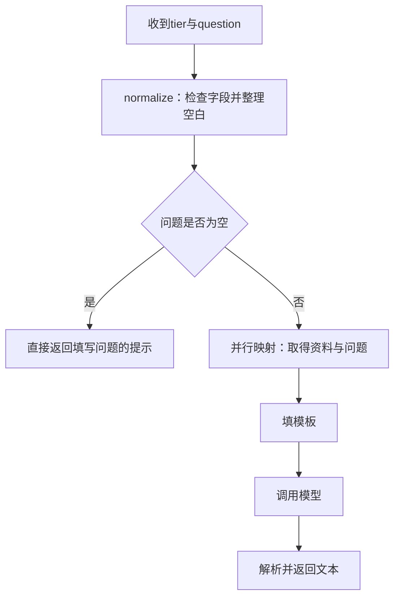
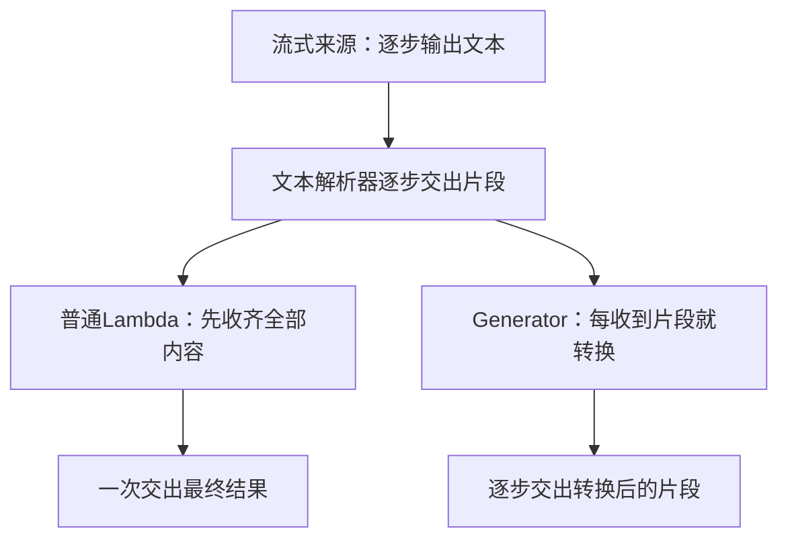

# 政策解释的扩展需求：字段整理、并行与运行方式

配合[第20篇正文](../20-用LangChain组织一次政策解释.md)按需阅读。正文只沿同一份政策与同一个问题，讲模板、模型、解析器的三步交接，以及Runnable与LCEL怎样组合这三步。本页是独立的扩展实验，不是正文尚未读完的后半部分，也不是运行基础案例的前置要求。

已有的扩展示例保留在[chain_demo.py](https://github.com/benx92/ai-learning-notes/blob/main/examples/20-lcel/chain_demo.py)，失败处理实验在[reliability_demo.py](https://github.com/benx92/ai-learning-notes/blob/main/examples/20-lcel/reliability_demo.py)。它们相互独立的部分，不会因为放在一个目录就自动组成完整应用。

每遇到一个新接口，先问：当前哪一段普通Python处理需要参与组合？如果没有这种需要，保留普通函数、if和循环即可。

本页的字段映射实验从页面提供tier开始，不是通用Agent一定要先给用户问题分类。直接问题检索与本篇链的实际交接另见[rag_bridge.py](https://github.com/benx92/ai-learning-notes/blob/main/examples/20-lcel/rag_bridge.py)和[运行准备](../examples/20-lcel/README.md)：检索取得context/evidence后，本页的生成组件才开始工作。不要把工具选择、候选检索、模板字段映射当作同一步。

## 在链中加入自己的函数，先明确输入输出

基础链需要`context`和`question`，而页面收到的输入可能是：

<!-- example-kind: illustration -->

```json
{"tier": "member", "question": "会员订单的申请期限是多少？"}
```

这里的`tier`只是教学配置，用于选择会员或普通条款，不是让用户自报身份后直接获得会员权益。真实业务中的身份、订单类型与资格，需要从受信任的数据中取得。

输入进入模板前，需要检查类型、去掉问题两端空白，并根据`tier`取得资料。这些都是普通Python逻辑，不需要请模型判断。

LangChain提供 **RunnableLambda**，把普通函数接到共同调用接口上。名称里有Lambda，不代表只能接匿名函数，具名函数也可以。

本例的`normalize`函数摘录如下：

<!-- example-source: examples/20-lcel/chain_demo.py -->

```python
def normalize(data):
    # 普通Python业务步骤：校验输入、清理空白，返回新字典，不修改原输入。
    if not isinstance(data, dict):
        raise TypeError("输入必须是字典")
    # get取不到字段时返回None，下面的检查会拒绝缺失或不支持的值。
    tier = data.get("tier")
    question = data.get("question")
    if tier not in POLICIES:  # 只允许已有教学条款的标识。
        raise ValueError("tier必须是member或general")
    if not isinstance(question, str):  # 先检查类型，才可以安全调用strip。
        raise TypeError("question必须是字符串")
    # 全空白问题会变为""，交给后面的空问题分支处理。
    return {"tier": tier, "question": question.strip()}
```

先不用组合语法，直接比较普通函数调用与包装后的调用：

<!-- example-kind: usage -->

```python
from chain_demo import normalize
from langchain_core.runnables import RunnableLambda

raw = {"tier": "member", "question": "  期限？  "}
plain = normalize(raw)  # 普通Python：直接运行这个函数。
step = RunnableLambda(normalize)  # 把函数本身交给包装组件，此时不运行normalize。
wrapped = step.invoke(raw)  # 通过共同接口运行，内部调用的仍是normalize。
print(plain)  # {'tier': 'member', 'question': '期限？'}
print(wrapped == plain)  # True：包装没有改变本例的清理规则。
```

`RunnableLambda`是框架提供的类，`step`是我们给包装后的对象起的变量名。它增加的是共同的调用和组合方式；清理哪些字段，仍由传入的普通函数决定。这里传`normalize`，不写`normalize(raw)`，因为后者会立即运行并交出结果字典，而不是把函数交给框架。

`RunnableLambda(normalize)`就可以放在链的最前面。它返回一个新字典，没有修改原输入，也没有请求模型。`normalize`之所以检查类型，是因为这些规则在函数里明确实现了；不能因为外面包了Runnable，就假定全部业务字段已经自动校验。

**`|`只连接结果，不会猜测字段对应。**前一步返回`{"text": "..."}`，后面的模板需要`question`，框架不会自动理解两个字段意思相近。前一步返回`AIMessage`，后面的函数直接调用`.strip()`，也会因为把消息当字符串而出错。

| 接口没对齐的情况 | 应怎样改 |
| --- | --- |
| 字段叫text，模板要question | 明确取值并重建相应字段 |
| 后一步要字符串，前面返回模型消息 | 在合适位置解析文本，或显式读取需要的内容 |
| 函数只保留question，后面还要tier | 在转换时保留它，或重新安排数据结构 |
| 参数结构符合要求，业务含义却不成立 | 在业务逻辑中继续核对条件 |

普通函数放进受支持的LCEL组合位置时，也可以自动转换成Runnable；本文显式使用`RunnableLambda`，是为了让读者看清哪里在接入自己的处理步骤。无论选择哪种组合写法，都需要明确函数输入什么、返回什么。

## 同一份输入分成两路，再汇总成模板变量

先延续本页已经明确的输入：开发者提供`tier`和`question`，模板需要`context`和`question`。这里要做的两件事是“按已有标识取教学条款”和“保留原问题”。两项工作都只依赖输入字典，因此可以分别处理后汇总。这里没有两个资料服务，也没有问题拆分。

例如输入`{"tier": "member", "question": "会员期限是多少？"}`，程序根据已经给定的`member`取出条款，另一路直接读原问题。两条路径由下面的代码明确配置，并非框架根据问题自动生成。

先用普通Python表达想得到的结果：

<!-- example-kind: usage -->

```python
from chain_demo import DEMO_INPUT, select_policy

# 从同一份输入分别取资料、取问题，再用两个键组织输出。
variables = {
    "context": select_policy(DEMO_INPUT),
    "question": DEMO_INPUT["question"],
}
print(variables["context"])  # 会员教学条款。
print(variables["question"])  # 会员订单的申请期限是多少？
```

现在希望把这两次取值也声明成组件关系，交给链的共同入口运行。**RunnableParallel就是接收多条处理支路的框架组件：把同一份输入交给各条支路，再用支路名称汇总结果。**下面的写法与上面的字段组织目标相同，不过允许各支路并发执行：

<!-- example-source: examples/20-lcel/chain_demo.py -->

```python
def build_inputs():
    # 两条支路收到同一份完整字典；支路名称成为汇总结果的键。
    return RunnableParallel(
        # 取条款字符串，放入输出的context字段。
        context=RunnableLambda(select_policy),
        # 取原问题字符串，放入输出的question字段；itemgetter来自operator。
        question=RunnableLambda(itemgetter("question")),
    )
```

这里用到的本地政策和选择函数也来自同一个脚本：

<!-- example-source: examples/20-lcel/chain_demo.py -->

```python
# 教学条款按tier标识保存；这些字符串是模板资料，不是模型生成结果。
POLICIES = {
    "member": "教学政策：会员订单签收后15日内可以申请退货，商品例外需另行核对。来源：demo-policy/member。",
    "general": "教学政策：普通订单签收后7日内可以申请退货，商品例外需另行核对。来源：demo-policy/general。",
}
```

<!-- example-source: examples/20-lcel/chain_demo.py -->

```python
def select_policy(data):
    # 输入是完整的tier/question字典，输出只是一段政策字符串。
    return POLICIES[data["tier"]]
```

`itemgetter`是Python标准库`operator`提供的取值工具，源码通过`from operator import itemgetter`导入。`itemgetter("question")`先创建一个取值函数，把输入字典交给它时，效果相当于执行`data["question"]`；创建这个函数本身不会立刻读取某一份输入。`RunnableLambda`、`RunnableParallel`等组合组件来自`langchain_core.runnables`。这里没有隐藏的资料检索步骤。

`select_policy`从本地`POLICIES`字典选择条款；`itemgetter("question")`取出输入里的问题字段。两个函数都已在完整文件中准备或导入。不要因为第二条支路叫`question`，就以为框架只给它传了问题字符串：**两条支路接收的都是完整输入字典。**



汇总结果有两个键：`context`对应条款，`question`对应问题。这就恰好符合模板的需要。原来的`tier`没有出现在结果中，因为本次映射没有保留它。[并行组合](https://reference.langchain.com/python/langchain-core/runnables/base/RunnableParallel)

可以单独运行这一步，直接观察字段怎样变化：

<!-- example-kind: usage -->

```python
from chain_demo import DEMO_INPUT, build_inputs

# 两条支路重建context/question字典，不保留tier。
print(build_inputs().invoke(DEMO_INPUT))
```

结果只有`context`和`question`，没有`tier`。这一步没有调用模型；先检查输入整理是否正确，再检查生成答案，能区分字段问题与模型问题。

**并行不是把输入拆成互不相干的几块，也不是让后一条支路读取前一条的结果。**若问题支路需要资料支路的输出，就存在先后依赖，应当放到汇总之后处理，而不是期待并行支路按书写顺序互相传值。

**问题有两个关注点，也不会自动多出两条支路。**用户问“会员期限是多少，定制商品有什么例外”，可以把整句话交给一个知识库，取得多段相关资料。若产品的资料分散在两个服务，开发者也可以先定义两项独立查询，把完整问题交给各自的查询函数，再考虑并行执行。若希望动态生成子问题，则还要增加问题分析与结果检查；`RunnableParallel`只执行已经配置的处理路径。本例`build_inputs()`只做本地字段整理，没有实现上述远程查询或动态拆分。

这里的本地取值很快，使用并行映射主要为了说明数据形状。若支路是独立的网络查询，并发安排可能减少等待，但实际耗时还受并发上限、服务限速与最慢支路影响。若三条支路分别调用模型，仍然是三份模型工作与相应费用，不会因并行自动变成一次。

在序列中看到`{"context": ..., "question": ...}`这样的字典组合时，它也可能被框架转换为并行映射；离开组合语境，普通Python字典本身没有`invoke`方法。先区分“配置映射关系”和“已经计算出的结果字典”。

**如果想保留原输入，再追加资料字段呢？**前面的映射只把指定支路的结果汇总出来，因此`tier`消失了。普通Python可以先复制原字典，再加一个字段：

<!-- example-kind: usage -->

```python
from chain_demo import DEMO_INPUT, select_policy

preserved = DEMO_INPUT.copy()  # 复制tier和question，避免修改原字典。
preserved["context"] = select_policy(DEMO_INPUT)  # 再加入政策资料。
print(list(preserved))  # ['tier', 'question', 'context']
```

框架提供的`RunnablePassthrough`用于保留输入，`.assign(...)`则用于在保留字典字段的同时，计算并合并新字段。这里的`assign`是组件提供的方法，不是数据库保存操作。对应到本例：

<!-- example-source: examples/20-lcel/chain_demo.py -->

```python
def build_preserved_inputs():
    # 与上面的重建字典不同：保留tier和question，再追加context。
    # 输入必须是字典；select_policy仍然读取原输入里的tier。
    return RunnablePassthrough.assign(context=RunnableLambda(select_policy))
```

`Passthrough`表示透传，即保留输入经过当前步骤。单独的`RunnablePassthrough()`通常原样交出输入；`.assign(...)`要求输入是字典，再把计算字段合并到结果。对于本例，会得到`tier`、`question`、`context`三个字段。

可以运行已经定义好的这个组件，确认字段确实保留了下来：

<!-- example-kind: usage -->

```python
from chain_demo import DEMO_INPUT, build_preserved_inputs

preserved = build_preserved_inputs().invoke(DEMO_INPUT)
print(list(preserved))  # ['tier', 'question', 'context']。
print(preserved["tier"])  # member。
print("context" in DEMO_INPUT)  # False：原始输入没有被追加字段。
```

它不是聊天记忆，也不会把字段永久保存到数据库。同名字段可能被新计算结果覆盖；多个新增字段若彼此依赖，应分步追加，不能默认在同一次`assign`里按书写顺序执行。[字段保留与追加](https://reference.langchain.com/python/langchain-core/runnables/passthrough/RunnablePassthrough)

## 条件分支：由程序选择路径，再调用整条链

用户没有填问题时，仍然调用模型既浪费，也难以得到有用结果。可以在检查与整理之后设置一条规则：空问题直接返回提示，有问题才进入资料与生成流程。

先把判断条件读成普通Python：`data["question"]`是清理后的问题，空字符串`""`在条件判断中为假，所以`not data["question"]`表示“问题为空”。本例中，问题全是空格也会先被`normalize()`清理成空字符串。

下面会出现Python的匿名函数写法`lambda`。`lambda data: not data["question"]`表示“接收data，返回问题是否为空”，相当于定义一个函数，在函数体里写`return not data["question"]`；`lambda data: "请先填写政策问题。"`则接收输入后返回固定提示。`lambda`是Python语法，和框架组件名`RunnableLambda`是两件事。

这种按条件选择处理路径的组件叫 **RunnableBranch**。本例完整的组装函数如下，里面使用的基础链与输入整理函数就是前面已经解释的实现：

<!-- example-source: examples/20-lcel/chain_demo.py -->

```python
def build_pipeline(model):
    # 非空问题路径：tier/question -> context/question -> 提示 -> 模型响应 -> 文本。
    answer = build_inputs() | build_basic_chain(model)
    route = RunnableBranch(
        # 每个条件分支是(判断函数, 处理组件)；最后的answer是默认处理组件。
        # 条件成立时只返回提示，不进入上面的answer，也不调用模型。
        (lambda data: not data["question"],
         RunnableLambda(lambda data: "请先填写政策问题。")),
        # 默认分支必须提供；只有条件不成立时才执行这条链。
        answer,
    )
    # 实际执行从左向右：先清理空白，再判断清理后的问题是否为空。
    # 函数里先创建answer对象，不代表运行时会先执行answer。
    return RunnableLambda(normalize) | route
```

先执行`normalize`。问题两端空白被去掉后，再判断它是否为空；为空时，运行固定提示函数；否则运行最后的默认分支`answer`。`RunnableBranch`按条件顺序检查，选择第一个成立的分支；条件都不成立，才使用默认处理。[条件分支](https://reference.langchain.com/python/langchain-core/runnables/branch/RunnableBranch)



**条件由程序定义，不是框架临时替用户理解意图。**本例只看问题是否为空，没有让模型分类。若某个应用先让模型分类，再把分类结果交给分支，那是额外设计的一步模型调用，需要单独验证分类是否可靠。

组装函数中的书写顺序容易造成一个误解：`answer = ...`虽然先写，但它只创建非空问题的默认执行路径；真正运行从`return`左边的`normalize`开始。因此空问题不会先调用一次模型再被拦截。

现在可以完整运行这一条入口：

<!-- example-kind: usage -->

```python
from chain_demo import DEMO_INPUT, build_pipeline, make_model

pipeline = build_pipeline(make_model())
# 对外接收tier/question；内部先检查、映射成context/question，再执行基础链。
print(pipeline.invoke(DEMO_INPUT))
# 空白先被normalize清理，分支直接返回提示，不调用模型。
print(pipeline.invoke({"tier": "member", "question": "  "}))
```

输出依次是：

```text
教学固定响应：会员订单的申请期限为签收后15日，商品例外仍需核对。
请先填写政策问题。
```

至此有两个可以复用的入口：`build_basic_chain(model)`要求调用方提供`context/question`；`build_pipeline(model)`接收页面的`tier/question`，内部完成字段整理与空问题判断。不要把两种输入混用。

两条路径都返回文本，因此调用方可以统一展示。不同分支当然也可以返回不同类型，但调用方就需要处理这种差异，不能假定框架会自动整理成同一份业务结果。

这也是固定链与Agent的区别：当前路径的条件与后续步骤事先已经定义；Agent则可能让模型根据反馈提出不同工具请求，运行程序再组织下一轮。LCEL可以包装或参与Agent中的某些步骤，但把几个函数接起来，不会因此自动获得自主规划、持久会话或人工审批能力。

## 同一条链，怎样处理单次、批量与异步请求

这三项需求分开出现：一条用户问题用invoke；每天已有一批待解释问题时才考虑batch；异步服务需要在等待网络时安排其他任务，才会使用ainvoke。它们都是运行同一段流程的方式，不是解释一次政策必须依次经过的三个处理阶段。


整条链组装好了，使用者主要关心外部输入与结果，不需要在每个调用点重写内部步骤。但一次链调用包含几次模型请求，仍要看链里具体放了什么。

本例正常问题走过一次模型；空问题不经过模型。若把两个模型步骤接在一起，一次`chain.invoke()`也可能产生两次模型请求。

| 方法 | 外部处理方式 | 容易误解的地方 |
| --- | --- | --- |
| `invoke(input)` | 一份输入，返回这次完整结果 | 一次链调用不等于一次模型调用 |
| `batch(inputs)` | 多份独立输入，返回对应结果列表 | 不是把问题拼成长提示，只请求一次 |
| `ainvoke(input)` | 异步等待一份输入的结果 | 不会让单次模型推理自动变快 |
| `stream(input)` | 执行过程中交出输出片段 | 有这个方法不保证每步都增量透传 |

在配套目录导入已有流水线，批量调用可以这样观察：

<!-- example-kind: usage -->

```python
from chain_demo import DEMO_INPUT, build_pipeline, make_model

# 组装完整流水线，接收tier/question；创建时不处理任何问题。
pipeline = build_pipeline(make_model())
# 多份输入分别执行；结果列表的位置与输入列表对应。
results = pipeline.batch(
    [DEMO_INPUT,
     {"tier": "unknown", "question": "期限？"},  # 故意提供不存在的条款标识。
     {"tier": "member", "question": ""}],
    config={"max_concurrency": 2},  # 本次批量配置最多2个并发，不是每分钟请求额度。
    return_exceptions=True,  # 失败项返回异常对象，调用方逐项处理。
)
for result in results:
    if isinstance(result, Exception):  # 失败结果不能当成正常回答展示。
        print("输入错误：", result)
    else:
        print(result)
```

上例依次打印政策回答、`输入错误： tier必须是member或general`、填写问题的提示。第二份输入被拒绝，第一份与第三份仍有各自结果。

结果列表仍对应输入位置，完成先后不等于返回列表顺序。`return_exceptions=True`使本次批量的错误也以对应位置的异常对象返回；应用需要逐项判断，不能把异常对象直接当成一条正常回答。它也不表示已成功的调用可以撤销。

`max_concurrency`是执行并发配置，不是“每分钟最多多少请求”的服务限速器。整条链内部还可能有并行支路或下层重试，控制真实成本时，需要按实际调用路径统计。

如果一个应用需要在等待网络回复时继续处理其他任务，就会用到**异步调用**。这里不改变政策解释步骤，只改变程序等待结果的方式。`ainvoke`可以理解成这条链的异步执行入口；调用后需要用`await`等待结果，等待期间异步运行环境可以安排其他就绪任务。

下面的`async def`定义一个异步函数，`await`写在这个函数里面；`asyncio`是Python用于运行和安排异步任务的标准库。这个例子只有一份输入，没有主动启动多项并发任务：

<!-- example-kind: usage -->

```python
import asyncio
from chain_demo import DEMO_INPUT, build_pipeline, make_model

async def main():
    # 异步等待一次完整结果；不是让模型自动生成得更快。
    result = await build_pipeline(make_model()).ainvoke(DEMO_INPUT)
    print(result)

# 普通Python脚本用这个入口运行异步函数；已有事件循环的环境应直接await。
asyncio.run(main())
```

这是完整脚本的入口写法；已有事件循环的应用应在对应异步环境中`await`，而不是嵌套运行一个新的事件循环。框架可为部分同步组件提供异步适配，但自定义的阻塞逻辑、下游客户端和并发限制仍需要明确安排。

## 流式输出为什么会在中间停住

这个需求只在界面希望“先显示前半句，后半句随后到达”时出现。假设模型交出三片文字：“会员订单”“签收后”“15日内可申请”。界面每收一片就显示，用户能更早开始阅读；如果某个后处理必须等整段到齐，它之后的界面就只能等。下面用字母大写观察这个等待位置，大写本身不是售后功能。


假设模型逐步交出文本，界面也希望边收到边显示。只有下游步骤能够接收并交出片段，增量信息才能持续到达界面。

这里“片段”是输出过程中的一小段文本，例如`"a"`、`" "`、`"b"`；“收齐”是等这些片段合并成完整的`"a b"`，才开始下一步。代码里常用变量名`chunk`指当前片段，它不是另一个模型或组件。

普通后处理函数`str.upper`接收完整字符串后返回大写结果。`upper`是Python字符串转大写的方法，例如`"a b".upper()`得到`"A B"`。把它包成`RunnableLambda`接在流式来源后面，输入会先收齐，再执行转换。因此最后文本可能完全正确，但中间片段已经消失。



配套实验使用固定字符响应`a b`观察这件事，记录到的结果是：

| 处理方式 | 本地实验收到的输出 |
| --- | --- |
| 模板、固定模型与文本解析器 | `['a', ' ', 'b']` |
| 后面加`RunnableLambda(str.upper)` | `['A B']` |
| 后面加增量生成器 | `['A', ' ', 'B']` |

这是本地固定响应的分片结果，不是线上Token边界或耗时测量。在线体验还要观察首个有效片段何时到达，不能仅凭片段数量判断是否及时展示。

普通函数用`return`一次交回结果；Python的**生成器函数**则用`yield`逐次产出结果。调用方每取下一项，函数才继续向后执行。这里的输入也是能逐项读取的文本来源，称为迭代器，因此可以收到一片就处理一片，不用先拿到完整回答。

处理这种增量输入时，可以使用 **RunnableGenerator**：它把接收片段迭代器、逐步产出结果的生成器函数包装成可组合的组件。函数签名中的`Iterator[str]`表示“逐项提供字符串的迭代器”；箭头右边的同一写法说明输出也是逐项提供字符串。这些是类型注解，不是在创建或执行一个新的组件。本例函数摘自`chain_demo.py`：

<!-- example-source: examples/20-lcel/chain_demo.py -->

```python
def uppercase_chunks(chunks: Iterator[str]) -> Iterator[str]:
    # chunks是文本片段迭代器，chunk是当前的一小段字符串，不是整段回答。
    for chunk in chunks:
        # 每收到一个文本片段就产出一个结果，不等待整个字符串收齐。
        yield chunk.upper()
```

在[完整源码的`stream_observation()`](https://github.com/benx92/ai-learning-notes/blob/main/examples/20-lcel/chain_demo.py)里，三种执行方式直接并排比较：

<!-- example-source: examples/20-lcel/chain_demo.py -->

```python
    # 直接收集模型和解析器交出的片段。
    direct = list(chain.stream(inputs))
    # 普通字符串函数等全部文本收齐后，一次返回大写结果。
    buffered = list((chain | RunnableLambda(str.upper)).stream(inputs))
    # 生成器每收到一段就产出一段，保留增量交接。
    incremental = list((chain | RunnableGenerator(uppercase_chunks)).stream(inputs))
```

这里的`chain`使用固定响应`a b`；`RunnableLambda`与`RunnableGenerator`已经从`langchain_core.runnables`导入。要复现上表，不必自行拼装变量，直接导入这个实验：

<!-- example-kind: usage -->

```python
from chain_demo import stream_observation

# 实验内分别运行直接输出、Lambda后处理和Generator后处理。
for name, chunks in stream_observation().items():
    print(name, chunks)  # 打印方式名称和实际收到的片段列表。
```

这些`list(...)`只是在实验里收集片段用于对照。实际希望边收到边显示，应在迭代时打印，而不是等待`list`收集结束。例如使用已有的基础链：

<!-- example-kind: usage -->

```python
from chain_demo import POLICIES, build_basic_chain, make_model

chain = build_basic_chain(make_model())
inputs = {"context": POLICIES["member"], "question": "会员订单的申请期限是多少？"}
# 迭代时就消费片段；不用list等待整段收齐。
for chunk in chain.stream(inputs):
    print(chunk, end="", flush=True)  # 不换行并立即刷新，便于观察逐步显示。
print()
```

默认仍是固定响应；换成在线模型后，也要检查服务是否及时交出片段。

函数里的`yield`表示逐步交出结果。`RunnableGenerator`明确按片段处理；普通`RunnableLambda`更适合一次收齐输入后再计算的逻辑。[增量处理](https://reference.langchain.com/python/langchain-core/runnables/base/RunnableGenerator)

**逐片处理也要符合操作本身的语义。**大写转换适合这个小实验；跨片段匹配一句话、解析完整JSON、对整段文本做去空白，不能简单对每片独立操作。例如逐片`.strip()`可能删掉词语之间本该保留的空格。

模型之前的输入整理，通常只影响何时开始请求模型；流式来源之后的非增量步骤，则会让后续等待内容收齐。需要最终审核后才能展示的信息，也不能仅为追求流式体验而提前放出。使用哪种输出方式，取决于业务需要。

## 配置、重试与回退，要放在明确的执行范围

已经看懂正常路径以后，再考虑运行中的控制。Runnable除了能组合，还可以加配置或包装，但每个开关都有实际边界。

这里以`with_`开头的写法，都是在已有组件上准备一个带配置或额外处理的执行对象；调用这些方法本身不等于已经请求模型。后面的`invoke()`才开始运行。`with_retry()`附加重试行为，`with_fallbacks()`附加失败后的备用处理，`with_config()`附加运行配置。

`with_config`可以设置执行名称、标签或并发等配置。例如在调用时传入`run_name`，便于区分哪次是在运行政策解释。**设置名字不会自动创建可视化监控，也不会自动把数据上传到某个平台**；若要追踪服务，还需要明确接入与数据发送范围。

例如给同一条流水线设定运行名称，再执行一次：

<!-- example-kind: usage -->

```python
from chain_demo import DEMO_INPUT, build_pipeline, make_model

pipeline = build_pipeline(make_model())
# 准备带名称的执行对象；policy-explanation是我们自己起的名字。
named_pipeline = pipeline.with_config({"run_name": "policy-explanation"})
# 到这里才处理问题，业务输入和结果没有因设置名称而改变。
print(named_pipeline.invoke(DEMO_INPUT))
```

**重试是再次执行同一步，回退是失败后改走另一处理。**配套`reliability_demo.py`用一个只读模拟函数，前两次抛超时，第三次返回结果。代码里的`TimeoutError`是Python表示超时的异常类型，`raise`表示当前调用失败并交出这个异常；重试组件根据异常类型决定是否再次执行同一步：

<!-- example-source: examples/20-lcel/reliability_demo.py -->

```python
def run_retry_demo():
    # 一次实验共用这份列表，用于统计实际执行了几次。
    attempts = []

    def temporary_lookup(value):
        # 用列表记录实际执行次数；前两次失败，第三次成功。
        attempts.append(value)
        if len(attempts) < 3:
            raise TimeoutError("模拟只读查询暂时超时")
        return "教学查询恢复"

    # 重试仅包住这一个只读步骤；不把其他已成功步骤一起重跑。
    step = RunnableLambda(temporary_lookup).with_retry(
        retry_if_exception_type=(TimeoutError,),  # 只有超时才重试，其他异常继续抛出。
        stop_after_attempt=3,  # 包含首次，总共最多执行3次。
        wait_exponential_jitter=False,  # 为快速观察次数关闭等待，不作为线上退避配置。
    )
    # invoke才开始执行；成功后同时交回结果与尝试次数。
    result = step.invoke("policy-demo")
    return {"attempts": len(attempts), "result": result}
```

这里`stop_after_attempt=3`表示**总共最多尝试3次**，包含首次；它不同于其他接口里“失败后再试几次”的`max_retries`。实验关闭等待只是为了快速观察次数，真实服务应根据错误类型、等待要求和总期限安排退避。

本例只重试`TimeoutError`。参数缺失、权限不足、政策不存在，通常不能靠原样请求变正确。重试应包在确实需要重试的步骤附近：包住整条链，可能让已经成功的模型与查询也全部再跑一遍，增加成本或重复副作用。

`with_fallbacks`则在指定错误发生后，依次尝试备用Runnable。本例返回“暂时无法取得资料，尚未完成政策核对”，而不是用固定话术冒充成功。若更换备用模型，也要核对它是否支持当前输入、工具或输出约束。[调用包装与回退](https://reference.langchain.com/python/langchain-core/runnables/base/Runnable)

下面是同一个`reliability_demo.py`中的完整回退实验；与上面的重试分开运行，更容易分清它们的区别：

<!-- example-source: examples/20-lcel/reliability_demo.py -->

```python
def run_fallback_demo():
    def unavailable(value):
        # 主处理始终失败，用它触发备用路径。
        raise TimeoutError("模拟持续不可用")

    primary = RunnableLambda(unavailable)
    # 备用处理只说明未完成核对，不生成一个看似成功的政策结论。
    fallback = RunnableLambda(lambda value: "暂时无法取得资料，尚未完成政策核对。")
    # 只接住TimeoutError；这里没有配置重试，主步骤超时后直接进入备用处理。
    step = primary.with_fallbacks([fallback], exceptions_to_handle=(TimeoutError,))
    # 主处理收到policy-demo，超时后备用处理接收同一份原始输入。
    return step.invoke("policy-demo")
```

前一个实验是“同一函数最多尝试3次”；这个实验是“主函数超时后，执行另一个备用函数”。回退并不表示主查询已经成功，也不会自己补上重试。

| 要控制什么 | 放置和验证的重点 |
| --- | --- |
| 某次只读查询偶发超时 | 在该步骤有限重试，检查实际尝试次数 |
| 主处理持续不可用 | 在明确错误类型下回退，并说明结果来源或失败状态 |
| 整条任务成本过高 | 统计真实模型、工具与重试次数，设置总预算 |
| 创建申请等业务写入 | 先落实授权、确认、幂等与业务记录，不能直接套全链重试 |

一条顺序链可以组织这些调用与失败处理；它并没有因此定义完整的业务审批规则。是否允许重试、怎样确认写入，仍需要结合具体业务决定。

## 参考资料

- [Runnable：共同接口与组合](https://reference.langchain.com/python/langchain-core/runnables/)
- [RunnableSequence：顺序与流式交接](https://reference.langchain.com/python/langchain-core/runnables/base/RunnableSequence)
- [RunnableParallel：相同输入与结果映射](https://reference.langchain.com/python/langchain-core/runnables/base/RunnableParallel)
- [RunnableLambda：接入普通处理函数](https://reference.langchain.com/python/langchain-core/runnables/base/RunnableLambda)
- [RunnablePassthrough：透传与追加字段](https://reference.langchain.com/python/langchain-core/runnables/passthrough/RunnablePassthrough)
- [RunnableBranch：条件与默认路径](https://reference.langchain.com/python/langchain-core/runnables/branch/RunnableBranch)
- [RunnableGenerator：增量输入输出](https://reference.langchain.com/python/langchain-core/runnables/base/RunnableGenerator)
